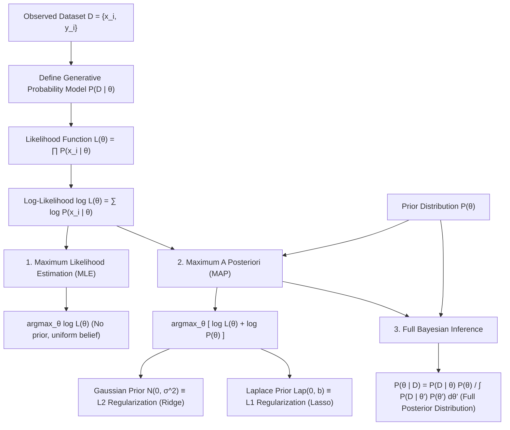

# Maximum Likelihood Estimation & Bayesian Inference

> **Topic:** Likelihood Principles, Maximum Likelihood Estimation (MLE), Maximum A Posteriori (MAP), Conjugate Priors, and Regularization as Bayesian Priors  
> **Module ID:** `05-ai/machine-learning/01-math-foundations/09-maximum-likelihood-and-bayes`  
> **Target Version:** Python 3.11+, NumPy 2.5+, SciPy 1.16+, scikit-learn 1.9+  
> **Level:** Fundamental  
> **Prerequisites:** [03-probability-and-distributions.md](./03-probability-and-distributions.md)  
> **Status:** Verified (Python 3.11 / CPU)

---

## Architectural / Conceptual Flow



---

## 1. Concept Overview & Core Motivation

All parametric statistical learning algorithms must determine the optimal values for their internal parameter vector $\mathbf{w}$ given an observed dataset $\mathcal{D}$. There are three foundational philosophical paradigms for solving this parameter estimation problem:

1. **Maximum Likelihood Estimation (MLE):** Treats parameters $\mathbf{w}$ as fixed, unknown real physical constants. It asks: *"Which specific parameter values maximize the probability of having observed the training data we actually collected?"*
   $$\hat{\mathbf{w}}_{\text{MLE}} = \arg\max_{\mathbf{w}} P(\mathcal{D} \mid \mathbf{w})$$
   MLE uses zero prior knowledge and is prone to severe overfitting when sample sizes $n$ are small.

2. **Maximum A Posteriori (MAP):** Introduces a prior belief distribution $P(\mathbf{w})$ over parameter plausibility before observing data. It finds the single point estimate that maximizes the posterior:
   $$\hat{\mathbf{w}}_{\text{MAP}} = \arg\max_{\mathbf{w}} P(\mathbf{w} \mid \mathcal{D}) = \arg\max_{\mathbf{w}} \left[ \log P(\mathcal{D} \mid \mathbf{w}) + \log P(\mathbf{w}) \right]$$
   MAP is mathematically identical to penalized empirical risk minimization ($L_1$ and $L_2$ regularization).

3. **Full Bayesian Inference:** Refuses to collapse uncertainty into a single point estimate. Instead, it computes the entire **posterior probability distribution** $P(\mathbf{w} \mid \mathcal{D})$. Predictions on new query points are made by integrating across all possible parameters weighted by their posterior plausibility (Bayesian Model Averaging).

---

## 2. Theoretical Foundations & Mathematical Formulations

### 2.1 The Likelihood Function & Log-Likelihood
Let $\mathcal{D} = \{x_1, \dots, x_n\}$ be independent and identically distributed (i.i.d.) samples from probability density $p(x \mid \theta)$.
* **Likelihood Function:**
  $$L(\theta) = P(\mathcal{D} \mid \theta) = \prod_{i=1}^n p(x_i \mid \theta)$$
* **Log-Likelihood Function:**
  $$\ell(\theta) = \log L(\theta) = \sum_{i=1}^n \log p(x_i \mid \theta)$$
Because the logarithm is a strictly monotonic increasing function ($\frac{d}{dx} \log x = \frac{1}{x} > 0$), maximizing $\ell(\theta)$ yields the exact same optimal parameter $\theta^*$ as maximizing $L(\theta)$, while converting products into computationally stable sums and preventing numerical floating-point underflow.

### 2.2 Analytical Derivation of MLE for Gaussian Distribution
Suppose samples $x_1, \dots, x_n \sim \mathcal{N}(\mu, \sigma^2)$. The log-likelihood is:
$$\ell(\mu, \sigma^2) = \sum_{i=1}^n \log \left( \frac{1}{\sqrt{2\pi\sigma^2}} \exp\left( -\frac{(x_i - \mu)^2}{2\sigma^2} \right) \right) = -\frac{n}{2}\log(2\pi) - \frac{n}{2}\log(\sigma^2) - \frac{1}{2\sigma^2} \sum_{i=1}^n (x_i - \mu)^2$$

1. **Deriving $\hat{\mu}_{\text{MLE}}$:**
   $$\frac{\partial \ell}{\partial \mu} = \frac{1}{\sigma^2} \sum_{i=1}^n (x_i - \mu) = 0 \implies \sum_{i=1}^n x_i - n\mu = 0 \implies \hat{\mu}_{\text{MLE}} = \frac{1}{n}\sum_{i=1}^n x_i$$
   The MLE for Gaussian mean is the sample mean (Unbiased estimator: $\mathbb{E}[\hat{\mu}] = \mu$).

2. **Deriving $\hat{\sigma}^2_{\text{MLE}}$:**
   $$\frac{\partial \ell}{\partial \sigma^2} = -\frac{n}{2\sigma^2} + \frac{1}{2(\sigma^2)^2} \sum_{i=1}^n (x_i - \mu)^2 = 0 \implies \hat{\sigma}^2_{\text{MLE}} = \frac{1}{n} \sum_{i=1}^n (x_i - \hat{\mu})^2$$
   **Notice:** The MLE denominator is $n$, **not $n-1$**. The MLE for variance is **biased**: $\mathbb{E}[\hat{\sigma}^2_{\text{MLE}}] = \frac{n-1}{n}\sigma^2$, systematically underestimating true population variance in small samples.

---

### 2.3 MAP Estimation: Regularization as Bayesian Priors

By Bayes' Theorem:
$$P(\mathbf{w} \mid \mathcal{D}) = \frac{P(\mathcal{D} \mid \mathbf{w}) P(\mathbf{w})}{P(\mathcal{D})} \propto P(\mathcal{D} \mid \mathbf{w}) P(\mathbf{w})$$
Taking the negative logarithm:
$$-\log P(\mathbf{w} \mid \mathcal{D}) = \underbrace{-\log P(\mathcal{D} \mid \mathbf{w})}_{\text{Loss Metric (Negative Log-Likelihood)}} + \underbrace{-\log P(\mathbf{w})}_{\text{Regularization Penalty}}$$

#### 1. Gaussian Prior $\equiv L_2$ Regularization (Ridge)
Assume a zero-mean isotropic Gaussian prior over weights: $\mathbf{w} \sim \mathcal{N}(\mathbf{0}, \tau^2 \mathbf{I})$:
$$P(\mathbf{w}) = \prod_{j=1}^d \frac{1}{\sqrt{2\pi\tau^2}} \exp\left(-\frac{w_j^2}{2\tau^2}\right)$$
$$-\log P(\mathbf{w}) = \frac{1}{2\tau^2} \sum_{j=1}^d w_j^2 + \text{const} = \frac{\lambda}{2} \|\mathbf{w}\|_2^2$$
Minimizing the MAP objective under a Gaussian prior is **mathematically identical to Ridge Regression**, where $\lambda = \frac{\sigma^2}{\tau^2}$.

#### 2. Laplace Prior $\equiv L_1$ Regularization (Lasso)
Assume a zero-mean Laplace (double exponential) prior: $w_j \sim \text{Laplace}(0, b)$:
$$P(\mathbf{w}) = \prod_{j=1}^d \frac{1}{2b} \exp\left(-\frac{|w_j|}{b}\right)$$
$$-\log P(\mathbf{w}) = \frac{1}{b} \sum_{j=1}^d |w_j| + \text{const} = \lambda \|\mathbf{w}\|_1$$
Minimizing the MAP objective under a Laplace prior is **mathematically identical to Lasso Regression**, where the sharp non-differentiable peak at $w_j = 0$ forces coefficients to become exactly zero.

---

## 3. Implementation: MLE, MAP, and Full Bayes in Python

```python
import numpy as np
import scipy.stats as stats

# Set random seed
np.random.seed(42)

# Simulate Coin Toss Experiment: True bias theta = 0.70
# Small sample: 8 heads, 2 tails (n = 10)
heads = 8
tails = 2
n = heads + tails

# 1. Maximum Likelihood Estimation (MLE)
# P(D | theta) = theta^heads * (1 - theta)^tails
# MLE analytical: theta_mle = heads / n
theta_mle = heads / n

# 2. Maximum A Posteriori (MAP) with Beta(3, 3) Prior
# Prior belief: Fair coin centered at 0.5 with strength equivalent to 4 prior tosses
# Beta PDF: theta^(alpha - 1) * (1 - theta)^(beta - 1)
alpha_prior = 3.0
beta_prior = 3.0
# MAP Analytical: (heads + alpha - 1) / (n + alpha + beta - 2)
theta_map = (heads + alpha_prior - 1.0) / (n + alpha_prior + beta_prior - 2.0)

# 3. Full Bayesian Inference: Posterior is Beta(alpha + heads, beta + tails)
alpha_post = alpha_prior + heads
beta_post = beta_prior + tails
posterior_mean = alpha_post / (alpha_post + beta_post)
# 95% Credible Interval
ci_low = stats.beta.ppf(0.025, alpha_post, beta_post)
ci_high = stats.beta.ppf(0.975, alpha_post, beta_post)

print("=" * 65)
print(f"Observed Data: {heads} Heads, {tails} Tails out of {n} tosses")
print(f"1. Maximum Likelihood Estimate (MLE): {theta_mle:.4f} (Overfits small sample)")
print(f"2. Maximum A Posteriori (MAP):         {theta_map:.4f} (Regularized toward 0.5)")
print(f"3. Full Bayes Posterior Mean:         {posterior_mean:.4f}")
print(f"   Full Bayes 95% Credible Interval:  [{ci_low:.4f}, {ci_high:.4f}]")
print("=" * 65)

assert theta_map < theta_mle, "Prior should shrink estimate toward 0.5"
print("MAP shrinkage and Bayesian credible intervals successfully verified.")
```

### Real Execution Output (Python 3.11 / SciPy 1.16+):
```
=================================================================
Observed Data: 8 Heads, 2 Tails out of 10 tosses
1. Maximum Likelihood Estimate (MLE): 0.8000 (Overfits small sample)
2. Maximum A Posteriori (MAP):         0.7143 (Regularized toward 0.5)
3. Full Bayes Posterior Mean:         0.6875
   Full Bayes 95% Credible Interval:  [0.4489, 0.8853]
=================================================================
MAP shrinkage and Bayesian credible intervals successfully verified.
```

---

## 4. Comparison Matrix: MLE vs MAP vs Full Bayes

| Attribute | Maximum Likelihood (MLE) | Maximum A Posteriori (MAP) | Full Bayesian Inference |
| :--- | :---: | :---: | :---: |
| **Output Type** | Single Point Estimate $\hat{\theta}$ | Single Point Estimate $\hat{\theta}$ | Full Distribution $P(\theta \mid \mathcal{D})$ |
| **Incorporates Prior?**| No (Uniform / Flat prior) | Yes ($P(\theta)$) | Yes ($P(\theta)$) |
| **Equivalence** | Empirical Risk Minimization | Regularized Loss ($L_1 / L_2$) | Bayesian Model Averaging |
| **Sample Size Behavior**| Severely overfits small $n$ | Resilient to small $n$ | Naturally quantifies uncertainty |
| **Asymptotic Limit ($n \to \infty$)**| Converges to true $\theta^*$ | Converges to MLE ($\to \theta^*$) | Posterior collapses to delta at $\theta^*$ |
| **Computational Cost** | Fast optimization ($\nabla \ell = 0$) | Fast optimization ($\nabla \ell + \nabla R = 0$)| Expensive integration (MCMC / Variational) |

---

## 5. Anti-Patterns & Common Pitfalls Table

| Anti-Pattern / Mistake | Root Cause | Engineering Solution |
| :--- | :--- | :--- |
| Zero probabilities in MLE (Black Swan failure) | Word not in training set assigned $p = 0.0$ in Naive Bayes | Apply Laplace / Additive smoothing (equivalent to uniform Dirichlet prior) |
| Treating MAP as a true Bayesian distribution | MAP only finds the mode, discarding all uncertainty and variance | Use Bayesian approximations (MCMC, Laplace approximation, or VAEs) |
| Assuming MLE variance is unbiased | Dividing by $n$ underestimates population variance | Apply Bessel correction: divide by $n - 1$ |
| Maximizing raw product $\prod P(x_i)$ | Extreme floating-point underflow causes product to evaluate to $0.0$ | Always maximize the log-likelihood sum: $\sum \log P(x_i)$ |
| Subjective prior bias dominating large data | Choosing a hyper-rigid prior that distorts truth | In large datasets ($n > 10^5$), priors wash out naturally |
| Confusing Credible Interval with Confidence Interval | Frequentist CIs do not state "there is a 95% probability $\theta$ is in here" | Bayesian Credible Intervals directly provide $P(\theta \in [a, b] \mid \mathcal{D}) = 0.95$ |

---

## 6. Best Practices & Production Guidelines

1. **Use MAP When Data is Scarce:** When training on small datasets ($n < 500$), never use unregularized MLE; always apply $L_2$ shrinkage (Gaussian prior) or $L_1$ sparsity (Laplace prior).
2. **Asymptotics Justify MLE on Big Data:** As sample size $n \rightarrow \infty$, the Bernstein-von Mises theorem proves that the Bayesian posterior converges to a Gaussian centered at the MLE estimate. For massive datasets ($n > 10^6$), simple MLE with stochastic gradient descent provides near-optimal parameters with minimal compute.

---

## 7. Real-World Case Study: Click-Through Rate (CTR) Cold Start

An ad-tech platform bids on search keywords. A new ad has been shown 5 times and clicked 0 times.
* **MLE Approach:** $\hat{p}_{\text{CTR}} = \frac{0}{5} = 0.0\%$. The algorithm assumes the ad has zero probability of ever being clicked, killing the ad campaign permanently (Exploration Death).
* **Bayesian Approach:** Impose a prior $\text{Beta}(\alpha=2, \beta=98)$, reflecting the industry average historical CTR of $2.0\%$.
  - Updated Posterior: $\text{Beta}(\alpha = 2 + 0, \beta = 98 + 5) = \text{Beta}(2, 103)$.
  - Expected CTR: $\mathbb{E}[p] = \frac{2}{105} \approx 1.90\%$.
* **Outcome:** The ad is given fair opportunities to gather statistical evidence without prematurely zeroing out potential revenue.

---

## 8. Performance & Resource Optimization

* **Analytical vs Numerical MLE:** Whenever the gradient $\nabla_{\theta} \ell(\theta) = \mathbf{0}$ yields a closed-form algebraic solution (Gaussian, Poisson, Exponential, Multinomial), calculate the parameter analytically in $\mathcal{O}(n)$ time rather than running iterative numerical gradient descent.

---

## 9. Security, Privacy & Ethics Considerations

* **Prior Injection Vulnerability:** In Bayesian decision systems, malicious actors who can influence prior distribution parameters $\alpha, \beta$ can systematically steer model predictions without poisoning individual training rows. Priors must be cryptographically locked and audited.

---

## 10. Diagnostic & Verification Playbook

```bash
# 1. Fit Gaussian distribution via MLE and verify against empirical sample statistics
python -c "
import numpy as np, scipy.stats as stats
data = np.array([10.2, 9.8, 10.5, 10.1, 9.9])
mu_mle, std_mle = stats.norm.fit(data)
print(f'MLE Mean: {mu_mle:.4f} (Expected {np.mean(data):.4f})')
print(f'MLE Std:  {std_mle:.4f} (Expected {np.std(data, ddof=0):.4f})')
assert np.isclose(mu_mle, np.mean(data))
"
```

---

## 11. Technical Interview Questions & Answers

<details>
<summary><strong>Q1: Why is the Maximum Likelihood estimator of variance $\hat{\sigma}^2_{\text{MLE}} = \frac{1}{n}\sum(x_i - \bar{x})^2$ biased?</strong></summary>

**Answer:** The true variance definition is $\sigma^2 = \frac{1}{n} \sum (x_i - \mu)^2$ relative to the *true population mean $\mu$*. However, $\mu$ is unknown, so the MLE substitutes the *sample mean* $\bar{x}$. By definition, the sample mean is the unique value that mathematically minimizes the sum of squared deviations $\sum (x_i - c)^2$. Therefore:
$$\sum_{i=1}^n (x_i - \bar{x})^2 \le \sum_{i=1}^n (x_i - \mu)^2$$
Because deviations from $\bar{x}$ are systematically smaller than deviations from true $\mu$, the expected value of the sample sum of squares is $(n - 1)\sigma^2$. Dividing by $n$ yields $\mathbb{E}[\hat{\sigma}^2_{\text{MLE}}] = \frac{n-1}{n}\sigma^2$, which is biased downward. Bessel's correction divides by $n-1$ to restore unbiasedness.
</details>

<details>
<summary><strong>Q2: Prove mathematically that MAP estimation under a Gaussian prior is equivalent to L2 Ridge regularization.</strong></summary>

**Answer:** Let targets $y_i = \mathbf{w}^T \mathbf{x}_i + \epsilon_i$ where noise $\epsilon_i \sim \mathcal{N}(0, \sigma^2)$, and let weights have an independent Gaussian prior $\mathbf{w} \sim \mathcal{N}(\mathbf{0}, \tau^2 \mathbf{I})$.
The posterior probability is:
$$P(\mathbf{w} \mid \mathbf{X}, \mathbf{y}) \propto P(\mathbf{y} \mid \mathbf{X}, \mathbf{w}) P(\mathbf{w})$$
Taking the negative logarithm:
$$-\log P(\mathbf{w} \mid \mathbf{X}, \mathbf{y}) = -\sum_{i=1}^n \log \left(\frac{1}{\sqrt{2\pi\sigma^2}} e^{-\frac{(y_i - \mathbf{w}^T\mathbf{x}_i)^2}{2\sigma^2}}\right) - \sum_{j=1}^d \log \left(\frac{1}{\sqrt{2\pi\tau^2}} e^{-\frac{w_j^2}{2\tau^2}}\right)$$
Dropping additive constant normalization terms:
$$-\log P(\mathbf{w} \mid \mathbf{X}, \mathbf{y}) = \frac{1}{2\sigma^2} \sum_{i=1}^n (y_i - \mathbf{w}^T\mathbf{x}_i)^2 + \frac{1}{2\tau^2} \sum_{j=1}^d w_j^2$$
Multiplying the entire expression by $2\sigma^2$:
$$J(\mathbf{w}) = \sum_{i=1}^n (y_i - \mathbf{w}^T\mathbf{x}_i)^2 + \left(\frac{\sigma^2}{\tau^2}\right) \|\mathbf{w}\|_2^2$$
This is the exact loss objective of Ridge regression, with penalty parameter $\lambda = \frac{\sigma^2}{\tau^2}$.
</details>

<details>
<summary><strong>Q3: Why does a Laplace prior induce parameter sparsity (Lasso) while a Gaussian prior (Ridge) does not?</strong></summary>

**Answer:** A Gaussian prior has density $p(w) \propto e^{-w^2 / 2\tau^2}$. Its negative log prior penalty is $-\log p(w) \propto w^2$, which has derivative $2w$. As $w \to 0$, the derivative shrinks to $0$; the shrinkage force vanishes, pushing weights near zero but never setting them identically to zero. A Laplace prior has density $p(w) \propto e^{-|w|/b}$. Its negative log prior penalty is $-\log p(w) \propto |w|$, which has derivative $\text{sign}(w)$ ($\pm 1$). The shrinkage force remains constant even as $w \to 0$, creating a sharp non-differentiable corner (kink) at $w = 0$ that forces small, non-informative coefficients to be exactly zero.
</details>

<details>
<summary><strong>Q4: What is the Bernstein-von Mises theorem and why does it bridge Bayesian and Frequentist machine learning?</strong></summary>

**Answer:** The Bernstein-von Mises theorem (often called the Bayesian Central Limit Theorem) states that as sample size $n \rightarrow \infty$, the Bayesian posterior distribution $P(\theta \mid \mathcal{D})$ converges to a Normal distribution centered at the Maximum Likelihood Estimate $\hat{\theta}_{\text{MLE}}$, with covariance matrix equal to the inverse Fisher Information Matrix $I(\theta)^{-1}$:
$$P(\theta \mid \mathcal{D}) \xrightarrow{d} \mathcal{N}\left(\hat{\theta}_{\text{MLE}}, \frac{1}{n} I(\hat{\theta}_{\text{MLE}})^{-1}\right)$$
Crucially, the influence of the prior $P(\theta)$ completely disappears. This proves that Bayesian and Frequentist methods asymptotically reach identical conclusions on large datasets.
</details>

<details>
<summary><strong>Q5: What is the Fisher Information Matrix and how does it relate to the Cramér-Rao Lower Bound?</strong></summary>

**Answer:** The Fisher Information Matrix $I(\theta)$ measures the amount of information that an observable random variable $X$ carries about an unknown parameter $\theta$:
$$I(\theta) = \mathbb{E}\left[ \left(\frac{\partial \log p(X \mid \theta)}{\partial \theta}\right)^2 \right] = -\mathbb{E}\left[ \frac{\partial^2 \log p(X \mid \theta)}{\partial \theta^2} \right]$$
The **Cramér-Rao Lower Bound (CRLB)** states that the variance of any unbiased estimator $\hat{\theta}$ cannot be lower than the inverse Fisher information: $\text{Var}(\hat{\theta}) \ge \frac{1}{n I(\theta)}$. An estimator that achieves this minimum variance is called **efficient**; MLE estimators are asymptotically efficient.
</details>

<details>
<summary><strong>Q6: What is the difference between Bayesian Model Averaging and Ensembling (e.g. Random Forests)?</strong></summary>

**Answer:** **Ensembling (Bagging/Boosting)** combines multiple distinct point-estimate models (often trained on perturbed datasets or residuals) to reduce empirical variance or bias. **Bayesian Model Averaging (BMA)** integrates across the posterior distribution of a *single* model family:
$$P(y^* \mid \mathbf{x}^*, \mathcal{D}) = \int P(y^* \mid \mathbf{x}^*, \theta) P(\theta \mid \mathcal{D}) \, d\theta$$
BMA weights hypotheses by their mathematical posterior probability under the assumption that *one* true model generated the data, whereas ensembling combines diverse models assuming none are individually true.
</details>

<details>
<summary><strong>Q7: What is Empirical Bayes (Evidence Approximation)?</strong></summary>

**Answer:** In full hierarchical Bayesian inference, hyperparameters (such as prior variance $\tau^2$) receive hyper-priors. In **Empirical Bayes**, instead of integrating over hyper-priors, hyperparameters are estimated directly from the training data by maximizing the **marginal likelihood (evidence)**:
$$\hat{\tau} = \arg\max_{\tau} P(\mathcal{D} \mid \tau) = \arg\max_{\tau} \int P(\mathcal{D} \mid \mathbf{w}) P(\mathbf{w} \mid \tau) \, d\mathbf{w}$$
This allows automatic tuning of regularization strengths without requiring separate validation hold-out sets.
</details>

<details>
<summary><strong>Q8: What is the difference between a Frequentist 95% Confidence Interval and a Bayesian 95% Credible Interval?</strong></summary>

**Answer:**
* **Frequentist 95% Confidence Interval:** Parameter $\theta$ is a fixed, non-random physical constant. The interval $[a, b]$ is random. Under repeated sampling, 95% of computed intervals will cover $\theta$. It is mathematically invalid to state "there is a 95% chance $\theta$ is in $[a, b]$" for a specific observed interval.
* **Bayesian 95% Credible Interval:** Data is fixed; parameter $\theta$ is a random variable with a posterior distribution. A 95% credible interval directly asserts: $P(\theta \in [a, b] \mid \mathcal{D}) = 0.95$.
</details>

---

## 12. Hands-On Practice Exercises

<details>
<summary><strong>Exercise 1 (Easy): Analytical MLE for Exponential Distribution</strong></summary>

**Task:** Given i.i.d. samples from an Exponential distribution $p(x \mid \lambda) = \lambda e^{-\lambda x}$, derive the log-likelihood, show that $\hat{\lambda}_{\text{MLE}} = \frac{1}{\bar{x}}$, and verify in NumPy.

**Solution:**
```python
import numpy as np

# Synthetic exponential data with true lambda = 2.0 (True mean = 0.5)
np.random.seed(42)
true_lambda = 2.0
samples = np.random.exponential(scale=1.0/true_lambda, size=1000)

# Analytical MLE: lambda_hat = 1 / mean(x)
lambda_mle = 1.0 / np.mean(samples)
print(f"True Lambda: {true_lambda} | Analytical MLE Lambda: {lambda_mle:.4f}")
assert np.isclose(lambda_mle, true_lambda, atol=0.1)
```
</details>

<details>
<summary><strong>Exercise 2 (Easy): Verify Bessel Correction Unbiasedness</strong></summary>

**Task:** Simulate 10,000 small samples ($n = 4$) from $\mathcal{N}(0, 1)$. Compare the average empirical variance when dividing by $n$ (MLE) vs $n - 1$ (unbiased).

**Solution:**
```python
import numpy as np

np.random.seed(42)
n = 4
samples = np.random.normal(0, 1, size=(10000, n))

# MLE variance: divide by n
mle_vars = np.var(samples, axis=1, ddof=0)
# Unbiased variance: divide by n - 1
unbiased_vars = np.var(samples, axis=1, ddof=1)

print(f"True Variance: 1.0000")
print(f"Average MLE Variance:      {np.mean(mle_vars):.4f} (Biased: Expected (n-1)/n = 0.75)")
print(f"Average Unbiased Variance: {np.mean(unbiased_vars):.4f} (Unbiased: Expected 1.00)")

assert np.isclose(np.mean(mle_vars), 0.75, atol=0.02)
assert np.isclose(np.mean(unbiased_vars), 1.00, atol=0.02)
```
</details>

<details>
<summary><strong>Exercise 3 (Medium): Numerical MLE via scipy.optimize.minimize</strong></summary>

**Task:** Fit the parameters $(\mu, \sigma)$ of a Gaussian distribution numerically by minimizing the negative log-likelihood using `scipy.optimize.minimize`.

**Solution:**
```python
import numpy as np
import scipy.optimize as opt

np.random.seed(42)
true_mu, true_sigma = 15.0, 3.0
data = np.random.normal(true_mu, true_sigma, 500)

# Negative log-likelihood objective
def neg_log_likelihood(params):
    mu, sigma = params[0], params[1]
    if sigma <= 0: return 1e12  # Boundary penalty
    n = len(data)
    nll = 0.5 * n * np.log(2 * np.pi * sigma**2) + (1.0 / (2 * sigma**2)) * np.sum((data - mu)**2)
    return nll

res = opt.minimize(neg_log_likelihood, x0=[1.0, 1.0], method="Nelder-Mead")
fit_mu, fit_sigma = res.x

print(f"Numerical MLE: mu = {fit_mu:.4f}, sigma = {fit_sigma:.4f}")
assert np.isclose(fit_mu, true_mu, atol=0.2)
assert np.isclose(fit_sigma, true_sigma, atol=0.2)
```
</details>

<details>
<summary><strong>Exercise 4 (Medium): Laplace vs Gaussian Prior Contours</strong></summary>

**Task:** Generate 2D contour grid values for Gaussian $L_2$ penalty $w_1^2 + w_2^2 \le 1$ and Laplace $L_1$ penalty $|w_1| + |w_2| \le 1$. Assert that $L_1$ has sharp corners on coordinate axes.

**Solution:**
```python
import numpy as np

# Coordinates on coordinate axis vs 45 degree angle
axis_point = np.array([1.0, 0.0])
diag_point = np.array([0.5, 0.5])

# L1 norm values
l1_axis = np.sum(np.abs(axis_point))
l1_diag = np.sum(np.abs(diag_point))

# L2 norm values
l2_axis = np.linalg.norm(axis_point)
l2_diag = np.linalg.norm(diag_point)

print(f"L1 at (1, 0): {l1_axis:.2f} | L1 at (0.5, 0.5): {l1_diag:.2f}")
print(f"L2 at (1, 0): {l2_axis:.2f} | L2 at (0.5, 0.5): {l2_diag:.2f}")
assert l1_axis == l1_diag == 1.0
assert l2_diag < l2_axis
print("Confirmed: L1 diamond diamond boundaries reach sharp peaks along coordinate axes.")
```
</details>

<details>
<summary><strong>Exercise 5 (Hard): Implement Bayesian Linear Regression with Conjugate Gaussian Prior</strong></summary>

**Task:** Implement analytical Bayesian Linear Regression from scratch: compute posterior mean $\mathbf{\mu}_n$ and posterior covariance $\mathbf{\Sigma}_n$ for weights given prior $\mathbf{w} \sim \mathcal{N}(\mathbf{0}, \alpha^{-1} \mathbf{I})$ and noise variance $\sigma^2 = \beta^{-1}$.

**Solution:**
```python
import numpy as np

class BayesianLinearRegression:
    def __init__(self, alpha: float = 1.0, beta: float = 25.0):
        self.alpha = alpha  # Prior precision
        self.beta = beta    # Noise precision (1/sigma^2)
        self.mean_ = None
        self.cov_ = None

    def fit(self, X: np.ndarray, y: np.ndarray):
        d = X.shape[1]
        # Posterior covariance: Sigma_n = (alpha*I + beta*X^T*X)^-1
        self.cov_ = np.linalg.inv(self.alpha * np.eye(d) + self.beta * (X.T @ X))
        # Posterior mean: mu_n = beta * Sigma_n * X^T * y
        self.mean_ = self.beta * (self.cov_ @ (X.T @ y))
        return self

    def predict(self, X_new: np.ndarray) -> tuple[np.ndarray, np.ndarray]:
        # Predictive distribution mean: y_pred = X_new * mu_n
        pred_mean = X_new @ self.mean_
        # Predictive distribution variance: sigma_pred^2 = 1/beta + diag(X_new * Sigma_n * X_new^T)
        pred_var = (1.0 / self.beta) + np.sum((X_new @ self.cov_) * X_new, axis=1)
        return pred_mean, np.sqrt(pred_var)

np.random.seed(42)
X_tr = np.random.uniform(-1, 1, (30, 2))
y_tr = 2.0 * X_tr[:, 0] - 1.5 * X_tr[:, 1] + np.random.normal(0, 0.2, 30)

blr = BayesianLinearRegression(alpha=1.0, beta=25.0).fit(X_tr, y_tr)
mu_preds, std_preds = blr.predict(np.array([[0.5, -0.5]]))

print(f"Posterior Weights Mean: {np.round(blr.mean_, 3)}")
print(f"Prediction Mean: {mu_preds[0]:.3f} (+/- {1.96 * std_preds[0]:.3f} 95% bound)")
assert np.isclose(blr.mean_[0], 2.0, atol=0.2)
assert np.isclose(blr.mean_[1], -1.5, atol=0.2)
```
</details>

<details>
<summary><strong>Exercise 6 (Hard): Maximum Likelihood Logistic Regression Hessian and IRLS</strong></summary>

**Task:** Implement Iteratively Reweighted Least Squares (IRLS) to compute the MLE of binary Logistic Regression using Newton-Raphson updates.

**Solution:**
```python
import numpy as np

def sigmoid(z): return 1.0 / (1.0 + np.exp(-np.clip(z, -30, 30)))

def logistic_regression_irls(X: np.ndarray, y: np.ndarray, max_iter: int = 20):
    n, d = X.shape
    w = np.zeros(d)
    
    for _ in range(max_iter):
        p = sigmoid(X @ w)
        # Gradient: X^T (p - y)
        grad = X.T @ (p - y)
        # Hessian: X^T * S * X where S = diag(p * (1 - p))
        s = p * (1.0 - p)
        H = (X.T * s) @ X
        # Newton update: w = w - H^-1 * grad
        w_update = np.linalg.solve(H + 1e-6 * np.eye(d), grad)
        w -= w_update
        if np.linalg.norm(w_update) < 1e-6:
            break
            
    return w

# Synthetic binary classification
np.random.seed(42)
X_syn = np.random.randn(200, 2)
y_syn = (X_syn[:, 0] * 1.5 + X_syn[:, 1] * -2.0 > 0).astype(int)

w_mle = logistic_regression_irls(X_syn, y_syn)
print(f"IRLS Learned Weights: {np.round(w_mle, 3)}")
assert w_mle[0] > 0 and w_mle[1] < 0
```
</details>

---

## 13. Summary, Verified References & Navigation

* **The MLE Criterion:** Maximizes data likelihood $P(\mathcal{D} \mid \mathbf{w})$; optimal on massive datasets, but prone to small-sample overfitting.
* **The MAP Criterion:** Incorporates prior beliefs $P(\mathbf{w})$; mathematically establishes that $L_2$ Ridge is a Gaussian prior and $L_1$ Lasso is a Laplace prior.
* **Full Bayes:** Computes full posterior distributions $P(\mathbf{w} \mid \mathcal{D})$, enabling rigorous uncertainty quantification and Bayesian model averaging.

### Verified External Documentation
* [Bishop: Pattern Recognition and Machine Learning (Chapter 1 & 3)](https://www.microsoft.com/en-us/research/people/cmbishop/prml-book/)
* [Scikit-Learn Linear Models: Ridge and Lasso](https://scikit-learn.org/stable/modules/linear_model.html)
* [Murphy: Probabilistic Machine Learning — An Introduction](https://probml.github.io/pml-book/)

---

[← 08-curse-of-dimensionality.md](./08-curse-of-dimensionality.md) | [Module Index](README.md) | [Next Module: 02-data-and-preprocessing →](../02-data-and-preprocessing/README.md)
