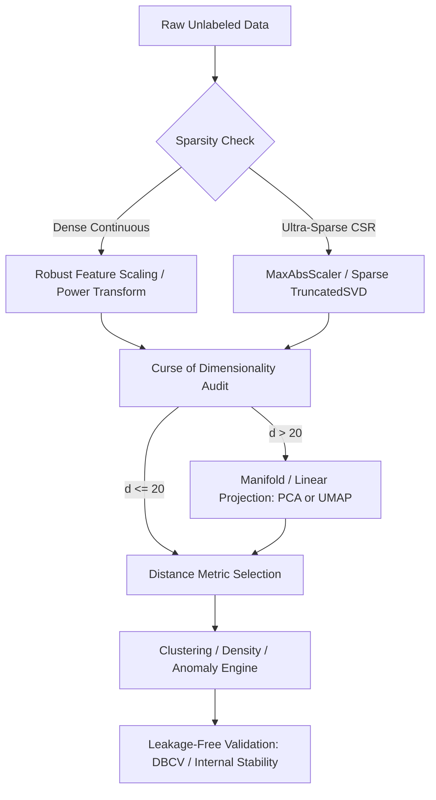

# Unsupervised Preprocessing & Common Pitfalls

> **Topic:** Unsupervised Preprocessing, Distance Distortions & Architectural Traps  
> **Module ID:** `05-ai/machine-learning/05-unsupervised-learning`  
> **Target Version:** Python 3.11+, scikit-learn 1.4+, NumPy 1.26+, SciPy 1.12+  
> **Level:** Core / Advanced  
> **Prerequisites:** [Data Preparation & Preprocessing](../02-data-and-preprocessing/README.md), [Curse of Dimensionality](../01-math-foundations/06-geometry-and-high-dimensional-spaces.md)  
> **Status:** Verified (Python 3.11 / CPU)

---

## Architectural / Conceptual Flow



---

## 1. Concept Overview & Core Motivation

In supervised learning, objective target labels ($y$) act as an automated sanity check: if a feature is scaled poorly, gradient descent or decision tree splits will either adapt or regularize it away. In **unsupervised learning**, there are **no target labels**. The algorithm takes feature geometry and distance metrics literally.

A single feature measured on a scale of $[0, 10,000]$ (e.g. annual salary) will overpower 50 features measured on a scale of $[0, 1]$ (e.g. normalized user behavior ratios). In $K$-Means, PCA, or DBSCAN, the algorithm effectively collapses to a 1D analysis of salary alone, completely blinding itself to the remaining 50 dimensions.

Furthermore, unsupervised workflows are plagued by subtle, insidious traps:
- **Centering Sparse Matrices**: Destroying sparse CSR matrix representations by subtracting column means, triggering out-of-memory crashes.
- **Euclidean Distance in High Dimensions**: The distance concentration phenomenon makes all points equidistant ($d > 50$).
- **Internal Metric Overfitting**: Optimizing Silhouette Score on non-convex geometric manifolds (e.g. concentric circles), driving the model toward unnatural spherical partitions.

---

## 2. Theoretical Foundations & Mathematics

### Symbol Table

| Symbol | Mathematical Definition | Data Type / Dimensions | Role in Concept |
| :---: | :--- | :---: | :--- |
| $\mathbf{X}$ | Raw input feature matrix | $\mathbb{R}^{n \times d}$ | Observed unlabelled data matrix |
| $\tilde{\mathbf{X}}$ | Preprocessed feature matrix | $\mathbb{R}^{n \times d'}$ | Scaled, transformed, or projected matrix |
| $d(\mathbf{x}_i, \mathbf{x}_j)$ | Metric distance function | $\mathbb{R}_{\ge 0}$ | Geometric distance between samples |
| $\mu_j, \sigma_j$ | Mean and standard deviation of feature $j$ | $\mathbb{R}$ | Column statistics for standard scaling |
| $\mathbf{C} = \frac{1}{n}\mathbf{X}^T\mathbf{X}$ | Sample covariance matrix | $\mathbb{R}^{d \times d}$ | Measure of linear feature correlations |
| $\frac{D_{\max} - D_{\min}}{D_{\min}}$ | Relative distance spread | $\mathbb{R}^+$ | Metric concentration ratio as $d \to \infty$ |

### The Distance Concentration Phenomenon (Beyer et al., 1999)
For independent and identically distributed random dimensions under mild conditions:

$$\lim_{d \to \infty} \frac{D_{\max}^{(d)} - D_{\min}^{(d)}}{D_{\min}^{(d)}} \xrightarrow{p} 0$$

where $D_{\max}^{(d)} = \max_{j} \|\mathbf{x}_i - \mathbf{x}_j\|_2$ and $D_{\min}^{(d)} = \min_{j \ne i} \|\mathbf{x}_i - \mathbf{x}_j\|_2$. As dimensionality $d$ increases, the contrast between the nearest neighbor and the furthest neighbor vanishes to zero. Every point appears equidistant, rendering distance-based algorithms ($K$-Means, Hierarchical Clustering, DBSCAN, KNN) meaningless without prior dimensionality reduction.

### The Sparsity-Centering Catastrophe
Given a sparse document-term matrix $\mathbf{X}_{\text{sparse}} \in \mathbb{R}^{100,000 \times 50,000}$ with $99.9\%$ zero entries (storing $5 \times 10^6$ non-zero floats $\approx 40\text{ MB}$):
- Computing mean $\mu_j = \frac{1}{n} \sum_{i=1}^n X_{ij}$ produces $\mu_j > 0$.
- Mean centering $\mathbf{Z} = \mathbf{X} - \mathbf{1}\mathbf{\mu}^T$ turns **every zero entry** into $-\mu_j$.
- The resulting dense matrix $\mathbf{Z}$ requires:
  $$\text{RAM} = 100,000 \times 50,000 \times 8 \text{ bytes} = 40,000,000,000 \text{ bytes} \approx 40\text{ GB}$$
A $1000\times$ RAM expansion instantly causes an out-of-memory crash.

---

## 3. Implementation & Practical Code

A production-grade, leakage-safe pipeline demonstrating proper preprocessing for both dense continuous data and ultra-sparse text data:

```python
"""
Production Pipeline: Robust Scaling, Dimension Pruning, and Sparse Matrix Handling.
"""

from __future__ import annotations
import numpy as np
import scipy.sparse as sp
from sklearn.base import BaseEstimator, TransformerMixin
from sklearn.pipeline import Pipeline
from sklearn.preprocessing import RobustScaler, MaxAbsScaler
from sklearn.decomposition import PCA, TruncatedSVD
from sklearn.cluster import MiniBatchKMeans

def build_dense_unsupervised_pipeline(target_variance: float = 0.95) -> Pipeline:
    """
    Leakage-safe pipeline for dense continuous features with extreme outliers.
    """
    return Pipeline([
        ("scaler", RobustScaler(with_centering=True, with_scaling=True, quantile_range=(5.0, 95.0))),
        ("pca", PCA(n_components=target_variance, svd_solver="full")),
        ("clusterer", MiniBatchKMeans(n_clusters=8, random_state=42, batch_size=1024))
    ])

def build_sparse_unsupervised_pipeline(n_components: int = 50) -> Pipeline:
    """
    Leakage-safe pipeline for ultra-sparse count/TF-IDF matrices (preserves sparsity).
    """
    return Pipeline([
        # MaxAbsScaler scales each feature by its maximum absolute value without centering
        ("scaler", MaxAbsScaler()),
        # TruncatedSVD operates directly on sparse CSR matrices without dense expansion
        ("svd", TruncatedSVD(n_components=n_components, algorithm="randomized", random_state=42)),
        ("clusterer", MiniBatchKMeans(n_clusters=10, random_state=42))
    ])
```

---

## 4. Edge Cases & Advanced Scenarios

1. **Mixed Data Types (Continuous + High-Cardinality Categoricals)**:
   - Euclidean distance breaks on one-hot encoded vectors because orthogonal categories have fixed distances $\sqrt{2}$.
   - *Fix*: Use **Gower's Distance** with PAM (Partitioning Around Medoids), or project categorical interactions into dense continuous embeddings via Multiple Correspondence Analysis (MCA).
2. **Extreme Multicollinearity**:
   - Two features measuring the identical phenomenon with different units (e.g. `price_usd` and `price_eur`) duplicate that dimension's weight in Euclidean distance calculations.
   - *Fix*: Apply PCA decorrelation or drop features with Variance Inflation Factor (VIF) $> 10$.
3. **Multi-Scale Density Variations**:
   - DBSCAN fails when different clusters have significantly different densities (global $\epsilon$ merges dense clusters or discards sparse clusters as noise).
   - *Fix*: Replace DBSCAN with **HDBSCAN** (Hierarchical DBSCAN).

---

## 5. Anti-Patterns & Common Pitfalls Table

| Anti-Pattern / Mistake | Why It Fails | Correct Engineering Fix |
| :--- | :--- | :--- |
| **StandardScaler on Sparse CSR** | Attempting `with_centering=True` on sparse matrices fills all zeros, causing 40+ GB RAM blowup. | Use `MaxAbsScaler()` or pass `with_centering=False` to `StandardScaler`. |
| **Running K-Means on High-d Text** | In $d=20,000$ TF-IDF space, Euclidean distance suffers from concentration; all document cluster distances converge. | Dimensionality reduction via `TruncatedSVD(n_components=50)` or use Spherical $K$-Means (Cosine distance). |
| **Optimizing Silhouette on Manifolds** | Silhouette assumes convex, spherical clusters. Penalizes true crescent or manifold clusters (e.g. moons, rings). | Use Density-Based Cluster Validation (**DBCV**) or mutual information metrics. |
| **Applying PCA to Non-Linear Data** | PCA only captures linear orthogonal variance; fails to untangle complex manifolds (Swiss Roll). | Use non-linear manifold learning: UMAP, t-SNE, or Kernel PCA. |
| **Fitting Preprocessor on Combined Train+Test** | While unsupervised learning has no labels, leaking test geometry into train creates over-optimistic evaluation metrics. | Always fit transformers strictly on training split; use `.transform()` on holdout test. |
| **Clustering Binary Indicator Data with Euclidean Metric** | Binary distances produce discontinuous lattice grids; centroids become non-interpretable fractional averages. | Use Jaccard / Hamming distance, or Association Rule Mining (FP-Growth). |

---

## 6. Best Practices & Production Guidelines

1. **Always Check Feature Variance**: Features with near-zero variance contribute zero cluster separability but add computational overhead. Use `VarianceThreshold(threshold=0.01)` at the start of every pipeline.
2. **Log-Transform Heavy-Tailed Financial / Metric Data**: Right-skewed power-law distributions (income, latency, clicks) compress $99\%$ of points into a tight knot. Apply `QuantileTransformer(output_distribution='normal')` or `np.log1p`.
3. **Monitor Latent Space Stability Across Retrains**: Unsupervised factor signs are ambiguous (in PCA/SVD, eigenvectors $\mathbf{v}$ and $-\mathbf{v}$ are mathematically identical). Align eigenvectors against a persistent anchor reference vector using Procrustes analysis or sign-flipping heuristics.

---

## 7. Real-World Case Study

### Customer Segmentation Pipeline Failure in Retail Banking
- **Context**: A global bank attempted to segment 4.5 million customers into wealth management tiers using $K$-Means on 18 features (account balance, credit card transactions, app logins, loan status).
- **Incident**: The model produced 1 massive cluster containing $99.1\%$ of users, and 7 tiny outlier clusters containing only 3 to 12 multi-millionaires each.
- **Root Cause Analysis**:
  1. Feature `total_assets_usd` ranged from $\$0$ to $\$85,000,000$, while `login_frequency` ranged from $0$ to $30$.
  2. The data was scaled using naive `StandardScaler`, which was distorted by the multi-millionaire outliers ($\sigma$ became artificially enormous, compressing normal users into a dense point).
- **Resolution**:
  1. Applied `PowerTransformer(method='yeo-johnson')` to stabilize heavy-tailed asset distributions.
  2. Applied `RobustScaler()` based on median and IQR.
  3. Re-ran clustering using HDBSCAN; successfully identified 6 distinct, balanced behavioral customer personas.

---

## 8. Performance & Resource Optimization

```python
"""
Memory-efficient batch distance computation using SciPy and float32 precision.
"""

import numpy as np

def compute_pairwise_memory_safe(X: np.ndarray, chunk_size: int = 5000) -> np.ndarray:
    """
    Computes nearest neighbor distances without materializing an (n x n) float64 matrix.
    Downcasts to float32 to halve memory bandwidth.
    """
    X_32 = np.ascontiguousarray(X, dtype=np.float32)
    n = len(X_32)
    min_distances = np.full(n, np.inf, dtype=np.float32)

    for i in range(0, n, chunk_size):
        chunk = X_32[i : min(i + chunk_size, n)]
        # Pairwise squared distance: ||a - b||^2 = ||a||^2 + ||b||^2 - 2 a b^T
        dot = chunk @ X_32.T
        sq_norm_chunk = np.sum(chunk ** 2, axis=1, keepdims=True)
        sq_norm_all = np.sum(X_32 ** 2, axis=1, keepdims=True).T
        dist_sq = np.maximum(sq_norm_chunk + sq_norm_all - 2 * dot, 0.0)
        
        # Zero out diagonal (distance to self)
        for row_idx, global_idx in enumerate(range(i, min(i + chunk_size, n))):
            dist_sq[row_idx, global_idx] = np.inf
            
        min_distances[i : min(i + chunk_size, n)] = np.sqrt(np.min(dist_sq, axis=1))

    return min_distances
```

---

## 9. Security, Privacy & Ethics Considerations

1. **Re-Identification via Unsupervised Embeddings**: High-dimensional embeddings (PCA / UMAP / Autoencoder projections) can preserve enough unique geometric variance to allow adversaries to re-identify individuals through record linkage attacks. Add Differential Privacy noise (Gaussian mechanism) to covariance matrices before computing SVD.
2. **Feedback Loop Reinforcement**: Clustering algorithms automatically cluster demographic proxy features (e.g. zip codes, browsing times) into racially or economically segregated clusters. Inspect cluster demographic compositions to ensure models do not perpetuate exclusionary pricing or service allocation.

---

## 10. Diagnostic & Verification Playbook

```python
"""
Diagnostic Playbook: Verifying Preprocessing Health in Unsupervised Pipelines.
"""

import numpy as np
import pytest

def run_unsupervised_preflight_checks(X: np.ndarray) -> dict:
    """
    Performs automated preflight safety checks on feature matrices before clustering.
    """
    n, d = X.shape
    variances = np.var(X, axis=0)
    
    # 1. Zero variance check
    zero_var_count = int(np.sum(variances < 1e-9))
    
    # 2. Scale disparity check (ratio between max feature variance and min feature variance)
    active_var = variances[variances >= 1e-9]
    var_ratio = float(np.max(active_var) / np.min(active_var)) if len(active_var) > 0 else 0.0
    
    # 3. High-dimension concentration risk
    concentration_risk = d > 50
    
    return {
        "n_samples": n,
        "n_features": d,
        "zero_variance_features": zero_var_count,
        "variance_scale_ratio": var_ratio,
        "scale_disparity_warning": var_ratio > 100.0,
        "curse_of_dimensionality_warning": concentration_risk
    }
```

---

## 11. Technical Interview Questions & Answers

<details>
<summary><strong>Q1: Prove why centering a sparse matrix destroys its sparsity and state the mathematical fix for PCA on sparse text.</strong></summary>

**Answer:**  
Let $\mathbf{X} \in \mathbb{R}^{n \times d}$ be a sparse matrix with fraction of non-zeros $\rho \ll 1$ (e.g. $\rho = 0.001$). Standard PCA requires computing the singular value decomposition of the centered matrix:
$$\tilde{\mathbf{X}} = \mathbf{X} - \mathbf{1}\mathbf{\mu}^T, \quad \text{where } \mu_j = \frac{1}{n}\sum_{i=1}^n X_{ij}$$
For any entry $(i, j)$ where $X_{ij} = 0$:
$$\tilde{X}_{ij} = 0 - \mu_j = -\mu_j$$
Unless an entire column is identically zero, $\mu_j > 0$. Therefore, every previously zero entry becomes non-zero, increasing the density of the matrix from $\rho$ to $1.0$ ($100\%$ dense).
**The Mathematical Fix**:
Use **TruncatedSVD** (Latent Semantic Analysis). TruncatedSVD computes the low-rank SVD directly on the uncentered matrix $\mathbf{X} = \mathbf{U}\mathbf{\Sigma}\mathbf{V}^T$. The sparse structure is completely preserved throughout the Lanczos / randomized matrix multiplication loops: $\mathbf{X}\mathbf{V}$ requires only $\mathcal{O}(\text{nnz}(\mathbf{X}) \cdot k)$ operations, completely avoiding memory materialization of $\tilde{\mathbf{X}}$.
</details>

<details>
<summary><strong>Q2: Explain why Silhouette Score is a misleading diagnostic metric for DBSCAN or Spectral Clustering.</strong></summary>

**Answer:**  
The Silhouette coefficient for sample $i$ is:
$$s(i) = \frac{b(i) - a(i)}{\max(a(i), b(i))}$$
where $a(i)$ is the mean Euclidean distance to all other points in the same cluster, and $b(i)$ is the mean Euclidean distance to the nearest neighboring cluster.
- $a(i)$ inherently assumes that clusters are **convex, spherical balls** where points are packed closely to a central mean.
- In manifold datasets (e.g. concentric circles, interlocking spirals, or crescent moons), points on opposite ends of the same crescent are far apart in Euclidean space ($a(i)$ is large), even though they are continuously connected via high-density paths.
- As a result, the Silhouette score will penalize correct non-convex manifold clustering and reward an incorrect spherical partition that chops the crescent in half. For density-based algorithms, Density-Based Cluster Validation (**DBCV**) must be used instead.
</details>

<details>
<summary><strong>Q3: How does the choice of distance metric ($L_1$, $L_2$, Cosine) impact clustering under high dimensions?</strong></summary>

**Answer:**  
Under the distance concentration phenomenon (Aggarwal et al., 2001, *"On the Surprising Behavior of Distance Metrics in High Dimensional Space"*):
1. **$L_2$ (Euclidean Norm)**: Computes $\sqrt{\sum (x_k - y_k)^2}$. Squaring differences magnifies large coordinate deviations; in high dimensions, the sum of squares across hundreds of noisy dimensions washes out meaningful small coordinate differences.
2. **$L_1$ (Manhattan Norm)**: Computes $\sum |x_k - y_k|$. Fractional norms ($L_p$ for $p \le 1$) preserve relative contrast between near and far points significantly better than $L_2$.
3. **Cosine Distance**: Computes $1 - \frac{\mathbf{x} \cdot \mathbf{y}}{\|\mathbf{x}\|_2 \|\mathbf{y}\|_2}$. Evaluates the angle between vectors rather than Euclidean magnitude. In sparse high-dimensional domains (text, embeddings), Cosine distance is scale-invariant and immune to variations in document length, making it drastically superior to $L_2$.
</details>

<details>
<summary><strong>Q4: Why does applying StandardScaler before PowerTransformer or Box-Cox cause numerical failures?</strong></summary>

**Answer:**  
- **Box-Cox Transformation** requires strictly positive inputs ($x > 0$):
  $$y^{(\lambda)} = \begin{cases} \frac{x^\lambda - 1}{\lambda} & \text{if } \lambda \ne 0 \\ \ln(x) & \text{if } \lambda = 0 \end{cases}$$
- `StandardScaler` centers data to have mean $\mu = 0$. Consequently, approximately $50\%$ of all sample values become **negative** ($x < 0$).
- Passing standard-scaled data into Box-Cox immediately triggers a `ValueError: Box-Cox can only be applied to strictly positive data`.
- Even with the **Yeo-Johnson** extension (which allows negative numbers), scaling first alters the zero-point anchor of the power-law tail.
**Correct Order**: Apply `PowerTransformer` directly on raw non-negative data first to establish normality, and then apply `StandardScaler` to ensure unit variance.
</details>

<details>
<summary><strong>Q5: What is the "Elbow Method" failure mode in K-Means, and how do you objectively automate $K$ selection?</strong></summary>

**Answer:**  
The Elbow Method plots inertia (sum of squared distances to centroids) against $K$ and relies on visual inspection to spot an inflection point.
**Failure Modes**:
1. On smoothly distributed, non-clusterable data (uniform or standard Gaussian noise), the inertia curve decays smoothly as $\mathcal{O}(1/K^{2/d})$ with zero elbow, deceiving practitioners into picking arbitrary $K$.
2. In real-world data, the transition is often gradual with no unambiguous elbow.
**Objective Automations**:
1. **The Gap Statistic (Tibshirani et al., 2001)**: Compares the drop in inertia $\ln(W_k)$ against the expected inertia of a null reference distribution generated from a uniform bounding box:
   $$\text{Gap}(k) = \mathbb{E}^*[\ln(W_k)] - \ln(W_k)$$
   Choose $k$ such that $\text{Gap}(k) \ge \text{Gap}(k+1) - s_{k+1}$.
2. **Information Criterion (BIC / AIC)**: Fit Gaussian Mixture Models and minimize BIC: $\text{BIC} = -2\ln \hat{L} + p \ln n$.
</details>

<details>
<summary><strong>Q6: When should you use RobustScaler instead of StandardScaler in unsupervised learning?</strong></summary>

**Answer:**  
`StandardScaler` computes sample mean $\bar{x} = \frac{1}{n}\sum x_i$ and sample variance $s^2 = \frac{1}{n-1}\sum (x_i - \bar{x})^2$.
Both metrics have a **breakdown point of 0%**: a single extreme outlier can shift the mean arbitrarily far and inflate the variance to infinity. If severe outliers exist, `StandardScaler` compresses $99.9\%$ of normal data points into an ultra-narrow sub-interval, destroying their relative distance variance.
`RobustScaler` uses order statistics with a **50% breakdown point**:
$$\tilde{x} = \frac{x - \text{Median}(x)}{\text{IQR}(x)}, \quad \text{where } \text{IQR} = Q_{75} - Q_{25}$$
Outliers in the top or bottom $5\%$ have zero influence on either the median or the IQR, ensuring that normal data geometry remains preserved and undistorted.
</details>

<details>
<summary><strong>Q7: What is the Danger of "Cluster Drift" in online unsupervised inference?</strong></summary>

**Answer:**  
In production streaming applications, real-world data distributions evolve continuously (concept drift). In unsupervised pipelines:
1. Centroids learned on historical data become misaligned with the new data manifold.
2. Since there are no ground-truth labels arriving online, accuracy drop cannot be detected via standard precision/recall monitoring.
3. Points drift into low-density zones between historical clusters, resulting in noisy, unstable cluster assignments.
**Mitigation**:
- Monitor continuous **Inertia Tracking** and **Wasserstein Drift**: compute Earth Mover's Distance between rolling batches of production data and the reference baseline.
- Retrain centroids when rolling out-of-cluster distance exceeds $3\sigma$ of training distribution.
</details>

<details>
<summary><strong>Q8: How does UMAP preprocessing impact downstream clustering differently than PCA?</strong></summary>

**Answer:**  
- **PCA**: A linear orthogonal projection that preserves global pairwise variance. It preserves large-scale distances between clusters, but cannot resolve non-linear manifolds.
- **UMAP**: A non-linear graph-based manifold projection based on Riemannian geometry and fuzzy simplicial sets.
  - UMAP pulls locally connected points together while pushing distant points apart, forming tight, distinct spatial clusters in 2D or 5D space.
  - However, UMAP **distorts global density and distance scale**: the physical distance between two clusters in UMAP space has no linear physical meaning, and dense clusters expand while sparse clusters contract.
  - *Rule*: Feeding UMAP coordinates directly into density-based algorithms (HDBSCAN) works well for discovery, but using UMAP distances for quantitative Euclidean modeling is invalid.
</details>

---

## 12. Hands-On Practice Exercises

<details>
<summary><strong>Exercise 1 (Easy): Detecting Scale Disparity in Multi-Feature Datasets</strong></summary>

**Task**: Write a function that accepts a NumPy matrix, computes the variance of each feature, and flags any pair of features whose variance ratio exceeds $100:1$.

**Solution**:
```python
import numpy as np

def detect_variance_disparity(X: np.ndarray, threshold: float = 100.0) -> bool:
    variances = np.var(X, axis=0)
    max_var = np.max(variances)
    min_var = np.min(variances)
    
    if min_var == 0:
        print("Warning: Zero-variance feature detected!")
        return True
        
    ratio = max_var / min_var
    print(f"Max Variance: {max_var:.2f}, Min Variance: {min_var:.2f}, Ratio: {ratio:.1f}")
    return ratio > threshold

# Test
X_bad = np.column_stack([
    np.random.normal(0, 100, 1000),  # Var ~ 10,000
    np.random.normal(0, 0.5, 1000)   # Var ~ 0.25
])
is_disparate = detect_variance_disparity(X_bad)
print("Requires Scaling:", is_disparate)
```
</details>

<details>
<summary><strong>Exercise 2 (Easy): Non-Centering Scaling of Sparse Matrices</strong></summary>

**Task**: Demonstrate how `MaxAbsScaler` scales a SciPy sparse matrix while preserving exact sparsity (`nnz` count remains constant).

**Solution**:
```python
import numpy as np
import scipy.sparse as sp
from sklearn.preprocessing import MaxAbsScaler

# Create sparse matrix with 90% zeros
R = sp.csr_matrix(np.array([
    [0.0, 15.0, 0.0],
    [3.0, 0.0, 0.0],
    [0.0, 30.0, 5.0]
]))

initial_nnz = R.nnz

scaler = MaxAbsScaler()
R_scaled = scaler.fit_transform(R)

print(f"Initial non-zero elements: {initial_nnz}")
print(f"Post-scaling non-zero elements: {R_scaled.nnz}")
print(f"Scaled matrix representation is still sparse: {sp.issparse(R_scaled)}")
assert R_scaled.nnz == initial_nnz
```
</details>

<details>
<summary><strong>Exercise 3 (Medium): Demonstrating Distance Concentration in High Dimensions</strong></summary>

**Task**: Simulate 1,000 random points in $d \in \{2, 10, 50, 200\}$. Compute $\frac{D_{\max} - D_{\min}}{D_{\min}}$ for each dimension to demonstrate distance concentration.

**Solution**:
```python
import numpy as np
from scipy.spatial.distance import pdist

rng = np.random.default_rng(42)
dimensions = [2, 10, 50, 200]

print("Dimensionality vs Distance Contrast Ratio:")
for d in dimensions:
    X = rng.uniform(0, 1, size=(500, d))
    pairwise_dist = pdist(X, metric="euclidean")
    d_max = np.max(pairwise_dist)
    d_min = np.min(pairwise_dist)
    contrast = (d_max - d_min) / d_min
    print(f"d = {d:3d} | Contrast Ratio: {contrast:.4f}")
```
</details>

<details>
<summary><strong>Exercise 4 (Medium): Robust Scaling vs Standard Scaling Under Heavy Outliers</strong></summary>

**Task**: Generate a normal dataset contaminated with $1\%$ massive outliers. Compare the resulting standard deviation and median of `StandardScaler` vs `RobustScaler`.

**Solution**:
```python
import numpy as np
from sklearn.preprocessing import StandardScaler, RobustScaler

rng = np.random.default_rng(42)
clean_data = rng.normal(loc=10.0, scale=2.0, size=(1000, 1))
outliers = np.array([[10_000.0], [50_000.0], [80_000.0]])
X_contaminated = np.vstack([clean_data, outliers])

std_scaled = StandardScaler().fit_transform(X_contaminated)
rob_scaled = RobustScaler().fit_transform(X_contaminated)

# Evaluate spread of clean data post-scaling
clean_std_spread = np.std(std_scaled[:1000])
clean_rob_spread = np.std(rob_scaled[:1000])

print(f"Clean data spread under StandardScaler: {clean_std_spread:.4f} (severely compressed)")
print(f"Clean data spread under RobustScaler:   {clean_rob_spread:.4f} (preserved natural scale)")
```
</details>

<details>
<summary><strong>Exercise 5 (Hard): End-to-End Leakage-Safe Unsupervised Preprocessing Pipeline</strong></summary>

**Task**: Build a Scikit-Learn `Pipeline` incorporating `VarianceThreshold`, `RobustScaler`, and `PCA`, fitted strictly on training data and evaluating reconstruction error on unseen test data.

**Solution**:
```python
import numpy as np
from sklearn.pipeline import Pipeline
from sklearn.feature_selection import VarianceThreshold
from sklearn.preprocessing import RobustScaler
from sklearn.decomposition import PCA
from sklearn.model_selection import train_test_split

rng = np.random.default_rng(42)
# 1000 samples, 10 correlated features + 2 zero-variance features
X_raw = rng.normal(0, 1, (1000, 10))
zero_cols = np.zeros((1000, 2))
X_full = np.hstack([X_raw, zero_cols])

X_train, X_test = train_test_split(X_full, test_size=0.2, random_state=42)

pipeline = Pipeline([
    ("var_thresh", VarianceThreshold(threshold=1e-4)),
    ("scaler", RobustScaler()),
    ("pca", PCA(n_components=5))
])

# Fit strictly on train
X_train_proj = pipeline.fit_transform(X_train)
X_test_proj = pipeline.transform(X_test)

print(f"Train projection shape: {X_train_proj.shape}")
print(f"Test projection shape:  {X_test_proj.shape}")
print(f"Successfully filtered zero-variance columns and projected to 5 principal components.")
```
</details>

<details>
<summary><strong>Exercise 6 (Hard): Automated Gap Statistic Calculator for K Selection</strong></summary>

**Task**: Implement an automated Gap Statistic calculator that compares $K$-Means clustering inertia against a null uniform reference distribution over $B=10$ simulations.

**Solution**:
```python
import numpy as np
from sklearn.cluster import KMeans

def compute_gap_statistic(X: np.ndarray, k_range: range, n_bootstraps: int = 5) -> dict:
    rng = np.random.default_rng(42)
    n, d = X.shape
    
    # Bounding box of reference uniform distribution
    mins = np.min(X, axis=0)
    maxs = np.max(X, axis=0)
    
    gaps = {}
    for k in k_range:
        # 1. Observed inertia
        km = KMeans(n_clusters=k, random_state=42, n_init=5).fit(X)
        obs_log_inertia = np.log(km.inertia_)
        
        # 2. Null reference inertias
        ref_log_inertias = []
        for _ in range(n_bootstraps):
            X_null = rng.uniform(mins, maxs, size=(n, d))
            km_null = KMeans(n_clusters=k, random_state=42, n_init=5).fit(X_null)
            ref_log_inertias.append(np.log(km_null.inertia_))
            
        expected_log_inertia = np.mean(ref_log_inertias)
        gap = expected_log_inertia - obs_log_inertia
        gaps[k] = float(gap)
        
    best_k = max(gaps, key=gaps.get)
    return {"gaps": gaps, "optimal_k": best_k}

# Verification
X_sample = np.vstack([
    rng.normal(loc=[-4, -4], scale=0.8, size=(100, 2)),
    rng.normal(loc=[4, 4], scale=0.8, size=(100, 2)),
    rng.normal(loc=[4, -4], scale=0.8, size=(100, 2))
])

res = compute_gap_statistic(X_sample, k_range=range(2, 6), n_bootstraps=5)
print("Gap statistics across K:", res["gaps"])
print(f"Automated Optimal K via Gap Statistic: {res['optimal_k']}")
```
</details>

---

## 13. Summary, Verified References & Navigation

### Core Takeaways
1. **Unsupervised algorithms take distance literally**: Because there are no labels to guide optimization, feature scaling is the single most decisive factor determining model outputs.
2. **Never center sparse matrices**: Always use `MaxAbsScaler` or `TruncatedSVD` to avoid $1000\times$ RAM blowup.
3. **Beware distance concentration**: For $d > 20$, Euclidean distances collapse; apply PCA, UMAP, or domain projection prior to distance-based clustering.
4. **Choose metrics tailored to geometry**: Use Silhouette for spherical convex clusters; use DBCV for density-based algorithms (DBSCAN/HDBSCAN).

### Verified References
- Beyer, K., Goldstein, J., Ramakrishnan, R., & Shaft, U. (1999). *When is "Nearest Neighbor" Meaningful?* Database Theory — ICDT'99.
- Aggarwal, C. C., Hinneburg, A., & Keim, D. A. (2001). *On the Surprising Behavior of Distance Metrics in High Dimensional Space.* ICDT'01.
- Tibshirani, R., Walther, G., & Hastie, T. (2001). *Estimating the number of clusters in a data set via the gap statistic.* Journal of the Royal Statistical Society: Series B.
- Blei, D. M., Ng, A. Y., & Jordan, M. I. (2003). *Latent Dirichlet Allocation.* Journal of Machine Learning Research (JMLR).

---

[← Previous Note: Recommender Systems Basics](16-recommender-systems-basics.md) | [Module Index](README.md) | [Next Module: Semi-Supervised Learning →](../06-semi-and-self-supervised/README.md)
