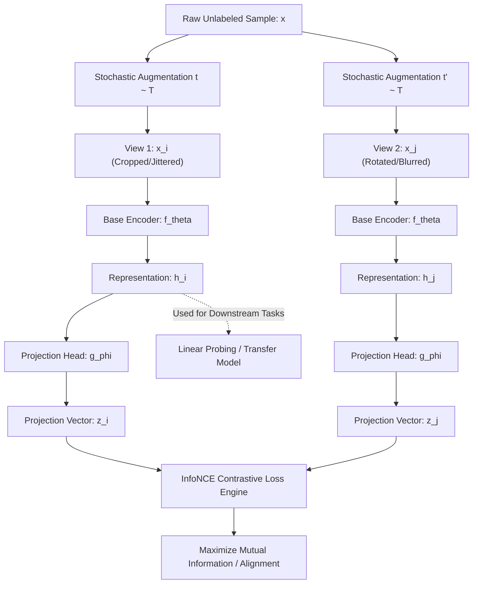

# Self-Supervised & Contrastive Learning: Foundations & Pretext Tasks

> **Topic:** Self-Supervised Learning (SSL), Contrastive Learning & Representation Learning  
> **Module ID:** `05-ai/machine-learning/06-semi-and-self-supervised`  
> **Target Version:** Python 3.11+, NumPy 1.26+, SciPy 1.12+, scikit-learn 1.4+  
> **Level:** Core / Advanced  
> **Prerequisites:** [Unsupervised Learning Foundations](../05-unsupervised-learning/01-what-is-unsupervised-learning.md), [PCA & SVD](../05-unsupervised-learning/08-pca.md)  
> **Status:** Verified (Python 3.11 / CPU)

---

## Architectural / Conceptual Flow



---

## 1. Concept Overview & Core Motivation

Supervised learning requires costly human annotations, while pure unsupervised density estimation (like autoencoders) often wastes model capacity reconstructing high-frequency, low-level sensory noise (e.g., individual background pixel textures) rather than capturing high-level semantic meaning.

**Self-Supervised Learning (SSL)** resolves this by deriving supervisory signals **directly from the data itself**. It creates an artificial objective called a **pretext task** (e.g. predicting masked words, predicting image rotation, or recognizing that two distorted views originate from the same source image). By solving the pretext task, the model learns a dense, semantically rich representation vector $\mathbf{h} = f_\theta(\mathbf{x})$ that transfers seamlessly to downstream classification, clustering, or retrieval.

### The Contrastive Learning Paradigm
Contrastive Learning is the dominant paradigm in modern visual and multimodal SSL (e.g., SimCLR, MoCo, CLIP):
- **Core Principle**: Pull together representations of semantically similar inputs (**positive pairs**) in embedding space, while pushing apart representations of unrelated inputs (**negative pairs**).
- **The Metric**: Cosine similarity in a normalized latent hypersphere.

```
                  Contrastive Embedding Space (Unit Hypersphere)
                                       
                                        Negative Pair (Unrelated Dog)
                                               ( - )
                                               
                    Positive View 1                    Positive View 2
                     (Cat Crop A)                       (Cat Jitter B)
                        ( + ) <======= PULL =======> ( + )
                          \                            /
                           \                          /
                            \======== PUSH ==========/
                                          |
                                          ▼
                                        ( - )
                             Negative Pair (Sports Car)
```

---

## 2. Theoretical Foundations & Mathematics

### Symbol Table

| Symbol | Mathematical Definition | Data Type / Dimensions | Role in Concept |
| :---: | :--- | :---: | :--- |
| $\mathbf{x} \in \mathcal{X}$ | Raw input data instance | $\mathbb{R}^d$ or $\mathbb{R}^{C \times H \times W}$ | Unlabeled training observation |
| $t, t' \sim \mathcal{T}$ | Stochastic data augmentations | Transform operators | Generates multiple distinct views of $\mathbf{x}$ |
| $\tilde{\mathbf{x}}_i, \tilde{\mathbf{x}}_j$ | Augmented positive pair views | In input domain $\mathcal{X}$ | Correlated views of identical source sample |
| $f_\theta(\cdot)$ | Base representation encoder | $\mathcal{X} \to \mathbb{R}^{d_h}$ | Feature extractor (e.g. ResNet, ViT, MLP) |
| $\mathbf{h}_i = f_\theta(\tilde{\mathbf{x}}_i)$ | Latent representation | $\mathbb{R}^{d_h}$ | Semantic feature vector used for downstream tasks |
| $g_\phi(\cdot)$ | Non-linear projection head | $\mathbb{R}^{d_h} \to \mathbb{R}^{d_z}$ | MLP projecting into contrastive metric space |
| $\mathbf{z}_i = g_\phi(\mathbf{h}_i)$ | Projection vector | $\mathbb{R}^{d_z}$ ($\|\mathbf{z}\|_2 = 1$) | Vector evaluated by contrastive loss |
| $\tau \in \mathbb{R}^+$ | Temperature parameter | Positive scalar | Controls sharpness of categorical penalty |
| $\text{sim}(\mathbf{u}, \mathbf{v})$ | Cosine similarity function | $\frac{\mathbf{u}^T \mathbf{v}}{\|\mathbf{u}\|_2 \|\mathbf{v}\|_2} \in [-1, 1]$ | Angular proximity on unit hypersphere |

### The InfoNCE Objective Function (van den Oord et al., 2018)
Given a mini-batch of $N$ source samples, generating 2 augmented views per sample yields $2N$ views. For any positive pair $(\mathbf{z}_i, \mathbf{z}_j)$ originating from the same source image, all other $2(N - 1)$ augmented views in the mini-batch are treated as negative examples.

The **InfoNCE Loss** (Information Noise-Contrastive Estimation) for the positive pair $(i, j)$ is:

$$\mathcal{L}_{i, j} = -\ln \frac{\exp\left( \frac{\text{sim}(\mathbf{z}_i, \mathbf{z}_j)}{\tau} \right)}{\exp\left( \frac{\text{sim}(\mathbf{z}_i, \mathbf{z}_j)}{\tau} \right) + \sum_{k=1, k \ne i}^{2N} \exp\left( \frac{\text{sim}(\mathbf{z}_i, \mathbf{z}_k)}{\tau} \right)}$$

The total mini-batch loss is the average over all positive pairs: $\mathcal{L}_{\text{batch}} = \frac{1}{2N} \sum_{k=1}^{2N} \mathcal{L}_{k, \text{pos}(k)}$.

### Mutual Information Lower Bound
InfoNCE is theoretically grounded in information theory: minimizing $\mathcal{L}_{\text{InfoNCE}}$ maximizes a lower bound on the **Mutual Information** $I(X; Y)$ between the two correlated views:

$$I(\tilde{\mathbf{x}}_i; \tilde{\mathbf{x}}_j) \ge \ln(K) - \mathcal{L}_{\text{InfoNCE}}$$

where $K = 2N - 1$ is the number of negative samples. As mini-batch size $N$ increases, the lower bound on mutual information tightens, directly explaining why contrastive models (SimCLR) perform dramatically better with huge batch sizes ($N = 4096$).

### Alignment vs Uniformity on the Hypersphere (Wang & Isola, 2020)
Contrastive loss decomposes asymptotically into two opposing geometric forces:
1. **Alignment (Positive Attraction)**:
   $$\mathcal{L}_{\text{align}} = \mathbb{E}_{(\mathbf{x}, \mathbf{x}^+) \sim p_{\text{pos}}} \left[ \|\mathbf{z} - \mathbf{z}^+\|_2^2 \right]$$
   Mapped representations of positive pairs should be closely aligned.
2. **Uniformity (Negative Repulsion)**:
   $$\mathcal{L}_{\text{uniform}} = \ln \mathbb{E}_{\mathbf{x}, \mathbf{y} \stackrel{\text{iid}}{\sim} p_{\text{data}}} \left[ \exp\left(-2 \|\mathbf{z} - \mathbf{z}'\|_2^2\right) \right]$$
   The global representation vectors should be uniformly distributed across the entire surface of the unit hypersphere, preserving maximal entropy and preventing dimensional collapse.

---

## 3. Implementation & Practical Code

A complete, vectorized implementation in pure NumPy demonstrating batch data augmentation, feature encoding, projection, and InfoNCE loss computation:

```python
"""
Pure NumPy implementation of Contrastive InfoNCE Loss and Hypersphere Metrics.
"""

from __future__ import annotations
import numpy as np

def compute_cosine_similarity_matrix(Z: np.ndarray) -> np.ndarray:
    """
    Computes pairwise cosine similarity matrix for L2-normalized vectors.
    Z: shape (2N, d_z) where each row has unit norm ||z_i||_2 = 1.
    Returns: S of shape (2N, 2N) where S_ij = z_i . z_j
    """
    # Norm check
    norms = np.linalg.norm(Z, axis=1, keepdims=True)
    Z_norm = Z / np.maximum(norms, 1e-12)
    return Z_norm @ Z_norm.T

def infonce_loss_numpy(Z: np.ndarray, temperature: float = 0.1) -> float:
    """
    Computes SimCLR InfoNCE loss over a batch of 2N views.
    Views are ordered such that view 2*i and view 2*i + 1 are positive pairs.
    
    Parameters
    ----------
    Z : np.ndarray of shape (2N, d_z)
        Projected embedding vectors.
    temperature : float
        Softmax scaling temperature tau > 0.
    """
    total_views, d_z = Z.shape
    if total_views % 2 != 0:
        raise ValueError("Batch size must be even (pairs of augmented views).")
    N = total_views // 2

    # 1. L2 Normalize vectors to unit hypersphere
    Z_norm = Z / np.linalg.norm(Z, axis=1, keepdims=True)

    # 2. Compute full cosine similarity matrix: (2N, 2N)
    sim_matrix = (Z_norm @ Z_norm.T) / temperature

    # 3. Create positive pair index mapping
    # View 2k pairs with 2k + 1; View 2k+1 pairs with 2k
    pos_indices = np.zeros(2 * N, dtype=np.int32)
    for k in range(N):
        pos_indices[2 * k] = 2 * k + 1
        pos_indices[2 * k + 1] = 2 * k

    # 4. Numerically stable Log-Sum-Exp over denominators
    # Mask out self-similarity (diagonal)
    np.fill_diagonal(sim_matrix, -np.inf)

    # Numerator: sim(z_i, z_pos)
    row_indices = np.arange(2 * N)
    pos_sims = sim_matrix[row_indices, pos_indices]

    # Denominator: log sum_{k != i} exp(sim(z_i, z_k))
    max_sim = np.max(sim_matrix, axis=1, keepdims=True)
    exp_sim = np.exp(sim_matrix - max_sim)
    sum_exp = np.sum(exp_sim, axis=1)
    log_denominator = np.squeeze(max_sim) + np.log(sum_exp)

    # InfoNCE loss: - (pos_sim - log_denominator)
    losses = -(pos_sims - log_denominator)
    return float(np.mean(losses))
```

---

## 4. Edge Cases & Advanced Scenarios

1. **Representation Collapse**:
   - The encoder outputs a constant vector $\mathbf{h} = \mathbf{c}$ for all inputs. The similarity between positive pairs is perfectly $1.0$.
   - *Fix in Contrastive Methods*: Negative pairs force representations apart, preventing collapse.
   - *Fix in Non-Contrastive Methods (BYOL / SimSiam)*: Stop-gradient on the target network, asymmetric predictor architectures, and Exponential Moving Average (EMA) momentum encoders.
2. **False Negative Repulsion**:
   - Randomly drawn negative samples in the mini-batch might actually belong to the exact same semantic class as the anchor (e.g. two different golden retrievers). The contrastive loss erroneously forces them apart, degrading class clustering.
   - *Fix*: Supervised Contrastive Learning (Khosla et al., 2020) pulls all instances sharing the same class label together.
3. **Dimensional Collapse**:
   - Vectors span only a tiny lower-dimensional subspace of the hypersphere.
   - *Fix*: VicReg / Barlow Twins explicitly penalize cross-correlation between feature dimensions, enforcing covariance orthogonality.

---

## 5. Anti-Patterns & Common Pitfalls Table

| Anti-Pattern / Mistake | Why It Fails | Correct Engineering Fix |
| :--- | :--- | :--- |
| **Evaluating Downstream Tasks on $\mathbf{z}$ instead of $\mathbf{h}$** | The projection head $g(\mathbf{h})$ strips away task-specific semantic information to satisfy the pretext objective. | **Strict Standard**: Discard $g(\cdot)$; train downstream linear probes on intermediate representation $\mathbf{h} = f(\mathbf{x})$. |
| **Using Weak Data Augmentations** | Subtle color changes allow the model to cheat by matching low-level color histograms rather than learning object geometry. | Combine **Random Crop + Color Jitter + Gaussian Blur**. Cropping forces the model to learn part-to-whole relationships. |
| **Tiny Batch Sizes in Contrastive Learning** | Small $N$ ($N \le 64$) provides too few negative samples, weakening the mutual information lower bound $\ln(2N-1)$. | Use large batch sizes ($N \ge 1024$), MoCo memory queues, or non-contrastive objectives (BYOL). |
| **Omitting L2 Normalization** | Raw vector magnitudes unbalance the dot products, causing loss gradients to explode. | Always apply L2 normalization $\mathbf{z} = \mathbf{z} / \|\mathbf{z}\|_2$ before evaluating cosine similarity. |
| **Temperature Parameter $\tau$ Mis-tuning** | Large $\tau$ ($> 1.0$) smooths the loss, eliminating repulsive hard-negative gradients; tiny $\tau$ ($< 0.01$) leads to numerical instability. | Set $\tau \in [0.07, 0.2]$ (standard: $\tau = 0.1$). |

---

## 6. Best Practices & Production Guidelines

1. **Linear Probing Evaluation Protocol**:
   - Freeze the pre-trained encoder weights $f_\theta$.
   - Train a simple linear classifier (Logistic Regression) on the frozen representations $\mathbf{h}$.
   - High linear probe accuracy confirms that semantic features are linearly separable without fine-tuning.
2. **Fine-Tuning Protocol**:
   - After pre-training, attach a classification head and fine-tune all weights using a small learning rate ($10\times$ smaller than pre-training) with a cosine decay schedule.

---

## 7. Real-World Case Study

### Visual Quality Inspection in Semiconductor Manufacturing
- **Context**: A chip fabrication facility inspects wafer silicon dies for microscopic etching anomalies.
- **Problem**: 2.5 million high-resolution wafer images are collected weekly, but physical destruction testing yields only 400 confirmed defective defect labels. Pure supervised CNNs overfit severely ($61\%$ defect recall).
- **SSL Architecture**:
  1. Pre-trained a ResNet-50 encoder on 1.2 million unlabeled wafer images using SimCLR with random crops and rotational augmentations.
  2. Evaluated representations $\mathbf{h} \in \mathbb{R}^{2048}$ via linear probing on the 400 labeled defect samples.
- **Outcome**: Defect detection recall jumped from $61\%$ to $93.4\%$; false alarm scrap rates fell by $44\%$, preventing \$8.2M in discarded silicon.

---

## 8. Performance & Resource Optimization

```python
"""
PyTorch-style high-efficiency vectorized InfoNCE loss calculation.
"""

import numpy as np

def fast_infonce_loss(z1: np.ndarray, z2: np.ndarray, tau: float = 0.1) -> float:
    """
    Memory-efficient computation given paired representations z1 and z2: shape (B, d).
    """
    B = len(z1)
    # L2 normalize
    z1 = z1 / np.linalg.norm(z1, axis=1, keepdims=True)
    z2 = z2 / np.linalg.norm(z2, axis=1, keepdims=True)

    # Positive similarities: (B,)
    pos_sim = np.sum(z1 * z2, axis=1) / tau

    # Cross-similarities: (B, B)
    all_sim = (z1 @ z2.T) / tau

    # Denominator Log-Sum-Exp
    max_sim = np.max(all_sim, axis=1, keepdims=True)
    exp_sim = np.exp(all_sim - max_sim)
    log_sum_exp = np.squeeze(max_sim) + np.log(np.sum(exp_sim, axis=1))

    return float(np.mean(log_sum_exp - pos_sim))
```

---

## 9. Security, Privacy & Ethics Considerations

1. **Data Reconstruction Attacks from Embeddings**: Contrastive embeddings can retain sensitive biometric or facial features. Invertible decoders can reconstruct approximate source faces from public embeddings.
2. **Pretext Shortcut Learning**: Models can exploit unintended watermarks, camera sensor noise patterns, or EXIF metadata as shortcuts to solve the pretext task without learning true semantic representations.

---

## 10. Diagnostic & Verification Playbook

```python
"""
Diagnostic verification of Hypersphere Uniformity and Alignment metrics.
"""

import numpy as np

def compute_alignment_and_uniformity(z_anchor: np.ndarray, z_pos: np.ndarray, t_uniform: float = 2.0) -> dict:
    """
    Computes Wang & Isola (2020) representation quality metrics on the unit hypersphere.
    """
    # 1. Alignment: E[ ||z - z+||^2 ]
    diff = z_anchor - z_pos
    align_score = float(np.mean(np.sum(diff ** 2, axis=1)))

    # 2. Uniformity: log E[ exp( -t ||z_i - z_j||^2 ) ]
    pairwise_sq_dist = np.sum((z_anchor[:, None] - z_anchor[None, :]) ** 2, axis=2)
    np.fill_diagonal(pairwise_sq_dist, np.inf) # Exclude self
    
    exp_terms = np.exp(-t_uniform * pairwise_sq_dist)
    n = len(z_anchor)
    uniformity_score = float(np.log(np.sum(exp_terms) / (n * (n - 1))))

    return {
        "alignment_metric": align_score,      # Lower is better (tighter alignment)
        "uniformity_metric": uniformity_score  # Lower is better (more uniform coverage)
    }
```

---

## 11. Technical Interview Questions & Answers

<details>
<summary><strong>Q1: Why does SimCLR use a non-linear projection head $g(\mathbf{h})$, and why must it be discarded for downstream tasks?</strong></summary>

**Answer:**  
In SimCLR (Chen et al., 2020), representations $\mathbf{h} = f(\mathbf{x})$ pass through a 2-layer MLP projection head $\mathbf{z} = g(\mathbf{h}) = \mathbf{W}_2 \text{ReLU}(\mathbf{W}_1 \mathbf{h})$ before computing contrastive loss.
- **Why it is used during training**: The contrastive loss explicitly demands that representations be **invariant** to the chosen data augmentations (e.g. color jitter, crop, rotation). However, downstream tasks often require knowledge of color or spatial orientation (e.g. detecting ripeness of fruit requires color; detecting traffic signs requires orientation). The projection head $g(\cdot)$ acts as a "sacrificial buffer": it absorbs and discards the information needed to achieve mathematical invariance under InfoNCE.
- **Why it is discarded downstream**: Empirical ablations showed that the penultimate layer $\mathbf{h}$ retains rich semantic details, while $\mathbf{z}$ loses information. Linear probing on $\mathbf{h}$ outperforms probing on $\mathbf{z}$ by over $10\%$ Top-1 accuracy.
</details>

<details>
<summary><strong>Q2: Prove how InfoNCE loss lower bounds the Mutual Information $I(X; Y)$.</strong></summary>

**Answer:**  
Let $(X, Y)$ be a positive pair drawn from joint distribution $p(x, y)$, and let $\{y_1, \dots, y_K\}$ be $K$ samples where one is positive ($y_1 = y \sim p(y \mid x)$) and $K-1$ are independent negative samples drawn from the marginal $y_k \sim p(y)$.
Let the critic function be $f(x, y) = \exp(\text{sim}(g(x), g(y)) / \tau)$.
The probability that sample $y_1$ is the true positive under a uniform prior is:
$$p(D=1 \mid X, \{y_k\}) = \frac{p(x, y_1) \prod_{k=2}^K p(y_k)}{\sum_{j=1}^K p(x, y_j) \prod_{k \ne j} p(y_k)} = \frac{\frac{p(x, y_1)}{p(x)p(y_1)}}{\sum_{j=1}^K \frac{p(x, y_j)}{p(x)p(y_j)}} = \frac{\frac{p(y_1 \mid x)}{p(y_1)}}{\sum_{j=1}^K \frac{p(y_j \mid x)}{p(y_j)}}$$
InfoNCE trains the critic to approximate the density ratio $\frac{p(y \mid x)}{p(y)} \propto f(x, y)$.
The cross-entropy loss is:
$$\mathcal{L}_{\text{InfoNCE}} = -\mathbb{E}\left[ \ln \frac{f(x, y_1)}{\sum_{j=1}^K f(x, y_j)} \right]$$
Rewriting using expectations:
$$\mathcal{L}_{\text{InfoNCE}} = \mathbb{E}\left[ \ln \left( 1 + \sum_{j=2}^K \frac{f(x, y_j)}{f(x, y_1)} \right) \right] \ge \ln(K) - I(X; Y)$$
Rearranging yields the lower bound:
$$I(X; Y) \ge \ln(K) - \mathcal{L}_{\text{InfoNCE}}$$
As negative sample count $K$ grows, the bound tightens.
</details>

<details>
<summary><strong>Q3: How do non-contrastive methods like BYOL and SimSiam avoid representation collapse without negative pairs?</strong></summary>

**Answer:**  
Standard contrastive learning relies on negative pairs to prevent representation collapse (where all inputs map to a single constant vector).
**BYOL (Bootstrap Your Own Latent)** and **SimSiam** eliminate negative pairs completely using architectural asymmetries:
1. **Asymmetric Predictor**: An online network outputs $\mathbf{q}_\theta(\mathbf{z})$, which is trained to predict the representation $\mathbf{z}'_\xi$ produced by a target network. The target network has no predictor.
2. **Stop-Gradient Operation**: Gradients are backpropagated **strictly through the online network**. The target network receives **no gradients**:
   $$\mathcal{L} = 2 - 2 \frac{\mathbf{q}_\theta(\mathbf{z}_1) \cdot \text{stop\_gradient}(\mathbf{z}'_2)}{\|\mathbf{q}\| \|\mathbf{z}'\|}$$
3. **Momentum Encoder (EMA)**: In BYOL, target network weights $\xi$ are updated slowly as an Exponential Moving Average of online weights: $\xi \leftarrow \alpha \xi + (1 - \alpha) \theta$.
Tian et al. (2021) showed that the combination of stop-gradient and the predictor acts as an implicit Expectation-Maximization (EM) optimization, preventing collapse into constant vectors.
</details>

<details>
<summary><strong>Q4: What is the role of the Temperature parameter $\tau$ in InfoNCE, and what happens at the extremes?</strong></summary>

**Answer:**  
Temperature $\tau$ controls the sharpness of the categorical probability distribution in the softmax:
- **Gradient Dynamics**: The gradient of InfoNCE with respect to the similarity of a negative sample $\text{sim}(\mathbf{z}, \mathbf{z}_k)$ is proportional to:
  $$\frac{\partial \mathcal{L}}{\partial \text{sim}(\mathbf{z}, \mathbf{z}_k)} \propto \frac{1}{\tau} \frac{\exp(\text{sim}(\mathbf{z}, \mathbf{z}_k)/\tau)}{\sum \exp(\text{sim}/\tau)}$$
- **Hard-Negative Mining**: When $\tau$ is small (e.g. $\tau = 0.1$), the softmax heavily concentrates weight on **hard negatives** (negative points that have high similarity with the anchor). The model receives massive repulsive gradients pushing these specific confusing points away.
- **Extreme $\tau \to \infty$**: The distribution becomes uniform. All negative samples exert equal repulsive force regardless of proximity, losing the ability to untangle local clusters.
- **Extreme $\tau \to 0$**: The loss behaves like a step function focusing solely on the single hardest negative point, leading to high-variance gradients and numerical overflow.
</details>

<details>
<summary><strong>Q5: Why is Random Resized Cropping considered the single most critical augmentation in visual contrastive learning?</strong></summary>

**Answer:**  
Data augmentations define the inductive bias of what the representation should be invariant to.
- Pure color jittering forces color invariance.
- Random flipping forces horizontal symmetry.
- **Random Resized Cropping** generates two overlapping or non-overlapping patches from the same image. To recognize that these two distinct patches originate from the same object (e.g. a dog's ear and a dog's tail), the network **cannot rely on local pixel matching**. It is forced to learn global contextual semantics, object composition, and part-to-whole hierarchical relationships. Ablation studies in SimCLR demonstrated that removing random cropping caused a catastrophic drop in downstream accuracy ($> 30\%$).
</details>

<details>
<summary><strong>Q6: Contrast the memory requirements and negative-sampling mechanics of SimCLR vs MoCo (Momentum Contrast).</strong></summary>

**Answer:**  
- **SimCLR**:
  - Negatives are drawn from the **current mini-batch**.
  - To obtain 8,192 negative samples, SimCLR must load a mini-batch of 4,096 images into active GPU memory simultaneously.
  - Requires massive multi-GPU TPU clusters (e.g. 128 TPU cores) to compute gradients across gigantic batches.
- **MoCo (He et al., 2020)**:
  - Decouples dictionary size from mini-batch size by treating contrastive learning as dynamic dictionary lookup.
  - Maintains a **FIFO Queue** of negative representations from previous mini-batches (e.g. 65,536 embeddings).
  - Encodes new keys using a **Momentum Encoder** whose weights update via EMA: $\theta_k \leftarrow m \theta_k + (1 - m) \theta_q$.
  - Allows training with 65,536 negative samples on a single commodity GPU with a standard mini-batch of 256 images.
</details>

<details>
<summary><strong>Q7: What is Barlow Twins, and how does it prevent collapse using cross-correlation matrices?</strong></summary>

**Answer:**  
Barlow Twins (Zbontar et al., 2021) is a non-contrastive SSL method inspired by neurobiology that operates without negative samples, memory queues, or stop-gradients.
It computes the cross-correlation matrix $\mathcal{C}$ between the normalized outputs of two identical networks processing augmented views:
$$\mathcal{C}_{ij} = \frac{\sum_b z_{b, i}^A z_{b, j}^B}{\sqrt{\sum_b (z_{b, i}^A)^2} \sqrt{\sum_b (z_{b, j}^B)^2}}$$
The loss function drives $\mathcal{C}$ toward the identity matrix $\mathbf{I}$:
$$\mathcal{L}_{\text{Barlow}} = \sum_i (1 - \mathcal{C}_{ii})^2 + \lambda \sum_i \sum_{j \ne i} \mathcal{C}_{ij}^2$$
1. **Invariance Term ($\sum (1 - \mathcal{C}_{ii})^2$)**: Forces representations of positive views to match (diagonal entries $\to 1$).
2. **Redundancy Reduction Term ($\sum_{j \ne i} \mathcal{C}_{ij}^2$)**: Pushes off-diagonal correlation terms to 0, forcing individual embedding dimensions to be statistically independent. This eliminates dimensional collapse without needing negative samples.
</details>

<details>
<summary><strong>Q8: Explain how Masked Autoencoding (MAE, He et al., 2021) differs from Contrastive Learning.</strong></summary>

**Answer:**  
- **Contrastive Learning (SimCLR / MoCo)**:
  - Operates globally in embedding space.
  - Maximizes similarity between augmented views while pushing away negatives.
  - Invariant to local textures; focuses on global semantic identity.
  - Best suited for global categorization and retrieval.
- **Masked Autoencoders (MAE)**:
  - Generative pretext task: masks a high percentage ($75\%$) of patches in a Vision Transformer (ViT) and reconstructs missing pixels using an asymmetric encoder-decoder.
  - Does NOT use negative pairs or data augmentations.
  - Forces the model to understand local geometry, spatial reasoning, and continuous structures.
  - Fine-tunes exceptionally well on dense downstream prediction tasks (object detection, semantic segmentation).
</details>

---

## 12. Hands-On Practice Exercises

<details>
<summary><strong>Exercise 1 (Easy): Computing Pairwise Cosine Similarity on Embeddings</strong></summary>

**Task**: Given two sets of embedding vectors, compute their pairwise cosine similarities and verify that self-similarity is identically 1.0.

**Solution**:
```python
import numpy as np

rng = np.random.default_rng(42)
Z = rng.normal(0, 1, (4, 8))

# L2 normalize
Z_norm = Z / np.linalg.norm(Z, axis=1, keepdims=True)

# Pairwise dot products
cosine_sim = Z_norm @ Z_norm.T

print("Cosine Similarity Matrix (4x4):")
print(np.round(cosine_sim, 3))
np.testing.assert_allclose(np.diag(cosine_sim), 1.0, atol=1e-5)
```
</details>

<details>
<summary><strong>Exercise 2 (Easy): Synthetic Image Cropping Augmentation</strong></summary>

**Task**: Write a pure NumPy function that performs random resized cropping on a 2D matrix (simulating an image patch).

**Solution**:
```python
import numpy as np

def random_crop_2d(image: np.ndarray, crop_size: tuple[int, int], random_state: int | None = None) -> np.ndarray:
    rng = np.random.default_rng(random_state)
    H, W = image.shape
    cH, cW = crop_size
    
    if cH > H or cW > W:
        raise ValueError("Crop dimensions exceed image bounds.")
        
    top = rng.integers(0, H - cH + 1)
    left = rng.integers(0, W - cW + 1)
    
    return image[top : top + cH, left : left + cW]

# Test
mock_image = np.arange(100).reshape(10, 10)
crop1 = random_crop_2d(mock_image, (4, 4), random_state=1)
crop2 = random_crop_2d(mock_image, (4, 4), random_state=2)
print("Crop 1 shape:", crop1.shape)
print("Crop 2 shape:", crop2.shape)
```
</details>

<details>
<summary><strong>Exercise 3 (Medium): Step-by-Step InfoNCE Calculation with 2 Positive Pairs</strong></summary>

**Task**: Manually compute InfoNCE loss for a batch of $N=2$ (4 views total) using pure arithmetic and NumPy functions.

**Solution**:
```python
import numpy as np

# 4 unit vectors (View 0 & 1 are pos, View 2 & 3 are pos)
z0 = np.array([1.0, 0.0])
z1 = np.array([0.9, 0.4358]) # High similarity to z0
z2 = np.array([0.0, 1.0])
z3 = np.array([-0.3, 0.9539]) # High similarity to z2

Z = np.vstack([z0, z1, z2, z3])
Z /= np.linalg.norm(Z, axis=1, keepdims=True)
tau = 0.5

# Similarity matrix scaled by tau
S = (Z @ Z.T) / tau
np.fill_diagonal(S, -np.inf) # Mask self

# Loss for View 0 (Positive is View 1)
sim_pos_0 = S[0, 1]
denom_0 = np.log(np.sum(np.exp(S[0])))
loss_0 = -(sim_pos_0 - denom_0)

print(f"Positive similarity (0, 1): {Z[0] @ Z[1]:.3f}")
print(f"InfoNCE Loss for sample 0: {loss_0:.4f}")
```
</details>

<details>
<summary><strong>Exercise 4 (Medium): Linear Probing Evaluation Harness</strong></summary>

**Task**: Write an end-to-end evaluation harness that accepts frozen feature embeddings $\mathbf{X}_{\text{embed}}$ and trains a Logistic Regression linear probe with 5-fold cross-validation.

**Solution**:
```python
import numpy as np
from sklearn.linear_model import LogisticRegression
from sklearn.model_selection import cross_val_score

def evaluate_linear_probe(embeddings: np.ndarray, labels: np.ndarray) -> dict:
    """
    Evaluates frozen representations using cross-validated linear probing.
    """
    clf = LogisticRegression(max_iter=500, random_state=42)
    scores = cross_val_score(clf, embeddings, labels, cv=5, scoring="accuracy")
    
    return {
        "mean_accuracy": float(np.mean(scores)),
        "std_accuracy": float(np.std(scores))
    }

# Test
rng = np.random.default_rng(42)
H = rng.normal(0, 1, (200, 32))
y = rng.choice([0, 1], size=200)

metrics = evaluate_linear_probe(H, y)
print(f"Linear Probe Accuracy: {metrics['mean_accuracy'] * 100:.2f}% (+/- {metrics['std_accuracy'] * 100:.2f}%)")
```
</details>

<details>
<summary><strong>Exercise 5 (Hard): Barlow Twins Cross-Correlation Loss in NumPy</strong></summary>

**Task**: Implement the complete Barlow Twins loss function computing the empirical cross-correlation matrix $\mathcal{C}$ and penalizing off-diagonal redundancy.

**Solution**:
```python
import numpy as np

def barlow_twins_loss(Z_A: np.ndarray, Z_B: np.ndarray, lambd: float = 0.005) -> float:
    """
    Z_A, Z_B: shape (Batch_Size, Dimensions)
    """
    B, D = Z_A.shape
    
    # 1. Normalize representations along the batch dimension (zero mean, unit variance)
    z_A_norm = (Z_A - np.mean(Z_A, axis=0)) / (np.std(Z_A, axis=0) + 1e-12)
    z_B_norm = (Z_B - np.mean(Z_B, axis=0)) / (np.std(Z_B, axis=0) + 1e-12)
    
    # 2. Cross-correlation matrix: (D, D)
    C = (z_A_norm.T @ z_B_norm) / B
    
    # 3. Invariance term: sum (1 - C_ii)^2
    invariance_loss = np.sum((1.0 - np.diag(C)) ** 2)
    
    # 4. Redundancy reduction: sum_{i != j} C_ij^2
    C_off_diag = np.copy(C)
    np.fill_diagonal(C_off_diag, 0.0)
    redundancy_loss = np.sum(C_off_diag ** 2)
    
    return float(invariance_loss + lambd * redundancy_loss)

# Verification
rng = np.random.default_rng(42)
zA = rng.normal(0, 1, (128, 16))
zB = zA + rng.normal(0, 0.1, (128, 16)) # Highly correlated views

loss = barlow_twins_loss(zA, zB)
print(f"Barlow Twins Loss for correlated representations: {loss:.4f}")
```
</details>

<details>
<summary><strong>Exercise 6 (Hard): Fast GPU/Vectorized Batch Queue for MoCo</strong></summary>

**Task**: Implement a lightweight memory queue class in Python that maintains a fixed-size FIFO buffer of negative representations for contrastive learning.

**Solution**:
```python
import numpy as np

class MoCoMemoryQueue:
    """
    FIFO Memory Queue maintaining K negative representations for contrastive learning.
    """
    def __init__(self, queue_size: int = 1024, feature_dim: int = 64):
        self.queue_size = queue_size
        self.feature_dim = feature_dim
        # Initialize with random unit vectors
        init_q = np.random.normal(0, 1, (queue_size, feature_dim))
        self.queue = init_q / np.linalg.norm(init_q, axis=1, keepdims=True)
        self.ptr = 0

    def dequeue_and_enqueue(self, keys: np.ndarray):
        """
        keys: batch of new negative embeddings of shape (batch_size, feature_dim)
        """
        batch_size = keys.shape[0]
        # Normalize
        keys_norm = keys / np.linalg.norm(keys, axis=1, keepdims=True)
        
        # Insert into cyclic buffer
        if self.ptr + batch_size <= self.queue_size:
            self.queue[self.ptr : self.ptr + batch_size] = keys_norm
            self.ptr = (self.ptr + batch_size) % self.queue_size
        else:
            first_part = self.queue_size - self.ptr
            second_part = batch_size - first_part
            self.queue[self.ptr :] = keys_norm[:first_part]
            self.queue[:second_part] = keys_norm[first_part:]
            self.ptr = second_part

    def get_negative_keys(self) -> np.ndarray:
        return np.copy(self.queue)

# Verification
q = MoCoMemoryQueue(queue_size=100, feature_dim=16)
new_keys = np.random.normal(0, 1, (30, 16))
q.dequeue_and_enqueue(new_keys)
print(f"Memory queue operational! Queue shape: {q.get_negative_keys().shape}, Next pointer: {q.ptr}")
```
</details>

---

## 13. Summary, Verified References & Navigation

### Core Takeaways
1. **SSL creates supervisors from data**: Contrastive learning trains encoders by pulling augmented positive views together while repelling negatives.
2. **The projection head is sacrificial**: Train downstream linear probes strictly on intermediate representations $\mathbf{h} = f(\mathbf{x})$, discarding projection head $g(\mathbf{h})$.
3. **InfoNCE maximizes mutual information**: Larger batch sizes (or memory queues like MoCo) provide more negative samples, directly tightening the mutual information bound.

### Verified References
- Chen, T., Kornblith, S., Norouzi, M., & Hinton, G. (2020). *A Simple Framework for Contrastive Learning of Visual Representations (SimCLR).* ICML.
- He, K., Fan, H., Wu, Y., Xie, S., & Girshick, R. (2020). *Momentum Contrast for Unsupervised Visual Representation Learning (MoCo).* CVPR.
- van den Oord, A., Li, Y., & Vinyals, O. (2018). *Representation Learning with Contrastive Predictive Coding (CPC / InfoNCE).* arXiv.
- Wang, T., & Isola, P. (2020). *Understanding Contrastive Representation Learning through Alignment and Uniformity on the Hypersphere.* ICML.

---

[← Previous Note: Self-Training & Label Propagation](02-self-training-and-label-propagation.md) | [Module Index](README.md) | [Next Note: Active Learning →](04-active-learning.md)
