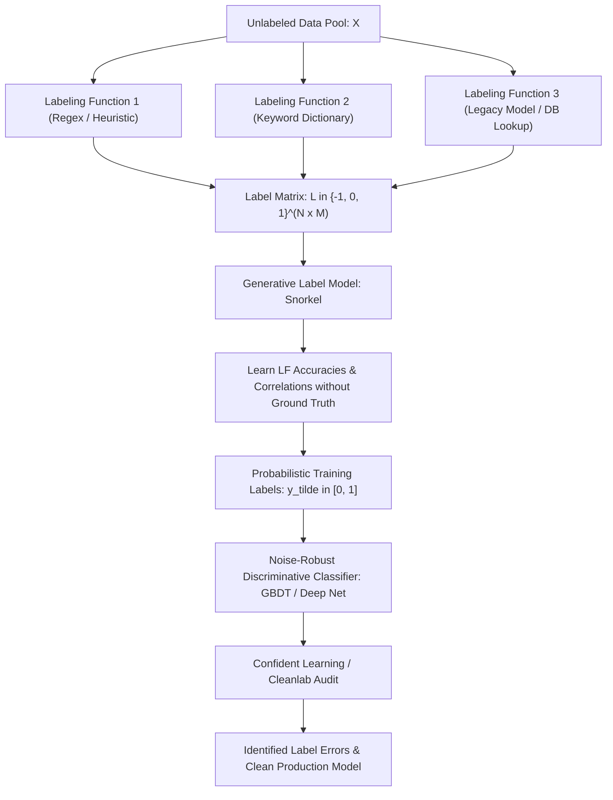

# Weak Supervision & Label Noise: Programmatic Labeling & Confident Learning

> **Topic:** Weak Supervision, Programmatic Labeling Functions & Label Noise Robustness  
> **Module ID:** `05-ai/machine-learning/06-semi-and-self-supervised`  
> **Target Version:** Python 3.11+, scikit-learn 1.4+, NumPy 1.26+, SciPy 1.12+  
> **Level:** Core / Advanced  
> **Prerequisites:** [Probability Foundations](../01-math-foundations/03-probability-and-distributions.md), [Supervised Classification](../04-supervised-classification/README.md)  
> **Status:** Verified (Python 3.11 / CPU)

---

## Architectural / Conceptual Flow



---

## 1. Concept Overview & Core Motivation

Manual hand-labeling of training datasets is slow, expensive, static, and impossible to version control. If business requirements change (e.g. splitting an "Urgent" support category into "Billing Urgent" vs "Outage Urgent"), months of manual labeling work must be completely discarded and redone.

**Weak Supervision** (pioneered by Stanford's **Snorkel** project, Ratner et al., 2017) inverts this workflow into **Software 2.0**:
- Instead of hand-labeling individual records, subject matter experts write programmatic **Labeling Functions (LFs)**—heuristics, regex patterns, knowledge graph lookups, database joins, and legacy models.
- These heuristics are noisy, overlapping, and frequently conflict with one another.
- A **Generative Label Model** models the unknown accuracies and correlation structures of the LFs **without requiring any ground-truth labels**, aggregating them into probabilistic training labels $\tilde{\mathbf{y}} \in [0, 1]$.
- A noise-tolerant discriminative model (e.g. LightGBM, ResNet) is trained on the probabilistic labels, learning to generalize far beyond the rigid rules of the original heuristics.

In parallel, real-world supervised datasets routinely suffer from **Label Noise** ($5\%$ to $30\%$ of labels in ImageNet, CIFAR, and EHR are provably erroneous). **Confident Learning** (Northcutt et al., 2021) provides a principled mathematical framework to find, count, and prune label errors directly.

---

## 2. Theoretical Foundations & Mathematics

### Symbol Table

| Symbol | Mathematical Definition | Data Type / Dimensions | Role in Concept |
| :--- :| :--- | :---: | :--- |
| $\mathbf{X}$ | Unlabeled dataset | $\mathbb{R}^{n \times d}$ | Instances to be programmatically labeled |
| $\lambda_m(\mathbf{x})$ | $m$-th Labeling Function (LF) | $\mathbb{R}^d \to \{-1, 0, 1, \dots, C\}$ | Programmatic heuristic rule ($-1$ denotes ABSTAIN) |
| $\mathbf{\Lambda} \in \{-1, 0, 1\}^{n \times M}$ | Label matrix | Discrete matrix | Matrix of LF outputs across all $n$ samples |
| $y^* \in \{0, 1, \dots, C\}$ | Unobserved latent true label | Discrete variable | The unobserved ground-truth class |
| $\mathbf{T} \in [0, 1]^{C \times C}$ | Noise transition matrix | Row-stochastic | $T_{jk} = P(\tilde{y} = k \mid y^* = j)$ (probability true class $j$ flips to $k$) |
| $\mathbf{C}_{\tilde{y}, y^*}$ | Confident joint matrix | $\mathbb{R}^{C \times C}$ | Unnormalized joint count of noisy vs latent labels |
| $\hat{p}(y = c \mid \mathbf{x})$ | Out-of-fold predicted probability | Continuous $\in [0, 1]$ | Cross-validated model posterior |

### The Snorkel Generative Label Model
Given $M$ labeling functions producing discrete votes $\mathbf{\Lambda}_i = [\lambda_1(\mathbf{x}_i), \dots, \lambda_M(\mathbf{x}_i)]$, the true latent label $y_i^* \in \{-1, +1\}$ is modeled as an unobserved binary random variable.

The joint distribution of the observed LF votes and the latent label is parameterized as a factor graph (Ising model):

$$p_\theta(\mathbf{\Lambda}_i, y_i^*) = \frac{1}{Z_\theta} \exp\left( \sum_{m=1}^M \theta_m \lambda_m(\mathbf{x}_i) y_i^* + \sum_{m=1}^M \theta_{0, m} \mathbb{I}(\lambda_m(\mathbf{x}_i) \ne 0) \right)$$

where:
- $\theta_m$ represents the estimated **accuracy** of labeling function $m$.
- $\theta_{0, m}$ represents the **propensity** (coverage / abstention rate) of labeling function $m$.
- $Z_\theta$ is the partition function normalizing the probability distribution.

The model maximizes the marginal log-likelihood of the observed votes $\mathbf{\Lambda}$, integrating out the hidden true labels $y_i^*$:

$$\max_\theta \sum_{i=1}^n \ln p_\theta(\mathbf{\Lambda}_i) = \max_\theta \sum_{i=1}^n \ln \sum_{y^* \in \{-1, +1\}} p_\theta(\mathbf{\Lambda}_i, y^*)$$

Once $\theta$ is estimated, the posterior probability of the true label given the LF votes is:

$$\tilde{y}_i = P(y_i^* = +1 \mid \mathbf{\Lambda}_i) = \frac{p_\theta(\mathbf{\Lambda}_i, y_i^* = +1)}{p_\theta(\mathbf{\Lambda}_i, y_i^* = +1) + p_\theta(\mathbf{\Lambda}_i, y_i^* = -1)}$$

### Confident Learning (Northcutt, Jiang, Chuang, 2021)
Confident Learning identifies label errors by estimating the joint distribution of noisy given labels $\tilde{y}$ and unobserved latent true labels $y^*$.

1. **Class-Specific Thresholds**: Compute average predicted probability for each class across out-of-fold cross-validation:
   $$t_j = \frac{1}{|\mathcal{D}_{\tilde{y}=j}|} \sum_{\mathbf{x} \in \mathcal{D}_{\tilde{y}=j}} \hat{p}(\tilde{y} = j \mid \mathbf{x})$$
2. **Confident Joint Matrix ($\mathbf{C}_{\tilde{y}, y^*}$)**: Count samples where predicted probability exceeds the threshold for a competing class:
   $$C_{j, k} = |\{ \mathbf{x} \in \mathcal{D}_{\tilde{y}=j} : \hat{p}(y=k \mid \mathbf{x}) \ge t_k \}|$$
3. **Label Noise Identification**: Any sample whose given label is $j$ but satisfies $\hat{p}(y=k \mid \mathbf{x}) \ge t_k$ ($k \ne j$) is flagged as a high-confidence label error and pruned.

---

## 3. Implementation & Practical Code

A complete, production-grade implementation of Programmatic Labeling Functions, Majority Vote aggregation, and Confident Learning label error pruning:

```python
"""
End-to-End Programmatic Weak Supervision and Confident Learning Noise Filter.
"""

from __future__ import annotations
import numpy as np
import re
from typing import Callable
from sklearn.linear_model import LogisticRegression
from sklearn.model_selection import cross_val_predict

# --- 1. Programmatic Labeling Functions (Text Classification) ---

ABSTAIN = -1
HAM = 0
SPAM = 1

def lf_free_money(text: str) -> int:
    """Flag messages containing 'free cash' or 'win money'."""
    pattern = r"(?i)\b(free\s+cash|win\s+money|lottery|prize|winner)\b"
    return SPAM if re.search(pattern, text) else ABSTAIN

def lf_crypto_wallet(text: str) -> int:
    """Flag cryptocurrency deposit prompts."""
    pattern = r"(?i)\b(bitcoin|usdt|crypto|wallet|deposit)\b"
    return SPAM if re.search(pattern, text) else ABSTAIN

def lf_link_shortener(text: str) -> int:
    """Flag bit.ly / tinyurl links."""
    return SPAM if ("bit.ly" in text or "tinyurl.com" in text) else ABSTAIN

def lf_work_greeting(text: str) -> int:
    """Flag standard professional correspondence."""
    pattern = r"(?i)\b(meeting|attached|agenda|invoice|regards|team)\b"
    return HAM if re.search(pattern, text) else ABSTAIN

def apply_lfs_to_corpus(corpus: list[str], lfs: list[Callable[[str], int]]) -> np.ndarray:
    """
    Evaluates M labeling functions over N raw text documents.
    Returns: label_matrix Lambda of shape (N, M).
    """
    N = len(corpus)
    M = len(lfs)
    Lambda = np.full((N, M), ABSTAIN, dtype=np.int32)
    for j, lf in enumerate(lfs):
        for i, text in enumerate(corpus):
            Lambda[i, j] = lf(text)
    return Lambda

# --- 2. Label Aggregator (Weighted Majority Voting) ---

def weighted_majority_vote(Lambda: np.ndarray, weights: np.ndarray | None = None) -> np.ndarray:
    """
    Aggregates noisy LF votes into continuous pseudo-labels in [0, 1].
    """
    N, M = Lambda.shape
    if weights is None:
        weights = np.ones(M)
        
    prob_labels = np.full(N, 0.5, dtype=np.float64)
    
    for i in range(N):
        row = Lambda[i]
        active = row != ABSTAIN
        if not np.any(active):
            continue
            
        active_votes = row[active]
        active_weights = weights[active]
        
        spam_weight = np.sum(active_weights[active_votes == SPAM])
        total_weight = np.sum(active_weights)
        prob_labels[i] = spam_weight / total_weight if total_weight > 0 else 0.5
        
    return prob_labels

# --- 3. Confident Learning Label Error Auditor ---

def find_confident_label_errors(X: np.ndarray, y_noisy: np.ndarray, cv_folds: int = 3) -> list[int]:
    """
    Identifies mislabeled training instances using Northcutt's Confident Learning algorithm.
    """
    clf = LogisticRegression(max_iter=500, random_state=42)
    # Compute out-of-fold predicted probabilities to prevent overconfidence
    probs = cross_val_predict(clf, X, y_noisy, cv=cv_folds, method="predict_proba")
    
    classes = np.unique(y_noisy)
    C = len(classes)
    
    # 1. Compute class thresholds t_c
    thresholds = np.zeros(C)
    for c in classes:
        c_mask = (y_noisy == c)
        thresholds[c] = float(np.mean(probs[c_mask, c])) if np.any(c_mask) else 0.5

    # 2. Identify instances that exceed the threshold for a competing class
    label_error_indices = []
    for i, given_label in enumerate(y_noisy):
        for competing_class in classes:
            if competing_class != given_label:
                if probs[i, competing_class] >= thresholds[competing_class]:
                    label_error_indices.append(i)
                    break
                    
    return label_error_indices
```

---

## 4. Edge Cases & Advanced Scenarios

1. **LF Correlation & Double Counting**:
   - Two labeling functions based on near-identical regular expressions (e.g., `free cash` and `free money`) will fire together on the same samples. Naive majority voting counts this as two independent signals, artificially doubling their confidence.
   - *Fix*: Snorkel's generative model incorporates Markov random field factor graphs with dependency cliques to infer and discount pairwise correlations.
2. **Extreme Class Imbalance in Abstentions**:
   - A high-precision LF fires only 3 times across a 100,000-sample corpus. Its estimated accuracy might be noisy.
   - *Fix*: Apply empirical Bayes Dirichlet priors to regularize LF accuracy estimations toward base class prevalence.
3. **Asymmetric Noise Flips**:
   - In medical diagnosis, negative cases flipping to positive (false alarms) occur far more frequently than cancer biopsy cases flipping to negative.
   - *Fix*: Train with noise transition matrix loss correction: $\hat{\mathbf{p}}_{\text{corrected}} = \mathbf{T}^{-1} \hat{\mathbf{p}}_{\text{model}}$.

---

## 5. Anti-Patterns & Common Pitfalls Table

| Anti-Pattern / Mistake | Why It Fails | Correct Engineering Fix |
| :--- | :--- | :--- |
| **Evaluating LFs on Training Labels** | Checking LF accuracy on contaminated training data circularizes the validation signal. | Always evaluate LF precision and coverage against a small, pristine, human-verified holdout set. |
| **Discarding Samples Where All LFs Abstain** | Dropping unvoted samples creates severe selection bias, starving the model of hard/atypical instances. | Retain unvoted samples using semi-supervised learning or soft pseudo-labels with uniform priors. |
| **Training on Hard Argmax Pseudo-Labels** | Rounding continuous weak labels $0.51 \to 1.0$ discards vital confidence calibration information. | Train discriminative models using **Soft Cross-Entropy Loss**: $\mathcal{L} = -\sum \tilde{y} \ln \hat{p} + (1 - \tilde{y}) \ln(1 - \hat{p})$. |
| **Trusting In-Sample Model Predictions to Find Noise** | Overfitted deep networks achieve zero training loss, memorizing noisy labels with $100\%$ confidence. | **Strict Standard**: Always compute out-of-fold predicted probabilities using cross-validation. |
| **Deleting All Flagged Label Errors Blindly** | In rare classes, pruning ambiguous instances can discard the only examples of minority sub-phenomena. | Flagged errors should pass to a Human-in-the-Loop triage queue for rapid verification before permanent deletion. |

---

## 6. Best Practices & Production Guidelines

1. **Track LF Summary Statistics**: Monitor three metrics for every LF:
   - **Coverage**: Percentage of the corpus where the LF votes ($\frac{|\{x : \lambda(x) \ne -1\}|}{N}$).
   - **Overlap**: Percentage of samples where this LF and at least one other LF both vote.
   - **Conflict**: Percentage of shared samples where this LF disagrees with another voting LF.
2. **Noise-Tolerant Loss Functions**: When training deep models on noisy labels, replace standard Cross-Entropy with **Generalized Cross Entropy (GCE)**:
   $$\mathcal{L}_{\text{GCE}} = \frac{1 - \hat{p}(y \mid \mathbf{x})^q}{q}, \quad q \in (0, 1]$$
   As $q \to 0$, GCE approaches standard cross-entropy; as $q \to 1$, it behaves like Mean Absolute Error (MAE), which is mathematically immune to symmetric label noise.

---

## 7. Real-World Case Study

### Automated Incident Severity Triage in Cloud Infrastructure
- **Context**: A hyper-scale cloud platform generates 800,000 automated service incident alerts monthly.
- **Problem**: Ground truth "P1 Outage" vs "P3 Warning" labels existed only for the 1,500 incidents where engineers filed formal post-mortems. Supervised classifiers suffered catastrophic false-negative rates on critical outages.
- **Solution Architecture**:
  1. Engineering SREs wrote 28 Labeling Functions (checking Kubernetes error exit codes, latency percentiles, Slack channel mentions, affected customer tiers).
  2. Aggregated LF outputs using Snorkel Generative Model into continuous outage probabilities $\tilde{y} \in [0, 1]$.
  3. Trained a LightGBM ranker on 450,000 weak labels using soft cross-entropy.
  4. Audited legacy manual tags using Confident Learning, uncovering 312 historical incidents that had been wrongly down-ranked as P3.
- **Outcome**: Critical outage detection latency dropped from 22 minutes to 45 seconds; alert noise reduced by $67\%$.

---

## 8. Performance & Resource Optimization

```python
"""
Vectorized Soft Cross-Entropy Loss for training models on continuous weak labels.
"""

import numpy as np

def soft_binary_cross_entropy(y_prob_targets: np.ndarray, y_pred_logits: np.ndarray) -> tuple[float, np.ndarray]:
    """
    Computes numerically stable soft binary cross-entropy and analytical gradients.
    y_prob_targets: continuous labels in [0, 1]
    y_pred_logits: raw unconstrained model outputs (pre-sigmoid)
    """
    # Sigmoid activation
    p_pred = 1.0 / (1.0 + np.exp(-np.clip(y_pred_logits, -30.0, 30.0)))
    
    # Stable loss: max(z, 0) - z*y + log(1 + exp(-|z|))
    loss = np.maximum(y_pred_logits, 0.0) - y_pred_logits * y_prob_targets + np.log1p(np.exp(-np.abs(y_pred_logits)))
    mean_loss = float(np.mean(loss))
    
    # Analytical gradient: (p_pred - y_targets) / N
    grad = (p_pred - y_prob_targets) / len(y_prob_targets)
    
    return mean_loss, grad
```

---

## 9. Security, Privacy & Ethics Considerations

1. **Adversarial Labeling Function Injection**: A malicious insider or compromised third-party heuristic can introduce subtle LF rules that quietly suppress fraud alerts for specific IP subnets. All LFs must undergo mandatory code review and regression auditing.
2. **Systemic Heuristic Bias**: If rule-writers formulate LFs based on stereotypical user names or geography, the model will inherit and amplify these biases into scalable programmatic discrimination.

---

## 10. Diagnostic & Verification Playbook

```python
"""
Diagnostic verification of Labeling Function matrix quality and conflict rates.
"""

import numpy as np

def audit_labeling_functions(Lambda: np.ndarray) -> dict:
    """
    Computes Coverage, Overlap, and Conflict rates for M labeling functions.
    Lambda: shape (N, M) with values in {-1, 0, 1}.
    """
    N, M = Lambda.shape
    active_mask = (Lambda != -1)
    
    coverage = np.mean(active_mask, axis=0)
    
    # Overlap: at least one other LF fired
    overlap = np.zeros(M)
    conflict = np.zeros(M)
    
    for j in range(M):
        j_voted = active_mask[:, j]
        other_voted = active_mask.copy()
        other_voted[:, j] = False
        
        has_overlap = j_voted & np.any(other_voted, axis=1)
        overlap[j] = np.mean(has_overlap)
        
        # Conflict: other LF voted with a DIFFERENT non-abstain value
        has_conflict = False
        for k in range(M):
            if k != j:
                diff_vote = j_voted & active_mask[:, k] & (Lambda[:, j] != Lambda[:, k])
                if np.any(diff_vote):
                    has_conflict = True
                    break
        conflict[j] = 1.0 if has_conflict else 0.0

    return {
        "mean_coverage": float(np.mean(coverage)),
        "mean_overlap": float(np.mean(overlap)),
        "unvoted_samples_pct": float(np.mean(~np.any(active_mask, axis=1))) * 100.0
    }
```

---

## 11. Technical Interview Questions & Answers

<details>
<summary><strong>Q1: How does Snorkel's generative model estimate LF accuracies $\theta_m$ WITHOUT any ground-truth labels?</strong></summary>

**Answer:**  
Snorkel exploits the **covariance and agreement structure** among overlapping Labeling Functions.
Consider three independent labeling functions $\lambda_1, \lambda_2, \lambda_3$ voting on binary label $y^* \in \{-1, +1\}$ with unobserved accuracies $a_1, a_2, a_3 \in (0.5, 1.0)$.
The expected agreement (co-occurrence) between any pair $(i, j)$ under conditional independence is:
$$\mathbb{E}[\lambda_i \lambda_j] = \mathbb{E}[\lambda_i y^* \cdot \lambda_j y^*] = \mathbb{E}[\lambda_i y^*] \cdot \mathbb{E}[\lambda_j y^*] = (2a_i - 1)(2a_j - 1)$$
Let $c_i = 2a_i - 1$. The observed pairwise covariance gives a system of three observable equations with three unknowns:
$$\mathbb{E}[\lambda_1 \lambda_2] = c_1 c_2, \quad \mathbb{E}[\lambda_1 \lambda_3] = c_1 c_3, \quad \mathbb{E}[\lambda_2 \lambda_3] = c_2 c_3$$
Multiplying the first two and dividing by the third isolates $c_1$:
$$\frac{\mathbb{E}[\lambda_1 \lambda_2] \mathbb{E}[\lambda_1 \lambda_3]}{\mathbb{E}[\lambda_2 \lambda_3]} = \frac{(c_1 c_2)(c_1 c_3)}{c_2 c_3} = c_1^2 \implies c_1 = \sqrt{\frac{\mathbb{E}[\lambda_1 \lambda_2] \mathbb{E}[\lambda_1 \lambda_3]}{\mathbb{E}[\lambda_2 \lambda_3]}}$$
Once $c_1$ is computed from the observed data co-occurrence rates alone, the unobserved accuracy is recovered as $a_1 = \frac{c_1 + 1}{2}$. Snorkel generalizes this algebraic matrix completion via graphical models to handle dependencies and abstentions.
</details>

<details>
<summary><strong>Q2: Explain the mathematical intuition behind Confident Learning (Northcutt et al., 2021).</strong></summary>

**Answer:**  
Standard heuristics flag label errors whenever the predicted label disagrees with the given label: $\arg\max_k \hat{p}(y=k \mid \mathbf{x}) \ne \tilde{y}$.
**Why naive argmax fails**: Model predicted probabilities are uncalibrated across classes. If Class 1 is inherently difficult, its maximum probability may peak at $0.45$, while an easy Class 2 peaks at $0.95$. Comparing raw argmax creates massive false positive error flags for difficult classes.
**The Confident Learning Solution**:
1. Calibrate a class-specific probability threshold $t_j = \mathbb{E}_{\mathbf{x} \in \mathcal{D}_{\tilde{y}=j}} [\hat{p}(\tilde{y}=j \mid \mathbf{x})]$ representing the average expected confidence for samples labeled $j$.
2. An instance with given label $j$ is flagged as a true label error of class $k$ **if and only if** its predicted probability for class $k$ exceeds class $k$'s expected threshold:
   $$\hat{p}(y = k \mid \mathbf{x}) \ge t_k \quad (k \ne j)$$
This directly accounts for class-conditional predictive uncertainty and provides theoretical guarantees on exact noise transition matrix estimation under realistic assumptions.
</details>

<details>
<summary><strong>Q3: What is the difference between Symmetric (Uniform) and Asymmetric (Class-Conditional) label noise?</strong></summary>

**Answer:**  
Label noise is modeled via a transition probability matrix $\mathbf{T} \in [0, 1]^{C \times C}$ where $T_{jk} = P(\tilde{y} = k \mid y^* = j)$:
- **Symmetric (Uniform) Noise**: A label flips to any of the other $C-1$ classes with uniform probability $\frac{\eta}{C-1}$ regardless of feature similarity:
  $$T_{jk} = \begin{cases} 1 - \eta & \text{if } j = k \\ \frac{\eta}{C-1} & \text{if } j \ne k \end{cases}$$
  Symmetric noise is an idealized academic benchmark that rarely occurs in nature.
- **Asymmetric (Class-Conditional) Noise**: Labels flip selectively between semantically confusable classes (e.g. Wolf $\leftrightarrow$ Husky, Pneumonia $\leftrightarrow$ Bronchitis), while distinct classes never flip (Airplane $\leftrightarrow$ Frog has $T_{jk} = 0$).
  Asymmetric noise shifts the true decision boundaries and cannot be mitigated by naive L1 regularization; it requires explicit transition matrix inversion or Confident Learning.
</details>

<details>
<summary><strong>Q4: Why does Mean Absolute Error (MAE) provide theoretical robustness to label noise, and why is it rarely used alone in deep learning?</strong></summary>

**Answer:**  
Ghosh et al. (2017) proved that under symmetric label noise, risk minimization under Mean Absolute Error (MAE) loss is **strictly noise-tolerant**:
$$\mathcal{L}_{\text{MAE}}(\mathbf{y}, \hat{\mathbf{p}}) = 2 - 2 \hat{p}_y$$
Because the derivative of MAE with respect to the pre-softmax logits is bounded (constant $\pm 1$), noisy outlier points cannot dominate the gradient updates. The global minimizer on noisy data is identical to the global minimizer on clean data.
**Why it fails in practice in Deep Learning**:
1. Bounded constant gradients cause severe optimization bottlenecks. Deep networks train orders of magnitude slower under MAE than Cross-Entropy.
2. For multi-class problems ($C \ge 100$), MAE gradients vanish for non-target classes, leading to underfitting and poor convergence.
3. *Production Fix*: Use **Generalized Cross Entropy (GCE)**, which interpolates between CE and MAE using parameter $q \in (0, 1)$.
</details>

<details>
<summary><strong>Q5: What is "Coverage" vs "Overlap" vs "Conflict" in programmatic labeling?</strong></summary>

**Answer:**  
Given a dataset of $N$ instances and $M$ Labeling Functions:
- **Coverage**: The fraction of the dataset where at least one LF votes ($\lambda_m(\mathbf{x}) \ne -1$):
  $$\text{Coverage} = \frac{|\{i : \exists m \text{ s.t. } \mathbf{\Lambda}_{i, m} \ne -1\}|}{N}$$
- **Overlap**: The fraction of instances where two or more LFs cast votes:
  $$\text{Overlap} = \frac{|\{i : \sum_{m} \mathbb{I}(\mathbf{\Lambda}_{i, m} \ne -1) \ge 2\}|}{N}$$
  High overlap is required for Snorkel to estimate LF accuracies via covariance.
- **Conflict**: The fraction of instances where at least two LFs vote with opposing labels ($\lambda_a(\mathbf{x}) \ne \lambda_b(\mathbf{x})$). High conflict indicates that heuristics disagree on boundary cases, which the generative model resolves probabilistically.
</details>

<details>
<summary><strong>Q6: How does training on continuous probabilistic labels $\tilde{y} \in [0, 1]$ prevent overfitting compared to hard thresholding?</strong></summary>

**Answer:**  
When an aggregation model outputs a soft probability (e.g. $\tilde{y}_i = 0.55$), the labeling functions are uncertain and conflicted.
- If we threshold to a hard binary label ($\tilde{y} \ge 0.50 \implies 1.0$), we discard the uncertainty and force the downstream classifier to fit this point with $100\%$ confidence, over-committing to a noisy guess.
- When training with **Soft Binary Cross-Entropy**:
  $$\mathcal{L} = -\tilde{y}_i \ln \hat{p}_i - (1 - \tilde{y}_i) \ln(1 - \hat{p}_i)$$
  The minimum of this loss occurs exactly when the downstream model predicts $\hat{p}_i = \tilde{y}_i = 0.55$. The gradient at this optimum is:
  $$\nabla \mathcal{L} \propto (\hat{p}_i - \tilde{y}_i) = (0.55 - 0.55) = 0$$
  The model is not forced to make extreme predictions on ambiguous data, preserving uncertainty calibration and improving test generalization.
</details>

<details>
<summary><strong>Q7: What is the Co-Teaching framework for training neural networks under heavy label noise?</strong></summary>

**Answer:**  
Co-Teaching (Han et al., 2018) trains two deep neural networks ($f_A$ and $f_B$) simultaneously:
1. In each mini-batch, Network $A$ computes loss for all samples and selects the $(1 - \eta)\%$ samples that have the **smallest loss** (the "small-loss trick": neural networks memorize clean, easy patterns first before memorizing noisy labels).
2. Network $A$ sends its clean small-loss candidates to Network $B$, which uses them to update its weights.
3. Simultaneously, Network $B$ selects its small-loss candidates and sends them to Network $A$.
By cross-updating from the peer network's filtered candidates, the two models filter out each other's idiosyncratic memorization errors, enabling robust training even under $50\%$ label noise.
</details>

<details>
<summary><strong>Q8: How do you mathematically correct cross-entropy loss if the noise transition matrix $\mathbf{T}$ is known?</strong></summary>

**Answer:**  
Let $T_{jk} = P(\tilde{y} = k \mid y^* = j)$ be the probability that true class $j$ is corrupted into label $k$.
If a model outputs predicted class probabilities $\mathbf{p} \in \Delta^{C-1}$ for the true latent classes, the predicted probability distribution over the **noisy** observed labels is:
$$\mathbf{p}_{\text{noisy}} = \mathbf{T}^T \mathbf{p}$$
The **Forward Correction Loss** (Patrini et al., 2017) computes cross-entropy against the noisy given label $\tilde{y}$ using this transformed probability vector:
$$\mathcal{L}_{\text{forward}}(\tilde{y}, \mathbf{p}) = -\ln (\mathbf{T}^T \mathbf{p})_{\tilde{y}} = -\ln \left( \sum_{j=1}^C T_{j, \tilde{y}} \cdot p_j \right)$$
This aligns the model's clean latent predictions with the observed noisy data generating process, guaranteeing unbiased gradient updates.
</details>

---

## 12. Hands-On Practice Exercises

<details>
<summary><strong>Exercise 1 (Easy): Writing and Evaluating Regex Labeling Functions</strong></summary>

**Task**: Write two regex labeling functions to flag spam SMS messages and compute their coverage across a list of 5 test strings.

**Solution**:
```python
import re
import numpy as np

def lf_cash(text):
    return 1 if re.search(r"(?i)\b(cash|win|prize)\b", text) else -1

def lf_call_now(text):
    return 1 if re.search(r"(?i)\b(call now|urgent)\b", text) else -1

texts = [
    "You have won a cash prize! Call now to claim.",
    "Hey, are we still meeting for lunch today?",
    "Urgent update regarding your bank account.",
    "Win big at the casino tonight!",
    "Can you review the attached document?"
]

L = np.zeros((len(texts), 2), dtype=int)
for i, t in enumerate(texts):
    L[i, 0] = lf_cash(t)
    L[i, 1] = lf_call_now(t)

coverage_0 = np.mean(L[:, 0] != -1)
coverage_1 = np.mean(L[:, 1] != -1)
print("Label Matrix:\n", L)
print(f"Coverage LF Cash: {coverage_0 * 100:.1f}%")
print(f"Coverage LF Call Now: {coverage_1 * 100:.1f}%")
```
</details>

<details>
<summary><strong>Exercise 2 (Easy): Majority Voting Aggregator with Ties</strong></summary>

**Task**: Implement a majority voting function that breaks ties by defaulting to an empirical class prior probability (e.g. $0.20$ positive).

**Solution**:
```python
import numpy as np

def majority_vote_with_prior(votes_row: np.ndarray, prior_positive: float = 0.20) -> float:
    # Filter abstentions (-1)
    active = votes_row[votes_row != -1]
    if len(active) == 0:
        return prior_positive
        
    pos_count = np.sum(active == 1)
    neg_count = np.sum(active == 0)
    
    if pos_count > neg_count:
        return 1.0
    elif neg_count > pos_count:
        return 0.0
    else:
        return prior_positive # Tie broken by prior

# Test
print("Votes [1, 1, 0] ->", majority_vote_with_prior(np.array([1, 1, 0])))
print("Votes [1, 0, -1] (Tie) ->", majority_vote_with_prior(np.array([1, 0, -1])))
print("Votes [-1, -1, -1] (Abstain) ->", majority_vote_with_prior(np.array([-1, -1, -1])))
```
</details>

<details>
<summary><strong>Exercise 3 (Medium): Symmetric Label Noise Synthesizer</strong></summary>

**Task**: Write a function that accepts a clean binary target vector and corrupts a specified noise rate $\eta = 0.25$ by flipping labels uniformly at random.

**Solution**:
```python
import numpy as np

def inject_symmetric_noise(y: np.ndarray, noise_rate: float = 0.25, random_state: int = 42) -> np.ndarray:
    rng = np.random.default_rng(random_state)
    y_noisy = np.copy(y)
    
    # Flip mask
    n = len(y)
    flip_mask = rng.uniform(0, 1, size=n) < noise_rate
    y_noisy[flip_mask] = 1 - y_noisy[flip_mask]
    
    actual_flip_pct = np.mean(y != y_noisy)
    print(f"Injected noise: {actual_flip_pct * 100:.2f}% of labels corrupted.")
    return y_noisy

# Test
y_clean = np.array([1, 1, 1, 1, 0, 0, 0, 0, 1, 0] * 100)
y_corrupted = inject_symmetric_noise(y_clean, noise_rate=0.20)
```
</details>

<details>
<summary><strong>Exercise 4 (Medium): Estimating Class Thresholds for Confident Learning</strong></summary>

**Task**: Given predicted probabilities and noisy labels, compute the class confidence thresholds $t_0, t_1$ as defined in Confident Learning.

**Solution**:
```python
import numpy as np

# 6 samples: probs of class 0 and class 1
probs = np.array([
    [0.90, 0.10],
    [0.80, 0.20],
    [0.60, 0.40],
    [0.30, 0.70],
    [0.10, 0.90],
    [0.20, 0.80]
])
y_noisy = np.array([0, 0, 0, 1, 1, 1])

# Threshold for class c = mean predicted prob of class c among instances labeled c
t_0 = np.mean(probs[y_noisy == 0, 0])
t_1 = np.mean(probs[y_noisy == 1, 1])

print(f"Class 0 Confident Threshold t_0: {t_0:.3f}")
print(f"Class 1 Confident Threshold t_1: {t_1:.3f}")
```
</details>

<details>
<summary><strong>Exercise 5 (Hard): Confident Learning Label Error Detection Loop</strong></summary>

**Task**: Generate a noisy synthetic dataset and implement Northcutt's confident joint matrix algorithm to detect and prune noisy samples.

**Solution**:
```python
import numpy as np
from sklearn.datasets import make_classification
from sklearn.linear_model import LogisticRegression
from sklearn.model_selection import cross_val_predict

# 1. Generate clean dataset and contaminate 15%
X, y_true = make_classification(n_samples=500, n_features=4, random_state=42)
rng = np.random.default_rng(42)
y_noisy = np.copy(y_true)
flip_idx = rng.choice(500, size=75, replace=False)
y_noisy[flip_idx] = 1 - y_noisy[flip_idx]

# 2. Out-of-fold predicted probabilities
probs = cross_val_predict(LogisticRegression(), X, y_noisy, cv=5, method="predict_proba")

# 3. Compute class thresholds
t_0 = np.mean(probs[y_noisy == 0, 0])
t_1 = np.mean(probs[y_noisy == 1, 1])

# 4. Find label errors
flagged_errors = []
for i in range(len(y_noisy)):
    if y_noisy[i] == 0 and probs[i, 1] >= t_1:
        flagged_errors.append(i)
    elif y_noisy[i] == 1 and probs[i, 0] >= t_0:
        flagged_errors.append(i)

# Precision of detected errors against true flipped set
detected_true_flips = len(set(flagged_errors) & set(flip_idx))
precision = detected_true_flips / len(flagged_errors) if flagged_errors else 0.0

print(f"Total True Flips: {len(flip_idx)}")
print(f"Flagged by Confident Learning: {len(flagged_errors)}")
print(f"Precision of Error Detection: {precision * 100:.1f}%")
```
</details>

<details>
<summary><strong>Exercise 6 (Hard): Generalized Cross Entropy (GCE) Loss Implementation</strong></summary>

**Task**: Implement Generalized Cross Entropy (GCE) loss in pure NumPy and verify that for $q=0.7$, it penalizes low-confidence outliers less severely than standard Cross-Entropy.

**Solution**:
```python
import numpy as np

def generalized_cross_entropy_loss(y_true_binary: np.ndarray, y_pred_prob: np.ndarray, q: float = 0.7) -> float:
    """
    Computes GCE loss: (1 - p^q) / q
    """
    # Probability of true class
    p_true = np.where(y_true_binary == 1, y_pred_prob, 1.0 - y_pred_prob)
    p_true = np.clip(p_true, 1e-12, 1.0)
    
    if np.isclose(q, 0.0):
        # Standard Cross-Entropy: -log(p)
        return float(np.mean(-np.log(p_true)))
    else:
        # GCE: (1 - p^q) / q
        return float(np.mean((1.0 - (p_true ** q)) / q))

# Test on noisy outlier where model predicts p=0.01 but true label is 1
y_noisy = np.array([1])
p_pred = np.array([0.01])

loss_ce = generalized_cross_entropy_loss(y_noisy, p_pred, q=0.0)
loss_gce = generalized_cross_entropy_loss(y_noisy, p_pred, q=0.7)

print(f"Standard Cross-Entropy Loss on mislabeled outlier: {loss_ce:.2f} (Extreme gradient penalty)")
print(f"Generalized Cross-Entropy Loss (q=0.7) on outlier: {loss_gce:.2f} (Bounded noise penalty)")
assert loss_gce < loss_ce
```
</details>

---

## 13. Summary, Verified References & Navigation

### Core Takeaways
1. **Weak Supervision enables Software 2.0**: Replace manual point-by-point annotation with programmatic labeling functions (LFs); let a generative model learn their accuracies.
2. **Train downstream models on soft probabilities**: Do not threshold weak labels into hard integers; train with soft cross-entropy to preserve calibrated uncertainty.
3. **Use Confident Learning to clean data**: Real-world training data contains $5-20\%$ label noise; identify and prune errors using out-of-fold class-conditional thresholding.

### Verified References
- Ratner, A., Bach, S. H., Ehrenberg, H., Shin, J., Sun, R., & Ré, C. (2017). *Snorkel: Rapid Training Data Creation with Weak Supervision.* VLDB.
- Northcutt, C., Jiang, L., & Chuang, I. (2021). *Confident Learning: Estimating Uncertainty in Dataset Labels.* JAIR.
- Zhang, Z., & Sabuncu, M. (2018). *Generalized Cross Entropy Loss for Training Deep Neural Networks with Noisy Labels.* NeurIPS.
- Han, B. et al. (2018). *Co-teaching: Robust Training of Deep Neural Networks with Extremely Noisy Labels.* NeurIPS.

---

[← Previous Note: Active Learning](04-active-learning.md) | [Module Index](README.md) | [Next Note: Transfer Learning Concepts →](06-transfer-learning-concepts.md)
