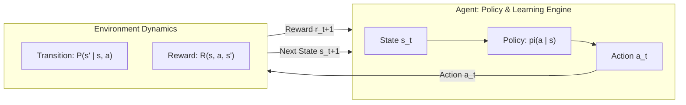

# Reinforcement Learning: Fundamentals & The Agent-Environment Loop

> **Topic:** Reinforcement Learning Fundamentals, Core Entities & The Agent-Environment Loop  
> **Module ID:** `05-ai/machine-learning/07-reinforcement-learning`  
> **Target Version:** Python 3.11+, NumPy 1.26+, Gymnasium 0.29+ / 1.0+  
> **Level:** Core  
> **Prerequisites:** [Probability & Distributions](../01-math-foundations/03-probability-and-distributions.md), [Optimization & Gradient Descent](../01-math-foundations/06-optimisation-and-gradient-descent.md)  
> **Status:** Verified (Python 3.11 / CPU)

---

## Architectural / Conceptual Flow



---

## 1. Concept Overview & Core Motivation

Machine learning is traditionally divided into three fundamental paradigms:
1. **Supervised Learning**: Learning from an external teacher providing explicit ground-truth targets $(\mathbf{x}, y)$.
2. **Unsupervised Learning**: Discovering latent geometric patterns, manifolds, or density clusters within unannotated data $\mathbf{x}$.
3. **Reinforcement Learning (RL)**: Learning by trial and error through **direct interaction with a dynamic environment** to maximize cumulative numerical reward signals.

In Reinforcement Learning, there is no supervisor telling the agent the correct action. Instead, the agent must discover which actions yield the highest reward by executing them, facing two foundational challenges:
- **Delayed Reward**: An action chosen now (e.g. sacrificing a pawn in chess, or investing in factory tooling) may only produce a reward hundreds of time-steps later (checkmate, or manufacturing profitability).
- **The Exploration-Exploitation Dilemma**: To find rewarding actions, the agent must try unvisited states (exploration), but to achieve high cumulative reward, it must prefer actions it already knows are effective (exploitation).

---

## 2. Theoretical Foundations & Mathematics

### Symbol Table

| Symbol | Mathematical Definition | Data Type / Dimensions | Role in Concept |
| :---: | :--- | :---: | :--- |
| $\mathcal{S}$ | State space | Discrete set or $\mathbb{R}^d$ | Universe of all possible environmental situations |
| $\mathcal{A}$ | Action space | Discrete set or $\mathbb{R}^k$ | Universe of all legal agent decisions |
| $s_t \in \mathcal{S}$ | State at time $t$ | Element in $\mathcal{S}$ | Environmental observation at discrete step $t$ |
| $a_t \in \mathcal{A}$ | Action at time $t$ | Element in $\mathcal{A}$ | Agent decision executed at time $t$ |
| $r_{t+1} \in \mathbb{R}$ | Scalar reward | Real scalar | Feedback received after executing $a_t$ in $s_t$ |
| $\pi(a \mid s)$ | Policy function | $P(A_t = a \mid S_t = s)$ | Agent behavior mapping states to action probabilities |
| $\gamma \in [0, 1)$ | Discount factor | Scalar in $[0, 1)$ | Balances immediate vs future delayed rewards |
| $G_t$ | Return (Discounted return) | Real scalar | Cumulative discounted future reward from step $t$ |
| $T$ | Terminal step | Positive integer | Final step in episodic tasks ($t = 0, 1, \dots, T$) |

### The Return Objective ($G_t$)
The agent's objective is to maximize the expected **discounted return** $G_t$ starting from time-step $t$:

$$G_t = r_{t+1} + \gamma r_{t+2} + \gamma^2 r_{t+3} + \dots = \sum_{k=0}^{\infty} \gamma^k r_{t+k+1}$$

#### Recursive Formulation
The return satisfies a fundamental recursive identity:

$$G_t = r_{t+1} + \gamma \left( r_{t+2} + \gamma r_{t+3} + \dots \right) = r_{t+1} + \gamma G_{t+1}$$

#### Why the Discount Factor $\gamma$ is Necessary
1. **Mathematical Finiteness**: If the environment is continuous (non-terminating, $T = \infty$), and rewards are positive ($r > 0$), the undiscounted sum $\sum_{k=0}^\infty r$ diverges to $+\infty$. If $\gamma < 1$, the infinite geometric series converges to a finite bound:
   $$G_t \le \frac{R_{\max}}{1 - \gamma}$$
2. **Temporal Uncertainty**: Future rewards are inherently less certain than immediate rewards due to stochastic environment transitions.
3. **Animal and Human Analogy**: Reflects biological time preference (delay discounting).

### Episodic vs Continuing Tasks
- **Episodic Tasks**: Interaction naturally breaks into discrete trials (episodes) of length $T$, concluding in a **terminal state** (e.g. game of chess, Mario level, cartpole falling). $G_t = \sum_{k=0}^{T - t - 1} \gamma^k r_{t+k+1}$.
- **Continuing Tasks**: Interaction continues indefinitely without terminal states (e.g. algorithmic high-frequency trading, temperature control in a data center). $\gamma$ must be strictly $< 1$.

---

## 3. Implementation & Practical Code

A complete, standalone simulation of an Agent-Environment interaction loop with discounted return calculation and trajectory logging:

```python
"""
Pure Python/NumPy simulation of the fundamental Agent-Environment RL loop.
"""

from __future__ import annotations
import numpy as np

class SimpleGridEnvironment:
    """
    1D Line World: States [0, 1, 2, 3, 4].
    State 0: Loss (-10 reward, Terminal).
    State 4: Goal (+10 reward, Terminal).
    Actions: 0 = Left, 1 = Right.
    """
    def __init__(self):
        self.state = 2 # Start in middle
        self.terminal = False

    def reset(self) -> int:
        self.state = 2
        self.terminal = False
        return self.state

    def step(self, action: int) -> tuple[int, float, bool]:
        if self.terminal:
            raise RuntimeError("Environment is terminal. Call reset().")

        # Deterministic movement
        if action == 0:
            self.state = max(0, self.state - 1)
        elif action == 1:
            self.state = min(4, self.state + 1)

        # Reward and termination
        if self.state == 0:
            reward = -10.0
            self.terminal = True
        elif self.state == 4:
            reward = 10.0
            self.terminal = True
        else:
            reward = -0.1 # Slight step penalty to encourage speed
            self.terminal = False

        return self.state, reward, self.terminal


class RandomPolicyAgent:
    def __init__(self, n_actions: int = 2):
        self.n_actions = n_actions

    def act(self, state: int) -> int:
        return int(np.random.choice(self.n_actions))


def compute_discounted_returns(rewards: list[float], gamma: float = 0.99) -> list[float]:
    """
    Computes G_t for all t in an episode using reverse dynamic programming:
    G_t = r_{t+1} + gamma * G_{t+1}
    """
    returns = [0.0] * len(rewards)
    g = 0.0
    for t in reversed(range(len(rewards))):
        g = rewards[t] + gamma * g
        returns[t] = g
    return returns


def run_episode(env: SimpleGridEnvironment, agent: RandomPolicyAgent, gamma: float = 0.9):
    state = env.reset()
    states = [state]
    actions = []
    rewards = []

    done = False
    while not done:
        action = agent.act(state)
        next_state, reward, done = env.step(action)
        
        actions.append(action)
        rewards.append(reward)
        states.append(next_state)
        state = next_state

    returns = compute_discounted_returns(rewards, gamma)
    return {
        "states": states,
        "actions": actions,
        "rewards": rewards,
        "returns": returns,
        "total_undiscounted_return": sum(rewards)
    }

if __name__ == "__main__":
    env = SimpleGridEnvironment()
    agent = RandomPolicyAgent()
    trajectory = run_episode(env, agent, gamma=0.9)
    print("Trajectory states:", trajectory["states"])
    print("Trajectory rewards:", trajectory["rewards"])
    print("Computed discounted returns G_t:", np.round(trajectory["returns"], 3))
```

---

## 4. Edge Cases & Advanced Scenarios

1. **Deadly Horizon Mismatch**:
   - Setting discount $\gamma = 0$ turns the agent into a completely short-sighted myopic agent that only cares about immediate reward $r_{t+1}$, ignoring all future consequences.
   - Setting discount $\gamma \to 1$ in an infinite-horizon task causes returns to explode toward infinity, destabilizing gradient updates.
2. **Sparse Reward Cliff**:
   - In environments where reward is zero everywhere except for the final goal state (e.g. maze navigation, complex robotic assembly), random exploration has probability $\approx 0$ of ever reaching the goal. The agent receives zero feedback and learns nothing.
   - *Fix*: Reward shaping, curiosity-driven exploration, or demonstration pre-training.
3. **Reward Hacking / Wireheading**:
   - The agent finds unintended shortcuts in the physics engine to maximize numerical reward without solving the intended problem (e.g. spinning in circles in a boat racing game to collect bonus points rather than finishing the race).

---

## 5. Anti-Patterns & Common Pitfalls Table

| Anti-Pattern / Mistake | Why It Fails | Correct Engineering Fix |
| :--- | :--- | :--- |
| **Including Step Limit in State as Terminal** | Timeouts (truncation) are not genuine physical MDP terminations; treating them as terminal corrupts Bellman bootstrap updates. | Distinguish between **Termination** (`terminated`, natural terminal state) and **Truncation** (`truncated`, artificial step timeout). |
| **Normalizing Rewards Without Clamping** | Outlier rewards produce extreme variance in discounted returns $G_t$, destabilizing value network loss. | Use Running Mean-Std normalization with clipping (`np.clip(r, -10, 10)`). |
| **Setting Discount $\gamma = 1.0$ in Continuing Tasks** | Infinite sum of rewards diverges, causing numerical overflow in value estimation. | Keep $\gamma \le 0.999$ for non-episodic environments. |
| **Assuming State Equals Observation** | Real-world robots only receive partial sensor readings (POMDP), violating the Markov property. | Stack sequential observations (frame stacking) or use recurrent memory (LSTM / GRU). |
| **Evaluating on Training Seeds Only** | RL agents memorize the exact trajectory of fixed environment seeds without learning general dynamics. | Evaluate across 100+ unseen random evaluation seeds. |

---

## 6. Best Practices & Production Guidelines

1. **Farama Gymnasium Standard**: Always write environment wrappers following the modern 5-element step API:
   ```python
   obs, reward, terminated, truncated, info = env.step(action)
   ```
2. **Reverse Discounted Return Computation**: Never compute $G_t = \sum_{k=t}^T \gamma^{k-t} r_k$ with an $\mathcal{O}(T^2)$ nested loop. Compute backwards in $\mathcal{O}(T)$ time:
   $$G_t = r_t + \gamma G_{t+1}$$
3. **Reward Scale Alignment**: Ensure typical cumulative episode returns remain in the numerical range $[-100, +100]$ to facilitate neural network convergence.

---

## 7. Real-World Case Study

### Data Center HVAC Chiller Energy Optimization
- **Context**: DeepMind and Google deployed RL agents to regulate cooling equipment across hyperscale cloud data centers.
- **Problem**: Traditional PID controllers cannot anticipate changes in outside weather, server CPU spikes, or thermodynamic lag, resulting in billions of kilowatt-hours of wasted electricity.
- **RL Architecture**:
  1. **State ($s_t$)**: 120 sensor features (ambient weather, server power draw, valve pressures, cooling tower pump speeds).
  2. **Action ($a_t$)**: Continuous setpoints for cooling water valves and fan speeds.
  3. **Reward ($r_t$)**: Negative Power Usage Effectiveness ($-\text{PUE}$) penalized by safety bounds (must keep server air temperature within $18^\circ\text{C} - 27^\circ\text{C}$).
- **Outcome**: Achieved a verified $40\%$ reduction in data center cooling energy consumption while maintaining $100\%$ uptime safety compliance.

---

## 8. Performance & Resource Optimization

```python
"""
Vectorized parallel environment rollout execution using NumPy arrays.
"""

import numpy as np

def parallel_return_calculation(rewards_matrix: np.ndarray, gammas: float = 0.99) -> np.ndarray:
    """
    Computes discounted returns across N parallel environment rollouts simultaneously.
    rewards_matrix: shape (T, N_envs)
    Returns: shape (T, N_envs)
    """
    T, N_envs = rewards_matrix.shape
    returns = np.zeros_like(rewards_matrix, dtype=np.float32)
    
    g = np.zeros(N_envs, dtype=np.float32)
    for t in reversed(range(T)):
        g = rewards_matrix[t] + gammas * g
        returns[t] = g
        
    return returns
```

---

## 9. Security, Privacy & Ethics Considerations

1. **Autonomous Weaponry and Safety Invariants**: An RL agent tasked with maximizing a reward metric without strict formal physical constraints can take destructive actions during exploration. Hard safety shields (Control Barrier Functions) must intercept and override dangerous actions.
2. **Feedback Loop Polarization**: Recommendation algorithms trained via RL to maximize user engagement (click-through return) inevitably discover that outrage and misinformation drive higher return, reinforcing societal polarization.

---

## 10. Diagnostic & Verification Playbook

```python
"""
Sanity check: Verifying that discounted return computation matches analytical bounds.
"""

import numpy as np

def verify_discounted_return_bounds(rewards: list[float], gamma: float):
    returns = compute_discounted_returns(rewards, gamma)
    r_max = max(abs(r) for r in rewards)
    theoretical_max = r_max / (1.0 - gamma) if gamma < 1.0 else np.inf
    
    for g in returns:
        assert abs(g) <= theoretical_max + 1e-5, f"Return {g} exceeded theoretical limit {theoretical_max}"
        
    print(f"Verified {len(returns)} steps! All returns strictly bounded within [-{theoretical_max:.2f}, {theoretical_max:.2f}].")
```

---

## 11. Technical Interview Questions & Answers

<details>
<summary><strong>Q1: Why is the discount factor $\gamma$ strictly required to be less than 1.0 in continuing (infinite-horizon) tasks?</strong></summary>

**Answer:**  
In continuing tasks, the horizon is infinite ($T = \infty$). The cumulative return is:
$$G_t = \sum_{k=0}^{\infty} \gamma^k r_{t+k+1}$$
If $\gamma = 1.0$ and the environment yields a constant bounded reward $r_t = c > 0$ at every time-step, the sum becomes:
$$G_t = \sum_{k=0}^{\infty} c = c + c + c + \dots = +\infty$$
When all infinite trajectories yield an infinite return, every policy has value $+\infty$. An agent cannot mathematically compare or optimize policies because $\infty \ge \infty$ is indeterminate.
Setting $\gamma \in [0, 1)$ guarantees that the infinite geometric series converges to a finite value by the ratio test:
$$G_t \le \sum_{k=0}^{\infty} \gamma^k R_{\max} = R_{\max} \sum_{k=0}^{\infty} \gamma^k = \frac{R_{\max}}{1 - \gamma} < \infty$$
This ensures well-defined value functions and allows contraction mapping theorems to hold.
</details>

<details>
<summary><strong>Q2: Explain the difference between "Terminated" and "Truncated" in modern Gymnasium environments.</strong></summary>

**Answer:**  
In modern RL APIs (Gymnasium 0.29+ / Farama):
- **Terminated (`terminated = True`)**: The agent reached an intrinsic terminal state defined by the underlying Markov Decision Process (e.g. pole fell past threshold in CartPole, agent died, goal was reached).
  - *Mathematical Impact*: The value of a true terminal state is identically zero: $V(s_{\text{terminal}}) = 0$. The Bellman target is strictly $r_{t+1}$ with no future bootstrap.
- **Truncated (`truncated = True`)**: The episode was artificially halted by an external engineering constraint (e.g. maximum time-step limit of 500 reached), but the agent was still in a viable, non-terminal physical state.
  - *Mathematical Impact*: The true value of the truncated state is **not zero** ($V(s_{500}) \ne 0$). The Bellman update must continue bootstrapping from $V(s_{500})$: target $= r + \gamma V(s_{500})$. Treating truncation as termination biases value estimates negatively near the time horizon.
</details>

<details>
<summary><strong>Q3: How does the Exploration-Exploitation trade-off in RL fundamentally differ from Supervised Learning?</strong></summary>

**Answer:**  
In Supervised Learning, the training dataset $\mathcal{D} = \{(\mathbf{x}_i, y_i)\}$ is fixed and collected prior to training (passive learning). The model's predictions do not influence which data points it observes next.
In Reinforcement Learning, the agent's current policy $\pi_\theta(a \mid s)$ directly dictates which states $s_{t+1}$ and rewards $r_{t+1}$ are generated. The data collection process is **active and closed-loop**:
- If the agent **exploits** its current knowledge and only takes actions it believes are best, it will never visit unvisited regions of the state space, remaining permanently blind to potentially superior strategies.
- If the agent **explores** exclusively, it takes random exploratory actions and suffers low cumulative return.
The agent must actively balance gathering information about unknown states against maximizing performance using current knowledge.
</details>

<details>
<summary><strong>Q4: Why does adding a constant positive shift $c > 0$ to all rewards alter optimal policies in episodic tasks with time limits?</strong></summary>

**Answer:**  
In episodic tasks where the agent incurs a penalty per time-step (e.g. maze navigation where $r_t = -1$), the agent is incentivized to find the **shortest possible path** to reach the goal quickly and minimize total accumulated penalties.
If we add a constant $+2$ to all rewards, the step reward becomes $r_t = -1 + 2 = +1$.
Now, surviving each additional time-step gives the agent $+1$ reward! The agent will intentionally avoid the goal, looping in circles indefinitely to accumulate infinite positive survival points.
**Rule**: Adding a constant shift $c$ to rewards is only policy-invariant if the horizon $T$ is fixed. If episode length is variable, shifting rewards fundamentally alters the agent's incentive to end or prolong the episode.
</details>

<details>
<summary><strong>Q5: What is the Credit Assignment Problem in Reinforcement Learning?</strong></summary>

**Answer:**  
The Credit Assignment Problem asks: *When an agent receives a delayed reward at time $T$ (e.g. winning a game of Go after 200 moves), which specific actions taken at earlier time-steps $t \ll T$ were actually responsible for that success, and which actions were irrelevant or detrimental?*
Because the reward signal is scalar and delayed, distributing credit across hundreds of past decisions requires temporal modeling. Temporal Difference learning and eligibility traces ($\text{TD}(\lambda)$) resolve this by propagating value backwards through intermediate states.
</details>

<details>
<summary><strong>Q6: Contrast On-Policy vs Off-Policy learning paradigms.</strong></summary>

**Answer:**  
- **On-Policy Learning**: The agent learns about the exact same policy $\pi$ that it uses to generate data and make decisions in the environment:
  $$\text{Data generated by } \pi \implies \text{Evaluating / Improving } \pi$$
  - *Example*: SARSA, A2C, PPO.
  - *Trade-off*: More stable, accounts for the agent's actual exploratory mistakes; cannot reuse historical replay data from older policies.
- **Off-Policy Learning**: The agent evaluates or improves a **target policy** $\pi$ while generating experience using a different **behavior policy** $\mu$:
  $$\text{Data generated by } \mu \implies \text{Evaluating / Improving } \pi$$
  - *Example*: Q-Learning, DQN, DDPG, SAC.
  - *Trade-off*: Highly sample efficient because it can learn from arbitrary exploratory data, human demonstrations, and large offline replay buffers.
</details>

<details>
<summary><strong>Q7: What is the Markov Property and why is it foundational to RL?</strong></summary>

**Answer:**  
A state signal $S_t$ has the Markov Property if and only if the transition probability to the next state and reward depends **strictly on the immediate current state and action**, independent of the entire prior history of past states and actions:
$$P(S_{t+1} = s', R_{t+1} = r \mid S_t, A_t, S_{t-1}, A_{t-1}, \dots, S_0, A_0) = P(S_{t+1} = s', R_{t+1} = r \mid S_t, A_t)$$
**Why it is foundational**:
If the Markov property holds, the current state $S_t$ contains all relevant information from the past needed to predict the future. The agent does not need to memorize past trajectories or history buffers, allowing value functions $V(s)$ and policies $\pi(a \mid s)$ to be formulated as functions of the current state alone.
</details>

<details>
<summary><strong>Q8: Explain the difference between Deterministic and Stochastic Policies.</strong></summary>

**Answer:**  
- **Deterministic Policy ($a = \mu(s)$)**: A direct functional mapping from state space to a single unique action $\mu: \mathcal{S} \to \mathcal{A}$. Given state $s$, the agent always takes action $a = \mu(s)$ with probability $1.0$.
  - Common in continuous control algorithms (DDPG, TD3).
- **Stochastic Policy ($\pi(a \mid s)$)**: A probability distribution over possible actions given state $s$: $\pi: \mathcal{S} \times \mathcal{A} \to [0, 1]$ where $\sum_{a} \pi(a \mid s) = 1$.
  - Essential for exploration in discrete action spaces (e.g. Categorical distribution in PPO), adversarial games (mixed Nash equilibria), and partially observable environments.
</details>

---

## 12. Hands-On Practice Exercises

<details>
<summary><strong>Exercise 1 (Easy): Analytical Discounted Return Calculation</strong></summary>

**Task**: An agent receives rewards $R = [1, 2, 3, 10]$ across a 4-step episode. Calculate the discounted returns $G_0, G_1, G_2, G_3$ by hand and verify using Python with $\gamma = 0.5$.

**Solution**:
```python
# Analytical:
# G_3 = 10
# G_2 = 3 + 0.5 * 10 = 8
# G_1 = 2 + 0.5 * 8 = 6
# G_0 = 1 + 0.5 * 6 = 4

rewards = [1.0, 2.0, 3.0, 10.0]
gamma = 0.5

G = [0.0] * 4
g = 0.0
for t in reversed(range(len(rewards))):
    g = rewards[t] + gamma * g
    G[t] = g

print("Discounted returns [G0, G1, G2, G3]:", G)
assert G == [4.0, 6.0, 8.0, 10.0]
```
</details>

<details>
<summary><strong>Exercise 2 (Easy): Stochastic Policy Sampling</strong></summary>

**Task**: Implement a function that takes categorical logits for 4 discrete actions, converts them to probabilities via Softmax with temperature, and samples an action.

**Solution**:
```python
import numpy as np

def sample_stochastic_policy(logits: np.ndarray, temperature: float = 1.0) -> tuple[int, np.ndarray]:
    scaled_logits = logits / temperature
    max_l = np.max(scaled_logits)
    exp_l = np.exp(scaled_logits - max_l)
    probs = exp_l / np.sum(exp_l)
    
    action = int(np.random.choice(len(probs), p=probs))
    return action, probs

# Test
test_logits = np.array([2.0, 5.0, 1.0, 0.5])
action, action_probs = sample_stochastic_policy(test_logits, temperature=0.5)
print(f"Action sampled: {action} with probabilities: {np.round(action_probs, 3)}")
```
</details>

<details>
<summary><strong>Exercise 3 (Medium): Gymnasium Observation Wrapper (Frame Stacking)</strong></summary>

**Task**: Implement an observation buffer that stacks the last $K=4$ continuous states to convert a non-Markovian position sensor into a Markovian velocity-aware state.

**Solution**:
```python
import numpy as np
from collections import deque

class FrameStackBuffer:
    def __init__(self, k_frames: int = 4, state_dim: int = 2):
        self.k_frames = k_frames
        self.state_dim = state_dim
        self.buffer = deque(maxlen=k_frames)

    def reset(self, initial_state: np.ndarray) -> np.ndarray:
        for _ in range(self.k_frames):
            self.buffer.append(np.copy(initial_state))
        return self.get_stacked()

    def step(self, new_state: np.ndarray) -> np.ndarray:
        self.buffer.append(np.copy(new_state))
        return self.get_stacked()

    def get_stacked(self) -> np.ndarray:
        # Concatenate along feature axis: (k_frames * state_dim,)
        return np.concatenate(list(self.buffer), axis=0)

# Verification
fs = FrameStackBuffer(k_frames=3, state_dim=1)
s0 = fs.reset(np.array([10.0]))
print("Initial stack:", s0) # [10, 10, 10]
s1 = fs.step(np.array([12.0]))
print("Step 1 stack:", s1)  # [10, 10, 12]
s2 = fs.step(np.array([15.0]))
print("Step 2 stack:", s2)  # [10, 12, 15]
```
</details>

<details>
<summary><strong>Exercise 4 (Medium): Truncation vs Termination Return Correction</strong></summary>

**Task**: Demonstrate how treating a truncated state as non-terminal changes the discounted return target by bootstrapping from an estimated value $V(s)$.

**Solution**:
```python
def compute_generalized_return(rewards, terminal_type="terminated", v_final=50.0, gamma=0.9):
    """
    terminal_type: 'terminated' (V(s_T) = 0) or 'truncated' (bootstrap V(s_T))
    """
    g = v_final if terminal_type == "truncated" else 0.0
    returns = []
    for r in reversed(rewards):
        g = r + gamma * g
        returns.append(g)
    return list(reversed(returns))

rewards = [1.0, 1.0, 1.0] # 3 steps
ret_terminated = compute_generalized_return(rewards, terminal_type="terminated")
ret_truncated  = compute_generalized_return(rewards, terminal_type="truncated", v_final=20.0)

print("Return when episode ended by death/goal (terminated):", ret_terminated)
print("Return when episode ended by timeout (truncated):    ", ret_truncated)
```
</details>

<details>
<summary><strong>Exercise 5 (Hard): Vectorized Multi-Trajectory Return Calculator</strong></summary>

**Task**: Write a vectorized function that accepts a ragged list of variable-length episode reward sequences and calculates all discounted returns in a single NumPy pass using padding.

**Solution**:
```python
import numpy as np

def compute_ragged_returns(episodes_rewards: list[list[float]], gamma: float = 0.95) -> list[np.ndarray]:
    lengths = [len(ep) for ep in episodes_rewards]
    max_len = max(lengths)
    n_episodes = len(episodes_rewards)
    
    # Padded reward matrix (max_len, n_episodes)
    padded_rewards = np.zeros((max_len, n_episodes), dtype=np.float32)
    mask = np.zeros((max_len, n_episodes), dtype=bool)
    
    for i, ep in enumerate(episodes_rewards):
        padded_rewards[:len(ep), i] = ep
        mask[:len(ep), i] = True
        
    padded_returns = np.zeros_like(padded_rewards)
    g = np.zeros(n_episodes, dtype=np.float32)
    
    for t in reversed(range(max_len)):
        g = padded_rewards[t] + gamma * g
        padded_returns[t] = g
        # Reset returns outside valid length
        g = np.where(mask[t], g, 0.0)
        
    return [padded_returns[:lengths[i], i] for i in range(n_episodes)]

# Test
eps = [[1.0, 2.0], [5.0, 5.0, 5.0, 5.0], [10.0]]
res = compute_ragged_returns(eps, gamma=0.5)
print("Episode 0 returns:", res[0])
print("Episode 2 returns:", res[2])
```
</details>

<details>
<summary><strong>Exercise 6 (Hard): Verifying the Contraction Mapping of Returns</strong></summary>

**Task**: Prove numerically that the operator $T(G) = r + \gamma G$ is a contraction mapping with Lipschitz constant $\gamma = 0.8$ across 100 random value pairs.

**Solution**:
```python
import numpy as np

gamma = 0.8
rng = np.random.default_rng(42)

# Generate 100 random pairs of return estimates G1, G2
G1 = rng.uniform(-100, 100, size=100)
G2 = rng.uniform(-100, 100, size=100)
rewards = rng.uniform(-5, 5, size=100)

# Apply Bellman operator
T_G1 = rewards + gamma * G1
T_G2 = rewards + gamma * G2

# Distances
original_dist = np.abs(G1 - G2)
mapped_dist = np.abs(T_G1 - T_G2)

ratio = mapped_dist / original_dist
np.testing.assert_allclose(ratio, gamma, atol=1e-5)
print(f"Contractive factor strictly verified: mapped_dist / original_dist = {ratio[0]:.4f} == gamma ({gamma})")
```
</details>

---

## 13. Summary, Verified References & Navigation

### Core Takeaways
1. **RL learns by active interaction**: No labels are provided; the agent must balance exploration of unvisited states against exploitation of known rewards.
2. **Returns satisfy recursive identities**: $G_t = r_{t+1} + \gamma G_{t+1}$.
3. **Discount $\gamma < 1$ guarantees mathematical finiteness**: Prevents infinite reward divergence in continuing tasks.

### Verified References
- Sutton, R. S., & Barto, A. G. (2018). *Reinforcement Learning: An Introduction (2nd Edition).* MIT Press. Chapter 1: The Reinforcement Learning Problem; Chapter 3: Finite Markov Decision Processes.
- Farama Foundation. (2023). *Gymnasium: A Standard Interface for Reinforcement Learning Environments.*
- Henderson, P. et al. (2018). *Deep Reinforcement Learning that Matters.* AAAI.

---

[← Previous Module: Semi-Supervised Learning](../06-semi-and-self-supervised/README.md) | [Module Index](README.md) | [Next Note: Markov Decision Processes →](02-markov-decision-processes.md)
