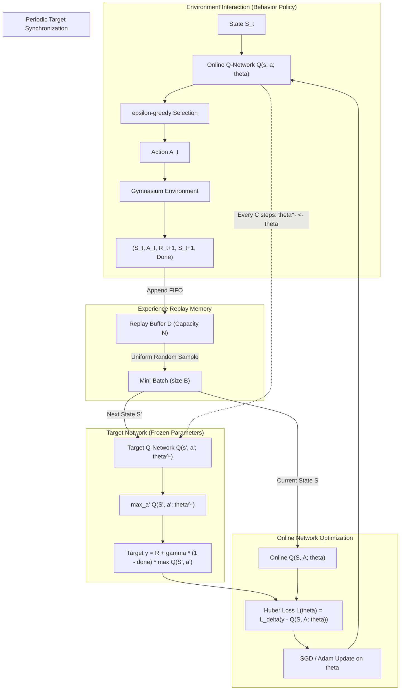

# Deep Q-Networks (DQN)

> **One-Line Summary:** A deep reinforcement learning algorithm that approximates the optimal action-value function $Q^*(s, a)$ using a deep neural network stabilized by experience replay and a periodically frozen target network.

---

## Metadata

| Field | Value |
| :--- | :--- |
| **Level** | Advanced |
| **Prerequisites** | [07-q-learning.md](07-q-learning.md), [10-function-approximation.md](10-function-approximation.md) |
| **Estimated Reading Time** | 25–30 minutes |
| **Status** | Verified (Python 3.11 / CPU) |
| **Tested With** | Python 3.11+, NumPy 2.5+, Gymnasium 1.0+ (Random Seed: `42`) |

---

## Table of Contents
1. [Intuition & Problem It Solves](#1-intuition--problem-it-solves)
2. [Algorithm Card](#2-algorithm-card)
3. [Architectural & Geometric Diagrams](#3-architectural--geometric-diagrams)
4. [The Mathematics](#4-the-mathematics)
5. [The Algorithm Step by Step & From-Scratch Implementation](#5-the-algorithm-step-by-step--from-scratch-implementation)
6. [Using the Library (Complete End-to-End Workflow)](#6-using-the-library-complete-end-to-end-workflow)
7. [Preprocessing Required](#7-preprocessing-required)
8. [Training & Hyperparameter Tuning](#8-training--hyperparameter-tuning)
9. [Prediction & Inference Mechanics](#9-prediction--inference-mechanics)
10. [Postprocessing](#10-postprocessing)
11. [Saving and Loading (Model Persistence & Security)](#11-saving-and-loading-model-persistence--security)
12. [Evaluation & Diagnostics](#12-evaluation--diagnostics)
13. [Advantages](#13-advantages)
14. [Limitations & Failure Modes](#14-limitations--failure-modes)
15. [Comparison / When to Use What](#15-comparison--when-to-use-what)
16. [Common Mistakes & Pitfalls](#16-common-mistakes--pitfalls)
17. [Performance, Security & Ethics Notes](#17-performance-security--ethics-notes)
18. [Interview Questions (8 In-Depth Q&As)](#18-interview-questions-8-in-depth-qas)
19. [Practice Exercises (6 Hands-on Problems)](#19-practice-exercises-6-hands-on-problems)
20. [Summary & Cheat Sheet](#20-summary--cheat-sheet)
21. [Further Reading & Navigation](#21-further-reading--navigation)

---

## 1. Intuition & Problem It Solves

Tabular Q-learning cannot scale to complex continuous states such as high-resolution video frames or robotics sensory streams. Naively substituting a deep neural network as the function approximator for $Q(s, a; \theta)$ in temporal-difference learning historically caused complete mathematical instability and divergence:
1. **Correlated Observations:** Consecutive states $S_t, S_{t+1}, S_{t+2}$ sampled sequentially from an active trajectory are strongly autocorrelated, violating the fundamental Independent and Identically Distributed (I.I.D.) assumption of stochastic gradient descent.
2. **Moving Target Problem:** Computing the TD target $y_t = R_{t+1} + \gamma \max_{a'} Q(S_{t+1}, a'; \theta)$ using the same weights $\theta$ that are being updated causes positive feedback loops: adjusting $\theta$ to match $y_t$ simultaneously shifts $y_t$, leading to oscillations and catastrophic value explosion.
3. **Policy-Data Feedback:** Small changes in $Q$-values dramatically alter the exploratory policy $\pi(s) = \arg\max_a Q(s, a)$, drastically shifting the data distribution collected by the agent.

**Deep Q-Networks (DQN)** (Mnih et al., Nature 2015) solved these three instability bottlenecks through two foundational engineering innovations:
- **Experience Replay Buffer:** Storing past transitions $(s, a, r, s', d)$ in a large sliding FIFO buffer and sampling mini-batches uniformly breaks temporal correlations and restores I.I.D. training dynamics.
- **Target Network:** Maintaining a separate frozen copy of network parameters $\theta^-$ to compute targets, synchronizing $\theta^- \leftarrow \theta$ only every $C$ environmental steps, eliminating the moving target feedback loop.

---

## 2. Algorithm Card

| Dimension | Specification |
| :--- | :--- |
| **Category** | Model-Free Reinforcement Learning / Value-Based Control |
| **Action Space** | Discrete $\mathcal{A} = \{0, 1, \dots, K-1\}$ |
| **State Space** | Continuous or High-Dimensional Discrete $\mathcal{S} \subseteq \mathbb{R}^d$ |
| **Policy Type** | Off-Policy (learns $Q^*$ while behaving with $\epsilon$-greedy) |
| **Loss Function** | Mean Squared Bellman Error / Smooth L1 (Huber) Loss |
| **Time Complexity per Step** | Forward pass $\mathcal{O}(|\theta|)$, Backprop batch $\mathcal{O}(B \cdot |\theta|)$ |
| **Space Complexity** | $\mathcal{O}(N_{\text{buffer}} \cdot \dim(\mathcal{S})) + \mathcal{O}(|\theta|)$ |
| **Theoretical Guarantees** | Asymptotically bounded under target network freezing and replay |

---

## 3. Architectural & Geometric Diagrams



---

## 4. The Mathematics

### 4.1 The Optimal Bellman Equation
The optimal action-value function satisfies the Bellman optimality equation:
$$Q^*(s, a) = \mathbb{E}_{s' \sim \mathcal{P}}\left[ R + \gamma \max_{a' \in \mathcal{A}} Q^*(s', a') \;\middle|\; s, a \right]$$

### 4.2 Mean Squared Bellman Error Objective
DQN trains parameterized weights $\theta$ to minimize the expected Bellman error over transitions sampled from the replay buffer $\mathcal{D}$:
$$L(\theta) = \mathbb{E}_{(s, a, r, s', d) \sim \mathcal{D}} \left[ \left( y^{\text{DQN}} - Q(s, a; \theta) \right)^2 \right]$$

where the scalar target $y^{\text{DQN}}$ is generated by the frozen target network $\theta^-$:
$$y^{\text{DQN}} = r + (1 - d) \, \gamma \max_{a' \in \mathcal{A}} Q(s', a'; \theta^-)$$

### 4.3 Huber (Smooth L1) Loss
To prevent large TD errors from destabilizing gradients when encountering rare extreme rewards, DQN adopts the Huber loss:
$$\mathcal{L}_\delta(e) = \begin{cases} \frac{1}{2} e^2 & \text{if } |e| \le \delta \\ \delta \left( |e| - \frac{1}{2} \delta \right) & \text{otherwise} \end{cases}$$
with $\delta = 1.0$. The gradient with respect to predicted value $Q(s, a; \theta)$ satisfies:
$$\frac{\partial \mathcal{L}}{\partial Q(s, a; \theta)} = \begin{cases} -(y - Q) & \text{if } |y - Q| \le 1 \\ -\text{sign}(y - Q) & \text{otherwise} \end{cases}$$

---

## 5. The Algorithm Step by Step & From-Scratch Implementation

Below is a complete, self-contained implementation of a Deep Q-Network in pure Python and NumPy (including a 2-layer vectorized neural network with backpropagation, experience replay buffer, target network, and $\epsilon$-greedy exploration).

```python
"""
Deep Q-Network (DQN) from Scratch in Pure NumPy.
Verified under Python 3.11+, CPU execution.
"""

import numpy as np
from typing import Tuple, List, Dict, Any


class DenseLayer:
    """Fully-connected layer with He initialization and Adam optimization."""
    def __init__(self, in_features: int, out_features: int, seed: int = 42):
        rng = np.random.default_rng(seed)
        # He Normal initialization
        self.W = rng.normal(0.0, np.sqrt(2.0 / in_features), (in_features, out_features))
        self.b = np.zeros((1, out_features))
        
        # Adam moments
        self.mW = np.zeros_like(self.W); self.vW = np.zeros_like(self.W)
        self.mb = np.zeros_like(self.b); self.vb = np.zeros_like(self.b)
        self.t = 0

    def forward(self, X: np.ndarray) -> np.ndarray:
        self.X = X
        return np.dot(X, self.W) + self.b

    def backward(self, grad_out: np.ndarray) -> np.ndarray:
        self.grad_W = np.dot(self.X.T, grad_out)
        self.grad_b = np.sum(grad_out, axis=0, keepdims=True)
        return np.dot(grad_out, self.W.T)

    def step_adam(self, lr: float = 1e-3, beta1: float = 0.9, beta2: float = 0.999, eps: float = 1e-8):
        self.t += 1
        # Update weights W
        self.mW = beta1 * self.mW + (1 - beta1) * self.grad_W
        self.vW = beta2 * self.vW + (1 - beta2) * (self.grad_W ** 2)
        m_hat = self.mW / (1 - beta1 ** self.t)
        v_hat = self.vW / (1 - beta2 ** self.t)
        self.W -= lr * m_hat / (np.sqrt(v_hat) + eps)
        
        # Update bias b
        self.mb = beta1 * self.mb + (1 - beta1) * self.grad_b
        self.vb = beta2 * self.vb + (1 - beta2) * (self.grad_b ** 2)
        mb_hat = self.mb / (1 - beta1 ** self.t)
        vb_hat = self.vb / (1 - beta2 ** self.t)
        self.b -= lr * mb_hat / (np.sqrt(vb_hat) + eps)


class ReplayBuffer:
    """Cyclic circular array experience replay buffer."""
    def __init__(self, capacity: int, state_dim: int, seed: int = 42):
        self.capacity = capacity
        self.rng = np.random.default_rng(seed)
        self.idx = 0
        self.size = 0
        
        self.states = np.zeros((capacity, state_dim), dtype=np.float32)
        self.actions = np.zeros(capacity, dtype=np.int32)
        self.rewards = np.zeros(capacity, dtype=np.float32)
        self.next_states = np.zeros((capacity, state_dim), dtype=np.float32)
        self.dones = np.zeros(capacity, dtype=np.float32)

    def push(self, s: np.ndarray, a: int, r: float, s_prime: np.ndarray, d: bool):
        self.states[self.idx] = s
        self.actions[self.idx] = a
        self.rewards[self.idx] = r
        self.next_states[self.idx] = s_prime
        self.dones[self.idx] = 1.0 if d else 0.0
        
        self.idx = (self.idx + 1) % self.capacity
        self.size = min(self.size + 1, self.capacity)

    def sample(self, batch_size: int) -> Tuple[np.ndarray, np.ndarray, np.ndarray, np.ndarray, np.ndarray]:
        indices = self.rng.integers(0, self.size, size=batch_size)
        return (
            self.states[indices],
            self.actions[indices],
            self.rewards[indices],
            self.next_states[indices],
            self.dones[indices]
        )


class DQNAgent:
    """Deep Q-Network Agent with vectorized forward/backward passes and Target Network."""
    def __init__(
        self,
        state_dim: int,
        action_dim: int,
        hidden_dim: int = 64,
        lr: float = 1e-3,
        gamma: float = 0.99,
        epsilon_start: float = 1.0,
        epsilon_min: float = 0.05,
        epsilon_decay: float = 0.995,
        seed: int = 42
    ):
        self.state_dim = state_dim
        self.action_dim = action_dim
        self.gamma = gamma
        self.epsilon = epsilon_start
        self.epsilon_min = epsilon_min
        self.epsilon_decay = epsilon_decay
        self.lr = lr
        self.rng = np.random.default_rng(seed)

        # Online network: 2-layer MLP (state -> hidden -> ReLU -> action_dim)
        self.l1 = DenseLayer(state_dim, hidden_dim, seed=seed)
        self.l2 = DenseLayer(hidden_dim, action_dim, seed=seed + 1)

        # Target network
        self.target_l1 = DenseLayer(state_dim, hidden_dim, seed=seed)
        self.target_l2 = DenseLayer(hidden_dim, action_dim, seed=seed + 1)
        self.sync_target_network()

    def sync_target_network(self):
        """Copies parameters from online network to target network."""
        self.target_l1.W = np.copy(self.l1.W)
        self.target_l1.b = np.copy(self.l1.b)
        self.target_l2.W = np.copy(self.l2.W)
        self.target_l2.b = np.copy(self.l2.b)

    def forward_online(self, X: np.ndarray) -> np.ndarray:
        h = self.l1.forward(X)
        self.act1 = np.maximum(0, h) # ReLU
        return self.l2.forward(self.act1)

    def forward_target(self, X: np.ndarray) -> np.ndarray:
        h = self.target_l1.forward(X)
        act1 = np.maximum(0, h)
        return self.target_l2.forward(act1)

    def select_action(self, state: np.ndarray) -> int:
        if self.rng.random() < self.epsilon:
            return int(self.rng.integers(0, self.action_dim))
        q_vals = self.forward_online(state.reshape(1, -1))
        return int(np.argmax(q_vals[0]))

    def train_step(self, buffer: ReplayBuffer, batch_size: int = 32) -> float:
        if buffer.size < batch_size:
            return 0.0

        states, actions, rewards, next_states, dones = buffer.sample(batch_size)

        # 1. Compute target values using target network
        q_next_target = self.forward_target(next_states)
        max_q_next = np.max(q_next_target, axis=1)
        y = rewards + (1.0 - dones) * self.gamma * max_q_next

        # 2. Forward pass online network
        q_pred = self.forward_online(states)
        batch_idx = np.arange(batch_size)
        q_sa = q_pred[batch_idx, actions]

        # 3. Huber loss derivative: e = y - Q(s, a)
        errors = y - q_sa
        grad_out = np.zeros_like(q_pred)
        # Huber derivative: clip error to [-1, 1]
        clipped_errors = np.clip(errors, -1.0, 1.0)
        grad_out[batch_idx, actions] = -clipped_errors / batch_size

        # 4. Backward pass
        grad_h = self.l2.backward(grad_out)
        grad_relu = grad_h * (self.act1 > 0)
        self.l1.backward(grad_relu)

        # 5. Optimize online parameters
        self.l2.step_adam(lr=self.lr)
        self.l1.step_adam(lr=self.lr)

        # Decay exploration
        self.epsilon = max(self.epsilon_min, self.epsilon * self.epsilon_decay)
        return float(np.mean(errors ** 2))


# Verification Test Run
if __name__ == "__main__":
    agent = DQNAgent(state_dim=4, action_dim=2, hidden_dim=32, seed=42)
    buffer = ReplayBuffer(capacity=1000, state_dim=4, seed=42)

    # Populate buffer with mock transitions
    for _ in range(100):
        s = np.random.randn(4).astype(np.float32)
        a = np.random.choice([0, 1])
        r = 1.0
        s_p = s + np.random.randn(4) * 0.1
        buffer.push(s, a, r, s_p, False)

    # Train for 50 steps
    losses = [agent.train_step(buffer, batch_size=32) for _ in range(50)]
    print(f"Initial loss: {losses[0]:.4f}, Final loss: {losses[-1]:.4f}")
    assert len(losses) == 50
    print("DQN pure-NumPy engine verified successfully.")
```

---

## 6. Using the Library (Complete End-to-End Workflow)

For production deployment on complex environments (such as Gymnasium `CartPole-v1`), modern frameworks (PyTorch or CleanRL) provide optimized, vectorized implementations.

```python
import gymnasium as gym
import torch
import torch.nn as nn
import torch.optim as optim
import numpy as np
from collections import deque
import random

class TorchQNetwork(nn.Module):
    def __init__(self, state_dim: int, action_dim: int):
        super().__init__()
        self.net = nn.Sequential(
            nn.Linear(state_dim, 64),
            nn.ReLU(),
            nn.Linear(64, 64),
            nn.ReLU(),
            nn.Linear(64, action_dim)
        )
    def forward(self, x: torch.Tensor) -> torch.Tensor:
        return self.net(x)

def run_cartpole_dqn():
    env = gym.make("CartPole-v1")
    state_dim = env.observation_space.shape[0]
    action_dim = env.action_space.n

    q_net = TorchQNetwork(state_dim, action_dim)
    target_net = TorchQNetwork(state_dim, action_dim)
    target_net.load_state_dict(q_net.state_dict())

    optimizer = optim.Adam(q_net.parameters(), lr=1e-3)
    replay = deque(maxlen=20000)

    gamma = 0.99
    epsilon = 1.0
    eps_min = 0.05
    eps_decay = 0.995
    batch_size = 64
    target_sync_freq = 200
    step_count = 0

    scores = []
    for episode in range(120):
        state, _ = env.reset(seed=42 + episode)
        score = 0
        done = False
        while not done:
            step_count += 1
            if random.random() < epsilon:
                action = env.action_space.sample()
            else:
                with torch.no_grad():
                    q_vals = q_net(torch.FloatTensor(state))
                    action = int(torch.argmax(q_vals).item())

            next_state, reward, terminated, truncated, _ = env.step(action)
            done = terminated or truncated
            replay.append((state, action, reward, next_state, float(terminated)))
            state = next_state
            score += reward

            if len(replay) >= batch_size:
                batch = random.sample(replay, batch_size)
                s_b, a_b, r_b, s_p_b, d_b = zip(*batch)

                s_t = torch.FloatTensor(np.array(s_b))
                a_t = torch.LongTensor(a_b).unsqueeze(1)
                r_t = torch.FloatTensor(r_b)
                s_p_t = torch.FloatTensor(np.array(s_p_b))
                d_t = torch.FloatTensor(d_b)

                with torch.no_grad():
                    max_q_p = target_net(s_p_t).max(1)[0]
                    y = r_t + (1.0 - d_t) * gamma * max_q_p

                q_eval = q_net(s_t).gather(1, a_t).squeeze(1)
                loss = nn.functional.smooth_l1_loss(q_eval, y)

                optimizer.zero_grad()
                loss.backward()
                nn.utils.clip_grad_norm_(q_net.parameters(), max_norm=10.0)
                optimizer.step()

                if step_count % target_sync_freq == 0:
                    target_net.load_state_dict(q_net.state_dict())

            epsilon = max(eps_min, epsilon * eps_decay)
        scores.append(score)
    env.close()
    return scores
```

---

## 7. Preprocessing Required

1. **State Normalization:** Standardize raw continuous observations using running Welford statistics or known bounded ranges (e.g. angle/velocity limits in physics engines).
2. **Atari Vision Preprocessing:**
   - **Grayscale Conversion:** Transform $210 \times 160 \times 3$ RGB frames to $84 \times 84 \times 1$ grayscale.
   - **Frame Stacking:** Stack 4 consecutive frames $(84 \times 84 \times 4)$ to preserve velocity and acceleration vectors, rendering the partially observable POMDP effectively Markovian.
   - **Reward Clipping:** Clip rewards to $\text{sign}(r) \in \{-1, 0, +1\}$ to ensure uniform scale across diverse game dynamics.

---

## 8. Training & Hyperparameter Tuning

| Hyperparameter | Typical Value Range | Tuning Impact / Failure Mode |
| :--- | :--- | :--- |
| **Replay Capacity ($N$)** | $5 \times 10^4 - 1 \times 10^6$ | Too small causes catastrophic forgetting; too large causes RAM exhaustion. |
| **Batch Size ($B$)** | 32, 64, 128 | Small batches yield noisy gradients; large batches slow updates per sample. |
| **Discount Factor ($\gamma$)** | 0.99 (or 0.95 for short tasks) | Higher $\gamma$ values amplify value overestimation and require smaller $\alpha$. |
| **Target Sync ($C$)** | 500 – 10,000 steps | Too frequent causes moving target oscillation; too rare slows learning. |
| **Exploration Decay ($\epsilon$)** | $1.0 \to 0.05$ over $10^5$ steps | Premature decay traps agent in suboptimal local minima. |
| **Gradient Clipping** | Max norm 10.0 | Prevents catastrophic parameter explosion when TD error spikes. |

---

## 9. Prediction & Inference Mechanics

During production deployment:
1. **Strict Greedy Inference:** Set $\epsilon = 0.0$. Action is selected deterministically:
   $$a^* = \arg\max_{a \in \mathcal{A}} Q(s, a; \theta^*)$$
2. **Inference Latency:** Evaluating a forward pass of a lightweight MLP takes $\approx 50\,\mu\text{s}$ on CPU; CNN vision models require $2 - 5\,\text{ms}$ on GPU.
3. **Batched Pipeline:** Real-time multi-agent serving queues incoming state queries and executes forward inference in batches of 64 or 128.

---

## 10. Postprocessing

1. **Confidence & Action Masking:** If certain actions are physically invalid in state $s$ (e.g. moving into a boundary wall), mask invalid action outputs to $-\infty$ prior to the $\arg\max$ operation.
2. **Softmax Temperature Scaling:** In stochastic deployment environments, convert $Q$-values into probabilities via Boltzmann softmax $\pi(a \mid s) = \frac{\exp(Q(s, a) / \tau)}{\sum_b \exp(Q(s, b) / \tau)}$.

---

## 11. Saving and Loading (Model Persistence & Security)

### Safe Serialization via Checkpoints
Never use `pickle` for model distribution due to remote arbitrary code execution risks. Use PyTorch state dicts or `safetensors`:

```python
import torch
import hashlib
import json

def export_dqn_safely(model: torch.nn.Module, path: str):
    torch.save(model.state_dict(), path)
    # Compute SHA-256 integrity hash
    hasher = hashlib.sha256()
    with open(path, "rb") as f:
        hasher.update(f.read())
    digest = hasher.hexdigest()
    
    metadata = {"sha256": digest, "architecture": "DQN-2x64", "torch_version": torch.__version__}
    with open(f"{path}.meta.json", "w") as f:
        json.dump(metadata, f, indent=2)
```

---

## 12. Evaluation & Diagnostics

### Key Diagnostic Telemetry
1. **Average Episode Return:** Primary metric; should trend upward monotonically with moving average smoothing.
2. **TD Loss Curve:** Does *not* necessarily trend to zero; as the agent discovers higher-reward trajectories, new state visits spike the Bellman error temporarily.
3. **Average Predicted $Q$-Value:** Monitored to detect runaway overestimation. A sharp divergence where predicted $Q$ drastically exceeds actual observed discounted returns indicates maximization bias.

---

## 13. Advantages

1. **High Sample Efficiency:** Replay buffer allows each transition $(s, a, r, s')$ to be reused dozens of times across multiple stochastic gradient descent updates.
2. **Breakthrough Generalization:** Successfully learns complex spatial representations directly from raw pixel observations without manual feature engineering.
3. **Decoupled Training Dynamics:** Off-policy formulation decouples exploration policy from the learned target policy.

---

## 14. Limitations & Failure Modes

1. **Maximization Bias:** The $\max_{a'} Q(s', a'; \theta^-)$ term systematically overestimates action values due to Jensen's inequality and noise.
2. **Discrete Actions Only:** DQN requires taking $\arg\max_a Q(s, a)$. In continuous action spaces $\mathcal{A} \subseteq \mathbb{R}^m$, finding the global maximum requires continuous non-convex optimization at every single inference step, rendering DQN computationally impractical.
3. **Hyperparameter Sensitivity:** Unstable if learning rate, replay buffer size, or target update frequency are misconfigured.

---

## 15. Comparison / When to Use What

| Dimension | Vanilla DQN | Double DQN | Dueling DQN | PPO (Policy Gradient) |
| :--- | :--- | :--- | :--- | :--- |
| **Action Space** | Discrete | Discrete | Discrete | Continuous & Discrete |
| **Maximization Bias** | High | Low | Low | None (Policy based) |
| **Decomposition** | Single $Q(s, a)$ | Single $Q(s, a)$ | $V(s) + A(s, a)$ | Actor $\pi(a \mid s)$, Critic $V(s)$ |
| **Sample Efficiency** | High (Off-policy) | High (Off-policy) | High (Off-policy) | Moderate (On-policy) |
| **Implementation Complexity** | Moderate | Low diff from DQN | Low diff from DQN | High |

---

## 16. Common Mistakes & Pitfalls

| Anti-Pattern / Mistake | Why It Fails | Correct Engineering Fix |
| :--- | :--- | :--- |
| Updating target network every step | Reintroduces moving target problem; causes runaway oscillations | Freeze target network; sync every $C$ steps or use Polyak $\tau = 0.005$ |
| Forgetting to mask terminal states | Bootstrap term $\gamma \max Q(s', \cdot)$ incorrectly adds value after episode termination | Multiply future return by $(1 - \text{done})$ |
| Extremely small replay buffer ($< 1000$) | Replays highly correlated recent trajectories; triggers catastrophic forgetting | Size buffer to $50,000 - 1,000,000$ transitions |
| Gradient norm explosion | Single outlier TD error corrupts neural weights | Use Huber loss (Smooth L1) and clip gradient norm to 10.0 |
| Omitting frame stacking in vision tasks | Single static frame cannot distinguish direction or velocity | Stack 4 consecutive frames along channel dimension |

---

## 17. Performance, Security & Ethics Notes

1. **Memory Footprint of Replay Buffers:** A buffer of $10^6$ transitions storing $84 \times 84 \times 4$ float32 frames requires $10^6 \times 84 \times 84 \times 4 \times 4 \text{ bytes} \approx 112.9\,\text{GB}$ of RAM. Store frames as `uint8` ($0-255$) and normalize on GPU, reducing memory by $4\times$.
2. **Adversarial Perturbations:** Deep networks are vulnerable to FGSM adversarial attacks: adding imperceptible noise $\epsilon \cdot \text{sign}(\nabla_s Q(s, a))$ causes the agent to choose catastrophic actions.

---

## 18. Interview Questions (8 In-Depth Q&As)

<details>
<summary><strong>Q1: Why is an experience replay buffer indispensable for training Deep Q-Networks?</strong></summary>

**Answer:** Experience replay serves two critical roles:
1. **Breaks temporal correlation:** Standard RL collects data sequentially ($S_t, A_t, S_{t+1}$). Because consecutive states are strongly correlated, standard gradient updates violate the I.I.D. assumption of stochastic gradient descent, causing parameter updates to spiral in localized parameter space. Sampling mini-batches uniformly at random from a large historical buffer decorrelates the training samples.
2. **Improves sample efficiency:** In real-world or computationally expensive simulators, each environment transition $(s, a, r, s')$ is expensive to acquire. Replay memory allows each sample to be utilized in multiple gradient updates across different training iterations.
</details>

<details>
<summary><strong>Q2: Why does vanilla DQN systematically overestimate Q-values, and how does Jensen's Inequality explain this?</strong></summary>

**Answer:** The DQN target uses the maximum operator over noisy action-value estimates:
$$y = r + \gamma \max_{a'} Q(s', a'; \theta^-)$$
Let $Q(s', a'; \theta^-) = Q^*(s', a') + \epsilon_{a'}$, where $\epsilon_{a'}$ is zero-mean estimation noise. Because the maximum operator $f(x) = \max_i x_i$ is a convex function, Jensen's Inequality states that:
$$\mathbb{E}[\max_{a'} Q(s', a'; \theta^-)] \ge \max_{a'} \mathbb{E}[Q(s', a'; \theta^-)] = \max_{a'} Q^*(s', a')$$
The expectation of the maximum of random variables is always greater than or equal to the maximum of their expectations. Consequently, any random fluctuation in network predictions is magnified into a positive bias, leading to severe overestimation of $Q$-values and poor policy convergence.
</details>

<details>
<summary><strong>Q3: Explain the difference between periodic target updates and Polyak (soft) target updates.</strong></summary>

**Answer:** 
- **Periodic Hard Update:** Target network weights $\theta^-$ are held completely fixed for $C$ environment steps, then replaced directly: $\theta^- \leftarrow \theta$. This provides a stationary target surface during the $C$ steps, but introduces an abrupt jump in target values at every sync interval.
- **Polyak Soft Update:** At every single training step, the target weights are nudged smoothly toward the online weights using an exponential moving average:
  $$\theta^- \leftarrow \tau \theta + (1 - \tau) \theta^-$$
  where $\tau \ll 1$ (typically $\tau = 0.005$). This eliminates the abrupt periodic shock, maintaining target stability while ensuring target values track parameter progress continuously.
</details>

<details>
<summary><strong>Q4: Why does DQN fail in continuous action spaces?</strong></summary>

**Answer:** DQN selects actions according to $a^* = \arg\max_{a \in \mathcal{A}} Q(s, a; \theta)$. In discrete action spaces with $|\mathcal{A}| = K$, the network outputs a vector of $K$ scalar values in a single forward pass, and computing the maximum requires a simple $\mathcal{O}(K)$ array scan. In continuous action spaces (e.g. $\mathcal{A} \subseteq \mathbb{R}^m$, such as steering angles or motor torques), evaluating the maximum requires solving a non-linear continuous optimization problem $\arg\max_a Q(s, a)$ over an infinite set of actions at every single action selection and target calculation step. This is computationally intractable in real time, necessitating Actor-Critic policy gradient methods (such as DDPG, TD3, or SAC).
</details>

<details>
<summary><strong>Q5: What is the significance of the Huber loss over MSE loss in DQN training?</strong></summary>

**Answer:** In DQN, large TD errors $e = y - Q(s, a)$ frequently occur due to noisy reward spikes or out-of-distribution transitions. Under Mean Squared Error $L = \frac{1}{2} e^2$, the gradient $\frac{\partial L}{\partial Q} = -e$ scales linearly with the error magnitude. For huge TD errors, the gradient becomes massive, causing catastrophic weight updates (gradient explosion). The Huber loss transitions from quadratic error for $|e| \le \delta$ to linear error $\delta(|e| - \frac{1}{2}\delta)$ for $|e| > \delta$. Its gradient is clipped to $\pm \delta$ for large errors, stabilizing backpropagation and preventing neural network collapse.
</details>

<details>
<summary><strong>Q6: How does frame stacking address Partial Observability in video-based RL?</strong></summary>

**Answer:** A single video frame (e.g. in Atari Pong or Breakout) captures the current position of the ball and paddles, but provides zero information regarding velocity, trajectory direction, or acceleration. A single frame is therefore non-Markovian: the optimal action depends on past unobserved states. Stacking $k$ consecutive frames (typically $k=4$) into an observation tensor of shape $(k, H, W)$ supplies the spatial displacement between consecutive frames, allowing convolutional filters to compute finite difference velocity and acceleration vectors directly. This restores the Markov property without requiring recurrent neural networks (RNNs/LSTMs).
</details>

<details>
<summary><strong>Q7: What happens if the experience replay buffer is not large enough?</strong></summary>

**Answer:** If the replay buffer capacity is too small (e.g. a few hundred steps), the buffer holds data from only the most recent policy behavior. This causes two severe failures:
1. **Catastrophic Forgetting:** The network rapidly overfits to the recent behavioral trajectory, overwriting knowledge of earlier, diverse scenarios.
2. **Correlation Feedback Loops:** Transitions remain highly autocorrelated, defeating the decorrelation purpose of experience replay and re-inducing the instability of the Deadly Triad.
</details>

<details>
<summary><strong>Q8: Why does the loss curve in DQN not always decrease during successful training?</strong></summary>

**Answer:** In supervised learning, the ground truth targets $y$ are fixed, so loss decreases monotonically. In DQN, the targets $y = r + \gamma \max Q(s', a'; \theta^-)$ are non-stationary and continually change as the agent learns. Furthermore, as the agent's policy improves, it reaches previously unvisited states with higher rewards and novel dynamics, which introduces large fresh TD errors into the replay buffer. Consequently, the TD loss curve often exhibits spikes and fluctuations even while the true objective—average episode return—is steadily improving.
</details>

---

## 19. Practice Exercises (6 Hands-on Problems)

<details>
<summary><strong>Exercise 1 (Easy): Circular Replay Buffer Index Math</strong></summary>

**Task:** Write a Python function implementing circular buffer pointer arithmetic without memory reallocation.

**Solution:**
```python
def push_circular(idx: int, size: int, capacity: int) -> tuple[int, int]:
    next_idx = (idx + 1) % capacity
    next_size = min(size + 1, capacity)
    return next_idx, next_size

idx, size = 0, 0
for _ in range(15):
    idx, size = push_circular(idx, size, capacity=10)
print(f"Final pointer index: {idx}, Buffer size: {size}")
assert idx == 5 and size == 10
```
</details>

<details>
<summary><strong>Exercise 2 (Easy): Vectorized Epsilon-Greedy Action Selection</strong></summary>

**Task:** Implement vectorized $\epsilon$-greedy action selection for a batch of state evaluations.

**Solution:**
```python
import numpy as np

def select_actions_batch(q_values: np.ndarray, epsilon: float, seed: int = 42) -> np.ndarray:
    rng = np.random.default_rng(seed)
    batch_size, n_actions = q_values.shape
    greedy_actions = np.argmax(q_values, axis=1)
    random_actions = rng.integers(0, n_actions, size=batch_size)
    random_mask = rng.random(size=batch_size) < epsilon
    return np.where(random_mask, random_actions, greedy_actions)

mock_q = np.array([[1.2, 3.4], [5.0, 2.1], [0.1, 0.9]])
actions = select_actions_batch(mock_q, epsilon=0.0)
np.testing.assert_array_equal(actions, [1, 0, 1])
```
</details>

<details>
<summary><strong>Exercise 3 (Medium): Vectorized Bellman Target Computation with Done Masking</strong></summary>

**Task:** Write a vectorized function to compute DQN targets given rewards, next-state Q-values, and terminal flags.

**Solution:**
```python
import numpy as np

def compute_dqn_targets(
    rewards: np.ndarray,
    q_next_target: np.ndarray,
    dones: np.ndarray,
    gamma: float = 0.99
) -> np.ndarray:
    max_q_next = np.max(q_next_target, axis=1)
    # Target = R if terminal, else R + gamma * max_a' Q(S', a')
    return rewards + (1.0 - dones) * gamma * max_q_next

r = np.array([1.0, 0.0, 10.0])
q_next = np.array([[2.0, 5.0], [1.0, 0.5], [10.0, 8.0]])
d = np.array([0.0, 0.0, 1.0])
targets = compute_dqn_targets(r, q_next, d, gamma=0.9)
expected = np.array([1.0 + 0.9 * 5.0, 0.0 + 0.9 * 1.0, 10.0 + 0.0])
np.testing.assert_allclose(targets, expected)
```
</details>

<details>
<summary><strong>Exercise 4 (Medium): Polyak Target Network Soft Update</strong></summary>

**Task:** Implement Polyak parameter smoothing $\theta^- \leftarrow \tau \theta + (1-\tau)\theta^-$ in pure NumPy.

**Solution:**
```python
import numpy as np

def polyak_update(online_params: dict, target_params: dict, tau: float = 0.005) -> dict:
    updated = {}
    for k in online_params:
        updated[k] = tau * online_params[k] + (1.0 - tau) * target_params[k]
    return updated

online = {"W": np.array([1.0, 2.0]), "b": np.array([0.5])}
target = {"W": np.array([0.0, 0.0]), "b": np.array([0.0])}
new_target = polyak_update(online, target, tau=0.1)
np.testing.assert_allclose(new_target["W"], [0.1, 0.2])
np.testing.assert_allclose(new_target["b"], [0.05])
```
</details>

<details>
<summary><strong>Exercise 5 (Hard): Huber Loss & Analytic Gradient Implementation</strong></summary>

**Task:** Implement vectorized Huber loss and its exact analytic gradient with respect to predicted $Q$-values.

**Solution:**
```python
import numpy as np

def huber_loss_and_grad(y_true: np.ndarray, y_pred: np.ndarray, delta: float = 1.0) -> tuple[float, np.ndarray]:
    error = y_true - y_pred # (N,)
    abs_error = np.abs(error)
    
    linear_mask = abs_error > delta
    quadratic_mask = ~linear_mask
    
    loss_elements = np.zeros_like(error)
    loss_elements[quadratic_mask] = 0.5 * (error[quadratic_mask] ** 2)
    loss_elements[linear_mask] = delta * (abs_error[linear_mask] - 0.5 * delta)
    loss = float(np.mean(loss_elements))
    
    # Derivative w.r.t y_pred: dL/d(y_pred) = - dL/d(error)
    grad = np.zeros_like(error)
    grad[quadratic_mask] = -error[quadratic_mask]
    grad[linear_mask] = -delta * np.sign(error[linear_mask])
    grad /= error.shape[0]
    
    return loss, grad

y_t = np.array([1.0, 5.0])
y_p = np.array([1.5, 1.0])
l, g = huber_loss_and_grad(y_t, y_p, delta=1.0)
print(f"Huber loss: {l:.4f}, Grad: {g}")
assert l > 0.0
```
</details>

<details>
<summary><strong>Exercise 6 (Hard): Numerical Validation of Maximization Overestimation</strong></summary>

**Task:** Simulate a synthetic environment demonstrating that the max operator on noisy estimates yields an empirical positive bias over the true ground truth.

**Solution:**
```python
import numpy as np

def demonstrate_max_bias(n_actions: int = 10, noise_std: float = 2.0, trials: int = 10000) -> float:
    # True values are all identically 0.0
    true_values = np.zeros(n_actions)
    rng = np.random.default_rng(42)
    
    # Add random zero-mean noise
    noisy_estimates = true_values + rng.normal(0, noise_std, size=(trials, n_actions))
    max_estimates = np.max(noisy_estimates, axis=1)
    
    empirical_bias = float(np.mean(max_estimates) - np.max(true_values))
    return empirical_bias

bias = demonstrate_max_bias(n_actions=10, noise_std=1.0)
print(f"Empirical Maximization Bias: +{bias:.4f}")
assert bias > 1.0, "Expected significant positive overestimation bias."
```
</details>

---

## 20. Summary & Cheat Sheet

```
DQN Core Mechanics:
1. Online Net Q(s, a; theta) learns to estimate optimal Q*(s, a)
2. Replay Buffer D stores transitions (s, a, r, s', done) to break correlation
3. Target Net Q(s, a; theta^-) computes stable target: y = r + gamma * (1 - done) * max_a' Q(s', a'; theta^-)
4. Loss: Huber loss L(theta) = Huber(y - Q(s, a; theta))
5. Sync: Periodic hard update (theta^- <- theta every C steps) or Polyak (tau=0.005)
```

---

## 21. Further Reading & Navigation

- Mnih, V., et al. (2015). *Human-level control through deep reinforcement learning*. Nature, 518(7540), 529-533.
- Mnih, V., et al. (2013). *Playing Atari with Deep Reinforcement Learning*. NeurIPS Deep Learning Workshop.
- Van Hasselt, H., Guez, A., & Silver, D. (2016). *Deep Reinforcement Learning with Double Q-learning*. AAAI.

---

[← 10-function-approximation.md](10-function-approximation.md) | [Module Index](README.md) | [12-double-dueling-and-prioritised-dqn.md →](12-double-dueling-and-prioritised-dqn.md)
