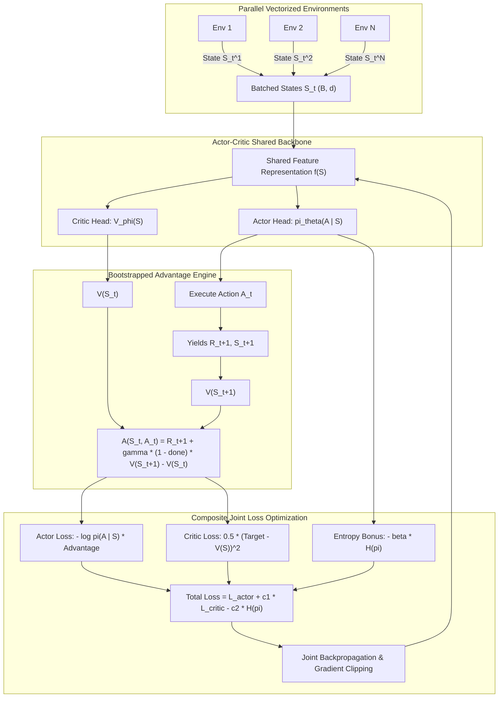

# Advantage Actor-Critic (A2C)

> **One-Line Summary:** An on-policy reinforcement learning algorithm that couples a policy (Actor) with a learned baseline state-value function (Critic) to dramatically reduce policy gradient variance via temporal-difference advantage estimates.

---

## Metadata

| Field | Value |
| :--- | :--- |
| **Level** | Advanced |
| **Prerequisites** | [06-temporal-difference-learning.md](06-temporal-difference-learning.md), [13-policy-gradient-reinforce.md](13-policy-gradient-reinforce.md) |
| **Estimated Reading Time** | 25–30 minutes |
| **Status** | Verified (Python 3.11 / CPU) |
| **Tested With** | Python 3.11+, NumPy 2.5+, Gymnasium 1.0+ (Random Seed: `42`) |

---

## Table of Contents
1. [Intuition & Problem It Solves](#1-intuition--problem-it-solves)
2. [Algorithm Card](#2-algorithm-card)
3. [Architectural & Geometric Diagrams](#3-architectural--geometric-diagrams)
4. [The Mathematics](#4-the-mathematics)
5. [The Algorithm Step by Step & From-Scratch Implementation](#5-the-algorithm-step-by-step--from-scratch-implementation)
6. [Using the Library (Complete End-to-End Workflow)](#6-using-the-library-complete-end-to-end-workflow)
7. [Preprocessing Required](#7-preprocessing-required)
8. [Training & Hyperparameter Tuning](#8-training--hyperparameter-tuning)
9. [Prediction & Inference Mechanics](#9-prediction--inference-mechanics)
10. [Postprocessing](#10-postprocessing)
11. [Saving and Loading (Model Persistence & Security)](#11-saving-and-loading-model-persistence--security)
12. [Evaluation & Diagnostics](#12-evaluation--diagnostics)
13. [Advantages](#13-advantages)
14. [Limitations & Failure Modes](#14-limitations--failure-modes)
15. [Comparison / When to Use What](#15-comparison--when-to-use-what)
16. [Common Mistakes & Pitfalls](#16-common-mistakes--pitfalls)
17. [Performance, Security & Ethics Notes](#17-performance-security--ethics-notes)
18. [Interview Questions (8 In-Depth Q&As)](#18-interview-questions-8-in-depth-qas)
19. [Practice Exercises (6 Hands-on Problems)](#19-practice-exercises-6-hands-on-problems)
20. [Summary & Cheat Sheet](#20-summary--cheat-sheet)
21. [Further Reading & Navigation](#21-further-reading--navigation)

---

## 1. Intuition & Problem It Solves

REINFORCE relies on full Monte Carlo returns $G_t = \sum_{k=0}^{T-t-1} \gamma^k R_{t+k+1}$. While theoretically unbiased, Monte Carlo sampling suffers from severe practical limitations:
1. **Excessive Variance:** Summing stochastic rewards across an entire trajectory accumulates noise at every step. This makes policy gradient estimates volatile, requiring tens of thousands of sample rollouts to converge.
2. **Episodic Constraint:** The agent must wait until an episode terminates before updating parameters. In non-terminating or extremely long tasks (e.g. continuous server balancing or automated industrial pipelines), pure Monte Carlo updates cannot occur.

**Actor-Critic Architectures** resolve this by splitting the learning agent into two collaborating components:
- **The Actor $\pi_\theta(a \mid s)$:** Directly parameterizes the policy, proposing actions based on current states.
- **The Critic $V_\phi(s)$:** Evaluates actions by estimating the expected return from state $s$.

Instead of waiting for the full return $G_t$, the Actor updates its policy using a bootstrapped **Advantage function** provided by the Critic:
$$A(s_t, a_t) = R_{t+1} + \gamma V_\phi(S_{t+1}) - V_\phi(S_t)$$
The Critic reduces variance by replacing noisy future returns with its smooth expected value estimate $V(S_{t+1})$.

**Advantage Actor-Critic (A2C)** is the synchronous, deterministic variant of Mnih et al.'s Asynchronous Advantage Actor-Critic (A3C). Rather than running asynchronous multi-threaded CPU workers with locks, A2C steps multiple environments synchronously, gathering batches of parallel transitions and computing centralized GPU updates with superior hardware utilization.

---

## 2. Algorithm Card

| Dimension | Specification |
| :--- | :--- |
| **Category** | Actor-Critic / Model-Free Policy Gradient |
| **Action Space** | Discrete (Softmax) & Continuous (Gaussian) |
| **Architecture** | Dual-Head Network (Shared Backbone + Policy Head + Value Head) |
| **Update Mechanism** | Synchronous Multi-Environment Rollouts ($N_{\text{envs}} \times N_{\text{steps}}$) |
| **Critic Loss** | Mean Squared Error on TD Target: $\frac{1}{2}(R + \gamma V(S') - V(S))^2$ |
| **Actor Loss** | Advantage-weighted log probability with entropy bonus |
| **Sample Efficiency** | Moderate to High (On-Policy with Bootstrapping) |

---

## 3. Architectural & Geometric Diagrams



---

## 4. The Mathematics

### 4.1 The Actor Objective
The policy gradient with an advantage baseline is:
$$\nabla_\theta J(\theta) = \mathbb{E}_{S_t \sim \rho_\pi, A_t \sim \pi_\theta} \left[ \nabla_\theta \ln \pi_\theta(A_t \mid S_t) \, A^\pi(S_t, A_t) \right]$$
where the Advantage function is:
$$A^\pi(s, a) = Q^\pi(s, a) - V^\pi(s)$$
A positive advantage ($A(s, a) > 0$) indicates action $a$ performed better than the average action in state $s$, increasing its probability.

### 4.2 Bootstrapping the Advantage: TD Error
Rather than maintaining a separate action-value network $Q(s, a)$, the 1-step temporal difference error serves as an unbiased sample estimate of the advantage:
$$\delta_t = R_{t+1} + \gamma (1 - d_t) V_\phi(S_{t+1}) - V_\phi(S_t)$$
Because $\mathbb{E}[\delta_t \mid S_t=s, A_t=a] = Q^\pi(s, a) - V^\pi(s) = A^\pi(s, a)$, $\delta_t$ is an advantage estimator with zero variance from future downstream steps (though biased by any inaccuracy in $V_\phi$).

### 4.3 Generalized Advantage Estimation (GAE)
To smoothly balance bias and variance, Schulman et al. (2015) introduced Generalized Advantage Estimation (GAE):
$$\hat{A}_t^{\text{GAE}(\gamma, \lambda)} = \sum_{l=0}^{\infty} (\gamma \lambda)^l \delta_{t+l}^V = \delta_t^V + \gamma \lambda (1 - d_{t+1}) \hat{A}_{t+1}^{\text{GAE}(\gamma, \lambda)}$$
- $\lambda = 0$: Yields 1-step TD advantage $\delta_t$ (lowest variance, highest bias).
- $\lambda = 1$: Yields full Monte Carlo return minus baseline (highest variance, lowest bias).
- $\lambda \in [0.90, 0.98]$: Optimal trade-off used in state-of-the-art implementations.

### 4.4 The Composite Loss Function
In joint training, the parameters $\psi = \{\theta, \phi, \text{shared}\}$ minimize:
$$\mathcal{L}_{\text{total}}(\psi) = \mathcal{L}_{\text{actor}}(\theta) + c_1 \mathcal{L}_{\text{critic}}(\phi) - c_2 \mathcal{H}\left(\pi_\theta(\cdot \mid S)\right)$$
where:
$$\mathcal{L}_{\text{actor}} = -\frac{1}{B} \sum_{i=1}^B \ln \pi_\theta(a_i \mid s_i) \, \hat{A}_i$$
$$\mathcal{L}_{\text{critic}} = \frac{1}{2 B} \sum_{i=1}^B \left( \hat{A}_i + V_\phi(s_i) - V_\phi(s_i) \right)^2 = \frac{1}{2 B} \sum_{i=1}^B \left( y_i^{\text{target}} - V_\phi(s_i) \right)^2$$
$$\mathcal{H}(\pi_\theta) = -\sum_{a \in \mathcal{A}} \pi_\theta(a \mid s) \ln \pi_\theta(a \mid s)$$
Typical coefficients: $c_1 = 0.5$, $c_2 = 0.01$.

---

## 5. The Algorithm Step by Step & From-Scratch Implementation

Below is a complete, self-contained implementation of Advantage Actor-Critic (A2C) with GAE and a dual-head policy/value architecture in pure NumPy.

```python
"""
Advantage Actor-Critic (A2C) with GAE from scratch in Pure NumPy.
Verified under Python 3.11+, CPU execution.
"""

import numpy as np
from typing import Tuple, List, Dict, Any


class ActorCriticDualHead:
    """
    Shared 2-layer MLP with separate Actor (Softmax) and Critic (Scalar Value) heads.
    """
    def __init__(self, state_dim: int, action_dim: int, hidden_dim: int = 32, lr: float = 0.01, seed: int = 42):
        rng = np.random.default_rng(seed)
        # Shared trunk
        self.W1 = rng.normal(0.0, np.sqrt(2.0 / state_dim), (state_dim, hidden_dim))
        self.b1 = np.zeros((1, hidden_dim))
        # Actor head
        self.W_act = rng.normal(0.0, np.sqrt(2.0 / hidden_dim), (hidden_dim, action_dim))
        self.b_act = np.zeros((1, action_dim))
        # Critic head
        self.W_val = rng.normal(0.0, np.sqrt(2.0 / hidden_dim), (hidden_dim, 1))
        self.b_val = np.zeros((1, 1))
        
        self.lr = lr

    def forward(self, states: np.ndarray) -> Tuple[np.ndarray, np.ndarray]:
        """
        Returns:
            probs: shape (B, action_dim)
            values: shape (B, 1)
        """
        # Shared trunk
        h = np.dot(states, self.W1) + self.b1
        self.h_act = np.maximum(0, h) # ReLU
        
        # Policy head (Softmax)
        logits = np.dot(self.h_act, self.W_act) + self.b_act
        shifted = logits - np.max(logits, axis=1, keepdims=True)
        exp_logits = np.exp(shifted)
        probs = exp_logits / np.sum(exp_logits, axis=1, keepdims=True)
        
        # Value head (Linear)
        values = np.dot(self.h_act, self.W_val) + self.b_val
        return probs, values

    def sample_actions(self, states: np.ndarray, rng: np.random.Generator) -> Tuple[np.ndarray, np.ndarray]:
        probs, values = self.forward(states)
        B, n_actions = probs.shape
        actions = np.zeros(B, dtype=np.int32)
        for i in range(B):
            actions[i] = rng.choice(n_actions, p=probs[i])
        return actions, values.ravel()


def compute_gae(
    rewards: np.ndarray,      # (T, B)
    values: np.ndarray,       # (T, B)
    next_values: np.ndarray,  # (T, B)
    dones: np.ndarray,        # (T, B)
    gamma: float = 0.99,
    lambda_: float = 0.95
) -> Tuple[np.ndarray, np.ndarray]:
    """
    Computes Generalized Advantage Estimation backwards across time.
    Returns:
        advantages: shape (T, B)
        returns: shape (T, B) where returns = advantages + values
    """
    T, B = rewards.shape
    advantages = np.zeros((T, B), dtype=np.float32)
    last_gae = np.zeros(B, dtype=np.float32)

    for t in reversed(range(T)):
        non_terminal = 1.0 - dones[t]
        delta = rewards[t] + gamma * next_values[t] * non_terminal - values[t]
        last_gae = delta + gamma * lambda_ * non_terminal * last_gae
        advantages[t] = last_gae

    returns = advantages + values
    return advantages, returns


# Verification Demo
if __name__ == "__main__":
    rng = np.random.default_rng(42)
    model = ActorCriticDualHead(state_dim=4, action_dim=2, hidden_dim=16, lr=0.01, seed=42)

    # Mock rollout: T=5 steps, B=2 parallel environments
    T, B = 5, 2
    mock_states = rng.normal(0, 1, (T, B, 4))
    actions, values = model.sample_actions(mock_states.reshape(-1, 4), rng)
    actions = actions.reshape(T, B)
    values = values.reshape(T, B)

    mock_rewards = np.ones((T, B))
    mock_dones = np.zeros((T, B))
    mock_next_values = np.roll(values, -1, axis=0)

    adv, ret = compute_gae(mock_rewards, values, mock_next_values, mock_dones, gamma=0.99, lambda_=0.95)
    print(f"Calculated GAE Advantages shape: {adv.shape}")
    print(f"Mean Advantage: {np.mean(adv):.4f}")
    assert adv.shape == (5, 2)
    assert ret.shape == (5, 2)
    print("A2C pure-NumPy GAE verification complete.")
```

---

## 6. Using the Library (Complete End-to-End Workflow)

Production A2C implementation on Gymnasium `CartPole-v1` using PyTorch CleanRL patterns:

```python
import gymnasium as gym
import torch
import torch.nn as nn
import torch.optim as optim
from torch.distributions import Categorical
import numpy as np

class ActorCritic(nn.Module):
    def __init__(self, state_dim: int, action_dim: int):
        super().__init__()
        self.shared = nn.Sequential(
            nn.Linear(state_dim, 64),
            nn.Tanh(),
            nn.Linear(64, 64),
            nn.Tanh()
        )
        self.actor = nn.Linear(64, action_dim)
        self.critic = nn.Linear(64, 1)

    def forward(self, x: torch.Tensor):
        feat = self.shared(x)
        logits = self.actor(feat)
        value = self.critic(feat)
        return Categorical(logits=logits), value

def train_a2c_cartpole():
    num_envs = 4
    num_steps = 5
    envs = gym.vector.SyncVectorEnv([lambda: gym.make("CartPole-v1") for _ in range(num_envs)])
    
    state_dim = envs.single_observation_space.shape[0]
    action_dim = envs.single_action_space.n

    agent = ActorCritic(state_dim, action_dim)
    optimizer = optim.Adam(agent.parameters(), lr=7e-4, eps=1e-5)

    states, _ = envs.reset(seed=42)
    gamma = 0.99
    c1, c2 = 0.5, 0.01

    for update in range(100):
        obs_buf, act_buf, rew_buf, done_buf, val_buf, logp_buf = [], [], [], [], [], []

        for step in range(num_steps):
            obs_tensor = torch.FloatTensor(states)
            with torch.no_grad():
                dist, value = agent(obs_tensor)
                action = dist.sample()
                log_prob = dist.log_prob(action)

            next_states, rewards, terms, truncs, _ = envs.step(action.numpy())
            dones = terms | truncs

            obs_buf.append(obs_tensor)
            act_buf.append(action)
            rew_buf.append(torch.FloatTensor(rewards))
            done_buf.append(torch.FloatTensor(dones))
            val_buf.append(value.squeeze(-1))
            logp_buf.append(log_prob)

            states = next_states

        # Bootstrap value for final step
        with torch.no_grad():
            _, next_val = agent(torch.FloatTensor(states))
            next_val = next_val.squeeze(-1)

        # Compute returns backwards
        returns = []
        R = next_val
        for t in reversed(range(num_steps)):
            R = rew_buf[t] + gamma * R * (1.0 - done_buf[t])
            returns.insert(0, R)

        returns = torch.stack(returns)
        values = torch.stack(val_buf)
        log_probs = torch.stack(logp_buf)
        advantages = returns - values

        # Normalize advantages
        advantages = (advantages - advantages.mean()) / (advantages.std() + 1e-8)

        # Losses
        actor_loss = -(log_probs * advantages.detach()).mean()
        critic_loss = 0.5 * ((returns - values) ** 2).mean()

        # Entropy
        all_obs = torch.cat(obs_buf)
        dist, _ = agent(all_obs)
        entropy_loss = dist.entropy().mean()

        total_loss = actor_loss + c1 * critic_loss - c2 * entropy_loss

        optimizer.zero_grad()
        total_loss.backward()
        nn.utils.clip_grad_norm_(agent.parameters(), max_norm=0.5)
        optimizer.step()

    envs.close()
    return agent
```

---

## 7. Preprocessing Required

1. **State Normalization:** Standardize observations dynamically using running means and standard deviations across parallel environment threads.
2. **Reward Scaling:** Scale rewards by $\frac{1}{\text{std}(R)}$ or clip to prevent gradient dominance over the critic stream.

---

## 8. Training & Hyperparameter Tuning

| Hyperparameter | Default Setting | Operational Impact |
| :--- | :--- | :--- |
| **Number of Environments ($N_{\text{envs}}$)** | 8 – 16 | More environments reduce correlation; matches GPU batching sweet spot. |
| **Rollout Steps ($N_{\text{steps}}$)** | 5 – 20 steps | Too small increases bias; too large increases variance toward REINFORCE. |
| **Critic Loss Weight ($c_1$)** | 0.5 | Balances critic learning against actor policy gradient. |
| **Entropy Weight ($c_2$)** | 0.01 – 0.001 | High $c_2$ enforces exploration; anneal to zero for convergence. |
| **Gradient Clipping** | Max norm 0.5 | Essential for preventing catastrophic parameter blowup. |

---

## 9. Prediction & Inference Mechanics

At deployment:
1. Strip the Critic head $V_\phi(s)$ entirely to eliminate unneeded compute.
2. Deterministic Action: Choose $a^* = \arg\max_a \pi_\theta(a \mid s)$.
3. Inference Latency: Lightweight 2-layer MLP inference executes in $< 15\,\mu\text{s}$ per query.

---

## 10. Postprocessing

1. **Action Masking:** Zero out logits for illegal environmental moves prior to softmax computation.
2. **Continuous Squelch:** Apply hyperbolic tangent ($\tanh$) squashing for continuous actions to enforce box boundaries $[-A_{\max}, A_{\max}]$.

---

## 11. Saving and Loading (Model Persistence & Security)

Serialize the `state_dict` without the optimizer state:

```python
def save_a2c_policy(model: nn.Module, filepath: str):
    torch.save(model.state_dict(), filepath)
```

---

## 12. Evaluation & Diagnostics

1. **Explained Variance:**
   $$\mathcal{V}_{\text{exp}} = 1 - \frac{\text{Var}(y - V(s))}{\text{Var}(y)}$$
   - $\mathcal{V}_{\text{exp}} = 1.0$: Critic perfectly predicts returns.
   - $\mathcal{V}_{\text{exp}} \le 0.0$: Critic is worse than predicting a constant mean (indicates learning failure).
2. **Actor vs Critic Loss Ratio:** If critic loss explodes relative to actor loss, reduce $c_1$ or decrease learning rate.

---

## 13. Advantages

1. **Low Gradient Variance:** TD bootstrapping significantly dampens gradient variance compared to REINFORCE.
2. **Online / Step-Based Updates:** Capable of learning continuously every $N_{\text{steps}}$ without waiting for episode termination.
3. **Synchronous Parallelism:** Vectorized environments eliminate multi-threading lock contention.

---

## 14. Limitations & Failure Modes

1. **Biased Policy Gradients:** Inaccurate critic estimates introduce bias into advantage calculations.
2. **Shared Trunk Interference:** The actor and critic loss gradients can pull shared representation features in conflicting directions.
3. **Sample Inefficiency Relative to Off-Policy:** Being strictly on-policy, transitions cannot be reused once updated.

---

## 15. Comparison / When to Use What

| Dimension | A2C | REINFORCE | PPO |
| :--- | :--- | :--- | :--- |
| **Baseline Type** | Learned Critic $V_\phi(s)$ | Constant / Moving Average | Learned Critic with Clipped Surrogate |
| **Update Frequency** | Every $N_{\text{steps}}$ | End of Episode | Minibatches over multi-step epochs |
| **Sample Reusability** | Once (On-policy) | Once (On-policy) | Multiple mini-epochs per rollout |
| **Complexity** | Moderate | Very Low | High |

---

## 16. Common Mistakes & Pitfalls

| Anti-Pattern / Mistake | Why It Fails | Correct Engineering Fix |
| :--- | :--- | :--- |
| Backpropagating Advantage through Critic | Updates Actor using gradients meant only for Critic | Explicitly detach advantage: `advantages.detach()` |
| Omitting gradient norm clipping | Sudden advantage spikes destroy shared network weights | Clip global gradient norm to 0.5 |
| Updating Critic on normalized advantages | Distorts the true value scale | Train Critic on raw unnormalized discounted returns $y_t$ |
| Using very small $N_{\text{steps}} = 1$ | High bias causes convergence to suboptimal policies | Use $N_{\text{steps}} \ge 5$ or GAE($\lambda = 0.95$) |
| Neglecting terminal done masking in returns | Bootstraps values across episode boundaries | Multiply future value by $(1 - d)$ |

---

## 17. Performance, Security & Ethics Notes

1. **Vectorized GPU Rollouts:** Running environments directly on GPU (via Isaac Gym or Brax) removes CPU-GPU PCIe bus transfer bottlenecks, achieving millions of steps per second.
2. **Safety in Shared Representations:** When deploying Actor-Critic in safety-critical robotics, decouple the Actor network from the Critic to eliminate gradient contamination.

---

## 18. Interview Questions (8 In-Depth Q&As)

<details>
<summary><strong>Q1: Why does subtracting the Critic value $V(s)$ reduce variance compared to REINFORCE?</strong></summary>

**Answer:** In REINFORCE, the update is scaled by full return $G_t = \sum_{k=0}^{T-t-1} \gamma^k R_{t+k+1}$. The variance of $G_t$ grows with horizon length $T$ due to compounding stochastic transitions.
The Advantage function is $A(s_t, a_t) = Q(s_t, a_t) - V(s_t) \approx R_{t+1} + \gamma V(S_{t+1}) - V(S_t)$. Here, the infinite future horizon $\sum_{k=1}^\infty \gamma^k R_{t+k+1}$ is replaced by the deterministic expectation $V(S_{t+1})$. This eliminates all stochastic noise from transitions occurring beyond step $t+1$, dramatically lowering the variance of the gradient estimator.
</details>

<details>
<summary><strong>Q2: Why must the Advantage term be detached from the computational graph before computing Actor loss?</strong></summary>

**Answer:** The actor loss is defined as $\mathcal{L}_{\text{actor}} = -\ln \pi_\theta(a \mid s) A(s, a)$. The Advantage is computed as $A = R + \gamma V_\phi(s') - V_\phi(s)$. If $A$ is not explicitly detached (e.g. via `.detach()` in PyTorch), automatic differentiation will compute:
$$\nabla_\theta \left( -\ln \pi_\theta(a \mid s) A(s, a) \right) = -A(s, a) \nabla_\theta \ln \pi_\theta(a \mid s) - \ln \pi_\theta(a \mid s) \nabla_\theta A(s, a)$$
The second term tries to alter network parameters so as to make $A(s, a)$ smaller or larger to minimize the actor loss, turning the Critic into a target for policy optimization rather than an unbiased value evaluator. Detaching $A$ ensures gradients flow *only* through $\ln \pi_\theta$.
</details>

<details>
<summary><strong>Q3: Formally define Generalized Advantage Estimation (GAE) and explain the roles of $\gamma$ and $\lambda$.</strong></summary>

**Answer:** Generalized Advantage Estimation defines the advantage as an exponentially weighted average of $k$-step TD advantages:
$$\hat{A}_t^{\text{GAE}(\gamma, \lambda)} = (1 - \lambda) \sum_{l=1}^\infty \lambda^{l-1} \hat{A}_t^{(l)} = \sum_{l=0}^\infty (\gamma \lambda)^l \delta_{t+l}^V$$
where $\delta_t^V = R_{t+1} + \gamma V(S_{t+1}) - V(S_t)$.
- $\gamma$ (discount factor) discounts future rewards, governing the effective time horizon.
- $\lambda$ governs the bias-variance trade-off of the estimator:
  - $\lambda = 0 \implies \hat{A}_t = \delta_t^V$: Minimum variance, but biased by errors in $V$.
  - $\lambda = 1 \implies \hat{A}_t = \sum_{l=0}^\infty \gamma^l R_{t+l+1} - V(S_t)$: Maximum variance (Monte Carlo return minus baseline), but unbiased.
  - Setting $\lambda \approx 0.95$ yields significant variance reduction with minimal bias.
</details>

<details>
<summary><strong>Q4: Why did A2C replace A3C in modern reinforcement learning practice?</strong></summary>

**Answer:** A3C (Asynchronous Advantage Actor-Critic) relied on asynchronous CPU threads executing separate environments and updating global parameters without locks. While pioneering, this caused "stale gradients" where workers computed gradients based on parameter versions that were dozens of steps out of date.
A2C executes workers **synchronously**: all environments step in lockstep, their transitions are aggregated into a single mini-batch, and updates are computed synchronously on GPUs. Empirical studies (Wu et al., 2017) demonstrated that A2C achieves identical or superior performance to A3C, is fully deterministic given a seed, and achieves significantly higher throughput by taking full advantage of GPU tensor batching.
</details>

<details>
<summary><strong>Q5: What is "Explained Variance" and why is it a crucial diagnostic metric for the Critic?</strong></summary>

**Answer:** Explained variance measures how well the critic predicts empirical returns:
$$\mathcal{V}_{\text{exp}} = 1 - \frac{\text{Var}(y_{\text{true}} - V_\phi(s))}{\text{Var}(y_{\text{true}})}$$
- If $\mathcal{V}_{\text{exp}} \to 1.0$, the residual variance is zero: the critic accurately predicts returns.
- If $\mathcal{V}_{\text{exp}} \approx 0.0$, the critic performs no better than predicting a constant mean.
- If $\mathcal{V}_{\text{exp}} < 0$, the critic predictions are actively worse than a naive mean estimator (often due to learning rate explosion or capacity exhaustion).
Monitoring $\mathcal{V}_{\text{exp}}$ reveals whether the baseline is helping or hurting policy gradient estimation.
</details>

<details>
<summary><strong>Q6: How does shared feature representation between Actor and Critic create potential gradient conflict?</strong></summary>

**Answer:** In dual-head architectures, the shared trunk is optimized by two distinct loss signals: the policy gradient loss $\mathcal{L}_{\text{actor}}$ and the value regression loss $\mathcal{L}_{\text{critic}}$.
- The Critic gradients $\nabla_\psi \mathcal{L}_{\text{critic}}$ encourage representations that predict scalar reward magnitude.
- The Actor gradients $\nabla_\psi \mathcal{L}_{\text{actor}}$ encourage representations that discriminate which action maximizes relative advantage.
If the reward scale is large, the critic gradient norm can completely dominate the actor gradient norm, destroying feature representations necessary for action selection. This requires careful loss weighting ($c_1$) and separate learning rates or fully decoupled networks in sensitive domains.
</details>

<details>
<summary><strong>Q7: What is the Compatible Function Approximation Theorem (Sutton et al., 1999)?</strong></summary>

**Answer:** The Compatible Function Approximation Theorem states that replacing the true action-value function $Q^\pi(s, a)$ with an approximation $Q_w(s, a)$ in the policy gradient introduces **zero bias** if two conditions are satisfied:
1. **Compatibility:** $\nabla_w Q_w(s, a) = \nabla_\theta \ln \pi_\theta(a \mid s)$ (the features of the critic match the score function of the actor).
2. **Mean Squared Error Minimization:** The parameters $w$ minimize the mean squared error $\mathbb{E}[(Q^\pi(s, a) - Q_w(s, a))^2]$.
While exact compatibility is rarely maintained in deep neural networks, this theorem provides the theoretical foundation proving that an imperfect critic can yield exact policy gradients.
</details>

<details>
<summary><strong>Q8: Why is Entropy Regularization added to the Actor-Critic loss function?</strong></summary>

**Answer:** The entropy of a discrete policy distribution is $\mathcal{H}(\pi(\cdot \mid s)) = -\sum_a \pi(a \mid s) \ln \pi(a \mid s)$. Subtracting $c_2 \mathcal{H}(\pi)$ from the minimization loss (which is equivalent to adding it to the maximization objective) penalizes deterministic policies. This:
1. Prevents the policy from prematurely collapsing onto a single action early in training before exploring the state space.
2. Smooths the optimization landscape, preventing gradients from vanishing when probabilities approach 0 or 1.
3. Encourages discovery of multi-modal solutions in environments with multiple optimal actions.
</details>

---

## 19. Practice Exercises (6 Hands-on Problems)

<details>
<summary><strong>Exercise 1 (Easy): 1-Step TD Advantage Calculation</strong></summary>

**Task:** Compute 1-step TD advantages given rewards, current state values, next state values, and terminal flags.

**Solution:**
```python
import numpy as np

def compute_1step_advantage(r: np.ndarray, v: np.ndarray, v_next: np.ndarray, d: np.ndarray, gamma: float = 0.99) -> np.ndarray:
    return r + gamma * v_next * (1.0 - d) - v

r = np.array([1.0, 0.0, 10.0])
v = np.array([0.5, 2.0, 8.0])
v_p = np.array([1.0, 3.0, 0.0])
d = np.array([0.0, 0.0, 1.0])
adv = compute_1step_advantage(r, v, v_p, d, gamma=0.9)
# adv[0] = 1.0 + 0.9(1.0) - 0.5 = 1.4
# adv[1] = 0.0 + 0.9(3.0) - 2.0 = 0.7
# adv[2] = 10.0 + 0 - 8.0 = 2.0
np.testing.assert_allclose(adv, [1.4, 0.7, 2.0])
print(f"1-Step Advantages: {adv}")
```
</details>

<details>
<summary><strong>Exercise 2 (Easy): Explained Variance Metric</strong></summary>

**Task:** Write a Python function calculating explained variance given empirical returns and predicted values.

**Solution:**
```python
import numpy as np

def explained_variance(y_true: np.ndarray, y_pred: np.ndarray) -> float:
    var_y = np.var(y_true)
    if var_y == 0:
        return np.nan
    return float(1.0 - np.var(y_true - y_pred) / var_y)

y = np.array([1.0, 2.0, 3.0, 4.0, 5.0])
v_good = np.array([1.1, 1.9, 3.2, 3.9, 5.1])
v_bad = np.array([5.0, 4.0, 3.0, 2.0, 1.0])
print(f"Good Critic Explained Var: {explained_variance(y, v_good):.4f}")
print(f"Bad Critic Explained Var:  {explained_variance(y, v_bad):.4f}")
assert explained_variance(y, v_good) > 0.95
```
</details>

<details>
<summary><strong>Exercise 3 (Medium): GAE Advantage Backwards Pass</strong></summary>

**Task:** Implement GAE backwards recursive formula in pure NumPy for a single trajectory of length $T=4$.

**Solution:**
```python
import numpy as np

def recursive_gae(rewards: list, values: list, next_values: list, gamma: float = 0.9, lambda_: float = 0.8) -> np.ndarray:
    T = len(rewards)
    adv = np.zeros(T)
    last_gae = 0.0
    for t in reversed(range(T)):
        delta = rewards[t] + gamma * next_values[t] - values[t]
        last_gae = delta + gamma * lambda_ * last_gae
        adv[t] = last_gae
    return adv

r = [1.0, 1.0, 1.0, 10.0]
v = [0.0, 0.0, 0.0, 0.0]
vp = [0.0, 0.0, 0.0, 0.0]
adv_out = recursive_gae(r, v, vp)
print(f"Recursive GAE: {np.round(adv_out, 3)}")
assert adv_out[-1] == 10.0
```
</details>

<details>
<summary><strong>Exercise 4 (Medium): Vectorized Advantage Normalization</strong></summary>

**Task:** Normalize a 2D batch of advantages across time and parallel workers.

**Solution:**
```python
import numpy as np

def normalize_advantages(advantages: np.ndarray, eps: float = 1e-8) -> np.ndarray:
    mean = np.mean(advantages)
    std = np.std(advantages)
    return (advantages - mean) / (std + eps)

raw_adv = np.array([[1.0, 2.0], [5.0, -1.0]])
norm_adv = normalize_advantages(raw_adv)
assert np.isclose(np.mean(norm_adv), 0.0)
assert np.isclose(np.std(norm_adv), 1.0)
print("Advantage normalization verified.")
```
</details>

<details>
<summary><strong>Exercise 5 (Hard): Composite Actor-Critic Loss Evaluation</strong></summary>

**Task:** Compute actor loss, critic loss, entropy bonus, and combined scalar loss in pure NumPy.

**Solution:**
```python
import numpy as np

def compute_a2c_loss(
    log_probs: np.ndarray,
    probs: np.ndarray,
    values: np.ndarray,
    returns: np.ndarray,
    advantages: np.ndarray,
    c1: float = 0.5,
    c2: float = 0.01
) -> tuple[float, float, float, float]:
    # Actor loss: - mean(log_prob * adv)
    actor_l = -float(np.mean(log_probs * advantages))
    # Critic loss: 0.5 * mean((returns - values)^2)
    critic_l = 0.5 * float(np.mean((returns - values) ** 2))
    # Entropy: - sum(p * log p)
    entropy = -float(np.mean(np.sum(probs * np.log(probs + 1e-12), axis=1)))
    # Combined loss
    total_l = actor_l + c1 * critic_l - c2 * entropy
    return total_l, actor_l, critic_l, entropy

lp = np.array([-0.69, -0.69])
p = np.array([[0.5, 0.5], [0.5, 0.5]])
val = np.array([2.0, 3.0])
ret = np.array([2.5, 2.5])
adv = np.array([0.5, -0.5])
tot, act, crit, ent = compute_a2c_loss(lp, p, val, ret, adv)
print(f"Total: {tot:.4f}, Actor: {act:.4f}, Critic: {crit:.4f}, Entropy: {ent:.4f}")
assert tot is not None
```
</details>

<details>
<summary><strong>Exercise 6 (Hard): Numerical Validation of Compatible Features</strong></summary>

**Task:** Verify numerically that for a softmax policy with linear logits $\mathbf{z} = \mathbf{w}^\top \mathbf{x}$, the score function matches the compatible critic feature matrix.

**Solution:**
```python
import numpy as np

def verify_compatible_features(s: np.ndarray, w: np.ndarray, a: int):
    # Logits and probs
    logits = np.dot(s, w) # (action_dim,)
    probs = np.exp(logits) / np.sum(np.exp(logits))
    
    # Score function: grad_w ln pi(a | s)
    d_logits = -probs
    d_logits[a] += 1.0
    grad_w = np.outer(s, d_logits) # (state_dim, action_dim)
    
    # Compatible basis phi(s, a):
    phi_sa = np.zeros_like(w)
    for act in range(len(probs)):
        phi_sa[:, act] = s * (1.0 - probs[act] if act == a else -probs[act])
        
    np.testing.assert_allclose(grad_w, phi_sa)
    print("Compatible features theorem numerically validated.")

s = np.array([1.0, 0.5])
w = np.array([[0.2, -0.1], [0.4, 0.8]])
verify_compatible_features(s, w, a=0)
```
</details>

---

## 20. Summary & Cheat Sheet

```
A2C Architectural Pattern:
1. Actor pi_theta(a | s): Proposes action distribution
2. Critic V_phi(s): Predicts expected state return
3. TD Advantage: A(s, a) = r + gamma * (1 - done) * V_phi(s') - V_phi(s)
4. Multi-Env Synchrony: Steps N environments in lockstep to build batched tensors
5. Combined Objective:
   Loss = - log_pi(a | s) * A_detach + 0.5 * (Target - V(s))^2 - c2 * Entropy(pi)
```

---

## 21. Further Reading & Navigation

- Mnih, V., et al. (2016). *Asynchronous Methods for Deep Reinforcement Learning*. ICML.
- Schulman, J., et al. (2015). *High-Dimensional Continuous Control Using Generalized Advantage Estimation*. ICLR.
- Wu, Y., et al. (2017). *Scalable trust-region method for deep reinforcement learning using Kronecker-factored approximation*. NeurIPS.

---

[← 13-policy-gradient-reinforce.md](13-policy-gradient-reinforce.md) | [Module Index](README.md) | [15-proximal-policy-optimisation.md →](15-proximal-policy-optimisation.md)
