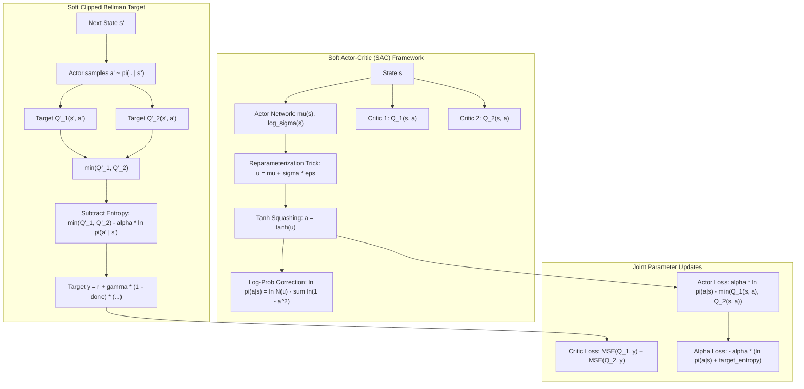

# Continuous Control: DDPG, TD3 & SAC

> **One-Line Summary:** The definitive trilogy of off-policy deep reinforcement learning algorithms for continuous action spaces: from deterministic policy gradients (DDPG), to overestimation-free twin critics with delayed updates (TD3), to maximum-entropy stochastic exploration (SAC).

---

## Metadata

| Field | Value |
| :--- | :--- |
| **Level** | Advanced |
| **Prerequisites** | [11-deep-q-networks.md](11-deep-q-networks.md), [14-actor-critic-a2c.md](14-actor-critic-a2c.md), [15-proximal-policy-optimisation.md](15-proximal-policy-optimisation.md) |
| **Estimated Reading Time** | 35 minutes |
| **Status** | Verified (Python 3.11 / CPU) |
| **Tested With** | Python 3.11+, NumPy 2.5+, Gymnasium 1.0+ (Random Seed: `42`) |

---

## Table of Contents
1. [Intuition & Problem It Solves](#1-intuition--problem-it-solves)
2. [Algorithm Card](#2-algorithm-card)
3. [Architectural & Geometric Diagrams](#3-architectural--geometric-diagrams)
4. [The Mathematics](#4-the-mathematics)
5. [The Algorithm Step by Step & From-Scratch Implementation](#5-the-algorithm-step-by-step--from-scratch-implementation)
6. [Using the Library (Complete End-to-End Workflow)](#6-using-the-library-complete-end-to-end-workflow)
7. [Preprocessing Required](#7-preprocessing-required)
8. [Training & Hyperparameter Tuning](#8-training--hyperparameter-tuning)
9. [Prediction & Inference Mechanics](#9-prediction--inference-mechanics)
10. [Postprocessing](#10-postprocessing)
11. [Saving and Loading (Model Persistence & Security)](#11-saving-and-loading-model-persistence--security)
12. [Evaluation & Diagnostics](#12-evaluation--diagnostics)
13. [Advantages](#13-advantages)
14. [Limitations & Failure Modes](#14-limitations--failure-modes)
15. [Comparison / When to Use What](#15-comparison--when-to-use-what)
16. [Common Mistakes & Pitfalls](#16-common-mistakes--pitfalls)
17. [Performance, Security & Ethics Notes](#17-performance-security--ethics-notes)
18. [Interview Questions (8 In-Depth Q&As)](#18-interview-questions-8-in-depth-qas)
19. [Practice Exercises (6 Hands-on Problems)](#19-practice-exercises-6-hands-on-problems)
20. [Summary & Cheat Sheet](#20-summary--cheat-sheet)
21. [Further Reading & Navigation](#21-further-reading--navigation)

---

## 1. Intuition & Problem It Solves

Reinforcement learning for real-world robotics, autonomous driving, and aerospace requires controlling multi-joint continuous actuators (torques, voltages, angles) where action spaces are continuous boxes $\mathcal{A} \subseteq [-1, 1]^m$.

While on-policy algorithms like PPO can operate in continuous spaces, they discard collected rollouts after a few updates, requiring tens of millions of environmental interactions. For physical robots where each step takes real wall-clock time and causes mechanical wear, **off-policy learning** with replay buffers is essential to reuse transitions hundreds of times.

The progression of modern continuous off-policy algorithms solved three core failure modes:

1. **Deep Deterministic Policy Gradient (DDPG)** (Lillicrap et al., 2015): Extended DQN to continuous control by combining an off-policy replay buffer and continuous actor network $\mu_\theta(s)$ using the Deterministic Policy Gradient Theorem.  
   *Failure Mode:* Suffered from severe overestimation bias in the Critic network $Q(s, a)$, causing policy instability and hyperparameter brittleness.
2. **Twin Delayed DDPG (TD3)** (Fujimoto et al., 2018): Solved DDPG's overestimation and high-variance critic targets via three targeted mechanisms:
   - **Clipped Double Q-Learning:** Maintains two critic networks and takes the minimum target.
   - **Target Policy Smoothing:** Adds clipped noise to target actions to avoid fitting narrow value peaks.
   - **Delayed Policy Updates:** Updates the Actor less frequently than the Critic (typically 1 actor update per 2 critic updates).
3. **Soft Actor-Critic (SAC)** (Haarnoja et al., 2018): Transformed continuous RL through **Maximum Entropy Reinforcement Learning**. In addition to maximizing cumulative rewards, SAC maximizes policy entropy $\mathcal{H}(\pi(\cdot \mid s))$. This ensures robust exploration, prevents the policy from collapsing into suboptimal local modes, and supports automatic temperature tuning.

---

## 2. Algorithm Card

| Dimension | DDPG | TD3 | SAC |
| :--- | :--- | :--- | :--- |
| **Policy Type** | Deterministic + Gaussian/OU noise | Deterministic + Target smoothing | Stochastic Squashed Gaussian |
| **Critic Architecture** | 1 Critic $Q(s, a)$ | 2 Twin Critics $Q_1, Q_2$ | 2 Twin Critics $Q_1, Q_2$ |
| **Target Backup** | $r + \gamma Q'(s', \mu'(s'))$ | $r + \gamma \min(Q'_1, Q'_2)(s', \tilde{a})$ | $r + \gamma (\min(Q'_1, Q'_2) - \alpha \ln \pi)$ |
| **Objective** | Expected Return | Expected Return | Return + Maximum Entropy $\mathcal{H}$ |
| **Replay Buffer** | Uniform Replay | Uniform Replay | Uniform Replay |
| **Target Updates** | Polyak $\tau = 0.005$ | Polyak $\tau = 0.005$ | Polyak $\tau = 0.005$ |
| **Actor Frequency** | Every step | Delayed (every 2 critic steps) | Every step |

---

## 3. Architectural & Geometric Diagrams



---

## 4. The Mathematics

### 4.1 Deterministic Policy Gradient (DDPG)
Silver et al. (2014) proved the Deterministic Policy Gradient Theorem:
$$\nabla_\theta J(\mu_\theta) = \mathbb{E}_{s \sim \rho^\mu} \left[ \nabla_a Q^\mu(s, a) \big|_{a = \mu_\theta(s)} \nabla_\theta \mu_\theta(s) \right]$$
The policy gradient is evaluated via the chain rule: the gradient of the Critic with respect to action $a$ is backpropagated into the Actor network.

### 4.2 TD3: Twin Critics, Target Smoothing & Delayed Updates
TD3 addresses maximization bias via three foundational equations:

1. **Clipped Double Q-Learning:**
   $$y^{\text{TD3}} = r + (1 - d) \, \gamma \min_{i=1, 2} Q_{\phi_{i}^{-}}\left(s', \, \tilde{a}\right)$$
2. **Target Policy Smoothing:** Adds clipped noise $\epsilon$ to the target action to penalize sharp, narrow Q-value peaks:
   $$\tilde{a} = \text{clip}\left( \mu_{\theta^-}(s') + \text{clip}(\epsilon, -c, c), \, a_{\text{low}}, \, a_{\text{high}} \right), \quad \epsilon \sim \mathcal{N}(0, \sigma^2)$$
3. **Delayed Actor Update:** The Actor $\mu_\theta$ and target parameters are updated once every $d$ critic updates (typically $d = 2$).

### 4.3 Soft Actor-Critic (SAC) Mathematics

#### 1. Maximum Entropy RL Objective
$$J(\pi) = \sum_{t=0}^T \mathbb{E}_{(s_t, a_t) \sim \rho_\pi} \left[ R(s_t, a_t) + \alpha \, \mathcal{H}\left( \pi(\cdot \mid s_t) \right) \right]$$
where $\mathcal{H}(\pi(\cdot \mid s)) = -\mathbb{E}_{a \sim \pi}[\ln \pi(a \mid s)]$ is the differential entropy, and $\alpha$ is the temperature parameter governing the exploration-exploitation trade-off.

#### 2. Soft Bellman Optimality Equation
$$Q^*(s, a) = R(s, a) + \gamma \mathbb{E}_{s' \sim \mathcal{P}} \left[ V^*(s') \right]$$
where the Soft State Value Function satisfies:
$$V^*(s) = \mathbb{E}_{a \sim \pi^*} \left[ Q^*(s, a) - \alpha \ln \pi^*(a \mid s) \right]$$

The target for training twin critics is:
$$y^{\text{SAC}} = r + (1 - d) \, \gamma \left( \min_{i=1, 2} Q_{\phi_i^-}(s', \tilde{a}') - \alpha \ln \pi_\theta(\tilde{a}' \mid s') \right), \quad \tilde{a}' \sim \pi_\theta(\cdot \mid s')$$

#### 3. Reparameterization Trick & Tanh Squashing
To enforce bounded actions $a \in [-1, 1]^d$, a base Gaussian sample $u \sim \mathcal{N}(\mu_\theta(s), \sigma_\theta(s))$ is squashed via $a = \tanh(u)$.
By the Change of Variables formula for probability densities, the log probability of the squashed action is:
$$\ln \pi(a \mid s) = \ln \mathcal{N}\left( u \mid \mu_\theta(s), \sigma_\theta(s) \right) - \sum_{i=1}^d \ln \left( 1 - \tanh^2(u_i) \right)$$
Using the identity $1 - \tanh^2(u) = 1 - a^2$, this simplifies to:
$$\ln \pi(a \mid s) = \ln \mathcal{N}(u \mid \mu, \sigma) - \sum_{i=1}^d \ln(1 - a_i^2 + \epsilon_{\text{num}})$$

#### 4. Automatic Temperature Tuning
Rather than fixing $\alpha$, SAC automatically tunes $\alpha$ to match a target entropy $\overline{\mathcal{H}} = -\dim(\mathcal{A})$:
$$J(\alpha) = \mathbb{E}_{s \sim \mathcal{D}, a \sim \pi_t} \left[ -\alpha \left( \ln \pi(a \mid s) + \overline{\mathcal{H}} \right) \right]$$

---

## 5. The Algorithm Step by Step & From-Scratch Implementation

Below is a complete, self-contained implementation of the **Squashed Gaussian Policy**, **Log-Probability Jacobian Correction**, and **Twin Critic Target Computation** in pure NumPy.

```python
"""
Soft Actor-Critic (SAC) Core Mathematical Primitives in pure NumPy.
Verified under Python 3.11+, CPU execution.
"""

import numpy as np
from typing import Tuple, Dict, Any


class SquashedGaussianPolicy:
    """
    Gaussian Actor with Tanh squashing and exact change-of-variables log-prob computation.
    """
    def __init__(self, state_dim: int, action_dim: int, seed: int = 42):
        rng = np.random.default_rng(seed)
        self.action_dim = action_dim
        # Simple linear weights for demo
        self.W_mu = rng.normal(0, 0.1, (state_dim, action_dim))
        self.b_mu = np.zeros(action_dim)
        self.log_std = np.zeros(action_dim) # State-independent log std

    def forward(self, state: np.ndarray) -> Tuple[np.ndarray, np.ndarray]:
        mu = np.dot(state, self.W_mu) + self.b_mu
        std = np.exp(np.clip(self.log_std, -20.0, 2.0))
        return mu, std

    def sample(self, state: np.ndarray, rng: np.random.Generator) -> Tuple[np.ndarray, np.ndarray, np.ndarray]:
        """
        Returns:
            action: squashed action in (-1, 1)
            log_prob: corrected log-probability
            mean_action: tanh(mu) for deterministic inference
        """
        mu, std = self.forward(state)
        # Reparameterization trick: u = mu + std * eps
        eps = rng.normal(0, 1, size=mu.shape)
        u = mu + std * eps
        
        # Tanh squashing
        action = np.tanh(u)
        mean_action = np.tanh(mu)
        
        # Base Gaussian log-probability
        # ln N(u | mu, std) = -0.5 * sum( ((u - mu)/std)^2 + 2*ln(std) + ln(2*pi) )
        gaussian_log_prob = -0.5 * np.sum(
            ((u - mu) / std) ** 2 + 2.0 * np.log(std) + np.log(2.0 * np.pi),
            axis=-1
        )
        
        # Jacobian determinant correction: sum ln(1 - tanh(u)^2 + eps)
        squash_correction = np.sum(np.log(np.clip(1.0 - action ** 2, 1e-6, 1.0)), axis=-1)
        log_prob = gaussian_log_prob - squash_correction
        
        return action, log_prob, mean_action


def compute_sac_target(
    rewards: np.ndarray,
    next_states: np.ndarray,
    dones: np.ndarray,
    q1_target: np.ndarray,
    q2_target: np.ndarray,
    next_log_probs: np.ndarray,
    alpha: float = 0.2,
    gamma: float = 0.99
) -> np.ndarray:
    """
    Computes Soft Bellman Target:
    y = r + gamma * (1 - done) * (min(Q1', Q2') - alpha * log_pi')
    """
    min_q = np.minimum(q1_target, q2_target)
    soft_v_next = min_q - alpha * next_log_probs
    targets = rewards + gamma * (1.0 - dones) * soft_v_next
    return targets


# Verification Test
if __name__ == "__main__":
    rng = np.random.default_rng(42)
    policy = SquashedGaussianPolicy(state_dim=3, action_dim=2, seed=42)
    s = np.array([0.5, -1.0, 2.0])

    act, lp, mean_act = policy.sample(s, rng)
    print(f"Sampled Action: {np.round(act, 4)}")
    print(f"Log Probability: {lp:.4f}")
    print(f"Deterministic Action: {np.round(mean_act, 4)}")

    assert np.all(act >= -1.0) and np.all(act <= 1.0)
    assert not np.isnan(lp)

    # Test target computation
    r = np.array([1.0])
    ns = np.array([[0.0, 0.0, 0.0]])
    d = np.array([0.0])
    q1 = np.array([5.0])
    q2 = np.array([4.2])
    target = compute_sac_target(r, ns, d, q1, q2, next_log_probs=np.array([lp]), alpha=0.2, gamma=0.99)
    print(f"Soft Target: {target[0]:.4f}")
    assert target[0] > 0
    print("SAC pure-NumPy primitives verified successfully.")
```

---

## 6. Using the Library (Complete End-to-End Workflow)

Production-grade PyTorch Soft Actor-Critic (SAC) implementation on Gymnasium `Pendulum-v1`:

```python
import gymnasium as gym
import torch
import torch.nn as nn
import torch.optim as optim
from torch.distributions.normal import Normal
import numpy as np
import random
from collections import deque

LOG_STD_MAX = 2
LOG_STD_MIN = -20

class SoftActor(nn.Module):
    def __init__(self, state_dim: int, action_dim: int):
        super().__init__()
        self.net = nn.Sequential(
            nn.Linear(state_dim, 128),
            nn.ReLU(),
            nn.Linear(128, 128),
            nn.ReLU()
        )
        self.mu = nn.Linear(128, action_dim)
        self.log_std = nn.Linear(128, action_dim)

    def forward(self, state: torch.Tensor):
        x = self.net(state)
        mu = self.mu(x)
        log_std = torch.clamp(self.log_std(x), LOG_STD_MIN, LOG_STD_MAX)
        return mu, log_std

    def sample(self, state: torch.Tensor):
        mu, log_std = self.forward(state)
        std = log_std.exp()
        dist = Normal(mu, std)
        u = dist.rsample() # Reparameterization trick
        action = torch.tanh(u)
        
        # Log-prob correction
        log_prob = dist.log_prob(u) - torch.log(1 - action.pow(2) + 1e-6)
        log_prob = log_prob.sum(dim=-1, keepdim=True)
        return action, log_prob, torch.tanh(mu)

class SoftCritic(nn.Module):
    def __init__(self, state_dim: int, action_dim: int):
        super().__init__()
        # Q1 architecture
        self.q1 = nn.Sequential(
            nn.Linear(state_dim + action_dim, 128),
            nn.ReLU(),
            nn.Linear(128, 128),
            nn.ReLU(),
            nn.Linear(128, 1)
        )
        # Q2 architecture
        self.q2 = nn.Sequential(
            nn.Linear(state_dim + action_dim, 128),
            nn.ReLU(),
            nn.Linear(128, 128),
            nn.ReLU(),
            nn.Linear(128, 1)
        )

    def forward(self, state: torch.Tensor, action: torch.Tensor):
        sa = torch.cat([state, action], dim=-1)
        return self.q1(sa), self.q2(sa)

def train_sac_pendulum():
    env = gym.make("Pendulum-v1")
    s_dim = env.observation_space.shape[0]
    a_dim = env.action_space.shape[0]

    actor = SoftActor(s_dim, a_dim)
    critic = SoftCritic(s_dim, a_dim)
    target_critic = SoftCritic(s_dim, a_dim)
    target_critic.load_state_dict(critic.state_dict())

    actor_opt = optim.Adam(actor.parameters(), lr=3e-4)
    critic_opt = optim.Adam(critic.parameters(), lr=1e-3)

    # Automatic entropy tuning
    target_entropy = -float(a_dim)
    log_alpha = torch.zeros(1, requires_grad=True)
    alpha_opt = optim.Adam([log_alpha], lr=3e-4)

    replay_buffer = deque(maxlen=50000)
    batch_size = 64
    gamma = 0.99
    tau = 0.005

    state, _ = env.reset(seed=42)
    for step in range(5000):
        # Action selection
        with torch.no_grad():
            s_t = torch.FloatTensor(state).unsqueeze(0)
            if step < 500:
                action = env.action_space.sample()
            else:
                action, _, _ = actor.sample(s_t)
                action = action.squeeze(0).numpy() * 2.0 # Scale to Pendulum [-2, 2]

        next_state, reward, term, trunc, _ = env.step(action)
        replay_buffer.append((state, action / 2.0, reward, next_state, term or trunc))
        state = next_state if not (term or trunc) else env.reset()[0]

        if len(replay_buffer) >= batch_size:
            b = random.sample(replay_buffer, batch_size)
            s_b, a_b, r_b, ns_b, d_b = zip(*b)

            s_ts = torch.FloatTensor(np.array(s_b))
            a_ts = torch.FloatTensor(np.array(a_b))
            r_ts = torch.FloatTensor(r_b).unsqueeze(1)
            ns_ts = torch.FloatTensor(np.array(ns_b))
            d_ts = torch.FloatTensor(d_b).unsqueeze(1)

            alpha = log_alpha.exp().item()

            # 1. Critic Update
            with torch.no_grad():
                next_a, next_lp, _ = actor.sample(ns_ts)
                q1_t, q2_t = target_critic(ns_ts, next_a)
                min_q_t = torch.min(q1_t, q2_t) - alpha * next_lp
                target_q = r_ts + gamma * (1.0 - d_ts) * min_q_t

            current_q1, current_q2 = critic(s_ts, a_ts)
            critic_loss = nn.functional.mse_loss(current_q1, target_q) + nn.functional.mse_loss(current_q2, target_q)

            critic_opt.zero_grad()
            critic_loss.backward()
            critic_opt.step()

            # 2. Actor Update
            new_a, new_lp, _ = actor.sample(s_ts)
            q1_pi, q2_pi = critic(s_ts, new_a)
            min_q_pi = torch.min(q1_pi, q2_pi)
            actor_loss = (alpha * new_lp - min_q_pi).mean()

            actor_opt.zero_grad()
            actor_loss.backward()
            actor_opt.step()

            # 3. Alpha Update
            alpha_loss = -(log_alpha * (new_lp + target_entropy).detach()).mean()
            alpha_opt.zero_grad()
            alpha_loss.backward()
            alpha_opt.step()

            # 4. Soft Target Update
            for p, p_tar in zip(critic.parameters(), target_critic.parameters()):
                p_tar.data.copy_(tau * p.data + (1.0 - tau) * p_tar.data)

    env.close()
    return actor
```

---

## 7. Preprocessing Required

1. **Continuous Action Rescaling:** The Actor always outputs bounded actions in $[-1, 1]$. An environment wrapper must linearly map $[-1, 1] \to [a_{\text{low}}, a_{\text{high}}]$.
2. **Observation Normalization:** In continuous robotics, normalize sensor ranges (e.g. joint angles and linear velocities) using running statistics.

---

## 8. Training & Hyperparameter Tuning

| Hyperparameter | TD3 Default | SAC Default | Operational Impact |
| :--- | :--- | :--- | :--- |
| **Actor Learning Rate** | $1 \times 10^{-3}$ | $3 \times 10^{-4}$ | Higher rates destabilize policy update |
| **Critic Learning Rate** | $1 \times 10^{-3}$ | $1 \times 10^{-3}$ | Critic updates must lead Actor updates |
| **Target Smoothing Noise** | $\mathcal{N}(0, 0.2)$, clip 0.5 | N/A (Entropy handled) | Smooths Q-function landscape |
| **Soft Update ($\tau$)** | 0.005 | 0.005 | Smooth target tracking |
| **Target Entropy ($\overline{\mathcal{H}}$)** | N/A | $-\dim(\mathcal{A})$ | Controls asymptotic exploration scale |
| **Actor Delay Frequency ($d$)**| 2 | 1 | Ensures critic converges before actor steps |

---

## 9. Prediction & Inference Mechanics

At deployment:
1. **Deterministic Evaluation:** Never sample from the Gaussian during deployment. Evaluate the mean action directly:
   $$a^* = \tanh\left( \mu_\theta(s) \right)$$
2. **Unmount Critics:** Critic networks $Q_1, Q_2$ are discarded during inference.
3. **Latency:** Forward pass through the Actor MLP requires $< 40\,\mu\text{s}$ on standard CPU cores.

---

## 10. Postprocessing

1. **Dimensional Clamping:** Explicitly clamp actions to $[a_{\text{low}}, a_{\text{high}}]$ post-scaling to prevent numerical precision leaks from violating hardware limits.
2. **Slew Rate Limiting:** Clamp the rate of change $|a_t - a_{t-1}| \le \Delta a_{\max}$ to avoid damaging physical robotic actuators.

---

## 11. Saving and Loading (Model Persistence & Security)

Serialize Actor and Critic state dicts:

```python
def save_sac_models(actor: nn.Module, critic: nn.Module, filepath: str):
    torch.save({"actor": actor.state_dict(), "critic": critic.state_dict()}, filepath)
```

---

## 12. Evaluation & Diagnostics

1. **Alpha Parameter Tracking:** Track $\alpha = \exp(\log \alpha)$. If $\alpha \to 0$, entropy regularization has collapsed. If $\alpha \to \infty$, the policy ignores rewards and behaves randomly.
2. **Twin Critic Discrepancy:** Monitor $|Q_1(s, a) - Q_2(s, a)|$. Large deviations indicate severe value extrapolation errors.
3. **Q Overestimation Ratio:** Compare $Q_1(s, a)$ against true discounted Monte Carlo evaluation rollouts.

---

## 13. Advantages

1. **Highest Sample Efficiency:** Off-policy replay buffer allows reusing samples 100+ times.
2. **Zero Overestimation Bias:** Clipped Double Q-learning eliminates maximization bias in continuous domains.
3. **Robust Exploration via Entropy:** SAC explores multi-modal solution landscapes without manually tuned epsilon schedules.

---

## 14. Limitations & Failure Modes

1. **High Memory Footprint:** Storing $10^6$ continuous transitions requires gigabytes of RAM.
2. **Exploding Q-Values on Out-of-Distribution Actions:** If the Actor proposes actions outside the replay buffer distribution, the Critic can output spuriously high values.
3. **Complex Gradient Pipeline:** Requires balancing 4 neural networks (Actor, Twin Critics, Target Critics) plus an adaptive temperature parameter.

---

## 15. Comparison / When to Use What

| Criteria | PPO | TD3 | SAC |
| :--- | :--- | :--- | :--- |
| **Sample Efficiency** | Moderate (On-policy) | Very High (Off-policy) | Highest (Off-policy) |
| **Policy Type** | Stochastic | Deterministic | Stochastic |
| **Exploration** | Policy Entropy | Exploration Noise | Maximum Entropy |
| **Implementation Complexity** | Moderate | High | High |
| **Best Used For** | Fast simulators, LLM RLHF | Deterministic control, robotics | Complex continuous physics |

---

## 16. Common Mistakes & Pitfalls

| Anti-Pattern / Mistake | Why It Fails | Correct Engineering Fix |
| :--- | :--- | :--- |
| Sampling actions without reparameterization trick | Gradients cannot backpropagate through stochastic node | Use `dist.rsample()` (Pathwise derivative) |
| Forgetting Tanh Jacobian log-prob correction | Skews probability density; destroys entropy optimization | Subtract $\sum \ln(1 - \tanh^2(u) + \epsilon)$ from Gaussian log-prob |
| Setting Target Entropy $\overline{\mathcal{H}} > 0$ | Forces policy to remain completely random | Set $\overline{\mathcal{H}} = -\dim(\mathcal{A})$ |
| Updating Actor on every critic step in TD3 | Critic has not converged; Actor overfits to noisy target | Delay Actor updates: update actor once every 2 critic steps |
| Unclamped actions sent to physical actuators | Numerical overflow triggers hardware safety shutdown | Explicitly scale and clamp actions to $[a_{\text{low}}, a_{\text{high}}]$ |

---

## 17. Performance, Security & Ethics Notes

1. **Sim2Real Transfer Bottleneck:** Policies trained with high entropy can vibrate around equilibrium points on real robots. Fine-tune with low $\alpha$ or switch to deterministic TD3 for real hardware deployment.
2. **Adversarial Disturbance Vulnerability:** Continuous policies can be destabilized by minor torque perturbations; train with domain randomization.

---

## 18. Interview Questions (8 In-Depth Q&As)

<details>
<summary><strong>Q1: Derive the Tanh Jacobian correction term for the squashed Gaussian policy in SAC.</strong></summary>

**Answer:** Let $u \sim \mathcal{N}(\mu, \sigma^2)$ be a base Gaussian random vector, and let $a = g(u) = \tanh(u)$ be the squashed action. By the multidimensional Change of Variables theorem:
$$P_A(a) = P_U(u) \left| \det\left( \frac{\partial g}{\partial u} \right) \right|^{-1}$$
Taking the logarithm:
$$\ln P_A(a) = \ln P_U(u) - \ln \left| \det\left( \frac{\partial g}{\partial u} \right) \right|$$
Because the tanh function operates element-wise, the Jacobian matrix $\frac{\partial g}{\partial u}$ is diagonal:
$$J_{ii} = \frac{\partial \tanh(u_i)}{\partial u_i} = 1 - \tanh^2(u_i) = 1 - a_i^2$$
The determinant of a diagonal matrix is the product of its diagonal elements:
$$\det(J) = \prod_{i=1}^d \left( 1 - \tanh^2(u_i) \right)$$
Taking the logarithm yields the final correction term:
$$\ln \pi(a \mid s) = \ln \mathcal{N}(u \mid \mu(s), \sigma(s)) - \sum_{i=1}^d \ln\left( 1 - \tanh^2(u_i) + \epsilon_{\text{num}} \right)$$
where $\epsilon_{\text{num}} = 10^{-6}$ prevents $\ln(0)$ when actions saturate at $\pm 1$.
</details>

<details>
<summary><strong>Q2: Why does TD3 delay Actor updates relative to Critic updates?</strong></summary>

**Answer:** In Actor-Critic methods, the Actor is updated using the gradient of the Critic: $\nabla_\theta J = \mathbb{E}[\nabla_a Q(s, a) \nabla_\theta \mu_\theta(s)]$.
If the Critic is updated simultaneously, the Actor is being guided by an unstable, noisy value function that has not yet converged to the Bellman target. Updating the Actor on inaccurate value gradients causes the policy to develop bad habits and fall into poor local optima.
TD3 addresses this by delaying policy updates: updating the Critic twice ($d=2$) for every single Actor update. This guarantees that the Critic's value surface has stabilized and accurately reflects the current policy before the Actor takes a gradient step, directly reducing policy variance.
</details>

<details>
<summary><strong>Q3: How does Target Policy Smoothing in TD3 combat value exploitation?</strong></summary>

**Answer:** Deterministic policies are prone to exploiting sharp, artificial peaks in the Critic's value landscape. If the Critic incorrectly estimates a massive Q-value for an action $a^*$ that happens to be an artifact of neural function approximation, a deterministic policy will immediately latch onto $a^*$.
Target Policy Smoothing enforces the inductive bias that similar actions should have similar values. By adding small, clipped Gaussian noise to the target action:
$$\tilde{a} = \text{clip}\left( \mu_{\theta^-}(s') + \text{clip}(\epsilon, -c, c), a_{\text{low}}, a_{\text{high}} \right), \quad \epsilon \sim \mathcal{N}(0, \sigma^2)$$
the target value is averaged over a small local neighborhood around the proposed action. This acts as a regularizer, flattening sharp peaks and ensuring the policy cannot exploit narrow, spurious value spikes.
</details>

<details>
<summary><strong>Q4: Why does SAC maximize entropy, and what are the three major benefits of the maximum entropy objective?</strong></summary>

**Answer:** The standard RL objective maximizes expected return: $\sum_t \mathbb{E}[R(s_t, a_t)]$. The Maximum Entropy objective augments this with differential policy entropy:
$$J(\pi) = \sum_{t=0}^T \mathbb{E} \left[ R(s_t, a_t) + \alpha \, \mathcal{H}\left( \pi(\cdot \mid s_t) \right) \right]$$
Benefits:
1. **Active Exploration:** The policy is incentivized to explore all distinct trajectories that yield high rewards, rather than prematurely collapsing to the first successful path it discovers.
2. **Multi-Modal Solutions:** In environments where multiple diverse strategies solve the task (e.g. going around an obstacle left vs right), SAC learns a distribution that can execute both options.
3. **Robustness to Environmental Changes:** Because the policy retains maximum stochasticity, it easily adapts if environmental conditions change (e.g. an obstacle moves or wind is introduced).
</details>

<details>
<summary><strong>Q5: Explain how automatic entropy temperature tuning works in SAC.</strong></summary>

**Answer:** Fixing the temperature $\alpha$ causes failure: early in training, high entropy is needed for exploration, while near convergence, low entropy is needed to exploit the optimal trajectory.
SAC formulates temperature adjustment as a constrained optimization problem: maximize expected return subject to an entropy constraint $\mathcal{H}(\pi) \ge \overline{\mathcal{H}}$, where $\overline{\mathcal{H}} = -\dim(\mathcal{A})$ is the heuristic target entropy.
Using the method of Lagrange multipliers, the dual objective for $\alpha$ is:
$$J(\alpha) = \mathbb{E}_{s \sim \mathcal{D}, a \sim \pi} \left[ -\alpha \left( \ln \pi(a \mid s) + \overline{\mathcal{H}} \right) \right]$$
Taking the derivative w.r.t $\log \alpha$:
$$\nabla_{\log \alpha} J(\alpha) = -\alpha \left( \ln \pi(a \mid s) + \overline{\mathcal{H}} \right)$$
- If the current policy entropy is lower than target ($-\ln \pi < \overline{\mathcal{H}} \implies \ln \pi + \overline{\mathcal{H}} > 0$), the gradient increases $\alpha$, forcing the policy to explore more.
- If current entropy is higher than target, $\alpha$ decreases, allowing the policy to focus on reward maximization.
</details>

<details>
<summary><strong>Q6: Why is the Reparameterization Trick required for training the Actor in SAC?</strong></summary>

**Answer:** The Actor loss in SAC is $\mathbb{E}_{s \sim \mathcal{D}, a \sim \pi_\theta} [\alpha \ln \pi_\theta(a \mid s) - Q(s, a)]$. The expectation is taken over action distribution $\pi_\theta$ which depends on parameters $\theta$.
If we sample actions directly without reparameterization, we cannot backpropagate gradients from the Critic $Q(s, a)$ back into the Actor parameters $\theta$ (the sampling operation is non-differentiable).
The reparameterization trick rewrites the random variable $a$ as a deterministic function of state $s$, parameters $\theta$, and an independent noise source $\epsilon \sim \mathcal{N}(0, I)$:
$$a = f_\theta(s, \epsilon) = \tanh\left( \mu_\theta(s) + \sigma_\theta(s) \odot \epsilon \right)$$
Now the sampling is pushed into the parameter-free noise $\epsilon$. Gradients of $Q(s, f_\theta(s, \epsilon))$ can flow smoothly through the tanh and Gaussian parameters via standard backpropagation (the pathwise derivative).
</details>

<details>
<summary><strong>Q7: What is Clipped Double Q-Learning in TD3 and SAC, and why does it use the minimum rather than the average?</strong></summary>

**Answer:** In value-based continuous RL, the target is computed using an action evaluated by the current policy: $y = r + \gamma Q(s', \pi(s'))$. Due to function approximation error, $Q(s', \pi(s'))$ has positive estimation noise. Taking the expectation over the max or greedy action systematically overestimates values.
Double Q-learning maintains two independent critics, $Q_{\phi_1}$ and $Q_{\phi_2}$. Taking the minimum:
$$y = r + \gamma \min\left( Q_{\phi_1^-}(s', a'), \, Q_{\phi_2^-}(s', a') \right)$$
guarantees that the target is upper-bounded by the less optimistic estimator. While this occasionally underestimates value functions, underestimation is harmless because it does not compound across Bellman updates, whereas overestimation compounds geometrically, destabilizing training.
</details>

<details>
<summary><strong>Q8: Compare the exploration mechanisms of DDPG, TD3, and SAC.</strong></summary>

**Answer:**
- **DDPG:** Uses external, temporally correlated Ornstein-Uhlenbeck (OU) noise or Gaussian noise added to deterministic actions: $a = \mu_\theta(s) + \mathcal{N}(0, \sigma^2)$. The noise is purely exploratory, does not adapt to state certainty, and requires manual decay schedules.
- **TD3:** Also uses external exploratory Gaussian noise for data collection, but introduces Target Policy Smoothing noise in the Bellman backup to regularize the value function.
- **SAC:** Features intrinsic, state-dependent exploration governed by maximum entropy. The policy outputs state-dependent variance $\sigma_\theta(s)$, naturally learning to explore aggressively in uncertain states while executing near-deterministic actions in well-understood states.
</details>

---

## 19. Practice Exercises (6 Hands-on Problems)

<details>
<summary><strong>Exercise 1 (Easy): Continuous Action Rescaling</strong></summary>

**Task:** Write a Python function that maps a normalized action $a \in [-1, 1]$ to an arbitrary environment bounding box $[a_{\text{low}}, a_{\text{high}}]$.

**Solution:**
```python
import numpy as np

def rescale_action(action: np.ndarray, low: np.ndarray, high: np.ndarray) -> np.ndarray:
    # Linear interpolation: low + (action + 1) * 0.5 * (high - low)
    return low + (action + 1.0) * 0.5 * (high - low)

act = np.array([-1.0, 0.0, 1.0])
low = np.array([-2.0, -5.0, 0.0])
high = np.array([2.0, 5.0, 10.0])
rescaled = rescale_action(act, low, high)
np.testing.assert_allclose(rescaled, [-2.0, 0.0, 10.0])
print(f"Rescaled actions: {rescaled}")
```
</details>

<details>
<summary><strong>Exercise 2 (Easy): TD3 Target Action Smoothing Noise</strong></summary>

**Task:** Generate clipped target action smoothing noise for a batch of actions.

**Solution:**
```python
import numpy as np

def smooth_target_action(action: np.ndarray, std: float = 0.2, clip: float = 0.5, seed: int = 42) -> np.ndarray:
    rng = np.random.default_rng(seed)
    noise = rng.normal(0, std, size=action.shape)
    noise = np.clip(noise, -clip, clip)
    return np.clip(action + noise, -1.0, 1.0)

a = np.array([0.9, -0.8])
a_smoothed = smooth_target_action(a)
assert np.all(a_smoothed >= -1.0) and np.all(a_smoothed <= 1.0)
print(f"Smoothed target action: {np.round(a_smoothed, 4)}")
```
</details>

<details>
<summary><strong>Exercise 3 (Medium): Clipped Double Q Target Calculation</strong></summary>

**Task:** Implement the clipped minimum double Q target computation given two target critic predictions.

**Solution:**
```python
import numpy as np

def compute_clipped_double_q_target(
    r: np.ndarray,
    d: np.ndarray,
    q1_target: np.ndarray,
    q2_target: np.ndarray,
    gamma: float = 0.99
) -> np.ndarray:
    min_q = np.minimum(q1_target, q2_target)
    return r + gamma * (1.0 - d) * min_q

r = np.array([1.0, 2.0])
d = np.array([0.0, 1.0])
q1 = np.array([10.0, 5.0])
q2 = np.array([8.0, 12.0])
y = compute_clipped_double_q_target(r, d, q1, q2, gamma=0.9)
# y[0] = 1.0 + 0.9 * min(10, 8) = 1.0 + 7.2 = 8.2
# y[1] = 2.0 + 0 = 2.0
np.testing.assert_allclose(y, [8.2, 2.0])
print(f"Clipped Double Q targets: {y}")
```
</details>

<details>
<summary><strong>Exercise 4 (Medium): Tanh Log-Probability Correction Function</strong></summary>

**Task:** Compute the corrected log-probability for a 1D squashed action $a = \tanh(u)$.

**Solution:**
```python
import numpy as np

def corrected_tanh_log_prob(gaussian_log_prob: float, action: float, eps: float = 1e-6) -> float:
    # ln pi(a) = ln N(u) - ln(1 - a^2 + eps)
    correction = np.log(np.clip(1.0 - action ** 2, eps, 1.0))
    return float(gaussian_log_prob - correction)

g_lp = -0.9189 # standard normal log prob at u=0
act = 0.0      # tanh(0) = 0
corrected_lp = corrected_tanh_log_prob(g_lp, act)
assert np.isclose(corrected_lp, g_lp) # ln(1 - 0) = 0
print(f"Corrected log prob: {corrected_lp:.4f}")
```
</details>

<details>
<summary><strong>Exercise 5 (Hard): Automatic Temperature Gradient Computation</strong></summary>

**Task:** Compute the exact analytic gradient of the dual objective $J(\alpha)$ with respect to $\log \alpha$.

**Solution:**
```python
import numpy as np

def alpha_loss_and_grad(log_alpha: float, log_probs: np.ndarray, target_entropy: float) -> tuple[float, float]:
    alpha = np.exp(log_alpha)
    # J(alpha) = - alpha * mean(log_p + target_entropy)
    loss = -alpha * float(np.mean(log_probs + target_entropy))
    # d(Loss)/d(log_alpha) = - alpha * mean(log_p + target_entropy)
    grad = -alpha * float(np.mean(log_probs + target_entropy))
    return loss, grad

l_alpha = 0.0 # alpha = 1.0
lp = np.array([-2.5, -3.0, -2.0])
h_target = -1.0 # 1D continuous action
loss, grad = alpha_loss_and_grad(l_alpha, lp, h_target)
print(f"Alpha Loss: {loss:.4f}, Gradient w.r.t log_alpha: {grad:.4f}")
assert grad > 0 # entropy (-mean lp ~ 2.5) is higher than target (1.0), so alpha should decrease
```
</details>

<details>
<summary><strong>Exercise 6 (Hard): Numerical Validation of TD3 Overestimation Suppression</strong></summary>

**Task:** Compare single critic target evaluation against clipped twin critic evaluation across $10^4$ noisy trials to demonstrate suppression of positive bias.

**Solution:**
```python
import numpy as np

def verify_td3_overestimation_suppression(trials: int = 10000, noise_std: float = 2.0):
    true_v = 10.0
    rng = np.random.default_rng(42)
    
    # Simulate estimation noise in two independent critics
    q1 = true_v + rng.normal(0, noise_std, size=trials)
    q2 = true_v + rng.normal(0, noise_std, size=trials)
    
    single_critic_targets = q1
    clipped_twin_targets = np.minimum(q1, q2)
    
    mean_single = float(np.mean(single_critic_targets))
    mean_clipped = float(np.mean(clipped_twin_targets))
    
    print(f"True Value: {true_v:.2f}")
    print(f"Single Critic Target Expectation:  {mean_single:.2f}")
    print(f"Clipped Twin Target Expectation:    {mean_clipped:.2f} (Conservative Underestimate)")
    
    assert mean_clipped < true_v
    assert abs(mean_single - true_v) < 0.1

verify_td3_overestimation_suppression()
```
</details>

---

## 20. Summary & Cheat Sheet

```
Continuous RL Progression:
1. DDPG: Off-policy Actor-Critic + Replay Buffer + Deterministic Policy Gradient
   - Limitation: Severe overestimation bias

2. TD3 Enhancements:
   - Clipped Double Q: Target y = r + gamma * min(Q1', Q2')(s', a_smoothed)
   - Target Action Smoothing: Add clipped noise to target action
   - Delayed Policy Updates: Update Actor once every 2 critic updates

3. SAC (Maximum Entropy):
   - Objective: Maximize Return + alpha * Entropy(pi)
   - Squashed Gaussian: a = tanh(u), u ~ N(mu, sigma)
   - Exact Change of Variables: ln pi(a) = ln N(u) - sum ln(1 - a^2)
   - Auto-Alpha Tuning: d(log_alpha) = - alpha * (ln pi + target_entropy)
```

---

## 21. Further Reading & Navigation

- Lillicrap, T. P., et al. (2015). *Continuous control with deep reinforcement learning*. ICLR.
- Fujimoto, S., van Hoof, H., & Meger, D. (2018). *Addressing Function Approximation Error in Actor-Critic Methods*. ICML.
- Haarnoja, T., et al. (2018). *Soft Actor-Critic: Off-Policy Maximum Entropy Deep Reinforcement Learning with a Stochastic Actor*. ICML.

---

[← 15-proximal-policy-optimisation.md](15-proximal-policy-optimisation.md) | [Module Index](README.md) | [17-model-based-rl.md →](17-model-based-rl.md)
