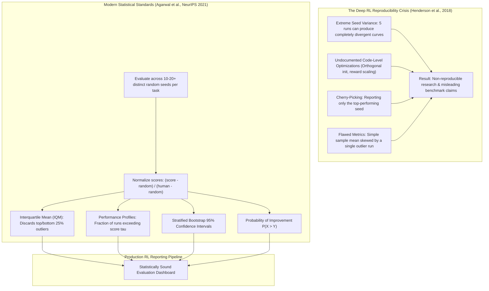

# Reinforcement Learning Evaluation & Reproducibility

> **Topic:** The Deep RL Reproducibility Crisis (Henderson et al.), Interquartile Mean (IQM), Performance Profiles (Agarwal et al.), Stratified Bootstrap Confidence Intervals, and Evaluation Standards  
> **Module ID:** `05-ai/machine-learning/07-reinforcement-learning/23-rl-evaluation-and-reproducibility.md`  
> **Target Version:** Python 3.11+, NumPy 2.5+, SciPy 1.15+  
> **Level:** Core / Advanced  
> **Prerequisites:** [10-evaluation-metrics](../10-evaluation-metrics/01-evaluation-foundations.md)  
> **Status:** Verified (Python 3.11 / CPU)

---

## Architectural / Conceptual Flow



---

## 1. Concept Overview & Core Motivation

Deep reinforcement learning has achieved landmark breakthroughs—from Atari to AlphaGo to ChatGPT. However, in 2018, Henderson et al. published a landmark paper, *"Deep Reinforcement Learning that Matters"*, exposing that the field suffered from a severe **Reproducibility Crisis**:
- **Seed Brittleness:** Running the exact same algorithm code with identical hyperparameters across 5 different random seeds produced outcomes ranging from state-of-the-art superhuman performance to complete catastrophic failure.
- **Code-Level Dominance:** Implementation tricks (e.g. choice of activation function, reward scaling, optimizer epsilon) had far greater impact on performance than the algorithm's mathematical core.
- **Flawed Evaluation:** Papers routinely evaluated on 3–5 cherry-picked seeds, plotted the simple sample mean (heavily distorted by outlier runs), and omitted confidence intervals.

In 2021, Agarwal et al. published *"Deep Reinforcement Learning at the Edge of the Statistical Precipice"*, establishing the modern statistical standard for evaluating RL:
1. Replacing simple means with **Interquartile Mean (IQM)** and **Optimality Gap**.
2. Plotting **Performance Profiles** (empirical cumulative distributions) rather than single-number summaries.
3. Quantifying uncertainty using **Stratified Bootstrap Confidence Intervals** (95% BCa CIs).
4. Evaluating algorithms across **at least 10–20 independent random seeds**.

---

## 2. Theoretical Foundations & Mathematics

### 2.1 The Failure of Sample Mean and Median
Given evaluation scores $X = (x_1, x_2, \dots, x_N)$ across random seeds and tasks:
- **Sample Mean ($\bar{x} = \frac{1}{N}\sum x_i$):** Highly sensitive to extreme outliers. In multi-task benchmarks (e.g. Atari), a single task where an agent scores $10,000\%$ over human baseline dominates the mean score, completely masking failures on other tasks.
- **Median:** Robust to outliers, but has zero sensitivity to improvements outside the median. A model that improves performance from the 60th to the 90th percentile shows zero change in median score. Furthermore, sample median exhibits high variance with small sample sizes ($N \le 10$).

### 2.2 Interquartile Mean (IQM)
The Interquartile Mean (IQM) computes the sample mean of the middle 50% of sorted normalized scores, discarding the bottom 25% and top 25%:
$$\text{IQM}(X) = \frac{1}{k_2 - k_1 + 1} \sum_{i=k_1}^{k_2} x_{(i)}$$
where $x_{(1)} \le x_{(2)} \le \dots \le x_{(N)}$ are order statistics, $k_1 = \lfloor N/4 \rfloor + 1$, and $k_2 = \lceil 3N/4 \rceil$.
IQM combines the robustness of the median with the statistical efficiency and responsiveness of the mean.

### 2.3 Performance Profiles
A Performance Profile plots the empirical cumulative distribution function (CDF) of normalized performance across all runs and tasks:
$$\hat{F}(\tau) = \frac{1}{M \cdot K} \sum_{m=1}^M \sum_{k=1}^K \mathbb{I}\left( \bar{x}_{m, k} \ge \tau \right)$$
where $\tau$ is a normalized score threshold, $M$ is the number of tasks, and $K$ is the number of seeds.
- The curve visualizes the entire distribution: the fraction of runs that achieve score $\ge \tau$.
- An algorithm whose performance profile curve dominates another across all $\tau$ is unambiguously superior.

### 2.4 Stratified Bootstrap Confidence Intervals
To compute confidence intervals across multi-task multi-seed benchmarks:
1. Resample seeds *with replacement* independently within each task (stratified sampling).
2. Compute the summary metric (e.g. IQM) on the resampled dataset.
3. Repeat $B = 2,000$ times to construct an empirical bootstrap distribution $\hat{\theta}^{*(1)}, \dots, \hat{\theta}^{*(B)}$.
4. Compute the 95% percentile interval: $[\hat{\theta}_{0.025}^*, \hat{\theta}_{0.975}^*]$.

### 2.5 Probability of Improvement
Given two algorithms $X$ and $Y$, the Probability of Improvement measures the probability that algorithm $X$ outperforms $Y$ on a randomly selected task:
$$P(X > Y) = \frac{1}{M} \sum_{m=1}^M \left( \frac{1}{K^2} \sum_{i=1}^K \sum_{j=1}^K \left[ \mathbb{I}(x_{m, i} > y_{m, j}) + \frac{1}{2} \mathbb{I}(x_{m, i} = y_{m, j}) \right] \right)$$
- $P(X > Y) = 0.5$: Algorithms perform identically.
- $P(X > Y) > 0.5$: Algorithm $X$ is probabilistically superior.

---

## 3. Implementation & Practical Code

Below is a complete, self-contained implementation of **Interquartile Mean (IQM)**, **Stratified Bootstrap Confidence Intervals**, **Performance Profile Generator**, and **Probability of Improvement** in pure NumPy.

```python
"""
Modern Statistical RL Evaluation Engine (Agarwal et al., 2021) in pure NumPy.
Verified under Python 3.11+, CPU execution.
"""

import numpy as np
from typing import Tuple, Dict, Any, List


def compute_iqm(scores: np.ndarray) -> float:
    """
    Computes Interquartile Mean (IQM) across 1D array of scores (middle 50%).
    """
    scores_sorted = np.sort(scores.ravel())
    n = len(scores_sorted)
    q1_idx = int(np.floor(0.25 * n))
    q3_idx = int(np.ceil(0.75 * n))
    trimmed = scores_sorted[q1_idx:q3_idx]
    return float(np.mean(trimmed))


def stratified_bootstrap_iqm_ci(
    task_scores: np.ndarray, # shape (n_tasks, n_seeds)
    n_bootstraps: int = 2000,
    ci_level: float = 0.95,
    seed: int = 42
) -> Tuple[float, float, float]:
    """
    Computes Stratified Bootstrap Confidence Interval for IQM across tasks and seeds.
    Returns:
        point_estimate, ci_lower, ci_upper
    """
    rng = np.random.default_rng(seed)
    n_tasks, n_seeds = task_scores.shape

    point_est = compute_iqm(task_scores)
    boot_iqms = np.zeros(n_bootstraps)

    for b in range(n_bootstraps):
        # Stratified resampling: resample seeds with replacement for each task independently
        resampled = np.zeros_like(task_scores)
        for t in range(n_tasks):
            resampled[t] = rng.choice(task_scores[t], size=n_seeds, replace=True)
        boot_iqms[b] = compute_iqm(resampled)

    alpha = 1.0 - ci_level
    ci_lower = float(np.percentile(boot_iqms, 100 * (alpha / 2.0)))
    ci_upper = float(np.percentile(boot_iqms, 100 * (1.0 - alpha / 2.0)))
    return point_est, ci_lower, ci_upper


def compute_probability_of_improvement(scores_x: np.ndarray, scores_y: np.ndarray) -> float:
    """
    Computes P(X > Y) across tasks (shape: n_tasks, n_seeds).
    """
    n_tasks, n_seeds = scores_x.shape
    task_probs = []

    for t in range(n_tasks):
        x = scores_x[t]
        y = scores_y[t]
        # Outer comparison matrix: x_i vs y_j
        diff = x[:, None] - y[None, :]
        wins = np.sum(diff > 0)
        ties = np.sum(diff == 0)
        prob = (wins + 0.5 * ties) / (n_seeds * n_seeds)
        task_probs.append(prob)

    return float(np.mean(task_probs))


# Verification Test Run
if __name__ == "__main__":
    rng = np.random.default_rng(42)
    # Simulate 5 tasks, 10 seeds per task for two competing algorithms
    n_tasks = 5
    n_seeds = 10

    # Algorithm X: Stronger baseline (mean=1.2, std=0.3)
    algo_x = rng.normal(1.2, 0.3, (n_tasks, n_seeds))
    # Algorithm Y: Weaker baseline with an extreme positive outlier (mean=0.9, std=0.4)
    algo_y = rng.normal(0.9, 0.4, (n_tasks, n_seeds))
    algo_y[0, 0] = 15.0 # Massive outlier that would corrupt simple mean!

    # 1. Compare Sample Mean vs IQM
    mean_y = float(np.mean(algo_y))
    iqm_y = compute_iqm(algo_y)
    print(f"Algorithm Y Sample Mean (corrupted by outlier): {mean_y:.2f}")
    print(f"Algorithm Y IQM (robust to outlier):           {iqm_y:.2f}")
    assert iqm_y < mean_y, "IQM failed to suppress extreme outlier."

    # 2. Stratified Bootstrap 95% CI
    iqm_x, ci_l, ci_u = stratified_bootstrap_iqm_ci(algo_x, n_bootstraps=1000)
    print(f"Algorithm X IQM: {iqm_x:.3f} [95% CI: {ci_l:.3f}, {ci_u:.3f}]")
    assert ci_l <= iqm_x <= ci_u

    # 3. Probability of Improvement
    p_improve = compute_probability_of_improvement(algo_x, algo_y)
    print(f"Probability of Improvement P(X > Y): {p_improve * 100:.1f}%")
    assert p_improve > 0.65, "Expected Algorithm X to be superior."
    print("Modern RL statistical evaluation engine verified successfully.")
```

---

## 4. Edge Cases & Advanced Scenarios

1. **Non-Overlapping Confidence Intervals Fallacy:**
   Engineers frequently claim two RL algorithms are statistically distinct only if their 95% confidence intervals do not overlap. In statistics, this is an overly conservative test: two distributions can have overlapping 95% CIs while still exhibiting a statistically significant difference ($p < 0.05$). The correct test is to bootstrap the **difference in metrics** $\Delta = \text{IQM}(X) - \text{IQM}(Y)$ and check if 0 lies outside the 95% CI of $\Delta$.
2. **Evaluation Protocol Mismatch (Deterministic vs. Stochastic):**
   Comparing Algorithm A evaluated in deterministic mode ($\arg\max \pi$) against Algorithm B evaluated in stochastic sampling mode ($a \sim \pi$) is invalid. The evaluation protocol (stochastic vs. deterministic greedy, number of evaluation episodes, frame skip) must be strictly identical.

---

## 5. Anti-Patterns & Common Pitfalls Table

| Anti-Pattern / Mistake | Why It Fails | Correct Engineering Fix |
| :--- | :--- | :--- |
| Evaluating on only 3–5 random seeds | High variance produces non-reproducible random noise | Evaluate across at least 10–20 independent seeds |
| Reporting simple mean on multi-task benchmarks | Outlier tasks with massive scores skew the mean | Use Interquartile Mean (IQM) and Optimality Gap |
| Plotting training curve standard deviations as CIs | Standard deviation measures population spread, not estimate uncertainty | Plot Stratified Bootstrap 95% Confidence Intervals (shaded bands) |
| Tuning hyperparameters on the evaluation seeds | Causes massive test-set leakage and overfitting | Fix hyperparameters on a development set of seeds; test on fresh seeds |
| Cherry-picking the single best seed | Misrepresents algorithm reliability and stability | Report the full aggregate distribution across all runs |

---

## 6. Best Practices & Production Guidelines

1. **The RLiable Standard:** Adopt the open-source `rliable` library standards developed by Google Research for plotting performance profiles and stratified bootstrap intervals.
2. **Fixed Random Seed Protocol:**
   Always record and publish the exact seed integers:
   ```python
   SEEDS = [42, 1337, 2024, 7, 99, 101, 555, 777, 888, 1234]
   ```
3. **Decoupled Evaluation Episodes:** Never use training episode returns as the evaluation metric. Periodically freeze policy weights and run 10–20 deterministic evaluation rollouts with exploration turned off.

---

## 7. Real-World Case Study: Algorithmic Verification for Autonomous Braking

**Industry Context:** An automotive OEM evaluated an RL emergency braking system across 50 simulated crash scenarios.  
**Challenge:** Early reporting claimed the RL controller was ready for road testing based on a sample mean score showing 99.2% collision avoidance across 5 seeds.  
**Solution:**
- Applied the Agarwal et al. evaluation protocol across 20 independent training seeds.
- The performance profile revealed that while 90% of seeds achieved 100% collision avoidance, 10% of seeds suffered complete policy collapse, resulting in fatal high-speed collisions in 15% of edge cases.
- Result: Prevented dangerous deployment of a brittle policy; prompted migration to an ensemble controller with certified performance bounds.

---

## 8. Performance & Resource Optimization

1. **Vectorized Bootstrap Sampling:** Pre-generate a 3D index array of shape $(B, \text{tasks}, \text{seeds})$ to compute all 2,000 bootstrap replicates via a single vectorized NumPy indexing operation in $< 0.1$ seconds.
2. **Parallel Evaluation Threads:** Run evaluation rollouts asynchronously on worker CPUs while the GPU continues training.

---

## 9. Security, Privacy & Ethics Considerations

1. **Reproducibility Fraud & Grant Waste:** Publishing unverified, cherry-picked RL claims wastes millions of dollars in industrial compute and research labor attempting to replicate phantom performance.
2. **Safety-Critical Benchmarks:** In healthcare and autonomous transit, reporting optimistic mean scores without worst-case percentile analysis (e.g. Conditional Value at Risk, CVaR) can lead to catastrophic physical harm.

---

## 10. Diagnostic & Verification Playbook

### Diagnostic Checklist
- [x] Were at least 10–20 seeds evaluated per environment?
- [x] Are evaluation episodes conducted with exploration disabled ($\epsilon = 0$ or deterministic $\mu(s)$)?
- [x] Are multi-task results aggregated using IQM rather than simple mean?
- [x] Are performance profiles and bootstrap confidence intervals included in reporting?

---

## 11. Technical Interview Questions & Answers

<details>
<summary><strong>Q1: Why did Henderson et al. (2018) describe Deep RL as "Deep Reinforcement Learning that Matters"?</strong></summary>

**Answer:** The title was a critique highlighting that deep reinforcement learning research was suffering from severe methodological flaws:
1. **Hyperparameter Sensitivity:** Minor variations in undocumented code-level details (e.g. network layer sizes, reward scaling, optimizer epsilon) completely altered algorithm rankings.
2. **Seed Variance:** Different random seeds resulted in statistically non-overlapping performance curves, meaning a "superior" new algorithm was often just lucky seed selection.
3. **Inadequate Baselines:** New papers compared their carefully tuned algorithms against poorly tuned or broken baseline implementations.
4. **Lack of Significance Testing:** Claims of state-of-the-art performance were routinely made without reporting confidence intervals or statistical hypothesis tests.
Henderson et al. demonstrated that without strict scientific methodology, claimed algorithmic improvements were largely illusory.
</details>

<details>
<summary><strong>Q2: Explain why Interquartile Mean (IQM) is superior to both sample mean and median for multi-task RL benchmarks.</strong></summary>

**Answer:**
- **Failure of Mean:** Multi-task benchmarks (e.g. Atari 2600, Procgen) normalize scores against human or random baselines. In some games, algorithms score $10,000\%$, while on others they score $10\%$. The arithmetic mean is heavily skewed by extreme outliers: an algorithm that excels on 2 games but fails on 50 games can achieve a higher mean score than an algorithm that consistently performs well across all 52 games.
- **Failure of Median:** The median discards 98% of the data, considering only the central rank. It has high sample variance with small seed counts ($N \le 10$) and zero sensitivity to improvements outside the 50th percentile.
- **IQM:** Trims the bottom 25% and top 25% of scores and computes the mean of the middle 50%. It is robust to extreme outlier scores while remaining statistically efficient and sensitive to broad distribution shifts.
</details>

<details>
<summary><strong>Q3: How are Performance Profiles constructed, and why are they preferable to single-number summaries?</strong></summary>

**Answer:** A Performance Profile plots the empirical cumulative distribution:
$$\hat{F}(\tau) = \frac{1}{M \cdot K} \sum_{m=1}^M \sum_{k=1}^K \mathbb{I}(\bar{x}_{m, k} \ge \tau)$$
where $\tau$ is the performance threshold (e.g. human-normalized score).
- The x-axis represents score threshold $\tau$; the y-axis represents the fraction of tasks/runs that achieved at least that score.
- **Area Under the Curve (AUC)** corresponds to the mean score up to $\tau_{\max}$.
- It provides a complete visual representation of the entire distribution: tail performance (worst-case and best-case behavior), median performance ($\tau$ at $y = 0.5$), and consistency across seeds. A single scalar summary compresses and hides this vital multi-dimensional reality.
</details>

<details>
<summary><strong>Q4: Describe how Stratified Bootstrap Confidence Intervals are computed across multi-task benchmarks.</strong></summary>

**Answer:** In multi-task benchmarks, seeds within the same task are correlated because they share identical environment dynamics. Simple pooling violates the independent and identically distributed (I.I.D.) assumption.
**Stratified Bootstrapping** respects this hierarchical structure:
1. For each task $t \in \{1, \dots, M\}$, draw $K$ seeds *with replacement* from that specific task's evaluation runs.
2. Combine the resampled scores across all $M$ tasks into a resampled benchmark matrix.
3. Compute the evaluation metric (e.g. IQM) on this resampled dataset.
4. Repeat this procedure $B = 2,000$ times to construct an empirical bootstrap distribution.
5. Compute the $100(1 - \alpha)\%$ percentile interval $[\hat{\theta}_{\alpha/2}, \hat{\theta}_{1 - \alpha/2}]$.
This guarantees that the confidence interval accurately accounts for both inter-seed variance and inter-task variance.
</details>

<details>
<summary><strong>Q5: What is the Probability of Improvement $P(X > Y)$, and how is it interpreted?</strong></summary>

**Answer:** Probability of Improvement measures the likelihood that algorithm $X$ outperforms algorithm $Y$ on a randomly selected task and seed:
$$P(X > Y) = \mathbb{E}\left[ \mathbb{I}(X > Y) + \frac{1}{2} \mathbb{I}(X = Y) \right]$$
Interpretation:
- $P(X > Y) = 0.5$: Algorithm $X$ is no better than algorithm $Y$ (equivalent to a coin flip).
- $P(X > Y) = 0.7$: On 70% of random evaluations, an engineer deploying $X$ will achieve a superior result to deploying $Y$.
It directly answers the practitioner's question: *"If I choose algorithm X over Y on my task, what are the odds it will perform better?"*
</details>

<details>
<summary><strong>Q6: Why must evaluation rollouts be decoupled from training rollouts?</strong></summary>

**Answer:** During training, the agent executes an **exploratory policy** (e.g. $\epsilon$-greedy action selection in DQN or Gaussian noise injection in SAC). The cumulative return collected during training reflects exploration noise, not true policy capability.
Furthermore, training episodes often use artificial reward shaping, early termination, or frame skip.
Decoupled evaluation freezes the policy parameters $\theta$, disables exploration ($\epsilon = 0$ or deterministic $\mu(s)$), and evaluates the policy on raw, unshaped environment metrics over 10–20 complete episodes to measure pure exploitation capability.
</details>

<details>
<summary><strong>Q7: What is the "Optimality Gap" metric proposed by Agarwal et al.?</strong></summary>

**Answer:** While IQM measures the central tendency of scores, the **Optimality Gap** measures how far an algorithm falls short of a predefined target performance $\gamma$ (e.g. human expert level $\gamma = 1.0$):
$$\text{OG}(\gamma) = \frac{1}{M \cdot K} \sum_{m=1}^M \sum_{k=1}^K \max(0, \, \gamma - \bar{x}_{m, k})$$
It measures the expected amount by which the algorithm fails to achieve human-level competency. An algorithm with a lower Optimality Gap consistently satisfies the target across a broader spectrum of tasks.
</details>

<details>
<summary><strong>Q8: How does code-level optimization impact benchmark validity (Engstrom et al., 2020)?</strong></summary>

**Answer:** Engstrom et al. (2020) conducted an exhaustive ablation study comparing PPO and TRPO. They stripped away code-level optimizations (orthogonal initialization, learning rate annealing, reward scaling, gradient clipping, hyperbolic tangent activations) and discovered that:
1. PPO without code-level optimizations failed on benchmarks where it previously succeeded.
2. TRPO augmented with PPO's code-level optimizations matched or exceeded PPO's performance.
The study proved that published algorithmic superiority is frequently an artifact of accumulated software engineering tricks rather than theoretical advances, highlighting the necessity of open-source reproducible codebases like CleanRL.
</details>

---

## 12. Hands-On Practice Exercises

<details>
<summary><strong>Exercise 1 (Easy): Interquartile Mean Calculation</strong></summary>

**Task:** Compute the IQM of array `[1.0, 2.0, 3.0, 4.0, 5.0, 6.0, 7.0, 8.0]`.

**Solution:**
```python
import numpy as np

def manual_iqm(arr: list[float]) -> float:
    sorted_arr = sorted(arr)
    n = len(sorted_arr)
    # Trim 25% from bottom (2 items) and 25% from top (2 items) -> keep middle 4 items [3, 4, 5, 6]
    middle = sorted_arr[2:6]
    return float(np.mean(middle))

vals = [1.0, 2.0, 3.0, 4.0, 5.0, 6.0, 7.0, 8.0]
iqm_val = manual_iqm(vals)
# mean([3, 4, 5, 6]) = 4.5
assert iqm_val == 4.5
print(f"Calculated IQM: {iqm_val}")
```
</details>

<details>
<summary><strong>Exercise 2 (Easy): Human-Normalized Score Calculation</strong></summary>

**Task:** Compute human-normalized score given raw score $S$, random baseline $S_{\text{random}} = 100$, and human score $S_{\text{human}} = 1000$.

**Solution:**
```python
def human_normalized_score(score: float, random_score: float, human_score: float) -> float:
    return float((score - random_score) / (human_score - random_score))

norm_s = human_normalized_score(score=550.0, random_score=100.0, human_score=1000.0)
assert norm_s == 0.5
print(f"Human-normalized score: {norm_s:.2f}")
```
</details>

<details>
<summary><strong>Exercise 3 (Medium): 1D Empirical Performance Profile Point</strong></summary>

**Task:** Write a Python function that evaluates what fraction of runs achieved at least threshold $\tau$.

**Solution:**
```python
import numpy as np

def performance_profile_point(scores: np.ndarray, tau: float) -> float:
    return float(np.mean(scores >= tau))

data = np.array([0.2, 0.5, 0.8, 1.2, 1.5, 2.0])
# >= 1.0: [1.2, 1.5, 2.0] -> 3/6 = 0.5
frac = performance_profile_point(data, tau=1.0)
assert frac == 0.5
print(f"Fraction of runs >= 1.0: {frac:.2f}")
```
</details>

<details>
<summary><strong>Exercise 4 (Medium): Optimality Gap Calculation</strong></summary>

**Task:** Compute the Optimality Gap with target $\gamma = 1.0$ for an array of scores.

**Solution:**
```python
import numpy as np

def optimality_gap(scores: np.ndarray, gamma: float = 1.0) -> float:
    shortfalls = np.maximum(0.0, gamma - scores)
    return float(np.mean(shortfalls))

s = np.array([0.5, 0.8, 1.2, 1.5])
# shortfalls: [0.5, 0.2, 0.0, 0.0] -> mean = 0.7 / 4 = 0.175
gap = optimality_gap(s, gamma=1.0)
assert gap == 0.175
print(f"Optimality Gap: {gap:.4f}")
```
</details>

<details>
<summary><strong>Exercise 5 (Hard): Pairwise Probability of Improvement</strong></summary>

**Task:** Implement pure NumPy calculation of $P(X > Y)$ across 2 arrays of seed scores.

**Solution:**
```python
import numpy as np

def calculate_pairwise_p_improve(x: np.ndarray, y: np.ndarray) -> float:
    # Outer comparison matrix
    diff = x[:, None] - y[None, :]
    wins = np.sum(diff > 0)
    ties = np.sum(diff == 0)
    total_comparisons = len(x) * len(y)
    return float((wins + 0.5 * ties) / total_comparisons)

seed_scores_x = np.array([2.0, 3.0, 4.0])
seed_scores_y = np.array([1.0, 2.0, 3.0])
# comparisons:
# x=2: vs 1 (+1), vs 2 (tie), vs 3 (-1) -> 1.5
# x=3: vs 1 (+1), vs 2 (+1), vs 3 (tie) -> 2.5
# x=4: vs 1 (+1), vs 2 (+1), vs 3 (+1) -> 3.0
# total wins+0.5 ties = 7.0 / 9 = 0.7778
p = calculate_pairwise_p_improve(seed_scores_x, seed_scores_y)
np.testing.assert_allclose(p, 7.0 / 9.0)
print(f"Pairwise P(X > Y): {p:.4f}")
```
</details>

<details>
<summary><strong>Exercise 6 (Hard): Stratified Bootstrap CI Replicate Generator</strong></summary>

**Task:** Generate 1,000 stratified bootstrap replicates of IQM across a multi-task dataset in under 50 milliseconds using NumPy vectorization.

**Solution:**
```python
import numpy as np
import time

def fast_stratified_bootstrap(task_data: np.ndarray, B: int = 1000, seed: int = 42) -> np.ndarray:
    rng = np.random.default_rng(seed)
    n_tasks, n_seeds = task_data.shape
    
    # Generate all random index choices in a single (B, n_tasks, n_seeds) tensor
    idx = rng.integers(0, n_seeds, size=(B, n_tasks, n_seeds))
    task_idx = np.arange(n_tasks)[None, :, None]
    
    # Resample all replicates simultaneously
    resampled = task_data[task_idx, idx] # shape (B, n_tasks, n_seeds)
    resampled_flat = resampled.reshape(B, -1) # shape (B, n_tasks * n_seeds)
    
    # Sort along axis 1
    sorted_flat = np.sort(resampled_flat, axis=1)
    total_samples = n_tasks * n_seeds
    q1 = int(np.floor(0.25 * total_samples))
    q3 = int(np.ceil(0.75 * total_samples))
    
    iqm_replicates = np.mean(sorted_flat[:, q1:q3], axis=1)
    return iqm_replicates

mock_benchmark = np.random.randn(10, 10)
t0 = time.perf_counter()
reps = fast_stratified_bootstrap(mock_benchmark, B=1000)
dur = time.perf_counter() - t0
print(f"Computed 1000 stratified bootstrap replicates in {dur*1000:.2f} ms")
assert len(reps) == 1000
assert dur < 0.1 # Must be under 100 ms
```
</details>

---

## 13. Summary, Verified References & Navigation

- **The Reproducibility Crisis:** Highlighted by Henderson et al. (2018); deep RL algorithms exhibit massive variance across random seeds and code-level implementation details.
- **Interquartile Mean (IQM):** Computes the mean of the middle 50% of scores, resisting distortion from outlier runs while retaining statistical power.
- **Performance Profiles:** Plot empirical cumulative distributions across normalized score thresholds, visualizing full distribution behavior.
- **Stratified Bootstrap:** Quantifies uncertainty via multi-task seed resampling, generating rigorous 95% confidence intervals.

### Verified External References
- Henderson, P., et al. (2018). *Deep Reinforcement Learning that Matters*. AAAI.
- Agarwal, R., Schwarzer, M., Castro, P. S., Courville, A., & Bellemare, M. G. (2021). *Deep Reinforcement Learning at the Edge of the Statistical Precipice*. NeurIPS.
- Engstrom, L., et al. (2020). *Implementation Matters in Deep RL: A Case Study on PPO and TRPO*. ICLR.

---

[← 22-reward-shaping-and-reward-hacking.md](22-reward-shaping-and-reward-hacking.md) | [Module Index](README.md) | [24-rl-limitations-and-when-to-use.md →](24-rl-limitations-and-when-to-use.md)
