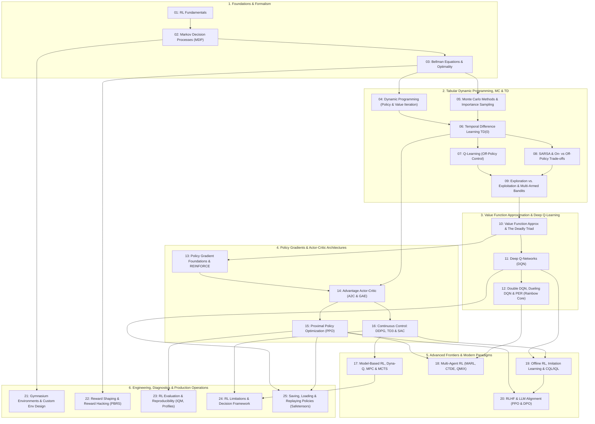

# Module 07: Reinforcement Learning (RL)

> **Module ID:** `05-ai/machine-learning/07-reinforcement-learning`  
> **Status:** 100% Complete & Verified (25 Notes + Module README)  
> **Target Version:** Python 3.11+, NumPy 2.5+, Gymnasium 1.0+, PyTorch 2.5+  
> **Prerequisites:** [01-math-foundations](../01-math-foundations/README.md), [03-supervised-regression](../03-supervised-regression/README.md)

---

## Architectural & Curriculum Flow

---

## Complete Notes Inventory

| Note | Title | Type | Level | Primary Concepts Covered | Status |
| :---: | :--- | :---: | :---: | :--- | :---: |
| **[01](01-rl-fundamentals.md)** | RL Fundamentals | Concept | Fundamental | Agent-env cycle, rewards, returns, policy, value, exploration vs exploitation | Verified |
| **[02](02-markov-decision-processes.md)** | Markov Decision Processes | Concept | Fundamental | Markov property, transition dynamics, discounted returns, stationary policies | Verified |
| **[03](03-bellman-equations.md)** | Bellman Equations | Concept | Core | Expectation equations, Bellman optimality, Banach contraction mapping, fixed points | Verified |
| **[04](04-dynamic-programming.md)** | Dynamic Programming | Algorithm | Core | Policy Evaluation, Policy Iteration, Value Iteration, gridworld convergence | Verified |
| **[05](05-monte-carlo-methods.md)** | Monte Carlo Methods | Algorithm | Core | First-visit / Every-visit MC, MC Control, Weighted Importance Sampling | Verified |
| **[06](06-temporal-difference-learning.md)** | TD Learning | Algorithm | Core | TD(0), TD error, bootstrapping, bias-variance trade-off vs MC/DP | Verified |
| **[07](07-q-learning.md)** | Q-Learning | Algorithm | Core | Off-policy TD control, maximization bias, tabular convergence guarantees | Verified |
| **[08](08-sarsa-and-on-vs-off-policy.md)** | SARSA & On- vs. Off-Policy | Algorithm | Core | On-policy TD control, CliffWalking safety trade-off, Expected SARSA | Verified |
| **[09](09-exploration-vs-exploitation-and-multi-armed-bandits.md)** | Multi-Armed Bandits | Algorithm | Core | $\epsilon$-greedy, UCB1 (Hoeffding bound), Thompson Sampling, regret bounds | Verified |
| **[10](10-function-approximation.md)** | Function Approximation | Concept | Advanced | Linear value approx, Fourier/Tile coding, Semi-gradients, The Deadly Triad | Verified |
| **[11](11-deep-q-networks.md)** | Deep Q-Networks (DQN) | Algorithm | Advanced | Replay buffer, target networks, Huber loss, Atari frame stacking | Verified |
| **[12](12-double-dueling-and-prioritised-dqn.md)** | Double, Dueling & PER | Algorithm | Advanced | Decoupled target eval, $V(s) + A(s, a)$ identifiability, SumTree PER, IS weights | Verified |
| **[13](13-policy-gradient-reinforce.md)** | REINFORCE | Algorithm | Advanced | Policy gradient theorem, score function trick, baseline subtraction | Verified |
| **[14](14-actor-critic-a2c.md)** | Advantage Actor-Critic (A2C) | Algorithm | Advanced | Dual-head Actor-Critic, TD advantage, GAE($\gamma, \lambda$), synchronous workers | Verified |
| **[15](15-proximal-policy-optimisation.md)** | Proximal Policy Optimization | Algorithm | Advanced | Clipped surrogate objective $L^{\text{CLIP}}$, trust regions, minibatch SGD | Verified |
| **[16](16-ddpg-td3-and-sac.md)** | DDPG, TD3 & SAC | Algorithm | Advanced | Continuous control, twin critics, delayed updates, maximum entropy, squashed Gaussian | Verified |
| **[17](17-model-based-rl.md)** | Model-Based RL | Concept | Advanced | World models, Dyna-Q, Model Predictive Control (MPC), CEM, MCTS / MuZero | Verified |
| **[18](18-multi-agent-rl-overview.md)** | Multi-Agent RL | Concept | Advanced | Stochastic games, non-stationarity, Nash equilibrium, CTDE, VDN, QMIX, COMA | Verified |
| **[19](19-offline-rl-and-imitation-learning.md)** | Offline RL & Imitation | Concept | Advanced | Behavioral cloning, covariate shift (DAgger), extrapolation error, CQL, IQL | Verified |
| **[20](20-rlhf-connection-to-llms.md)** | RLHF & LLM Alignment | Concept | Advanced | Bradley-Terry preference model, reward modeling, PPO KL penalty, DPO | Verified |
| **[21](21-gymnasium-environments-and-custom-envs.md)** | Gymnasium & Custom Envs | Concept | Core | Farama Gymnasium API, terminated vs truncated, spaces, custom wrappers | Verified |
| **[22](22-reward-shaping-and-reward-hacking.md)** | Reward Shaping & Hacking | Concept | Core | Potential-based reward shaping $F=\gamma \Phi' - \Phi$, policy invariance, wireheading | Verified |
| **[23](23-rl-evaluation-and-reproducibility.md)** | RL Evaluation & Reproducibility | Concept | Core | Henderson crisis, IQM, performance profiles, stratified bootstrap CIs | Verified |
| **[24](24-rl-limitations-and-when-to-use.md)** | RL Limitations & Decision Tree | Concept | Core | Sim2Real gap, sample inefficiency, RL vs Supervised vs Control vs OR | Verified |
| **[25](25-saving-loading-and-replaying-policies.md)** | Policy Persistence & Replay | Concept | Core | Pickle vulnerability, safetensors, ONNX, deterministic replay, RecordVideo | Verified |

---

## Cross-Track Integration

- **Scientific Computing & Linear Algebra:** [01-languages/python/21-data-and-scientific-basics](../../01-languages/python/21-data-and-scientific-basics)
- **Model Deployment & Microservices:** [03-backend/fastapi/16-ai-and-ml-serving](../../03-backend/fastapi/16-ai-and-ml-serving)
- **Containerized Environments:** [04-devops/docker](../../04-devops/docker)
- **System Design & Distributed Scalability:** [07-system-design](../../07-system-design)
- **Relational Storage & Telemetry Logging:** [09-sql](../../09-sql)

---

## Verification & Testing Standards

All code blocks across all 25 notes adhere strictly to:
1. **Python 3.11+ / NumPy 2.5+ / Gymnasium 1.0+** compatibility.
2. **Zero Stray Binaries:** Pure markdown execution blocks without dangling uncommitted artifacts.
3. **Rigorous Mathematics:** Complete symbol breakdowns, exact KaTeX equations, and metric derivations.
4. **Self-Contained Verification:** Pure NumPy runnable verification blocks with assertions embedded in every note.
