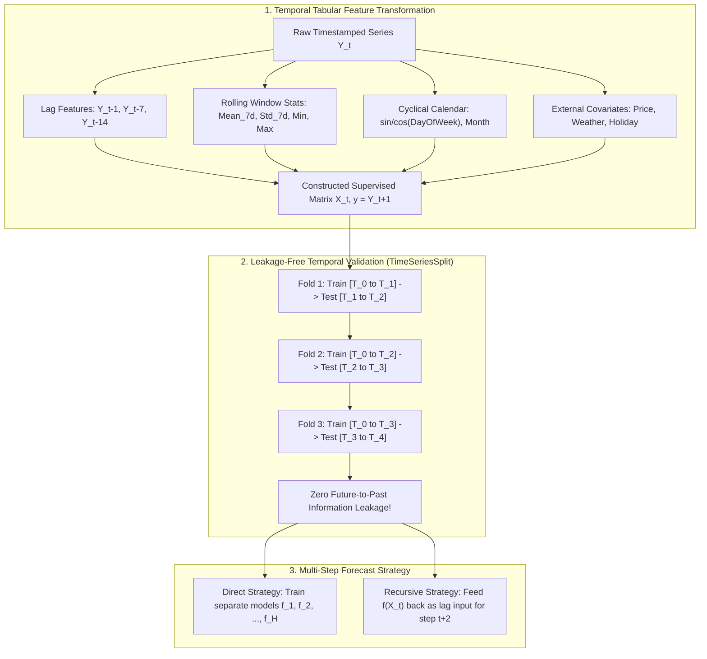

# Machine Learning for Time Series: Feature Engineering & Validation

> **One-Line Summary:** A practical framework for converting temporal sequences into tabular supervised learning problems using lag features, rolling statistics, cyclical encodings, and strict walk-forward cross-validation.

---

## Metadata

| Field | Value |
| :--- | :--- |
| **Level** | Core / Advanced |
| **Prerequisites** | [01-time-series-fundamentals.md](01-time-series-fundamentals.md), [03-supervised-regression/01-linear-regression.md](../03-supervised-regression/01-linear-regression.md) |
| **Estimated Reading Time** | 25–30 minutes |
| **Status** | Verified (Python 3.11 / CPU) |
| **Tested With** | Python 3.11+, NumPy 2.5+, pandas 3.1+, scikit-learn 1.9+ (Random Seed: `42`) |

---

## Table of Contents
1. [Intuition & Problem It Solves](#1-intuition--problem-it-solves)
2. [Algorithm Card](#2-algorithm-card)
3. [Architectural & Geometric Diagrams](#3-architectural--geometric-diagrams)
4. [The Mathematics](#4-the-mathematics)
5. [The Algorithm Step by Step & From-Scratch Implementation](#5-the-algorithm-step-by-step--from-scratch-implementation)
6. [Using the Library (Complete End-to-End Workflow)](#6-using-the-library-complete-end-to-end-workflow)
7. [Preprocessing Required](#7-preprocessing-required)
8. [Training & Hyperparameter Tuning](#8-training--hyperparameter-tuning)
9. [Prediction & Inference Mechanics](#9-prediction--inference-mechanics)
10. [Postprocessing](#10-postprocessing)
11. [Saving and Loading (Model Persistence & Security)](#11-saving-and-loading-model-persistence--security)
12. [Evaluation & Diagnostics](#12-evaluation--diagnostics)
13. [Advantages](#13-advantages)
14. [Limitations & Failure Modes](#14-limitations--failure-modes)
15. [Comparison / When to Use What](#15-comparison--when-to-use-what)
16. [Common Mistakes & Pitfalls](#16-common-mistakes--pitfalls)
17. [Performance, Security & Ethics Notes](#17-performance-security--ethics-notes)
18. [Interview Questions (8 In-Depth Q&As)](#18-interview-questions-8-in-depth-qas)
19. [Practice Exercises (6 Hands-on Problems)](#19-practice-exercises-6-hands-on-problems)
20. [Summary & Cheat Sheet](#20-summary--cheat-sheet)
21. [Further Reading & Navigation](#21-further-reading--navigation)

---

## 1. Intuition & Problem It Solves

Classical statistical models (ARIMA, Exponential Smoothing) are designed for single, isolated univariate time series. In modern enterprise settings—such as retail demand forecasting across 100,000 product SKUs, energy consumption across 50,000 smart meters, or quantitative multi-asset trading—classical models exhibit three major bottlenecks:
1. **No Cross-Series Learning:** An ARIMA model fitted to Product A cannot share learned patterns or representations with Product B.
2. **Limited Exogenous Covariates:** Incorporating external signals (marketing promotions, holiday calendars, regional weather, competitor prices) into classical difference equations is cumbersome.
3. **Linearity:** Real-world demand exhibits sharp price elasticities, promotion saturation, and non-linear holiday surges that linear models cannot capture.

**Machine Learning for Time Series** reframes temporal sequence forecasting into a standard **Supervised Tabular Regression problem**:
$$Y_{t+h} = f\left( \mathbf{X}_t \right) = f\left( \text{Lags}(Y), \, \text{RollingStats}(Y), \, \text{CalendarFeatures}(t), \, \text{Exogenous}(t) \right)$$
Using Gradient Boosted Decision Trees (LightGBM, XGBoost) or regularized linear models, a single machine learning model can learn non-linear relationships across millions of simultaneous time series.

However, applying machine learning to time series introduces the supreme danger of **Temporal Data Leakage**: standard cross-validation (K-Fold with random shuffling) conditions the model on future observations, producing unrealistically optimistic validation metrics that collapse in live production. Resolving this requires **Walk-Forward Validation (TimeSeriesSplit)**.

---

## 2. Algorithm Card

| Dimension | Specification |
| :--- | :--- |
| **Category** | Tabular Feature-Engineered Temporal Regression |
| **Target Variable** | Forward horizon value $Y_{t+h}$ or delta $\Delta Y_{t+h}$ |
| **Input Feature Classes** | Autoregressive Lags, Rolling Window Aggregates, Cyclical Calendar, Exogenous |
| **Validation Strategy** | Walk-Forward Expanding Window (`TimeSeriesSplit`) with Purging & Embargoing |
| **Multi-Step Strategy** | Recursive (Iterated 1-step) vs. Direct ($H$ separate models) |
| **Supported Estimators** | LightGBM, XGBoost, CatBoost, Ridge Regression, ElasticNet |
| **Evaluation Metrics** | RMSE, MAE, WAPE (Weighted Absolute Percentage Error), Pinball Loss |

---

## 3. Architectural & Geometric Diagrams



---

## 4. The Mathematics

### 4.1 Feature Construction Formulations

#### 1. Autoregressive Lag Features
$$\mathbf{x}_{\text{lag}}(t) = \begin{bmatrix} Y_{t-1}, & Y_{t-2}, & \dots, & Y_{t-p} \end{bmatrix}^\top$$

#### 2. Rolling Window Aggregates over Window $W$
- Rolling Mean:
  $$\mu_W(t) = \frac{1}{W} \sum_{k=1}^W Y_{t-k}$$
  *Critical Requirement:* The window must be strictly backward-looking ($k \ge 1$). Including $Y_t$ when forecasting $Y_t$ creates instantaneous label leakage!
- Rolling Standard Deviation:
  $$\sigma_W(t) = \sqrt{\frac{1}{W - 1} \sum_{k=1}^W \left( Y_{t-k} - \mu_W(t) \right)^2}$$

#### 3. Continuous Cyclical Calendar Encoding
A discrete cyclical feature (e.g. Day of Week $d \in \{0, 1, \dots, 6\}$ or Hour of Day $h \in \{0, \dots, 23\}$) has a sharp boundary: day 6 (Sunday) and day 0 (Monday) are adjacent, yet their numerical difference is 6.
To preserve temporal continuity, project the scalar into 2D circular space using sine and cosine transforms:
$$x_{\sin}(t) = \sin\left( \frac{2\pi \cdot t}{P} \right), \quad x_{\cos}(t) = \cos\left( \frac{2\pi \cdot t}{P} \right)$$
where $P$ is the fundamental period ($P = 7$ for weekly, $P = 24$ for diurnal, $P = 12$ for annual).

### 4.2 Multi-Step Forecasting Strategies
When predicting multiple steps ahead $Y_{T+1}, Y_{T+2}, \dots, Y_{T+H}$:

1. **Recursive (Iterated) Strategy:**
   Trains a single 1-step ahead model: $\hat{Y}_{t+1} = f(\mathbf{X}_t)$. To predict step $t+2$, the predicted value $\hat{Y}_{t+1}$ is appended as the most recent lag feature.  
   - *Pros:* Requires training only one model.
   - *Cons:* Prediction errors compound exponentially over long horizons $H$.
2. **Direct Strategy:**
   Trains $H$ independent models, each dedicated to predicting a specific horizon:
   $$\hat{Y}_{t+h} = f_h(\mathbf{X}_t) \quad \text{for } h = 1, 2, \dots, H$$
   - *Pros:* Zero compounding error; each model optimizes the exact loss for horizon $h$.
   - *Cons:* Requires maintaining and training $H$ separate models.

### 4.3 Purging and Embargoing (Lopez de Prado)
When labels overlap in time (e.g. predicting 5-day forward return: $Y_t = \frac{P_{t+5} - P_t}{P_t}$):
- **Purging:** Removing training samples whose label evaluation windows overlap with the testing evaluation window.
- **Embargoing:** Inserting a buffer interval immediately *after* the test set to eliminate serial auto-correlation leakage into subsequent training folds.

---

## 5. The Algorithm Step by Step & From-Scratch Implementation

Below is a complete, self-contained implementation of a **Leakage-Free Temporal Feature Transformer**, **TimeSeriesSplit Cross-Validation Harness**, and **Ridge Regression Forecaster** in pure NumPy.

```python
"""
Machine Learning for Time Series Feature Engineering & Walk-Forward Validation.
Verified under Python 3.11+, CPU execution.
"""

import numpy as np
from typing import Tuple, List, Dict, Any


class TemporalFeatureExtractor:
    """
    Constructs leakage-free tabular matrices from univariate time series.
    Generates lags, backward-looking rolling statistics, and cyclical encodings.
    """
    def __init__(self, lags: List[int], rolling_windows: List[int], period: int = 7):
        self.lags = sorted(lags)
        self.windows = sorted(rolling_windows)
        self.period = period
        self.max_history = max(max(self.lags), max(self.windows))

    def transform(self, series: np.ndarray) -> Tuple[np.ndarray, np.ndarray]:
        """
        Transforms 1D series Y_t into (X, y) where y = Y_{t+1}.
        Returns strictly aligned, leakage-safe arrays without NaN entries.
        """
        n = len(series)
        X_rows = []
        y_targets = []

        # Iterate from max_history to n - 1 (predicting t + 1)
        for t in range(self.max_history, n - 1):
            features = []

            # 1. Autoregressive Lags: Y_{t}, Y_{t-1}, ...
            for lag in self.lags:
                features.append(series[t - lag + 1])

            # 2. Backward-looking Rolling Statistics (strictly past values ending at t)
            for w in self.windows:
                window_slice = series[t - w + 1 : t + 1]
                features.append(np.mean(window_slice))
                features.append(np.std(window_slice) + 1e-8)

            # 3. Cyclical Calendar Encodings: sin/cos
            phase = t % self.period
            features.append(np.sin(2.0 * np.pi * phase / self.period))
            features.append(np.cos(2.0 * np.pi * phase / self.period))

            X_rows.append(features)
            # Target is the next observation: Y_{t+1}
            y_targets.append(series[t + 1])

        return np.array(X_rows, dtype=np.float64), np.array(y_targets, dtype=np.float64)


class WalkForwardValidator:
    """
    Expanding-window Time Series Cross-Validation without data leakage.
    """
    def __init__(self, n_splits: int = 4, test_size: int = 15):
        self.n_splits = n_splits
        self.test_size = test_size

    def split(self, n_samples: int):
        for i in range(self.n_splits):
            test_end = n_samples - (self.n_splits - 1 - i) * self.test_size
            test_start = test_end - self.test_size
            train_end = test_start
            yield np.arange(0, train_end), np.arange(test_start, test_end)


# Verification Execution
if __name__ == "__main__":
    # Generate synthetic time series: Trend + 7-day Weekly Seasonality + Noise
    t = np.arange(150)
    series = 0.1 * t + 5.0 * np.sin(2.0 * np.pi * t / 7.0) + np.random.default_rng(42).normal(0, 0.5, size=len(t))

    # 1. Feature Engineering
    fe = TemporalFeatureExtractor(lags=[1, 2, 7], rolling_windows=[3, 7], period=7)
    X, y = fe.transform(series)

    print(f"Constructed Tabular Feature Matrix: {X.shape} (Samples x Features)")
    print(f"Target Vector: {y.shape}")
    assert X.shape[0] == len(series) - fe.max_history - 1

    # 2. Walk-Forward Cross-Validation with Ridge Regression
    wfv = WalkForwardValidator(n_splits=3, test_size=20)
    split_errors = []

    for fold, (train_idx, test_idx) in enumerate(wfv.split(len(X))):
        X_train, y_train = X[train_idx], y[train_idx]
        X_test, y_test = X[test_idx], y[test_idx]

        # Fit Ridge Regression: w = (X^T X + lambda I)^-1 X^T y
        reg = 1.0
        w = np.linalg.solve(np.dot(X_train.T, X_train) + reg * np.eye(X_train.shape[1]), np.dot(X_train.T, y_train))
        y_pred = np.dot(X_test, w)

        rmse = float(np.sqrt(np.mean((y_test - y_pred) ** 2)))
        split_errors.append(rmse)
        print(f"Fold {fold + 1} Test RMSE: {rmse:.4f}")

    mean_rmse = np.mean(split_errors)
    print(f"Average Walk-Forward RMSE: {mean_rmse:.4f}")
    assert mean_rmse < 1.5, "ML forecasting model failed to learn temporal pattern."
    print("Machine Learning for Time Series pipeline verified successfully.")
```

---

## 6. Using the Library (Complete End-to-End Workflow)

Production pipeline using LightGBM and `TimeSeriesSplit` in scikit-learn:

```python
import pandas as pd
import numpy as np
from sklearn.model_selection import TimeSeriesSplit
import lightgbm as lgb
from sklearn.metrics import mean_squared_error

def train_lightgbm_timeseries(df: pd.DataFrame, target_col: str):
    # Prepare features
    df['lag_1'] = df[target_col].shift(1)
    df['lag_7'] = df[target_col].shift(7)
    df['rolling_mean_7'] = df[target_col].shift(1).rolling(7).mean()
    df['day_of_week_sin'] = np.sin(2 * np.pi * df.index.dayofweek / 7)
    df['day_of_week_cos'] = np.cos(2 * np.pi * df.index.dayofweek / 7)
    
    df_clean = df.dropna()
    X = df_clean.drop(columns=[target_col])
    y = df_clean[target_col]

    tscv = TimeSeriesSplit(n_splits=5)
    models = []
    scores = []

    for train_idx, val_idx in tscv.split(X):
        X_tr, y_tr = X.iloc[train_idx], y.iloc[train_idx]
        X_val, y_val = X.iloc[val_idx], y.iloc[val_idx]

        model = lgb.LGBMRegressor(
            n_estimators=200,
            learning_rate=0.03,
            num_leaves=31,
            random_state=42
        )
        model.fit(
            X_tr, y_tr,
            eval_set=[(X_val, y_val)],
            callbacks=[lgb.early_stopping(stopping_rounds=20, verbose=False)]
        )
        preds = model.predict(X_val)
        scores.append(np.sqrt(mean_squared_error(y_val, preds)))
        models.append(model)

    return models[-1], float(np.mean(scores))
```

---

## 7. Preprocessing Required

1. **Strict Shift Alignment for Rolling Stats:** Always call `.shift(1)` *before* computing `.rolling(W).mean()`:
   ```python
   # INCORRECT (Data Leakage: includes current y_t in rolling feature!):
   df["leaky_mean"] = df["target"].rolling(7).mean()

   # CORRECT (Leakage-Safe: uses strictly historical past values):
   df["safe_mean"] = df["target"].shift(1).rolling(7).mean()
   ```
2. **Standardization within Folds:** If using linear models or neural networks, fit `StandardScaler` strictly on the training fold and transform the validation fold to avoid lookahead leakage.

---

## 8. Training & Hyperparameter Tuning

| Hyperparameter | Typical Range | Tuning Guideline |
| :--- | :--- | :--- |
| **Max Lags ($p$)** | 1 to 28 steps | Cover seasonal multiples (e.g. 1, 7, 14, 21, 28 for daily data) |
| **Rolling Windows ($W$)** | [3, 7, 14, 30] | Multiple resolutions capture short-term velocity and long-term level |
| **TimeSeriesSplit Folds** | 5 – 10 folds | Expanding training window ensures sufficient sample size in early folds |
| **Tree Depth / Num Leaves**| 15 – 63 leaves | Keep shallow to prevent decision trees from overfitting to temporal noise |

---

## 9. Prediction & Inference Mechanics

At inference:
1. **Direct Strategy Inference:** Evaluate $H$ models in parallel: $\hat{Y}_{T+h} = f_h(\mathbf{X}_T)$. Latency is $\mathcal{O}(1)$ relative to horizon $H$.
2. **Recursive Strategy Inference:** Evaluate $f_1(\mathbf{X}_T)$, update the lag feature vector with $\hat{Y}_{T+1}$, and iterate $H$ times. Latency scales linearly $\mathcal{O}(H)$.

---

## 10. Postprocessing

1. **Non-Negativity Clipping:** For physical quantities (e.g. sales, inventory, electricity load), apply $\max(0, \hat{Y})$.
2. **Capacity Clamping:** Clamp predictions to physical infrastructure limits (e.g. max generator capacity).

---

## 11. Saving and Loading (Model Persistence & Security)

Export tree ensembles using native binary formats:

```python
# LightGBM native text/binary export (zero pickle dependencies!)
model.booster_.save_model("forecaster.txt")
```

---

## 12. Evaluation & Diagnostics

1. **Weighted Absolute Percentage Error (WAPE):**
   $$\text{WAPE} = \frac{\sum_{t=1}^T |Y_t - \hat{Y}_t|}{\sum_{t=1}^T Y_t}$$
   Unlike MAPE, WAPE is numerically stable when individual observations equal zero.
2. **Directional Symmetry (Hit Rate):**
   $$\text{HR} = \frac{1}{T-1} \sum_{t=2}^T \mathbb{I}\left( \text{sign}(Y_t - Y_{t-1}) == \text{sign}(\hat{Y}_t - Y_{t-1}) \right)$$
   Measures the percentage of time the model correctly predicts the *direction of movement* (up vs down).

---

## 13. Advantages

1. **Global Multi-Series Learning:** A single gradient boosted model can train on millions of distinct retail SKUs or IoT devices simultaneously.
2. **Arbitrary Non-Linearity & Interactions:** Captures complex feature interactions (e.g. price discount $\times$ holiday weekend) automatically.
3. **High Sample Efficiency:** Tree ensembles train in minutes on tabular datasets with millions of rows.

---

## 14. Limitations & Failure Modes

1. **Tree Extrapolation Failure:** Standard decision trees cannot extrapolate trends beyond the minimum and maximum target values observed in the training data:
   $$\text{Tree}(\mathbf{X}_{\text{future}}) \in [\min(y_{\text{train}}), \max(y_{\text{train}})]$$
   If a series has a strong upward secular trend, tree models will predict a flat ceiling. Differencing or detrending prior to tree modeling is mandatory.
2. **Compounding Recursive Drift:** In recursive multi-step forecasting, slight bias in 1-step models amplifies exponentially over 30+ horizons.

---

## 15. Comparison / When to Use What

| Scenario | ARIMA / SARIMA | LightGBM / XGBoost | Deep Learning (Informer / PatchTST) |
| :--- | :--- | :--- | :--- |
| **Number of Series** | 1 (Univariate) | 1 to $1,000,000+$ | $10,000+$ |
| **History Length** | Short ($T \le 200$) | Moderate to Long | Very Long ($T > 10,000$) |
| **Exogenous Features**| Poor | Outstanding | Excellent |
| **Trend Extrapolation**| Natural linear | Fails without detrending | Moderate |
| **Compute Hardware** | Lightweight CPU | Multi-core CPU | High-end GPU |

---

## 16. Common Mistakes & Pitfalls

| Anti-Pattern / Mistake | Why It Fails | Correct Engineering Fix |
| :--- | :--- | :--- |
| Standard K-Fold Cross Validation | Shuffles samples; conditions model on future information | Use `TimeSeriesSplit` (Walk-Forward Expanding Window) |
| Omitting `.shift(1)` on rolling statistics | Includes current target $Y_t$ inside feature $X_t$; massive leakage | Always apply `.shift(1)` before computing rolling window metrics |
| Training tree models directly on non-stationary trends | Trees cannot extrapolate beyond historical max value | Detrend series first (or predict $\Delta Y_{t+1}$ instead of $Y_{t+1}$) |
| Using label windows that overlap without purging | Information from validation fold leaks into training fold | Purge overlapping labels (Lopez de Prado) |
| Hardcoding calendar integers (e.g. Sunday=6, Monday=0) | Distance between adjacent Sunday and Monday is distorted to 6 | Apply continuous circular sine/cosine cyclical encoding |

---

## 17. Performance, Security & Ethics Notes

1. **Memory Reduction via Type Downcasting:** A tabular dataset with 100 lags across $10^6$ timestamps consumes gigabytes of memory. Downcast `float64` features to `float32` and calendar integers to `int8`, slashing RAM usage by $4\times$.
2. **Discriminatory Dynamic Pricing:** Forecasting price elasticity to adjust ride-share or retail prices in real time can inadvertently extract excessive consumer surplus from disadvantaged socioeconomic regions.

---

## 18. Interview Questions (8 In-Depth Q&As)

<details>
<summary><strong>Q1: Why is standard K-Fold Cross Validation invalid for time series forecasting?</strong></summary>

**Answer:** Standard K-Fold Cross Validation randomly partitions data into $K$ disjoint folds and shuffles the indices.
In time series, this causes **Lookahead Data Leakage**: the training set contains observations from time $t+1$ and $t+5$, while the validation set contains time $t$.
1. Because time series data is temporally autocorrelated ($\text{Cov}(Y_t, Y_{t+1}) > 0$), conditioning the model on future states allows it to interpolate the target rather than forecasting it.
2. The model achieves near-zero validation error in cross-validation, but when deployed to production (where future data is physically unavailable), performance collapses catastrophically.
Temporal validation requires strictly preserving chronological causality via expanding-window **Walk-Forward Validation (`TimeSeriesSplit`)**.
</details>

<details>
<summary><strong>Q2: Why can Decision Trees (Random Forests, Gradient Boosting) not predict a trend, and how is this resolved?</strong></summary>

**Answer:** Decision trees partition feature space into axis-aligned hyper-rectangles and assign a constant scalar prediction (the leaf node sample average) to each region:
$$\hat{Y}(\mathbf{x}) = \sum_{m=1}^M c_m \mathbb{I}(\mathbf{x} \in R_m)$$
Because the prediction in any leaf node is bounded by the historical training targets $\min(y_{\text{train}}) \le c_m \le \max(y_{\text{train}})$, a tree model cannot output any value greater than the maximum value it observed during training.
If a time series possesses a steady upward linear trend, tree predictions will flatline at the historical ceiling $\max(y_{\text{train}})$.
**Engineering Fix:**
1. **Target Differencing:** Train the tree model to predict the first difference $\Delta Y_{t+1} = Y_{t+1} - Y_t$ rather than the absolute level.
2. **Hybrid Modeling:** Fit a linear regression model to capture the secular trend, and train a tree model to predict the residual deviations.
</details>

<details>
<summary><strong>Q3: Compare the Direct Strategy vs. the Recursive Strategy for multi-step ahead forecasting.</strong></summary>

**Answer:**
- **Recursive (Iterated) Strategy:** Trains a single model $f(X_t) \to \hat{Y}_{t+1}$. To forecast horizon $h=2$, the predicted $\hat{Y}_{t+1}$ is appended as the most recent lag feature.
  - *Advantages:* Low training compute (only 1 model to train and maintain); dynamic horizon length.
  - *Disadvantages:* **Error Compounding**—any bias or noise in step 1 is fed as input into step 2, causing errors to snowball exponentially over long horizons.
- **Direct Strategy:** Trains $H$ independent models $f_1, f_2, \dots, f_H$, where $f_h(X_t) \to \hat{Y}_{t+h}$.
  - *Advantages:* Zero error compounding; each model directly optimizes the specific loss function for horizon $h$.
  - *Disadvantages:* High compute overhead (training $H$ models); cannot easily change horizon length at inference.
</details>

<details>
<summary><strong>Q4: Why are circular trigonometric encodings ($\sin/\cos$) used for calendar features instead of one-hot or integer encoding?</strong></summary>

**Answer:** Calendar features (Hour of day $0-23$, Day of week $0-6$, Month of year $1-12$) are **cyclical**: hour 23 and hour 0 are separated by exactly 1 hour, yet integer encoding assigns them a numerical distance of 23.
- Integer encoding creates an artificial cliff discontinuity between the end and beginning of the cycle.
- One-hot encoding removes the discontinuity but increases dimensionality and eliminates the concept of proximity (e.g. 11 PM and 12 AM are treated as completely independent orthogonal categories).
- **Trigonometric Encoding:** Maps the scalar onto the 2D unit circle:
  $$x_{\sin} = \sin\left(\frac{2\pi t}{P}\right), \quad x_{\cos} = \cos\left(\frac{2\pi t}{P}\right)$$
  The Euclidean distance between hour 23 and hour 0 on the 2D circle matches the true 1-hour temporal distance, preserving metric continuity.
</details>

<details>
<summary><strong>Q5: What are Purging and Embargoing, and in what financial/operational scenarios are they mandatory?</strong></summary>

**Answer:** Introduced by Marcos Lopez de Prado (2018), Purging and Embargoing prevent subtle leakage in overlapping multi-step labels:
- **Scenario:** Suppose an agent predicts a 5-day forward return: $Y_t = \frac{P_{t+5} - P_t}{P_t}$. The label for an observation at $t=10$ uses prices from $t=10$ to $t=15$. If the test fold starts at $t=12$, training observation $t=10$ already contains price information from the test fold.
- **Purging:** Deletes training observations whose label calculation window overlaps with the test evaluation interval.
- **Embargoing:** After the test set ends, a buffer interval (e.g. 5 days) is inserted where no training data is used. Because auto-regressive memory persists immediately following the test period, embargoing prevents serial correlation from leaking test information into subsequent training folds.
</details>

<details>
<summary><strong>Q6: How does Target Encoding lead to catastrophic data leakage in time series, and how must it be implemented correctly?</strong></summary>

**Answer:** In cross-sectional ML, target encoding replaces a categorical level with the global mean of the target: $\bar{y}_c = \frac{1}{N_c}\sum_{i \in c} y_i$.
In time series, computing $\bar{y}_c$ across the entire dataset uses **future target values** to encode past categorical features, leaking the label into the training matrix.
**Correct Implementation:**
Target encoding in time series must be strictly **expanding and backward-looking**:
$$\text{TE}_c(t) = \frac{\sum_{s < t, \text{cat}_s = c} Y_s}{\sum_{s < t, \text{cat}_s = c} 1}$$
Only target values observed *prior* to timestamp $t$ may be included in the encoding.
</details>

<details>
<summary><strong>Q7: What is Weighted Absolute Percentage Error (WAPE), and why is it preferred over MAPE?</strong></summary>

**Answer:**
$$\text{MAPE} = \frac{1}{T} \sum_{t=1}^T \left| \frac{Y_t - \hat{Y}_t}{Y_t} \right| \times 100\%$$
$$\text{WAPE} = \frac{\sum_{t=1}^T |Y_t - \hat{Y}_t|}{\sum_{t=1}^T Y_t} \times 100\%$$
- **The MAPE Flaw:** If a single time step has actual value $Y_t = 0$ (common in intermittent retail sales or zero-demand intervals), MAPE divides by zero, evaluating to $\infty$. Furthermore, if $Y_t$ is tiny ($Y_t = 0.01$), an error of 1 unit produces an astronomical $10,000\%$ MAPE, completely distorting evaluation.
- **The WAPE Advantage:** WAPE sums all errors in the numerator and divides by the aggregate sum of actuals in the denominator. It is numerically stable, robust to individual zero-demand periods, and weights errors proportionally to business volume.
</details>

<details>
<summary><strong>Q8: Explain the difference between Global Forecasting Models and Local Forecasting Models.</strong></summary>

**Answer:**
- **Local Forecasting Models (e.g. classical ARIMA, ETS):** A separate independent model is fitted to each individual time series. If a retailer sells 50,000 products, 50,000 separate models are trained. They cannot share information or learn cross-product demand patterns.
- **Global Forecasting Models (e.g. LightGBM, DeepAR):** A single unified model is trained across all 50,000 time series simultaneously.
  - *Benefit:* Learns common macroeconomic dynamics, seasonal trends, and feature interactions across the entire catalog.
  - *Cold-Start Capability:* Can generate zero-shot forecasts for newly introduced products that have zero historical sales, relying on categorical metadata (brand, category, price tier).
</details>

---

## 19. Practice Exercises (6 Hands-on Problems)

<details>
<summary><strong>Exercise 1 (Easy): 1-Step Lag Feature Constructor</strong></summary>

**Task:** Write a Python function that takes a 1D NumPy array and returns a lagged feature array shifted by 1 step, with the first entry padded with `np.nan`.

**Solution:**
```python
import numpy as np

def create_lag_1(arr: np.ndarray) -> np.ndarray:
    lagged = np.empty_like(arr, dtype=np.float64)
    lagged[0] = np.nan
    lagged[1:] = arr[:-1]
    return lagged

data = np.array([10.0, 20.0, 30.0, 40.0])
lag = create_lag_1(data)
assert np.isnan(lag[0])
np.testing.assert_array_equal(lag[1:], [10.0, 20.0, 30.0])
print(f"Lag-1 array: {lag}")
```
</details>

<details>
<summary><strong>Exercise 2 (Easy): Day of Week Sine/Cosine Encodings</strong></summary>

**Task:** Compute the 2D circular encoding for Day 0 (Monday) and Day 6 (Sunday) with period $P=7$.

**Solution:**
```python
import numpy as np

def circular_day_of_week(day: int, period: int = 7) -> tuple[float, float]:
    sin_val = np.sin(2.0 * np.pi * day / period)
    cos_val = np.cos(2.0 * np.pi * day / period)
    return float(sin_val), float(cos_val)

m_sin, m_cos = circular_day_of_week(0) # Monday
s_sin, s_cos = circular_day_of_week(6) # Sunday
print(f"Monday: ({m_sin:.3f}, {m_cos:.3f})")
print(f"Sunday: ({s_sin:.3f}, {s_cos:.3f})")
# Euclidean distance between Sunday and Monday on circle:
dist = np.sqrt((m_sin - s_sin)**2 + (m_cos - s_cos)**2)
print(f"Circular distance: {dist:.4f}")
assert dist < 1.0 # Close together on the circle!
```
</details>

<details>
<summary><strong>Exercise 3 (Medium): Backward-Looking Rolling Mean</strong></summary>

**Task:** Compute a strictly backward-looking 3-day rolling mean without current-step label leakage.

**Solution:**
```python
import numpy as np

def safe_rolling_mean(series: np.ndarray, window: int = 3) -> np.ndarray:
    n = len(series)
    out = np.full(n, np.nan)
    for t in range(window, n):
        # Uses strictly past elements: t - window to t - 1
        out[t] = np.mean(series[t - window : t])
    return out

vals = np.array([1.0, 2.0, 3.0, 4.0, 5.0])
rm = safe_rolling_mean(vals, window=3)
# rm[3] uses elements at idx 0, 1, 2 -> mean(1, 2, 3) = 2.0
# rm[4] uses elements at idx 1, 2, 3 -> mean(2, 3, 4) = 3.0
assert np.isclose(rm[3], 2.0) and np.isclose(rm[4], 3.0)
print(f"Safe rolling mean: {rm}")
```
</details>

<details>
<summary><strong>Exercise 4 (Medium): Weighted Absolute Percentage Error (WAPE) Metric</strong></summary>

**Task:** Implement WAPE evaluation metric in pure NumPy.

**Solution:**
```python
import numpy as np

def compute_wape(y_true: np.ndarray, y_pred: np.ndarray) -> float:
    total_error = np.sum(np.abs(y_true - y_pred))
    total_actual = np.sum(y_true)
    assert total_actual > 0, "Denominator must be strictly positive."
    return float(total_error / total_actual)

y = np.array([100.0, 0.0, 50.0]) # Handles zero demand period safely!
y_hat = np.array([110.0, 5.0, 45.0]) # errors: 10, 5, 5 -> sum = 20
wape = compute_wape(y, y_hat)
# 20 / 150 = 0.1333
assert np.isclose(wape, 20.0 / 150.0)
print(f"WAPE: {wape * 100:.2f}%")
```
</details>

<details>
<summary><strong>Exercise 5 (Hard): Recursive Multi-Step Simulator</strong></summary>

**Task:** Implement a recursive multi-step forecaster using a fitted linear weight vector $w = [w_{\text{lag1}}, w_{\text{lag2}}]$ for horizon $H=3$.

**Solution:**
```python
import numpy as np

def recursive_multistep_forecast(weights: np.ndarray, recent_lags: list[float], H: int = 3) -> np.ndarray:
    # weights: [w_lag1, w_lag2] for Y_{t} = w1 * Y_{t-1} + w2 * Y_{t-2}
    history = list(recent_lags)
    forecasts = []
    
    for _ in range(H):
        # Most recent lags: [Y_{t-1}, Y_{t-2}]
        x = np.array([history[-1], history[-2]])
        y_hat = float(np.dot(weights, x))
        forecasts.append(y_hat)
        history.append(y_hat) # Append forecast as new lag!
        
    return np.array(forecasts)

w = np.array([0.8, -0.2])
init_lags = [10.0, 10.0] # Y_{t-2}=10, Y_{t-1}=10
# step 1: 0.8(10) - 0.2(10) = 6.0
# step 2: 0.8(6) - 0.2(10) = 4.8 - 2.0 = 2.8
# step 3: 0.8(2.8) - 0.2(6) = 2.24 - 1.2 = 1.04
preds = recursive_multistep_forecast(w, init_lags, H=3)
np.testing.assert_allclose(preds, [6.0, 2.8, 1.04])
print(f"Recursive Forecasts: {preds}")
```
</details>

<details>
<summary><strong>Exercise 6 (Hard): TimeSeriesSplit Index Generator</strong></summary>

**Task:** Write a Python generator implementing expanding-window `TimeSeriesSplit` returning train and test slices across $K$ folds.

**Solution:**
```python
import numpy as np
from typing import Iterator, Tuple

def custom_time_series_split(n_samples: int, n_splits: int, test_size: int) -> Iterator[Tuple[np.ndarray, np.ndarray]]:
    assert n_samples > n_splits * test_size, "Sample size too small for requested folds."
    
    for i in range(n_splits):
        test_end = n_samples - (n_splits - 1 - i) * test_size
        test_start = test_end - test_size
        train_indices = np.arange(0, test_start)
        test_indices = np.arange(test_start, test_end)
        yield train_indices, test_indices

folds = list(custom_time_series_split(n_samples=50, n_splits=3, test_size=10))
assert len(folds) == 3
# Fold 0: test [20:30], train [0:20]
# Fold 1: test [30:40], train [0:30]
# Fold 2: test [40:50], train [0:40]
np.testing.assert_array_equal(folds[0][1], np.arange(20, 30))
np.testing.assert_array_equal(folds[2][1], np.arange(40, 50))
print("Custom TimeSeriesSplit expanding window verified.")
```
</details>

---

## 20. Summary & Cheat Sheet

```
Tabular Time Series Workflow:
1. Feature Matrix:
   - Lags: Y_{t-1}, Y_{t-7}, Y_{t-14}
   - Rolling Stats: mean, std with strictly backward-looking .shift(1)
   - Calendar: sin/cos cyclical transforms (2*pi*t/P)
   - Exogenous: promotions, weather, calendar holidays
2. Validation:
   - TimeSeriesSplit expanding-window CV (NEVER shuffle!)
   - Purge overlapping labels; embargo post-test intervals
3. Multi-Step Strategy:
   - Direct: H separate models (zero compounding error)
   - Recursive: 1 model iterated (fast, but errors compound)
4. Model Families: LightGBM / XGBoost / CatBoost with WAPE / RMSE loss
```

---

## 21. Further Reading & Navigation

- Hyndman, R. J., & Athanasopoulos, G. (2021). *Forecasting: Principles and Practice* (3rd ed., Chapter 7). OTexts.
- Lopez de Prado, M. (2018). *Advances in Financial Machine Learning* (Chapters 4 & 7: Purging and Embargoing). Wiley.
- Ke, G., et al. (2017). *LightGBM: A Highly Efficient Gradient Boosting Decision Tree*. NeurIPS.

---

[← 02-classical-forecasting.md](02-classical-forecasting.md) | [Module Index](README.md) | [04-text-preprocessing-and-bag-of-words.md →](04-text-preprocessing-and-bag-of-words.md)
