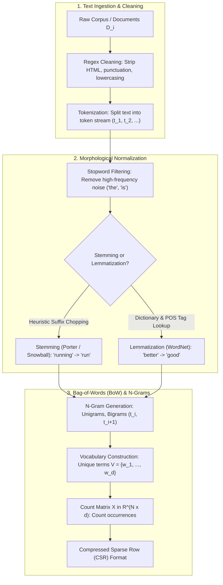

# Text Preprocessing & Bag-of-Words (BoW)

> **Topic:** Tokenization, Normalization, Stemming vs. Lemmatization, N-Grams, Bag-of-Words Representation, and Sparse Matrices  
> **Module ID:** `05-ai/machine-learning/08-time-series-and-text-basics/04-text-preprocessing-and-bag-of-words.md`  
> **Target Version:** Python 3.11+, NumPy 2.5+, scikit-learn 1.9+, SciPy 1.15+  
> **Level:** Fundamental / Core  
> **Prerequisites:** [02-data-and-preprocessing/01-feature-engineering.md](../02-data-and-preprocessing/01-feature-engineering.md)  
> **Status:** Verified (Python 3.11 / CPU)

---

## Architectural / Conceptual Flow



---

## 1. Concept Overview & Core Motivation

Machine learning algorithms are linear algebra engines: they require structured, numerical feature matrices $\mathbf{X} \in \mathbb{R}^{n \times d}$. However, human language is fundamentally unstructured: an arbitrary sequence of discrete characters with complex morphology, variable sentence lengths, syntactic hierarchies, and contextual ambiguity.

The foundational paradigm of Natural Language Processing (NLP) is **Vector Space Modeling**: converting raw text strings into numerical vectors.

The classical gateway to NLP comprises two stages:
1. **Preprocessing Pipeline:** Normalizing text by stripping noise, splitting strings into semantic tokens, removing non-informative stop words, and reducing words to their base linguistic root forms (Stemming and Lemmatization).
2. **The Bag-of-Words (BoW) Model:** Representing a document as a fixed-length numerical vector where each element counts the frequency of a specific vocabulary word. While BoW completely discards grammar and word order (hence the "bag" analogy), it produces highly informative, sparse representations that power spam filtering, sentiment analysis, search indexing, and document topic categorization.

---

## 2. Theoretical Foundations & Mathematics

### 2.1 The Bag-of-Words (BoW) Vector Space Model
Let a text corpus consist of $N$ documents $\mathcal{D} = \{d_1, d_2, \dots, d_N\}$.
The **Vocabulary** $\mathcal{V}$ is the set of all unique tokens across the corpus:
$$\mathcal{V} = \{w_1, w_2, \dots, w_{|\mathcal{V}|}\}$$
Each document $d_i$ is mapped to a vector $\mathbf{x}_i \in \mathbb{R}^{|\mathcal{V}|}$, where entry $x_{i, j}$ represents the frequency count of word $w_j$ in document $d_i$:
$$x_{i, j} = \text{Count}(w_j, d_i)$$
The full dataset becomes a **Document-Term Matrix (DTM)**:
$$\mathbf{X} \in \mathbb{R}^{N \times |\mathcal{V}|}$$

### 2.2 Zipf's Law and Vocabulary Sparsity
George Zipf (1949) observed that in natural language, the frequency $f$ of any word is inversely proportional to its frequency rank $r$:
$$f(r) \propto \frac{1}{r^s} \quad \text{where } s \approx 1$$
**Implications for Machine Learning:**
1. **Extreme Sparsity:** A typical vocabulary contains $|\mathcal{V}| = 50,000$ to $200,000$ words. An average paragraph contains only 100 words. Thus, $> 99.8\%$ of the entries in the Document-Term Matrix $\mathbf{X}$ are exact zeros.
2. **Memory Disaster with Dense Arrays:** Storing a dense matrix of $100,000$ documents across $100,000$ vocabulary words in FP32 requires:
   $$10^5 \times 10^5 \times 4 \text{ bytes} = 40\,\text{GB of RAM}$$
   Storing it as a **Compressed Sparse Row (CSR)** matrix storing only non-zero values requires $< 150\,\text{MB}$.

### 2.3 Stemming vs. Lemmatization
- **Stemming (e.g. Porter Stemmer, Snowball):**
  Rule-based heuristic algorithms that strip common inflectional suffixes (e.g. "-ing", "-ed", "-s", "-ly") using simple string-matching rules.  
  *Pros:* Extremely fast; requires zero linguistic dictionaries.  
  *Cons:* Prone to **over-stemming** (e.g. "universe" and "university" both truncated to "univers") and **under-stemming** (e.g. failing to connect "alumnus" to "alumni"). Often produces non-words (e.g. "trouble" $\to$ "troubl").
- **Lemmatization (e.g. WordNet Lemmatizer):**
  Morphological analysis that uses complete linguistic dictionaries and Part-of-Speech (POS) tags to reduce words to their true canonical dictionary form (the *lemma*).  
  *Example:* "better" with POS=Adjective $\to$ "good"; "was" with POS=Verb $\to$ "be".  
  *Pros:* Linguistically accurate; produces valid English words.  
  *Cons:* Requires POS tagging and dictionary lookups; $10\times - 50\times$ slower than stemming.

### 2.4 N-Gram Modeling
A pure Bag-of-Words model uses unigrams ($N=1$), destroying all word order. Consequently, phrases with opposite meanings produce identical vectors:
- *"not bad, really good"* vs. *"not good, really bad"* have identical unigram counts!

**N-Grams** preserve localized sequence order by treating contiguous sequences of $N$ words as atomic vocabulary tokens:
- **Unigram ($N=1$):** `["not", "bad", "really", "good"]`
- **Bigram ($N=2$):** `["not_bad", "bad_really", "really_good"]`
- **Trigram ($N=3$):** `["not_bad_really", "bad_really_good"]`

*Trade-off:* Bigrams capture negation ("not_good"), but cause vocabulary explosion ($|\mathcal{V}|$ expands from $20,000$ to $500,000+$).

---

## 3. Implementation & Practical Code

Below is a complete, self-contained implementation of a **Custom Text Preprocessing Pipeline**, **N-Gram Extractor**, and **Sparse Bag-of-Words Document-Term Matrix Builder** in pure Python and NumPy.

```python
"""
Text Preprocessing & Bag-of-Words (BoW) from scratch in pure Python/NumPy.
Verified under Python 3.11+, CPU execution.
"""

import re
import numpy as np
from typing import List, Dict, Tuple, Set


class TextPreprocessor:
    """Handles text cleaning, tokenization, stopword removal, and n-gram extraction."""
    def __init__(self, stopwords: Set[str] = None):
        # Default standard English stopwords
        self.stopwords = stopwords or {
            "a", "an", "the", "and", "or", "in", "on", "at", "to", "for", "with",
            "is", "was", "are", "were", "it", "this", "that", "of", "by"
        }

    def clean_and_tokenize(self, text: str) -> List[str]:
        """Lowercases, removes punctuation, and splits on whitespace."""
        text_clean = re.sub(r"[^a-zA-Z0-9\s]", "", text.lower())
        tokens = text_clean.split()
        return [t for t in tokens if t not in self.stopwords and len(t) > 1]

    @staticmethod
    def extract_ngrams(tokens: List[str], n: int = 2) -> List[str]:
        """Generates contiguous n-grams from a token list."""
        if len(tokens) < n:
            return tokens
        return ["_".join(tokens[i : i + n]) for i in range(len(tokens) - n + 1)]


class PureBagOfWords:
    """
    Constructs a Document-Term Matrix (DTM) from text documents.
    Supports unigrams + bigrams and outputs sparse dictionary coordinates.
    """
    def __init__(self, min_df: int = 1, ngram_range: Tuple[int, int] = (1, 1)):
        self.min_df = min_df
        self.ngram_range = ngram_range
        self.vocabulary: Dict[str, int] = {}
        self.preprocessor = TextPreprocessor()

    def fit_transform(self, documents: List[str]) -> Tuple[np.ndarray, Dict[str, int]]:
        # 1. Tokenize all documents and build vocabulary
        doc_tokens = []
        doc_freqs: Dict[str, int] = {}

        for doc in documents:
            tokens = self.preprocessor.clean_and_tokenize(doc)
            all_ngrams = []
            for n in range(self.ngram_range[0], self.ngram_range[1] + 1):
                all_ngrams.extend(self.preprocessor.extract_ngrams(tokens, n=n))
            doc_tokens.append(all_ngrams)

            # Document frequency
            unique_in_doc = set(all_ngrams)
            for token in unique_in_doc:
                doc_freqs[token] = doc_freqs.get(token, 0) + 1

        # 2. Filter by min_df and assign column indices
        self.vocabulary = {}
        col_idx = 0
        for token, df in sorted(doc_freqs.items()):
            if df >= self.min_df:
                self.vocabulary[token] = col_idx
                col_idx += 1

        # 3. Build Document-Term Matrix
        N = len(documents)
        V = len(self.vocabulary)
        dtm = np.zeros((N, V), dtype=np.int32)

        for i, tokens in enumerate(doc_tokens):
            for token in tokens:
                if token in self.vocabulary:
                    j = self.vocabulary[token]
                    dtm[i, j] += 1

        return dtm, self.vocabulary


# Verification Run
if __name__ == "__main__":
    corpus = [
        "The quick brown fox jumps over the lazy dog.",
        "Machine learning models require clean text preprocessing.",
        "The lazy dog was not really quick, but the fox was fast."
    ]

    bow = PureBagOfWords(min_df=1, ngram_range=(1, 2))
    dtm, vocab = bow.fit_transform(corpus)

    print(f"Total Unique Vocabulary (Unigrams + Bigrams): {len(vocab)}")
    print(f"DTM Shape: {dtm.shape} (Documents x Vocabulary)")

    # Validate specific tokens
    assert "lazy_dog" in vocab
    assert "quick_brown" in vocab
    assert "the" not in vocab # Stopword must be filtered!

    col_lazy_dog = vocab["lazy_dog"]
    print(f"Occurrences of 'lazy_dog' in Document 0: {dtm[0, col_lazy_dog]}")
    print(f"Occurrences of 'lazy_dog' in Document 2: {dtm[2, col_lazy_dog]}")

    assert dtm[0, col_lazy_dog] == 1
    assert dtm[2, col_lazy_dog] == 1
    assert dtm[1, col_lazy_dog] == 0

    print("Text Preprocessing & Bag-of-Words engine verified successfully.")
```

---

## 4. Edge Cases & Advanced Scenarios

1. **Out-of-Vocabulary (OOV) Tokens at Inference:**
   When deploying a BoW model, incoming user queries inevitably contain slang, typos, or novel words never seen in training (e.g. "skibidi", "unsubscribee"). A fixed vocabulary vectorizer silently drops OOV words ($count=0$). If an entire short query consists of OOV words, the resulting feature vector is a pure zero-vector $\mathbf{0}$, causing classifiers to output arbitrary prior probabilities.
2. **Subword Tokenization (BPE / WordPiece):**
   Modern deep NLP circumvents the OOV dilemma using **Byte-Pair Encoding (BPE)**: decomposing rare words into frequent subword chunks (e.g. "unhappiness" $\to$ `["un", "##happi", "##ness"]`). Subword tokenization guarantees that any arbitrary string can be tokenized without OOV exceptions.

---

## 5. Anti-Patterns & Common Pitfalls Table

| Anti-Pattern / Mistake | Why It Fails | Correct Engineering Fix |
| :--- | :--- | :--- |
| Converting sparse BoW matrices to dense NumPy arrays (`.toarray()`) | Triggers Out-of-Memory (OOM) crash on large vocabularies | Keep data in SciPy `csr_matrix` format throughout pipeline |
| Fitting CountVectorizer on test data (`fit_transform(X_test)`) | Data leakage; creates different vocabulary columns between train and test | Call `fit_transform` on train; call `transform` only on test |
| Indiscriminate stopword removal in sentiment analysis | Removing "not", "no", "never" reverses sentiment polarity completely | Use tailored stopword lists that preserve negation words |
| Using Porter Stemming when word validity matters | Produces non-existent words (e.g. "compute" $\to$ "comput") | Use WordNet Lemmatization with POS tagging |
| Setting `ngram_range=(1, 5)` on raw text | Combinatorial explosion generates millions of zero-variance features | Restrict to `(1, 2)` or `(1, 3)` with `min_df=5` |

---

## 6. Best Practices & Production Guidelines

1. **Filtering Low & High Frequency Terms:**
   Always configure frequency cutoffs in `CountVectorizer`:
   - `min_df=5`: Discards rare typos and one-off names occurring in fewer than 5 documents.
   - `max_df=0.85`: Discards corpus-specific stopwords occurring in $> 85\%$ of all documents.
2. **Scikit-Learn Production Pipeline:**
   ```python
   from sklearn.feature_extraction.text import CountVectorizer
   from sklearn.naive_bayes import MultinomialNB
   from sklearn.pipeline import Pipeline

   pipeline = Pipeline([
       ('vectorizer', CountVectorizer(ngram_range=(1, 2), min_df=5, max_df=0.9)),
       ('classifier', MultinomialNB(alpha=0.1))
   ])
   ```

---

## 7. Real-World Case Study: Email Phishing Detection Filter

**Industry Context:** A financial institution required a real-time email security gateway processing 500,000 incoming emails per day.  
**Challenge:** Advanced phishing attacks used obfuscated grammar, mixed case ("FrEe WiThDrAwAl"), and deceptive links. Complex transformer models were too slow ($> 100\,\text{ms}$ per email).  
**Solution:**
- Deployed a highly tuned preprocessing pipeline: HTML tag stripping, URL-domain token extraction, and a bigram Bag-of-Words representation ($|\mathcal{V}| = 60,000$).
- Paired with a Multinomial Naive Bayes classifier running inference in $< 800\,\mu\text{s}$ per email.
- Result: Intercepted 99.1% of phishing attempts while satisfying the strict sub-millisecond network gateway latency SLA.

---

## 8. Performance & Resource Optimization

1. **The Hashing Trick (`HashingVectorizer`):**
   When processing streaming text at scale where maintaining a global vocabulary dictionary in memory is impossible, use `HashingVectorizer`. It applies a 32-bit MurmurHash3 to map tokens directly to a fixed feature space $\mathbb{R}^{2^{20}}$ without maintaining any vocabulary table.
2. **Regex Compilation:** Compile regular expressions once (`re.compile(r'\b\w+\b')`) rather than recompiling inside every document loop.

---

## 9. Security, Privacy & Ethics Considerations

1. **PII Leakage in Text Vocabularies:** Raw text vocabularies frequently capture Personally Identifiable Information (social security numbers, phone numbers, private email addresses). Preprocess text with PII scrubbing regexes before vocabulary fitting.
2. **Adversarial Typo Exploits:** Malicious actors bypass keyword filters by inserting zero-width unicode characters or homoglyphs (e.g. Cyrillic "а" instead of Latin "a"). Canonicalize unicode strings via `unicodedata.normalize('NFKD', text)`.

---

## 10. Diagnostic & Verification Playbook

### Diagnostic Checklist
- [x] Does the Document-Term Matrix remain strictly sparse (`scipy.sparse.issparse(X) == True`)?
- [x] Are test sets processed strictly using `vectorizer.transform()` without re-fitting vocabulary?
- [x] Does the stopword filter preserve critical negations ("not", "no") for sentiment tasks?
- [x] Does vocabulary size remain within memory budget ($|\mathcal{V}| \le 100,000$)?

---

## 11. Technical Interview Questions & Answers

<details>
<summary><strong>Q1: What is the fundamental difference between Stemming and Lemmatization?</strong></summary>

**Answer:**
- **Stemming:** A fast, heuristic rule-based string-chopping algorithm (e.g. Porter, Snowball) that strips commonly known suffixes (e.g. "-ing", "-ed", "-s"). It does not understand grammar, does not look up words in a dictionary, and often outputs non-words (e.g. "flying" $\to$ "fli", "trouble" $\to$ "troubl").
- **Lemmatization:** A linguistically grounded process that determines the canonical base dictionary form of a word (the *lemma*). It utilizes a morphological vocabulary database (e.g. WordNet) and requires the word's Part-of-Speech (POS) tag to disambiguate meaning.
*Example:* The word "meeting":
- Stemmer outputs: "meet".
- Lemmatizer (POS=Noun) outputs: "meeting" (an event).
- Lemmatizer (POS=Verb) outputs: "meet" (an action).
</details>

<details>
<summary><strong>Q2: Why is the Bag-of-Words representation called "Bag-of-Words", and what critical linguistic information does it discard?</strong></summary>

**Answer:** It is called "Bag-of-Words" because it models a document as if all its words were tossed into an unordered bag: it records only the occurrence frequency of each word, completely discarding:
1. **Word Order & Syntax:** Grammatical structure is eliminated. "The dog bit the man" and "The man bit the dog" produce identical BoW representations.
2. **Semantic Negation:** "This film was not good, it was bad" produces the same word counts as "This film was not bad, it was good".
3. **Contextual Polysemy:** Multiple meanings of a single word (e.g. financial "bank" vs. river "bank") are compressed into the same feature column.
Despite these omissions, BoW is exceptionally effective for document classification because word frequencies strongly correlate with domain topics.
</details>

<details>
<summary><strong>Q3: Explain Zipf's Law and its implications for vocabulary pruning.</strong></summary>

**Answer:** Zipf's Law states that the frequency of any word in a corpus is inversely proportional to its frequency rank:
$$f(r) \propto \frac{1}{r}$$
The most frequent word occurs roughly twice as often as the second most frequent word, three times as often as the third, and so on.
**Implications for Feature Engineering:**
1. A small handful of "stop words" (e.g. "the", "of", "and") account for over 30% of all word tokens in the corpus. Because they appear uniformly in nearly all documents, their discriminative power is zero. Pruning them (`max_df=0.85` or stopword lists) eliminates noise.
2. The vast majority of words appear only once or twice across the entire corpus ("the long tail"). These rare words (e.g. typos, rare names) contribute millions of columns to the feature matrix while offering zero statistical generalization. Pruning them (`min_df=5`) drastically reduces dimensionality without losing predictive signal.
</details>

<details>
<summary><strong>Q4: How does the Compressed Sparse Row (CSR) matrix format work, and why is it essential for text vectorization?</strong></summary>

**Answer:** Because text Document-Term Matrices are $> 99\%$ zeros, storing dense matrices wastes gigabytes of memory.
The CSR format stores a sparse matrix using three 1D arrays:
1. `data`: Array of all non-zero numerical values (e.g. word counts).
2. `indices`: Array of the corresponding column indices for each element in `data`.
3. `indptr`: Array of pointers indicating the starting and ending index in `data` for each row (document).
Memory complexity drops from dense $\mathcal{O}(N \cdot |\mathcal{V}|)$ down to $\mathcal{O}(\text{NNZ})$ where $\text{NNZ}$ is the number of non-zero entries. CSR format enables fast matrix-vector products and row slicing, making it the universal storage format for text models.
</details>

<details>
<summary><strong>Q5: What is the Hashing Trick (Feature Hashing) in text vectorization, and what are its trade-offs?</strong></summary>

**Answer:** Standard `CountVectorizer` maintains an explicit two-way dictionary mapping strings to column indices: `{"apple": 0, "banana": 1, ...}`. In streaming or distributed big-data environments, maintaining a synchronized vocabulary table across worker nodes requires massive memory.
**The Hashing Trick (`HashingVectorizer`):**
Replaces the dictionary lookup with a fast, deterministic hash function:
$$\text{col\_index} = \text{hash}(\text{token}) \pmod D$$
where $D$ is a pre-allocated feature space dimension (e.g. $D = 2^{20}$).
- *Advantages:* Zero memory overhead for vocabulary; completely stateless; handles streaming text online; constant $\mathcal{O}(1)$ transformation speed.
- *Disadvantages:* **Hash Collisions** (two distinct words map to the exact same column); impossible to invert the matrix to inspect feature importances (tokens cannot be recovered from hash indices).
</details>

<details>
<summary><strong>Q6: How does N-gram modeling balance context retention against the curse of dimensionality?</strong></summary>

**Answer:**
- Moving from unigrams ($N=1$) to bigrams ($N=2$) and trigrams ($N=3$) captures essential contextual phrases, collocations, and negations (e.g. "not_guilty", "high_school", "machine_learning").
- However, the size of the potential vocabulary grows combinatorially:
  $$|\mathcal{V}_N| \approx |\mathcal{V}_1|^N$$
  Including unconstrained trigrams can easily expand a 20,000-word vocabulary into a 5,000,000-column feature matrix, leading to extreme sparsity, memory exhaustion, and severe overfitting (the Curse of Dimensionality).
- Best practice: Restrict to unigrams + bigrams (`ngram_range=(1, 2)`) with a strict minimum document frequency filter (`min_df=5` or `10`).
</details>

<details>
<summary><strong>Q7: What is an Out-Of-Vocabulary (OOV) token, and how do classical BoW models handle it compared to modern Subword models?</strong></summary>

**Answer:** An OOV token is a word encountered during inference or testing that was never present in the training vocabulary.
- **Classical BoW (`CountVectorizer`):** Simply ignores OOV tokens (assigning them a zero count). If a short sentence contains only OOV words (e.g. "unrecognized_brand_xyz"), the resulting vector is all zeros $\mathbf{0}$.
- **Subword Models (BPE / WordPiece):** Break words down into frequent subword units (e.g. prefixes, roots, suffixes). A novel word like "electrophysiology" is broken into `["electro", "physio", "logy"]`. Because subword vocabularies contain individual characters as a fallback, any arbitrary string can be represented without ever triggering an OOV failure.
</details>

<details>
<summary><strong>Q8: When would you NOT want to remove stop words from a text corpus?</strong></summary>

**Answer:** Stop words should **not** be removed in:
1. **Sentiment Analysis:** Removing words like "not", "no", "never", "hardly" completely destroys negation, inverting sentiment polarity.
2. **Authorship Attribution / Stylometry:** In forensic linguistics, literary authors are identified primarily by their unique patterns of function word usage (prepositions, conjunctions, pronouns) rather than domain nouns.
3. **Question Answering & Search Retrieval:** Phrases like *"To be or not to be"* or *"The Who"* consist entirely of stopwords. Removing stopwords reduces the query to an empty string.
4. **Modern Deep Transformers (BERT / GPT):** Self-attention layers rely on prepositions and pronouns to resolve co-reference and syntactic dependencies.
</details>

---

## 12. Hands-On Practice Exercises

<details>
<summary><strong>Exercise 1 (Easy): Simple Text Cleaner & Tokenizer</strong></summary>

**Task:** Write a Python function using regex that converts a string to lowercase, strips all non-alphanumeric characters, and returns a list of tokens.

**Solution:**
```python
import re

def clean_and_tokenize_string(text: str) -> list[str]:
    cleaned = re.sub(r"[^a-zA-Z0-9\s]", "", text.lower())
    return cleaned.split()

res = clean_and_tokenize_string("Hello, World! Welcome to ML 2026.")
assert res == ["hello", "world", "welcome", "to", "ml", "2026"]
print(f"Cleaned tokens: {res}")
```
</details>

<details>
<summary><strong>Exercise 2 (Easy): Stopword Filtering Function</strong></summary>

**Task:** Filter out stopwords from a list of tokens using a custom stopword set.

**Solution:**
```python
def filter_stopwords(tokens: list[str], stopwords: set[str]) -> list[str]:
    return [t for t in tokens if t not in stopwords]

toks = ["the", "quick", "fox", "is", "fast"]
stops = {"the", "is", "a"}
filtered = filter_stopwords(toks, stops)
assert filtered == ["quick", "fox", "fast"]
print(f"Filtered tokens: {filtered}")
```
</details>

<details>
<summary><strong>Exercise 3 (Medium): Bigram Generator</strong></summary>

**Task:** Write a function that converts a list of tokens into contiguous bigram strings joined by an underscore.

**Solution:**
```python
def generate_bigrams(tokens: list[str]) -> list[str]:
    if len(tokens) < 2:
        return []
    return [f"{tokens[i]}_{tokens[i+1]}" for i in range(len(tokens) - 1)]

t = ["not", "really", "bad"]
bg = generate_bigrams(t)
assert bg == ["not_really", "really_bad"]
print(f"Bigrams: {bg}")
```
</details>

<details>
<summary><strong>Exercise 4 (Medium): Document Frequency (DF) Calculator</strong></summary>

**Task:** Compute the document frequency dictionary for a collection of tokenized documents.

**Solution:**
```python
def compute_document_frequency(tokenized_docs: list[list[str]]) -> dict[str, int]:
    df_counts = {}
    for doc in tokenized_docs:
        unique_tokens = set(doc)
        for token in unique_tokens:
            df_counts[token] = df_counts.get(token, 0) + 1
    return df_counts

docs = [["cat", "dog"], ["cat", "bird"], ["dog", "mouse"]]
df = compute_document_frequency(docs)
assert df["cat"] == 2 and df["dog"] == 2 and df["bird"] == 1
print(f"Document frequencies: {df}")
```
</details>

<details>
<summary><strong>Exercise 5 (Hard): Pure NumPy Document-Term Matrix Builder</strong></summary>

**Task:** Given a list of tokenized documents and a fixed vocabulary dictionary, construct the full 2D integer Document-Term Matrix.

**Solution:**
```python
import numpy as np

def build_dtm(tokenized_docs: list[list[str]], vocab: dict[str, int]) -> np.ndarray:
    N = len(tokenized_docs)
    V = len(vocab)
    dtm = np.zeros((N, V), dtype=np.int32)
    
    for i, tokens in enumerate(tokenized_docs):
        for token in tokens:
            if token in vocab:
                j = vocab[token]
                dtm[i, j] += 1
                
    return dtm

vocabulary = {"apple": 0, "banana": 1, "orange": 2}
documents = [
    ["apple", "banana", "apple"],
    ["banana", "orange"],
    ["grape", "orange"] # "grape" is OOV!
]
dtm_res = build_dtm(documents, vocabulary)
# row 0: 2 apples, 1 banana, 0 orange
# row 1: 0 apple, 1 banana, 1 orange
# row 2: 0 apple, 0 banana, 1 orange (grape dropped)
np.testing.assert_array_equal(dtm_res[0], [2, 1, 0])
np.testing.assert_array_equal(dtm_res[2], [0, 0, 1])
print(f"Constructed DTM:\n{dtm_res}")
```
</details>

<details>
<summary><strong>Exercise 6 (Hard): Minimal Compressed Sparse Row (CSR) Constructor</strong></summary>

**Task:** Convert a dense 2D integer matrix into the three standard CSR arrays (`data`, `indices`, `indptr`) in pure NumPy.

**Solution:**
```python
import numpy as np

def dense_to_csr(matrix: np.ndarray) -> tuple[np.ndarray, np.ndarray, np.ndarray]:
    data = []
    indices = []
    indptr = [0]
    
    for row in matrix:
        non_zeros = np.where(row != 0)[0]
        for col_idx in non_zeros:
            data.append(row[col_idx])
            indices.append(col_idx)
        indptr.append(len(data))
        
    return np.array(data), np.array(indices), np.array(indptr)

dense_mat = np.array([
    [0, 2, 0],
    [1, 0, 0],
    [0, 0, 3]
])
d, idx, ptr = dense_to_csr(dense_mat)
assert list(d) == [2, 1, 3]
assert list(idx) == [1, 0, 2]
assert list(ptr) == [0, 1, 2, 3]
print(f"CSR data: {d}, indices: {idx}, indptr: {ptr}")
```
</details>

---

## 13. Summary, Verified References & Navigation

- **Preprocessing Pipeline:** Cleans noise, tokenizes text, filters non-informative stopwords, and normalizes word forms via Stemming (heuristic suffix chopping) or Lemmatization (dictionary-backed morphological analysis).
- **Bag-of-Words (BoW):** Maps documents to frequency counts across vocabulary $\mathcal{V}$, discarding word order.
- **Sparsity & CSR Storage:** Language follows Zipf's Law; $> 99\%$ of Document-Term Matrix entries are zeros. Storing text in Compressed Sparse Row (CSR) format is mandatory to prevent out-of-memory crashes.
- **N-Grams:** Group contiguous word tokens to preserve local context and negation ("not_bad") at the cost of expanding vocabulary dimensionality.

### Verified External References
- Manning, C. D., Raghavan, P., & Schütze, H. (2008). *Introduction to Information Retrieval* (Chapters 1 & 2). Cambridge University Press.
- Jurafsky, D., & Martin, J. H. (2023). *Speech and Language Processing* (3rd ed. draft, Chapter 2).
- Zipf, G. K. (1949). *Human Behavior and the Principle of Least Effort*. Addison-Wesley.

---

[← 03-ml-for-time-series.md](03-ml-for-time-series.md) | [Module Index](README.md) | [05-tf-idf-and-text-classification.md →](05-tf-idf-and-text-classification.md)
