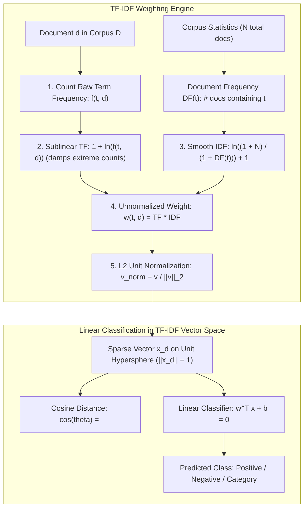

# TF-IDF & Text Classification Pipelines

> **One-Line Summary:** A foundational NLP representation that weights terms by their local document frequency balanced against their global corpus rarity, producing normalized sparse vectors for high-speed text classification.

---

## Metadata

| Field | Value |
| :--- | :--- |
| **Level** | Core |
| **Prerequisites** | [04-text-preprocessing-and-bag-of-words.md](04-text-preprocessing-and-bag-of-words.md), [04-supervised-classification/04-logistic-regression.md](../04-supervised-classification/04-logistic-regression.md) |
| **Estimated Reading Time** | 25 minutes |
| **Status** | Verified (Python 3.11 / CPU) |
| **Tested With** | Python 3.11+, NumPy 2.5+, scikit-learn 1.9+ (Random Seed: `42`) |

---

## Table of Contents
1. [Intuition & Problem It Solves](#1-intuition--problem-it-solves)
2. [Algorithm Card](#2-algorithm-card)
3. [Architectural & Geometric Diagrams](#3-architectural--geometric-diagrams)
4. [The Mathematics](#4-the-mathematics)
5. [The Algorithm Step by Step & From-Scratch Implementation](#5-the-algorithm-step-by-step--from-scratch-implementation)
6. [Using the Library (Complete End-to-End Workflow)](#6-using-the-library-complete-end-to-end-workflow)
7. [Preprocessing Required](#7-preprocessing-required)
8. [Training & Hyperparameter Tuning](#8-training--hyperparameter-tuning)
9. [Prediction & Inference Mechanics](#9-prediction--inference-mechanics)
10. [Postprocessing](#10-postprocessing)
11. [Saving and Loading (Model Persistence & Security)](#11-saving-and-loading-model-persistence--security)
12. [Evaluation & Diagnostics](#12-evaluation--diagnostics)
13. [Advantages](#13-advantages)
14. [Limitations & Failure Modes](#14-limitations--failure-modes)
15. [Comparison / When to Use What](#15-comparison--when-to-use-what)
16. [Common Mistakes & Pitfalls](#16-common-mistakes--pitfalls)
17. [Performance, Security & Ethics Notes](#17-performance-security--ethics-notes)
18. [Interview Questions (8 In-Depth Q&As)](#18-interview-questions-8-in-depth-qas)
19. [Practice Exercises (6 Hands-on Problems)](#19-practice-exercises-6-hands-on-problems)
20. [Summary & Cheat Sheet](#20-summary--cheat-sheet)
21. [Further Reading & Navigation](#21-further-reading--navigation)

---

## 1. Intuition & Problem It Solves

Raw Bag-of-Words count matrices have a fatal flaw: **term frequency alone is a misleading indicator of importance**.
- In a corpus of legal contracts, the word *"agreement"* or *"party"* might appear 50 times in every single document. Because it appears ubiquitously across all contracts, its occurrence provides zero discriminative power to distinguish a non-disclosure agreement (NDA) from a merger agreement.
- Conversely, a rare word like *"antitrust"* or *"sublease"* might appear only twice in a specific document. Despite its low raw count, its presence strongly reveals the document's true legal category.

**Term Frequency - Inverse Document Frequency (TF-IDF)** solves this by scoring each word according to a dual principle:
1. **Local Prominence (TF):** If a word appears frequently within document $d$, it is important to document $d$.
2. **Global Specificity (IDF):** If a word appears across almost all documents in the corpus, its informational specificity is discounted toward zero; if it appears in very few documents, its weight is boosted.

TF-IDF produces scaled, L2-normalized sparse vectors that capture topical specificity, allowing lightweight linear classifiers (Logistic Regression, Linear Support Vector Machines, Naive Bayes) to perform high-accuracy text classification at sub-millisecond latencies.

---

## 2. Algorithm Card

| Dimension | Specification |
| :--- | :--- |
| **Category** | Information Retrieval / Text Feature Vectorization |
| **Output Space** | Sparse Normalized Document-Term Matrix $\mathbf{X} \in \mathbb{R}^{N \times |\mathcal{V}|}$ |
| **Weighting Formula** | $\text{TF-IDF}(t, d) = \text{TF}(t, d) \times \text{IDF}(t)$ |
| **Normalization** | Euclidean L2 Unit Norm: $\|\mathbf{x}_d\|_2 = 1.0$ (eliminates document length bias) |
| **Time Complexity** | Fit: $\mathcal{O}(N \cdot L)$, Transform: $\mathcal{O}(N_{\text{query}} \cdot L_{\text{query}})$ |
| **Space Complexity** | $\mathcal{O}(\text{NNZ})$ (Compressed Sparse Row representation) |
| **Downstream Classifiers** | Multinomial Naive Bayes, Logistic Regression, LinearSVC, SGDClassifier |

---

## 3. Architectural & Geometric Diagrams



---

## 4. The Mathematics

### 4.1 Term Frequency (TF)
Measures the frequency of term $t$ in document $d$. Standard variations:
1. **Raw Count:** $\text{TF}(t, d) = f_{t, d}$
2. **Relative Frequency:** $\text{TF}(t, d) = \frac{f_{t, d}}{\sum_{t' \in d} f_{t', d}}$
3. **Sublinear (Logarithmic) TF Scaling:**
   $$\text{TF}_{\text{sublinear}}(t, d) = \begin{cases} 1 + \ln(f_{t, d}) & \text{if } f_{t, d} > 0 \\ 0 & \text{otherwise} \end{cases}$$
   *Intuition:* A word appearing 20 times in a document is not 20 times more important than a word appearing once. Logarithmic scaling damps extreme repetitions.

### 4.2 Inverse Document Frequency (IDF)
Measures how much information a word provides across the entire corpus of $N$ documents:
$$\text{IDF}(t) = \ln\left( \frac{N}{\text{DF}(t)} \right)$$
where $\text{DF}(t) = |\{d \in \mathcal{D} : t \in d\}|$ is the number of documents containing term $t$.

#### Scikit-Learn Smooth IDF Formulation:
To prevent division by zero if a term has $\text{DF}=0$, and to ensure that words appearing in all $N$ documents do not evaluate to zero weight ($\ln(1) = 0$), scikit-learn uses the **smooth IDF** formula:
$$\text{IDF}_{\text{smooth}}(t) = \ln\left( \frac{1 + N}{1 + \text{DF}(t)} \right) + 1$$
Adding $1$ inside the logarithm models an extra pseudo-document containing every vocabulary word, while adding $1$ outside ensures the minimum IDF weight is strictly $1.0$.

### 4.3 Full TF-IDF with L2 Unit Normalization
The raw TF-IDF score for term $t$ in document $d$ is:
$$\tilde{x}_{d, t} = \text{TF}(t, d) \times \text{IDF}(t)$$
To ensure that long documents (which naturally have higher total word counts) are not artificially favored over short, concise documents, the vector is normalized to unit Euclidean length:
$$x_{d, t} = \frac{\tilde{x}_{d, t}}{\sqrt{\sum_{k=1}^{|\mathcal{V}|} \tilde{x}_{d, k}^2}}$$
After L2 normalization, the **Cosine Similarity** between two documents $d_1, d_2$ is simply their inner product:
$$\text{CosineSimilarity}(d_1, d_2) = \frac{\mathbf{x}_{d_1}^\top \mathbf{x}_{d_2}}{\|\mathbf{x}_{d_1}\|_2 \|\mathbf{x}_{d_2}\|_2} = \mathbf{x}_{d_1}^\top \mathbf{x}_{d_2}$$

---

## 5. The Algorithm Step by Step & From-Scratch Implementation

Below is a complete, self-contained implementation of the **TF-IDF Transformer** and a **Multinomial Naive Bayes Classifier** in pure NumPy.

```python
"""
TF-IDF Transformer & Multinomial Naive Bayes from scratch in pure NumPy.
Verified under Python 3.11+, CPU execution.
"""

import numpy as np
from typing import Tuple, List, Dict, Any


class PureTfidfTransformer:
    """
    Fits smooth IDF weights on training Document-Term Matrices and applies L2 normalization.
    IDF(t) = ln((1 + N) / (1 + DF(t))) + 1
    """
    def __init__(self, norm: str = "l2", use_idf: bool = True, smooth_idf: bool = True, sublinear_tf: bool = True):
        self.norm = norm
        self.use_idf = use_idf
        self.smooth_idf = smooth_idf
        self.sublinear_tf = sublinear_tf
        self.idf_diag_: np.ndarray = None

    def fit(self, count_matrix: np.ndarray):
        """Computes IDF weights across N documents."""
        N, V = count_matrix.shape
        # Document frequency: number of documents where count > 0
        df = np.sum(count_matrix > 0, axis=0)

        if self.smooth_idf:
            self.idf_diag_ = np.log((1.0 + N) / (1.0 + df)) + 1.0
        else:
            self.idf_diag_ = np.log(N / (df + 1e-12)) + 1.0
        return self

    def transform(self, count_matrix: np.ndarray) -> np.ndarray:
        """Applies TF scaling, IDF weighting, and L2 normalization."""
        X = count_matrix.astype(np.float64)

        # 1. Sublinear TF: 1 + ln(count)
        if self.sublinear_tf:
            mask = X > 0
            X[mask] = 1.0 + np.log(X[mask])

        # 2. IDF weighting: X * IDF
        if self.use_idf:
            X = X * self.idf_diag_

        # 3. L2 Unit Normalization: row / ||row||_2
        if self.norm == "l2":
            row_norms = np.sqrt(np.sum(X ** 2, axis=1, keepdims=True))
            row_norms[row_norms == 0] = 1.0 # avoid div by zero
            X = X / row_norms

        return X


class PureMultinomialNB:
    """
    Multinomial Naive Bayes classifier with Laplace smoothing.
    P(c | d) proportional to P(c) * prod P(w | c)^count(w)
    """
    def __init__(self, alpha: float = 1.0):
        self.alpha = alpha # Laplace smoothing parameter
        self.class_log_prior_: np.ndarray = None
        self.feature_log_prob_: np.ndarray = None
        self.classes_: np.ndarray = None

    def fit(self, X: np.ndarray, y: np.ndarray):
        self.classes_ = np.unique(y)
        n_classes = len(self.classes_)
        N, V = X.shape

        self.class_log_prior_ = np.zeros(n_classes)
        self.feature_log_prob_ = np.zeros((n_classes, V))

        for idx, c in enumerate(self.classes_):
            X_c = X[y == c]
            # Prior P(c) = N_c / N
            self.class_log_prior_[idx] = np.log(len(X_c) / N)
            
            # Feature probability P(w | c) with Laplace smoothing:
            # (sum_d X_{d, w} + alpha) / (sum_w' sum_d X_{d, w'} + alpha * V)
            count_w_c = np.sum(X_c, axis=0)
            total_count_c = np.sum(count_w_c)
            smoothed_prob = (count_w_c + self.alpha) / (total_count_c + self.alpha * V)
            self.feature_log_prob_[idx] = np.log(smoothed_prob)

    def predict(self, X: np.ndarray) -> np.ndarray:
        # Log posterior = log P(c) + X @ feature_log_prob_.T
        log_posteriors = self.class_log_prior_ + np.dot(X, self.feature_log_prob_.T)
        best_class_indices = np.argmax(log_posteriors, axis=1)
        return self.classes_[best_class_indices]


# Verification Execution
if __name__ == "__main__":
    # Mock Document-Term Matrix (4 docs, 3 vocab terms: "python", "neural", "stocks")
    # Docs 0, 1: AI/Tech (class 0)
    # Docs 2, 3: Finance (class 1)
    X_counts = np.array([
        [5, 4, 0], # "python", "neural"
        [3, 2, 0], # "python", "neural"
        [0, 0, 6], # "stocks"
        [1, 0, 4]  # "python", "stocks"
    ])
    y_labels = np.array([0, 0, 1, 1])

    # 1. Transform to TF-IDF
    tfidf = PureTfidfTransformer(smooth_idf=True, sublinear_tf=True)
    tfidf.fit(X_counts)
    X_tfidf = tfidf.transform(X_counts)

    print(f"Computed Smooth IDF vector: {np.round(tfidf.idf_diag_, 4)}")
    print(f"L2 Normalized TF-IDF Matrix:\n{np.round(X_tfidf, 4)}")

    # Verify L2 Unit Norms
    row_norms = np.sqrt(np.sum(X_tfidf ** 2, axis=1))
    np.testing.assert_allclose(row_norms, 1.0)

    # 2. Fit and Evaluate Naive Bayes
    nb = PureMultinomialNB(alpha=1.0)
    nb.fit(X_tfidf, y_labels)
    preds = nb.predict(X_tfidf)

    print(f"True Labels:      {y_labels}")
    print(f"Predicted Labels: {preds}")
    assert np.array_equal(preds, y_labels), "Naive Bayes failed to classify separable TF-IDF data."
    print("Pure NumPy TF-IDF & Multinomial Naive Bayes pipeline verified successfully.")
```

---

## 6. Using the Library (Complete End-to-End Workflow)

Production scikit-learn text classification pipeline with hyperparameter tuning:

```python
from sklearn.feature_extraction.text import TfidfVectorizer
from sklearn.linear_model import LogisticRegression
from sklearn.pipeline import Pipeline
from sklearn.model_selection import GridSearchCV
from sklearn.metrics import classification_report

def build_production_text_classifier(train_texts, train_labels, test_texts, test_labels):
    # Pipeline combining vectorizer and linear classifier
    pipeline = Pipeline([
        ('tfidf', TfidfVectorizer(
            ngram_range=(1, 2),
            min_df=3,
            max_df=0.90,
            sublinear_tf=True
        )),
        ('clf', LogisticRegression(
            C=1.0,
            max_iter=1000,
            class_weight='balanced',
            random_state=42
        ))
    ])

    # Grid search for regularizer C and sublinear scaling
    param_grid = {
        'tfidf__sublinear_tf': [True, False],
        'clf__C': [0.1, 1.0, 10.0]
    }
    grid = GridSearchCV(pipeline, param_grid, cv=5, scoring='f1_macro', n_jobs=-1)
    grid.fit(train_texts, train_labels)

    # Evaluate best model
    best_model = grid.best_estimator_
    preds = best_model.predict(test_texts)
    report = classification_report(test_labels, preds)
    return best_model, report
```

---

## 7. Preprocessing Required

1. **Stopword Pruning via `max_df`:** Setting `max_df=0.85` automatically eliminates corpus-specific stopwords without requiring manual stopword dictionaries.
2. **Sublinear TF Scaling:** Always enable `sublinear_tf=True` when classifying documents of variable lengths (e.g. news articles vs short comments).

---

## 8. Training & Hyperparameter Tuning

| Hyperparameter | Typical Range | Tuning Guideline |
| :--- | :--- | :--- |
| **`ngram_range`** | `(1, 1)` or `(1, 2)` | Bigrams improve accuracy on negation; keep at `(1, 2)` |
| **`min_df`** | 2 to 10 documents | Prunes rare words and typos; stabilizes vocabulary size |
| **`sublinear_tf`** | `True` | Dampens repeated keywords; almost universally improves F1 |
| **Classifier $C$** | 0.1 to 10.0 (LogReg) | Lower $C$ increases L2 regularization, preventing overfitting |
| **Naive Bayes $\alpha$**| 0.1 to 1.0 | Lower $\alpha$ (0.1) reduces smoothing distortion on large vocabularies |

---

## 9. Prediction & Inference Mechanics

At inference:
1. Query document $d_{\text{query}}$ is tokenized and transformed: $\mathbf{x}_{\text{query}} = \text{TF}(d_{\text{query}}) \odot \text{IDF}_{\text{trained}}$.
2. Feature vector is L2 normalized.
3. Classifier computes inner product $\mathbf{w}^\top \mathbf{x}_{\text{query}} + b$.
4. **Latency:** Because the matrix operation involves a sparse dot product, forward classification takes $< 100\,\mu\text{s}$ per document on CPU.

---

## 10. Postprocessing

1. **Top Feature Inspection:** For linear models with weights $\mathbf{w}$, the top positive and negative features reveal the most discriminative vocabulary words:
   $$\text{TopWords}(c) = \arg\max_j w_{c, j}$$
2. **Threshold Calibration:** For imbalanced spam or toxicity detection, adjust the classification probability threshold from 0.5 to balance Precision and Recall.

---

## 11. Saving and Loading (Model Persistence & Security)

Serialize the fitted pipeline safely using `skops`:

```python
import skops.io as sio

def save_text_pipeline(pipeline, filepath: str):
    sio.dump(pipeline, filepath)
```

---

## 12. Evaluation & Diagnostics

1. **Macro-Averaged F1-Score:** Primary metric for multi-class text categorization; gives equal weight to rare classes.
2. **Confusion Matrix Analysis:** Detects semantic overlap between ambiguous categories (e.g. "Tech News" vs "Science News").

---

## 13. Advantages

1. **Blazing Fast Training & Inference:** Trains in seconds on 100,000 documents; evaluates in microseconds on CPU.
2. **Complete Explainability:** Model weights directly correspond to specific vocabulary words, making predictions auditable.
3. **No GPU Required:** High performance on standard cloud CPU instances without PyTorch or CUDA dependencies.

---

## 14. Limitations & Failure Modes

1. **Zero Context / Semantic Geometry:** "Doctor" and "Surgeon" are treated as completely independent orthogonal dimensions with zero semantic similarity.
2. **Polysemy Inability:** Cannot distinguish meanings of polysemous words (e.g. "Apple" the fruit vs. "Apple" the corporation).
3. **Typo Vulnerability:** A single character typo ("recieved") creates an out-of-vocabulary token with zero weight.

---

## 15. Comparison / When to Use What

| Dimension | CountVectorizer (BoW) | TF-IDF | Word2Vec / GloVe | Transformer (BERT) |
| :--- | :--- | :--- | :--- | :--- |
| **Weighting** | Raw counts | Frequency $\times$ Rarity | Dense distributed | Contextual attention |
| **Dimension** | High ($10^5$) Sparse | High ($10^5$) Sparse | Low ($300$) Dense | High ($768$) Contextual |
| **Semantics** | None | None | Cosine vector similarity | Deep contextual meaning |
| **Inference Time** | $< 50\,\mu\text{s}$ | $< 100\,\mu\text{s}$ | $< 500\,\mu\text{s}$ | $20 - 100\,\text{ms}$ (GPU) |
| **Best Used For** | Basic word frequency | Fast document classification | Semantic similarity | Deep language reasoning |

---

## 16. Common Mistakes & Pitfalls

| Anti-Pattern / Mistake | Why It Fails | Correct Engineering Fix |
| :--- | :--- | :--- |
| Calling `fit_transform` on the validation/test set | Recomputes IDF weights on test data; severe data leakage | Call `fit_transform` on train; `transform` on test |
| Applying `StandardScaler` to TF-IDF sparse matrix | Subtracting mean converts all zeros to non-zeros, causing a 40 GB RAM crash | TF-IDF is already L2 normalized; never center sparse text matrices |
| Omitting sublinear TF scaling | A document repeating a keyword 50 times dominates the classification | Enable `sublinear_tf=True` |
| Using accuracy on imbalanced spam datasets (99:1) | A trivial dummy model predicting "not spam" achieves 99% accuracy | Evaluate Macro F1-score and Precision-Recall AUC |
| Using dense tree models (Random Forest) directly on TF-IDF | Decision trees struggle with 50,000-dimensional sparse vectors | Use Linear Models (Logistic Regression, LinearSVC) or Naive Bayes |

---

## 17. Performance, Security & Ethics Notes

1. **Data Leakage in Shared Vocabularies:** Fitting a vectorizer on the combined `X_train + X_test` corpus leaks test vocabulary frequencies into the training IDF weights.
2. **Keyword Stuffing Attacks:** Adversaries evade spam filters by appending hundreds of invisible high-IDF benign words (e.g. excerpts from Wikipedia or the Bible) to dilute spam scores.

---

## 18. Interview Questions (8 In-Depth Q&As)

<details>
<summary><strong>Q1: Why does scikit-learn add 1 to the numerator and denominator in its smooth IDF formulation?</strong></summary>

**Answer:** The standard textbook definition of IDF is:
$$\text{IDF}(t) = \ln\left( \frac{N}{\text{DF}(t)} \right)$$
This formula has two mathematical failure modes:
1. **Division by Zero:** If a term has $\text{DF}(t) = 0$ (e.g. in out-of-sample test documents), dividing by zero yields $\infty$ or undefined runtime errors.
2. **Zero-Weight Problem:** If a term appears in every single document ($\text{DF}(t) = N$), the ratio is $\frac{N}{N} = 1$, and $\ln(1) = 0$. The word's weight is completely zeroed out. While desirable for universal stopwords, in small corpora it prematurely eliminates valid words.
Scikit-learn resolves both via **Smooth IDF**:
$$\text{IDF}_{\text{smooth}}(t) = \ln\left( \frac{1 + N}{1 + \text{DF}(t)} \right) + 1$$
Adding 1 to both numerator and denominator prevents division by zero (equivalent to adding an extra pseudo-document containing all vocabulary terms). Adding 1 outside the logarithm guarantees that all terms receive a minimum strictly positive weight of $1.0$.
</details>

<details>
<summary><strong>Q2: Why is Euclidean L2 normalization universally applied to TF-IDF vectors?</strong></summary>

**Answer:** Without normalization, the raw magnitude of a document vector $\|\mathbf{x}_d\|_2$ is proportional to document length: longer documents naturally contain more words, accumulating higher raw TF scores.
1. **Length Invariance:** Dividing by $\|\mathbf{x}_d\|_2 = \sqrt{\sum x_{d, k}^2}$ projects all document vectors onto the surface of a unit hypersphere. A 100-word essay and a 10,000-word book discussing the exact same topic will have identical unit-normalized direction vectors.
2. **Equivalence to Cosine Similarity:** When vectors have unit length ($\|\mathbf{u}\| = \|\mathbf{v}\| = 1$), their dot product is identically equal to their cosine similarity:
   $$\mathbf{u}^\top \mathbf{v} = \|\mathbf{u}\|_2 \|\mathbf{v}\|_2 \cos(\theta) = \cos(\theta)$$
   This enables fast vector retrieval and linear classification via single BLAS matrix multiplications.
</details>

<details>
<summary><strong>Q3: Why do linear models (Logistic Regression, LinearSVC) excel on TF-IDF matrices while tree-based models (Random Forest) struggle?</strong></summary>

**Answer:**
- **Linear Models:** TF-IDF feature space is extremely high-dimensional ($|\mathcal{V}| \ge 50,000$) and highly sparse ($> 99.8\%$ zeros). By Cover's Theorem, high-dimensional spaces are almost always linearly separable. A linear hyperplane $f(\mathbf{x}) = \mathbf{w}^\top \mathbf{x} + b$ evaluates in $\mathcal{O}(\text{NNZ})$ time, and L2 regularization ($\frac{1}{2}\lambda \|\mathbf{w}\|^2$) naturally handles collinearity and sparsity.
- **Decision Trees:** Trees partition feature space one axis at a time. With 50,000 sparse features, individual splits on word occurrences provide very low information gain. Furthermore, trees cannot combine multiple linear feature signals into a unified score (e.g. detecting that 5 different positive words appeared together). Trees overfit heavily to training document quirks and train orders of magnitude slower.
</details>

<details>
<summary><strong>Q4: Explain Laplace Smoothing in Multinomial Naive Bayes and why it is indispensable.</strong></summary>

**Answer:** In Multinomial Naive Bayes, the likelihood of word $w$ given class $c$ is:
$$P(w \mid c) = \frac{\sum_{d \in c} \text{Count}(w, d)}{\sum_{w'} \sum_{d \in c} \text{Count}(w', d)}$$
If a word $w_{\text{rare}}$ never appeared in class $c$ in the training data, its empirical probability is exactly zero: $P(w_{\text{rare}} \mid c) = 0$.
Because Naive Bayes multiplies feature probabilities together:
$$P(c \mid d) \propto P(c) \prod_{t \in d} P(w_t \mid c)$$
a single zero probability zeros out the entire posterior probability, regardless of how strongly all other words in the document favor class $c$.
**Laplace (Additive) Smoothing ($\alpha > 0$):** Adds a pseudo-count $\alpha$ to every word:
$$P_{\text{smooth}}(w \mid c) = \frac{\sum_{d \in c} \text{Count}(w, d) + \alpha}{\sum_{w'} \sum_{d \in c} \text{Count}(w', d) + \alpha |\mathcal{V}|}$$
This guarantees that all word likelihoods are strictly positive, preventing the zero-probability collapse.
</details>

<details>
<summary><strong>Q5: What is Sublinear TF scaling, and why does it improve classification accuracy?</strong></summary>

**Answer:** Standard TF uses raw count: $\text{TF} = f_{t, d}$.
Sublinear TF replaces raw counts with a logarithmic progression:
$$\text{TF}_{\text{sublinear}} = 1 + \ln(f_{t, d}) \quad \text{for } f_{t, d} > 0$$
- In real-world writing, an author repeating the word "crypto" 20 times in a short forum post does not convey 20 times more informational evidence that the post is about cryptocurrency than an author using it twice.
- Raw linear counts allow repetitive keyword spamming to dominate the L2 norm, skewing the document vector in favor of a single repeated term. Logarithmic scaling damps the influence of extreme term frequencies, creating balanced, representative document vectors.
</details>

<details>
<summary><strong>Q6: Why is centering a TF-IDF sparse matrix (e.g. subtracting mean $\mathbf{X} - \boldsymbol{\mu}$) an engineering anti-pattern?</strong></summary>

**Answer:** In a sparse matrix of shape $100,000 \times 100,000$, $99.9\%$ of the values are exact zeros.
The mean frequency of almost every word is a small positive number $\mu_j > 0$.
Subtracting the mean transforms every single zero entry into a non-zero negative number: $0 - \mu_j = -\mu_j$.
This completely destroys the sparsity structure: the number of non-zero entries explodes from $\approx 10^7$ up to $10^{10}$. A matrix that previously occupied $150\,\text{MB}$ in CSR format suddenly requires $40\,\text{GB}$ of dense RAM, immediately causing an Out-Of-Memory (OOM) operating system crash. Sparse text algorithms must never be explicitly mean-centered.
</details>

<details>
<summary><strong>Q7: How do you extract the most informative keywords for a class from a fitted Logistic Regression model?</strong></summary>

**Answer:** In a binary or multinomial Logistic Regression classifier fitted on TF-IDF features, each feature column corresponds to a specific vocabulary term $w_j$, with an associated learned weight $w_{c, j}$.
- The log-odds contribution of term $w_j$ to class $c$ is directly proportional to its weight magnitude $w_{c, j}$.
- To find the top $K$ positive keywords for class $c$:
  $$\text{TopKeywords}(c) = \arg\max_{j \in \{1, \dots, |\mathcal{V}|\}}^{(K)} w_{c, j}$$
- Mapping the top column indices back through `vectorizer.get_feature_names_out()` yields human-interpretable domain keywords (e.g. for "Sports": `["touchdown", "quarterback", "playoffs"]`).
</details>

<details>
<summary><strong>Q8: What is the difference between Macro-Averaged F1 and Micro-Averaged F1 in multi-class text categorization?</strong></summary>

**Answer:**
- **Macro-Averaged F1:** Computes the F1-score independently for each class and then takes the unweighted arithmetic mean:
  $$\text{F1}_{\text{macro}} = \frac{1}{K} \sum_{c=1}^K \text{F1}_c$$
  Every class is treated equally. If a rare class (e.g. "Urgent Escalation", 1% of data) is predicted poorly, Macro F1 drops severely. It is the gold standard for evaluating multi-class classification on imbalanced corpora.
- **Micro-Averaged F1:** Aggregates global true positives, false positives, and false negatives across all classes before computing F1. It is heavily dominated by performance on the majority class.
</details>

---

## 19. Practice Exercises (6 Hands-on Problems)

<details>
<summary><strong>Exercise 1 (Easy): Smooth IDF Calculation</strong></summary>

**Task:** Compute the smooth IDF weight for a word appearing in 10 documents across a corpus of $N=100$ total documents.

**Solution:**
```python
import numpy as np

def compute_smooth_idf(N: int, df: int) -> float:
    # IDF = ln((1 + N) / (1 + df)) + 1
    return float(np.log((1.0 + N) / (1.0 + df)) + 1.0)

idf_val = compute_smooth_idf(N=100, df=10)
# ln(101 / 11) + 1 = ln(9.1818) + 1 ~ 2.2172 + 1 = 3.2172
assert np.isclose(idf_val, np.log(101.0 / 11.0) + 1.0)
print(f"Smooth IDF: {idf_val:.4f}")
```
</details>

<details>
<summary><strong>Exercise 2 (Easy): Sublinear TF Transform</strong></summary>

**Task:** Compute sublinear term frequency for raw count $f = 15$.

**Solution:**
```python
import numpy as np

def sublinear_tf(count: int) -> float:
    if count == 0:
        return 0.0
    return float(1.0 + np.log(count))

tf_val = sublinear_tf(15)
# 1 + ln(15) ~ 1 + 2.708 = 3.708
assert np.isclose(tf_val, 1.0 + np.log(15.0))
print(f"Sublinear TF: {tf_val:.4f}")
```
</details>

<details>
<summary><strong>Exercise 3 (Medium): Euclidean L2 Vector Normalizer</strong></summary>

**Task:** Write a Python function that normalizes a 1D vector to unit Euclidean length.

**Solution:**
```python
import numpy as np

def l2_normalize(vec: np.ndarray) -> np.ndarray:
    norm = np.linalg.norm(vec)
    if norm == 0:
        return vec
    return vec / norm

v = np.array([3.0, 4.0])
v_norm = l2_normalize(v)
np.testing.assert_allclose(v_norm, [0.6, 0.8])
assert np.isclose(np.linalg.norm(v_norm), 1.0)
print(f"Normalized vector: {v_norm}")
```
</details>

<details>
<summary><strong>Exercise 4 (Medium): Cosine Similarity from L2 Normalized Vectors</strong></summary>

**Task:** Compute cosine similarity between two unit-normalized vectors via simple dot product.

**Solution:**
```python
import numpy as np

def cosine_similarity_unit_vectors(u: np.ndarray, v: np.ndarray) -> float:
    # Since ||u|| = ||v|| = 1, cos(theta) = u . v
    return float(np.dot(u, v))

doc1 = np.array([0.6, 0.8, 0.0])
doc2 = np.array([0.6, 0.0, 0.8])
sim = cosine_similarity_unit_vectors(doc1, doc2)
# 0.6*0.6 + 0.8*0 + 0*0.8 = 0.36
assert np.isclose(sim, 0.36)
print(f"Cosine Similarity: {sim:.4f}")
```
</details>

<details>
<summary><strong>Exercise 5 (Hard): Complete 2-Document TF-IDF Vectorizer in Pure NumPy</strong></summary>

**Task:** Transform two count vectors `[1, 2, 0]` and `[0, 1, 1]` into L2-normalized TF-IDF vectors using smooth IDF.

**Solution:**
```python
import numpy as np

def manual_tfidf_2docs():
    X = np.array([[1, 2, 0], [0, 1, 1]], dtype=np.float64)
    N = 2
    # Document frequencies: term 0: 1 doc, term 1: 2 docs, term 2: 1 doc
    df = np.array([1, 2, 1])
    idf = np.log((1.0 + N) / (1.0 + df)) + 1.0 # ln(3/2)+1, ln(3/3)+1, ln(3/2)+1
    
    # Sublinear TF:
    X_sublinear = np.where(X > 0, 1.0 + np.log(X), 0.0)
    
    # Unnormalized TF-IDF:
    X_tfidf = X_sublinear * idf
    
    # L2 normalize
    row_norms = np.sqrt(np.sum(X_tfidf ** 2, axis=1, keepdims=True))
    X_norm = X_tfidf / row_norms
    return X_norm

res = manual_tfidf_2docs()
np.testing.assert_allclose(np.linalg.norm(res, axis=1), [1.0, 1.0])
print(f"Manual 2-Doc TF-IDF Matrix:\n{np.round(res, 4)}")
```
</details>

<details>
<summary><strong>Exercise 6 (Hard): Laplace Smoothed Naive Bayes Likelihood Evaluator</strong></summary>

**Task:** Given word counts for class 0 `[10, 5, 0]` and vocabulary size $V=3$, compute Laplace smoothed log-likelihoods for all 3 words with $\alpha = 1.0$.

**Solution:**
```python
import numpy as np

def compute_laplace_log_probs(counts: np.ndarray, alpha: float = 1.0) -> np.ndarray:
    V = len(counts)
    total_tokens = np.sum(counts)
    # P(w | c) = (count + alpha) / (total + alpha * V)
    smoothed_probs = (counts + alpha) / (total_tokens + alpha * V)
    return np.log(smoothed_probs)

c = np.array([10, 5, 0]) # total = 15, alpha=1, V=3 -> denom = 15 + 3 = 18
log_p = compute_laplace_log_probs(c, alpha=1.0)
# p = [11/18, 6/18, 1/18]
expected = np.log(np.array([11.0, 6.0, 1.0]) / 18.0)
np.testing.assert_allclose(log_p, expected)
print(f"Smoothed log probabilities: {np.round(log_p, 4)}")
```
</details>

---

## 20. Summary & Cheat Sheet

```
TF-IDF Architecture:
1. TF (Term Frequency):
   - Sublinear: 1 + ln(f_{t, d}) for f > 0 (damps keyword repetition)
2. IDF (Inverse Document Frequency):
   - Smooth IDF: ln((1 + N) / (1 + DF(t))) + 1
   - Downweights ubiquitous words, boosts discriminative keywords
3. Normalization:
   - Euclidean L2 unit norm: x_norm = x / ||x||_2
   - Eliminates document length bias; turns dot products into cosine similarities
4. Classifiers:
   - Logistic Regression with L2 penalty C=1.0 (outstanding baseline)
   - Multinomial Naive Bayes with Laplace smoothing alpha=0.1 to 1.0
```

---

## 21. Further Reading & Navigation

- Salton, G., & Buckley, C. (1988). *Term-weighting approaches in automatic text retrieval*. Information Processing & Management, 24(5), 513-523.
- Manning, C. D., Raghavan, P., & Schütze, H. (2008). *Introduction to Information Retrieval* (Chapter 6: Scoring, term weighting and the vector space model). Cambridge University Press.
- McCallum, A., & Nigam, K. (1998). *A comparison of event models for Naive Bayes text classification*. AAAI Workshop on Learning for Text Categorization.

---

[← 04-text-preprocessing-and-bag-of-words.md](04-text-preprocessing-and-bag-of-words.md) | [Module Index](README.md) | [06-word-embeddings-intro.md →](06-word-embeddings-intro.md)
