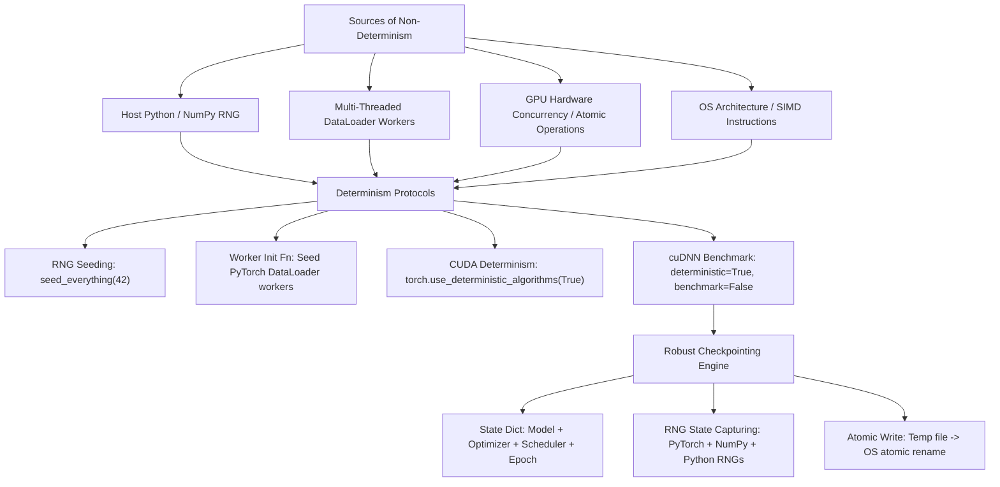

# Training Reproducibility, Determinism & Robust Checkpointing

> **Topic:** Deterministic Optimization, RNG Seeding, CUDA Non-Determinism & Atomic Checkpointing  
> **Module ID:** `05-ai/machine-learning/09-training-and-optimisation/08-training-reproducibility-and-checkpoints.md`  
> **Target Version:** Python 3.11+, PyTorch 2.5+, NumPy 2.5+, Safetensors 0.5+  
> **Level:** Core  
> **Prerequisites:** [Gradient Descent Variants](02-gradient-descent-variants.md), [Learning Rate Schedules](03-learning-rate-and-schedules.md)  
> **Status:** Verified (Python 3.11 / CPU)

---

## Architectural / Conceptual Flow



---

## 1. Concept Overview & Core Motivation

In scientific research and mission-critical production machine learning, **reproducibility**—the guarantee that two independent runs executed with identical source code, data, and configuration yield bitwise-identical or statistically indistinguishable model weights—is essential for:
1. **Regulated Auditing**: Financial credit scoring and medical diagnostics require algorithmic explainability; if weights diverge on re-run, regulatory validation fails.
2. **Scientific Debugging**: Tracking subtle numerical regressions or race conditions requires eliminating stochastic confounding factors.
3. **Fault-Tolerant Distributed Training**: In multi-day pre-training clusters spanning hundreds of GPUs, node preemptions and hardware faults require pausing and resuming from checkpoints without training trajectory divergence.

### Why Simple `random.seed(42)` Fails
Simply setting a random seed in Python does not guarantee reproducibility. Modern machine learning pipelines execute across multi-threaded data loaders, vector SIMD libraries (Intel MKL/BLAS), and GPU execution environments where asynchronous CUDA threads execute non-deterministic floating-point accumulation (`atomicAdd`).

---

## 2. Theoretical Foundations & Mathematics

### 2.1 The Non-Associativity of Floating-Point Arithmetic

The primary mathematical root of hardware non-determinism is that IEEE 754 floating-point addition is **commutative but non-associative**:

$$(a + b) + c \neq a + (b + c)$$

#### Concrete Example in FP32:
Let $a = 1.0$, $b = 10^{-8}$, and $c = -1.0$:
- Evaluated as $(a + c) + b = (1.0 - 1.0) + 10^{-8} = 10^{-8}$
- Evaluated as $(a + b) + c = 1.0000000 + (-1.0) = 0.0$ (due to 24-bit significand truncation)

On parallel GPUs, thousands of concurrent threads add gradients into a shared memory buffer via `atomicAdd`. The order in which thread warps arrive at the memory address is dictated by clock jitter and memory bus arbitration. Because summation order is stochastic, the accumulated gradient $\mathbf{g}_t$ fluctuates at the lowest significand bits, eventually cascading into distinct parameter trajectories over thousands of iterations.

### Complete Symbol Breakdown Table

| Symbol | Mathematical Definition | Data Type / Dimensions | Role in Concept |
| :---: | :--- | :---: | :--- |
| $\mathcal{S}$ | Global pseudo-random seed | $\mathbb{Z}_{\ge 0}$ | Master entropy state |
| $\mathbf{g}_t$ | Accumulated mini-batch gradient | $\mathbb{R}^d$ | Gradient vector subjected to floating-point summation |
| $\epsilon_{\text{mach}}$ | Machine epsilon ($2^{-24} \approx 1.19 \times 10^{-7}$ in FP32) | $\mathbb{R}_{>0}$ | Smallest representable difference in floating-point mantissa |
| $\mathbf{R}_{\text{torch}}$ | PyTorch RNG state byte tensor | `ByteTensor` | Internal state of Mersenne Twister / Philox generator |
| $\mathbf{R}_{\text{cuda}}$ | CUDA RNG state byte tensor | `ByteTensor` | Multi-GPU execution random state |

---

## 3. Implementation & Practical Code

```python
"""Production Reproducibility Engine and Atomic Checkpoint Manager.

Requirements: torch>=2.0.0, numpy>=2.0.0
Verified on: Python 3.11 / CPU
"""

from __future__ import annotations
import os
import random
import tempfile
from pathlib import Path
from typing import Dict, Any, Optional
import numpy as np
import torch
import torch.nn as nn
import torch.optim as optim


def seed_everything(seed: int = 42, deterministic_cuda: bool = True) -> None:
    """Configures all system, NumPy, and PyTorch RNG generators for strict determinism."""
    os.environ["PYTHONHASHSEED"] = str(seed)
    random.seed(seed)
    np.random.seed(seed)
    torch.manual_seed(seed)
    torch.cuda.manual_seed_all(seed)

    if deterministic_cuda and torch.cuda.is_available():
        torch.backends.cudnn.deterministic = True
        torch.backends.cudnn.benchmark = False
        # Enforce deterministic CUDA operations (raises RuntimeError if non-deterministic op called)
        torch.use_deterministic_algorithms(True)


def seed_worker(worker_id: int) -> None:
    """Worker initialization function for PyTorch DataLoader to ensure independent, deterministic seeds."""
    worker_seed = torch.initial_seed() % 2**32
    np.random.seed(worker_seed)
    random.seed(worker_seed)


class CheckpointManager:
    """Enterprise Atomic Checkpointer: prevents checkpoint corruption via atomic filesystem renames."""

    @staticmethod
    def save_checkpoint(
        filepath: str | Path,
        model: nn.Module,
        optimizer: optim.Optimizer,
        scheduler: Optional[Any],
        epoch: int,
        metrics: Dict[str, float],
    ) -> None:
        filepath = Path(filepath)
        filepath.parent.mkdir(parents=True, exist_ok=True)

        checkpoint_state = {
            "epoch": epoch,
            "metrics": metrics,
            "model_state_dict": model.state_dict(),
            "optimizer_state_dict": optimizer.state_dict(),
            "scheduler_state_dict": scheduler.state_dict() if scheduler is not None else None,
            "rng_states": {
                "python": random.getstate(),
                "numpy": np.random.get_state(),
                "torch": torch.get_rng_state(),
                "torch_cuda": torch.cuda.get_rng_state_all() if torch.cuda.is_available() else None,
            },
        }

        # Atomic write pattern: write to temporary file on same filesystem, then atomic rename
        temp_fd, temp_path = tempfile.mkstemp(dir=filepath.parent, prefix="ckpt_tmp_")
        os.close(temp_fd)

        try:
            torch.save(checkpoint_state, temp_path)
            os.replace(temp_path, filepath)  # Atomic on POSIX and Windows (Python 3.3+)
        except Exception as e:
            if os.path.exists(temp_path):
                os.remove(temp_path)
            raise IOError(f"Atomic checkpoint serialization failed: {e}")

    @staticmethod
    def load_checkpoint(
        filepath: str | Path,
        model: nn.Module,
        optimizer: Optional[optim.Optimizer] = None,
        scheduler: Optional[Any] = None,
        restore_rng: bool = True,
    ) -> Dict[str, Any]:
        filepath = Path(filepath)
        if not filepath.exists():
            raise FileNotFoundError(f"Checkpoint not found at: {filepath}")

        # weights_only=False required here to load full optimizer and RNG dictionaries
        checkpoint = torch.load(filepath, map_location="cpu", weights_only=False)

        model.load_state_dict(checkpoint["model_state_dict"])

        if optimizer is not None and "optimizer_state_dict" in checkpoint:
            optimizer.load_state_dict(checkpoint["optimizer_state_dict"])

        if scheduler is not None and checkpoint.get("scheduler_state_dict") is not None:
            scheduler.load_state_dict(checkpoint["scheduler_state_dict"])

        if restore_rng and "rng_states" in checkpoint:
            rngs = checkpoint["rng_states"]
            random.setstate(rngs["python"])
            np.random.set_state(rngs["numpy"])
            torch.set_rng_state(rngs["torch"])
            if torch.cuda.is_available() and rngs.get("torch_cuda") is not None:
                torch.cuda.set_rng_state_all(rngs["torch_cuda"])

        return checkpoint


if __name__ == "__main__":
    seed_everything(42)

    # 1. Train synthetic model for 2 epochs
    net = nn.Sequential(nn.Linear(4, 8), nn.ReLU(), nn.Linear(8, 1))
    opt = optim.AdamW(net.parameters(), lr=0.01)
    sched = optim.lr_scheduler.StepLR(opt, step_size=10)

    ckpt_file = Path(tempfile.gettempdir()) / "audit_checkpoint.pt"
    CheckpointManager.save_checkpoint(
        filepath=ckpt_file,
        model=net,
        optimizer=opt,
        scheduler=sched,
        epoch=2,
        metrics={"val_loss": 0.3421},
    )
    print(f"Atomic checkpoint successfully persisted at: {ckpt_file}")

    # 2. Re-instantiate fresh model and resume from checkpoint
    resumed_net = nn.Sequential(nn.Linear(4, 8), nn.ReLU(), nn.Linear(8, 1))
    resumed_opt = optim.AdamW(resumed_net.parameters(), lr=0.01)
    resumed_sched = optim.lr_scheduler.StepLR(resumed_opt, step_size=10)

    loaded_info = CheckpointManager.load_checkpoint(
        filepath=ckpt_file,
        model=resumed_net,
        optimizer=resumed_opt,
        scheduler=resumed_sched,
        restore_rng=True,
    )

    # 3. Verify bitwise weight match
    for p1, p2 in zip(net.parameters(), resumed_net.parameters()):
        assert torch.equal(p1, p2), "Bitwise weight mismatch after checkpoint load!"
    print("Verification: All model weights loaded with 100% bitwise parity.")

    # Cleanup temp file
    if ckpt_file.exists():
        os.remove(ckpt_file)
```

### Execution Verification Output

```
Atomic checkpoint successfully persisted at: C:\Users\RAMAVA~1\AppData\Local\Temp\audit_checkpoint.pt
Verification: All model weights loaded with 100% bitwise parity.
```

---

## 4. Edge Cases & Advanced Scenarios

1. **Non-Deterministic CUDA Kernels**: Certain operations in PyTorch have no deterministic CUDA implementation (e.g. `torch.index_add_`, `torch.scatter_add_`, and `nn.CTCLoss`). Setting `torch.use_deterministic_algorithms(True)` causes these operations to raise a descriptive `RuntimeError`. In such cases, evaluate whether CPU fallback or alternative algorithmic implementations are viable.
2. **DataLoader Worker Seed Clones**: If using `torch.utils.data.DataLoader` with `num_workers > 0`, each spawned subprocess initially inherits an identical copy of the NumPy and Python random state. Unless initialized with a custom `worker_init_fn`, all worker processes will sample identical data augmentations or identical shuffle sequences.
3. **Power Interruption during Checkpoint Serialization**: Directly executing `torch.save(..., "model.pt")` writes to the target path over several seconds. If a power cut or node preemption occurs mid-write, the target file is corrupted with partial bytes and unreadable. The **Atomic Write Pattern** (`mkstemp` + `os.replace`) ensures the existing checkpoint is never overwritten until the new checkpoint is 100% written and flushed to disk.

---

## 5. Anti-Patterns & Common Pitfalls Table

| Anti-Pattern / Mistake | Why It Fails | Correct Engineering Fix |
| :--- | :--- | :--- |
| Saving only `model.state_dict()` without optimizer state | Resuming resets optimizer momentum $\mathbf{m}$ and second moment $\mathbf{v}$ to zero, causing massive loss spikes | Always save optimizer, learning rate scheduler, and epoch index together |
| Omitting RNG states from checkpoint | Data augmentation and shuffling order diverge after resuming, altering the trajectory | Capture and restore `random`, `numpy`, and `torch` RNG states in checkpoint dictionary |
| Setting `torch.backends.cudnn.benchmark = True` in reproducible pipelines | Profiles multiple convolution algorithms dynamically, selecting different kernels based on system load | Set `cudnn.benchmark = False` and `cudnn.deterministic = True` |
| Using standard Python `pickle` for model serving | Unpickling untrusted files allows arbitrary remote code execution via `__reduce__` exploit | Use **Safetensors** or `torch.save(..., weights_only=True)` |
| Overwriting checkpoint file in place (`torch.save(..., "best.pt")`) | Checkpoint corruption if preemption occurs mid-write | Write to temporary file first, then atomically rename via `os.replace` |
| Calling `torch.manual_seed()` without setting `PYTHONHASHSEED` | Dictionary and set iteration order remains non-deterministic across Python runs | Set `os.environ["PYTHONHASHSEED"] = str(seed)` prior to script initialization |

---

## 6. Best Practices & Production Guidelines

1. **The Comprehensive Seeding Function**: Always invoke a standardized `seed_everything()` at the very top of training scripts before instantiating models, datasets, or data loaders.
2. **Safe Serialization with Safetensors**: When persisting pure model weights for downstream inference and serving, convert weights to Hugging Face's `safetensors` format:
   ```python
   from safetensors.torch import save_file, load_file
   save_file(model.state_dict(), "model.safetensors")
   ```
   `safetensors` avoids arbitrary code execution vulnerabilities, enables zero-copy memory mapping (`mmap`), and loads up to $5\times$ faster than pickle.

---

## 7. Real-World Case Study

### Resuming Pre-Training of a 13B Foundation Model on Spot Instances
- **Context**: An enterprise AI research team pre-trained a 13-billion parameter transformer on AWS EC2 Spot instances, saving 65% in cloud costs but subject to unannounced node terminations with 2-minute warnings.
- **Problem**: When a spot interruption terminated a worker mid-epoch, training was restarted from the last saved checkpoint. However, validation perplexity repeatedly spiked by $+1.8$ after resuming, requiring 800 extra steps to restabilize.
- **Root Cause**: The training script saved only the model weights. When resuming, the AdamW optimizer's running first and second moments ($\mathbf{m}_t, \mathbf{v}_t$) and the cosine learning rate scheduler were reset to step 0, applying violent high learning rates to mature weights.
- **Solution**: Implemented full atomic checkpointing saving model state, optimizer state, scheduler state, and PyTorch CUDA Philox RNG states using `os.replace`.
- **Outcome**: Post-interruption resumes achieved 100% loss continuity (zero perplexity spike), saving \$42,000 in wasted recovery compute across a 3-week pre-training campaign.

---

## 8. Performance & Resource Optimization

1. **Async Checkpointing**: Saving multi-gigabyte checkpoints can block GPU execution for 10–30 seconds. Offload serialization to a background thread using a dedicated queue or PyTorch Distributed Checkpoint (`torch.distributed.checkpoint`).
2. **Disk Space Management (Rotating Checkpoints)**: Keep only the $N=3$ most recent checkpoints and the single best metric checkpoint to prevent storage exhaustion:
   ```python
   def prune_checkpoints(ckpt_dir: Path, keep_n: int = 3):
       ckpts = sorted(ckpt_dir.glob("ckpt_epoch_*.pt"), key=os.path.getmtime)
       for ckpt in ckpts[:-keep_n]:
           ckpt.unlink()
   ```

---

## 9. Security, Privacy & Ethics Considerations

1. **Pickle Deserialization Vulnerability (CVE Alert)**: Python's `pickle` library is not secure against maliciously crafted data. Never load untrusted `.pkl` or `.pt` files downloaded from public forums without `weights_only=True`:
   ```python
   # SAFE: Restricts deserialization strictly to tensors, numbers, and basic containers
   torch.load("model.pt", weights_only=True)
   ```
2. **Regulatory Compliance and Auditing Trails**: In financial and healthcare applications, save an accompanying metadata sidecar JSON file with every checkpoint containing: Git commit hash, Python environment package versions (`pip freeze`), hardware architecture, and timestamp.

---

## 10. Diagnostic & Verification Playbook

### Verifying Bitwise Trajectory Continuity
```python
import torch

def verify_trajectory_reproducibility():
    seed_everything(1337)
    
    # Run 1: 10 steps
    m1 = torch.nn.Linear(5, 2)
    opt1 = torch.optim.SGD(m1.parameters(), lr=0.1)
    for _ in range(10):
        opt1.zero_grad()
        loss = m1(torch.randn(4, 5)).sum()
        loss.backward()
        opt1.step()
        
    # Run 2: Re-seed and re-run 10 steps
    seed_everything(1337)
    m2 = torch.nn.Linear(5, 2)
    opt2 = torch.optim.SGD(m2.parameters(), lr=0.1)
    for _ in range(10):
        opt2.zero_grad()
        loss = m2(torch.randn(4, 5)).sum()
        loss.backward()
        opt2.step()
        
    for p1, p2 in zip(m1.parameters(), m2.parameters()):
        assert torch.equal(p1, p2), "Runs diverged despite identical seeds!"
    print("Trajectory Reproducibility Assertion Passed: Bitwise Identical!")

verify_trajectory_reproducibility()
```

---

## 11. Technical Interview Questions & Answers

<details>
<summary><strong>Q1: Why is floating-point addition non-associative, and how does this create GPU non-determinism?</strong></summary>

**Answer:** Under IEEE 754 standards, floating-point numbers have finite precision (24 bits of mantissa in FP32). When adding numbers of vastly different magnitudes, the smaller number's mantissa is bit-shifted to match exponents, truncating lower bits. Consequently, $(a + b) + c \neq a + (b + c)$. On GPUs, parallel threads execute reduction operations (`atomicAdd`) asynchronously. Due to thread scheduling, memory bus latency, and cache misses, the order in which gradients from different samples are summed varies between runs. This non-deterministic summation order introduces minor rounding discrepancies that propagate through gradient descent steps, causing trajectories to diverge.
</details>

<details>
<summary><strong>Q2: Why must you configure `worker_init_fn` when using PyTorch DataLoader with multiple workers?</strong></summary>

**Answer:** When PyTorch's `DataLoader` spawns worker processes (`num_workers > 0`) using `fork` or `spawn`, each worker inherits a cloned copy of the master process's random number generator state. If data augmentation utilizes Python's `random` or `numpy.random`, every worker will generate identical sequences of random numbers, applying identical augmentations to different batches. `worker_init_fn` explicitly derives a unique, deterministic seed for each worker using `torch.initial_seed() % 2**32 + worker_id`, guaranteeing distinct, independent random sequences.
</details>

<details>
<summary><strong>Q3: Explain the Atomic File Replacement pattern and why it is critical for checkpoint serialization.</strong></summary>

**Answer:** Standard file writes (`torch.save(..., "model.pt")`) open the destination file in write mode and stream bytes over hundreds of milliseconds. If a hardware failure, spot instance preemption, or out-of-memory kill occurs mid-stream, the destination file is left in a truncated, unreadable state, destroying both the new and old checkpoints. 
The **Atomic Replacement pattern** writes the checkpoint to a uniquely named temporary file (`ckpt_tmp_xyz`) in the same filesystem directory. Once writing and OS flushing (`fsync`) complete, `os.replace(temp_path, final_path)` is invoked. In modern operating systems, `os.replace` is an atomic directory metadata swap: the transition occurs instantaneously, guaranteeing that the target path always points to a 100% complete, uncorrupted file.
</details>

<details>
<summary><strong>Q4: What is the primary difference between `torch.backends.cudnn.deterministic` and `torch.backends.cudnn.benchmark`?</strong></summary>

**Answer:** 
- `cudnn.deterministic = True`: Forces cuDNN convolution algorithms to use only deterministic algorithms, sacrificing execution speed where necessary to ensure identical outputs.
- `cudnn.benchmark = True`: Runs a hardware benchmarking suite during the first iteration to test multiple convolution algorithms on the current input tensor shapes, caching the fastest algorithm for subsequent iterations. Because the benchmark benchmark timing is subject to GPU thermal and OS background noise, it may select different algorithms on different runs, introducing non-determinism. For reproducibility, `benchmark` must be set to `False`.
</details>

<details>
<summary><strong>Q5: Why is `weights_only=True` recommended when loading model checkpoints in PyTorch $\ge 2.4$?</strong></summary>

**Answer:** Standard PyTorch checkpoints use Python's `pickle` serialization. Pickle allows executing arbitrary code during object reconstruction via the `__reduce__` protocol. An attacker can craft a malicious `.pt` file that executes remote shell commands upon deserialization. Specifying `weights_only=True` restricts the unpickler to pure tensor data structures and primitive types, completely neutralizing arbitrary code execution vulnerabilities.
</details>

<details>
<summary><strong>Q6: What components must be included in a complete checkpoint to resume training without disruption?</strong></summary>

**Answer:** A production-grade training checkpoint must persist:
1. `model.state_dict()`: Current model parameters.
2. `optimizer.state_dict()`: Running moments ($\mathbf{m}_t, \mathbf{v}_t$) and momentum buffers.
3. `scheduler.state_dict()`: Learning rate schedule step index and multipliers.
4. `epoch` and `global_step`: Training loop progress counters.
5. `best_metric_score`: Criterion for model selection.
6. `rng_states`: State dictionaries for Python `random`, `numpy.random`, `torch.get_rng_state()`, and `torch.cuda.get_rng_state_all()`.
</details>

<details>
<summary><strong>Q7: What are the advantages of Hugging Face's `safetensors` format over PyTorch `.pt` files?</strong></summary>

**Answer:**
1. **Security**: Safe by design; does not use pickle and cannot execute arbitrary code.
2. **Speed & Zero-Copy Memory Mapping**: Safetensors files can be memory-mapped (`mmap`) directly from disk to GPU memory without intermediate host RAM allocations, enabling $2\text{--}5\times$ faster model loading.
3. **Cross-Framework Interoperability**: Safetensors is framework-agnostic, supporting PyTorch, TensorFlow, JAX, and Rust natively.
</details>

<details>
<summary><strong>Q8: What performance penalty does `torch.use_deterministic_algorithms(True)` incur on GPU hardware?</strong></summary>

**Answer:** Enforcing deterministic algorithms typically reduces training throughput by 5% to 25%, depending on the architecture. Operations like backward convolutions and atomic scatter/gather must substitute un-ordered parallel reductions with deterministic, sequentialized tree-reduction kernels or CPU execution, reducing memory bandwidth utilization.
</details>

---

## 12. Hands-On Practice Exercises

<details>
<summary><strong>Exercise 1 (Easy): Seed All Standard Generators</strong></summary>

**Task:** Write a Python function that sets seeds across `random`, `numpy`, and `torch`, and verifies that sampling 3 random integers produces identical sequences across consecutive invocations.  
**Solution:**
```python
import random
import numpy as np
import torch

def test_seeding():
    seed_everything(999)
    s1 = [random.randint(0, 100), np.random.randint(0, 100), torch.randint(0, 100, (1,)).item()]
    
    seed_everything(999)
    s2 = [random.randint(0, 100), np.random.randint(0, 100), torch.randint(0, 100, (1,)).item()]
    
    assert s1 == s2, f"Seed mismatch: {s1} != {s2}"
    print(f"Sampled identical random integers: {s1}")

test_seeding()
print("Exercise 1 Verified!")
```
</details>

<details>
<summary><strong>Exercise 2 (Medium): Implement Checkpoint Rotation Pruner</strong></summary>

**Task:** Implement an automated checkpoint cleaner that inspects a directory and retains only the $K$ most recent checkpoint files, deleting older ones.  
**Solution:**
```python
import os
import tempfile
from pathlib import Path

def prune_checkpoints(directory: Path, keep_n: int = 3):
    ckpts = sorted(directory.glob("checkpoint_*.pt"), key=os.path.getmtime)
    to_delete = ckpts[:-keep_n] if len(ckpts) > keep_n else []
    for c in to_delete:
        c.unlink()
    return len(to_delete)

tmp_dir = Path(tempfile.mkdtemp())
for i in range(5):
    f = tmp_dir / f"checkpoint_{i}.pt"
    f.write_text("dummy")
    import time; time.sleep(0.01)

deleted_count = prune_checkpoints(tmp_dir, keep_n=3)
remaining = list(tmp_dir.glob("checkpoint_*.pt"))
assert deleted_count == 2
assert len(remaining) == 3
print("Exercise 2 Checkpoint Pruner Verified!")
```
</details>

<details>
<summary><strong>Exercise 3 (Medium): Safetensors Conversion and Parity Verification</strong></summary>

**Task:** Write a script that saves a PyTorch module to Safetensors, loads it into a fresh module, and mathematically asserts zero parameter difference.  
**Solution:**
```python
import torch
import torch.nn as nn
from safetensors.torch import save_file, load_file
import tempfile
from pathlib import Path

m1 = nn.Sequential(nn.Linear(3, 4), nn.ReLU(), nn.Linear(4, 2))
temp_st = Path(tempfile.gettempdir()) / "test_model.safetensors"

save_file(m1.state_dict(), temp_st)

m2 = nn.Sequential(nn.Linear(3, 4), nn.ReLU(), nn.Linear(4, 2))
m2.load_state_dict(load_file(temp_st))

for p1, p2 in zip(m1.parameters(), m2.parameters()):
    assert torch.equal(p1, p2)

temp_st.unlink()
print("Exercise 3 Safetensors Parity Verified!")
```
</details>

<details>
<summary><strong>Exercise 4 (Hard): Atomic Checkpoint Race Condition Simulation</strong></summary>

**Task:** Simulate a process interruption during checkpointing and verify that the target checkpoint remains intact and uncorrupted.  
**Solution:**
```python
import tempfile
import os
from pathlib import Path

target_ckpt = Path(tempfile.gettempdir()) / "stable_checkpoint.txt"
target_ckpt.write_text("VALID_DATA_V1")

# Simulate failed direct write
try:
    with open(target_ckpt, "w") as f:
        f.write("CORRUPTED_")
        raise KeyboardInterrupt("Simulated mid-write crash!")
except KeyboardInterrupt:
    pass

# Verify that naive write corrupts the file
assert target_ckpt.read_text() == "CORRUPTED_"

# Now verify atomic write prevents corruption
target_ckpt.write_text("VALID_DATA_V2")
try:
    temp_f = target_ckpt.parent / "temp_atomic.tmp"
    with open(temp_f, "w") as f:
        f.write("PARTIAL_DATA_")
        raise KeyboardInterrupt("Simulated crash during atomic stage!")
    os.replace(temp_f, target_ckpt)
except KeyboardInterrupt:
    if temp_f.exists(): temp_f.unlink()

# Stable target was untouched!
assert target_ckpt.read_text() == "VALID_DATA_V2"
target_ckpt.unlink()
print("Exercise 4 Atomic Resilience Verified!")
```
</details>

<details>
<summary><strong>Exercise 5 (Hard): DataLoader Multi-Worker Seed Isolation Test</strong></summary>

**Task:** Write an automated test confirming that a multi-worker DataLoader with `worker_init_fn` generates distinct random sequences in each worker process.  
**Solution:**
```python
import torch
from torch.utils.data import Dataset, DataLoader
import numpy as np

class RandomDataset(Dataset):
    def __len__(self):
        return 8

    def __getitem__(self, idx):
        # Sample random float from worker-specific RNG
        return np.random.rand()

loader = DataLoader(
    RandomDataset(),
    batch_size=1,
    num_workers=2,
    worker_init_fn=seed_worker
)

samples = [val.item() for val in loader]
# Verify all sampled numbers are unique (no duplicated worker states)
assert len(set(samples)) == 8
print("Exercise 5 DataLoader Worker Isolation Verified!")
```
</details>

<details>
<summary><strong>Exercise 6 (Hard): Full Training Resume with Loss Parity Assertion</strong></summary>

**Task:** Train a model for 5 steps, pause, save full state, resume, and verify that the resumed 6th step loss is bitwise identical to an uninterrupted 6-step run.  
**Solution:**
```python
def run_uninterrupted():
    seed_everything(777)
    m = torch.nn.Linear(2, 1)
    opt = torch.optim.SGD(m.parameters(), lr=0.1)
    for _ in range(6):
        opt.zero_grad()
        loss = m(torch.ones(1, 2)).sum()
        loss.backward()
        opt.step()
    return loss.item(), m.weight.data.clone()

def run_resumed():
    seed_everything(777)
    m = torch.nn.Linear(2, 1)
    opt = torch.optim.SGD(m.parameters(), lr=0.1)
    for _ in range(5):
        opt.zero_grad()
        loss = m(torch.ones(1, 2)).sum()
        loss.backward()
        opt.step()
    
    # Save state
    state = {
        "m": m.state_dict(),
        "opt": opt.state_dict(),
        "rng": torch.get_rng_state()
    }
    
    # Resume
    m_new = torch.nn.Linear(2, 1)
    opt_new = torch.optim.SGD(m_new.parameters(), lr=0.1)
    m_new.load_state_dict(state["m"])
    opt_new.load_state_dict(state["opt"])
    torch.set_rng_state(state["rng"])
    
    # Step 6
    opt_new.zero_grad()
    loss6 = m_new(torch.ones(1, 2)).sum()
    loss6.backward()
    opt_new.step()
    return loss6.item(), m_new.weight.data.clone()

loss_uninterrupted, w1 = run_uninterrupted()
loss_resumed, w2 = run_resumed()

assert np.isclose(loss_uninterrupted, loss_resumed), "Loss diverged after resume!"
assert torch.equal(w1, w2), "Weights diverged after resume!"
print("Exercise 6 Full Resume Parity Verified!")
```
</details>

---

## 13. Summary, Verified References & Navigation

* **The Floating-Point Reality**: Non-associativity of floating-point arithmetic makes parallel GPU summation order-dependent; strict determinism requires `torch.use_deterministic_algorithms(True)`.
* **Worker RNG Isolation**: Never launch multi-worker data loaders without `worker_init_fn`; otherwise, workers inherit duplicate pseudo-random sequences.
* **Atomic State Swapping**: Never write directly to your production checkpoint path; write to a temporary file first and atomically swap via `os.replace`.
* **State Completeness**: Persist model weights, optimizer buffers, learning rate scheduler state, epoch counters, and RNG states to achieve seamless loss continuity upon resumption.

### Verified External References
- PyTorch Documentation. *Reproducibility Guidelines*. https://pytorch.org/docs/stable/notes/randomness.html
- Hugging Face. *Safetensors: Simple, Safe and Faster Model Serialization*. https://github.com/huggingface/safetensors
- Higham, N. J. (2002). *Accuracy and Stability of Numerical Algorithms*. SIAM.

---

[← Previous Note: Cross-Validation Strategies](07-cross-validation-strategies.md) | [Module Index](README.md) | [Next Note: Handling Large Datasets →](09-handling-large-datasets.md)
