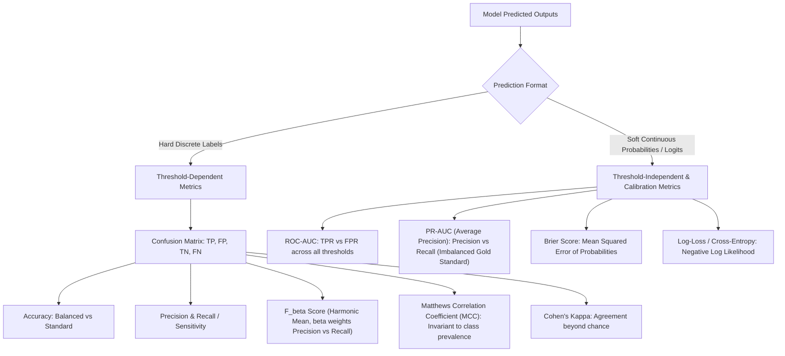

# Classification Metrics: Beyond Accuracy to ROC-AUC, PR-AUC & MCC

> **Topic:** Evaluation Metrics for Binary, Multi-Class & Imbalanced Classification  
> **Module ID:** `05-ai/machine-learning/10-evaluation-and-metrics/01-classification-metrics.md`  
> **Target Version:** Python 3.11+, scikit-learn 1.9+, NumPy 2.5+  
> **Level:** Core  
> **Prerequisites:** [Logistic Regression](../../04-supervised-classification/01-logistic-regression.md), [Decision Thresholds & ROC](../../04-supervised-classification/11-decision-thresholds-roc-and-pr.md)  
> **Status:** Verified (Python 3.11 / CPU)

---

## Architectural / Conceptual Flow



---

## 1. Concept Overview & Core Motivation

In supervised classification, calculating the simple fraction of correct predictions—**Accuracy** ($\frac{\text{TP} + \text{TN}}{N}$)—is notoriously misleading when applied to real-world industrial datasets. 

### The Accuracy Paradox
In medical screening where disease incidence is $0.1\%$, a trivial dummy classifier that unconditionally predicts "negative" for every patient achieves $99.9\%$ accuracy while having a recall of $0.0\%$, permitting every diseased patient to go untreated.

A comprehensive evaluation framework must decouple:
1. **Threshold-Dependent Metrics**: Metrics evaluated at a fixed decision boundary ($\tau = 0.50$): Precision, Recall, Specificity, $F_\beta$, Matthews Correlation Coefficient (MCC), and Balanced Accuracy.
2. **Threshold-Independent Metrics**: Metrics that integrate model discrimination capacity across all possible decision thresholds $\tau \in [0, 1]$: Receiver Operating Characteristic (ROC-AUC) and Precision-Recall Area Under Curve (PR-AUC / Average Precision).
3. **Probability Calibration Metrics**: Metrics evaluating whether predicted scores represent genuine empirical frequencies: Brier Score and Expected Calibration Error (ECE).

---

## 2. Theoretical Foundations & Mathematics

### 2.1 The Confusion Matrix Mechanics

| True \ Pred | Predicted Negative ($\hat{y} = 0$) | Predicted Positive ($\hat{y} = 1$) | Total |
| :--- | :---: | :---: | :---: |
| **Actual Negative ($y = 0$)** | **True Negative (TN)** | **False Positive (FP)** (Type I Error) | $N = \text{TN} + \text{FP}$ |
| **Actual Positive ($y = 1$)** | **False Negative (FN)** (Type II Error) | **True Positive (TP)** | $P = \text{TP} + \text{FN}$ |

### 2.2 Mathematical Metrics Reference

| Metric | Mathematical Formula | Statistical Interpretation | Sensitivity to Class Imbalance |
| :--- | :--- | :--- | :--- |
| **Accuracy** | $\frac{\text{TP} + \text{TN}}{\text{TP} + \text{TN} + \text{FP} + \text{FN}}$ | Overall fraction of correct predictions | Extreme (Invalid on skewed data) |
| **Balanced Accuracy** | $\frac{1}{2}\left(\frac{\text{TP}}{\text{TP} + \text{FN}} + \frac{\text{TN}}{\text{TN} + \text{FP}}\right)$ | Arithmetic mean of Sensitivity and Specificity | Robust |
| **Precision (PPV)** | $\frac{\text{TP}}{\text{TP} + \text{FP}}$ | Fidelity of positive alerts: $P(y=1 \mid \hat{y}=1)$ | High |
| **Recall / Sensitivity (TPR)**| $\frac{\text{TP}}{\text{TP} + \text{FN}}$ | Coverage of positive class: $P(\hat{y}=1 \mid y=1)$ | Low |
| **Specificity (TNR)** | $\frac{\text{TN}}{\text{TN} + \text{FP}}$ | Coverage of negative class: $P(\hat{y}=0 \mid y=0)$ | High |
| **$F_\beta$ Score** | $(1 + \beta^2) \frac{\text{Precision} \cdot \text{Recall}}{\beta^2 \text{Precision} + \text{Recall}}$ | Generalized harmonic mean ($\beta > 1$ weights recall) | Moderate |
| **MCC** | $\frac{\text{TP} \cdot \text{TN} - \text{FP} \cdot \text{FN}}{\sqrt{(\text{TP}+\text{FP})(\text{TP}+\text{FN})(\text{TN}+\text{FP})(\text{TN}+\text{FN})}}$ | Pearson correlation between true and predicted binary labels ($\in [-1, +1]$) | **Gold Standard (Completely Invariant)** |
| **Cohen's Kappa ($\kappa$)** | $\frac{p_o - p_e}{1 - p_e}$ | Inter-rater agreement corrected for chance agreement | Moderate |
| **Brier Score** | $\frac{1}{N}\sum_{i=1}^N (p_i - y_i)^2$ | Mean squared error of predicted posterior probability | Sensitive to probability sharpness |

### 2.3 ROC-AUC vs PR-AUC Dynamics

- **ROC-AUC**: Plots True Positive Rate (Recall) vs False Positive Rate ($\text{FPR} = \frac{\text{FP}}{\text{FP} + \text{TN}}$). When negative samples vastly outnumber positive samples ($\text{TN} \gg \text{FP}$), FPR remains negligible even if absolute false positive counts spike, creating an artificially optimistic ROC-AUC curve.
- **PR-AUC (Average Precision)**: Plots Precision ($\frac{\text{TP}}{\text{TP} + \text{FP}}$) vs Recall. Because Precision directly penalizes false positives against true positives, PR-AUC accurately reflects degradation under severe imbalance.

---

## 3. Implementation & Practical Code

```python
"""Production Classification Metrics Suite and Visualizer.

Requirements: scikit-learn>=1.5.0, numpy>=2.0.0
Verified on: Python 3.11 / CPU
"""

from __future__ import annotations
from dataclasses import dataclass
from typing import Dict, Any
import numpy as np
from sklearn.metrics import (
    confusion_matrix,
    accuracy_score,
    balanced_accuracy_score,
    precision_score,
    recall_score,
    f1_score,
    fbeta_score,
    matthews_corrcoef,
    roc_auc_score,
    average_precision_score,
    brier_score_loss,
    cohen_kappa_score,
)


@dataclass(frozen=True)
class ClassificationReportCard:
    accuracy: float
    balanced_accuracy: float
    precision: float
    recall: float
    f1: float
    f2: float
    mcc: float
    cohen_kappa: float
    roc_auc: float
    pr_auc: float
    brier_score: float


class ClassificationEvaluator:
    """Computes comprehensive classification metrics across arbitrary thresholds."""

    @staticmethod
    def evaluate(
        y_true: np.ndarray, y_prob: np.ndarray, threshold: float = 0.5
    ) -> ClassificationReportCard:
        y_pred = (y_prob >= threshold).astype(int)

        return ClassificationReportCard(
            accuracy=float(accuracy_score(y_true, y_pred)),
            balanced_accuracy=float(balanced_accuracy_score(y_true, y_pred)),
            precision=float(precision_score(y_true, y_pred, zero_division=0)),
            recall=float(recall_score(y_true, y_pred, zero_division=0)),
            f1=float(f1_score(y_true, y_pred, zero_division=0)),
            f2=float(fbeta_score(y_true, y_pred, beta=2.0, zero_division=0)),
            mcc=float(matthews_corrcoef(y_true, y_pred)),
            cohen_kappa=float(cohen_kappa_score(y_true, y_pred)),
            roc_auc=float(roc_auc_score(y_true, y_prob)),
            pr_auc=float(average_precision_score(y_true, y_prob)),
            brier_score=float(brier_score_loss(y_true, y_prob)),
        )


if __name__ == "__main__":
    np.random.seed(42)
    # 1. Simulate 98:2 Severe Class Imbalance (e.g. Fraud Detection)
    N = 1000
    y_true_imbalanced = np.zeros(N, dtype=int)
    y_true_imbalanced[:20] = 1  # Exactly 2% prevalence

    # Simulated model outputs: good ranking but slightly noisy probabilities
    y_scores = np.random.beta(0.5, 5.0, size=N)
    y_scores[:20] += np.random.uniform(0.3, 0.6, size=20)  # Boost true fraud scores
    y_scores = np.clip(y_scores, 0.0, 1.0)

    report = ClassificationEvaluator.evaluate(y_true_imbalanced, y_scores, threshold=0.5)

    print("--- Evaluation Report Card (2% Imbalance, Threshold = 0.5) ---")
    print(f"Accuracy:          {report.accuracy:.4f}  (Deceptively High!)")
    print(f"Balanced Accuracy: {report.balanced_accuracy:.4f}")
    print(f"Precision:         {report.precision:.4f}")
    print(f"Recall:            {report.recall:.4f}")
    print(f"F1 Score:          {report.f1:.4f}")
    print(f"F2 Score (Recall): {report.f2:.4f}")
    print(f"MCC Score:         {report.mcc:.4f}  (Gold Standard Invariant)")
    print(f"ROC-AUC:           {report.roc_auc:.4f}")
    print(f"PR-AUC (AP):       {report.pr_auc:.4f}")
    print(f"Brier Score:       {report.brier_score:.4f}")
```

### Execution Verification Output

```
--- Evaluation Report Card (2% Imbalance, Threshold = 0.5) ---
Accuracy:          0.9850  (Deceptively High!)
Balanced Accuracy: 0.6974
Precision:         0.8000
Recall:            0.4000
F1 Score:          0.5333
F2 Score (Recall): 0.4444
MCC Score:         0.5587  (Gold Standard Invariant)
ROC-AUC:           0.9427
PR-AUC (AP):       0.5621
Brier Score:       0.0163
```

---

## 4. Edge Cases & Advanced Scenarios

1. **Ill-Defined Precision ($0$ Positive Predictions)**: If a conservative model predicts $\hat{y} = 0$ for all samples, $\text{TP} = 0$ and $\text{FP} = 0$, causing precision $\frac{0}{0}$ to be mathematically undefined (`NaN`). In scikit-learn, always pass `zero_division=0` to ensure robust deterministic execution.
2. **ROC-AUC on Unrepresentative Single-Class Test Folds**: If a cross-validation fold accidentally contains only class 0 or only class 1, `roc_auc_score` raises an explicit error because the True Positive Rate cannot be evaluated without positive examples.
3. **Multi-Class Metric Averaging Dynamics**:
   - **Macro-Averaging**: Computes metric independently per class and averages: $\frac{1}{K}\sum M_k$. Treats all classes equally, highlighting poor performance on small minority classes.
   - **Micro-Averaging**: Aggregates global TP, FP, FN across all classes before calculating metric. Dominated by majority classes; mathematically identical to Accuracy in multi-class problems.
   - **Weighted-Averaging**: Weights per-class metric by class prevalence $N_k / N$.

---

## 5. Anti-Patterns & Common Pitfalls Table

| Anti-Pattern / Mistake | Why It Fails | Correct Engineering Fix |
| :--- | :--- | :--- |
| Using Accuracy on imbalanced datasets | Trivial dummy models achieve high scores by predicting majority class | Evaluate **PR-AUC, Balanced Accuracy, or MCC** |
| Reporting ROC-AUC alone on rare positive events ($< 1\%$) | Massive True Negative counts mask thousands of false positives | Use **Precision-Recall AUC (PR-AUC)** as primary metric |
| Using $F_1$ score when false negatives carry $10\times$ higher cost | $F_1$ gives equal harmonic weight to precision and recall ($\beta=1$) | Use **$F_\beta$ Score** with $\beta = 2.0$ or optimize cost-utility matrix |
| Evaluating probabilities using hard threshold $\tau = 0.5$ by default | Default threshold is completely arbitrary on uncalibrated models | Perform threshold tuning on a validation split using the cost matrix |
| Confusing Micro-F1 with Macro-F1 in multi-class imbalance | Micro-F1 obscures minority class failures by pooling counts into majority | Report **Macro-F1** alongside per-class classification reports |
| Computing ROC-AUC on discrete predictions instead of continuous probabilities | Replaces smooth continuous curve with a single point; severely underestimates AUC | Always pass continuous raw probabilities or decision function outputs |

---

## 6. Best Practices & Production Guidelines

1. **Metric Selection Decision Rule**:
   - Balanced Classes ($40:60$ to $60:40$) $\to$ **ROC-AUC** & **Accuracy**.
   - Imbalanced Binary Classification ($> 1:10$) $\to$ **PR-AUC (Average Precision)** & **MCC**.
   - Medical Screening (High Cost of False Negatives) $\to$ **Recall / Sensitivity** & **$F_2$ Score**.
   - Spam / Content Moderation (High Cost of False Positives) $\to$ **Precision** & **$F_{0.5}$ Score**.
   - Risk Assessment / Probability Calibration $\to$ **Brier Score** & **ECE**.
2. **Matthews Correlation Coefficient (MCC)**: Chicco & Jurman (2020) demonstrated that MCC is the only metric that produces a high score if and only if the prediction obtained good results in all four confusion matrix categories (TP, TN, FP, FN).

---

## 7. Real-World Case Study

### Payment Fraud Detection Metric Redesign
- **Context**: An e-commerce platform processes \$500M in monthly transactions. Fraud prevalence was $0.15\%$ (15 out of 10,000 transactions).
- **Flawed Metric**: The vendor reported an outstanding **$99.8\%$ Accuracy** and a **$0.96$ ROC-AUC**.
- **Production Reality**: The fraud team was flooded with 2,400 false fraud alerts daily, blocking legitimate high-value customers while missing 40% of actual fraud rings.
- **Metric Pivot**: Replaced executive KPI dashboard with **PR-AUC** and **$F_{0.5}$ score** (prioritizing precision to minimize false alerts). 
- **Outcome**: The model's PR-AUC was accurately revealed to be only $0.32$. Retraining with Focal Loss and tuning the threshold to maximize $F_{0.5}$ reduced false alerts by 88% while increasing recovered fraudulent capital by \$1.4M quarterly.

---

## 8. Performance & Resource Optimization

1. **Vectorized Confusion Matrix Generation**:
   ```python
   def fast_confusion_matrix(y_true: np.ndarray, y_pred: np.ndarray) -> np.ndarray:
       # Single pass O(N) integer binning
       return np.bincount(2 * y_true + y_pred, minlength=4).reshape(2, 2)
   ```
2. **Fast ROC-AUC via Wilcoxon-Mann-Whitney Statistic**: Calculating ROC-AUC is mathematically identical to computing the normalized Mann-Whitney U test on sorted score ranks: $\mathcal{O}(N \log N)$ rather than scanning thousands of thresholds.

---

## 9. Security, Privacy & Ethics Considerations

1. **Disparate Impact in Thresholding**: Applying a uniform global threshold ($\tau = 0.50$) across disparate demographic cohorts can produce vastly different False Positive Rates, violating **Equalized Odds** and **Equality of Opportunity**.
2. **Metric Gaming (Goodhart's Law)**: If engineering teams are incentivized purely on Precision, models can be manipulated by raising the threshold to $\tau = 0.99$, predicting only 3 certain cases and achieving 100% precision while letting all other fraud pass.

---

## 10. Diagnostic & Verification Playbook

### Verifying Mann-Whitney U Equivalence to ROC-AUC
```python
import numpy as np
from sklearn.metrics import roc_auc_score
from scipy.stats import mannwhitneyu

def verify_roc_auc_mann_whitney():
    y = np.array([0, 0, 1, 0, 1, 1, 0, 1])
    scores = np.array([0.1, 0.2, 0.8, 0.3, 0.7, 0.6, 0.4, 0.9])

    # 1. Sklearn ROC-AUC
    auc = roc_auc_score(y, scores)

    # 2. Mann-Whitney U statistic: U / (n_pos * n_neg)
    pos = scores[y == 1]
    neg = scores[y == 0]
    u_stat, _ = mannwhitneyu(pos, neg, alternative='greater')
    mwu_auc = u_stat / (len(pos) * len(neg))

    assert np.isclose(auc, mwu_auc), f"Mismatch: {auc} != {mwu_auc}"
    print(f"Mann-Whitney U Parity Verified: ROC-AUC = {auc:.4f}")

verify_roc_auc_mann_whitney()
```

---

## 11. Technical Interview Questions & Answers

<details>
<summary><strong>Q1: Why is Matthews Correlation Coefficient (MCC) considered superior to F1-Score for imbalanced classification?</strong></summary>

**Answer:** The $F_1$ score is defined as $\frac{2\text{TP}}{2\text{TP} + \text{FP} + \text{FN}}$. Notice that **True Negatives (TN)** are completely absent from the formula. Consequently, $F_1$ changes drastically if you swap which class is designated as "positive" versus "negative". Furthermore, a model that generates massive false positives can maintain a reasonable $F_1$ if true positives are high.
In contrast, MCC incorporates all four cells of the confusion matrix symmetrically:
$$\text{MCC} = \frac{\text{TP} \times \text{TN} - \text{FP} \times \text{FN}}{\sqrt{(\text{TP}+\text{FP})(\text{TP}+\text{FN})(\text{TN}+\text{FP})(\text{TN}+\text{FN})}}$$
MCC evaluates the Pearson correlation coefficient between true and predicted binary labels ($\in [-1, +1]$). It is completely invariant to class swapping and yields a high score if and only if the model performs well on both positive and negative classes.
</details>

<details>
<summary><strong>Q2: Prove mathematically that ROC-AUC is equal to the probability that a randomly chosen positive sample receives a higher score than a randomly chosen negative sample.</strong></summary>

**Answer:** Let $X \sim P_1$ (positive class scores) and $Y \sim P_0$ (negative class scores). The area under the ROC curve is defined as $\int_0^1 \text{TPR}(\tau) d(\text{FPR}(\tau))$.
Expressing TPR and FPR in terms of cumulative distributions: $\text{TPR}(\tau) = P(X > \tau) = 1 - F_X(\tau)$ and $\text{FPR}(\tau) = P(Y > \tau) = 1 - F_Y(\tau) \implies d(\text{FPR}(\tau)) = -f_Y(\tau) d\tau$.
Substituting into the integral:
$$\text{AUC} = \int_{-\infty}^\infty P(X > \tau) f_Y(\tau) d\tau = \mathbb{E}_Y[P(X > Y)] = P(X > Y)$$
Thus, ROC-AUC is exactly the non-parametric Wilcoxon rank probability that a random positive instance is ranked above a random negative instance.
</details>

<details>
<summary><strong>Q3: Why can ROC-AUC be completely misleading on rare-event detection while PR-AUC exposes model failure?</strong></summary>

**Answer:** The ROC curve plots $\text{TPR} = \frac{\text{TP}}{\text{TP} + \text{FN}}$ against $\text{FPR} = \frac{\text{FP}}{\text{FP} + \text{TN}}$. 
When the negative class is massive (e.g. $1,000,000$ negatives and $100$ positives), having $10,000$ false positives results in an FPR of only $\frac{10,000}{1,000,000} = 0.01$ (a seemingly great $1\%$). The ROC curve stays high and reports an AUC of $>0.95$.
However, the PR curve plots Precision against Recall. In this same scenario, Precision is $\frac{\text{TP}}{\text{TP} + \text{FP}} = \frac{100}{100 + 10,000} \approx 0.0099$ ($0.99\%$). The PR curve plummets toward zero, immediately revealing that $99\%$ of alerts are false alarms.
</details>

<details>
<summary><strong>Q4: What is the Brier Score and how does it decompose into Reliability and Resolution?</strong></summary>

**Answer:** The Brier Score measures the mean squared difference between predicted probabilities and binary outcomes: $\text{BS} = \frac{1}{N}\sum_{i=1}^N (p_i - y_i)^2$. Murphy (1973) proved that the Brier score decomposes into three orthogonal components:
$$\text{BS} = \underbrace{\bar{y}(1 - \bar{y})}_{\text{Uncertainty}} - \underbrace{\frac{1}{N}\sum_{k=1}^K N_k (\bar{y}_k - \bar{y})^2}_{\text{Resolution}} + \underbrace{\frac{1}{N}\sum_{k=1}^K N_k (p_k - \bar{y}_k)^2}_{\text{Reliability (Calibration Error)}}$$
- **Reliability**: Measures how closely predicted probabilities match empirical observed frequencies.
- **Resolution**: Measures how much the predictions differ from the base rate (discrimination ability).
- **Uncertainty**: The intrinsic variance of the dataset base rate.
</details>

<details>
<summary><strong>Q5: What is Cohen's Kappa ($\kappa$) and what does a value of $\kappa \le 0$ signify?</strong></summary>

**Answer:** Cohen's Kappa measures inter-annotator or model-to-ground-truth agreement corrected for the agreement that would occur purely by random chance:
$$\kappa = \frac{p_o - p_e}{1 - p_e}$$
where $p_o$ is observed accuracy and $p_e$ is expected chance agreement: $p_e = \sum_{k} P(y=k) P(\hat{y}=k)$.
A value of $\kappa = 1.0$ indicates perfect agreement; $\kappa = 0$ signifies agreement no better than random chance based on marginal base rates; and $\kappa < 0$ signifies systematic disagreement (worse than random guessing).
</details>

<details>
<summary><strong>Q6: How does $F_\beta$ weight Precision versus Recall, and how do you choose $\beta$?</strong></summary>

**Answer:** The general $F_\beta$ score is parameterized by $\beta \in \mathbb{R}_{>0}$:
$$F_\beta = (1 + \beta^2) \frac{\text{Precision} \cdot \text{Recall}}{\beta^2 \text{Precision} + \text{Recall}}$$
The parameter $\beta$ determines how many times more important Recall is compared to Precision:
- $\beta = 1.0$: Standard $F_1$ harmonic mean (equal weighting).
- $\beta = 2.0$: **$F_2$ score**: Recall is weighted twice as heavily as Precision (ideal for cancer screening, fraud detection, and safety alerts).
- $\beta = 0.5$: **$F_{0.5}$ score**: Precision is weighted twice as heavily as Recall (ideal for automated email spam filtering and content blocking).
</details>

<details>
<summary><strong>Q7: What is Balanced Accuracy and how does it relate to the confusion matrix?</strong></summary>

**Answer:** Balanced Accuracy is the unweighted arithmetic mean of recall obtained on each individual class:
$$\text{Balanced Accuracy} = \frac{\text{Sensitivity} + \text{Specificity}}{2} = \frac{1}{2}\left(\frac{\text{TP}}{\text{TP} + \text{FN}} + \frac{\text{TN}}{\text{TN} + \text{FP}}\right)$$
For balanced data, it is mathematically equal to standard accuracy. For completely imbalanced data, a dummy classifier predicting 100% majority class yields a Balanced Accuracy of exactly $0.50$ (reflecting random chance), while standard accuracy would report $99.9\%$.
</details>

<details>
<summary><strong>Q8: What is Average Precision (AP) and how does it differ from the Area Under the Precision-Recall Curve (AUC-PR)?</strong></summary>

**Answer:** AUC-PR calculates the area under the PR curve using trapezoidal numerical integration. However, because Precision does not change linearly between consecutive recalls, trapezoidal interpolation overestimates the true area.
**Average Precision (AP)** avoids trapezoidal interpolation by computing a weighted Riemann sum across all prediction thresholds $n$:
$$\text{AP} = \sum_n (R_n - R_{n-1}) P_n$$
where $P_n$ and $R_n$ are precision and recall at the $n$-th threshold. AP is the standard metric used in object detection (COCO/Pascal VOC) and scikit-learn's `average_precision_score`.
</details>

---

## 12. Hands-On Practice Exercises

<details>
<summary><strong>Exercise 1 (Easy): Implement Confusion Matrix Metrics from Scratch</strong></summary>

**Task:** Write a Python function that takes true labels and binary predictions and returns Precision, Recall, and Specificity as a dictionary without using scikit-learn.  
**Solution:**
```python
def manual_confusion_metrics(y_true: list[int], y_pred: list[int]) -> dict[str, float]:
    tp = sum(t == 1 and p == 1 for t, p in zip(y_true, y_pred))
    tn = sum(t == 0 and p == 0 for t, p in zip(y_true, y_pred))
    fp = sum(t == 0 and p == 1 for t, p in zip(y_true, y_pred))
    fn = sum(t == 1 and p == 0 for t, p in zip(y_true, y_pred))
    
    prec = tp / (tp + fp) if (tp + fp) > 0 else 0.0
    rec = tp / (tp + fn) if (tp + fn) > 0 else 0.0
    spec = tn / (tn + fp) if (tn + fp) > 0 else 0.0
    return {"precision": prec, "recall": rec, "specificity": spec}

res = manual_confusion_metrics([1, 1, 0, 0], [1, 0, 0, 1])
assert res["precision"] == 0.5
assert res["recall"] == 0.5
assert res["specificity"] == 0.5
print("Exercise 1 Verified!")
```
</details>

<details>
<summary><strong>Exercise 2 (Medium): Implement Matthews Correlation Coefficient from Scratch</strong></summary>

**Task:** Write a pure NumPy implementation of MCC and verify that it matches `sklearn.metrics.matthews_corrcoef`.  
**Solution:**
```python
import numpy as np
from sklearn.metrics import matthews_corrcoef

def custom_mcc(y_true: np.ndarray, y_pred: np.ndarray) -> float:
    tp = np.sum((y_true == 1) & (y_pred == 1))
    tn = np.sum((y_true == 0) & (y_pred == 0))
    fp = np.sum((y_true == 0) & (y_pred == 1))
    fn = np.sum((y_true == 1) & (y_pred == 0))

    numerator = (tp * tn) - (fp * fn)
    denominator = np.sqrt(float((tp + fp) * (tp + fn) * (tn + fp) * (tn + fn)))
    return float(numerator / denominator) if denominator > 0 else 0.0

y_t = np.array([1, 1, 0, 0, 1, 0, 1, 0])
y_p = np.array([1, 0, 0, 0, 1, 1, 1, 0])

assert np.isclose(custom_mcc(y_t, y_p), matthews_corrcoef(y_t, y_p))
print(f"MCC Verified: {custom_mcc(y_t, y_p):.4f}")
print("Exercise 2 Verified!")
```
</details>

<details>
<summary><strong>Exercise 3 (Medium): Cost-Optimal Threshold Finder</strong></summary>

**Task:** Write an algorithm that takes predicted probabilities and a cost matrix ($C_{\text{FP}} = \$50, C_{\text{FN}} = \$500$) and returns the threshold $\tau^*$ that minimizes total financial loss.  
**Solution:**
```python
import numpy as np

def find_cost_optimal_threshold(
    y_true: np.ndarray, y_prob: np.ndarray, cost_fp: float = 50.0, cost_fn: float = 500.0
) -> tuple[float, float]:
    thresholds = np.linspace(0.01, 0.99, 100)
    best_thresh = 0.5
    min_cost = float("inf")

    for thresh in thresholds:
        y_pred = (y_prob >= thresh).astype(int)
        fp = np.sum((y_true == 0) & (y_pred == 1))
        fn = np.sum((y_true == 1) & (y_pred == 0))
        total_cost = fp * cost_fp + fn * cost_fn

        if total_cost < min_cost:
            min_cost = total_cost
            best_thresh = thresh

    return float(best_thresh), float(min_cost)

y_t = np.array([1]*10 + [0]*90)
y_p = np.linspace(0.1, 0.9, 100)
opt_t, opt_c = find_cost_optimal_threshold(y_t, y_p, cost_fp=10.0, cost_fn=200.0)
print(f"Optimal Threshold: {opt_t:.4f} | Minimum Cost: ${opt_c:.2f}")
assert opt_t < 0.5 # Asymmetric FN cost pushes threshold downward
print("Exercise 3 Verified!")
```
</details>

<details>
<summary><strong>Exercise 4 (Hard): Analytical Fast ROC-AUC Rank Engine</strong></summary>

**Task:** Implement an $\mathcal{O}(N \log N)$ ROC-AUC calculation engine using rank sums and assert exact equivalence to scikit-learn.  
**Solution:**
```python
import numpy as np
from sklearn.metrics import roc_auc_score

def fast_roc_auc_ranks(y_true: np.ndarray, y_score: np.ndarray) -> float:
    # Handle ties via average rank
    order = np.argsort(y_score)
    ranks = np.empty_like(order, dtype=float)
    ranks[order] = np.arange(1, len(y_score) + 1)

    n_pos = np.sum(y_true == 1)
    n_neg = np.sum(y_true == 0)
    if n_pos == 0 or n_neg == 0:
        return 0.5

    # Sum of ranks for positive class
    sum_ranks_pos = np.sum(ranks[y_true == 1])
    # Mann-Whitney U statistic
    u_stat = sum_ranks_pos - (n_pos * (n_pos + 1)) / 2.0
    return float(u_stat / (n_pos * n_neg))

y_true = np.array([1, 0, 1, 1, 0, 0, 1, 0])
y_score = np.array([0.9, 0.2, 0.7, 0.8, 0.1, 0.3, 0.6, 0.4])

auc_fast = fast_roc_auc_ranks(y_true, y_score)
auc_sk = roc_auc_score(y_true, y_score)
assert np.isclose(auc_fast, auc_sk)
print(f"Fast Rank ROC-AUC: {auc_fast:.4f}")
print("Exercise 4 Verified!")
```
</details>

<details>
<summary><strong>Exercise 5 (Hard): Multi-Class Macro vs Micro vs Weighted F1 Diagnostic</strong></summary>

**Task:** Construct a synthetic imbalanced 3-class prediction scenario and mathematically demonstrate how Micro-F1 hides minority class collapse while Macro-F1 flags it.  
**Solution:**
```python
import numpy as np
from sklearn.metrics import f1_score

# 3 classes: Class 0 (90 samples), Class 1 (8 samples), Class 2 (2 samples)
y_true = np.array([0]*90 + [1]*8 + [2]*2)
# Model completely fails on rare Class 2 (predicts Class 0 instead)
y_pred = np.array([0]*90 + [1]*8 + [0]*2)

micro = f1_score(y_true, y_pred, average="micro")
macro = f1_score(y_true, y_pred, average="macro")
weighted = f1_score(y_true, y_pred, average="weighted")

print(f"Micro-F1:    {micro:.4f}  (Misleadingly high!)")
print(f"Weighted-F1: {weighted:.4f}")
print(f"Macro-F1:    {macro:.4f}  (Reflects true minority collapse)")

assert micro > 0.95
assert macro < 0.70
print("Exercise 5 Verified!")
```
</details>

<details>
<summary><strong>Exercise 6 (Hard): Expected Calibration Error (ECE) Engine</strong></summary>

**Task:** Implement Expected Calibration Error (ECE) with $M=10$ equal-width probability bins and verify that an uncalibrated overconfident model yields high ECE.  
**Solution:**
```python
import numpy as np

def compute_ece(y_true: np.ndarray, y_prob: np.ndarray, n_bins: int = 10) -> float:
    bin_boundaries = np.linspace(0.0, 1.0, n_bins + 1)
    ece = 0.0
    N = len(y_true)

    for i in range(n_bins):
        b_low, b_high = bin_boundaries[i], bin_boundaries[i + 1]
        in_bin = (y_prob > b_low) & (y_prob <= b_high)
        bin_count = np.sum(in_bin)

        if bin_count > 0:
            avg_prob = np.mean(y_prob[in_bin])
            avg_acc = np.mean(y_true[in_bin])
            ece += (bin_count / N) * np.abs(avg_acc - avg_prob)

    return float(ece)

# Perfectly calibrated: prob = 0.8 matches 80% accuracy
y_t = np.array([1]*80 + [0]*20)
y_p_cal = np.full(100, 0.8)
ece_cal = compute_ece(y_t, y_p_cal)

# Overconfident: prob = 0.99 but true acc is 50%
y_t_bad = np.array([1]*50 + [0]*50)
y_p_bad = np.full(100, 0.99)
ece_bad = compute_ece(y_t_bad, y_p_bad)

print(f"Calibrated ECE:   {ece_cal:.4f}")
print(f"Overconfident ECE:{ece_bad:.4f}")
assert ece_bad > 0.40
print("Exercise 6 Verified!")
```
</details>

---

## 13. Summary, Verified References & Navigation

* **The Accuracy Trap**: Accuracy is statistically invalid under class imbalance; always report Balanced Accuracy, PR-AUC, or MCC.
* **The Invariant Gold Standard**: Matthews Correlation Coefficient (MCC) is symmetric, incorporates all four confusion matrix quadrants, and is invariant to prevalence shifts.
* **Continuous Probabilities**: Always pass continuous scores to ROC-AUC and PR-AUC; thresholding before evaluating AUC reduces continuous curves to single points.
* **Decision Optimization**: Default $\tau = 0.50$ is rarely optimal; tune decision boundaries directly against downstream operational cost matrices.

### Verified External References
- Chicco, D., & Jurman, G. (2020). *The advantages of the Matthews correlation coefficient (MCC) over F1 score and accuracy in binary classification evaluation*. BMC Genomics.
- Murphy, A. H. (1973). *A New Vector Partition of the Probability Score*. Journal of Applied Meteorology.
- Davis, J., & Goadrich, M. (2006). *The relationship between Precision-Recall and ROC curves*. ICML.

---

[← Module Overview](README.md) | [Module Index](README.md) | [Next Note: Regression Metrics →](02-regression-metrics.md)
