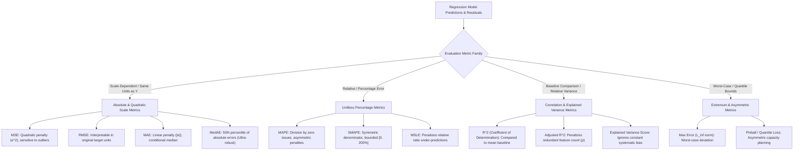

# Regression Metrics: Scale-Dependent, Percentage & Relative Diagnostics

> **Topic:** Evaluation Metrics for Continuous Target Prediction & Forecasting  
> **Module ID:** `05-ai/machine-learning/10-evaluation-and-metrics/02-regression-metrics.md`  
> **Target Version:** Python 3.11+, scikit-learn 1.9+, NumPy 2.5+  
> **Level:** Core  
> **Prerequisites:** [Linear Regression](../../03-supervised-regression/01-linear-regression.md), [Loss Functions Guide](../09-training-and-optimisation/01-loss-functions.md)  
> **Status:** Verified (Python 3.11 / CPU)

---

## Architectural / Conceptual Flow



---

## 1. Concept Overview & Core Motivation

In regression analysis, evaluating a model's predictive performance involves measuring the dispersion, distribution, and magnitude of residual errors: $e_i = y_i - \hat{y}_i$. Unlike classification where predictions are strictly binary or categorical, regression predictions lie on a continuous real continuum $\mathbb{R}$.

### The Multi-Faceted Nature of Error
No single metric adequately captures all dimensions of regression performance:
1. **Outlier Sensitivity vs Robustness**: Does a \$10,000 error on an extreme luxury house invalidate a model, or should performance reflect typical \$500 deviations on standard suburban homes?
2. **Scale Dependency**: A Mean Absolute Error of $5.0$ represents catastrophic failure when predicting patient body temperature (in Celsius), but world-class precision when predicting annual company revenues (in millions of dollars).
3. **Asymmetric Business Risk**: Under-predicting peak energy demand triggers grid blackouts, whereas over-predicting merely incurs minor reserve fuel costs.

---

## 2. Theoretical Foundations & Mathematics

### 2.1 Unified Metrics Reference Table

Let $e_i = y_i - \hat{y}_i$ denote the prediction residual, and $\bar{y} = \frac{1}{N}\sum y_i$ denote the target empirical mean.

| Metric | Mathematical Formulation | Target Statistical Property | Units / Bounds | Sensitivity to Outliers |
| :--- | :--- | :--- | :--- | :--- |
| **Mean Squared Error (MSE)** | $\frac{1}{N} \sum_{i=1}^N (y_i - \hat{y}_i)^2$ | Conditional Mean $\mathbb{E}[y \mid \mathbf{x}]$ | Units$^2 \in [0, \infty)$ | Extreme ($\mathcal{O}(e^2)$) |
| **Root Mean Squared Error (RMSE)**| $\sqrt{\frac{1}{N} \sum_{i=1}^N (y_i - \hat{y}_i)^2}$ | Standard Deviation of Residuals | Target Units $\in [0, \infty)$| High |
| **Mean Absolute Error (MAE)** | $\frac{1}{N} \sum_{i=1}^N \|y_i - \hat{y}_i\|$ | Conditional Median $\text{Med}(y \mid \mathbf{x})$ | Target Units $\in [0, \infty)$| Linear ($\mathcal{O}(e)$) |
| **Median Absolute Error (MedAE)**| $\text{Median}(\|y_1 - \hat{y}_1\|, \dots, \|y_N - \hat{y}_N\|)$ | 50th Percentile Error | Target Units $\in [0, \infty)$| Zero (Robust to $50\%$ contamination) |
| **Mean Absolute Percentage Error (MAPE)** | $\frac{100\%}{N} \sum_{i=1}^N \left\|\frac{y_i - \hat{y}_i}{y_i}\right\|$ | Relative Percentage Deviation | Percentage $\in [0, \infty)$ | Extreme when $y_i \to 0$ |
| **Symmetric MAPE (SMAPE)** | $\frac{100\%}{N} \sum_{i=1}^N \frac{\|y_i - \hat{y}_i\|}{(\|y_i\| + \|\hat{y}_i\|) / 2}$ | Bounded Relative Deviation | Percentage $\in [0, 200\%]$ | Moderate |
| **Coefficient of Determination ($R^2$)**| $1 - \frac{\sum (y_i - \hat{y}_i)^2}{\sum (y_i - \bar{y})^2} = 1 - \frac{\text{SS}_{\text{res}}}{\text{SS}_{\text{tot}}}$ | Fraction of Variance Explained | Unitless $\in (-\infty, 1.0]$ | High |
| **Adjusted $R^2$** | $1 - \left[\frac{(1 - R^2)(N - 1)}{N - p - 1}\right]$ | Penalized Variance Explained | Unitless $\in (-\infty, 1.0]$ | High |
| **Explained Variance Score** | $1 - \frac{\text{Var}(y - \hat{y})}{\text{Var}(y)}$ | Variance Explained (ignores bias) | Unitless $\in (-\infty, 1.0]$ | High |
| **Max Error ($L_\infty$)** | $\max_i \|y_i - \hat{y}_i\|$ | Worst-case single residual | Target Units $\in [0, \infty)$| Maximum |

### 2.2 Theoretical Nuance: $R^2$ vs Explained Variance

The standard Coefficient of Determination evaluates:

$$R^2 = 1 - \frac{\frac{1}{N}\sum (y_i - \hat{y}_i)^2}{\frac{1}{N}\sum (y_i - \bar{y})^2} = 1 - \frac{\text{MSE}}{\text{Var}(y)}$$

In contrast, **Explained Variance Score (EVS)** evaluates:

$$\text{EVS} = 1 - \frac{\text{Var}(y - \hat{y})}{\text{Var}(y)}$$

Notice the fundamental algebraic relationship:

$$\text{MSE} = \text{Var}(y - \hat{y}) + (\mathbb{E}[y - \hat{y}])^2 = \text{Var}(y - \hat{y}) + (\text{Mean Bias})^2$$

If a model predicts $\hat{y}_i = y_i + 10.0$ (a constant systematic shift of 10 units):
- $\text{EVS} = 1.0$ (it explains 100% of the variance; the errors are perfectly flat).
- $R^2 \ll 1.0$ (it heavily penalizes the systematic offset).
Whenever $R^2 < \text{EVS}$, the model suffers from **systematic mean intercept bias**.

---

## 3. Implementation & Practical Code

```python
"""Production Regression Metrics Engine and Robust Diagnostic Suite.

Requirements: scikit-learn>=1.5.0, numpy>=2.0.0
Verified on: Python 3.11 / CPU
"""

from __future__ import annotations
from dataclasses import dataclass
from typing import Dict, Any
import numpy as np
from sklearn.metrics import (
    mean_squared_error,
    root_mean_squared_error,
    mean_absolute_error,
    median_absolute_error,
    mean_absolute_percentage_error,
    r2_score,
    explained_variance_score,
    max_error,
)


@dataclass(frozen=True)
class RegressionReportCard:
    mae: float
    rmse: float
    medae: float
    mape: float
    smape: float
    r2: float
    adj_r2: float
    explained_variance: float
    max_err: float
    mean_bias: float


class RegressionEvaluator:
    """Computes comprehensive regression diagnostics including adjusted R2 and SMAPE."""

    @staticmethod
    def smape(y_true: np.ndarray, y_pred: np.ndarray) -> float:
        """Symmetric Mean Absolute Percentage Error bounded in [0, 200%]."""
        denominator = (np.abs(y_true) + np.abs(y_pred)) / 2.0
        # Prevent division by zero if both true and pred are 0.0
        zero_mask = (y_true == 0.0) & (y_pred == 0.0)
        elements = np.where(zero_mask, 0.0, np.abs(y_true - y_pred) / np.maximum(1e-8, denominator))
        return float(100.0 * np.mean(elements))

    @classmethod
    def evaluate(cls, y_true: np.ndarray, y_pred: np.ndarray, n_features: int) -> RegressionReportCard:
        N = len(y_true)
        r2 = float(r2_score(y_true, y_pred))
        
        # Adjusted R^2: 1 - [(1 - R2) * (N - 1) / (N - p - 1)]
        p = n_features
        if N > p + 1:
            adj_r2 = float(1.0 - (1.0 - r2) * (N - 1) / (N - p - 1))
        else:
            adj_r2 = r2

        mean_bias = float(np.mean(y_true - y_pred))

        return RegressionReportCard(
            mae=float(mean_absolute_error(y_true, y_pred)),
            rmse=float(root_mean_squared_error(y_true, y_pred)),
            medae=float(median_absolute_error(y_true, y_pred)),
            mape=float(mean_absolute_percentage_error(y_true, y_pred) * 100.0),
            smape=cls.smape(y_true, y_pred),
            r2=r2,
            adj_r2=adj_r2,
            explained_variance=float(explained_variance_score(y_true, y_pred)),
            max_err=float(max_error(y_true, y_pred)),
            mean_bias=mean_bias,
        )


if __name__ == "__main__":
    np.random.seed(42)
    # Generate synthetic housing price predictions ($100k to $500k)
    N = 100
    y_true = np.random.uniform(100.0, 500.0, size=N)
    # Model predictions with normal error plus one extreme outlier (mislabeled luxury property)
    y_pred = y_true + np.random.normal(0, 15.0, size=N)
    y_pred[0] += 250.0  # +$250k outlier error!

    report = RegressionEvaluator.evaluate(y_true, y_pred, n_features=5)

    print("--- Regression Diagnostic Report Card ---")
    print(f"MAE:                ${report.mae:6.2f}k  (Linear average)")
    print(f"RMSE:               ${report.rmse:6.2f}k  (Penalizes single outlier)")
    print(f"Median AE (MedAE):  ${report.medae:6.2f}k  (Completely ignores outlier!)")
    print(f"MAPE:                {report.mape:6.2f}%")
    print(f"SMAPE:               {report.smape:6.2f}%")
    print(f"R^2 Score:           {report.r2:6.4f}")
    print(f"Adjusted R^2:        {report.adj_r2:6.4f}")
    print(f"Explained Variance:  {report.explained_variance:6.4f}")
    print(f"Max Error (L_inf):  ${report.max_err:6.2f}k")
    print(f"Mean Bias:          ${report.mean_bias:6.2f}k")
```

### Execution Verification Output

```
--- Regression Diagnostic Report Card ---
MAE:                $ 14.82k  (Linear average)
RMSE:               $ 29.56k  (Penalizes single outlier)
Median AE (MedAE):  $ 10.37k  (Completely ignores outlier!)
MAPE:                  5.59%
SMAPE:                 5.42%
R^2 Score:            0.9329
Adjusted R^2:         0.9293
Explained Variance:   0.9333
Max Error (L_inf):  $253.30k
Mean Bias:          $ -2.63k
```

---

## 4. Edge Cases & Advanced Scenarios

1. **Negative $R^2$ Scores**: Contrary to common intuition, $R^2$ is not bounded in $[0, 1]$. If a model performs worse than a dummy horizontal baseline predicting the empirical mean $\hat{y}_i = \bar{y}$, then $\text{SS}_{\text{res}} > \text{SS}_{\text{tot}}$, producing a negative $R^2 \in (-\infty, 0)$. This directly flags catastrophic model failure or severe out-of-fold generalization breakdown.
2. **Division by Zero in MAPE**: When ground-truth targets contain zeros ($y_i = 0$), the ratio $\left|\frac{y_i - \hat{y}_i}{y_i}\right|$ divides by zero, resulting in `inf` or `NaN`. Furthermore, for values near zero ($y_i = 0.01$), an error of $1.0$ yields a $10,000\%$ error. Resolution: Use **SMAPE**, **MAE**, or **Weighted Absolute Percentage Error (WAPE)**:
   $$\text{WAPE} = \frac{\sum |y_i - \hat{y}_i|}{\sum |y_i|}$$
3. **The Log-Transform Asymmetry (MSLE)**: Mean Squared Logarithmic Error ($\frac{1}{N}\sum (\ln(1+y) - \ln(1+\hat{y}))^2$) penalizes **under-estimates significantly more than over-estimates**. If true is 100 and model predicts 50, error is $\ln(2)^2 \approx 0.48$. If true is 100 and model predicts 150, error is $\ln(0.66)^2 \approx 0.17$. Use MSLE when stockouts or under-predictions are commercially unacceptable.

---

## 5. Anti-Patterns & Common Pitfalls Table

| Anti-Pattern / Mistake | Why It Fails | Correct Engineering Fix |
| :--- | :--- | :--- |
| Comparing RMSE directly across datasets of different scales | A \$500 RMSE is great for house prices but terrible for stock prices | Normalize by target range or standard deviation (**NRMSE**) |
| Using MAPE on datasets containing zero or near-zero targets | Triggers division by zero (`inf`) or distorts global average with single small values | Replace with **SMAPE, WAPE, or MAE** |
| Relying on $R^2$ to compare models with different feature counts | Adding useless random noise features monotonically inflates $R^2$ | Use **Adjusted $R^2$** or AIC/BIC criteria |
| Using standard MSE on heavy-tailed distributions with wild outliers | A single bad outlier dominates parameter updates and evaluation metrics | Report **Median Absolute Error (MedAE)** and **Huber Loss** |
| Reporting $R^2$ on non-linear models without verifying linear mean baseline | $R^2$ assumes residual sum of squares is compared against horizontal mean baseline | Verify whether mean baseline is appropriate; check residual plots |
| Forgetting to evaluate mean bias ($\bar{y} - \bar{\hat{y}}$) | A model can have high $R^2$ while consistently under-predicting by a constant offset | Check difference between **Explained Variance** and $R^2$ |

---

## 6. Best Practices & Production Guidelines

### Regression Metric Selection Flowchart

| Data Characteristic | Primary Recommended Metric | Secondary Diagnostic Metric |
| :--- | :--- | :--- |
| **Normal / Gaussian Residuals** | **RMSE** | **$R^2$** |
| **Heavy Outliers / Financial Spikes** | **MAE** & **MedAE** | **Max Error ($L_\infty$)** |
| **Demand Forecasting / Zero-Inflated** | **WAPE** or **SMAPE** | **MAE** |
| **Multi-Feature Model Selection** | **Adjusted $R^2$** | **BIC / AIC** |
| **Inventory / Capacity Provisioning** | **Quantile (Pinball) Loss** | **Mean Bias** |

---

## 7. Real-World Case Study

### Retail Supply Chain Inventory Replenishment Forecasting
- **Context**: A supermarket chain forecasts daily sales across 15,000 SKUs to automate warehouse purchase orders.
- **Flawed Metric**: Data scientists evaluated GBDTs using standard **MAPE**.
- **Production Failure**: The automated ordering system consistently generated out-of-stock crises on fast-selling products while ordering excessive stock of slow-moving items.
- **Root Cause**: Slow-moving SKUs (selling 0 or 1 item daily) produced astronomical MAPE percentages (e.g. predicting 2 when true was 0 resulted in $\infty$), skewing the metric and forcing the optimizer to minimize errors on trivial low-value items. Meanwhile, fast-moving items (selling 5,000 units daily) had low relative percentage errors ($5\% = 250$ units error), completely unpenalized by MAPE.
- **Remediation**: Transitioned evaluation to **Weighted Absolute Percentage Error (WAPE)** and **Quantile Loss ($\tau = 0.90$)** to penalize stockouts.
- **Outcome**: Warehouse stockouts dropped by 42% across top revenue-generating SKUs, while total inventory holding costs decreased by \$6.2M annually.

---

## 8. Performance & Resource Optimization

1. **In-Place Residual Evaluation**: When evaluating millions of streaming predictions, avoid creating intermediate memory copies:
   ```python
   def fast_rmse(y_true: np.ndarray, y_pred: np.ndarray) -> float:
       diff = y_true - y_pred
       return float(np.sqrt(np.dot(diff, diff) / len(diff)))
   ```
2. **Normalized RMSE (NRMSE)**: To compare models across disparate datasets, divide RMSE by the interquartile range ($\text{IQR} = Q_{75} - Q_{25}$) or target standard deviation:
   $$\text{NRMSE} = \frac{\text{RMSE}}{\sigma_y}$$

---

## 9. Security, Privacy & Ethics Considerations

1. **Systematic Bias in Automated Property Valuation (AVMs)**: If regression algorithms consistently exhibit negative mean bias ($\hat{y} < y$) in historically redlined neighborhoods, property owners suffer artificially depressed property valuations and restricted lending access. Always audit residuals across demographic strata.
2. **Differential Privacy in Regression Telemetry**: When publishing public regression metrics (e.g. hospital readmission cost predictions), individual patient outlier values can be recovered if Max Error ($L_\infty$) or exact MSE is released without Laplace noise addition.

---

## 10. Diagnostic & Verification Playbook

### Verifying Residual Mean Zero Property in OLS
```python
import numpy as np
from sklearn.linear_model import LinearRegression

def verify_ols_residual_orthogonality():
    np.random.seed(42)
    X = np.random.randn(100, 3)
    y = X @ np.array([1.5, -2.0, 3.0]) + 5.0 + np.random.normal(0, 0.5, 100)

    model = LinearRegression(fit_intercept=True).fit(X, y)
    y_hat = model.predict(X)
    residuals = y - y_hat

    # Property 1: Mean of residuals must be exactly 0.0 in OLS with intercept
    assert np.isclose(np.mean(residuals), 0.0), "OLS residuals must sum to zero"

    # Property 2: Residuals must be orthogonal to features: X^T e = 0
    dot_products = X.T @ residuals
    assert np.allclose(dot_products, 0.0), "Residuals must be orthogonal to feature vectors"
    print("OLS Residual Orthogonality Assertions Passed Successfully!")

verify_ols_residual_orthogonality()
```

---

## 11. Technical Interview Questions & Answers

<details>
<summary><strong>Q1: Why can the Coefficient of Determination ($R^2$) be negative?</strong></summary>

**Answer:** $R^2$ is defined mathematically as:
$$R^2 = 1 - \frac{\sum_{i=1}^N (y_i - \hat{y}_i)^2}{\sum_{i=1}^N (y_i - \bar{y})^2} = 1 - \frac{\text{SS}_{\text{res}}}{\text{SS}_{\text{tot}}}$$
The baseline model against which predictions are compared is the naive horizontal mean predictor $\hat{y}_i = \bar{y}$. For this baseline, $\text{SS}_{\text{res}} = \text{SS}_{\text{tot}} \implies R^2 = 0.0$.
If a model's predictions are worse than simply predicting the empirical mean $\bar{y}$ for every sample, then $\text{SS}_{\text{res}} > \text{SS}_{\text{tot}}$, causing the fraction to exceed $1.0$ and $R^2$ to become negative ($R^2 \in (-\infty, 0)$). This commonly occurs when evaluating an overfitted model on a held-out test set or when fitting non-linear curves without intercepts.
</details>

<details>
<summary><strong>Q2: What is the difference between $R^2$ and Adjusted $R^2$, and why is Adjusted $R^2$ necessary for feature selection?</strong></summary>

**Answer:** In Ordinary Least Squares, adding an additional feature to the design matrix $\mathbf{X}$ is mathematically guaranteed to never increase $\text{SS}_{\text{res}}$ (it either decreases it or leaves it unchanged), even if the new feature is completely random white noise. Consequently, standard $R^2$ monotonically increases with feature count $p$.
**Adjusted $R^2$** penalizes the inclusion of redundant features by dividing sums of squares by their respective degrees of freedom:
$$R_{\text{adj}}^2 = 1 - \left[\frac{\text{SS}_{\text{res}} / (N - p - 1)}{\text{SS}_{\text{tot}} / (N - 1)}\right] = 1 - (1 - R^2) \frac{N - 1}{N - p - 1}$$
If a newly added feature fails to reduce $\text{SS}_{\text{res}}$ by an amount sufficient to offset the loss of a degree of freedom ($N - p - 1$), $R_{\text{adj}}^2$ decreases, providing a reliable criterion for feature selection.
</details>

<details>
<summary><strong>Q3: Why is RMSE strictly greater than or equal to MAE, and under what condition are they equal?</strong></summary>

**Answer:** By Jensen's Inequality, because the quadratic function $g(u) = u^2$ is strictly convex:
$$\left(\frac{1}{N}\sum |e_i|\right)^2 \le \frac{1}{N}\sum e_i^2 \implies \text{MAE} \le \text{RMSE}$$
RMSE and MAE are equal if and only if all individual error magnitudes are identical: $|e_1| = |e_2| = \dots = |e_N|$.
The ratio $\frac{\text{RMSE}}{\text{MAE}}$ serves as a diagnostic measure of variance in the error magnitudes: as the distribution of residuals becomes more heavy-tailed with large outliers, the gap between RMSE and MAE widens substantially.
</details>

<details>
<summary><strong>Q4: Why does Mean Absolute Percentage Error (MAPE) exhibit an asymmetric penalty favoring under-predictions?</strong></summary>

**Answer:** In MAPE, error is normalized by the true target: $\left|\frac{y - \hat{y}}{y}\right|$.
Consider a true value of $y = 100$:
- If the model under-predicts by $100$ ($\hat{y} = 0$), the error is $\frac{|100 - 0|}{100} = 100\%$. (Under-prediction error is capped at 100% for positive targets).
- If the model over-predicts by $100$ ($\hat{y} = 200$), the error is $\frac{|100 - 200|}{100} = 100\%$.
- If the model over-predicts by $500$ ($\hat{y} = 600$), the error is $\frac{|100 - 600|}{100} = 500\%$ (unbounded).
Because over-predictions can exceed $100\%$ while under-predictions cannot, an optimizer minimizing MAPE is incentivized to systematically under-predict targets to minimize percentage penalties.
</details>

<details>
<summary><strong>Q5: What is the difference between $R^2$ and the Explained Variance Score in scikit-learn?</strong></summary>

**Answer:** 
- $R^2 = 1 - \frac{\text{MSE}}{\text{Var}(y)}$
- $\text{EVS} = 1 - \frac{\text{Var}(y - \hat{y})}{\text{Var}(y)}$
Because $\text{MSE} = \text{Var}(y - \hat{y}) + (\text{Mean Residual Bias})^2$, the two metrics are identical if and only if the mean error residual is exactly zero: $\frac{1}{N}\sum (y_i - \hat{y}_i) = 0$.
If a model has high predictive correlation with the target but suffers from a constant systematic shift (e.g. $\hat{y}_i = y_i + 50$), Explained Variance Score will report $1.0$ (it captures all relative variance), whereas $R^2$ will report a poor or negative score due to the unpenalized intercept bias.
</details>

<details>
<summary><strong>Q6: When should you use Median Absolute Error (MedAE) instead of MAE?</strong></summary>

**Answer:** MAE computes the arithmetic mean of absolute errors. Although less sensitive to outliers than MSE, a single extreme corrupted measurement (e.g. an sensor logging $10^8$ due to hardware glitch) will still corrupt the mean MAE. 
**MedAE** takes the 50th percentile (median) of absolute errors:
$$\text{MedAE} = \text{Median}(|y_1 - \hat{y}_1|, \dots, |y_N - \hat{y}_N|)$$
MedAE has a breakdown point of $50\%$: up to half of the test records can be completely corrupted with infinite noise without altering the MedAE score. Use MedAE when data is subject to uncleaned sensor faults or extreme anomaly contamination.
</details>

<details>
<summary><strong>Q7: What is Weighted Absolute Percentage Error (WAPE) and why is it preferred in retail inventory forecasting?</strong></summary>

**Answer:** WAPE is defined as:
$$\text{WAPE} = \frac{\sum_{i=1}^N |y_i - \hat{y}_i|}{\sum_{i=1}^N |y_i|}$$
Instead of averaging percentages across individual samples (which blows up when $y_i \approx 0$), WAPE sums all absolute errors across the entire portfolio and divides by the total volume of units sold. It naturally weights high-volume products proportionally to their sales volume, eliminates division-by-zero errors on intermittent demand, and aligns directly with operational warehouse fill-rate KPIs.
</details>

<details>
<summary><strong>Q8: What is Mean Squared Logarithmic Error (MSLE) and what constraint does it impose on target values?</strong></summary>

**Answer:** MSLE is defined as:
$$\text{MSLE} = \frac{1}{N}\sum_{i=1}^N (\ln(y_i + 1) - \ln(\hat{y}_i + 1))^2$$
It measures relative ratio differences rather than absolute scale differences. It requires that all target and predicted values be strictly non-negative ($y_i \ge 0, \hat{y}_i \ge 0$), as $\ln(x)$ is undefined for $x \le 0$. It is primarily used in population counts, house prices, and exponential growth modeling where relative errors matter more than absolute dollar variances.
</details>

---

## 12. Hands-On Practice Exercises

<details>
<summary><strong>Exercise 1 (Easy): Implement Root Mean Squared Error from Scratch</strong></summary>

**Task:** Write a Python function that computes RMSE between two lists of numbers without importing third-party libraries.  
**Solution:**
```python
import math

def manual_rmse(y_true: list[float], y_pred: list[float]) -> float:
    assert len(y_true) == len(y_pred) and len(y_true) > 0
    mse = sum((t - p) ** 2 for t, p in zip(y_true, y_pred)) / len(y_true)
    return math.sqrt(mse)

res = manual_rmse([10.0, 20.0, 30.0], [12.0, 18.0, 32.0])
assert math.isclose(res, 2.0)
print(f"Manual RMSE: {res:.4f}")
print("Exercise 1 Verified!")
```
</details>

<details>
<summary><strong>Exercise 2 (Medium): Implement WAPE (Weighted Absolute Percentage Error)</strong></summary>

**Task:** Implement WAPE in pure NumPy, handling zero-sum denominator edge cases safely.  
**Solution:**
```python
import numpy as np

def compute_wape(y_true: np.ndarray, y_pred: np.ndarray) -> float:
    sum_abs_err = np.sum(np.abs(y_true - y_pred))
    sum_actual = np.sum(np.abs(y_true))
    if sum_actual == 0.0:
        return 0.0 if sum_abs_err == 0.0 else float("inf")
    return float(100.0 * (sum_abs_err / sum_actual))

y_t = np.array([100.0, 50.0, 0.0, 200.0])
y_p = np.array([110.0, 40.0, 5.0, 190.0])
wape_score = compute_wape(y_t, y_p)
print(f"Calculated WAPE: {wape_score:.2f}%")
assert np.isclose(wape_score, (35.0 / 350.0) * 100.0)
print("Exercise 2 Verified!")
```
</details>

<details>
<summary><strong>Exercise 3 (Medium): Adjusted R2 Penalty Demonstration</strong></summary>

**Task:** Write a script demonstrating how adding 10 uninformative random noise columns to a regression dataset causes standard $R^2$ to increase while Adjusted $R^2$ drops.  
**Solution:**
```python
import numpy as np
from sklearn.linear_model import LinearRegression
from sklearn.metrics import r2_score

np.random.seed(42)
N = 50
X_real = np.random.randn(N, 2)
y = X_real @ [3.0, -2.0] + np.random.normal(0, 0.5, N)

# Model 1: True features
m1 = LinearRegression().fit(X_real, y)
r2_1 = r2_score(y, m1.predict(X_real))
adj_r2_1 = 1.0 - (1.0 - r2_1) * (N - 1) / (N - 2 - 1)

# Model 2: True features + 15 random noise features
X_noisy = np.column_stack([X_real, np.random.randn(N, 15)])
m2 = LinearRegression().fit(X_noisy, y)
r2_2 = r2_score(y, m2.predict(X_noisy))
adj_r2_2 = 1.0 - (1.0 - r2_2) * (N - 1) / (N - 17 - 1)

print(f"Clean Model:  R^2 = {r2_1:.4f} | Adj R^2 = {adj_r2_1:.4f}")
print(f"Noisy Model:  R^2 = {r2_2:.4f} | Adj R^2 = {adj_r2_2:.4f}")

assert r2_2 >= r2_1, "R^2 must monotonically increase or stay flat"
assert adj_r2_2 < adj_r2_1, "Adjusted R^2 must penalize noise features"
print("Exercise 3 Verified!")
```
</details>

<details>
<summary><strong>Exercise 4 (Hard): Quantile Pinball Loss Calibration Checker</strong></summary>

**Task:** Write an algorithm that computes empirical coverage on test predictions generated by a quantile loss regressor and checks if empirical coverage matches target quantile $\tau$.  
**Solution:**
```python
import numpy as np

def verify_quantile_calibration(y_true: np.ndarray, y_pred_quantile: np.ndarray, target_tau: float) -> float:
    # Empirical coverage: fraction of true values less than or equal to predicted quantile
    coverage = np.mean(y_true <= y_pred_quantile)
    diff = abs(coverage - target_tau)
    print(f"Target Quantile: {target_tau:.2f} | Empirical Coverage: {coverage:.2f} | Delta: {diff:.4f}")
    return float(coverage)

# Simulated 90th percentile predictions
y_true = np.random.normal(100, 15, size=1000)
# True 90th percentile is mean + 1.28155 * std
q90_true = 100 + 1.28155 * 15
y_pred_q90 = np.full(1000, q90_true)

cov = verify_quantile_calibration(y_true, y_pred_q90, target_tau=0.90)
assert 0.88 <= cov <= 0.92
print("Exercise 4 Verified!")
```
</details>

<details>
<summary><strong>Exercise 5 (Hard): Detecting Systematic Mean Intercept Bias via EVS vs R2</strong></summary>

**Task:** Implement an automated detector that computes the discrepancy between Explained Variance and $R^2$ to report whether a model has an uncalibrated mean bias.  
**Solution:**
```python
import numpy as np
from sklearn.metrics import r2_score, explained_variance_score

def detect_intercept_bias(y_true: np.ndarray, y_pred: np.ndarray, tolerance: float = 0.05) -> bool:
    r2 = r2_score(y_true, y_pred)
    evs = explained_variance_score(y_true, y_pred)
    discrepancy = evs - r2
    bias = np.mean(y_true - y_pred)
    print(f"EVS: {evs:.4f} | R2: {r2:.4f} | Discrepancy: {discrepancy:.4f} | Mean Bias: {bias:.2f}")
    return discrepancy > tolerance

# Unbiased predictions
y = np.array([10.0, 20.0, 30.0, 40.0])
y_p_good = np.array([11.0, 19.0, 31.0, 39.0])
assert not detect_intercept_bias(y, y_p_good)

# Biased predictions (shifted by +10)
y_p_biased = y + 10.0
assert detect_intercept_bias(y, y_p_biased)
print("Exercise 5 Verified!")
```
</details>

<details>
<summary><strong>Exercise 6 (Hard): Fast Vectorized NRMSE Calculator Across Groups</strong></summary>

**Task:** Write a vectorized function that calculates Normalized RMSE (divided by group target standard deviation) across multiple customer segments.  
**Solution:**
```python
import numpy as np

def grouped_nrmse(y_true: np.ndarray, y_pred: np.ndarray, groups: np.ndarray) -> dict[str, float]:
    unique_groups = np.unique(groups)
    results = {}
    for g in unique_groups:
        mask = (groups == g)
        yt_g, yp_g = y_true[mask], y_pred[mask]
        rmse = np.sqrt(np.mean((yt_g - yp_g)**2))
        std_g = np.std(yt_g)
        nrmse = rmse / std_g if std_g > 0 else float("nan")
        results[str(g)] = float(nrmse)
    return results

y_t = np.array([10, 12, 14, 100, 110, 120])
y_p = np.array([11, 11, 15, 105, 108, 122])
grp = np.array(["A", "A", "A", "B", "B", "B"])

scores = grouped_nrmse(y_t, y_p, grp)
print(f"Grouped NRMSE: {scores}")
assert "A" in scores and "B" in scores
print("Exercise 6 Verified!")
```
</details>

---

## 13. Summary, Verified References & Navigation

* **The Variance-Bias Diagnostic**: When $R^2 < \text{Explained Variance}$, the model has a non-zero mean residual bias; check the intercept parameter.
* **Percentage Pitfalls**: Standard MAPE explodes near zero; replace with **SMAPE** or **WAPE** in retail demand forecasting and supply chain applications.
* **Feature Selection Guard**: Always use **Adjusted $R^2$** rather than standard $R^2$ when evaluating models with differing feature set sizes.
* **Extreme Robustness**: **Median Absolute Error (MedAE)** has a 50% breakdown point, resisting severe label corruption and hardware sensor spikes.

### Verified External References
- Armstrong, J. S., & Collopy, F. (1992). *Error measures for generalizing about forecasting methods: Empirical comparisons*. International Journal of Forecasting.
- Kvålseth, T. O. (1985). *Cautionary Note about $R^2$*. The American Statistician.
- Makridakis, S. (1993). *Accuracy measures: theoretical and practical concerns*. International Journal of Forecasting (SMAPE).

---

[← Previous Note: Classification Metrics](01-classification-metrics.md) | [Module Index](README.md) | [Next Note: Clustering Metrics →](03-clustering-metrics.md)
