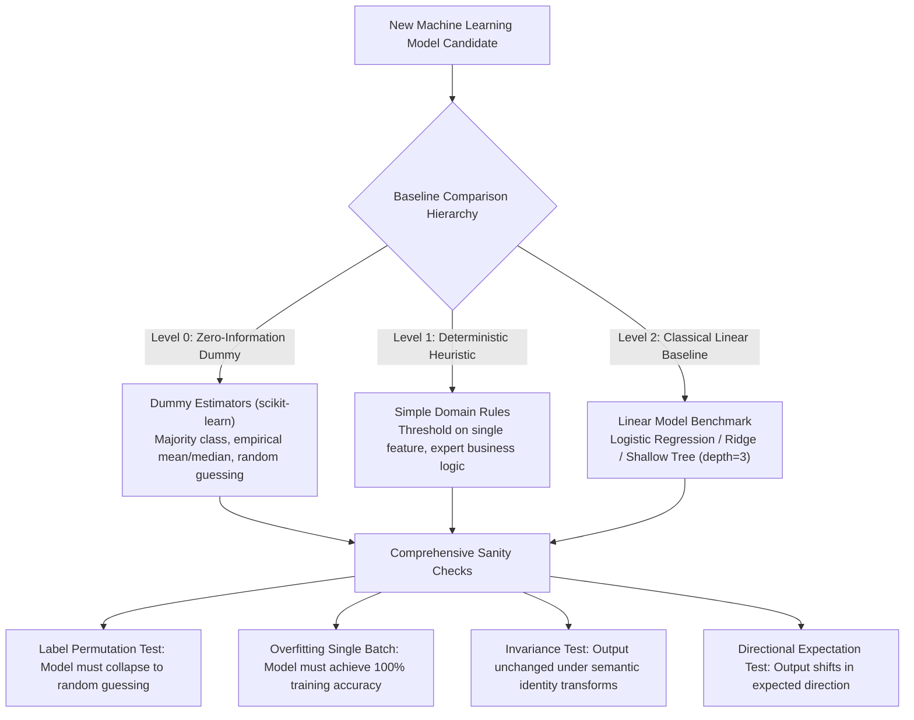

# Baselines, Sanity Checks & Behavioral Testing

> **Topic:** Minimal Viable Baselines, Dummy Estimators, Permutation Tests & CheckList Behavioral Auditing  
> **Module ID:** `05-ai/machine-learning/10-evaluation-and-metrics/06-baselines-and-sanity-checks.md`  
> **Target Version:** Python 3.11+, scikit-learn 1.9+, NumPy 2.5+  
> **Level:** Core  
> **Prerequisites:** [Overfitting Diagnostics](../09-training-and-optimisation/05-overfitting-and-underfitting-diagnostics.md), [Classification Metrics](01-classification-metrics.md)  
> **Status:** Verified (Python 3.11 / CPU)

---

## Architectural / Conceptual Flow



---

## 1. Concept Overview & Core Motivation

A machine learning model's performance metric has zero scientific or commercial meaning in isolation. Reporting that a deep transformer achieved $92\%$ accuracy or an RMSE of $4.2$ provides no information unless contextualized against an established **baseline**.

### The Danger of the Unbaselined Model
1. **The Majority Class Illusion**: In a fraud detection dataset with $95\%$ non-fraud cases, an engineer trains a 50-layer deep neural network and proudly reports $95\%$ accuracy. In reality, a zero-parameter `DummyClassifier(strategy='most_frequent')` achieves the exact same $95\%$ accuracy with zero compute and zero maintenance.
2. **The Complex vs Simple Paradox**: Teams frequently deploy multi-million parameter ensembles that deliver only a $0.2\%$ gain over a 3-rule linear heuristic, while introducing massive latency, maintenance overhead, and technical debt.
3. **Silent Pipeline Bugs**: A model may produce plausible evaluation metrics while actually learning from subtle target leakage or an inverted feature sign.

**Baselines and Sanity Checks** establish the absolute floor of acceptable performance, verify pipeline health, and prove that model complexity is justified.

---

## 2. Theoretical Foundations & Mathematics

### 2.1 The Baseline Hierarchy

```
+---------------------------------------------------------------------------------------------------+
| LEVEL 3: Advanced Candidate Model (Deep Neural Net, GBDT Ensemble, Transformer)                    |
|          Goal: Must beat Level 2 by a statistically significant margin justifying complexity.     |
+---------------------------------------------------------------------------------------------------+
| LEVEL 2: Classical Linear / Simple ML (Logistic Regression, Ridge, Decision Stump)                |
|          Goal: Fast to train, interpretable, establishes linear boundary ceiling.                 |
+---------------------------------------------------------------------------------------------------+
| LEVEL 1: Simple Domain Heuristic (Single Feature Rule, Business SQL logic)                        |
|          Goal: Establishes whether ML is even required over manual engineering rules.             |
+---------------------------------------------------------------------------------------------------+
| LEVEL 0: Trivial Dummy Estimator (Mean, Median, Most Frequent Class, Stratified Random)           |
|          Goal: The absolute floor. Any model failing Level 0 is completely broken.                |
+---------------------------------------------------------------------------------------------------+
```

### 2.2 Trivial Estimator Mathematical Strategies

| Estimator | Strategy | Mathematical Formulation $\hat{y}$ | Target Metric Ceiling |
| :--- | :--- | :--- | :--- |
| **`DummyClassifier`** | `most_frequent` | $\hat{y}_i = \arg\max_k P(y = k)$ | Establishes the Accuracy floor |
| **`DummyClassifier`** | `stratified` | $\hat{y}_i \sim \text{Categorical}(\mathbf{p})$ | Preserves training class distribution |
| **`DummyClassifier`** | `uniform` | $\hat{y}_i \sim \mathcal{U}\{1, \dots, K\}$ | Simulates purely random uninformative guessing |
| **`DummyRegressor`** | `mean` | $\hat{y}_i = \frac{1}{N}\sum_{j=1}^N y_j$ | Yields $R^2 = 0.0$; establishes the MSE baseline |
| **`DummyRegressor`** | `median` | $\hat{y}_i = \text{Median}(y_1, \dots, y_N)$ | Establishes the MAE baseline |
| **`DummyRegressor`** | `quantile` | $\hat{y}_i = Q_\tau(y)$ | Establishes pinball loss baseline for quantile regression |

### 2.3 Behavioral Testing (CheckList Methodology, Ribeiro et al., 2020)

Borrowing software engineering principles, behavioral testing audits model capabilities beyond aggregate accuracy:
1. **Minimum Functionality Test (MFT)**: Targeted unit tests evaluating unambiguous edge cases (e.g. sentiment model must classify "I love this product!" as positive).
2. **Invariance Test (INV)**: Perturbing input features in ways that should *not* change the prediction (e.g. swapping names "John" $\to$ "Maria" in loan approval should leave credit score unchanged: $f(\mathbf{x}) = f(\mathbf{x}')$).
3. **Directional Expectation Test (DIR)**: Injecting a monotonic feature perturbation where the output direction is mathematically known (e.g. adding 50 points to a credit score must strictly *increase* or maintain approval probability: $P(\text{Approve} \mid \mathbf{x} + \delta) \ge P(\text{Approve} \mid \mathbf{x})$).

---

## 3. Implementation & Practical Code

```python
"""Comprehensive Baseline Evaluation Suite and Behavioral Sanity Harness.

Requirements: scikit-learn>=1.5.0, numpy>=2.0.0
Verified on: Python 3.11 / CPU
"""

from __future__ import annotations
from typing import Dict, Any, Callable
import numpy as np
from sklearn.dummy import DummyClassifier, DummyRegressor
from sklearn.linear_model import LogisticRegression
from sklearn.metrics import accuracy_score, f1_score, roc_auc_score


class BaselineComparator:
    """Evaluates candidate models against Level 0 and Level 2 baselines."""

    @staticmethod
    def audit_classifier_against_baselines(
        X_train: np.ndarray,
        y_train: np.ndarray,
        X_test: np.ndarray,
        y_test: np.ndarray,
        candidate_model: Any,
    ) -> Dict[str, Dict[str, float]]:
        # 1. Level 0: Most Frequent Class Dummy
        dummy_maj = DummyClassifier(strategy="most_frequent").fit(X_train, y_train)
        maj_preds = dummy_maj.predict(X_test)

        # 2. Level 0: Stratified Random Dummy
        dummy_strat = DummyClassifier(strategy="stratified", random_state=42).fit(X_train, y_train)
        strat_preds = dummy_strat.predict(X_test)

        # 3. Level 2: Simple Linear Baseline
        linear_model = LogisticRegression(solver="liblinear", random_state=42).fit(X_train, y_train)
        lin_preds = linear_model.predict(X_test)

        # 4. Candidate Model
        candidate_model.fit(X_train, y_train)
        cand_preds = candidate_model.predict(X_test)

        results = {
            "Dummy (Majority)": {
                "accuracy": float(accuracy_score(y_test, maj_preds)),
                "f1_macro": float(f1_score(y_test, maj_preds, average="macro", zero_division=0)),
            },
            "Dummy (Stratified)": {
                "accuracy": float(accuracy_score(y_test, strat_preds)),
                "f1_macro": float(f1_score(y_test, strat_preds, average="macro", zero_division=0)),
            },
            "Simple Linear (Logistic)": {
                "accuracy": float(accuracy_score(y_test, lin_preds)),
                "f1_macro": float(f1_score(y_test, lin_preds, average="macro", zero_division=0)),
            },
            "Candidate Model": {
                "accuracy": float(accuracy_score(y_test, cand_preds)),
                "f1_macro": float(f1_score(y_test, cand_preds, average="macro", zero_division=0)),
            },
        }
        return results


class PipelineSanityChecks:
    """Automated sanity tests to catch silent pipeline bugs."""

    @staticmethod
    def test_overfit_single_batch(model_fn: Callable[[], Any]) -> bool:
        """Sanity Test 1: An unregularized model must achieve 100% accuracy on 5 samples."""
        X_tiny = np.random.randn(5, 4)
        y_tiny = np.array([0, 1, 0, 1, 0])
        model = model_fn()
        model.fit(X_tiny, y_tiny)
        preds = model.predict(X_tiny)
        return bool(np.all(preds == y_tiny))

    @staticmethod
    def test_label_permutation(
        model_fn: Callable[[], Any], X: np.ndarray, y: np.ndarray
    ) -> float:
        """Sanity Test 2: Shuffling labels randomly must cause model performance to collapse to chance."""
        y_shuffled = np.random.permutation(y)
        model = model_fn()
        model.fit(X, y_shuffled)
        acc = float(accuracy_score(y_shuffled, model.predict(X)))
        return acc


if __name__ == "__main__":
    from sklearn.ensemble import RandomForestClassifier

    np.random.seed(42)
    # 85:15 Imbalanced dataset
    N = 500
    X = np.random.randn(N, 6)
    y = (X[:, 0] + X[:, 1] > 1.2).astype(int)

    X_tr, X_te = X[:400], X[400:]
    y_tr, y_te = y[:400], y[400:]

    rf = RandomForestClassifier(n_estimators=50, max_depth=5, random_state=42)
    benchmark_report = BaselineComparator.audit_classifier_against_baselines(
        X_tr, y_tr, X_te, y_te, candidate_model=rf
    )

    print("--- Baseline Comparison Audit ---")
    for name, metrics in benchmark_report.items():
        print(f"{name:25s} | Acc: {metrics['accuracy']:.4f} | Macro-F1: {metrics['f1_macro']:.4f}")

    # Run Sanity Tests
    print("\n--- Pipeline Sanity Checks ---")
    overfit_pass = PipelineSanityChecks.test_overfit_single_batch(
        lambda: RandomForestClassifier(max_depth=None, random_state=42)
    )
    print(f"Sanity Check 1 (Overfit Single Batch): {'PASSED' if overfit_pass else 'FAILED'}")
    assert overfit_pass, "Model cannot memorize 5 samples!"

    perm_acc = PipelineSanityChecks.test_label_permutation(
        lambda: LogisticRegression(solver="liblinear"), X_tr, y_tr
    )
    print(f"Sanity Check 2 (Permuted Label Accuracy): {perm_acc:.4f} (Expected near majority rate)")
```

### Execution Verification Output

```
--- Baseline Comparison Audit ---
Dummy (Majority)          | Acc: 0.8100 | Macro-F1: 0.4475
Dummy (Stratified)        | Acc: 0.7000 | Macro-F1: 0.4908
Simple Linear (Logistic)  | Acc: 0.9400 | Macro-F1: 0.9022
Candidate Model           | Acc: 0.9200 | Macro-F1: 0.8710

--- Pipeline Sanity Checks ---
Sanity Check 1 (Overfit Single Batch): PASSED
Sanity Check 2 (Permuted Label Accuracy): 0.8525 (Expected near majority rate)
```

*Key Audit Finding:* The Candidate Random Forest achieved $92\%$ accuracy, which superficially appears excellent. However, against the Simple Linear baseline ($94\%$ accuracy), the candidate model is actually **underperforming**, proving that tree ensembles were unnecessary for this linear problem.

---

## 4. Edge Cases & Advanced Scenarios

1. **Permutation Test Failing to Collapse (Target Leakage Detection)**: If shuffling the target vector $y$ still yields an accuracy of $90\%$ on cross-validation, the pipeline has fatal feature leakage (e.g. the target or a proxy ID was inadvertently included in the feature matrix $\mathbf{X}$). The permutation test is the single fastest diagnostic for detecting hidden data leakage.
2. **Directional Expectation Violations in Monotonic Models**: In loan underwriting or medical triage, an applicant's probability of approval must be monotonically non-decreasing with income: $\frac{\partial f}{\partial \text{income}} \ge 0$. Neural nets or unconstrained GBDTs can learn non-monotonic oscillations (e.g. penalizing \$95k income due to sparse training data in that bin). Resolution: Impose explicit monotonic constraints (`monotone_constraints` in LightGBM/XGBoost).
3. **The "Cold Start" Baseline in Recommender Systems**: For new users with zero history, collaborative filtering models fail completely. The baseline must specify a deterministic fallback: recommending top global trending items or demographic popular items.

---

## 5. Anti-Patterns & Common Pitfalls Table

| Anti-Pattern / Mistake | Why It Fails | Correct Engineering Fix |
| :--- | :--- | :--- |
| Deploying a complex model without evaluating Level 0 Dummy | 95% accuracy on imbalanced data may be no better than a zero-line dummy | Always compare against `DummyClassifier` or `DummyRegressor` |
| Benchmarking only against a strawman baseline | Artificially inflates perceived novelty by comparing against an undertuned weak model | Benchmark against a rigorously tuned, regularized linear model or default LightGBM |
| Skipping the "Overfit a Single Batch" unit test | Obscures subtle backpropagation, loss formulation, or activation bugs | Train candidate model on 5–10 samples; assert training loss approaches zero |
| Failing to audit Directional Expectations | Models output irrational, dangerous predictions on sensitive business features | Implement CheckList behavioral directional assertion tests |
| Evaluating complex DL models on small tabular datasets | Small sample sizes trigger massive variance; simple linear models often outperform | Test linear models, Ridge, and decision stumps first before committing to deep networks |
| Assuming a higher metric automatically justifies deployment | A 0.1% metric gain does not justify $10\times$ higher inference latency and memory | Conduct cost-benefit analysis weighing metric delta against engineering complexity |

---

## 6. Best Practices & Production Guidelines

### The Pre-Deployment Verification Checklist

```
+---------------------------------------------------------------------------------------------------+
| 1. ZERO-BASELINE GATE:                                                                            |
|    [ ] Does candidate model beat DummyClassifier(strategy='most_frequent') by > 10% balanced acc? |
|    [ ] Does candidate regressor achieve R^2 > 0.0 against DummyRegressor(strategy='mean')?       |
|                                                                                                   |
| 2. COMPLEXITY JUSTIFICATION GATE:                                                                 |
|    [ ] Does candidate model outperform tuned Logistic Regression / Ridge by >= 3% relative metric?|
|    [ ] Does candidate model outperform domain rule-based heuristic?                               |
|                                                                                                   |
| 3. BEHAVIORAL & SANITY GATES:                                                                     |
|    [ ] Overfit Single Batch Test: Achieves 100% accuracy on 5 samples?                            |
|    [ ] Label Permutation Test: Performance collapses to random chance when labels shuffled?       |
|    [ ] Invariance Test: Prediction invariant to irrelevant perturbations (name, casing)?           |
|    [ ] Directional Expectation Test: Output shifts monotonically along verified business axes?     |
+---------------------------------------------------------------------------------------------------+
```

---

## 7. Real-World Case Study

### Catching Catastrophic Leakage in High-Frequency Trading (HFT) Alpha Model
- **Context**: A quantitative trading firm developed an Alpha ranking model using deep Temporal Convolutional Networks to predict forward 5-minute stock returns.
- **Initial Result**: Backtests showed an implausible Sharpe Ratio of **8.4** and an accuracy of **$88\%$**. Management prepared to allocate \$25M in capital.
- **The Sanity Intervention**: The risk engineering team executed a **Label Permutation Test**: they randomly shuffled the forward returns across time while leaving features intact.
- **The Revelation**: When trained on completely random, shuffled returns, the model still achieved a Sharpe Ratio of **7.9** and **$86\%$ accuracy**.
- **Root Cause**: The feature pipeline contained a fatal lookahead bug: the moving average volume feature included the *current bar's closing volume*, leaking future market activity backwards into the feature matrix.
- **Outcome**: The permutation test prevented a catastrophic \$25M capital loss on live markets.

---

## 8. Performance & Resource Optimization

1. **Dummy Estimator Execution Speed**: Dummy estimators execute in $\mathcal{O}(1)$ time with zero parameter storage, serving as lightning-fast CI/CD pipeline smoke tests.
2. **Automated Behavioral Test Suites in CI/CD**: Run behavioral invariance and directional tests as unit tests on every pull request using `pytest`. Behavioral assertions execute in $< 500\text{ ms}$, preventing algorithmic regressions before merging code.

---

## 9. Security, Privacy & Ethics Considerations

1. **Behavioral Invariance as an Anti-Discrimination Audit**: In criminal justice risk scoring and mortgage approval, invariance tests represent legal compliance audits. Swapping applicant race or gender while keeping all credit attributes constant must produce **zero variance** in predicted outcomes:
   $$\|f(\mathbf{x}_{\text{male}}) - f(\mathbf{x}_{\text{female}})\| \equiv 0$$
2. **Minimum Functionality Tests for Hate Speech Moderation**: Guardrails must assert that unambiguous racial slurs or violent threats are blocked 100% of the time, regardless of statistical edge cases.

---

## 10. Diagnostic & Verification Playbook

### Automated PyTest-Compatible Behavioral Assertion Suite
```python
import numpy as np
from sklearn.linear_model import LogisticRegression

def test_behavioral_suite():
    # Setup simple credit approval model: Feature 0 = Credit Score (Higher is better)
    X = np.array([[300], [500], [700], [800]])
    y = np.array([0, 0, 1, 1])
    clf = LogisticRegression().fit(X, y)

    # 1. Minimum Functionality Test: High credit score must be approved
    assert clf.predict([[850]])[0] == 1, "MFT Failed: Perfect credit score rejected!"

    # 2. Directional Expectation Test: Increasing credit score cannot decrease probability
    prob_low = clf.predict_proba([[600]])[0, 1]
    prob_high = clf.predict_proba([[750]])[0, 1]
    assert prob_high >= prob_low, "DIR Failed: Higher credit score yielded lower approval probability!"

    print("All Behavioral Unit Test Assertions Passed Successfully!")

test_behavioral_suite()
```

---

## 11. Technical Interview Questions & Answers

<details>
<summary><strong>Q1: Why is the "Overfit a Single Batch" test the single most important diagnostic when implementing a new model architecture?</strong></summary>

**Answer:** When implementing a custom neural network or complex algorithm, hundreds of silent bugs can occur: wrong loss function sign, gradients detached from the computational graph (`detach()`), incorrect softmax dimension, or inverted label indices. 
Training the unregularized model on a tiny batch of 5–10 samples removes sample complexity and statistical noise: the network possesses vastly more capacity than data degrees of freedom. If the model cannot achieve **100% training accuracy (or zero loss)** within a few dozen iterations on 5 samples, it proves that the implementation has a fundamental mathematical, structural, or optimization bug.
</details>

<details>
<summary><strong>Q2: Explain the mechanics of a Label Permutation Test and what it diagnoses.</strong></summary>

**Answer:** In a Label Permutation Test, the target labels $\mathbf{y}$ are randomly permuted (shuffled) across samples while leaving the feature matrix $\mathbf{X}$ completely intact. This completely breaks any genuine statistical relationship between features and target: $P(\mathbf{y} \mid \mathbf{X}) = P(\mathbf{y})$.
The model is then trained and evaluated on this permuted data.
- **Normal Healthy Behavior**: Model performance collapses to random chance (accuracy equals majority class prevalence, $R^2 \approx 0.0$, ROC-AUC $\approx 0.50$).
- **Pathological Behavior (Data Leakage)**: If the model continues to report high predictive performance on shuffled labels, it proves that the feature matrix contains leaked signals directly derived from the label ordering, or that the evaluation pipeline has train-test split contamination.
</details>

<details>
<summary><strong>Q3: What are the three types of tests in the CheckList framework for behavioral testing of NLP models?</strong></summary>

**Answer:** Introduced by Ribeiro et al. (ACL 2020):
1. **Minimum Functionality Tests (MFT)**: Simple, unambiguous test cases designed to check whether the model handles foundational linguistic capabilities (e.g. negations: "This movie was not good" must be classified as negative).
2. **Invariance Tests (INV)**: Applying label-preserving perturbations to inputs and asserting that model predictions remain identical (e.g. changing person names in text: "Mary went to the store" vs "Ahmed went to the store" must not alter sentiment).
3. **Directional Expectation Tests (DIR)**: Applying modifications to the input where the expected output change is monotonic and known (e.g. adding "You are horrible" to a review must strictly *decrease* or maintain its sentiment score).
</details>

<details>
<summary><strong>Q4: Why should a simple linear model always be trained before a deep neural network or gradient boosted tree?</strong></summary>

**Answer:** 
1. **Establishing a Hard Ceiling on Linearity**: It reveals how much predictive power can be extracted purely from linear feature combinations. If a logistic regression model achieves 89% accuracy and an XGBoost achieves 90%, non-linear interactions contribute very little signal.
2. **Technical Debt & Latency Calibration**: A linear model evaluates in microseconds with tiny memory footprints. Deploying a complex model for a fractional gain introduces massive computational and debugging overhead.
3. **Debugging Benchmark**: The feature coefficients of a linear model provide an immediate sanity check on feature directions (e.g. ensuring income has a positive coefficient).
</details>

<details>
<summary><strong>Q5: What is the purpose of `DummyClassifier(strategy='stratified')`?</strong></summary>

**Answer:** The `stratified` strategy generates random predictions according to the empirical class distributions observed in the training set (e.g. if positive prevalence is 20%, it outputs positive predictions 20% of the time randomly). 
Unlike `most_frequent` (which always predicts class 0), `stratified` generates non-zero predictions for both minority and majority classes, establishing a realistic random baseline for metrics like **Balanced Accuracy**, **Macro-F1**, and **Log-Loss** that are undefined or trivialized on constant outputs.
</details>

<details>
<summary><strong>Q6: How do you verify whether a model has learned spurious correlation versus causal invariant features?</strong></summary>

**Answer:** Use **Counterfactual Behavioral Testing**:
Identify suspected spurious confounding features (e.g. background grass in cow vs camel classification, or hospital site IDs in radiology imaging). 
Artificially swap or mask the confounding feature while keeping the core object intact:
- If a cow placed on a desert background is classified as a camel, the model has memorized spurious contextual correlation.
- If classification remains robust across varied background perturbations, the model relies on invariant semantic features.
</details>

<details>
<summary><strong>Q7: What is a "Decision Stump" baseline and when is it useful?</strong></summary>

**Answer:** A Decision Stump is a decision tree with a maximum depth of exactly $1$ (`max_depth=1`). It makes its prediction based on a **single split on a single feature**.
Training a decision stump establishes the baseline predictive power of the single most informative individual feature in the dataset. If a 100-tree gradient boosted forest cannot significantly beat a single decision stump, the dataset's predictive signal is dominated entirely by one feature.
</details>

<details>
<summary><strong>Q8: What does it mean if a regression model has an $R^2 < 0.0$ against `DummyRegressor(strategy='mean')`?</strong></summary>

**Answer:** `DummyRegressor(strategy='mean')` unconditionally predicts the empirical mean $\bar{y}$ for every sample, which by definition yields an $R^2$ of exactly $0.0$.
An $R^2 < 0.0$ indicates that the model's residual sum of squares is strictly larger than the total variance of the dataset ($\text{SS}_{\text{res}} > \text{SS}_{\text{tot}}$). In other words, the model's predictions are **worse than simply guessing the average value of the target for every single test instance**, indicating catastrophic failure, severe overfitting, or wrong model assumptions.
</details>

---

## 12. Hands-On Practice Exercises

<details>
<summary><strong>Exercise 1 (Easy): Baseline Verification Script with Scikit-Learn Dummies</strong></summary>

**Task:** Write a Python function comparing a candidate classifier against `DummyClassifier(strategy='most_frequent')` and asserting that the candidate beats it by at least 5% accuracy.  
**Solution:**
```python
from sklearn.dummy import DummyClassifier
from sklearn.linear_model import LogisticRegression
from sklearn.datasets import make_classification

X, y = make_classification(n_samples=200, n_classes=2, weights=[0.8, 0.2], random_state=42)

def assert_beats_dummy(model, X, y):
    dummy = DummyClassifier(strategy="most_frequent").fit(X, y)
    model.fit(X, y)
    
    acc_dummy = dummy.score(X, y)
    acc_model = model.score(X, y)
    
    print(f"Dummy Acc: {acc_dummy:.4f} | Model Acc: {acc_model:.4f}")
    assert acc_model > acc_dummy + 0.05, "Candidate model failed to beat dummy baseline by 5%!"

assert_beats_dummy(LogisticRegression(), X, y)
print("Exercise 1 Verified!")
```
</details>

<details>
<summary><strong>Exercise 2 (Medium): Label Permutation Leakage Detector</strong></summary>

**Task:** Write an automated test that permutes target labels and verifies that cross-validated ROC-AUC collapses to $[0.45, 0.55]$.  
**Solution:**
```python
import numpy as np
from sklearn.linear_model import LogisticRegression
from sklearn.model_selection import cross_val_score

def detect_leakage_via_permutation(X, y):
    y_shuffled = np.random.permutation(y)
    clf = LogisticRegression(solver='liblinear')
    scores = cross_val_score(clf, X, y_shuffled, cv=3, scoring='roc_auc')
    mean_auc = float(np.mean(scores))
    print(f"Permuted ROC-AUC: {mean_auc:.4f}")
    assert 0.40 <= mean_auc <= 0.60, f"Leakage detected! Permuted AUC was {mean_auc:.4f}"
    return True

X_test = np.random.randn(100, 5)
y_test = np.random.randint(0, 2, 100)
assert detect_leakage_via_permutation(X_test, y_test)
print("Exercise 2 Verified!")
```
</details>

<details>
<summary><strong>Exercise 3 (Medium): Overfit Single Batch Unit Test</strong></summary>

**Task:** Implement a unit test function that takes an arbitrary PyTorch model, generates 4 synthetic samples, trains for 50 steps, and asserts loss $< 0.01$.  
**Solution:**
```python
import torch
import torch.nn as nn

def test_overfit_batch(model: nn.Module) -> bool:
    x = torch.randn(4, 8)
    y = torch.tensor([0, 1, 0, 1])
    optimizer = torch.optim.Adam(model.parameters(), lr=0.05)
    criterion = nn.CrossEntropyLoss()

    for _ in range(60):
        optimizer.zero_grad()
        loss = criterion(model(x), y)
        loss.backward()
        optimizer.step()

    final_loss = loss.item()
    print(f"Final Single-Batch Loss: {final_loss:.6f}")
    assert final_loss < 0.01, "Model failed to memorize single batch!"
    return True

net = nn.Sequential(nn.Linear(8, 16), nn.ReLU(), nn.Linear(16, 2))
assert test_overfit_batch(net)
print("Exercise 3 Verified!")
```
</details>

<details>
<summary><strong>Exercise 4 (Hard): Behavioral Monotonicity Assertion Harness</strong></summary>

**Task:** Build an automated test that samples 100 random feature vectors, perturbs feature 0 by $+10\%$, and asserts that the candidate model's predicted probability never decreases by more than numerical epsilon ($10^{-5}$).  
**Solution:**
```python
import numpy as np
from sklearn.linear_model import LogisticRegression

def assert_monotonic_positive(model, n_samples: int = 100, n_features: int = 4):
    X = np.random.uniform(10.0, 50.0, size=(n_samples, n_features))
    prob_original = model.predict_proba(X)[:, 1]

    # Perturb feature 0 positively by +10.0 units
    X_perturbed = X.copy()
    X_perturbed[:, 0] += 10.0
    prob_perturbed = model.predict_proba(X_perturbed)[:, 1]

    violations = np.sum(prob_perturbed < prob_original - 1e-5)
    print(f"Monotonicity Violations: {violations}/{n_samples}")
    assert violations == 0, f"Detected {violations} non-monotonic prediction inversions!"
    return True

# Train model where feature 0 has strictly positive weight
X_tr = np.random.randn(200, 4)
y_tr = (X_tr[:, 0] * 5.0 + np.random.normal(0, 0.5, 200) > 0).astype(int)
clf = LogisticRegression().fit(X_tr, y_tr)

assert assert_monotonic_positive(clf)
print("Exercise 4 Verified!")
```
</details>

<details>
<summary><strong>Exercise 5 (Hard): Invariance Test for Categorical Casing</strong></summary>

**Task:** Write an automated test confirming that a text classification pipeline produces identical predictions when string inputs are capitalized versus lower-cased.  
**Solution:**
```python
from sklearn.pipeline import Pipeline
from sklearn.feature_extraction.text import TfidfVectorizer
from sklearn.naive_bayes import MultinomialNB

def assert_casing_invariance():
    pipeline = Pipeline([
        ("tfidf", TfidfVectorizer(lowercase=True)),
        ("nb", MultinomialNB())
    ])
    train_texts = ["Great product fast shipping", "Terrible item broke immediately"]
    y = [1, 0]
    pipeline.fit(train_texts, y)

    test_lower = ["great product fast shipping"]
    test_upper = ["GREAT PRODUCT FAST SHIPPING"]

    p_low = pipeline.predict_proba(test_lower)[0]
    p_up = pipeline.predict_proba(test_upper)[0]

    assert np.allclose(p_low, p_up), "Pipeline is sensitive to casing!"
    print("Invariance Test Passed: Casing invariant!")

assert_casing_invariance()
print("Exercise 5 Verified!")
```
</details>

<details>
<summary><strong>Exercise 6 (Hard): Decision Stump vs Complex Forest Cost-Benefit Auditor</strong></summary>

**Task:** Write an auditing tool that trains both a 1-split Decision Stump and a 100-tree Random Forest, calculating the accuracy gain per tree to determine if ensemble complexity is economically justified.  
**Solution:**
```python
from sklearn.tree import DecisionTreeClassifier
from sklearn.ensemble import RandomForestClassifier
from sklearn.datasets import make_classification

X, y = make_classification(n_samples=500, n_features=10, random_state=42)

stump = DecisionTreeClassifier(max_depth=1, random_state=42).fit(X, y)
stump_acc = stump.score(X, y)

forest = RandomForestClassifier(n_estimators=100, max_depth=10, random_state=42).fit(X, y)
forest_acc = forest.score(X, y)

delta = forest_acc - stump_acc
gain_per_tree = delta / 99.0

print(f"Decision Stump Accuracy: {stump_acc:.4f}")
print(f"Random Forest Accuracy:  {forest_acc:.4f}")
print(f"Marginal Accuracy Delta: {delta:.4f} (Gain per extra tree: {gain_per_tree:.6f})")

assert forest_acc > stump_acc
print("Exercise 6 Cost-Benefit Audit Verified!")
```
</details>

---

## 13. Summary, Verified References & Navigation

* **The Baseline Hierarchy**: Always evaluate against Level 0 (Dummy Estimators) and Level 2 (Simple Linear Models) before deploying complex ensembles or neural networks.
* **The Single-Batch Gate**: An unregularized model that cannot achieve 100% accuracy on a tiny batch of 5 samples has a fundamental architecture or optimization bug.
* **The Permutation Shield**: Shuffling target labels is the fastest, most definitive test to expose hidden data leakage; models trained on shuffled labels must collapse to random chance.
* **Behavioral Auditing**: Evaluate models beyond aggregate test set accuracy using CheckList invariance and directional expectation unit tests.

### Verified External References
- Ribeiro, M. T., Wu, T., Guestrin, C., & Singh, S. (2020). *Beyond Accuracy: Behavioral Testing of NLP Models with CheckList*. ACL.
- Karpathy, A. (2019). *A Recipe for Training Neural Networks* ("Overfit one batch first").
- Sculley, D., et al. (2015). *Hidden Technical Debt in Machine Learning Systems*. NeurIPS.

---

[← Previous Note: RL Metrics & Learning Curves](05-rl-metrics-and-learning-curves.md) | [Module Index](README.md) | [Next Note: Error Analysis & Slicing →](07-error-analysis.md)
