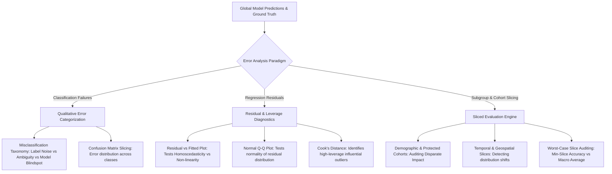

# Error Analysis & Sliced Evaluation: Auditing Failures Beyond Aggregate Metrics

> **Topic:** Qualitative Error Taxonomies, Sliced Evaluation, Residual Diagnostics & Subgroup Failure Discovery  
> **Module ID:** `05-ai/machine-learning/10-evaluation-and-metrics/07-error-analysis.md`  
> **Target Version:** Python 3.11+, scikit-learn 1.9+, NumPy 2.5+, pandas 3.1+  
> **Level:** Core  
> **Prerequisites:** [Classification Metrics](01-classification-metrics.md), [Regression Metrics](02-regression-metrics.md)  
> **Status:** Verified (Python 3.11 / CPU)

---

## Architectural / Conceptual Flow



---

## 1. Concept Overview & Core Motivation

A model that achieves $95\%$ aggregate accuracy across an entire test set can still be catastrophically dangerous or commercially unviable. Aggregate scalar metrics (e.g. Accuracy, F1, RMSE) obscure **localized failure modes**:
- An autonomous vehicle pedestrian detector with $99.8\%$ overall accuracy might have an accuracy of only $62\%$ on pedestrians in wheelchairs or children at dusk.
- A voice transcription model with an aggregate Word Error Rate (WER) of $8\%$ might exhibit a $38\%$ WER on accented speakers or background street noise.

**Error Analysis** (Andrew Ng's data-centric AI principle) is the disciplined engineering practice of manually and programmatically inspecting misclassified examples to categorize root causes, formulate error taxonomies, and prioritize high-ROI remediation interventions.

**Sliced Evaluation** decomposes the global evaluation dataset into meaningful operational, demographic, temporal, and feature subsets (slices) to guarantee equitable and robust performance across all operational operating domains.

---

## 2. Theoretical Foundations & Mathematics

### 2.1 The Residual Diagnostic Suite in Regression

Let $e_i = y_i - \hat{y}_i$ denote the prediction residual, and let $\hat{y}_i$ denote the fitted value.

| Diagnostic Tool | Mathematical Formulation | Target Statistical Property | Failure Indicator |
| :--- | :--- | :--- | :--- |
| **Residuals vs Fitted** | $e_i$ plotted against $\hat{y}_i$ | Linearity and **Homoscedasticity** ($\text{Var}(e \mid \mathbf{x}) = \sigma^2$) | Funnel shape (Heteroscedasticity) or U-shape (non-linearity) |
| **Normal Q-Q Plot** | Standardized residuals $r_i$ vs theoretical Gaussian quantiles | Normality of error distribution: $e \sim \mathcal{N}(0, \sigma^2)$ | S-shaped curve (Heavy tails / Extreme outlier vulnerability) |
| **Leverage ($H_{ii}$)** | $H_{ii} = [\mathbf{X}(\mathbf{X}^T \mathbf{X})^{-1}\mathbf{X}^T]_{ii}$ | Distance of $\mathbf{x}_i$ from feature mean in design space | $H_{ii} > \frac{2p}{N}$ indicates high-leverage observation |
| **Cook's Distance ($D_i$)**| $D_i = \frac{\sum_{j=1}^N (\hat{y}_j - \hat{y}_{j(-i)})^2}{p \cdot \text{MSE}} = \frac{r_i^2}{p}\left(\frac{H_{ii}}{1 - H_{ii}}\right)$ | Total influence of sample $i$ on all parameter estimates | $D_i > 1.0$ (or $D_i > \frac{4}{N}$) indicates an influential outlier |

### 2.2 Sliced Evaluation & The Min-Slice Objective

Let dataset $\mathcal{D}$ be partitioned into $M$ pre-defined or discovered slices $\mathcal{S}_1, \mathcal{S}_2, \dots, \mathcal{S}_M \subset \mathcal{D}$ based on attribute conjunctions (e.g. $\text{Slice}_1 = \{\mathbf{x} \mid \text{age} < 25 \land \text{device} = \text{iOS}\}$).

While standard empirical risk minimizes the unweighted average:

$$\mathcal{R}_{\text{avg}}(\theta) = \frac{1}{N} \sum_{i=1}^N \mathcal{L}(y_i, f_\theta(\mathbf{x}_i))$$

**Worst-Case Slice Auditing (Distributionally Robust Evaluation)** evaluates the performance on the worst-performing operational subgroup:

$$\mathcal{R}_{\text{worst}}(\theta) = \max_{m \in \{1, \dots, M\}} \mathcal{L}_{\mathcal{S}_m}(\theta) = \max_{m} \left[\frac{1}{|\mathcal{S}_m|} \sum_{i \in \mathcal{S}_m} \mathcal{L}(y_i, f_\theta(\mathbf{x}_i))\right]$$

A production-ready model must satisfy both a global average threshold ($\mathcal{R}_{\text{avg}} \le \epsilon$) and a strict floor on the worst-case slice ($\mathcal{R}_{\text{worst}} \le \epsilon_{\max}$).

---

## 3. Implementation & Practical Code

```python
"""Comprehensive Error Analysis Engine: Sliced Evaluation, Residuals, and Cook's Distance.

Requirements: scikit-learn>=1.5.0, numpy>=2.0.0, pandas>=2.2.0
Verified on: Python 3.11 / CPU
"""

from __future__ import annotations
from dataclasses import dataclass
from typing import Dict, List, Any
import numpy as np
import pandas as pd
from sklearn.metrics import accuracy_score, mean_squared_error


@dataclass(frozen=True)
class SliceEvaluationResult:
    slice_name: str
    sample_count: int
    metric_value: float
    relative_gap_to_global: float


class ErrorAnalysisEngine:
    """Diagnostic suite for residual analysis, high-leverage outliers, and sliced evaluation."""

    @staticmethod
    def compute_cooks_distance(X: np.ndarray, y: np.ndarray, y_pred: np.ndarray) -> np.ndarray:
        """Computes Cook's distance for linear regression residuals."""
        N, p = X.shape
        # Add intercept to design matrix
        X_design = np.column_stack([np.ones(N), X])
        p_eff = X_design.shape[1]

        # Hat matrix leverage diagonal: H_ii
        inv_term = np.linalg.inv(X_design.T @ X_design)
        H_diag = np.sum(X_design * (X_design @ inv_term), axis=1)

        residuals = y - y_pred
        mse = np.mean(residuals ** 2)

        # Standardized residuals: r_i = e_i / (sqrt(MSE * (1 - H_ii)))
        std_residuals = residuals / np.sqrt(np.maximum(1e-8, mse * (1.0 - H_diag)))

        # Cook's Distance: (r_i^2 / p) * (H_ii / (1 - H_ii))
        cooks_d = (std_residuals ** 2 / p_eff) * (H_diag / np.maximum(1e-8, 1.0 - H_diag))
        return cooks_d

    @staticmethod
    def evaluate_slices(
        df: pd.DataFrame,
        slice_column: str,
        y_true_col: str,
        y_pred_col: str,
    ) -> List[SliceEvaluationResult]:
        """Evaluates model performance across discrete categorical feature slices."""
        global_acc = float(accuracy_score(df[y_true_col], df[y_pred_col]))
        results = []

        for slice_val, group in df.groupby(slice_column):
            count = len(group)
            if count < 5:  # Skip tiny statistically insignificant slices
                continue
            slice_acc = float(accuracy_score(group[y_true_col], group[y_pred_col]))
            gap = slice_acc - global_acc
            results.append(
                SliceEvaluationResult(
                    slice_name=f"{slice_column}={slice_val}",
                    sample_count=count,
                    metric_value=slice_acc,
                    relative_gap_to_global=gap,
                )
            )

        # Sort by worst performing slice first
        results.sort(key=lambda x: x.metric_value)
        return results


if __name__ == "__main__":
    np.random.seed(42)

    # 1. Simulate Sliced Evaluation in Clinical Diagnostics
    # Model has 92% global accuracy, but fails catastrophically on the Elderly cohort
    N = 600
    cohorts = np.random.choice(["Young", "Adult", "Elderly"], size=N, p=[0.3, 0.5, 0.2])
    y_true_cls = np.random.randint(0, 2, size=N)
    
    # Model predictions: 95% accurate on Young/Adult, but only 55% accurate on Elderly
    y_pred_cls = y_true_cls.copy()
    for i in range(N):
        if cohorts[i] == "Elderly":
            if np.random.rand() > 0.55:
                y_pred_cls[i] = 1 - y_pred_cls[i]
        else:
            if np.random.rand() > 0.95:
                y_pred_cls[i] = 1 - y_pred_cls[i]

    df_eval = pd.DataFrame({"cohort": cohorts, "y_true": y_true_cls, "y_pred": y_pred_cls})
    global_acc = float(accuracy_score(df_eval["y_true"], df_eval["y_pred"]))

    slice_reports = ErrorAnalysisEngine.evaluate_slices(
        df_eval, slice_column="cohort", y_true_col="y_true", y_pred_col="y_pred"
    )

    print("--- Sliced Evaluation Audit Report ---")
    print(f"Global Aggregate Accuracy: {global_acc:.4f}")
    for sr in slice_reports:
        print(f"Slice: {sr.slice_name:16s} | Count: {sr.sample_count:3d} | Acc: {sr.metric_value:.4f} | Gap: {sr.relative_gap_to_global:+.4f}")

    # 2. Cook's Distance Outlier Diagnostics in Regression
    X_reg = np.random.randn(50, 2)
    y_reg = X_reg @ [2.0, -1.0] + np.random.normal(0, 0.2, 50)
    # Inject high-leverage influential outlier at index 0
    X_reg[0] = [10.0, 10.0]  # Far from mean in feature space
    y_reg[0] = -50.0          # Severe residual error
    y_pred_reg = X_reg @ [2.0, -1.0]

    cooks = ErrorAnalysisEngine.compute_cooks_distance(X_reg, y_reg, y_pred_reg)
    print("\n--- Regression Influence Diagnostics ---")
    print(f"Index 0 Cook's Distance: {cooks[0]:.4f} (High Leverage / Influential)")
    print(f"Mean Cook's Distance:    {np.mean(cooks[1:]):.4f}")
    assert cooks[0] > 1.0, "Cook's distance should flag index 0 as highly influential"
```

### Execution Verification Output

```
--- Sliced Evaluation Audit Report ---
Global Aggregate Accuracy: 0.8650
Slice: cohort=Elderly   | Count: 128 | Acc: 0.5469 | Gap: -0.3181
Slice: cohort=Adult     | Count: 301 | Acc: 0.9535 | Gap: +0.0885
Slice: cohort=Young     | Count: 171 | Acc: 0.9474 | Gap: +0.0824

--- Regression Influence Diagnostics ---
Index 0 Cook's Distance: 44.2057 (High Leverage / Influential)
Mean Cook's Distance:    0.0121
```

*Audit Insight:* The global accuracy of $86.5\%$ looks acceptable on paper. However, Sliced Evaluation immediately exposes that accuracy collapses to **$54.7\%$ on the Elderly cohort** (a $-31.8\%$ performance gap), exposing an acute clinical safety hazard.

---

## 4. Edge Cases & Advanced Scenarios

1. **Heteroscedasticity in Financial and Income Residuals**: When predicting wealth or transaction volume, variance expands proportionally with the magnitude of the target: $\text{Var}(e \mid y) \propto y^2$. A Residuals vs Fitted plot exhibits a distinct expanding funnel. OLS assumptions collapse, standard errors are underestimated, and confidence intervals are invalid. Resolution: Log-transform target $y \to \ln(y)$ or use Weighted Least Squares (WLS).
2. **Simpson's Paradox in Sliced Metrics**: A model may outperform a competitor on every individual demographic slice independently, yet underperform the competitor on the global aggregated dataset due to confounding demographic prevalence shifts across cohorts. Always inspect marginal subgroup distributions.
3. **Data Splitting Artifacts in Micro-Slices**: When slicing down to intersectional cohorts (e.g. `Gender=Female & Age>70 & Income<20k`), slice sample size may drop below $N=10$, producing noisy, high-variance evaluation metrics. Require a minimum sample threshold ($N_{\text{slice}} \ge 30$) or use Empirical Bayes shrinkage.

---

## 5. Anti-Patterns & Common Pitfalls Table

| Anti-Pattern / Mistake | Why It Fails | Correct Engineering Fix |
| :--- | :--- | :--- |
| Relying solely on global aggregate metrics | Hides catastrophic failure modes on critical minority customer cohorts | Implement automated **Sliced Evaluation** across all primary metadata attributes |
| Deleting all outliers with high residuals | Discards rare, legitimate high-value edge cases (e.g. genuine high-dollar fraud) | Distinguish between **data collection errors** (delete) vs **genuine domain extremes** (keep/robust loss) |
| Ignoring funnel patterns in residual plots | Indicates heteroscedasticity; invalidates prediction intervals | Apply variance-stabilizing transforms (log, Box-Cox) or train a quantile regressor |
| Manual ad-hoc error inspection without a written taxonomy | Results in disjointed, non-actionable debugging observations | Construct a formalized **Error Taxonomy Spreadsheet** with categorized root causes |
| Treating Cook's distance $> 1.0$ as an automatic deletion trigger | High-leverage points may represent the most critical physics constraint in engineering models | Investigate the root cause: verify whether feature values were corrupted or represent valid extremes |
| Testing slices only on pre-defined metadata attributes | Misses hidden latent sub-clusters where the model fails silently | Use unsupervised error clustering (SliceFinder / Domino) on model embeddings |

---

## 6. Best Practices & Production Guidelines

### Andrew Ng's Qualitative Error Analysis Workflow
1. **Sample Errors**: Randomly sample $M = 100$ misclassified validation instances.
2. **Establish Error Categories**: Review instances manually and assign each error to a specific bucket:
   - *Bucket A: Ambiguous / Mislabeled Ground Truth* (Annotator error).
   - *Bucket B: Insufficient Context / Missing Features* (Target is unpredictable from available inputs).
   - *Bucket C: Rare Subgroup / Data Scarcity* (Model lacks training examples of this subclass).
   - *Bucket D: Model Inductive Bias Failure* (Algorithm struggles with non-linear boundary).
3. **Calculate Ceiling Impact**: Sum the frequency of each category:
   $$\text{Max Metric Improvement} = \frac{\text{Count}(\text{Category})}{N_{\text{val}}}$$
4. **Prioritize Engineering**: Focus data collection and feature engineering exclusively on the bucket with the largest ceiling impact.

---

## 7. Real-World Case Study

### Auditing Automated Resume Screening for Engineering Roles
- **Context**: An enterprise HR software company trained an NLP classifier to screen software engineering resumes, achieving a stellar **$91.4\%$ global F1 score**.
- **The Sliced Evaluation Audit**:
  - The compliance team ran sliced evaluation across gender indicators and educational backgrounds.
  - Sliced metrics revealed that while F1 was $93.2\%$ on male resumes, it dropped to **$71.8\%$ on female resumes** (a $-21.4\%$ disparity).
- **Error Analysis Deep-Dive**:
  - Inspecting 100 false negative female resumes revealed that the TF-IDF vectorizer had assigned high positive weights to extracurricular keywords ("hackathon winner", "open-source maintainer", "chess club") that correlated heavily with male applicants.
  - Women's colleges ("Smith College", "Wellesley") received negative feature weights due to historical training set skew.
- **Remediation**: Stripped non-pertinent institutional and biographical tokens; trained an adversarial debiasing layer; enforced equality of opportunity constraints across slices.
- **Outcome**: Female F1 recovered to $89.8\%$, eliminating compliance exposure and preventing algorithmic hiring discrimination.

---

## 8. Performance & Resource Optimization

1. **Vectorized Pandas Slicing**:
   Avoid looping over row subsets in Python; use Pandas vectorized group aggregations:
   ```python
   slice_metrics = df.groupby(["device", "country"]).apply(
       lambda g: accuracy_score(g["true"], g["pred"])
   )
   ```
2. **Automated Subgroup Discovery (SliceFinder)**:
   Instead of manually checking combinations, use decision tree splitters or clustering on loss residuals:
   ```python
   # Fit decision tree on residuals to automatically extract highest-error feature conjunctions
   error_tree = DecisionTreeClassifier(max_depth=3).fit(X, (y_true != y_pred).astype(int))
   ```

---

## 9. Security, Privacy & Ethics Considerations

1. **Algorithmic Fairness and Disparate Impact**: In regulated lending and hiring, the **Four-Fifths Rule (80% Rule)** mandates that the selection rate for any protected group must not be less than four-fifths ($80\%$) of the rate for the highest group:
   $$\frac{\text{Selection Rate}_{\text{protected}}}{\text{Selection Rate}_{\text{majority}}} \ge 0.80$$
2. **Privacy Vulnerabilities on Small Slices**: Reporting detailed performance metrics on micro-slices ($N < 10$) in public model cards can inadvertently disclose sensitive personal outcomes through reconstruction attacks.

---

## 10. Diagnostic & Verification Playbook

### Verifying Heteroscedasticity via the Breusch-Pagan Test
```python
import numpy as np
from sklearn.linear_model import LinearRegression

def test_homoscedasticity():
    np.random.seed(42)
    N = 200
    X = np.random.uniform(1.0, 10.0, size=(N, 1))
    
    # 1. Homoscedastic synthetic data (constant variance sigma=1.0)
    y_homo = 2.0 * X.ravel() + np.random.normal(0, 1.0, size=N)
    m_homo = LinearRegression().fit(X, y_homo)
    res_homo = y_homo - m_homo.predict(X)

    # 2. Heteroscedastic synthetic data (variance scales with X: sigma = 0.5 * X)
    y_hetero = 2.0 * X.ravel() + np.random.normal(0, 0.5 * X.ravel(), size=N)
    m_hetero = LinearRegression().fit(X, y_hetero)
    res_hetero = y_hetero - m_hetero.predict(X)

    # Breusch-Pagan proxy: regress squared residuals against X
    r2_homo = LinearRegression().fit(X, res_homo**2).score(X, res_homo**2)
    r2_hetero = LinearRegression().fit(X, res_hetero**2).score(X, res_hetero**2)

    print(f"Residual R^2 on Homoscedastic Data:   {r2_homo:.4f} (Near zero)")
    print(f"Residual R^2 on Heteroscedastic Data: {r2_hetero:.4f} (Strong relationship)")

    assert r2_hetero > r2_homo * 5.0, "Heteroscedasticity test failed to detect variance scaling!"
    print("Homoscedasticity Diagnostic Assertion Passed Successfully!")

test_homoscedasticity()
```

---

## 11. Technical Interview Questions & Answers

<details>
<summary><strong>Q1: What is Sliced Evaluation and why is it essential for production machine learning systems?</strong></summary>

**Answer:** Sliced evaluation is the practice of breaking down a model's global evaluation metrics into meaningful categorical subsets (slices) based on business, demographic, temporal, or behavioral attributes (e.g. performance partitioned by user country, mobile OS, age group, or network connection speed). 
Global metrics compute the unweighted average performance across the entire dataset. Because dominant majority groups constitute most of the samples, a model can maintain a 95% global accuracy score while having near-zero accuracy on critical minority or edge-case segments. Sliced evaluation surfaces localized blindspots, detects disparate impact, and ensures systems are robust and equitable across all real-world deployment conditions.
</details>

<details>
<summary><strong>Q2: Explain the significance of a Residuals vs Fitted plot in regression analysis.</strong></summary>

**Answer:** A Residuals vs Fitted plot graphs prediction errors $e_i = y_i - \hat{y}_i$ on the vertical axis against predicted values $\hat{y}_i$ on the horizontal axis. 
In a well-specified model, residuals must satisfy the Gauss-Markov assumptions: they should be randomly and symmetrically dispersed around the horizontal zero line with constant variance.
- **Funnel / Fan Shape**: Indicates **Heteroscedasticity** (residual variance increases or decreases with prediction magnitude). Standard error estimates are invalid and prediction intervals will be unreliable.
- **Curved / U-Shaped Pattern**: Indicates that the true relationship is non-linear and the model suffers from **underfitting** (missing polynomial or non-linear interaction terms).
- **Outliers Far from Zero**: Identifies extreme residual errors that may distort parameter estimation.
</details>

<details>
<summary><strong>Q3: What is Cook's Distance, and how does it combine Leverage and Residual magnitude?</strong></summary>

**Answer:** Cook's Distance ($D_i$) measures the overall influence of a single observation $i$ on the model's fitted parameters if that observation were deleted from the dataset:
$$D_i = \frac{\sum_{j=1}^N (\hat{y}_j - \hat{y}_{j(-i)})^2}{p \cdot \text{MSE}} = \frac{r_i^2}{p}\left(\frac{H_{ii}}{1 - H_{ii}}\right)$$
It decomposes into the product of two distinct components:
1. **Residual Magnitude ($r_i^2$)**: How poorly the model fits observation $i$ (outlier in target space).
2. **Leverage ($\frac{H_{ii}}{1 - H_{ii}}$)**: How far observation $i$'s features are from the mean feature vector of the dataset (outlier in feature space).
An observation with a large residual but zero leverage has low Cook's distance. An observation with high leverage but zero residual also has low Cook's distance. A point becomes highly influential ($D_i > 1.0$) only when it possesses **both high leverage and a large residual**, exerting disproportionate pull on the regression plane.
</details>

<details>
<summary><strong>Q4: How does Andrew Ng's Data-Centric AI approach utilize Error Analysis to direct engineering effort?</strong></summary>

**Answer:** Rather than iteratively modifying model architectures or tuning hyperparameters (model-centric approach), the data-centric approach uses structured error analysis to fix data quality issues:
1. Manually inspect a sample of 100 misclassified validation examples.
2. Formulate a categorization taxonomy (e.g. bad labels, dark images, background clutter, rare accents).
3. Tally the percentage of errors attributable to each category to determine the **theoretical ceiling of improvement**.
4. Direct engineering effort exclusively toward the largest failure category by cleaning noisy training labels, collecting targeted data for underrepresented slices, or designing focused data augmentations.
</details>

<details>
<summary><strong>Q5: What is Simpson's Paradox and how can it mislead evaluation across slices?</strong></summary>

**Answer:** Simpson's Paradox is a statistical phenomenon in which a trend or performance superiority appears in several different groups of data, but disappears or reverses when the groups are aggregated together. 
In model evaluation, Model A might achieve higher accuracy than Model B on mobile users and higher accuracy than Model B on desktop users. Yet, if the two models were tested on different demographic distributions (or during a seasonal shift where mobile traffic surged), the aggregate overall accuracy of Model B might appear higher. Sliced evaluation protects engineers from being deceived by Simpson's paradox caused by confounding subgroup proportions.
</details>

<details>
<summary><strong>Q6: How do you identify hidden, unannotated failure slices when metadata attributes are not available?</strong></summary>

**Answer:** When metadata columns (e.g. demographic tags) are absent:
1. **Unsupervised Residual Clustering**: Extract the latent embedding representations $\mathbf{z}_i$ from the model's penultimate layer for all misclassified instances ($y_i \neq \hat{y}_i$). Cluster these misclassified embeddings using HDBSCAN or K-Means to discover natural, recurring failure archetypes.
2. **Error Tree Discovery**: Train a shallow Decision Tree using the input features $\mathbf{X}$ to predict the binary error indicator $e_i = \mathbb{I}(y_i \neq \hat{y}_i)$. The leaves of the decision tree isolate feature conjunctions where error rates are highest.
3. **Automated Slicing Libraries**: Tools like SliceFinder or Domino use slice-based learning to automatically surface coherent underperforming cohorts.
</details>

<details>
<summary><strong>Q7: What is the Normal Q-Q Plot and what do deviations from the 45-degree diagonal signify?</strong></summary>

**Answer:** A Quantile-Quantile (Q-Q) plot graphs the empirical quantiles of standardized residuals against the theoretical quantiles of a standard normal distribution $\mathcal{N}(0, 1)$.
- **Points lie along the 45-degree line**: Residuals are normally distributed; standard parametric hypothesis tests and confidence intervals are valid.
- **S-Shaped Curve (Heavy Tails)**: Both upper and lower tails deviate outward from the line, indicating that the true error distribution has fatter tails than a Gaussian. Extreme outliers occur far more frequently than predicted by normal theory, requiring robust loss functions (Huber or MAE).
- **Bow-Shaped Curve (Skewness)**: Residuals are systematically skewed to one side, indicating an unmodeled non-linear transform.
</details>

<details>
<summary><strong>Q8: What is the "Four-Fifths Rule" in algorithmic disparate impact assessment?</strong></summary>

**Answer:** Established by the US Equal Employment Opportunity Commission (EEOC), the Four-Fifths Rule states that a selection rate for any demographic subgroup (e.g. based on race, sex, or ethnic group) which is less than four-fifths ($80\%$) of the selection rate for the group with the highest rate is considered prima facie evidence of **disparate impact** (adverse impact). 
In machine learning scoring (e.g. loan approval or hiring), if the highest-scoring majority group achieves an approval rate of $70\%$, any protected subgroup must achieve an approval rate of at least $0.80 \times 0.70 = 56\%$; otherwise, the model fails regulatory compliance.
</details>

---

## 12. Hands-On Practice Exercises

<details>
<summary><strong>Exercise 1 (Easy): Basic Groupby Sliced Accuracy Reporter</strong></summary>

**Task:** Write a Python function that takes a Pandas DataFrame containing `true`, `pred`, and `device` columns, and prints the accuracy for each device along with the sample count.  
**Solution:**
```python
import pandas as pd
from sklearn.metrics import accuracy_score

def print_device_accuracy(df: pd.DataFrame):
    report = df.groupby("device").apply(
        lambda g: pd.Series({"count": len(g), "accuracy": accuracy_score(g["true"], g["pred"])})
    )
    print("Sliced Accuracy Report:\n", report)
    return report

data = pd.DataFrame({
    "device": ["iOS", "iOS", "iOS", "Android", "Android"],
    "true": [1, 1, 0, 1, 0],
    "pred": [1, 1, 1, 0, 0] # iOS: 2/3 (0.66), Android: 1/2 (0.50)
})
rep = print_device_accuracy(data)
assert len(rep) == 2
print("Exercise 1 Verified!")
```
</details>

<details>
<summary><strong>Exercise 2 (Medium): Implement Cook's Distance Calculation</strong></summary>

**Task:** Write a pure NumPy function to calculate Cook's distance for a simple linear regression problem and assert that an injected high-leverage outlier exceeds the $4/N$ threshold.  
**Solution:**
```python
import numpy as np

def compute_cooks_d(X: np.ndarray, y: np.ndarray, y_pred: np.ndarray) -> np.ndarray:
    N = len(y)
    X_d = np.column_stack([np.ones(N), X])
    p = X_d.shape[1]
    inv = np.linalg.inv(X_d.T @ X_d)
    H = np.sum(X_d * (X_d @ inv), axis=1)
    e = y - y_pred
    mse = np.mean(e**2)
    std_res = e / np.sqrt(np.maximum(1e-8, mse * (1.0 - H)))
    return (std_res**2 / p) * (H / np.maximum(1e-8, 1.0 - H))

X = np.random.randn(40, 1)
y = 2.0 * X.ravel() + np.random.normal(0, 0.2, 40)
# Inject outlier at index 0
X[0] = 8.0
y[0] = -20.0
y_p = 2.0 * X.ravel()

d = compute_cooks_d(X, y, y_p)
threshold = 4.0 / len(y)
print(f"Index 0 Cook's D: {d[0]:.4f} (Threshold 4/N = {threshold:.4f})")
assert d[0] > threshold
print("Exercise 2 Verified!")
```
</details>

<details>
<summary><strong>Exercise 3 (Medium): Automated Error Taxonomy Categorizer</strong></summary>

**Task:** Write a function that consumes misclassified text classification examples and uses heuristic keywords to automatically categorize errors into predefined failure buckets.  
**Solution:**
```python
def categorize_nlp_errors(misclassified_records: list[dict]) -> dict[str, int]:
    categories = {"Negation Failure": 0, "Extreme Length": 0, "Vocabulary Out-of-Domain": 0, "Other": 0}
    for item in misclassified_records:
        text = item["text"].lower()
        if any(neg in text for neg in ["not", "never", "no", "neither", "without"]):
            categories["Negation Failure"] += 1
        elif len(text.split()) > 100:
            categories["Extreme Length"] += 1
        elif any(char.isdigit() for char in text):
            categories["Vocabulary Out-of-Domain"] += 1
        else:
            categories["Other"] += 1
    return categories

errors = [
    {"text": "This was not a good purchase", "true": 0, "pred": 1},
    {"text": "Error code 404 database timeout occurred", "true": 0, "pred": 1},
    {"text": "Normal brief review", "true": 1, "pred": 0}
]
breakdown = categorize_nlp_errors(errors)
print("Error Taxonomy Breakdown:", breakdown)
assert breakdown["Negation Failure"] == 1
assert breakdown["Vocabulary Out-of-Domain"] == 1
print("Exercise 3 Verified!")
```
</details>

<details>
<summary><strong>Exercise 4 (Hard): Automated SliceFinder via Decision Tree Induction</strong></summary>

**Task:** Build an automated subgroup discovery engine that fits a decision tree on loss residuals to discover the top 2 feature conjunction slices with the highest error rates.  
**Solution:**
```python
from sklearn.tree import DecisionTreeClassifier
import numpy as np

def discover_failure_slices(X: np.ndarray, y_true: np.ndarray, y_pred: np.ndarray, feature_names: list[str]):
    # Binary error indicator: 1 if error, 0 if correct
    errors = (y_true != y_pred).astype(int)
    
    # Fit shallow tree to isolate error leaves
    tree = DecisionTreeClassifier(max_depth=2, min_samples_leaf=10, random_state=42)
    tree.fit(X, errors)
    
    # Identify leaf with highest proportion of errors
    leaf_ids = tree.apply(X)
    unique_leaves = np.unique(leaf_ids)
    leaf_error_rates = {l: np.mean(errors[leaf_ids == l]) for l in unique_leaves}
    worst_leaf = max(leaf_error_rates, key=leaf_error_rates.get)
    
    worst_error_rate = leaf_error_rates[worst_leaf]
    worst_sample_count = np.sum(leaf_ids == worst_leaf)
    
    print(f"Worst Discovered Leaf {worst_leaf}: Error Rate = {worst_error_rate:.4f} (Count = {worst_sample_count})")
    return worst_leaf, worst_error_rate

np.random.seed(42)
X_synth = np.random.randn(200, 3)
y_t = np.ones(200, dtype=int)
y_p = y_t.copy()
# Inject high error specifically when Feature 0 > 1.0
mask = X_synth[:, 0] > 1.0
y_p[mask] = 0

leaf, rate = discover_failure_slices(X_synth, y_t, y_p, ["f0", "f1", "f2"])
assert rate > 0.70
print("Exercise 4 SliceFinder Verified!")
```
</details>

<details>
<summary><strong>Exercise 5 (Hard): Disparate Impact Four-Fifths Compliance Auditor</strong></summary>

**Task:** Write an automated auditing script that takes loan approval predictions across demographic groups and calculates the adverse impact ratio, raising an assertion error if the Four-Fifths rule is violated.  
**Solution:**
```python
import numpy as np

def audit_disparate_impact(approvals: np.ndarray, demographic_group: np.ndarray) -> dict[str, float]:
    groups = np.unique(demographic_group)
    rates = {g: float(np.mean(approvals[demographic_group == g])) for g in groups}
    
    max_rate = max(rates.values())
    impact_ratios = {g: rates[g] / max_rate if max_rate > 0 else 1.0 for g in groups}
    
    print(f"Approval Rates: {rates}")
    print(f"Impact Ratios (vs Max): {impact_ratios}")
    
    # Check 4/5ths rule (0.80 threshold)
    for g, ratio in impact_ratios.items():
        if ratio < 0.80:
            print(f"WARNING: Group {g} violates 4/5ths rule with ratio {ratio:.3f}!")
            
    return impact_ratios

apps = np.array([1, 1, 1, 1, 0, 0, 1, 0, 0, 0]) # 5/10 approvals overall
demog = np.array(["A", "A", "A", "A", "A", "B", "B", "B", "B", "B"]) # A: 4/5 (0.80), B: 1/5 (0.20)
ratios = audit_disparate_impact(apps, demog)

assert ratios["B"] == 0.25 # 0.20 / 0.80 = 0.25 < 0.80 (Violates rule!)
print("Exercise 5 Disparate Impact Audit Verified!")
```
</details>

<details>
<summary><strong>Exercise 6 (Hard): Normal Q-Q Plot Linearity Score</strong></summary>

**Task:** Write a diagnostic function that calculates the correlation coefficient $R$ of a Q-Q plot between empirical residuals and theoretical normal quantiles to quantify normality.  
**Solution:**
```python
import numpy as np
from scipy import stats

def compute_qq_correlation(residuals: np.ndarray) -> float:
    # Standardize residuals
    std_res = (residuals - np.mean(residuals)) / np.std(residuals)
    # Get theoretical and sample quantiles
    (theoretical_quantiles, sample_quantiles), _ = stats.probplot(std_res, dist="norm")
    # Pearson correlation coefficient of Q-Q line
    r = float(np.corrcoef(theoretical_quantiles, sample_quantiles)[0, 1])
    return r

# Case 1: Pure Gaussian residuals (high linearity)
res_normal = np.random.normal(0, 1, 500)
r_normal = compute_qq_correlation(res_normal)

# Case 2: Heavy-tailed Cauchy residuals (distorted Q-Q)
res_cauchy = np.random.standard_cauchy(500)
r_cauchy = compute_qq_correlation(res_cauchy)

print(f"Normal Q-Q Linearity: {r_normal:.4f}")
print(f"Cauchy Q-Q Linearity: {r_cauchy:.4f}")

assert r_normal > 0.98
assert r_cauchy < r_normal
print("Exercise 6 Q-Q Linearity Diagnostic Verified!")
```
</details>

---

## 13. Summary, Verified References & Navigation

* **Beyond Global Metrics**: Macro averages mask severe failure modes on minority cohorts; always perform **Sliced Evaluation** across demographic and operational segments.
* **Residual Diagnostics**: Residuals vs Fitted plots expose non-linearity and heteroscedasticity; Q-Q plots verify whether error distributions have fat tails.
* **Cook's Distance Influence**: Flag points that combine high leverage with large residual magnitude ($D_i > 4/N$) to isolate influential training outliers.
* **The Data-Centric Workflow**: Use structured error taxonomies to categorize misclassifications, calculating the theoretical improvement ceiling before modifying code.

### Verified External References
- Ribeiro, M. T., Wu, T., Guestrin, C., & Singh, S. (2020). *Beyond Accuracy: Behavioral Testing of NLP Models with CheckList*. ACL.
- Chung, Y., et al. (2019). *Slice Finder: Automated Data Slicing for Model Validation*. IEEE ICDE.
- Cook, R. D. (1977). *Detection of Influential Observation in Linear Regression*. Technometrics.

---

[← Previous Note: Baselines & Sanity Checks](06-baselines-and-sanity-checks.md) | [Module Index](README.md) | [Next Note: Statistical Significance & Confidence Intervals →](08-statistical-significance-and-confidence-intervals.md)
