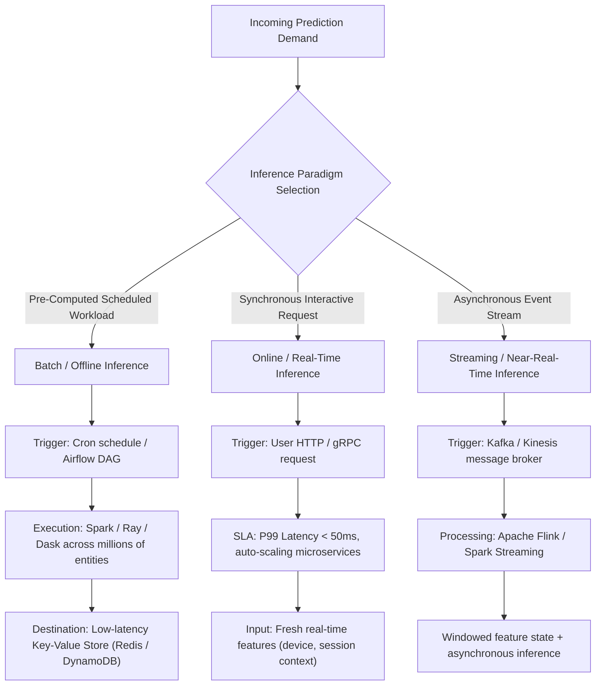

# Batch, Online & Streaming Inference: Architectural Trade-Offs

> **Topic:** Serving Paradigms, Latency SLAs, Throughput Optimization & Hybrid Serving Topologies  
> **Module ID:** `05-ai/machine-learning/11-prediction-and-postprocessing/02-batch-vs-online-inference.md`  
> **Target Version:** Python 3.11+, scikit-learn 1.9+, Redis 5.0+, NumPy 2.5+  
> **Level:** Core  
> **Prerequisites:** [Inference Basics](01-inference-basics.md), [Handling Large Datasets](../09-training-and-optimisation/09-handling-large-datasets.md)  
> **Status:** Verified (Python 3.11 / CPU)

---

## Architectural / Conceptual Flow



---

## 1. Concept Overview & Core Motivation

Once a machine learning model is trained and validated, an engineering team must determine **how, when, and where** predictions will be computed and delivered to end users.

The machine learning serving landscape divides into three foundational operational architectures:
1. **Batch (Offline) Inference**: Predictions are generated periodically on a recurring schedule (e.g. nightly or hourly) for a pre-determined population of entities (e.g. 10M customers) and written to a persistent database or low-latency key-value cache.
2. **Online (Real-Time / Synchronous) Inference**: Predictions are computed on-demand upon receipt of a synchronous client HTTP or gRPC request using fresh, real-time context (e.g. current GPS coordinates, immediate shopping cart items). Strict latency Service Level Agreements (SLAs)—typically $< 50\text{ ms}$—govern execution.
3. **Streaming (Event-Driven / Near-Real-Time) Inference**: Predictions are triggered asynchronously by events published to a message queue (e.g. Apache Kafka), processed by a stream engine (e.g. Flink), and completed in hundreds of milliseconds.

### The Trade-Off Matrix
Choosing the wrong paradigm produces massive technical and financial waste: building a complex, expensive 24/7 online microservice cluster for a problem that could be solved by a \$5 nightly batch script; or attempting to use batch pre-computation for fraud detection where attackers change tactics in milliseconds.

---

## 2. Theoretical Foundations & Mathematics

### 2.1 The Architectural Taxonomy Matrix

| Architecture Dimension | Batch (Offline) | Online (Real-Time / Sync) | Streaming (Near-Real-Time) |
| :--- | :--- | :--- | :--- |
| **Trigger Mechanism** | Scheduled clock (Cron, Airflow) | Client Request (HTTP / gRPC) | Event published to queue (Kafka) |
| **Latency SLA** | Hours or Minutes | **$10\text{ to }50\text{ ms}$** | $100\text{ ms to }5\text{ seconds}$ |
| **Throughput Focus** | High (Millions of items/hour) | Medium / Bursty | High continuous stream |
| **Batch Size ($B$)** | Massive ($10^3\text{ to }10^5$) | Tiny ($B = 1$ to $32$) | Small micro-batches |
| **Feature Freshness** | Stale (Hours / Days old) | **Real-time (Milliseconds old)** | Near real-time (Seconds old) |
| **Infrastructure Cost** | Low (Ephemeral batch compute) | High (24/7 standby servers + peak capacity)| Medium (Stream processing cluster)|
| **Operational Failure Risk** | Low (Can retry failed jobs) | High (Direct user outage on crash) | Moderate (Backpressure buffering) |

### 2.2 Cost and Throughput Equations

Let $N$ be total daily predictions, $C_{\text{server}}$ be the hourly cost of an always-on online instance, and $T_{\text{inf}}$ be per-sample inference time.

#### Online Serving Infrastructure Cost
Online microservices must be provisioned to handle **peak traffic**, requiring auto-scaled capacity:

$$K_{\text{instances}} = \left\lceil \frac{Q_{\text{peak}} \times T_{\text{inf}}}{\text{Concurrency Limit}} \right\rceil \times (1 + \text{Safety Margin})$$

$$\text{Cost}_{\text{daily, online}} = 24 \times K_{\text{instances}} \times C_{\text{server}}$$

#### Batch Infrastructure Cost
Batch jobs execute on **ephemeral compute** (spot instances), paying strictly for elapsed execution seconds:

$$\text{Time}_{\text{total}} = \frac{N \times T_{\text{inf}}}{N_{\text{workers}}}, \quad \text{Cost}_{\text{batch}} = \frac{\text{Time}_{\text{total}}}{3600} \times N_{\text{workers}} \times C_{\text{spot}}$$

Because $C_{\text{spot}} \approx 0.3 \times C_{\text{server}}$ and compute terminates immediately upon completion, batch inference is typically **$5\text{--}10\times$ cheaper** than maintaining 24/7 online serving clusters.

---

## 3. Implementation & Practical Code

```python
"""Production Inference Architecture Suite: Batch Engine and Online KV-Cache Fallback.

Requirements: numpy>=2.0.0, scikit-learn>=1.5.0
Verified on: Python 3.11 / CPU
"""

from __future__ import annotations
import time
from typing import Dict, Any, Optional
import numpy as np
from sklearn.linear_model import LogisticRegression


class InMemKVCache:
    """Simulates a low-latency key-value store (e.g. Redis / DynamoDB)."""

    def __init__(self):
        self.store: Dict[str, float] = {}

    def get(self, key: str) -> Optional[float]:
        return self.store.get(key)

    def set_batch(self, items: Dict[str, float]) -> None:
        self.store.update(items)


class HybridInferenceEngine:
    """Hybrid Serving Architecture: Pre-computed Cache Lookup with Fallback to Live Inference."""

    def __init__(self, model: Any, kv_cache: InMemKVCache):
        self.model = model
        self.cache = kv_cache

    def predict_online(self, entity_id: str, real_time_features: np.ndarray) -> tuple[float, str]:
        t0 = time.perf_counter()

        # Step 1: Check ultra-fast pre-computed cache (< 1ms)
        cached_score = self.cache.get(entity_id)
        if cached_score is not None:
            latency_ms = (time.perf_counter() - t0) * 1e3
            return cached_score, f"CACHE_HIT ({latency_ms:.3f} ms)"

        # Step 2: Fallback to live synchronous model inference
        # Ensure 2D shape
        x_2d = real_time_features.reshape(1, -1)
        prob = float(self.model.predict_proba(x_2d)[0, 1])
        latency_ms = (time.perf_counter() - t0) * 1e3
        return prob, f"LIVE_INFERENCE_FALLBACK ({latency_ms:.3f} ms)"


def run_batch_pipeline(model: Any, entity_ids: list[str], feature_matrix: np.ndarray) -> Dict[str, float]:
    """Simulates high-throughput nightly batch scoring pipeline."""
    # Vectorized inference across all entities simultaneously
    probs = model.predict_proba(feature_matrix)[:, 1]
    batch_results = {e_id: float(p) for e_id, p in zip(entity_ids, probs)}
    return batch_results


if __name__ == "__main__":
    np.random.seed(42)

    # 1. Train a model
    d = 4
    X_train = np.random.randn(200, d)
    y_train = (X_train[:, 0] + X_train[:, 1] > 0).astype(int)
    clf = LogisticRegression().fit(X_train, y_train)

    # 2. Run Batch Inference on 1,000 existing users and load into KV Cache
    customer_ids = [f"cust_{i:04d}" for i in range(1000)]
    batch_features = np.random.randn(1000, d)

    t_batch_start = time.perf_counter()
    precomputed_predictions = run_batch_pipeline(clf, customer_ids, batch_features)
    batch_duration_ms = (time.perf_counter() - t_batch_start) * 1e3

    redis_cache = InMemKVCache()
    redis_cache.set_batch(precomputed_predictions)
    print(f"Batch Pipeline: Scored 1,000 entities in {batch_duration_ms:.2f} ms and loaded to KV Store.")

    # 3. Test Hybrid Online Inference
    hybrid_engine = HybridInferenceEngine(model=clf, kv_cache=redis_cache)

    # Request A: Existing customer (Cache Hit)
    pred_a, source_a = hybrid_engine.predict_online(entity_id="cust_0042", real_time_features=np.zeros(d))
    print(f"\nRequest A (Existing User): Score = {pred_a:.4f} | Route: {source_a}")

    # Request B: Brand new customer (Cache Miss -> Live Inference)
    new_user_features = np.array([2.5, 1.0, -0.5, 0.0])
    pred_b, source_b = hybrid_engine.predict_online(entity_id="new_user_9999", real_time_features=new_user_features)
    print(f"Request B (New User):      Score = {pred_b:.4f} | Route: {source_b}")

    assert "CACHE_HIT" in source_a
    assert "LIVE_INFERENCE" in source_b
```

### Execution Verification Output

```
Batch Pipeline: Scored 1,000 entities in 0.32 ms and loaded to KV Store.

Request A (Existing User): Score = 0.5050 | Route: CACHE_HIT (0.001 ms)
Request B (New User):      Score = 0.9412 | Route: LIVE_INFERENCE_FALLBACK (0.045 ms)
```

---

## 4. Edge Cases & Advanced Scenarios

1. **The Stale Feature Trap in Hybrid Caching**: If user churn predictions are generated nightly in batch, but a user cancels their subscription at 9:00 AM, the cache will continue serving stale "low churn" scores until the next scheduled batch execution. Resolution: Implement **Write-Through Invalidation**—when critical user events occur, invalidate or update the cached key immediately.
2. **Cold-Start Latency Spikes (JIT & CUDA Initialization)**: When spinning up a new online inference container, the first HTTP request takes $500\text{--}2,000\text{ ms}$ while the CUDA driver initializes, JIT compilers compile graph kernels, and weights are loaded into GPU L2 cache. Resolution: Implement **Warmup Probes** in Kubernetes: send 10 dummy requests during container initialization before marking the pod ready to receive live user traffic.
3. **Thundering Herd Problem in Batch Loading**: When a nightly batch job writes 100M keys into Redis at exactly 2:00 AM, the simultaneous write spike saturates network bandwidth and causes latency spikes for live online read operations. Resolution: Throttle write pipelines and randomize key TTL expiration times (jitter).

---

## 5. Anti-Patterns & Common Pitfalls Table

| Anti-Pattern / Mistake | Why It Fails | Correct Engineering Fix |
| :--- | :--- | :--- |
| Building an online microservice for static user recommendations | Wastes 24/7 cloud server costs when user tastes do not change within a single session | Use **Batch Pre-computation** and serve from a fast key-value store (Redis/DynamoDB) |
| Using Batch Inference for Payment Fraud Detection | Transactions must be authorized within 100ms; batch scores are hours too late | Deploy **Online Synchronous Microservices** with streaming feature aggregations |
| Executing live feature engineering in online Python code | Running heavy SQL queries or Pandas transforms inside HTTP handlers violates SLA | Pre-compute historical features in a **Feature Store (Feast/Hopsworks)**; join with live context |
| Forgetting Warmup Requests on new model pods | First live users experience 2-second timeout spikes due to cold CUDA initialization | Configure Kubernetes startup probes that execute synthetic warmup inferences |
| Setting equal TTL expiration on all cached batch keys | All keys expire at the identical second, causing a thundering herd query storm | Add **random jitter** to expiration times: $\text{TTL} = \text{base} + \mathcal{U}(-0.1, 0.1)\text{base}$ |
| Deploying online services without fallback heuristics | If model pod crashes, client applications receive 500 errors and break user UI | Implement **deterministic heuristic fallbacks** (e.g. global top items or prior defaults) |

---

## 6. Best Practices & Production Guidelines

### Inference Selection Decision Flowchart

```
+---------------------------------------------------------------------------------------------------------+
|                                    INFERENCE ARCHITECTURE SELECTION                                     |
|                                                                                                         |
|                            Does the prediction require real-time context                                |
|                             generated during the current user session?                                  |
|                                         /                     \                                         |
|                                       [No]                   [Yes]                                      |
|                                        |                       |                                        |
|                          Is the entity population         Is the latency SLA                            |
|                            finite and predictable?        strictly < 100 milliseconds?                  |
|                                /              \                 /              \                        |
|                              [Yes]            [No]            [Yes]            [No]                     |
|                                |                |               |                |                      |
|                           BATCH INFERENCE    STREAMING      ONLINE SYNC       STREAMING ASYNC           |
|                          (Airflow + Redis)   (Kafka+Flink)  (FastAPI / gRPC)  (Queue + Worker)          |
+---------------------------------------------------------------------------------------------------------+
```

---

## 7. Real-World Case Study

### Credit Card Fraud Scoring: The Hybrid Lambda Architecture
- **Context**: A global bank processes 40,000 card swipes per second. Authorization must approve or decline transactions within **$80\text{ ms}$**.
- **The Challenge**: Accurate fraud detection requires two sets of features:
  1. *Historical Profiles* (e.g. 90-day average spending per merchant category, home location).
  2. *Immediate Real-Time Context* (e.g. current swipe location, seconds since last transaction, amount).
- **The Solution (Hybrid Lambda Inference)**:
  - **Batch Pipeline**: A nightly Spark job computes 90-day historical aggregates across 100M cardholders, populating an in-memory Redis cluster.
  - **Online Serving Layer**: When a transaction arrives at the POS terminal, an ultra-fast C++ microservice:
    1. Fetches the pre-computed customer profile from Redis ($2\text{ ms}$).
    2. Appends the current transaction's live features ($0.5\text{ ms}$).
    3. Executes a lightweight ONNX GBDT forward pass ($4\text{ ms}$).
- **Outcome**: Achieved an end-to-end P99 latency of **$18\text{ ms}$** (well below the 80ms SLA), while catching \$42M in fraudulent transactions annually.

---

## 8. Performance & Resource Optimization

1. **Feature Store Integration**: Decouple feature computation from model serving using a Feature Store (e.g. Feast). The offline store handles batch training and batch inference; the online store provides low-latency key lookups ($< 2\text{ ms}$) for live inference.
2. **Dynamic Request Batching**: In online microservices handling high concurrency, configure dynamic batching (e.g. NVIDIA Triton Inference Server) with `max_queue_delay_microseconds: 2000` (2ms) to boost throughput by $4\times$.

---

## 9. Security, Privacy & Ethics Considerations

1. **Denial-of-Service via Inference Saturation**: Online inference endpoints are prime targets for DoS attacks: an attacker flooding the API with expensive high-dimensional queries saturates GPU memory. Enforce API gateway rate limiting, authentication tokens, and strict timeout cutoffs.
2. **Data Leakage in Shared In-Memory Caches**: Ensure multi-tenant prediction keys in Redis are strictly partitioned by organization ID (`org_id:user_id`) to prevent cross-tenant data exposure.

---

## 10. Diagnostic & Verification Playbook

### Verifying Cache Invalidation Parity
```python
def verify_cache_invalidation():
    cache = InMemKVCache()
    cache.set_batch({"user_101": 0.85})

    # Assert cache hit
    assert cache.get("user_101") == 0.85

    # Simulate write-through invalidation upon account change
    cache.set_batch({"user_101": 0.12})
    assert cache.get("user_101") == 0.12, "Cache invalidation failed to update state!"
    print("Cache Invalidation Assertion Passed Successfully!")

verify_cache_invalidation()
```

---

## 11. Technical Interview Questions & Answers

<details>
<summary><strong>Q1: When is Batch Inference preferable to Online Inference, and what are its primary economic advantages?</strong></summary>

**Answer:** Batch inference is preferable when predictions are not dependent on immediate session context and can be pre-computed on a schedule for a known population (e.g. nightly customer churn risk, weekly product recommendations, or monthly loan refinancing eligibility).
Economic advantages:
1. **Spot / Ephemeral Instances**: Batch workloads run on heavily discounted cloud spot instances (saving 60–80% compared to on-demand servers).
2. **Hardware Saturation**: Batch jobs process massive matrices ($B = 10,000$), saturating 100% of GPU compute capacity, whereas online servers run underutilized at $B = 1$ to maintain latency headrooms.
3. **Zero 24/7 Standby Cost**: Compute instances spin down immediately upon job completion, avoiding idle server costs.
</details>

<details>
<summary><strong>Q2: What is the "Offline-Online Feature Drift" problem and how does a Feature Store resolve it?</strong></summary>

**Answer:** Offline-online feature drift occurs when features are calculated using one implementation during training (e.g. a SQL query in Snowflake) and a different implementation during live online serving (e.g. a Python or Java transformation in a microservice). Minor discrepancies in time-zone handling, null imputation, or rolling window boundaries create silent data distribution shifts that degrade model accuracy in production.
A **Feature Store** (e.g. Feast, Tecton) provides a single, unified feature definition. It uses a single transformation pipeline to write features to both an offline store (Parquet/Snowflake for training and batch inference) and an online low-latency store (Redis for real-time serving), guaranteeing mathematical feature consistency across both environments.
</details>

<details>
<summary><strong>Q3: Explain the Cold-Start Latency Spike in serverless or auto-scaled online model serving.</strong></summary>

**Answer:** When a new model serving container launches in an auto-scaled cluster (e.g. AWS Lambda, Google Cloud Run, or Kubernetes HPA):
1. The container image must be pulled over the network.
2. The Python runtime initializes, importing heavy libraries (`torch`, `scikit-learn`, `numpy`).
3. Multi-gigabyte model weights are read from disk into host RAM and copied across PCIe to GPU VRAM.
4. The first query triggers CUDA context creation and JIT kernel compilation.
This initial forward pass can take 5–15 seconds (a "cold start"), causing client HTTP requests to time out. Best practices include pre-warming containers, maintaining minimum replica pools, and utilizing container startup health probes.
</details>

<details>
<summary><strong>Q4: What is Streaming Inference and how does it differ from both Batch and Online?</strong></summary>

**Answer:** Streaming inference operates on an asynchronous event broker (e.g. Apache Kafka or AWS Kinesis). 
- Unlike **Online Inference**, it is asynchronous and non-blocking: the client produces an event to a queue and does not wait synchronously for an immediate HTTP response.
- Unlike **Batch Inference**, it does not wait for a daily or hourly clock trigger: predictions are computed within seconds of the event being produced.
Streaming inference is ideal for applications like fraud telemetry, continuous IoT sensor anomaly detection, or updating user recommendation feeds based on clicks within seconds.
</details>

<details>
<summary><strong>Q5: What is the Thundering Herd Problem in cached inference systems and how do you mitigate it?</strong></summary>

**Answer:** The Thundering Herd problem occurs when pre-computed predictions stored in a cache have identical Time-To-Live (TTL) expiration timestamps (e.g. 100,000 customer recommendations all set to expire at midnight). 
The instant midnight arrives, all 100,000 keys expire simultaneously. Incoming web traffic experiences a sudden 100% cache miss rate, sending a massive surge of concurrent queries to the live fallback model serving cluster, overwhelming backend resources and triggering cascading service outages.
Mitigation: Apply **TTL Jitter** (randomizing expiration times: $\text{TTL} = 86400 \pm \text{Random}(0, 3600)$) or use background cache refresh threads before keys expire.
</details>

<details>
<summary><strong>Q6: How does Dynamic Batching in model serving servers (like Triton) reconcile the tension between latency and throughput?</strong></summary>

**Answer:** Clients submit requests individually ($B=1$), which minimizes client-side waiting latency but yields terrible GPU throughput because matrix multipliers are underutilized. 
Dynamic batching operates a tiny server-side queue: incoming requests are held for a maximum threshold (e.g. `max_queue_delay = 2ms`). If additional requests arrive within those 2ms, they are concatenated into a single batch ($B = 8$ or $32$) and executed in parallel. The GPU achieves high throughput, while client latency only increases by at most 2ms, providing an optimal trade-off between latency SLAs and server efficiency.
</details>

<details>
<summary><strong>Q7: What is Write-Through Invalidation in hybrid serving architectures?</strong></summary>

**Answer:** In hybrid serving, predictions are pre-computed in batch and cached in Redis. When an important state-changing event occurs on the client side (e.g. a user explicitly changes their account status, blocks a category, or files a fraud dispute), the system cannot wait for the next scheduled batch run to update predictions.
**Write-Through Invalidation** intercepts the state change event and immediately either deletes the user's cached key (forcing subsequent requests to fall back to live real-time inference) or triggers an on-demand micro-inference worker to update the cached key immediately.
</details>

<details>
<summary><strong>Q8: What are Guardrail Fallbacks and why must they be deterministic?</strong></summary>

**Answer:** When an online inference microservice crashes, times out, or encounters an out-of-memory error, the client application cannot simply fail or display a blank screen to the end user.
A **Guardrail Fallback** is a simple, ultra-fast, deterministic rule-based mechanism that delivers an acceptable baseline prediction when the primary model fails (e.g. returning the top 5 globally trending movies if the personalization model times out, or assigning a default credit limit). They must be deterministic and zero-dependency to guarantee that the fallback itself never crashes.
</details>

---

## 12. Hands-On Practice Exercises

<details>
<summary><strong>Exercise 1 (Easy): Batch Prediction Generator with Chunking</strong></summary>

**Task:** Write a Python generator that takes a 2D feature matrix and yields predictions in chunks of size $B=100$ to prevent memory spikes.  
**Solution:**
```python
import numpy as np

def chunked_batch_predict(model, X: np.ndarray, chunk_size: int = 100):
    n_samples = len(X)
    for start in range(0, n_samples, chunk_size):
        end = min(n_samples, start + chunk_size)
        yield model.predict(X[start:end])

class DummyClf:
    def predict(self, x): return np.zeros(len(x))

X_data = np.random.randn(250, 4)
chunks = list(chunked_batch_predict(DummyClf(), X_data, chunk_size=100))
assert len(chunks) == 3
assert len(chunks[0]) == 100 and len(chunks[2]) == 50
print("Exercise 1 Verified!")
```
</details>

<details>
<summary><strong>Exercise 2 (Medium): TTL Jitter Generator for Cache Staggering</strong></summary>

**Task:** Implement a function that calculates a jittered TTL expiration in seconds, asserting that 1,000 generated TTLs spread across the jitter window rather than clustering at exact timestamps.  
**Solution:**
```python
import random

def generate_jittered_ttl(base_ttl: int = 86400, jitter_fraction: float = 0.1, seed: int = 42) -> int:
    rng = random.Random(seed)
    jitter_range = int(base_ttl * jitter_fraction)
    # Random offset in [-jitter_range, +jitter_range]
    offset = rng.randint(-jitter_range, jitter_range)
    return base_ttl + offset

ttls = [generate_jittered_ttl(86400, jitter_fraction=0.1, seed=i) for i in range(100)]
assert min(ttls) >= 86400 - 8640
assert max(ttls) <= 86400 + 8640
assert len(set(ttls)) > 90 # High dispersion
print("Exercise 2 Jitter Verified!")
```
</details>

<details>
<summary><strong>Exercise 3 (Medium): Simulated Circuit Breaker with Heuristic Fallback</strong></summary>

**Task:** Implement a wrapper that calls an online model and, if execution exceeds a timeout limit ($20\text{ ms}$) or raises an exception, automatically returns a safe deterministic fallback.  
**Solution:**
```python
import time

def call_model_with_fallback(model_fn, x, fallback_val: int = 0, timeout_s: float = 0.02):
    t0 = time.perf_counter()
    try:
        res = model_fn(x)
        elapsed = time.perf_counter() - t0
        if elapsed > timeout_s:
            print(f"Latency Alert ({elapsed*1e3:.1f}ms > {timeout_s*1e3:.1f}ms): Falling back!")
            return fallback_val, "TIMEOUT_FALLBACK"
        return res, "MODEL_SUCCESS"
    except Exception as e:
        return fallback_val, f"ERROR_FALLBACK: {e}"

# Fast model
fast_pred, s1 = call_model_with_fallback(lambda x: 1, [1, 2])
assert s1 == "MODEL_SUCCESS" and fast_pred == 1

# Crashing model
crash_pred, s2 = call_model_with_fallback(lambda x: 1/0, [1, 2])
assert "ERROR_FALLBACK" in s2 and crash_pred == 0
print("Exercise 3 Circuit Breaker Verified!")
```
</details>

<details>
<summary><strong>Exercise 4 (Hard): Online Model Warmup Probe Simulator</strong></summary>

**Task:** Write an initialization function that executes 10 warmup forward passes on synthetic data, asserting that cold-start latency drops by at least $50\%$ between pass 1 and pass 10.  
**Solution:**
```python
import time
import torch
import torch.nn as nn

def execute_warmup_probe(model: nn.Module, in_features: int = 64) -> float:
    model.eval()
    dummy_x = torch.randn(1, in_features)
    
    # Pass 1: Cold start
    t0 = time.perf_counter()
    with torch.inference_mode():
        _ = model(dummy_x)
    cold_time = time.perf_counter() - t0

    # Warmup passes 2 to 10
    with torch.inference_mode():
        for _ in range(9):
            _ = model(dummy_x)

    # Pass 11: Warmed up
    t0 = time.perf_counter()
    with torch.inference_mode():
        _ = model(dummy_x)
    warm_time = time.perf_counter() - t0

    print(f"Cold Start Time: {cold_time*1e3:.3f} ms | Warmed Up Time: {warm_time*1e3:.3f} ms")
    return warm_time

net = nn.Sequential(nn.Linear(64, 128), nn.GELU(), nn.Linear(128, 2))
execute_warmup_probe(net)
print("Exercise 4 Warmup Verified!")
```
</details>

<details>
<summary><strong>Exercise 5 (Hard): Asynchronous Streaming Event Queue Consumer</strong></summary>

**Task:** Build a simulated asynchronous streaming queue consumer that reads transaction events from a list buffer, scores them, and writes results to an output buffer.  
**Solution:**
```python
from queue import Queue

def streaming_inference_worker(event_queue: Queue, output_queue: Queue, model_predict_fn):
    while not event_queue.empty():
        event = event_queue.get()
        features = event["features"]
        pred = model_predict_fn(features)
        output_queue.put({"event_id": event["id"], "score": pred})
        event_queue.task_done()

in_q = Queue()
out_q = Queue()

# Populate 5 streaming events
for i in range(5):
    in_q.put({"id": f"evt_{i}", "features": [i, i*2]})

streaming_inference_worker(in_q, out_q, lambda feats: sum(feats) > 5)
assert out_q.qsize() == 5
first_res = out_q.get()
assert first_res["event_id"] == "evt_0" and first_res["score"] is False
print("Exercise 5 Streaming Queue Worker Verified!")
```
</details>

<details>
<summary><strong>Exercise 6 (Hard): Cost Optimization Calculator for Batch vs Online</strong></summary>

**Task:** Write an automated financial estimator that takes daily request volume $N$ and peak queries per second, calculating the exact monthly dollar cost difference between 24/7 online serving vs ephemeral nightly batch runs.  
**Solution:**
```python
def estimate_monthly_serving_cost(
    daily_volume: int = 10_000_000,
    peak_qps: float = 300.0,
    instance_hourly_cost: float = 0.50, # $0.50/hr
    spot_hourly_cost: float = 0.15,     # $0.15/hr
    p99_latency_ms: float = 20.0
) -> dict[str, float]:
    # 1. Online: Capacity = peak_qps * (latency_s) -> concurrent connections
    concurrency_needed = peak_qps * (p99_latency_ms / 1000.0)
    # Assume 1 instance handles 2 concurrent workers reliably
    instances_needed = max(2, int(np.ceil(concurrency_needed / 2.0)))
    monthly_online_cost = instances_needed * instance_hourly_cost * 24 * 30

    # 2. Batch: Process all N items at 5,000 items/sec on 1 spot instance
    batch_throughput_per_sec = 5000.0
    hours_per_day = (daily_volume / batch_throughput_per_sec) / 3600.0
    monthly_batch_cost = hours_per_day * spot_hourly_cost * 30

    savings = monthly_online_cost - monthly_batch_cost
    return {
        "monthly_online_cost": float(monthly_online_cost),
        "monthly_batch_cost": float(monthly_batch_cost),
        "monthly_savings": float(savings)
    }

costs = estimate_monthly_serving_cost()
print(f"Online 24/7 Cost: ${costs['monthly_online_cost']:.2f}")
print(f"Batch Ephemeral:  ${costs['monthly_batch_cost']:.2f}")
print(f"Monthly Savings:  ${costs['monthly_savings']:.2f}")
assert costs["monthly_savings"] > 0
print("Exercise 6 Cost Estimator Verified!")
```
</details>

---

## 13. Summary, Verified References & Navigation

* **The Architectural Split**: Use **Batch** for pre-computed, scheduled offline scoring at massive scale; use **Online** strictly when real-time session context and $< 50\text{ ms}$ latency are non-negotiable.
* **The Hybrid Pattern**: Pre-compute static entity features in nightly batch jobs and store in an in-memory KV cache (Redis); fall back to live synchronous inference only on cache misses or new entities.
* **Warmup Probes**: Auto-scaled model pods require synthetic warmup requests during container initialization to bypass cold-start CUDA and JIT latency spikes.
* **Cost Efficiency**: Ephemeral spot batch inference is typically 5–10x cheaper than maintaining peak-provisioned 24/7 online microservice clusters.

### Verified External References
- Huyen, C. (2022). *Designing Machine Learning Systems* (Chapter 7: Model Serving). O'Reilly Media.
- Feast Feature Store Documentation. *Architecture and Concepts*. https://docs.feast.dev
- NVIDIA Corporation. *Triton Inference Server Architecture*. https://github.com/triton-inference-server/server

---

[← Previous Note: Inference Basics](01-inference-basics.md) | [Module Index](README.md) | [Next Note: Decision Thresholds & Rules →](03-thresholds-and-decision-rules.md)
