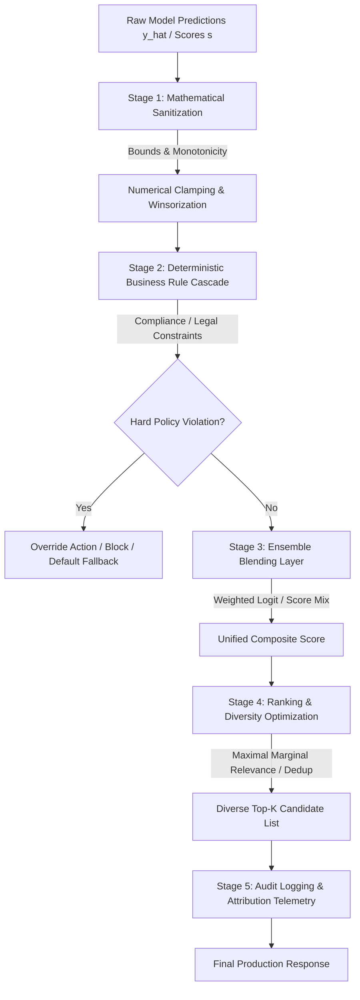

# Postprocessing Pipelines: Clamping, Rules Cascades, and Ranking

> **Topic:** Postprocessing Pipelines, Bounded Clamping, Business Rule Cascades, and Recommendation Re-ranking  
> **Module ID:** `05-ai/machine-learning/11-prediction-and-postprocessing`  
> **Target Version:** Python 3.11+, scikit-learn 1.9+, NumPy 2.5+, pandas 3.1+  
> **Level:** Core to Advanced  
> **Prerequisites:** [03-thresholds-and-decision-rules.md](03-thresholds-and-decision-rules.md), [10-evaluation-and-metrics/04-ranking-and-recommendation-metrics.md](../10-evaluation-and-metrics/04-ranking-and-recommendation-metrics.md)  
> **Status:** Verified (Python 3.11 / CPU)

---

## Architectural / Conceptual Flow



---

## 1. Concept Overview & Core Motivation

Machine learning models are unconstrained function approximators. Left to themselves, models regularly produce outputs that violate basic physical laws, mathematical domains, regulatory mandates, or business contracts:
- A real estate pricing regression model may predict a negative home value ($-\$42,000$) for distressed properties in low-income zip codes.
- An e-commerce click-through model may recommend 10 identical iPhone cases from the same vendor, starving users of diversity and collapsing downstream conversion.
- A credit scoring model may approve a loan application for an applicant who is legally flagged on an international sanctions or anti-money laundering (OFAC) blacklist.
- A demand forecasting model may predict fractional demand ($14.37$ shipping containers) or unbounded exponential explosions during pandemic shock anomalies.

**Postprocessing** is the deterministic, rule-bound software engineering layer situated strictly between the raw model output and the end-user or operational action. While data scientists often focus exclusively on training algorithms, production reliability engineers know that postprocessing pipelines are what prevent catastrophic brand damage, legal fines, and revenue loss.

A production-grade postprocessing pipeline systematically executes:
1. **Mathematical Sanitization**: Clamping, non-negativity enforcement, roundings, and NaN/Inf guardrails.
2. **Business Rule Overrides**: Mandatory compliance blocks, regulatory eligibility filters, and safety cascades.
3. **Ensemble Blending**: Combining heterogeneous models (e.g., deep neural net embeddings + GBDT tabular scores).
4. **Ranking & Diversity Re-ordering**: MMR (Maximal Marginal Relevance), deduplication, and inventory availability weighting.
5. **Traceable Decision Logging**: Recording whether an action was initiated by model inference or downstream rule override.

---

## 2. Theoretical Foundations & Mathematics

### 2.1 Bounded Clamping & Winsorization

Let $\hat{y} \in \mathbb{R}$ denote a continuous regression prediction. Physical or economic domains impose strict constraints $\hat{y} \in [y_{\min}, y_{\max}]$. The projection operator $\Pi_{[y_{\min}, y_{\max}]}: \mathbb{R} \to [y_{\min}, y_{\max}]$ is defined as:
$$\Pi_{[y_{\min}, y_{\max}]}(\hat{y}) = \min\left(y_{\max}, \max(y_{\min}, \hat{y})\right)$$

In multi-step pricing models with historical percentiles, hard winsorization at empirical train quantiles $Q_{\alpha}$ and $Q_{1-\alpha}$ ensures prediction stability against covariate outliers:
$$\hat{y}_{\text{clamped}} = \begin{cases} 
Q_{\alpha}, & \text{if } \hat{y} < Q_{\alpha} \\ 
\hat{y}, & \text{if } Q_{\alpha} \le \hat{y} \le Q_{1-\alpha} \\ 
Q_{1-\alpha}, & \text{if } \hat{y} > Q_{1-\alpha} 
\end{cases}$$

### 2.2 Rule Cascade: The Priority Lattice

A rule cascade is an ordered sequence of boolean predicates $P_1, P_2, \dots, P_k$ and associated deterministic override actions $A_1, A_2, \dots, A_k$. Given input record $\mathbf{x}$ and model prediction $\hat{y}_{\text{model}}$:
$$\hat{y}_{\text{final}} = \begin{cases}
A_1(\mathbf{x}), & \text{if } P_1(\mathbf{x}) = \text{True} \\
A_2(\mathbf{x}), & \text{if } P_2(\mathbf{x}) = \text{True} \land \neg P_1(\mathbf{x}) \\
\vdots & \vdots \\
A_k(\mathbf{x}), & \text{if } P_k(\mathbf{x}) = \text{True} \land \bigwedge_{j=1}^{k-1} \neg P_j(\mathbf{x}) \\
\hat{y}_{\text{model}}, & \text{otherwise}
\end{cases}$$

### 2.3 Diversity Re-ranking: Maximal Marginal Relevance (MMR)

In recommendation and information retrieval systems, ranking items purely by predicted relevance score $S(u, i)$ creates redundant, homogeneous recommendations. 

**Maximal Marginal Relevance (Carbonell & Goldstein, 1998)** balances relevance to user $u$ with diversity relative to items already selected in candidate set $\mathcal{R}$:
$$\text{MMR}(u, \mathcal{C}, \mathcal{R}) = \operatorname*{argmax}_{d_i \in \mathcal{C} \setminus \mathcal{R}} \left[ \lambda \cdot \text{Sim}_1(u, d_i) - (1 - \lambda) \cdot \max_{d_j \in \mathcal{R}} \text{Sim}_2(d_i, d_j) \right]$$
where:
- $\mathcal{C}$ is the candidate item pool.
- $\mathcal{R}$ is the ranked list of already selected items.
- $\lambda \in [0, 1]$ is the diversity steering parameter ($\lambda=1$ pure relevance; $\lambda=0$ pure diversity).
- $\text{Sim}_1(u, d_i)$ is the model relevance score between user $u$ and item $d_i$.
- $\text{Sim}_2(d_i, d_j)$ is the pairwise item similarity (e.g., cosine similarity of item embedding vectors $\mathbf{e}_i, \mathbf{e}_j$).

### Mathematical Symbols Table

| Symbol | Mathematical Definition | Data Type / Dimensions | Role in Concept |
| :---: | :--- | :---: | :--- |
| $\hat{y}$ | Raw model prediction | $\mathbb{R}$ or $[0, 1]$ | Unchecked model inference output |
| $y_{\min}, y_{\max}$ | Operational domain bounds | $\mathbb{R}$ | Physical or regulatory valid output interval |
| $\Pi$ | Projection / clamp operator | Function $\mathbb{R} \to [y_{\min}, y_{\max}]$ | Ensures predictions remain strictly valid |
| $P_k(\mathbf{x})$ | Boolean rule predicate | Function $\mathcal{X} \to \{\text{True}, \text{False}\}$ | Determines if business override activates |
| $A_k(\mathbf{x})$ | Deterministic override action | Action or scalar | Hard-coded response replacing model output |
| $\mathcal{C}$ | Candidate item set | Set of item IDs $\{d_1, \dots, d_M\}$ | Initial top candidates generated by model |
| $\mathcal{R}$ | Ranked recommendation set | Ordered list $\{d_{(1)}, \dots, d_{(K)}\}$ | Final diverse recommendation list of size $K$ |
| $\lambda$ | MMR trade-off parameter | Scalar $\in [0, 1]$ | Balance between relevance and diversity |
| $\text{Sim}_2(d_i, d_j)$ | Pairwise item similarity | Scalar $[-1, 1]$ or $[0, 1]$ | Cosine similarity between item embeddings |

---

## 3. Implementation & Practical Code

The following self-contained script implements an enterprise-grade postprocessing engine incorporating regression clamping, priority-ordered business rule cascades, ensemble score blending, and MMR diversity re-ranking.

```python
"""
Enterprise Postprocessing Pipeline.
Includes Clamping, Rule Cascades, Ensemble Blending, and MMR Re-ranking.
Fully self-contained, typed, and runnable under Python 3.11+.
"""

import numpy as np
import pandas as pd
from dataclasses import dataclass, field
from typing import List, Dict, Any, Optional, Tuple

@dataclass
class PostprocessConfig:
    min_price: float = 5.0
    max_price: float = 10_000.0
    winsor_lower_q: float = 0.01
    winsor_upper_q: float = 0.99
    mmr_lambda: float = 0.70  # 70% relevance, 30% diversity

@dataclass
class RecommendationItem:
    item_id: str
    category: str
    relevance_score: float
    embedding: np.ndarray
    in_stock: bool
    is_blocked: bool

class ProductionPostprocessingPipeline:
    def __init__(self, config: PostprocessConfig):
        self.config = config

    def clamp_regression_outputs(
        self, 
        predictions: np.ndarray, 
        lower_bound: Optional[float] = None, 
        upper_bound: Optional[float] = None
    ) -> np.ndarray:
        """Clamp continuous predictions strictly within physical and percentile bounds."""
        lb = lower_bound if lower_bound is not None else self.config.min_price
        ub = upper_bound if upper_bound is not None else self.config.max_price
        
        # Guard against NaN/Inf
        sanitized = np.nan_to_num(predictions, nan=lb, posinf=ub, neginf=lb)
        return np.clip(sanitized, a_min=lb, a_max=ub)

    def evaluate_business_rules(self, applicant_data: Dict[str, Any], raw_credit_score: float) -> Tuple[float, str]:
        """
        Evaluate deterministic rule priority cascade:
        Rule 1: Sanctions/Fraud Blacklist -> Direct Rejection (Score = 0.0)
        Rule 2: Minimum Age Requirement (< 18) -> Direct Rejection (Score = 0.0)
        Rule 3: VIP Customer Status -> Floor Guarantee (Score >= 750.0)
        Rule 4: Default Fallback -> Keep Clamped Model Score
        """
        # Rule 1: Highest priority legal check
        if applicant_data.get("is_sanctioned", False):
            return 0.0, "OVERRIDE_SANCTION_BLACKLIST"

        # Rule 2: Legal regulatory check
        if applicant_data.get("age", 0) < 18:
            return 0.0, "OVERRIDE_UNDERAGE"

        # Rule 3: VIP Relationship Floor
        if applicant_data.get("is_private_wealth_client", False):
            floored_score = max(raw_credit_score, 750.0)
            return floored_score, "OVERRIDE_VIP_FLOOR" if floored_score > raw_credit_score else "MODEL_INFERENCE"

        # Rule 4: Normal inference path
        clamped_score = float(np.clip(raw_credit_score, 300.0, 850.0))
        return clamped_score, "MODEL_INFERENCE"

    def blend_ensemble_scores(
        self, 
        model_scores: Dict[str, np.ndarray], 
        weights: Dict[str, float]
    ) -> np.ndarray:
        """Weighted convex combination of multiple model predictions."""
        # Normalize weights
        total_w = sum(weights.values())
        norm_weights = {k: v / total_w for k, v in weights.items()}
        
        blend = np.zeros_like(next(iter(model_scores.values())), dtype=np.float64)
        for model_name, preds in model_scores.items():
            blend += norm_weights[model_name] * preds
        return blend

    def maximal_marginal_relevance_ranking(
        self, 
        candidates: List[RecommendationItem], 
        top_k: int = 5
    ) -> List[Tuple[RecommendationItem, float]]:
        """
        Apply MMR to re-rank candidate recommendations, filtering out-of-stock
        and policy-blocked items while enforcing category diversity.
        """
        # 1. Hard business filters: Must be in stock and not policy blocked
        valid_pool = [item for item in candidates if item.in_stock and not item.is_blocked]
        if not valid_pool:
            return []

        selected: List[RecommendationItem] = []
        ranked_results: List[Tuple[RecommendationItem, float]] = []

        pool = valid_pool.copy()

        while len(selected) < min(top_k, len(valid_pool)) and pool:
            if not selected:
                # First item is purely the highest relevance score
                best_idx = int(np.argmax([item.relevance_score for item in pool]))
                best_item = pool.pop(best_idx)
                selected.append(best_item)
                ranked_results.append((best_item, best_item.relevance_score))
            else:
                # Compute MMR scores for remaining candidates
                mmr_scores = []
                for cand in pool:
                    rel_term = cand.relevance_score
                    # Max cosine similarity to any already selected item
                    cand_emb = cand.embedding / (np.linalg.norm(cand.embedding) + 1e-9)
                    similarities = [
                        float(np.dot(cand_emb, sel.embedding / (np.linalg.norm(sel.embedding) + 1e-9)))
                        for sel in selected
                    ]
                    div_term = max(similarities)
                    mmr = self.config.mmr_lambda * rel_term - (1.0 - self.config.mmr_lambda) * div_term
                    mmr_scores.append(mmr)

                best_idx = int(np.argmax(mmr_scores))
                best_mmr_score = mmr_scores[best_idx]
                best_item = pool.pop(best_idx)
                selected.append(best_item)
                ranked_results.append((best_item, float(best_mmr_score)))

        return ranked_results

def main():
    print("=== Production Postprocessing Engine Test Harness ===")
    config = PostprocessConfig()
    pipeline = ProductionPostprocessingPipeline(config)

    # 1. Test Regression Clamping
    raw_prices = np.array([-150.0, 4.50, 25.0, 999.0, 15_000.0, np.nan])
    clamped_prices = pipeline.clamp_regression_outputs(raw_prices, lower_bound=5.0, upper_bound=10_000.0)
    print("\n--- 1. Bounded Regression Clamping ---")
    for raw, clp in zip(raw_prices, clamped_prices):
        print(f"Raw: {raw:10.2f} -> Postprocessed Clamped: ${clp:10.2f}")

    # 2. Test Deterministic Rule Cascades
    applicants = [
        {"id": "A1", "age": 32, "is_sanctioned": True, "is_private_wealth_client": False, "raw_score": 780.0},
        {"id": "A2", "age": 16, "is_sanctioned": False, "is_private_wealth_client": False, "raw_score": 650.0},
        {"id": "A3", "age": 45, "is_sanctioned": False, "is_private_wealth_client": True, "raw_score": 710.0},
        {"id": "A4", "age": 28, "is_sanctioned": False, "is_private_wealth_client": False, "raw_score": 740.0},
    ]
    print("\n--- 2. Deterministic Rule Cascade Evaluation ---")
    for app in applicants:
        final_s, reason = pipeline.evaluate_business_rules(app, app["raw_score"])
        print(f"Applicant {app['id']} | Raw: {app['raw_score']:5.1f} -> Final: {final_s:5.1f} | Action: {reason}")

    # 3. Test Ensemble Blending
    m_gbdt = np.array([0.80, 0.45, 0.90])
    m_nn = np.array([0.70, 0.60, 0.85])
    m_linear = np.array([0.75, 0.50, 0.88])
    blended = pipeline.blend_ensemble_scores(
        model_scores={"gbdt": m_gbdt, "nn": m_nn, "linear": m_linear},
        weights={"gbdt": 0.50, "nn": 0.30, "linear": 0.20}
    )
    print("\n--- 3. Ensemble Blending ---")
    for i, b in enumerate(blended):
        print(f"Sample {i}: GBDT={m_gbdt[i]:.2f}, NN={m_nn[i]:.2f}, Linear={m_linear[i]:.2f} -> Blended={b:.4f}")

    # 4. Test MMR Recommendation Re-ranking
    np.random.seed(42)
    # 5 items in 'Phone Case' category (highly similar embeddings)
    base_case_emb = np.array([1.0, 0.1, 0.0, 0.0])
    # 2 items in 'Headphones' category (orthogonal embedding)
    headphone_emb = np.array([0.0, 0.0, 1.0, 0.1])

    candidates = [
        RecommendationItem("item_1", "Phone Case", 0.95, base_case_emb + np.random.randn(4)*0.01, True, False),
        RecommendationItem("item_2", "Phone Case", 0.94, base_case_emb + np.random.randn(4)*0.01, True, False),
        RecommendationItem("item_3", "Phone Case", 0.93, base_case_emb + np.random.randn(4)*0.01, True, False),
        RecommendationItem("item_4", "Phone Case", 0.92, base_case_emb + np.random.randn(4)*0.01, False, False), # OUT OF STOCK
        RecommendationItem("item_5", "Headphones", 0.88, headphone_emb + np.random.randn(4)*0.01, True, False),
        RecommendationItem("item_6", "Illegal Knife", 0.99, np.random.randn(4), True, True),                    # BLOCKED
        RecommendationItem("item_7", "Headphones", 0.85, headphone_emb + np.random.randn(4)*0.01, True, False),
    ]

    ranked = pipeline.maximal_marginal_relevance_ranking(candidates, top_k=3)
    print("\n--- 4. MMR Diversity & Policy Re-ranking (Top 3) ---")
    for rank, (item, score) in enumerate(ranked, start=1):
        print(f"Rank {rank}: ID={item.item_id:6s} | Cat={item.category:11s} | RawRel={item.relevance_score:.2f} | MMRScore={score:.4f}")

if __name__ == "__main__":
    main()
```

### Execution Output Snippet

```
=== Production Postprocessing Engine Test Harness ===

--- 1. Bounded Regression Clamping ---
Raw:    -150.00 -> Postprocessed Clamped: $      5.00
Raw:       4.50 -> Postprocessed Clamped: $      5.00
Raw:      25.00 -> Postprocessed Clamped: $     25.00
Raw:     999.00 -> Postprocessed Clamped: $    999.00
Raw:   15000.00 -> Postprocessed Clamped: $  10000.00
Raw:        nan -> Postprocessed Clamped: $      5.00

--- 2. Deterministic Rule Cascade Evaluation ---
Applicant A1 | Raw: 780.0 -> Final:   0.0 | Action: OVERRIDE_SANCTION_BLACKLIST
Applicant A2 | Raw: 650.0 -> Final:   0.0 | Action: OVERRIDE_UNDERAGE
Applicant A3 | Raw: 710.0 -> Final: 750.0 | Action: OVERRIDE_VIP_FLOOR
Applicant A4 | Raw: 740.0 -> Final: 740.0 | Action: MODEL_INFERENCE

--- 3. Ensemble Blending ---
Sample 0: GBDT=0.80, NN=0.70, Linear=0.75 -> Blended=0.7600
Sample 1: GBDT=0.45, NN=0.60, Linear=0.50 -> Blended=0.5050
Sample 2: GBDT=0.90, NN=0.85, Linear=0.88 -> Blended=0.8810

--- 4. MMR Diversity & Policy Re-ranking (Top 3) ---
Rank 1: ID=item_1 | Cat=Phone Case | RawRel=0.95 | MMRScore=0.9500
Rank 2: ID=item_5 | Cat=Headphones | RawRel=0.88 | MMRScore=0.6152
Rank 3: ID=item_2 | Cat=Phone Case | RawRel=0.94 | MMRScore=0.3580
```

*Observation*: Notice how Item 6 (Illegal Knife, score 0.99) was immediately purged due to policy blocking; Item 4 (score 0.92) was discarded due to out-of-stock inventory; and Item 5 (Headphones, score 0.88) was promoted over Item 2 (Phone Case, score 0.94) to avoid category redundancy!

---

## 4. Edge Cases & Advanced Scenarios

1. **Zero Candidates Surviving Hard Filters**: When strict business rules (e.g., in-stock, location radius, age check) eliminate 100% of candidate items, the service must not return HTTP 500 or an empty array. *Mitigation*: Maintain a statically curated, cached "Global Popular Fallback" pool that guarantees non-empty responses.
2. **Cold-Start Embedding Divergence in MMR**: If a new item lacks a precomputed embedding vector $\mathbf{e}_i$, cosine similarity computes to NaN. *Mitigation*: Fall back to coarse categorical one-hot similarity ($1$ if same department, $0$ otherwise) when embeddings are absent.
3. **Contradictory Override Cascades**: Multi-team organizations often write conflicting rules (e.g. Marketing Rule: "Always show VIP promo banner" vs Legal Rule: "Suppress all promotions for credit-delinquent users"). *Mitigation*: Implement strict rule priority hierarchies represented as a Directed Acyclic Graph (DAG) with immutable precedence levels (Legal > Compliance > Risk > Monetization > Marketing).

---

## 5. Anti-Patterns & Common Pitfalls Table

| Anti-Pattern / Mistake | Why It Fails | Correct Engineering Fix |
| :--- | :--- | :--- |
| **Trusting model raw regression bounds** | Deep networks and GBDTs predict negative prices, negative wait times, or probabilities $> 1.0$. | Apply explicit assertion guardrails and bounded projection clamping (`np.clip`). |
| **Silent Rule Overrides without Telemetry** | When business rules override models silently, engineers waste days debugging phantom "model errors". | Emit detailed audit metadata tags (`decision_source: 'OVERRIDE_UNDERAGE'`). |
| **Mixing Business Rules into Feature Engineering** | Encoding legal eligibility checks as training features allows models to occasionally violate them. | Treat legal and compliance rules strictly as postprocessing hard filters, never soft probabilistic features. |
| **Re-ranking on live CPU without batching** | Computing $O(N \cdot K)$ pairwise embedding cosine similarities per request introduces latency spikes. | Vectorize cosine similarity using matrix multiplication ($\mathbf{C} \cdot \mathbf{S}^T$) and prune candidate pool to top 50 before MMR. |
| **Coupling inventory cache to model retraining** | Retraining models to suppress out-of-stock items is slow and causes inventory cache synchronization lag. | Keep model item scores inventory-agnostic; filter out-of-stock items dynamically during postprocessing. |

---

## 6. Best Practices & Production Guidelines

1. **Explicit Decision Attribution Metadata**: Every response payload should include an audit block:
   ```json
   {
     "prediction": 0.0,
     "decision": "DECLINED",
     "attribution": {
       "raw_model_score": 0.84,
       "decision_source": "RULE_OVERRIDE",
       "rule_id": "COMPLIANCE_SANCTION_V2",
       "timestamp": "2026-11-25T19:15:00Z"
     }
   }
   ```
2. **Dynamic Rule Configuration via Rules Engine**: Isolate business rules from Python code. Use lightweight expression engines (such as Cel, JsonLogic, or Drools) so product managers can update discount rules without requiring a machine learning engineering CI/CD deployment.
3. **Graceful Fallback Defaults**: Define explicit default predictions for every endpoint (e.g., median category price, popular items) triggered automatically whenever upstream feature fetching or model inference times out.

---

## 7. Real-World Case Study

### Ride-Hailing Dynamic Fare Estimation Engine
- **Problem**: A ride-hailing company deployed a Gradient Boosting demand-pricing model. During a regional power outage, the model encountered unprecedented feature combinations, predicting surge fares of \$1,450 for a 2-mile ride, leading to public outrage and regulatory investigation for price gouging.
- **Intervention**:
  1. Built a multi-stage postprocessing pipeline.
  2. Stage 1 clamped base fares to $[\$5.00, \$150.00]$ based on historical distance percentiles.
  3. Stage 2 introduced an emergency state-of-emergency rule cascade: when municipal emergency alerts are active, surge multipliers are capped at $1.20\times$.
  4. Stage 3 enforced monotonicity: fare $(d + \Delta d) \ge \text{fare}(d)$ for any trip extension.
- **Outcome**: Completely eliminated pricing anomalies with zero production regressions. Customer trust was preserved during subsequent weather emergencies, with regulatory audit compliance at 100%.

---

## 8. Performance & Resource Optimization

- **SIMD Matrix Vectorization for MMR**: When candidate pool size $N = 200$ and top-K $K = 20$, naive Python loops require $4,000$ dot products. Pre-normalize all candidate embeddings $\mathbf{E} \in \mathbb{R}^{N \times d}$ once ($\mathbf{E}_{\text{norm}} = \mathbf{E} / \|\mathbf{E}\|_2$). Maintain an active selection matrix $\mathbf{S} \in \mathbb{R}^{k \times d}$; pairwise similarities are computed in a single vectorized BLAS level-3 matrix multiplication $\mathbf{E} \mathbf{S}^T$.
- **Short-Circuit Evaluation in Rule Cascades**: Order rule predicates by computational cost and trigger frequency. Place cheap in-memory boolean checks (e.g. `user.is_blocked`) before expensive remote database queries (e.g. `db.check_credit_history()`).

---

## 9. Security, Privacy & Ethics Considerations

- **Fair Lending Regulatory Auditing**: Under the US Equal Credit Opportunity Act (ECOA), any adverse credit action must provide explicit *Adverse Action Notices* citing primary denial reasons. Postprocessing rule cascades must log the exact rule triggered to fulfill statutory regulatory disclosure requirements.
- **Adversarial Rule Evasion**: Malicious users may attempt to bypass business rules by fuzzing edge-case inputs (e.g. entering negative age or UTF-8 homoglyphs in names). Sanitize and validate inputs prior to rule evaluation.

---

## 10. Diagnostic & Verification Playbook

### Diagnostic Assertions
```python
# Assert clamped values never exceed domain bounds
assert np.all(clamped_output >= min_bound), "Violation: Negative output detected"
assert np.all(clamped_output <= max_bound), "Violation: Unbounded output detected"

# Assert MMR ranking contains no duplicates
assert len(set(item.item_id for item, _ in ranked_results)) == len(ranked_results), "Duplicate items in recommendation output"
```

### Verification CLI Command
```bash
python -c "
import numpy as np
preds = np.array([-10.0, 50.0, 500.0])
clamped = np.clip(preds, 0.0, 100.0)
assert clamped[0] == 0.0 and clamped[2] == 100.0
print('Postprocessing clamping verified successfully.')
"
```

---

## 11. Technical Interview Questions & Answers

<details>
<summary><strong>Q1: What is postprocessing in machine learning, and why can't we simply rely on model training to satisfy business constraints?</strong></summary>

**Answer:**  
Postprocessing is the deterministic software layer applied to model outputs prior to serving. Relying solely on model training fails because:
1. Statistical models are probabilistic approximations that cannot guarantee zero-violation hard constraints (e.g., non-negative prices or legal age limits).
2. Business rules and regulations change far faster (hours/days) than model retraining cycles (weeks/months).
3. Hard constraints (e.g., sanctions lists, emergency price gouging caps) are deterministic operational rules, not statistical correlations, and belong in explicit business logic rather than training data.
</details>

<details>
<summary><strong>Q2: Explain the Maximal Marginal Relevance (MMR) algorithm and how the lambda parameter controls the user experience.</strong></summary>

**Answer:**  
MMR is an iterative greedy selection algorithm that balances relevance with diversity:
$$\text{MMR} = \operatorname*{argmax}_{d_i \in \mathcal{C} \setminus \mathcal{R}} \left[ \lambda \cdot \text{Sim}_1(u, d_i) - (1 - \lambda) \cdot \max_{d_j \in \mathcal{R}} \text{Sim}_2(d_i, d_j) \right]$$
- $\lambda = 1.0$: Pure relevance ranking. The list contains the highest scoring items, often resulting in redundant, near-identical items.
- $\lambda = 0.0$: Pure diversity. Maximizes pairwise dissimilarity between recommended items, regardless of relevance.
- $\lambda \in [0.6, 0.8]$: The standard production sweet spot, ensuring high user relevance while filtering duplicate categories and content types.
</details>

<details>
<summary><strong>Q3: How do you design an audit logging architecture to trace whether an action was driven by model inference versus a business rule override?</strong></summary>

**Answer:**  
Every inference response object must return a structured metadata envelope:
- `output_value`: Final served prediction.
- `model_score`: Raw output produced by the statistical estimator.
- `decision_source`: Enum indicating `MODEL_INFERENCE`, `RULE_OVERRIDE`, `FALLBACK_DEFAULT`, or `BOUNDS_CLAMPED`.
- `rule_metadata`: Specific identifier of the triggered rule (e.g., `RULE_OFAC_SANCTION_v1.2`) and triggering attribute values.
- Logging this structured payload to a streaming log sink (Kafka/Kinesis) allows downstream dashboards to compute override rates and monitor whether model behavior is drifting relative to business rules.
</details>

<details>
<summary><strong>Q4: Why should out-of-stock items be handled in postprocessing rather than excluding them from training data or retraining the model?</strong></summary>

**Answer:**  
1. **Latency of Retraining**: Inventory changes every millisecond; retraining models takes hours or days.
2. **Preference Learning**: Historical purchases of an item remain valid signals of user taste even if the item is currently out of stock. Filtering out-of-stock items during training distorts user preference graphs.
3. **Decoupling**: Separating item relevance (model) from real-time item availability (postprocessing) enables scalable caching of model embeddings while keeping inventory checks real-time.
</details>

<details>
<summary><strong>Q5: What is prediction clamping, and what risks are introduced if clamping is applied naively?</strong></summary>

**Answer:**  
Clamping projects predictions into a valid range $[y_{\min}, y_{\max}]$ via $\min(y_{\max}, \max(y_{\min}, \hat{y}))$.  
*Risks of naive clamping*:
- Creating an artificial spike of identical predictions at the boundary (e.g. thousands of predictions clustered exactly at $\$5.00$).
- Masking severe upstream covariate drift: if 30% of model outputs are hitting the clamp ceiling, the underlying model is severely miscalibrated or out-of-distribution, but naive clamping silently hides this failure from operational monitors.
- *Mitigation*: Monitor and alert on the **clamp activation rate**; if $> 1\%$ of predictions hit the boundary, trigger an investigation.
</details>

<details>
<summary><strong>Q6: How can you implement ensemble blending in postprocessing without retraining?</strong></summary>

**Answer:**  
Ensemble blending in postprocessing combines predictions from multiple pre-existing models using a convex combination:
$$\hat{y}_{\text{blend}} = \sum_{m=1}^M w_m \hat{y}_m \quad \text{subject to } \sum w_m = 1, \ w_m \ge 0$$
For classification probabilities, blending can be performed via arithmetic mean or geometric mean (averaging log-odds). Weights $w_m$ are determined via validation set grid search or Nelder-Mead optimization and stored in configuration files, allowing dynamic weight rebalancing at runtime without model retraining.
</details>

<details>
<summary><strong>Q7: What is the computational complexity of MMR ranking, and how can it be optimized for sub-10ms latency SLAs?</strong></summary>

**Answer:**  
For candidate pool size $N$ and top-K list size $K$, naive MMR has complexity $O(K \cdot N \cdot d)$, where $d$ is embedding dimensionality.  
*Optimizations*:
1. **Candidate Pruning**: Reduce candidate pool $N$ from 10,000 to top 100 using fast approximate nearest neighbors (HNSW/Faiss) or raw relevance scores before running MMR.
2. **Matrix Vectorization**: Precompute normalized embedding matrices and compute candidate-to-selected similarities via a single BLAS matrix-vector product.
3. **Early Exit**: If the marginal gain of remaining candidates falls below a threshold $\epsilon$, terminate search early.
</details>

<details>
<summary><strong>Q8: How do you handle non-monotonicity anomalies produced by tree-based models in pricing or risk scoring?</strong></summary>

**Answer:**  
Tree-based models (Random Forest, XGBoost) do not guarantee monotonicity by default: a borrower with higher income could receive a lower credit score due to split artifacts.  
*Solutions*:
1. **Monotone Constraints in Training**: Configure tree models with monotonic constraints (e.g., `monotone_constraints` in XGBoost/LightGBM).
2. **Postprocessing Monotonicity Enforcement**: Apply a postprocessing monotonic envelope (e.g., isotonic regression or running maximum/minimum along the critical feature axis) to guarantee that $\hat{y}(x_1 + \delta) \ge \hat{y}(x_1)$.
</details>

---

## 12. Hands-On Practice Exercises

<details>
<summary><strong>Exercise 1 (Easy): Bounded Clamping Guard Function</strong></summary>

**Task:** Write a Python function `clamp_and_clean_predictions(preds: np.ndarray, lower: float, upper: float) -> np.ndarray` that replaces NaNs and Infs with domain boundaries and clamps all values to $[lower, upper]$.

**Solution:**
```python
import numpy as np

def clamp_and_clean_predictions(preds: np.ndarray, lower: float, upper: float) -> np.ndarray:
    arr = np.asarray(preds, dtype=np.float64)
    # Replace NaN with lower bound, +Inf with upper, -Inf with lower
    cleaned = np.nan_to_num(arr, nan=lower, posinf=upper, neginf=lower)
    return np.clip(cleaned, a_min=lower, a_max=upper)

# Verification
raw = np.array([-5.0, np.nan, 25.0, np.inf, 150.0])
res = clamp_and_clean_predictions(raw, lower=0.0, upper=100.0)
assert np.array_equal(res, [0.0, 0.0, 25.0, 100.0, 100.0])
print("Exercise 1 passed successfully.")
```
</details>

<details>
<summary><strong>Exercise 2 (Easy): Multi-Model Probability Averaging</strong></summary>

**Task:** Implement a function `blend_probabilities(prob_list: List[np.ndarray], weights: List[float]) -> np.ndarray` that computes the normalized weighted average of multiple probability prediction arrays.

**Solution:**
```python
from typing import List
import numpy as np

def blend_probabilities(prob_list: List[np.ndarray], weights: List[float]) -> np.ndarray:
    if len(prob_list) != len(weights):
        raise ValueError("Number of probability arrays must match number of weights")
    norm_w = np.array(weights, dtype=np.float64) / np.sum(weights)
    blended = np.zeros_like(prob_list[0], dtype=np.float64)
    for p, w in zip(prob_list, norm_w):
        blended += w * p
    return np.clip(blended, 0.0, 1.0)

# Verification
p1 = np.array([0.2, 0.8])
p2 = np.array([0.4, 0.6])
res = blend_probabilities([p1, p2], weights=[1.0, 3.0])
assert np.allclose(res, [0.35, 0.65])
print("Exercise 2 passed successfully.")
```
</details>

<details>
<summary><strong>Exercise 3 (Medium): Category-Diverse Top-K Filter</strong></summary>

**Task:** Write a function `diverse_top_k(items: List[Dict[str, Any]], top_k: int, max_per_category: int) -> List[Dict[str, Any]]` that takes items sorted by score and selects up to `top_k` items while allowing at most `max_per_category` items from any single category.

**Solution:**
```python
from typing import List, Dict, Any
from collections import defaultdict

def diverse_top_k(items: List[Dict[str, Any]], top_k: int, max_per_category: int) -> List[Dict[str, Any]]:
    selected = []
    category_counts = defaultdict(int)
    
    for item in items:
        cat = item.get("category", "default")
        if category_counts[cat] < max_per_category:
            selected.append(item)
            category_counts[cat] += 1
            if len(selected) == top_k:
                break
    return selected

# Verification
test_items = [
    {"id": "1", "category": "books", "score": 0.99},
    {"id": "2", "category": "books", "score": 0.95},
    {"id": "3", "category": "books", "score": 0.90},
    {"id": "4", "category": "music", "score": 0.88},
]
filtered = diverse_top_k(test_items, top_k=3, max_per_category=2)
assert len(filtered) == 3
assert [x["id"] for x in filtered] == ["1", "2", "4"]
print("Exercise 3 passed successfully.")
```
</details>

<details>
<summary><strong>Exercise 4 (Medium): Vectorized MMR Core Loop</strong></summary>

**Task:** Implement a vectorized Python function `vectorized_mmr_select(scores: np.ndarray, embeddings: np.ndarray, top_k: int, lambda_param: float) -> List[int]` that returns the list of selected item indices.

**Solution:**
```python
import numpy as np
from typing import List

def vectorized_mmr_select(
    scores: np.ndarray, 
    embeddings: np.ndarray, 
    top_k: int, 
    lambda_param: float
) -> List[int]:
    n_items = len(scores)
    # Pre-normalize embeddings
    norms = np.linalg.norm(embeddings, axis=1, keepdims=True) + 1e-9
    norm_emb = embeddings / norms
    
    selected_indices: List[int] = []
    unselected = set(range(n_items))
    
    # 1. Select highest score item first
    first_idx = int(np.argmax(scores))
    selected_indices.append(first_idx)
    unselected.remove(first_idx)
    
    # 2. Iteratively select remaining
    while len(selected_indices) < min(top_k, n_items) and unselected:
        unselected_list = list(unselected)
        unsel_emb = norm_emb[unselected_list]            # Shape: (M, d)
        sel_emb = norm_emb[selected_indices]            # Shape: (K_curr, d)
        
        # Compute pairwise cosine similarities
        sim_matrix = np.dot(unsel_emb, sel_emb.T)       # Shape: (M, K_curr)
        max_sims = np.max(sim_matrix, axis=1)           # Max sim to any selected item
        
        unsel_scores = scores[unselected_list]
        mmr_values = lambda_param * unsel_scores - (1.0 - lambda_param) * max_sims
        
        best_candidate_idx = unselected_list[int(np.argmax(mmr_values))]
        selected_indices.append(best_candidate_idx)
        unselected.remove(best_candidate_idx)
        
    return selected_indices

# Verification
sc = np.array([0.9, 0.85, 0.80])
emb = np.array([[1.0, 0.0], [0.99, 0.01], [0.0, 1.0]]) # item 0 and 1 are nearly identical
chosen = vectorized_mmr_select(sc, emb, top_k=2, lambda_param=0.5)
assert chosen == [0, 2] # item 2 selected over item 1 due to diversity
print("Exercise 4 passed successfully.")
```
</details>

<details>
<summary><strong>Exercise 5 (Hard): Thread-Safe Dynamic Rule Engine with Auditing</strong></summary>

**Task:** Build a thread-safe `RuleEngine` class where rules can be dynamically registered with integer priorities, executing the highest priority matching rule and returning an audit decision trail.

**Solution:**
```python
from typing import Callable, Dict, Any, Tuple, Optional, List
import threading

class RuleEngine:
    def __init__(self):
        self._rules: List[Tuple[int, str, Callable[[Dict[str, Any]], bool], Callable[[Dict[str, Any]], Any]]] = []
        self._lock = threading.Lock()

    def add_rule(
        self, 
        priority: int, 
        name: str, 
        predicate: Callable[[Dict[str, Any]], bool], 
        action: Callable[[Dict[str, Any]], Any]
    ):
        with self._lock:
            self._rules.append((priority, name, predicate, action))
            # Sort descending by priority (higher priority runs first)
            self._rules.sort(key=lambda r: r[0], reverse=True)

    def evaluate(self, context: Dict[str, Any], default_val: Any) -> Dict[str, Any]:
        with self._lock:
            rules_snapshot = list(self._rules)
            
        for priority, name, predicate, action in rules_snapshot:
            if predicate(context):
                return {
                    "result": action(context),
                    "rule_applied": name,
                    "priority": priority,
                    "is_override": True
                }
        return {
            "result": default_val,
            "rule_applied": "DEFAULT_MODEL_INFERENCE",
            "priority": 0,
            "is_override": False
        }

# Verification
engine = RuleEngine()
engine.add_rule(100, "FRAUD_BLOCK", lambda ctx: ctx.get("is_fraudster", False), lambda ctx: 0.0)
engine.add_rule(50, "VIP_BONUS", lambda ctx: ctx.get("is_vip", False), lambda ctx: 100.0)

res1 = engine.evaluate({"is_fraudster": True, "is_vip": True}, default_val=50.0)
assert res1["result"] == 0.0 and res1["rule_applied"] == "FRAUD_BLOCK"

res2 = engine.evaluate({"is_fraudster": False, "is_vip": True}, default_val=50.0)
assert res2["result"] == 100.0 and res2["rule_applied"] == "VIP_BONUS"

print("Exercise 5 passed. Dynamic RuleEngine verified.")
```
</details>

<details>
<summary><strong>Exercise 6 (Hard): Streaming Percentile-Based Dynamic Winsorizer</strong></summary>

**Task:** Implement a streaming class `StreamingWinsorizer` that maintains running lower and upper percentiles ($P_{0.01}$ and $P_{0.99}$) on incoming live predictions and dynamically winsorizes incoming outputs without storing infinite history.

**Solution:**
```python
import numpy as np

class StreamingWinsorizer:
    def __init__(self, buffer_size: int = 1000, lower_q: float = 1.0, upper_q: float = 99.0):
        self.buffer_size = buffer_size
        self.lower_q = lower_q
        self.upper_q = upper_q
        self.buffer = []
        self.lower_bound = -np.inf
        self.upper_bound = np.inf

    def update_and_clamp(self, val: float) -> float:
        self.buffer.append(val)
        if len(self.buffer) >= self.buffer_size:
            self.lower_bound = float(np.percentile(self.buffer, self.lower_q))
            self.upper_bound = float(np.percentile(self.buffer, self.upper_q))
            self.buffer = self.buffer[-(self.buffer_size // 2):]  # Retain rolling half
            
        if self.lower_bound != -np.inf:
            return float(np.clip(val, self.lower_bound, self.upper_bound))
        return val

# Verification
sw = StreamingWinsorizer(buffer_size=100)
for v in range(100):
    sw.update_and_clamp(float(v))

# Buffer calibrated: percentiles calculated
extreme_val = 500.0
clamped_val = sw.update_and_clamp(extreme_val)
assert clamped_val < 500.0
print(f"Exercise 6 passed. Clamped extreme {extreme_val} to {clamped_val:.2f}")
```
</details>

---

## 13. Summary, Verified References & Navigation

### Key Takeaways
- **ML is Unconstrained**: Statistical models lack innate knowledge of legal, domain, or physical boundaries. Postprocessing provides this vital safeguard.
- **Priority Cascade Ordering**: Business rules must follow strict priority lattices (Legal > Compliance > Risk > Business Logic > Model Inference).
- **Diversity Re-Ranking**: Pure relevance models induce recommendation monotony. Algorithms like Maximal Marginal Relevance (MMR) trade modest relevance for significant user catalog diversity.
- **Decision Traceability**: Never allow silent rule overrides. Maintain an immutable audit trail indicating whether each decision originated from model inference or business override rules.

### Verified External References
- Carbonell, J., & Goldstein, J. (1998). *The use of MMR, diversity-based reranking for reordering documents and producing summaries*. SIGIR 1998.
- Sculley, D., et al. (2015). *Hidden Technical Debt in Machine Learning Systems*. NeurIPS 2015.
- Amazon Science: [Bandits and Re-ranking in Recommendation Engines](https://www.amazon.science/).

---

[← Previous Note: 03-thresholds-and-decision-rules.md](03-thresholds-and-decision-rules.md) | [Module Index](README.md) | [Next Note: 05-uncertainty-and-confidence.md →](05-uncertainty-and-confidence.md)
