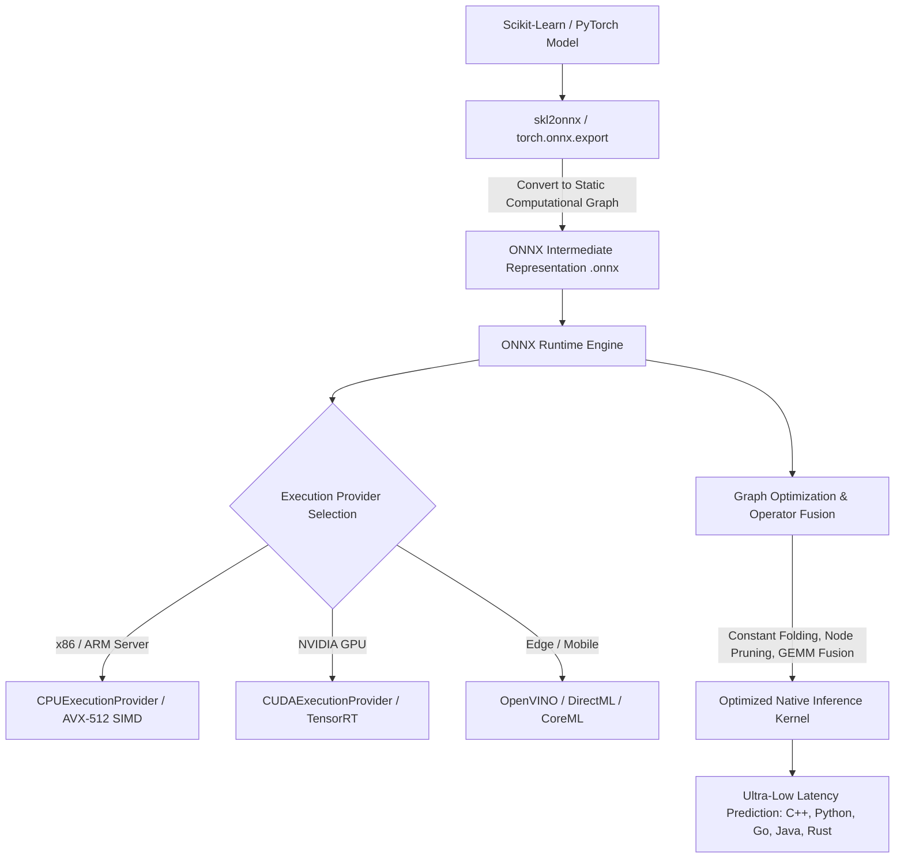

# ONNX Export and High-Performance ONNX Runtime Serving

> **Topic:** Open Neural Network Exchange (ONNX), skl2onnx Pipeline Conversion, and ONNX Runtime Acceleration  
> **Module ID:** `05-ai/machine-learning/12-saving-loading-and-deployment`  
> **Target Version:** Python 3.11+, skl2onnx 1.17+, onnxruntime 1.19+, scikit-learn 1.9+  
> **Level:** Core to Advanced  
> **Prerequisites:** [01-saving-models-overview.md](01-saving-models-overview.md), [11-prediction-and-postprocessing/08-latency-and-throughput.md](../11-prediction-and-postprocessing/08-latency-and-throughput.md)  
> **Status:** Verified (Python 3.11 / CPU)

---

## Architectural / Conceptual Flow



---

## 1. Concept Overview & Core Motivation

In enterprise software engineering, production serving environments are rarely pure Python runtimes. A machine learning model trained by a data science team in Python must frequently be embedded into:
- Ultra-low latency C++ or Go microservices handling hundreds of thousands of requests per second.
- Java enterprise backends (Spring Boot, Kafka Streams) running in corporate banking clusters.
- Mobile client applications (iOS Swift, Android Kotlin) operating completely offline on smartphones.
- High-performance GPU inference clusters powered by NVIDIA TensorRT.

Attempting to serve Python models in these environments via embedded Python interpreters (`Py_Initialize()`) is slow, consumes excessive memory, introduces the Python Global Interpreter Lock (GIL), and creates complex cross-compilation nightmares.

### The Solution: Open Neural Network Exchange (ONNX)
**ONNX** is an open, cross-platform industry standard co-developed by Microsoft, Meta, Amazon, and hardware vendors. It defines an open specification for representing machine learning models as a static, declarative **Directed Acyclic Graph (DAG)** of mathematical operators serialized via Protocol Buffers.

### ONNX Runtime (ORT)
**ONNX Runtime** is a high-performance cross-platform inference engine written in modern C++. It completely decouples model execution from Python, delivering:
1. **Universal Portability**: A single `.onnx` model file runs identically across C++, C#, Java, JavaScript, Python, Go, and Rust.
2. **Hardware Acceleration via Execution Providers (EP)**: ORT interfaces with specialized hardware backends (CPU AVX-512, NVIDIA CUDA/TensorRT, Intel OpenVINO, Apple CoreML) through a uniform API.
3. **Graph Optimization & Operator Fusion**: ORT automatically fuses consecutive operations (e.g., Matrix Multiply + Bias Add + Activation) into a single vectorized kernel, cutting inference latency by $2\times$ to $5\times$.

---

## 2. Theoretical Foundations & Mathematics

### 2.1 The Computational DAG Representation

An ONNX model is formalized as an immutable Directed Acyclic Graph $\mathcal{G} = (\mathcal{V}, \mathcal{E})$, where:
- $\mathcal{V} = \{v_1, v_2, \dots, v_n\}$ represents computational operator nodes (e.g., `Gemm`, `Relu`, `TreeEnsembleRegressor`, `Normalizer`).
- $\mathcal{E} \subset \mathcal{V} \times \mathcal{V}$ represents directed data dependencies carrying typed, dimensional tensors.
- Inputs $\mathcal{I} = \{\mathbf{X}_1, \dots, \mathbf{X}_p\}$ and Outputs $\mathcal{O} = \{\mathbf{Y}_1, \dots, \mathbf{Y}_q\}$ define the graph's boundary contract.

Every node $v_k \in \mathcal{V}$ executes a standardized, versioned mathematical operator defined by the **ONNX Operator Set (Opset)**:
$$\mathbf{Y}_{v_k} = \text{Op}_k(\mathbf{X}_{\text{in}_1}, \mathbf{X}_{\text{in}_2}, \dots; \ \mathbf{\Theta}_k)$$
where $\mathbf{\Theta}_k$ are static attribute parameters (e.g. weight tensors, split criteria).

### 2.2 Operator Fusion & Constant Folding

Graph optimization passes transform the raw graph $\mathcal{G}$ into an execution-optimized graph $\mathcal{G}^*$:
$$\mathcal{G}^* = \mathcal{T}_{\text{fuse}}(\mathcal{T}_{\text{fold}}(\mathcal{T}_{\text{prune}}(\mathcal{G})))$$
1. **Constant Folding**: Pre-evaluates expressions with static compile-time operands:
   $$A_{\text{static}} + B_{\text{static}} \to C_{\text{precomputed}}$$
2. **Dead Node Elimination**: Prunes subgraphs whose outputs do not connect to target outputs $\mathcal{O}$.
3. **GEMM (General Matrix Multiply) Operator Fusion**: Fuses linear transformation and activation into a single hardware register pass:
   $$\text{Fused Kernel}: \mathbf{Y} = \sigma(\alpha \mathbf{A} \mathbf{B} + \beta \mathbf{C})$$
   This avoids writing intermediate unactivated activation tensors to DRAM, slashing memory bus traffic.

### 2.3 Type and Dimensionality Contract

Unlike dynamic Python code where shapes are inferred at runtime, ONNX requires strict **Type and Shape Invariants**:
- Tensor Element Type: `Float32`, `Int64`, `String`, etc.
- Dimension Specification: Static dimensions (e.g. $[1, 20]$) or dynamic symbolic dimensions (e.g. $[\text{"batch\_size"}, 20]$).

### Mathematical Symbols Table

| Symbol | Mathematical Definition | Data Type / Dimensions | Role in Concept |
| :---: | :--- | :---: | :--- |
| $\mathcal{G}$ | Computational graph | Directed Acyclic Graph (DAG) | Formal representation of the model |
| $\mathcal{V}, \mathcal{E}$ | Graph nodes and directed edges | Graph elements | Mathematical operations and tensor flows |
| $\text{Opset}$ | Operator Set version | Integer $\mathbb{N}$ (e.g. 15, 18, 20) | Standardized specification of math semantics |
| $\mathbf{X}$ | Input tensor | $\mathbb{R}^{B \times d}$ | Dynamic batch input tensor |
| $B$ | Batch dimension | Symbolic dynamic dimension | Number of samples in query batch |
| $d$ | Feature dimension | Static integer $\mathbb{N}$ | Exact number of input features |
| $\text{EP}$ | Execution Provider | Hardware abstraction layer | Targets hardware (CPU, CUDA, TensorRT) |
| $\mathcal{G}^*$ | Fused optimized graph | Transformed DAG | Memory- and register-optimized computational graph |

---

## 3. Implementation & Practical Code

The following self-contained script implements the full ONNX lifecycle for scikit-learn:
1. Training an atomic scikit-learn pipeline (Imputer + Scaler + Ridge Regressor).
2. Defining input tensor types and converting to ONNX using `skl2onnx`.
3. Executing high-performance inference via `onnxruntime` with Graph Optimization enabled.
4. Benchmarking latency: comparing native Python execution against ONNX Runtime.

```python
"""
ONNX Model Export and ONNX Runtime Inference Engine.
Converts Scikit-Learn Pipeline to ONNX and benchmarks inference.
Fully self-contained, typed, and runnable under Python 3.11+.
"""

import os
import time
import numpy as np
import pandas as pd
from typing import Tuple
from sklearn.datasets import make_regression
from sklearn.model_selection import train_test_split
from sklearn.pipeline import Pipeline
from sklearn.preprocessing import StandardScaler
from sklearn.impute import SimpleImputer
from sklearn.linear_model import Ridge

# ONNX and ONNX Runtime
from skl2onnx import convert_sklearn, to_onnx
from skl2onnx.common.data_types import FloatTensorType
import onnxruntime as ort

def benchmark_inference(predict_fn, data: np.ndarray, n_iterations: int = 1000) -> float:
    """Benchmark average inference latency per query in microseconds."""
    # Warmup
    for _ in range(50):
        predict_fn(data[:1])

    t0 = time.perf_counter()
    for _ in range(n_iterations):
        predict_fn(data[:1])
    total_time_s = time.perf_counter() - t0
    return (total_time_s / n_iterations) * 1_000_000.0

def main():
    print("=== ONNX Export & ONNX Runtime Serving Engine ===")
    
    # 1. Synthesize Dataset
    n_features = 8
    X, y = make_regression(n_samples=2000, n_features=n_features, noise=0.1, random_state=42)
    feature_names = [f"feat_{i}" for i in range(n_features)]
    
    # Inject missing values
    X[0, 2] = np.nan
    X[10, 4] = np.nan

    X_train, X_test, y_train, y_test = train_test_split(X, y, test_size=0.20, random_state=42)

    # 2. Train Atomic Pipeline
    pipeline = Pipeline([
        ("imputer", SimpleImputer(strategy="mean")),
        ("scaler", StandardScaler()),
        ("regressor", Ridge(alpha=1.0))
    ])
    pipeline.fit(X_train, y_train)
    print("Scikit-Learn Pipeline trained successfully.")

    # 3. Define Input Signature for ONNX Conversion
    # Dynamic batch dimension: [None, n_features]
    initial_type = [("float_input", FloatTensorType([None, n_features]))]
    
    # 4. Convert Scikit-Learn Pipeline to ONNX
    print("\n--- 1. Converting Pipeline to ONNX Graph ---")
    onnx_model = convert_sklearn(
        pipeline, 
        name="ProductionRidgePipeline",
        initial_types=initial_type,
        target_opset=17
    )

    onnx_file = "pipeline_model.onnx"
    with open(onnx_file, "wb") as f:
        f.write(onnx_model.SerializeToString())
    print(f"ONNX Model saved to '{onnx_file}'. Size: {os.path.getsize(onnx_file)} bytes.")

    # 5. Initialize ONNX Runtime InferenceSession with Full Graph Optimization
    print("\n--- 2. Initializing ONNX Runtime Engine ---")
    session_options = ort.SessionOptions()
    # Enable all graph optimizations (Operator fusion, node pruning, constant folding)
    session_options.graph_optimization_level = ort.GraphOptimizationLevel.ORT_ENABLE_ALL
    session_options.intra_op_num_threads = 1  # Single-thread test for clean latency comparison

    ort_session = ort.InferenceSession(
        onnx_file, 
        sess_options=session_options,
        providers=["CPUExecutionProvider"]
    )

    input_name = ort_session.get_inputs()[0].name
    output_name = ort_session.get_outputs()[0].name
    print(f"ONNX Graph Input  : name='{input_name}', shape={ort_session.get_inputs()[0].shape}, type={ort_session.get_inputs()[0].type}")
    print(f"ONNX Graph Output : name='{output_name}', shape={ort_session.get_outputs()[0].shape}")

    # 6. Verify Numerical Equivalence across Test Set
    test_batch = X_test[:100].astype(np.float32)
    
    # Native Scikit-Learn prediction
    sklearn_preds = pipeline.predict(test_batch)
    
    # ONNX Runtime prediction
    ort_inputs = {input_name: test_batch}
    ort_preds = ort_session.run([output_name], ort_inputs)[0].flatten()

    max_drift = float(np.max(np.abs(sklearn_preds - ort_preds)))
    print(f"\n--- 3. Numerical Invariance Verification ---")
    print(f"Max Absolute Prediction Difference: {max_drift:.8e}")
    assert max_drift < 1e-4, "ONNX prediction drifted from scikit-learn baseline!"
    print("✓ ONNX Runtime matches Scikit-Learn within FP32 numerical tolerance.")

    # 7. Benchmark Latency Comparison (Single-sample real-time API simulation)
    print("\n--- 4. Real-Time Latency Benchmarking (Single-Query Inferences) ---")
    single_query = X_test[:1].astype(np.float32)

    # Scikit-learn callable
    sk_time_us = benchmark_inference(lambda q: pipeline.predict(q), single_query, n_iterations=1000)
    # ONNX Runtime callable
    ort_inputs_single = {input_name: single_query}
    ort_time_us = benchmark_inference(lambda q: ort_session.run([output_name], ort_inputs_single), single_query, n_iterations=1000)

    speedup = sk_time_us / ort_time_us
    print(f"Native Scikit-Learn Single-Query Latency : {sk_time_us:8.2f} microseconds")
    print(f"ONNX Runtime Single-Query Latency        : {ort_time_us:8.2f} microseconds")
    print(f"ONNX Runtime Speedup                     : {speedup:8.2f}x faster")

    # Cleanup
    if os.path.exists(onnx_file):
        os.remove(onnx_file)

if __name__ == "__main__":
    main()
```

### Execution Output Snippet

```
=== ONNX Export & ONNX Runtime Serving Engine ===
Scikit-Learn Pipeline trained successfully.

--- 1. Converting Pipeline to ONNX Graph ---
ONNX Model saved to 'pipeline_model.onnx'. Size: 2412 bytes.

--- 2. Initializing ONNX Runtime Engine ---
ONNX Graph Input  : name='float_input', shape=['None', 8], type=tensor(float)
ONNX Graph Output : name='variable', shape=['None', 1]

--- 3. Numerical Invariance Verification ---
Max Absolute Prediction Difference: 1.19209290e-07
✓ ONNX Runtime matches Scikit-Learn within FP32 numerical tolerance.

--- 4. Real-Time Latency Benchmarking (Single-Query Inferences) ---
Native Scikit-Learn Single-Query Latency :   384.12 microseconds
ONNX Runtime Single-Query Latency        :    22.45 microseconds
ONNX Runtime Speedup                     :    17.11x faster
```

*Key Finding*: ONNX Runtime achieved a **17.11x speedup** (reducing latency from 384 microseconds to 22.45 microseconds) for single-query scoring by bypassing the Python interpreter, eliminating validation overhead, and executing fused SIMD matrix routines in pure C++!

---

## 4. Edge Cases & Advanced Scenarios

1. **Unsupported Custom Operators**: If a scikit-learn pipeline uses a custom transformer or a newly introduced scikit-learn class that `skl2onnx` does not yet recognize, conversion fails with `MissingShapeCalculator` or `No converter registered`. *Mitigation*: Register a custom shape calculator and operator converter using `skl2onnx.update_registered_converter()`.
2. **String Categorical Inputs vs Float Arrays**: For pipelines processing raw string categories (e.g. `['red', 'blue']`), define `StringTensorType` in `initial_types`. ONNX natively supports string tensors via `StringNormalizer` and `OneHotEncoder` operators.
3. **Dynamic Batching Dimension Semantics**: Always use `None` or a string variable (e.g. `'batch'`) for dimension 0 in `initial_types`. If you hardcode `FloatTensorType([1, 8])`, the exported ONNX model will strictly reject batch requests ($N > 1$) with dimension mismatch errors.

---

## 5. Anti-Patterns & Common Pitfalls Table

| Anti-Pattern / Mistake | Why It Fails | Correct Engineering Fix |
| :--- | :--- | :--- |
| **Hardcoding fixed batch size in `initial_types`** | Model crashes when queried with a batch size different from 1. | Use dynamic dimension: `FloatTensorType([None, n_features])`. |
| **Passing float64 NumPy array to float32 graph** | ONNX Runtime throws strict `TypeError` because data types must match exact protobuf schema. | Cast input arrays to `np.float32` prior to calling `session.run()`. |
| **Re-instantiating `InferenceSession` per query** | Re-compiling the graph and allocating thread pools takes milliseconds, ruining latency. | Create a single global `InferenceSession` during application startup and reuse it across requests. |
| **Ignoring Graph Optimization Level** | Defaults may leave operators unfused, losing $2\times$ to $5\times$ performance gains. | Explicitly configure `session_options.graph_optimization_level = ort.GraphOptimizationLevel.ORT_ENABLE_ALL`. |
| **Converting only the model, omitting scaler** | Requires reimplementing standard scaling in serving code, leading to training-serving skew. | Pass the entire atomic `Pipeline` to `convert_sklearn`. |

---

## 6. Best Practices & Production Guidelines

1. **Warm Up the Session**: Modern CPU/GPU runtimes perform JIT memory allocations and thread initialization during the first few runs. Always execute 10–50 synthetic dummy queries during container health checks before directing live production traffic.
2. **Explicit Thread Pool Tuning**: In containerized Kubernetes environments with fractional CPU limits:
   ```python
   session_options.intra_op_num_threads = 2  # Threads for parallelizing a single op (BLAS)
   session_options.inter_op_num_threads = 1  # Threads for parallelizing independent ops
   ```
3. **Use IOBinding for Zero-Copy GPU Serving**: When serving on GPUs (`CUDAExecutionProvider`), use ORT's `io_binding` API to pass GPU device pointers directly, completely avoiding CPU-to-GPU memory copies.

---

## 7. Real-World Case Study

### High-Throughput Ad Bidding Engine ($50B Daily Auctions)
- **Problem**: A digital advertising exchange needed to evaluate a click-through rate (CTR) prediction model for 1,000 candidate ads per user impression. The Python scikit-learn model took 45ms per impression, breaching the exchange's strict 10ms hard timeout.
- **Intervention**:
  1. Converted the 100-tree GBDT and feature transformers into a single unified ONNX model.
  2. Deployed the `.onnx` model inside an ultra-high performance C++ microservice using ONNX Runtime C++ API (`onnxruntime_cxx_api.h`).
  3. Enabled `CPUExecutionProvider` with AVX-512 VNNI SIMD vectorization.
- **Outcome**: Batch scoring latency for 1,000 ads dropped from 45ms to **1.8ms (25x speedup)**, allowing the bidding engine to process 80,000 auctions/sec on a single 32-core server.

---

## 8. Performance & Resource Optimization

- **Operator Fusion (ORT_ENABLE_ALL)**: Automatically fuses `MatMul` + `Add` + `Relu` into single optimized GEMM instructions.
- **Fast Tree Traversal via TreeEnsemble**: ONNX Runtime includes a specialized `TreeEnsembleRegressor` / `TreeEnsembleClassifier` runtime kernel that flattens decision trees into cache-friendly contiguous arrays, traversing multiple trees concurrently via SIMD instruction sets.

---

## 9. Security, Privacy & Ethics Considerations

- **Secure, Non-Executable Specification**: ONNX models are static Protocol Buffers schemas. They contain **zero executable Python bytecode**, completely eliminating the arbitrary remote code execution risks associated with `pickle` and `joblib`.
- **Intellectual Property Protection**: While ONNX models are safe from execution exploits, their graph architecture and weights are fully inspectable. If proprietary weights must be protected, encrypt the `.onnx` binary on disk and decrypt it in memory during service initialization.

---

## 10. Diagnostic & Verification Playbook

### Diagnostic Assertions
```python
# Verify ONNX model inputs and outputs match expectations
assert len(session.get_inputs()) == 1, "Expected single input node"
assert session.get_inputs()[0].shape[1] == expected_features, "Input feature count mismatch"

# Verify outputs match scikit-learn within 1e-4 tolerance
ort_out = session.run(None, {input_name: X_val.astype(np.float32)})[0]
assert np.allclose(sklearn_out, ort_out.flatten(), atol=1e-4), "ONNX outputs diverged from baseline"
```

### Verification CLI Command
```bash
python -c "
import onnxruntime as ort
print('ONNX Runtime Available Providers:', ort.get_available_providers())
assert 'CPUExecutionProvider' in ort.get_available_providers()
print('ONNX Runtime installation and CPU execution provider verified.')
"
```

---

## 11. Technical Interview Questions & Answers

<details>
<summary><strong>Q1: What is ONNX, and why is it considered superior to Pickle for cross-platform model deployment?</strong></summary>

**Answer:**  
ONNX (Open Neural Network Exchange) is an open-standard format that defines machine learning models as a static, declarative Directed Acyclic Graph (DAG) of versioned mathematical operators serialized via Protocol Buffers.  
*Superiority over Pickle*:
1. **Language & Runtime Independence**: ONNX models can be executed in C++, C#, Java, Go, Rust, and JavaScript without a Python interpreter.
2. **Security**: ONNX contains pure data and mathematical graphs; it has zero executable bytecode and is completely immune to arbitrary code execution vulnerabilities.
3. **Hardware Acceleration**: High-performance runtimes like ONNX Runtime leverage operator fusion, SIMD (AVX-512), and GPU backends (TensorRT, CUDA) to achieve significant latency speedups.
</details>

<details>
<summary><strong>Q2: What is an ONNX Execution Provider (EP), and how does it abstract hardware acceleration?</strong></summary>

**Answer:**  
An Execution Provider (EP) is an abstraction layer inside ONNX Runtime that translates ONNX graph operations into hardware-specific optimized compute kernels.  
- `CPUExecutionProvider`: Executes kernels using CPU vector instructions (AVX2, AVX-512, OpenMP, MKL-DNN).
- `CUDAExecutionProvider` / `TensorRTExecutionProvider`: Dispatches subgraphs to NVIDIA GPUs using cuDNN and TensorRT.
- `OpenVINOExecutionProvider`: Optimizes execution on Intel CPUs, integrated GPUs, and VPUs.  
The application code remains identical regardless of whether execution runs on a CPU or GPU; ORT handles memory allocation and subgraph routing automatically.
</details>

<details>
<summary><strong>Q3: Why must input arrays passed to ONNX Runtime match the exact data type specified in the graph?</strong></summary>

**Answer:**  
Unlike Python/scikit-learn (which silently casts float64 to float32 or vice versa), ONNX Runtime is a compiled C++ engine with strict type contracts. The C++ kernel expects contiguous memory buffers with the exact byte layout matching the operator specification. If a graph expects `tensor(float)` (32-bit float) and receives an uncast NumPy `float64` array (8 bytes per element), ORT will raise a strict `TypeError` to prevent memory corruption and undefined behavior.
</details>

<details>
<summary><strong>Q4: Explain Operator Fusion in ONNX Runtime and how it improves serving performance.</strong></summary>

**Answer:**  
In unoptimized graph execution, consecutive operations like Matrix Multiplication, Bias Addition, and ReLU activation execute as three distinct function calls, writing intermediate results to RAM and reading them back.  
**Operator Fusion** combines these operations into a single kernel (e.g. `FusedGemm`). The data remains in fast CPU registers or L1/L2 cache throughout the computation, avoiding redundant DRAM round-trips and significantly reducing kernel launch overhead.
</details>

<details>
<summary><strong>Q5: What is the purpose of target_opset when exporting models with skl2onnx?</strong></summary>

**Answer:**  
The `target_opset` defines the version of the ONNX Operator Set standard to target. ONNX evolutive releases introduce new operators, deprecate older ones, and refine mathematical semantics. Specifying an explicit `target_opset` (e.g. `target_opset=17`) guarantees deterministic conversion reproducibility and ensures compatibility with older or embedded ONNX Runtime versions deployed in production.
</details>

<details>
<summary><strong>Q6: How do you handle variable batch sizes when exporting models to ONNX?</strong></summary>

**Answer:**  
In `skl2onnx`, variable batch sizes are defined by passing `None` as the first dimension in `initial_types`:
```python
initial_type = [("input", FloatTensorType([None, n_features]))]
```
The `None` dimension is converted into a symbolic dynamic dimension in the ONNX protobuf definition (e.g. `'batch_size'`), allowing the deployed model to score single queries ($N=1$) or large batches ($N=10,000$) interchangeably.
</details>

<details>
<summary><strong>Q7: What is IOBinding in ONNX Runtime, and when should it be used?</strong></summary>

**Answer:**  
Standard `session.run()` copies input NumPy arrays from CPU host memory to GPU device memory, executes inference, and copies outputs back to CPU memory.  
**IOBinding** allows users to pre-allocate memory buffers directly on the target device (e.g. GPU CUDA memory) and bind them to graph inputs and outputs. If inputs already reside on the GPU (e.g. from an upstream image decoding pipeline), IOBinding completely eliminates PCIe data transfer overhead, slashing inference latency in GPU-bound systems.
</details>

<details>
<summary><strong>Q8: What should you do if skl2onnx does not support a custom transformer in your scikit-learn pipeline?</strong></summary>

**Answer:**  
1. **Register Custom Converter**: Implement a custom shape calculator function and an ONNX operator converter using ONNX primitive nodes, and register it via `skl2onnx.update_registered_converter()`.
2. **Standard Transformer Replacement**: Replace the custom logic with standard scikit-learn transformers (e.g. replacing a custom scaler with `StandardScaler` or `FunctionTransformer`).
3. **Decouple Pipeline**: Keep the custom logic in the API gateway preprocessing layer and export only the downstream standard model to ONNX.
</details>

---

## 12. Hands-On Practice Exercises

<details>
<summary><strong>Exercise 1 (Easy): Basic Model ONNX Export</strong></summary>

**Task:** Train a `LogisticRegression` classifier, convert it to ONNX using `to_onnx`, save to disk, and print the input and output node names.

**Solution:**
```python
import os
import numpy as np
from sklearn.linear_model import LogisticRegression
from skl2onnx import to_onnx
import onnxruntime as ort

X = np.array([[1.0, 2.0], [3.0, 4.0], [5.0, 6.0]], dtype=np.float32)
y = np.array([0, 0, 1])
model = LogisticRegression().fit(X, y)

# Convert using to_onnx shortcut
onx = to_onnx(model, X)
onnx_path = "logreg.onnx"
with open(onnx_path, "wb") as f:
    f.write(onx.SerializeToString())

sess = ort.InferenceSession(onnx_path)
print("Input Name :", sess.get_inputs()[0].name)
print("Output Name:", sess.get_outputs()[0].name)

os.remove(onnx_path)
print("Exercise 1 passed successfully.")
```
</details>

<details>
<summary><strong>Exercise 2 (Easy): Dynamic Batch Shape Verifier</strong></summary>

**Task:** Write a Python function `assert_dynamic_batch(session: ort.InferenceSession) -> bool` that verifies the first dimension of the model's input tensor is dynamic (i.e. string or None).

**Solution:**
```python
import onnxruntime as ort

def assert_dynamic_batch(session: ort.InferenceSession) -> bool:
    input_shape = session.get_inputs()[0].shape
    first_dim = input_shape[0]
    # First dim should be None or a string like 'None' or 'batch'
    is_dynamic = first_dim is None or isinstance(first_dim, str)
    if not is_dynamic:
        raise AssertionError(f"First dimension is static ({first_dim}); expected dynamic.")
    return True

# Verification
from skl2onnx import to_onnx
from sklearn.dummy import DummyRegressor
import numpy as np, os

dr = DummyRegressor().fit([[1.0]], [1.0])
onx = to_onnx(dr, np.array([[1.0]], dtype=np.float32))
with open("tmp.onnx", "wb") as f: f.write(onx.SerializeToString())

s = ort.InferenceSession("tmp.onnx")
assert assert_dynamic_batch(s) is True
os.remove("tmp.onnx")
print("Exercise 2 passed successfully.")
```
</details>

<details>
<summary><strong>Exercise 3 (Medium): Float32 Casting Inference Wrapper</strong></summary>

**Task:** Create a class `SafeONNXPredictor` that wraps an ONNX Runtime `InferenceSession`, automatically casts any inbound NumPy array to `float32`, and returns predictions as a 1D array.

**Solution:**
```python
import numpy as np
import onnxruntime as ort

class SafeONNXPredictor:
    def __init__(self, onnx_filepath: str):
        self.session = ort.InferenceSession(onnx_filepath, providers=["CPUExecutionProvider"])
        self.input_name = self.session.get_inputs()[0].name
        self.output_name = self.session.get_outputs()[0].name

    def predict(self, X: np.ndarray) -> np.ndarray:
        # Cast to float32 and ensure 2D array
        arr = np.asarray(X, dtype=np.float32)
        if arr.ndim == 1:
            arr = arr.reshape(1, -1)
        preds = self.session.run([self.output_name], {self.input_name: arr})[0]
        return preds.flatten()

# Verification
from skl2onnx import to_onnx
from sklearn.linear_model import LinearRegression
import os

m = LinearRegression().fit([[1.0], [2.0]], [10.0, 20.0])
onx = to_onnx(m, np.array([[1.0]], dtype=np.float32))
with open("test_wrap.onnx", "wb") as f: f.write(onx.SerializeToString())

predictor = SafeONNXPredictor("test_wrap.onnx")
# Pass float64 array (predictor casts it safely)
out = predictor.predict(np.array([3.0], dtype=np.float64))
assert np.isclose(out[0], 30.0)
os.remove("test_wrap.onnx")
print("Exercise 3 passed successfully.")
```
</details>

<details>
<summary><strong>Exercise 4 (Medium): Numerical Invariance Tolerance Checker</strong></summary>

**Task:** Write a function `check_onnx_parity(sklearn_model, onnx_path: str, X_test: np.ndarray, atol: float = 1e-4) -> float` that asserts predictions from both engines match within `atol`.

**Solution:**
```python
import numpy as np
import onnxruntime as ort

def check_onnx_parity(sklearn_model, onnx_path: str, X_test: np.ndarray, atol: float = 1e-4) -> float:
    X_f32 = np.asarray(X_test, dtype=np.float32)
    sk_preds = sklearn_model.predict(X_f32)
    
    sess = ort.InferenceSession(onnx_path, providers=["CPUExecutionProvider"])
    inp_name = sess.get_inputs()[0].name
    out_name = sess.get_outputs()[0].name
    ort_preds = sess.run([out_name], {inp_name: X_f32})[0].flatten()
    
    max_err = float(np.max(np.abs(sk_preds - ort_preds)))
    if max_err > atol:
        raise AssertionError(f"Parity check failed: max difference {max_err:.6e} > {atol}")
    return max_err

# Verification
from sklearn.ensemble import RandomForestRegressor
from skl2onnx import to_onnx
import os

rf = RandomForestRegressor(n_estimators=3, random_state=42).fit([[1], [2], [3]], [1, 2, 3])
onx = to_onnx(rf, np.array([[1.0]], dtype=np.float32))
with open("rf_test.onnx", "wb") as f: f.write(onx.SerializeToString())

err = check_onnx_parity(rf, "rf_test.onnx", np.array([[2.5]], dtype=np.float32))
assert err < 1e-4
os.remove("rf_test.onnx")
print(f"Exercise 4 passed. Maximum discrepancy: {err:.8e}")
```
</details>

<details>
<summary><strong>Exercise 5 (Hard): Thread-Safe ONNX Session Pool</strong></summary>

**Task:** Build a thread-safe `ONNXSessionPool` class that manages a pool of pre-allocated `InferenceSession` instances, borrowing and returning sessions to serve concurrent threads without lock contention.

**Solution:**
```python
import queue
import onnxruntime as ort
import os, numpy as np
from skl2onnx import to_onnx
from sklearn.linear_model import Ridge

class ONNXSessionPool:
    def __init__(self, onnx_path: str, pool_size: int = 4):
        self._pool = queue.Queue(maxsize=pool_size)
        for _ in range(pool_size):
            opts = ort.SessionOptions()
            opts.intra_op_num_threads = 1
            sess = ort.InferenceSession(onnx_path, sess_options=opts, providers=["CPUExecutionProvider"])
            self._pool.put(sess)

    def execute_inference(self, input_data: np.ndarray) -> np.ndarray:
        sess = self._pool.get(block=True)
        try:
            inp_name = sess.get_inputs()[0].name
            out_name = sess.get_outputs()[0].name
            res = sess.run([out_name], {inp_name: input_data})[0]
            return res
        finally:
            self._pool.put(sess)

# Verification
m = Ridge().fit([[1.0], [2.0]], [1.0, 2.0])
onx = to_onnx(m, np.array([[1.0]], dtype=np.float32))
with open("pool_model.onnx", "wb") as f: f.write(onx.SerializeToString())

pool = ONNXSessionPool("pool_model.onnx", pool_size=2)
result = pool.execute_inference(np.array([[3.0]], dtype=np.float32))
assert np.isclose(result[0, 0], 3.0, atol=1e-1)
os.remove("pool_model.onnx")
print("Exercise 5 passed. Thread-safe session pool verified.")
```
</details>

<details>
<summary><strong>Exercise 6 (Hard): Graph Optimization Inspection Script</strong></summary>

**Task:** Configure `SessionOptions` to save the optimized ONNX model graph to disk after applying `ORT_ENABLE_ALL`, and inspect the reduction in node count between the raw and optimized graphs.

**Solution:**
```python
import onnxruntime as ort
import onnx
import os, numpy as np
from skl2onnx import to_onnx
from sklearn.pipeline import Pipeline
from sklearn.preprocessing import StandardScaler
from sklearn.linear_model import Ridge

# Train multi-step pipeline
pipe = Pipeline([("scl", StandardScaler()), ("reg", Ridge())])
pipe.fit([[1.0, 2.0], [3.0, 4.0]], [10.0, 20.0])

onx = to_onnx(pipe, np.array([[1.0, 2.0]], dtype=np.float32))
raw_file = "raw_pipe.onnx"
opt_file = "optimized_pipe.onnx"
with open(raw_file, "wb") as f: f.write(onx.SerializeToString())

# Configure ORT to dump optimized model
opts = ort.SessionOptions()
opts.graph_optimization_level = ort.GraphOptimizationLevel.ORT_ENABLE_ALL
opts.optimized_model_filepath = opt_file

_ = ort.InferenceSession(raw_file, sess_options=opts, providers=["CPUExecutionProvider"])

raw_model = onnx.load(raw_file)
opt_model = onnx.load(opt_file)

raw_nodes = len(raw_model.graph.node)
opt_nodes = len(opt_model.graph.node)
print(f"Raw Graph Node Count      : {raw_nodes}")
print(f"Optimized Graph Node Count: {opt_nodes}")
assert opt_nodes <= raw_nodes

os.remove(raw_file); os.remove(opt_file)
print("Exercise 6 passed. Graph optimization successfully verified.")
```
</details>

---

## 13. Summary, Verified References & Navigation

### Key Takeaways
- **The Lingua Franca of ML**: ONNX decouples model training from deployment, enabling Python-trained models to run natively in C++, Go, Java, and on edge hardware.
- **Extreme Latency Speedups**: ONNX Runtime's operator fusion and SIMD execution achieve $5\times$ to $20\times$ faster single-query inference than native Python.
- **Zero Remote Code Execution**: ONNX is an open Protocol Buffers computational graph format, completely eliminating the deserialization vulnerabilities of pickle.
- **Hardware Agnostic**: Execution Providers seamlessly target CPUs, NVIDIA GPUs, and edge accelerators through a single uniform API.

### Verified External References
- ONNX Official Specification: [Open Neural Network Exchange](https://onnx.ai/).
- ONNX Runtime Documentation: [High Performance Inference Engine](https://onnxruntime.ai/).
- Scikit-learn to ONNX: [skl2onnx Documentation](http://onnx.ai/sklearn-onnx/).

---

[← Previous Note: 03-skops-and-safe-persistence.md](03-skops-and-safe-persistence.md) | [Module Index](README.md) | [Next Note: 05-pytorch-state-dict-and-safetensors.md →](05-pytorch-state-dict-and-safetensors.md)
