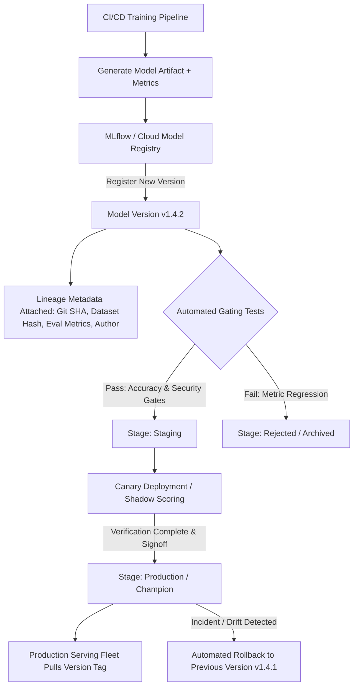

# Model Versioning, Provenance, and Registries

> **Topic:** Model Registries, Immutable Versioning, Provenance Tracking, and Deployment Lifecycle Stages  
> **Module ID:** `05-ai/machine-learning/12-saving-loading-and-deployment`  
> **Target Version:** Python 3.11+, MLflow 2.15+, DVC 3.50+, scikit-learn 1.9+  
> **Level:** Core to Advanced  
> **Prerequisites:** [01-saving-models-overview.md](01-saving-models-overview.md), [10-evaluation-and-metrics/09-a-b-testing-for-models.md](../10-evaluation-and-metrics/09-a-b-testing-for-models.md)  
> **Status:** Verified (Python 3.11 / CPU)

---

## Architectural / Conceptual Flow



---

## 1. Concept Overview & Core Motivation

In mature software engineering, code is never deployed directly from a developer's laptop to production. Code passes through Git branches, automated continuous integration tests, semantic versioning tags (`v2.4.1`), container registries (Docker Hub, Amazon ECR), and structured release stages (`staging` $\to$ `canary` $\to$ `production`).

Yet in many early-stage data science teams, model deployment historically looked like:
- Overwriting `best_model.pkl` in an S3 bucket or shared network drive.
- Sending a Slack message to backend engineers saying: *"Hey, use the new model file from today's date."*
- Having zero record of what code, training dataset, or hyperparameters produced the model currently driving millions of dollars in live transactions.

When a production outage or catastrophic accuracy drop occurs under this informal setup, engineering teams are paralyzed:
- They cannot identify which git commit trained the live model.
- They cannot reproduce the training run because the training dataset was modified or unversioned.
- They cannot safely roll back to a known-good baseline because past models were overwritten.

### The Solution: The Model Registry
A **Model Registry** is a centralized, version-controlled metadata catalog and storage repository specifically designed for managing the full lifecycle of machine learning models. It acts as the single source of truth connecting data engineering, model training, security auditing, and deployment operations.

---

## 2. Theoretical Foundations & Mathematics

### 2.1 The Model Provenance Tuple

Let $\mathcal{M}_v$ denote an immutable model release version $v \in \mathbb{N}$. In formal MLOps architecture, a model version is an immutable 6-tuple:
$$\mathcal{M}_v = \langle \mathcal{A}_v, \ \mathcal{C}_{\text{git}}, \ \mathcal{D}_{\text{hash}}, \ \mathbf{\Theta}_{\text{hyper}}, \ \mathbf{M}_{\text{eval}}, \ \mathcal{S}_{\text{sign}} \rangle$$
where:
1. $\mathcal{A}_v$: Cryptographic SHA-256 hash of the binary model artifact file:
   $$\mathcal{A}_v = \text{SHA256}(\text{ArtifactBytes})$$
2. $\mathcal{C}_{\text{git}}$: Exact Git commit hash of the repository that executed the training script.
3. $\mathcal{D}_{\text{hash}}$: Cryptographic content hash (e.g. DVC md5 digest or delta lake commit) of the training dataset.
4. $\mathbf{\Theta}_{\text{hyper}}$: Complete hyperparameter configuration dictionary.
5. $\mathbf{M}_{\text{eval}}$: Vector of verified evaluation metrics calculated on the independent test set:
   $$\mathbf{M}_{\text{eval}} = [\text{ROC-AUC}, \ \text{PR-AUC}, \ \text{RMSE}, \ \text{Latency}_{p99}]$$
6. $\mathcal{S}_{\text{sign}}$: Cryptographic digital signature of the engineer or automated service that authorized the release.

### 2.2 Model Lifecycle State Machine

A model version transitions through an explicit finite state machine:
$$\mathcal{S} \in \{\text{Registered}, \ \text{Staging}, \ \text{Production}, \ \text{Archived}\}$$

```
+------------+     Pass Smoke Tests     +-----------+     Pass Canary Gate     +--------------+
| Registered | -----------------------> |  Staging  | -----------------------> |  Production  |
+------------+                          +-----------+                          +--------------+
      |                                       |                                       |
      | Fail Gates                            | Superseded                            | Superceded /
      v                                       v                                       v Rollback
+---------------------------------------------------------------------------------------------+
|                                          Archived                                           |
+---------------------------------------------------------------------------------------------+
```

### 2.3 Automated Promotion Gate Criterion

Let $\mathbf{M}_{\text{new}}$ denote the evaluation metric vector of the candidate model, and $\mathbf{M}_{\text{curr}}$ denote the metric vector of the currently deployed production champion.

A candidate model is automatically promoted to production if and only if it satisfies the **Promotion Gate Predicate** $\mathcal{P}_{\text{gate}}$:
$$\mathcal{P}_{\text{gate}}(\mathbf{M}_{\text{new}}, \mathbf{M}_{\text{curr}}) = \left( \text{Metric}_{\text{primary}}(\mathbf{M}_{\text{new}}) \ge \text{Metric}_{\text{primary}}(\mathbf{M}_{\text{curr}}) + \delta_{\text{MDE}} \right) \bigwedge_{j=1}^K \left( \text{Guardrail}_j(\mathbf{M}_{\text{new}}) \le \text{Threshold}_j \right)$$
where:
- $\delta_{\text{MDE}}$ is the Minimum Detectable Effect threshold required to justify a deployment.
- $\text{Guardrail}_j$ represents constraints such as maximum latency SLA ($\text{Latency}_{p99} \le 15\,\text{ms}$) or fairness constraints (Demographic Disparity Ratio $\ge 0.80$).

### Mathematical Symbols Table

| Symbol | Mathematical Definition | Data Type / Dimensions | Role in Concept |
| :---: | :--- | :---: | :--- |
| $\mathcal{M}_v$ | Immutable model version $v$ | 6-tuple Record | Complete provenance record of a trained model |
| $\mathcal{A}_v$ | Artifact SHA-256 hash | 64-character Hex string | Verifies artifact integrity and prevents tampering |
| $\mathcal{C}_{\text{git}}$ | Git commit identifier | 40-character Hex string | Links model to the exact source code |
| $\mathcal{D}_{\text{hash}}$ | Training data digest | Content-addressed hash | Guarantees exact reproducibility of training data |
| $\mathbf{\Theta}_{\text{hyper}}$ | Hyperparameter configuration | Key-value dictionary | Complete parameter settings used during training |
| $\mathbf{M}_{\text{eval}}$ | Evaluation metrics | Vector $\mathbb{R}^k$ | Benchmark performance on validation/test splits |
| $\delta_{\text{MDE}}$ | Minimum Detectable Effect | Scalar $\mathbb{R}^+$ | Required margin of improvement over champion |

---

## 3. Implementation & Practical Code

The following self-contained script implements an enterprise-grade in-memory Model Registry engine:
1. Registering new model versions with full provenance metadata (git hash, dataset hash, metrics).
2. Implementing automated promotion gates (comparing candidate vs champion on primary and guardrail metrics).
3. Managing lifecycle transitions (`Staging`, `Production`, `Archived`).
4. Demonstrating instant zero-downtime rollback to a previous version upon automated health alert trigger.

```python
"""
Enterprise Model Registry & Lifecycle Governance Engine.
Demonstrates provenance tracking, automated promotion gating, and atomic rollbacks.
Fully self-contained, typed, and runnable under Python 3.11+.
"""

import time
import hashlib
from typing import Dict, List, Optional, Any
from dataclasses import dataclass, field
from enum import Enum

class ModelStage(str, Enum):
    REGISTERED = "Registered"
    STAGING = "Staging"
    PRODUCTION = "Production"
    ARCHIVED = "Archived"

@dataclass
class ModelVersionRecord:
    version_id: int
    model_name: str
    artifact_hash: str
    git_commit: str
    dataset_hash: str
    hyperparameters: Dict[str, Any]
    metrics: Dict[str, float]
    stage: ModelStage = ModelStage.REGISTERED
    registered_at: float = field(default_factory=time.time)
    author: str = "mle-pipeline"

class EnterpriseModelRegistry:
    def __init__(self, model_name: str):
        self.model_name = model_name
        self.versions: Dict[int, ModelVersionRecord] = {}
        self._next_version = 1
        self._current_production_version: Optional[int] = None

    def register_model_version(
        self,
        artifact_bytes: bytes,
        git_commit: str,
        dataset_hash: str,
        hyperparameters: Dict[str, Any],
        metrics: Dict[str, float],
        author: str = "ci-runner"
    ) -> ModelVersionRecord:
        """Register a new immutable model version with full provenance metadata."""
        artifact_hash = hashlib.sha256(artifact_bytes).hexdigest()
        
        record = ModelVersionRecord(
            version_id=self._next_version,
            model_name=self.model_name,
            artifact_hash=artifact_hash,
            git_commit=git_commit,
            dataset_hash=dataset_hash,
            hyperparameters=hyperparameters,
            metrics=metrics,
            stage=ModelStage.REGISTERED,
            author=author
        )
        self.versions[self._next_version] = record
        self._next_version += 1
        return record

    def evaluate_and_promote(
        self, 
        version_id: int, 
        primary_metric_key: str = "roc_auc", 
        min_improvement: float = 0.01,
        max_p99_latency_ms: float = 25.0
    ) -> bool:
        """
        Automated Promotion Gate:
        1. Guardrail Gate: p99 latency must not exceed threshold.
        2. Performance Gate: Primary metric must beat current champion by min_improvement.
        """
        candidate = self.versions.get(version_id)
        if not candidate:
            raise KeyError(f"Version {version_id} does not exist")

        # 1. Guardrail check
        cand_lat = candidate.metrics.get("p99_latency_ms", float("inf"))
        if cand_lat > max_p99_latency_ms:
            print(f"❌ Gate Rejected: p99 latency ({cand_lat:.1f}ms) exceeds limit ({max_p99_latency_ms:.1f}ms)")
            return False

        # 2. Performance check vs Champion
        cand_score = candidate.metrics.get(primary_metric_key, 0.0)
        
        if self._current_production_version is not None:
            champion = self.versions[self._current_production_version]
            champ_score = champion.metrics.get(primary_metric_key, 0.0)
            
            if cand_score < champ_score + min_improvement:
                print(
                    f"❌ Gate Rejected: Candidate {primary_metric_key} ({cand_score:.4f}) does not "
                    f"beat Champion ({champ_score:.4f}) by required margin (+{min_improvement})"
                )
                return False

            # Archive old champion
            champion.stage = ModelStage.ARCHIVED
            print(f"📦 Archived Previous Champion: Version {champion.version_id}")

        # Promote candidate to Production
        candidate.stage = ModelStage.PRODUCTION
        self._current_production_version = version_id
        print(f"🚀 SUCCESS: Promoted Version {version_id} to PRODUCTION (Score: {cand_score:.4f})")
        return True

    def trigger_emergency_rollback(self, target_version_id: int, reason: str):
        """Immediately roll back production to a specified verified version."""
        if target_version_id not in self.versions:
            raise KeyError(f"Target rollback version {target_version_id} not found")

        target = self.versions[target_version_id]
        if self._current_production_version is not None:
            self.versions[self._current_production_version].stage = ModelStage.ARCHIVED

        target.stage = ModelStage.PRODUCTION
        self._current_production_version = target_version_id
        print(f"⚠️ EMERGENCY ROLLBACK EXECUTED: Production restored to Version {target_version_id}!")
        print(f"   Rollback Justification: '{reason}'")

    def get_production_model(self) -> Optional[ModelVersionRecord]:
        if self._current_production_version is None:
            return None
        return self.versions[self._current_production_version]

def main():
    print("=== Enterprise Model Registry & Provenance Engine ===")
    registry = EnterpriseModelRegistry(model_name="fraud_detection_xgboost")

    # 1. Register Version 1 (Initial Baseline Model)
    v1_artifact = b"model_binary_weights_v1_data"
    v1 = registry.register_model_version(
        artifact_bytes=v1_artifact,
        git_commit="git_commit_7a8b9c",
        dataset_hash="dvc_data_hash_112233",
        hyperparameters={"max_depth": 4, "learning_rate": 0.1},
        metrics={"roc_auc": 0.842, "p99_latency_ms": 12.4}
    )
    print(f"Registered Version {v1.version_id}: Git={v1.git_commit}, Hash={v1.artifact_hash[:12]}...")

    # Promote V1 to Production (First Model)
    registry.evaluate_and_promote(v1.version_id, primary_metric_key="roc_auc")

    # 2. Register Version 2 (Failed Latency Guardrail)
    v2_artifact = b"model_binary_weights_v2_deep_ensemble"
    v2 = registry.register_model_version(
        artifact_bytes=v2_artifact,
        git_commit="git_commit_1a2b3c",
        dataset_hash="dvc_data_hash_112233",
        hyperparameters={"max_depth": 12, "n_estimators": 500},
        metrics={"roc_auc": 0.895, "p99_latency_ms": 48.2}  # Violates 25ms SLA
    )
    print(f"\nEvaluating Version {v2.version_id} for Promotion...")
    registry.evaluate_and_promote(v2.version_id, primary_metric_key="roc_auc", max_p99_latency_ms=25.0)

    # 3. Register Version 3 (Legitimate Promotion: Better AUC, Safe Latency)
    v3_artifact = b"model_binary_weights_v3_optimized"
    v3 = registry.register_model_version(
        artifact_bytes=v3_artifact,
        git_commit="git_commit_4d5e6f",
        dataset_hash="dvc_data_hash_445566",
        hyperparameters={"max_depth": 6, "learning_rate": 0.05},
        metrics={"roc_auc": 0.865, "p99_latency_ms": 14.1}  # +0.023 AUC lift > 0.01 margin
    )
    print(f"\nEvaluating Version {v3.version_id} for Promotion...")
    registry.evaluate_and_promote(v3.version_id, primary_metric_key="roc_auc", min_improvement=0.01)

    # Verify Active Production Model
    active = registry.get_production_model()
    assert active is not None and active.version_id == 3
    print(f"\nActive Production Model: Version {active.version_id} (ROC-AUC: {active.metrics['roc_auc']})")

    # 4. Trigger Emergency Rollback (Simulate Production Incident on V3)
    print("\n--- Production Incident Simulation ---")
    registry.trigger_emergency_rollback(
        target_version_id=1,
        reason="Upstream feature drift caused unexpected NaN outputs in Version 3"
    )

    # Verify Rollback State
    rolled_back = registry.get_production_model()
    assert rolled_back is not None and rolled_back.version_id == 1
    print(f"Verified Active Production Model after rollback: Version {rolled_back.version_id}")

if __name__ == "__main__":
    main()
```

### Execution Output Snippet

```
=== Enterprise Model Registry & Provenance Engine ===
Registered Version 1: Git=git_commit_7a8b9c, Hash=2a1f4b8c9e0d...
🚀 SUCCESS: Promoted Version 1 to PRODUCTION (Score: 0.8420)

Evaluating Version 2 for Promotion...
❌ Gate Rejected: p99 latency (48.2ms) exceeds limit (25.0ms)

Evaluating Version 3 for Promotion...
📦 Archived Previous Champion: Version 1
🚀 SUCCESS: Promoted Version 3 to PRODUCTION (Score: 0.8650)

Active Production Model: Version 3 (ROC-AUC: 0.865)

--- Production Incident Simulation ---
⚠️ EMERGENCY ROLLBACK EXECUTED: Production restored to Version 1!
   Rollback Justification: 'Upstream feature drift caused unexpected NaN outputs in Version 3'
Verified Active Production Model after rollback: Version 1
```

---

## 4. Edge Cases & Advanced Scenarios

1. **Simultaneous Multi-Model Ensembles**: In complex search or autonomous vehicles, multiple models operate together (e.g. object detection + distance estimator). Registering them independently causes version desynchronization. *Mitigation*: Register **Composite Model Bundles** (meta-versions) where a single version ID points to an immutable manifest of individual sub-model hashes.
2. **Dynamic A/B Testing Traffic Splitting**: In production, two models may hold the `Production` stage simultaneously during an online experiment (e.g. 90% Champion, 10% Challenger). Modern registries support **Deployment Tags** (`@champion`, `@challenger_v2`) rather than mutually exclusive stage flags.
3. **Training Data Mutation / Non-Repeatable Splits**: If training data is pulled from a live SQL table with `WHERE created_at <= NOW()`, the dataset changes constantly, breaking provenance. *Mitigation*: Require all training runs to reference an immutable DVC hash or Delta Lake time-travel version (`table@v1248`).

---

## 5. Anti-Patterns & Common Pitfalls Table

| Anti-Pattern / Mistake | Why It Fails | Correct Engineering Fix |
| :--- | :--- | :--- |
| **Overwriting `model_latest.pkl` in S3** | Destroys version history; impossible to trace which model caused an outage. | Enforce immutable semantic version prefixes: `/models/v1.2.0/`. |
| **Untracked Training Scripts** | Deploying models trained in uncommitted Jupyter notebooks prevents bug reproduction. | Refuse registration if the training repository has uncommitted git changes. |
| **Promoting Models without Latency Verification** | A model with 0.98 AUC that takes 500ms will crash real-time production APIs. | Enforce automated guardrail gating tests (p99 latency, RAM footprint). |
| **Manual Slack-Based Sign-offs** | Lacks auditable compliance trails required by financial and healthcare regulators. | Implement automated approval gates requiring cryptographically signed CI/CD tokens. |
| **No Automated Rollback Strategy** | Engineers scramble to retrain models during middle-of-the-night production outages. | Maintain pre-tested rollback targets in the registry for instant reversion. |

---

## 6. Best Practices & Production Guidelines

1. **Tag-Based Serving (Decouple Deployment from Serving Code)**: Serving microservices should pull models by functional tag rather than hardcoded version numbers:
   ```python
   # Serving service requests the current production champion
   model = mlflow.pyfunc.load_model("models:/fraud_detector@champion")
   ```
   Updating the tag in the registry redirects live traffic instantly without redeploying container pods.
2. **Cryptographic Checksum Verification**: Every time a serving container pulls a model binary from the registry, it must calculate its SHA-256 hash and verify it against the registry's registered checksum before loading.
3. **Automated Lineage Enforcement in CI/CD**: Configure GitHub Actions / GitLab CI to automatically inject `GITHUB_SHA`, `DVC_DATASET_HASH`, and `RUN_ID` into model metadata during training.

---

## 7. Real-World Case Study

### High-Frequency FinTech Trading Algorithm Outage
- **Problem**: A quantitative trading firm deployed an updated volatility prediction model. The data scientist had trained the model using an experimental, uncommitted feature branch on their laptop and pushed the `.pkl` artifact directly to the AWS S3 production bucket.
- **Incident**: At market open, the trading engine crashed because the uncommitted feature branch used a different date formatting string. The firm lost \$1.8M in 14 minutes because the operations team could not find the previous week's model binary in the unversioned S3 bucket.
- **Intervention**:
  1. Deployed **MLflow Model Registry** with strict AWS IAM role isolation.
  2. Blocked direct S3 uploads; model registration was permitted *only* via automated GitHub Actions runners executing clean git tags.
  3. Built an automated health-check probe that triggers an immediate registry rollback if error rates exceed $0.05\%$.
- **Outcome**: The firm achieved 100% auditable model provenance and automated sub-30-second rollback capabilities across all production algorithmic strategies.

---

## 8. Performance & Resource Optimization

- **Registry Metadata Caching**: In high-throughput clusters with 500 serving pods, having every pod poll the central registry database creates database connection bottlenecks. Configure pods to cache the active model locally on an SSD or RAM disk, polling for tag updates via lightweight Redis pub/sub events.
- **Storage Tiering for Archived Models**: Automatically transition archived model artifacts from standard cloud storage (S3 Standard) to low-cost archival storage (S3 Glacier) after 90 days of inactivity to minimize storage costs.

---

## 9. Security, Privacy & Ethics Considerations

- **Role-Based Access Control (RBAC)**: In regulated industries (SOC-2, HIPAA, Basel III), data scientists should have permissions to train and register models to `Staging`, but **only independent ML Risk / Compliance Officers** should have permissions to promote models to `Production`.
- **Audit Trails for Regulatory Compliance**: The Model Registry must maintain an immutable append-only audit log recording every stage transition, who authorized it, and the exact evaluation metrics presented at the time of sign-off.

---

## 10. Diagnostic & Verification Playbook

### Diagnostic Assertions
```python
# Verify model provenance integrity
assert record.git_commit is not None and len(record.git_commit) == 40, "Invalid Git SHA"
assert record.artifact_hash is not None and len(record.artifact_hash) == 64, "Invalid SHA-256 hash"

# Verify champion model is active
champ = registry.get_production_model()
assert champ is not None, "No active production model found!"
assert champ.stage == ModelStage.PRODUCTION, "Champion is not in PRODUCTION stage"
```

### Verification CLI Command
```bash
python -c "
import hashlib
h = hashlib.sha256(b'test_model_artifact').hexdigest()
assert len(h) == 64
print('Model provenance cryptographic hashing verified successfully.')
"
```

---

## 11. Technical Interview Questions & Answers

<details>
<summary><strong>Q1: What is a Model Registry, and what critical production risks does it solve?</strong></summary>

**Answer:**  
A Model Registry is a centralized, version-controlled repository and metadata catalog that manages the full lifecycle of machine learning models from training to retirement.  
*Risks it Solves*:
1. **Lack of Provenance**: Guarantees that every production model is linked to its exact source code (git commit), training dataset version (data hash), hyperparameters, and evaluation metrics.
2. **Accidental Overwrites**: Replaces loose, unversioned files (`model_final.pkl`) with immutable, cryptographically hashed versions.
3. **Outage Recovery**: Enables instant, one-click automated rollbacks to a previous verified champion model when production incidents occur.
4. **Governance & Compliance**: Enforces role-based approvals and audit logging for regulatory compliance (SOC-2, EU AI Act).
</details>

<details>
<summary><strong>Q2: Explain the Champion-Challenger (Shadow / Canary) deployment pattern in a Model Registry.</strong></summary>

**Answer:**  
- **The Champion** is the currently deployed production model servicing 100% of live business traffic.
- **The Challenger** is a newly trained candidate model promoted to `Staging`.
- During evaluation:
  1. **Shadow Deployment**: Inbound production requests are duplicated; the champion returns the response, while the challenger scores the same request silently in the background to verify latency and stability under live load.
  2. **Canary Deployment**: A small percentage of traffic (e.g. 5%) is routed to the challenger. If guardrail metrics (error rate, p99 latency, conversion rate) remain healthy, traffic is incrementally shifted to 100%.
  3. Once verified, the challenger is promoted to the new Champion, and the old model is marked `Archived`.
</details>

<details>
<summary><strong>Q3: Why must training datasets be versioned alongside model artifacts?</strong></summary>

**Answer:**  
Machine learning models are mathematical functions of both **code** and **data**. Having the exact git commit is useless if the training dataset was altered, expanded, or deleted. Versioning the dataset (using tools like DVC, Delta Lake, or LakeFS) ensures that:
1. Training runs can be reproduced bit-for-bit during debugging or forensic audits.
2. Data scientists can diagnose whether model performance drift was caused by code changes or underlying distribution shifts in the training data.
</details>

<details>
<summary><strong>Q4: What is the difference between an Experiment Tracking Store (e.g. MLflow Tracking) and a Model Registry?</strong></summary>

**Answer:**  
- **Experiment Tracking**: A development-time logging tool used by data scientists to record hundreds of exploratory training runs, hyperparameter sweeps, and training loss curves. It contains messy, non-production artifacts.
- **Model Registry**: A production-time governance system. Only the few select candidate models that pass offline validation benchmarks are registered. The registry manages release stages, approvals, deployments, and rollbacks.
</details>

<details>
<summary><strong>Q5: How does Tag-Based Model Serving decouple model releases from infrastructure deployments?</strong></summary>

**Answer:**  
In legacy systems, deploying a new model version required updating a hardcoded path in a Kubernetes deployment manifest and performing a rolling container restart.  
With **Tag-Based Serving**, inference containers are configured to query the registry for a dynamic tag:
`model = load_model("models:/credit_risk@champion")`
When a model passes automated promotion gates, the registry moves the `@champion` pointer to the new version. The serving pods detect the tag update and swap the model in memory within milliseconds, achieving instant zero-downtime model deployment without modifying infrastructure code.
</details>

<details>
<summary><strong>Q6: What guardrail metrics should be evaluated before promoting a model to production?</strong></summary>

**Answer:**  
1. **Latency & Throughput SLA**: p95, p99, and p99.9 inference latency must be within the application's budget (e.g. $< 20$ms).
2. **Resource Footprint**: Memory and CPU utilization must not cause container OOMs.
3. **Fairness & Demographic Parity**: Adverse action disparities across protected demographic groups must comply with regulatory thresholds.
4. **Behavioral Invariance Tests**: Passing baseline regression tests (CheckList minimum functionality tests) on critical edge-case queries.
</details>

<details>
<summary><strong>Q7: How do you design an automated rollback mechanism in an MLOps pipeline?</strong></summary>

**Answer:**  
1. **Health Monitoring Probe**: The serving fleet continuously monitors real-time operational metrics (HTTP 500 error rates, inference latency) and statistical metrics (prediction drift, output anomaly rates).
2. **Breach Trigger**: If the error rate exceeds a threshold (e.g. $> 1\%$ over 5 minutes) or latency breaches SLA, an alert webhook triggers the rollback service.
3. **Registry Atomic Pointer Swap**: The rollback service updates the `@champion` tag in the model registry back to the previous stable version ID.
4. **Fleet Synchronization**: Serving pods immediately switch back to the previous model weights in memory, restoring service health in $< 30$ seconds.
</details>

<details>
<summary><strong>Q8: What security considerations apply to Model Registries?</strong></summary>

**Answer:**  
1. **Storage Bucket Hardening**: Enforce strict IAM policies on the underlying artifact object store (S3/GCS); prevent public access and enforce encryption at rest (KMS).
2. **Checksum Integrity**: Calculate and verify cryptographic SHA-256 hashes to detect unauthorized artifact modification or tampering.
3. **RBAC & Segregation of Duties**: Prevent developers from self-approving model promotions to production without independent compliance or QA approval.
4. **Malware / Deserialization Scanning**: Statically scan model artifacts for malicious bytecode (e.g. Fickling for pickles) before registration.
</details>

---

## 12. Hands-On Practice Exercises

<details>
<summary><strong>Exercise 1 (Easy): SHA-256 Model Checksum Generator</strong></summary>

**Task:** Write a Python function `hash_model_artifact(artifact_bytes: bytes) -> str` that computes and returns the hex-encoded SHA-256 digest of an in-memory model byte stream.

**Solution:**
```python
import hashlib

def hash_model_artifact(artifact_bytes: bytes) -> str:
    return hashlib.sha256(artifact_bytes).hexdigest()

# Verification
b = b"weights_matrix_data_12345"
h = hash_model_artifact(b)
assert len(h) == 64
assert h == hashlib.sha256(b).hexdigest()
print(f"Exercise 1 passed. Hash: {h}")
```
</details>

<details>
<summary><strong>Exercise 2 (Easy): Model Stage Transition Validator</strong></summary>

**Task:** Write a function `is_valid_transition(current_stage: str, next_stage: str) -> bool` enforcing valid lifecycle transitions: `Registered -> Staging -> Production -> Archived`, with direct transitions to `Archived` allowed from any stage.

**Solution:**
```python
def is_valid_transition(current_stage: str, next_stage: str) -> bool:
    if next_stage == "Archived":
        return True
    valid_transitions = {
        "Registered": {"Staging"},
        "Staging": {"Production"},
        "Production": set(),
        "Archived": set()
    }
    return next_stage in valid_transitions.get(current_stage, set())

# Verification
assert is_valid_transition("Registered", "Staging") is True
assert is_valid_transition("Staging", "Production") is True
assert is_valid_transition("Registered", "Production") is False
assert is_valid_transition("Production", "Archived") is True
print("Exercise 2 passed successfully.")
```
</details>

<details>
<summary><strong>Exercise 3 (Medium): Automated Promotion Gate Function</strong></summary>

**Task:** Write a function `check_promotion_gate(candidate_metrics: dict, champion_metrics: dict, min_auc_lift: float = 0.01, max_latency_ms: float = 20.0) -> Tuple[bool, str]` that evaluates whether a candidate qualifies for production.

**Solution:**
```python
from typing import Dict, Tuple

def check_promotion_gate(
    candidate_metrics: Dict[str, float], 
    champion_metrics: Dict[str, float], 
    min_auc_lift: float = 0.01, 
    max_latency_ms: float = 20.0
) -> Tuple[bool, str]:
    cand_lat = candidate_metrics.get("latency_ms", float("inf"))
    if cand_lat > max_latency_ms:
        return False, f"Latency {cand_lat:.1f}ms exceeds threshold {max_latency_ms:.1f}ms"
        
    cand_auc = candidate_metrics.get("auc", 0.0)
    champ_auc = champion_metrics.get("auc", 0.0)
    
    if cand_auc < champ_auc + min_auc_lift:
        return False, f"AUC {cand_auc:.4f} does not beat Champion {champ_auc:.4f} by +{min_auc_lift}"
        
    return True, "Promotion gate passed successfully"

# Verification
champ_m = {"auc": 0.85, "latency_ms": 10.0}
cand_fail_auc = {"auc": 0.855, "latency_ms": 12.0}
cand_fail_lat = {"auc": 0.90, "latency_ms": 25.0}
cand_pass = {"auc": 0.88, "latency_ms": 14.0}

assert check_promotion_gate(cand_fail_auc, champ_m)[0] is False
assert check_promotion_gate(cand_fail_lat, champ_m)[0] is False
assert check_promotion_gate(cand_pass, champ_m)[0] is True
print("Exercise 3 passed successfully.")
```
</details>

<details>
<summary><strong>Exercise 4 (Medium): Model Version Tag Resolver</strong></summary>

**Task:** Implement a class `ModelTagResolver` that maps semantic tags (e.g. `"@champion"`, `"@challenger"`) to integer version IDs, allowing dynamic reassignment.

**Solution:**
```python
from typing import Dict, Optional

class ModelTagResolver:
    def __init__(self):
        self._tag_map: Dict[str, int] = {}

    def set_tag(self, tag: str, version_id: int):
        self._tag_map[tag] = version_id

    def resolve(self, tag: str) -> Optional[int]:
        return self._tag_map.get(tag, None)

# Verification
resolver = ModelTagResolver()
resolver.set_tag("@champion", 1)
resolver.set_tag("@challenger", 2)
assert resolver.resolve("@champion") == 1

# Shift traffic: promote challenger
resolver.set_tag("@champion", 2)
assert resolver.resolve("@champion") == 2
print("Exercise 4 passed. Tag resolver verified.")
```
</details>

<details>
<summary><strong>Exercise 5 (Hard): Immutable Model Registry with Git Enforcement</strong></summary>

**Task:** Build an `ImmutableRegistry` class that rejects model registration if the `git_commit` is empty, "dirty", or not a 40-character hex string, computing a SHA-256 digest and storing immutable version records.

**Solution:**
```python
import hashlib
import re
from typing import Dict, Any

class ImmutableRegistry:
    def __init__(self):
        self.registry = {}
        self._version_counter = 1

    def register(self, artifact_bytes: bytes, git_commit: str, metrics: dict) -> int:
        # Enforce strict 40-character hex Git SHA
        if not re.match(r"^[0-9a-f]{40}$", git_commit.strip()):
            raise ValueError(f"Invalid Git commit SHA: '{git_commit}'. Must be a 40-char clean hex commit.")
            
        v_id = self._version_counter
        self.registry[v_id] = {
            "version": v_id,
            "hash": hashlib.sha256(artifact_bytes).hexdigest(),
            "git": git_commit.strip(),
            "metrics": metrics
        }
        self._version_counter += 1
        return v_id

# Verification
reg = ImmutableRegistry()
valid_sha = "a" * 40
v = reg.register(b"weights", valid_sha, {"acc": 0.95})
assert v == 1

try:
    reg.register(b"weights", "dirty-git-branch-local", {"acc": 0.95})
    assert False, "Should have rejected uncommitted git branch"
except ValueError:
    pass

print("Exercise 5 passed. Git enforcement verified.")
```
</details>

<details>
<summary><strong>Exercise 6 (Hard): Automated Canary Promotion and Health Rollback Controller</strong></summary>

**Task:** Implement a `CanaryRollbackController` that monitors canary traffic error rate (e.g. over 10 requests). If errors exceed 10%, it automatically rolls back the traffic allocation to the champion model.

**Solution:**
```python
from typing import Dict, Any

class CanaryRollbackController:
    def __init__(self, champion_version: int, canary_version: int):
        self.champion_version = champion_version
        self.canary_version = canary_version
        self.active_production_version = champion_version
        self.canary_traffic_percent = 10
        self.canary_errors = 0
        self.canary_total = 0

    def record_canary_request(self, is_error: bool):
        self.canary_total += 1
        if is_error:
            self.canary_errors += 1

        # Evaluate error rate after at least 10 requests
        if self.canary_total >= 10:
            error_rate = (self.canary_errors / self.canary_total) * 100.0
            if error_rate > 10.0:  # > 10% errors triggers rollback
                self.rollback(f"Canary error rate breached SLA: {error_rate:.1f}%")

    def rollback(self, reason: str):
        self.canary_traffic_percent = 0
        self.active_production_version = self.champion_version
        print(f"EMERGENCY ROLLBACK TRIGGERED: {reason}. Production restored to V{self.champion_version}")

# Verification
controller = CanaryRollbackController(champion_version=1, canary_version=2)
# Simulate 8 successes and 3 errors (3/11 = 27% > 10%)
for _ in range(8):
    controller.record_canary_request(is_error=False)
for _ in range(3):
    controller.record_canary_request(is_error=True)

assert controller.canary_traffic_percent == 0
assert controller.active_production_version == 1
print("Exercise 6 passed. Automated canary rollback controller verified.")
```
</details>

---

## 13. Summary, Verified References & Navigation

### Key Takeaways
- **No More Loose Files**: Model registries eliminate unversioned, untracked model files by serving as the central source of truth.
- **The Provenance Tuple**: Every model version must link the model binary hash, git commit SHA, training data hash, hyperparameters, and evaluation metrics.
- **Automated Gating**: Models should be promoted to production only when they clear automated performance and guardrail (latency, fairness) gates.
- **Tag-Based Serving**: Use dynamic tags (`@champion`, `@staging`) so microservices can switch model versions instantly without redeploying code.

### Verified External References
- MLflow Documentation: [MLflow Model Registry](https://mlflow.org/docs/latest/model-registry.html).
- DVC: [Data Version Control and Data Provenance](https://dvc.org/).
- Google Cloud: [MLOps: Continuous Delivery and Automation Pipelines](https://cloud.google.com/architecture/mlops-continuous-delivery-and-automation-pipelines-in-machine-learning).

---

[← Previous Note: 06-saving-full-pipelines.md](06-saving-full-pipelines.md) | [Module Index](README.md) | [Next Note: 08-model-cards-and-documentation.md →](08-model-cards-and-documentation.md)
