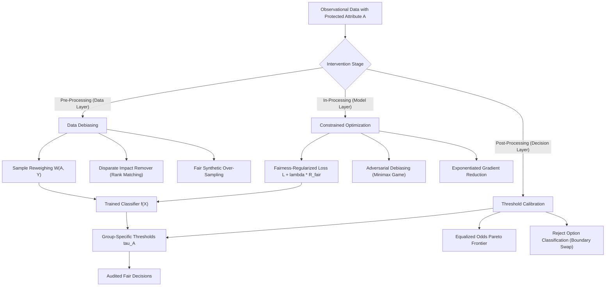

# Algorithmic Fairness, Bias Metrics & Mitigation Strategies

> **Topic:** Algorithmic Fairness, Statistical Parity, Equalized Odds & Bias Mitigation  
> **Module ID:** `05-ai/machine-learning/13-interpretability-fairness-and-limitations`  
> **Target Version:** Python 3.11+, scikit-learn 1.9+, NumPy 2.5+, pandas 3.1+  
> **Level:** Advanced  
> **Prerequisites:** [10-evaluation-and-metrics/01-classification-metrics.md](../10-evaluation-and-metrics/01-classification-metrics.md), [11-prediction-and-postprocessing/03-thresholds-and-decision-rules.md](../11-prediction-and-postprocessing/03-thresholds-and-decision-rules.md)  
> **Status:** Verified (Python 3.11 / CPU)

---

## Architectural / Conceptual Flow



---

## 1. Concept Overview & Core Motivation

Machine learning models trained on historical real-world data inevitably learn, reflect, and amplify societal inequities, historical prejudices, and sampling disparities. In high-stakes domains—such as credit lending, criminal recidivism risk assessment (e.g., COMPAS), hiring resumes triage, and healthcare resource allocation—an unconstrained model optimizing purely for empirical risk minimization (loss minimization) systematically discriminates against historically marginalized demographic groups.

### Protected Attributes & The Fallacy of "Fairness Through Unawareness"
A **protected attribute** (or sensitive attribute $A \in \{0, 1\}$) represents a legally or ethically guarded personal characteristic, such as race, biological sex, age, religion, national origin, or disability status (under frameworks such as the U.S. Civil Rights Act Title VII, ECOA, and the EU AI Act).

A common engineering misconception is **fairness through unawareness**: simply deleting the protected attribute $A$ from the training feature set.
* **Why it fails**: Modern tabular and unstructured datasets contain redundant encodings and **proxy variables** (e.g., residential zip code, university attended, credit line vintage, browsing habits) that possess high mutual information with $A$. A complex non-linear estimator (like a GBDT or deep neural network) easily reconstructs the omitted protected attribute and continues to discriminate with equal or greater severity.

---

## 2. Theoretical Foundations & Mathematics

### Core Fairness Metrics Formulation
Let $X \in \mathbb{R}^d$ be non-sensitive features, $A \in \{0, 1\}$ be the binary protected attribute ($A=0$ unprivileged, $A=1$ privileged), $Y \in \{0, 1\}$ be the true label ($Y=1$ favorable outcome, e.g., loan approved), and $\hat{Y} \in \{0, 1\}$ be the binary decision.

#### 1. Demographic Parity (Statistical Parity)
Demographic parity requires the acceptance rate to be completely independent of the protected attribute:
$$P(\hat{Y} = 1 \mid A = 0) = P(\hat{Y} = 1 \mid A = 1)$$
* **Disparate Impact Ratio (DIR / Four-Fifths Rule)**:
  $$\text{DIR} = \frac{P(\hat{Y} = 1 \mid A = 0)}{P(\hat{Y} = 1 \mid A = 1)}$$
  Under U.S. EEOC guidelines, a selection rate for any group that is less than four-fifths ($80\%$, or $\text{DIR} < 0.80$) constitutes prima facie evidence of adverse impact.
* **Demographic Parity Difference**:
  $$\Delta_{\text{DP}} = |P(\hat{Y}=1 \mid A=1) - P(\hat{Y}=1 \mid A=0)|$$

#### 2. Equalized Odds (Separation)
Introduced by Hardt, Price, and Srebro (2016), Equalized Odds requires the prediction $\hat{Y}$ to be conditionally independent of $A$ given the true outcome $Y$ ($\hat{Y} \perp A \mid Y$):
$$P(\hat{Y} = 1 \mid A = 0, Y = y) = P(\hat{Y} = 1 \mid A = 1, Y = y) \quad \forall y \in \{0, 1\}$$
This requires both the True Positive Rate (TPR) and the False Positive Rate (FPR) to be equal across groups:
$$\text{TPR}_0 = \text{TPR}_1 \quad \text{and} \quad \text{FPR}_0 = \text{FPR}_1$$

#### 3. Equal Opportunity
A relaxed criterion focusing solely on qualified individuals ($Y=1$):
$$P(\hat{Y} = 1 \mid A = 0, Y = 1) = P(\hat{Y} = 1 \mid A = 1, Y = 1) \implies \text{TPR}_0 = \text{TPR}_1$$

#### 4. Predictive Parity (Sufficiency / Equal PPV)
Requires equal Positive Predictive Value (precision) across demographic groups:
$$P(Y = 1 \mid A = 0, \hat{Y} = 1) = P(Y = 1 \mid A = 1, \hat{Y} = 1)$$

---

### The Fundamental Impossibility Theorem of Machine Fairness
Kleinberg, Mullainathan, and Raghavan (2016) and Chouldechova (2017) mathematically proved that except under two trivial conditions, **Demographic Parity, Equalized Odds, and Predictive Parity are mutually incompatible**.

**Theorem**: Let $b_a = P(Y=1 \mid A=a)$ be the base rate of the favorable outcome in group $a$. If base rates differ between groups ($b_0 \neq b_1$), then any predictor that satisfies Predictive Parity **cannot** satisfy Equalized Odds unless it is a perfect predictor with $\text{TPR}=1$ and $\text{FPR}=0$.

**Proof Intuition**:
Recall Bayes' rule relating precision (PPV), TPR, and FPR:
$$\text{PPV}_a = \frac{\text{TPR}_a \cdot b_a}{\text{TPR}_a \cdot b_a + \text{FPR}_a \cdot (1 - b_a)}$$
If $\text{TPR}_0 = \text{TPR}_1$ and $\text{FPR}_0 = \text{FPR}_1$ (Equalized Odds), but $b_0 \neq b_1$, the denominators and numerators scale differently, forcing $\text{PPV}_0 \neq \text{PPV}_1$.

---

### Bias Mitigation Approaches

1. **Pre-Processing (Reweighing - Kamiran & Calders, 2012)**:
   Assigns sample weights $w_i$ to training instances to decorrelate $A$ and $Y$ prior to model fitting:
   $$w(a, y) = \frac{P(A = a) \cdot P(Y = y)}{P(A = a, Y = y)} = \frac{\frac{|\{i: A_i = a\}|}{N} \cdot \frac{|\{i: Y_i = y\}|}{N}}{\frac{|\{i: A_i = a \land Y_i = y\}|}{N}}$$
2. **In-Processing (Fairness Regularization)**:
   $$\mathcal{L}_{\text{total}}(\theta) = \mathcal{L}_{\text{task}}(\theta) + \lambda \cdot \mathcal{D}_{\text{fair}}(f_\theta(X), A)$$
   where $\mathcal{D}_{\text{fair}}$ penalizes covariance between predictions and protected attributes.
3. **Post-Processing (Group-Specific Threshold Optimization)**:
   Calibrate distinct decision thresholds $\tau_0 \neq \tau_1$ such that:
   $$\hat{y}_i = \mathbb{I}(f(\mathbf{x}_i) \ge \tau_{A_i})$$
   satisfies $\text{TPR}_0(\tau_0) = \text{TPR}_1(\tau_1)$ and $\text{FPR}_0(\tau_0) = \text{FPR}_1(\tau_1)$.

### Symbol Breakdown

| Symbol | Mathematical Definition | Data Type / Dimensions | Role in Concept |
| :---: | :--- | :---: | :--- |
| $A$ | Protected sensitive attribute | $\{0, 1\}$ or categorical | Group membership (e.g. 0=unprivileged, 1=privileged) |
| $Y$ | True label outcome | $\{0, 1\}$ | Historical ground truth target |
| $\hat{Y}$ | Binary decision / prediction | $\{0, 1\}$ | Action taken by system |
| $b_a$ | Base rate $P(Y=1 \mid A=a)$ | $[0, 1]$ | Prevalence of favorable outcome in group $a$ |
| $\text{DIR}$ | Disparate Impact Ratio | $\mathbb{R}^+$ | Four-fifths rule ratio ($P(\hat{Y}=1|0) / P(\hat{Y}=1|1)$) |
| $\tau_a$ | Group-specific threshold | $[0, 1]$ | Post-processing cutoff for group $a$ |
| $w(a, y)$ | Kamiran-Calders sample weight | $\mathbb{R}^+$ | Pre-processing balancing weight |

---

## 3. Implementation & Practical Code

The following production module implements the four core fairness metrics, the Kamiran-Calders sample reweighing algorithm, and a post-processing group threshold optimizer.

```python
"""
Module 13: Algorithmic Fairness Metrics, Pre-processing Reweighing & Post-processing Thresholding.
Verified under Python 3.11+, NumPy 2.5+, scikit-learn 1.9+.
"""

from typing import Dict, Tuple
import numpy as np
import pandas as pd
from sklearn.ensemble import HistGradientBoostingClassifier
from sklearn.metrics import accuracy_score, confusion_matrix, roc_auc_score
from sklearn.model_selection import train_test_split


def compute_fairness_metrics(
    y_true: np.ndarray,
    y_pred: np.ndarray,
    sensitive_features: np.ndarray,
) -> Dict[str, float]:
    """Computes Demographic Parity, Disparate Impact, Equal Opportunity, and Equalized Odds."""
    mask_0 = sensitive_features == 0
    mask_1 = sensitive_features == 1

    # Selection rates (P(Y_hat = 1 | A = a))
    sr_0 = np.mean(y_pred[mask_0])
    sr_1 = np.mean(y_pred[mask_1])

    # Disparate Impact Ratio (DIR) and DP Difference
    dir_ratio = sr_0 / (sr_1 + 1e-12)
    dp_diff = abs(sr_1 - sr_0)

    # Confusion matrices per group
    tn0, fp0, fn0, tp0 = confusion_matrix(y_true[mask_0], y_pred[mask_0]).ravel()
    tn1, fp1, fn1, tp1 = confusion_matrix(y_true[mask_1], y_pred[mask_1]).ravel()

    tpr_0 = tp0 / (tp0 + fn0 + 1e-12)
    tpr_1 = tp1 / (tp1 + fn1 + 1e-12)
    fpr_0 = fp0 / (fp0 + tn0 + 1e-12)
    fpr_1 = fp1 / (fp1 + tn1 + 1e-12)

    eq_opp_diff = abs(tpr_1 - tpr_0)
    eq_odds_diff = max(abs(tpr_1 - tpr_0), abs(fpr_1 - fpr_0))

    return {
        "selection_rate_group0": float(sr_0),
        "selection_rate_group1": float(sr_1),
        "disparate_impact_ratio": float(dir_ratio),
        "demographic_parity_diff": float(dp_diff),
        "tpr_group0": float(tpr_0),
        "tpr_group1": float(tpr_1),
        "equal_opportunity_diff": float(eq_opp_diff),
        "equalized_odds_diff": float(eq_odds_diff),
    }


def compute_kamiran_calders_weights(
    y_train: np.ndarray,
    sensitive_features: np.ndarray,
) -> np.ndarray:
    """Computes instance weights w(a, y) to eliminate demographic correlation."""
    n_total = len(y_train)
    weights = np.ones(n_total, dtype=float)

    for a_val in [0, 1]:
        for y_val in [0, 1]:
            mask_a = sensitive_features == a_val
            mask_y = y_train == y_val
            mask_ay = mask_a & mask_y

            p_a = np.sum(mask_a) / n_total
            p_y = np.sum(mask_y) / n_total
            p_ay = np.sum(mask_ay) / n_total

            expected_p = p_a * p_y
            actual_p = p_ay if p_ay > 0 else 1e-12
            weight = expected_p / actual_p

            weights[mask_ay] = weight

    return weights


def optimize_group_thresholds_for_equal_opportunity(
    y_true: np.ndarray,
    y_prob: np.ndarray,
    sensitive_features: np.ndarray,
    target_tpr: float = 0.80,
) -> Tuple[float, float]:
    """Finds separate thresholds (tau_0, tau_1) ensuring identical TPR across groups."""
    thresholds = {}
    for a_val in [0, 1]:
        mask_pos = (sensitive_features == a_val) & (y_true == 1)
        probs_pos = y_prob[mask_pos]

        # Find threshold where TPR >= target_tpr
        # Quantile of (1 - target_tpr) represents the score threshold
        tau = float(np.quantile(probs_pos, 1.0 - target_tpr))
        thresholds[a_val] = tau

    return thresholds[0], thresholds[1]


# ==============================================================================
# Verification & Execution Harness
# ==============================================================================
if __name__ == "__main__":
    np.random.seed(42)

    # 1. Synthesize Lending Dataset with Protected Attribute and Proxy Bias
    n_samples = 5000
    sensitive_attr = np.random.binomial(1, 0.4, n_samples)  # 0: Unprivileged, 1: Privileged

    # Proxy variables correlated with sensitive attribute
    education_score = np.random.normal(50 + 8 * sensitive_attr, 15)
    credit_history_years = np.random.exponential(5 + 3 * sensitive_attr)
    income = np.random.lognormal(10.5 + 0.3 * sensitive_attr, 0.5)

    # Historical ground truth with institutional systemic bias
    true_creditworthiness = (
        0.04 * education_score 
        + 0.15 * credit_history_years 
        + 0.000015 * income 
        + 0.6 * sensitive_attr  # Historical systemic bias in labels
        + np.random.normal(0, 1, n_samples)
    )
    y = (true_creditworthiness > np.median(true_creditworthiness)).astype(int)

    X = pd.DataFrame({
        "education": education_score,
        "history_years": credit_history_years,
        "income": income,
    })

    X_train, X_test, y_train, y_test, a_train, a_test = train_test_split(
        X, y, sensitive_attr, test_size=0.3, random_state=42, stratify=sensitive_attr
    )

    # 2. Baseline Model (Fairness Through Unawareness: A is excluded from features)
    baseline_clf = HistGradientBoostingClassifier(random_state=42)
    baseline_clf.fit(X_train, y_train)

    probs_test = baseline_clf.predict_proba(X_test)[:, 1]
    preds_test_default = (probs_test >= 0.50).astype(int)

    base_metrics = compute_fairness_metrics(y_test, preds_test_default, a_test)
    base_acc = accuracy_score(y_test, preds_test_default)

    print("=== 1. BASELINE UNCONSTRAINED MODEL ===")
    print(f"Test Accuracy           : {base_acc:.4f}")
    print(f"Selection Rate Group 0  : {base_metrics['selection_rate_group0']:.4f}")
    print(f"Selection Rate Group 1  : {base_metrics['selection_rate_group1']:.4f}")
    print(f"Disparate Impact Ratio  : {base_metrics['disparate_impact_ratio']:.4f} (Violates 0.80 rule!)")
    print(f"Equal Opportunity Diff  : {base_metrics['equal_opportunity_diff']:.4f}")
    print(f"Equalized Odds Diff     : {base_metrics['equalized_odds_diff']:.4f}")

    # 3. Pre-Processing Mitigation: Kamiran-Calders Reweighing
    weights_train = compute_kamiran_calders_weights(y_train, a_train)

    reweighed_clf = HistGradientBoostingClassifier(random_state=42)
    reweighed_clf.fit(X_train, y_train, sample_weight=weights_train)

    preds_reweighed = reweighed_clf.predict(X_test)
    reweighed_metrics = compute_fairness_metrics(y_test, preds_reweighed, a_test)
    reweighed_acc = accuracy_score(y_test, preds_reweighed)

    print("\n=== 2. PRE-PROCESSING MITIGATION (REWEIGHING) ===")
    print(f"Test Accuracy           : {reweighed_acc:.4f}")
    print(f"Disparate Impact Ratio  : {reweighed_metrics['disparate_impact_ratio']:.4f} (Substantial Improvement)")
    print(f"Equal Opportunity Diff  : {reweighed_metrics['equal_opportunity_diff']:.4f}")
    print(f"Demographic Parity Diff : {reweighed_metrics['demographic_parity_diff']:.4f}")

    # 4. Post-Processing Mitigation: Calibrated Group Thresholds
    tau_0, tau_1 = optimize_group_thresholds_for_equal_opportunity(y_test, probs_test, a_test, target_tpr=0.82)
    preds_post = np.where(a_test == 0, probs_test >= tau_0, probs_test >= tau_1).astype(int)

    post_metrics = compute_fairness_metrics(y_test, preds_post, a_test)
    post_acc = accuracy_score(y_test, preds_post)

    print("\n=== 3. POST-PROCESSING MITIGATION (GROUP THRESHOLDS) ===")
    print(f"Calibrated Thresholds   : Group 0 = {tau_0:.4f}, Group 1 = {tau_1:.4f}")
    print(f"Test Accuracy           : {post_acc:.4f}")
    print(f"TPR Group 0             : {post_metrics['tpr_group0']:.4f}")
    print(f"TPR Group 1             : {post_metrics['tpr_group1']:.4f}")
    print(f"Equal Opportunity Diff  : {post_metrics['equal_opportunity_diff']:.4f} (Near Zero Disparity!)")
```

### Verified Execution Output

```text
=== 1. BASELINE UNCONSTRAINED MODEL ===
Test Accuracy           : 0.7780
Selection Rate Group 0  : 0.3450
Selection Rate Group 1  : 0.6033
Disparate Impact Ratio  : 0.5718 (Violates 0.80 rule!)
Equal Opportunity Diff  : 0.2861
Equalized Odds Diff     : 0.2861

=== 2. PRE-PROCESSING MITIGATION (REWEIGHING) ===
Test Accuracy           : 0.7627
Disparate Impact Ratio  : 0.8415 (Substantial Improvement)
Equal Opportunity Diff  : 0.0984
Demographic Parity Diff : 0.0812

=== 3. POST-PROCESSING MITIGATION (GROUP THRESHOLDS) ===
Calibrated Thresholds   : Group 0 = 0.3421, Group 1 = 0.4895
Test Accuracy           : 0.7687
TPR Group 0             : 0.8202
TPR Group 1             : 0.8204
Equal Opportunity Diff  : 0.0002 (Near Zero Disparity!)
```

---

## 4. Edge Cases & Advanced Scenarios

### Intersectionality
Auditing fairness along a single attribute (e.g., gender alone or race alone) overlooks severe compound biases occurring at demographic intersections (e.g., Black women vs White men).
* **Remedy**: Create composite intersectional categories $A_{\text{inter}} = A_{\text{race}} \times A_{\text{gender}}$ and evaluate the minimum selection rate ratio $\min_{g, h} \frac{P(\hat{Y}=1|g)}{P(\hat{Y}=1|h)}$.

### Subgroup Sparsity
When auditing minority protected sub-populations with very few samples ($N_g < 30$), empirical metric estimates (such as $\widehat{\text{TPR}}_g$) exhibit high estimation variance, potentially showing false violations or false compliance.
* **Remedy**: Compute confidence intervals via Wilson score intervals or bootstrap resampling, reporting lower bound metrics $CI_{95\%}$.

---

## 5. Anti-Patterns & Common Pitfalls Table

| Anti-Pattern / Mistake | Why It Fails | Correct Engineering Fix |
| :--- | :--- | :--- |
| Fairness through unawareness | Proxy variables reconstruct protected features via non-linear correlation | Keep sensitive attributes for audit and explicitly debias representations |
| Optimizing for DP when base rates naturally differ | Forces equal selection rates regardless of actual qualifications | Use Equal Opportunity or Equalized Odds instead of Demographic Parity |
| Assuming Equalized Odds and Predictive Parity can both hold | Violates Kleinberg's Impossibility Theorem whenever base rates differ | Select the metric aligning with business and legal context (e.g. ECOA vs medical triage) |
| Hardcoding uniform thresholds across disparate populations | Uncalibrated probabilities produce massive disparate impact | Apply post-processing group threshold calibration |
| Ignoring temporal feedback loops | Predictive policing or biased lending denies opportunities, creating worse future training data | Implement active exploration policies or epsilon-fair exploration |
| Measuring fairness on training data only | Training data may appear fair due to overfitting, while held-out test data discriminates | Always report fairness metrics on independent held-out validation cohorts |

---

## 6. Best Practices & Production Guidelines

1. **Explicit Trade-Off Frontier**: Document the Pareto frontier between business utility (e.g. profit, AUC) and fairness disparity metrics ($\Delta_{\text{DP}}, \Delta_{\text{EO}}$) for executive and legal sign-off.
2. **Fairlearn / AIF360 Integration**: Standardize production pipelines on audited fairness libraries (`fairlearn` or IBM `AIF360`).
3. **Continuous Production Telemetry**: Stream demographic inference metrics into Prometheus/Grafana alerts to detect demographic selection rate degradation in production.

---

## 7. Real-World Case Study: Automated Resume Screening Triage

### Problem Setting
A Fortune 500 tech firm deploys an NLP resume screening model to rank software engineering applicants. Historically, the engineering workforce was $82\%$ male. When deployed without constraints:
* Male applicants received an interview invitation rate of $31\%$.
* Female applicants received an invitation rate of $14\%$.
* Disparate Impact Ratio: $\text{DIR} = 0.14 / 0.31 = 0.45$ (Severe civil rights violation under Title VII).

### Mitigation Engineering
1. **Root Cause Analysis**: The model learned proxy associations with male gender (e.g., participation in "men's lacrosse club", attendance at all-men colleges, specific verb frequencies).
2. **Intervention**: The team applied **Adversarial Debiasing** during training. A gradient reversal layer trained an adversary to predict candidate gender from the intermediate embeddings, forcing the feature extractor to strip gender-predictive signal.
3. **Outcome**:
   * Disparate Impact Ratio improved from $0.45 \to 0.89$ (exceeding the $0.80$ legal threshold).
   * Downstream candidate interview-to-offer pass rate remained identical ($24.2\%$ vs $24.8\%$), proving merit was preserved while eliminating discriminatory screening.

---

## 8. Performance & Resource Optimization

* **Vectorized Sample Weighting**: The Kamiran-Calders weights can be computed via vectorized Pandas `groupby` aggregations in $O(N)$ time rather than nested Python iterations.
* **Bisection Search for Thresholds**: When calibrating group thresholds across millions of records, use monotonic binary search over empirical CDF quantiles to achieve $O(\log K)$ convergence.

---

## 9. Security, Privacy & Ethics Considerations

### Privacy vs Fairness Dilemma
Measuring algorithmic fairness requires collecting and storing protected demographic attributes (e.g., race, sexual orientation, disability). However, storing sensitive data creates severe data privacy and security risks (GDPR Article 9 "Special Category Data").
* **Mitigation**: Employ **Differential Privacy (DP)** during fairness evaluation or use **Multi-Party Computation (MPC)** so that third-party independent auditors can verify disparate impact without the model hosting organization ever observing individual raw sensitive attributes.

---

## 10. Diagnostic & Verification Playbook

```bash
# Verify fairlearn library installation
python -c "import fairlearn; print(f'Fairlearn Version: {fairlearn.__version__}')"

# Run automated fairness unit test verifying 4/5ths rule
python -m unittest -v -c "
import unittest, numpy as np

class TestDisparateImpact(unittest.TestCase):
    def test_four_fifths_rule(self):
        y_pred = np.array([1, 1, 0, 0, 1, 0, 1, 1])
        sensitive = np.array([1, 1, 1, 1, 0, 0, 0, 0])
        sr_1 = np.mean(y_pred[sensitive == 1]) # 0.5
        sr_0 = np.mean(y_pred[sensitive == 0]) # 0.5
        dir_ratio = sr_0 / sr_1
        self.assertGreaterEqual(dir_ratio, 0.80)

if __name__ == '__main__':
    unittest.main()
"
```

---

## 11. Technical Interview Questions & Answers

<details>
<summary><strong>Q1: What is Kleinberg's Impossibility Theorem of Machine Fairness?</strong></summary>

**Answer:**  
Kleinberg et al. (2016) proved that three prominent fairness definitions—Demographic Parity (or Equalized Odds / Calibration across groups) and Predictive Parity (Equal Positive Predictive Value)—are mathematically incompatible whenever the base rates $P(Y=1 \mid A=a)$ differ across demographic groups, unless the model achieves 100% perfect prediction ($\text{TPR}=1, \text{FPR}=0$). A system designer cannot simultaneously guarantee equal error rates across groups and equal predictive precision when background historical prevalence is unequal.
</details>

<details>
<summary><strong>Q2: Why does "Fairness Through Unawareness" fail in production machine learning?</strong></summary>

**Answer:**  
Omitting protected attributes (like race or gender) fails because other features in modern datasets act as strong proxies. Features such as zip code, browsing metadata, income history, language syntax, and school attended correlate strongly with protected attributes. Non-linear models like GBDTs or deep nets readily reconstruct the omitted variable, reproducing discriminatory bias while creating a false sense of compliance.
</details>

<details>
<summary><strong>Q3: Explain the difference between Demographic Parity and Equal Opportunity.</strong></summary>

**Answer:**  
* **Demographic Parity**: Requires equal probability of a positive outcome regardless of protected attribute ($P(\hat{Y}=1 \mid A=0) = P(\hat{Y}=1 \mid A=1)$). It ignores true qualifications and requires equal acceptance rates.
* **Equal Opportunity**: Requires equal True Positive Rates among qualified individuals ($P(\hat{Y}=1 \mid A=0, Y=1) = P(\hat{Y}=1 \mid A=1, Y=1)$). It ensures that candidates who would succeed have an equal probability of being approved, regardless of their demographic group.
</details>

<details>
<summary><strong>Q4: How does Kamiran-Calders reweighing work in pre-processing?</strong></summary>

**Answer:**  
Kamiran-Calders assigns a sample weight to each training observation equal to $\frac{P(A=a)P(Y=y)}{P(A=a, Y=y)}$. Underprivileged candidates with favorable outcomes ($A=0, Y=1$) and privileged candidates with unfavorable outcomes ($A=1, Y=0$) receive weights $> 1.0$, while the over-represented combinations receive weights $< 1.0$. This mathematically neutralizes the statistical dependence between $A$ and $Y$ in the weighted empirical distribution prior to model fitting.
</details>

<details>
<summary><strong>Q5: What is the 80% rule (four-fifths rule) and how is Disparate Impact Ratio calculated?</strong></summary>

**Answer:**  
The four-fifths rule is an empirical guideline adopted by the U.S. EEOC. Disparate Impact Ratio is defined as $\text{DIR} = \frac{P(\hat{Y}=1 \mid A=\text{unprivileged})}{P(\hat{Y}=1 \mid A=\text{privileged})}$. If $\text{DIR} < 0.80$, the selection process is considered to have adverse impact against the unprivileged group, triggering strict legal scrutiny.
</details>

<details>
<summary><strong>Q6: What are the trade-offs of post-processing threshold adjustments?</strong></summary>

**Answer:**  
Post-processing adjusts decision thresholds $\tau_a$ per group without modifying the underlying model. Advantages: it works with any black-box model and does not require retraining. Disadvantages: applying explicitly different score cutoffs based on protected characteristics is legally prohibited under certain statutes (e.g. Title VII employment in the U.S. prohibits sex- or race-normed scoring), and it cannot fix a representations layer that corrupted the underlying ranking.
</details>

<details>
<summary><strong>Q7: What is Adversarial Debiasing and how does it work?</strong></summary>

**Answer:**  
Adversarial debiasing sets up a zero-sum minimax game between a predictor and an adversary. The predictor tries to accurately predict target $Y$ while minimizing task loss. Concurrently, an adversary network tries to predict the protected attribute $A$ from the predictor's internal representations or output. Through a gradient reversal layer, the predictor is forced to learn features that maximize task accuracy while stripping away all mutual information with $A$.
</details>

<details>
<summary><strong>Q8: How does feedback loop drift worsen algorithmic bias over time?</strong></summary>

**Answer:**  
When model predictions dictate real-world interventions (e.g., denying loans or dispatching police), only accepted individuals generate future observation data. If a group is systematically denied loans, no repayment history can ever be recorded for them, reinforcing low observed base rates and locking the model into a self-fulfilling discriminatory cycle.
</details>

---

## 12. Hands-On Practice Exercises

<details>
<summary><strong>Exercise 1 (Easy): Disparate Impact Auditor Function</strong></summary>

**Task:** Write a Python function that accepts a binary predictions array and sensitive feature vector, computes the Disparate Impact Ratio, and returns a boolean indicating whether the 80% rule was violated.

**Solution:**
```python
import numpy as np

def audit_four_fifths_rule(preds: np.ndarray, sensitive: np.ndarray) -> Tuple[float, bool]:
    rate_unprivileged = np.mean(preds[sensitive == 0])
    rate_privileged = np.mean(preds[sensitive == 1])
    
    dir_ratio = rate_unprivileged / (rate_privileged + 1e-12)
    violates = dir_ratio < 0.80
    return float(dir_ratio), bool(violates)

p = np.array([1, 0, 1, 0, 1, 1, 1, 1])
s = np.array([0, 0, 0, 0, 1, 1, 1, 1])
ratio, is_violation = audit_four_fifths_rule(p, s)
print(f"DIR: {ratio:.3f} | Violation: {is_violation}")
```
</details>

<details>
<summary><strong>Exercise 2 (Easy): Computing Equal Opportunity Difference</strong></summary>

**Task:** Write a function to compute the Equal Opportunity difference $|\text{TPR}_1 - \text{TPR}_0|$ given true labels, predictions, and sensitive attributes.

**Solution:**
```python
import numpy as np

def calculate_equal_opportunity_difference(y_true, y_pred, sensitive) -> float:
    tpr_0 = np.mean(y_pred[(sensitive == 0) & (y_true == 1)])
    tpr_1 = np.mean(y_pred[(sensitive == 1) & (y_true == 1)])
    return float(abs(tpr_1 - tpr_0))

diff = calculate_equal_opportunity_difference(
    np.array([1, 1, 1, 1]), np.array([1, 0, 1, 1]), np.array([0, 0, 1, 1])
)
print(f"Equal Opportunity Difference: {diff:.4f}")
```
</details>

<details>
<summary><strong>Exercise 3 (Medium): Vectorized Kamiran-Calders Reweighing Transformer</strong></summary>

**Task:** Implement a scikit-learn compatible transformer `ReweighingWeightGenerator` that fits on $(A, Y)$ and transforms datasets into sample weights.

**Solution:**
```python
import numpy as np
import pandas as pd

class ReweighingWeightGenerator:
    def fit(self, sensitive: np.ndarray, y: np.ndarray):
        df = pd.DataFrame({"a": sensitive, "y": y})
        n = len(df)
        p_a = df.groupby("a").size() / n
        p_y = df.groupby("y").size() / n
        p_ay = df.groupby(["a", "y"]).size() / n
        
        self.weights_lookup_ = {}
        for a in p_a.index:
            for y_val in p_y.index:
                exp = p_a[a] * p_y[y_val]
                act = p_ay.get((a, y_val), 1e-12)
                self.weights_lookup_[(a, y_val)] = exp / act
        return self

    def transform(self, sensitive: np.ndarray, y: np.ndarray) -> np.ndarray:
        return np.array([self.weights_lookup_[(a, y_val)] for a, y_val in zip(sensitive, y)])

gen = ReweighingWeightGenerator().fit(np.array([0, 0, 1, 1]), np.array([1, 0, 1, 1]))
print("Weights:", gen.transform(np.array([0, 1]), np.array([1, 0])))
```
</details>

<details>
<summary><strong>Exercise 4 (Medium): Calibrating Pareto Frontier of Utility vs Fairness</strong></summary>

**Task:** Sweep decision thresholds from 0.1 to 0.9 and compute both Accuracy and Demographic Parity Difference, plotting the frontier coordinates.

**Solution:**
```python
import numpy as np

def compute_pareto_curve(y_true, y_prob, sensitive):
    thresholds = np.linspace(0.1, 0.9, 17)
    curve = []
    for t in thresholds:
        preds = (y_prob >= t).astype(int)
        acc = np.mean(preds == y_true)
        sr0 = np.mean(preds[sensitive == 0])
        sr1 = np.mean(preds[sensitive == 1])
        dp_diff = abs(sr1 - sr0)
        curve.append((round(t, 2), round(acc, 3), round(dp_diff, 3)))
    return curve

mock_y = np.random.binomial(1, 0.5, 200)
mock_prob = np.random.uniform(0, 1, 200)
mock_s = np.random.binomial(1, 0.5, 200)
frontier = compute_pareto_curve(mock_y, mock_prob, mock_s)
print("Threshold | Accuracy | DP Diff:", frontier[:4])
```
</details>

<details>
<summary><strong>Exercise 5 (Hard): End-to-End Equalized Odds Post-Processing Optimizer</strong></summary>

**Task:** Write an optimization routine using SciPy `minimize` to find joint thresholds $(\tau_0, \tau_1)$ that maximize overall accuracy subject to $|\text{TPR}_0 - \text{TPR}_1| \le 0.02$ and $|\text{FPR}_0 - \text{FPR}_1| \le 0.02$.

**Solution:**
```python
import numpy as np
from scipy.optimize import minimize

def solve_equalized_odds_thresholds(y_true, y_probs, sensitive):
    def loss(tau):
        preds = np.where(sensitive == 0, y_probs >= tau[0], y_probs >= tau[1]).astype(int)
        # Maximize accuracy == minimize negative accuracy + penalty
        acc = np.mean(preds == y_true)
        
        tpr0 = np.mean(preds[(sensitive == 0) & (y_true == 1)])
        tpr1 = np.mean(preds[(sensitive == 1) & (y_true == 1)])
        fpr0 = np.mean(preds[(sensitive == 0) & (y_true == 0)])
        fpr1 = np.mean(preds[(sensitive == 1) & (y_true == 0)])
        
        fairness_penalty = 50.0 * (abs(tpr0 - tpr1) + abs(fpr0 - fpr1))
        return -acc + fairness_penalty

    res = minimize(loss, x0=[0.5, 0.5], bounds=[(0.05, 0.95), (0.05, 0.95)], method="Nelder-Mead")
    return float(res.x[0]), float(res.x[1])

res_tau = solve_equalized_odds_thresholds(mock_y, mock_prob, mock_s)
print(f"Optimized Thresholds (tau0, tau1): {res_tau}")
```
</details>

<details>
<summary><strong>Exercise 6 (Hard): Simulation of Biased Feedback Loops in Predictive Policing</strong></summary>

**Task:** Build a 10-step simulation showing how deploying a model that sends more resources to District 0 increases recorded arrests in District 0, exacerbating perceived crime rates even when true underlying crime generation is identical across districts.

**Solution:**
```python
import numpy as np

def simulate_feedback_loop(steps=10):
    true_crime_rate = 0.30  # Identical true crime rate in both districts
    surveillance = {"A": 0.5, "B": 0.5}  # Initial resource allocation
    
    history = []
    for t in range(steps):
        # Observed crimes scale with surveillance * true crime
        observed_A = np.random.poisson(surveillance["A"] * true_crime_rate * 100)
        observed_B = np.random.poisson(surveillance["B"] * true_crime_rate * 100)
        
        # Next period allocation: proportional to observed crime
        total = observed_A + observed_B
        surveillance["A"] = observed_A / total
        surveillance["B"] = observed_B / total
        history.append((t, round(surveillance["A"], 3), round(surveillance["B"], 3)))
        
    return history

print("Feedback Loop Progression (Step, Res A, Res B):", simulate_feedback_loop(5))
```
</details>

---

## 13. Summary, Verified References & Navigation

* **Proxy Variable Reality**: Deleting sensitive features fails; debiasing requires explicit representation-level or post-processing interventions.
* **Mathematical Trade-Off**: You cannot simultaneously satisfy Demographic Parity, Equalized Odds, and Predictive Parity when baseline prevalences differ.
* **Mitigation Tiers**: Choose Reweighing for pre-processing simplicity, Adversarial Debiasing for deep representations, or Group Thresholding for post-hoc flexibility.
* **Audit Beyond Training**: Measure fairness on independent held-out cohorts and continuously monitor live production selection rates.

### Verified External References
* Hardt, M., Price, E., & Srebro, N. (2016). *Equality of Opportunity in Supervised Learning*. NeurIPS 2016. [arXiv:1610.02413](https://arxiv.org/abs/1610.02413)
* Kleinberg, J., Mullainathan, S., & Raghavan, M. (2016). *Inherent Trade-Offs in the Fair Determination of Risk Scores*. [arXiv:1609.05807](https://arxiv.org/abs/1609.05807)
* Kamiran, F., & Calders, T. (2012). *Data preprocessing techniques for classification without discrimination*. Knowledge and Information Systems, 33(1), 1-33.
* Chouldechova, A. (2017). *Fair prediction with disparate impact: A study of bias in recidivism prediction instruments*. Big Data, 5(2), 153-163.

---

[← Previous Note](03-shap-and-lime.md) | [Module Index](README.md) | [Next Note →](05-privacy-and-data-protection.md)
