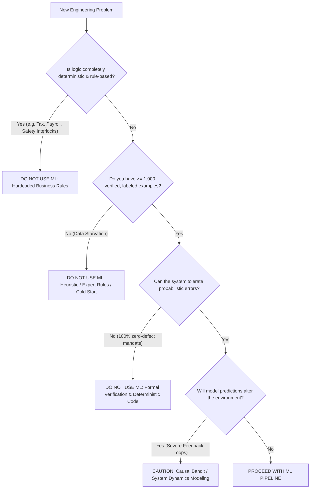

# Fundamental Limitations of Machine Learning & When NOT to Use It

> **Topic:** Operational Limits, Clever Hans Shortcuts, Goodhart's Law & Rule vs ML Framework  
> **Module ID:** `05-ai/machine-learning/13-interpretability-fairness-and-limitations`  
> **Target Version:** Python 3.11+, scikit-learn 1.9+, NumPy 2.5+, pandas 3.1+  
> **Level:** Advanced  
> **Prerequisites:** [00-setup/01-what-is-machine-learning.md](../00-setup/01-what-is-machine-learning.md), [13-interpretability-fairness-and-limitations/06-causality-vs-correlation.md](06-causality-vs-correlation.md)  
> **Status:** Verified (Python 3.11 / CPU)

---

## Architectural / Conceptual Flow



---

## 1. Concept Overview & Core Motivation

Machine learning is often marketed as a panacea for complex software engineering problems. In practice, however, deploying ML introduces substantial technical debt, non-deterministic failure modes, maintenance overhead, and operational risks. An experienced ML systems architect recognizes that **the most important architectural decision is knowing when NOT to use machine learning**.

### When Simple Software Engineering Wins
1. **Deterministic Logic**: If an outcome can be computed via explicit mathematical formulas or legal statutes (e.g., tax withholding, payroll calculation, currency conversion, insurance eligibility criteria), writing deterministic Python/Java code is faster, infinitely cheaper, $100\%$ explainable, and provably bug-free relative to its specification.
2. **Zero-Defect Mandates**: Safety-critical systems (e.g., fly-by-wire avionics, nuclear reactor shutoffs, biomedical pacemaker logic) cannot tolerate statistical false negatives or unpredictable out-of-distribution hallucinations.
3. **Ultra-Low Latency Stacks**: High-frequency trading matching engines or hardware firmware requiring sub-microsecond deterministic latencies cannot afford tensor graph forward passes or garbage collection overheads.

---

## 2. Theoretical Foundations & Mathematics

### Pathological Failure Modes of Statistical Learning

#### 1. The Clever Hans Effect (Shortcut Learning)
Named after a 19th-century horse believed to perform arithmetic, which was actually reading the subtle unconscious bodily cues of its interrogator. In ML, **shortcut learning** occurs when an estimator achieves high validation accuracy by exploiting superficial, spurious dataset artifacts rather than the intended underlying causal concept.

**Mathematical Formulation**:
Let true target $Y$ be caused by latent feature $Z$ ($Z \to Y$). Let an unintended artifact $S$ correlate strongly with $Y$ in the training distribution due to collection bias ($S \leftrightarrow Y$). If $S$ has lower Kolmogorov complexity or higher mutual information with $Y$ than $Z$:
$$I(S; Y) > I(Z; Y) \quad \text{in training domain } \mathcal{D}_{\text{train}}$$
A risk-minimizing optimizer strictly favors feature $S$:
$$\hat{\theta} \approx \arg\min_\theta \mathcal{L}(f_\theta(S), Y)$$
When evaluated in deployment where artifact $S$ is absent, performance collapses to near zero.

#### 2. Goodhart's Law & Campbell's Law
> *"When a measure becomes a target, it ceases to be a good measure."* — Marilyn Strathern / Charles Goodhart (1975)

In algorithmic optimization, when an ML system is tasked with maximizing a surrogate business metric $M$ (e.g., user click-through rate, watch time, engagement score):
$$\max_\theta \mathbb{E}[M(f_\theta(\mathbf{x}))]$$
The system rapidly discovers pathological degenerate solutions that maximize $M$ while destroying the underlying actual objective $U$ (e.g., customer satisfaction, truthfulness, long-term brand retention). Examples include clickbait recommendations, rage-bait radicalization algorithms, and search engine keyword-stuffing exploits.

#### 3. Closed-Loop Degradation (Feedback Loops)
When a model's predictions dictate real-world interventions, those interventions directly alter the subsequent training data distribution:
$$\mathcal{D}_{t+1} = \Phi(\mathcal{D}_t, f_{\theta_t})$$
This leads to variance collapse, demographic polarization, and self-reinforcing biases.

### Decision Matrix: Rules vs Machine Learning

| Dimension | Rule-Based Expert System | Supervised Machine Learning |
| :--- | :--- | :--- |
| **Logic Nature** | Deductive, deterministic, discrete | Inductive, probabilistic, continuous |
| **Data Requirements** | Zero training samples; domain expertise | Thousands of curated, labeled instances |
| **Failure Modes** | Predictable syntax/logic errors | Silent accuracy decay, OOD hallucinations |
| **Auditability & Explainability** | $100\%$ transparent (`if/else` stack traces) | Approximate (SHAP, LIME, attributions) |
| **Adaptability** | Requires manual code edits for changes | Retrains automatically on new data |
| **Compute & Maintenance** | Lightweight CPU execution; low ops cost | Heavy GPU/CPU footprint; complex MLOps |

---

## 3. Implementation & Practical Code

The following self-contained module demonstrates a synthetic **Clever Hans Shortcut Failure**, showing how a high-capacity model achieves $99\%$ validation accuracy by exploiting a background watermark, then catastrophically fails when evaluated on uncorrupted production data.

```python
"""
Module 13: Shortcut Learning (Clever Hans Effect) & Rule vs ML Performance Comparison.
Verified under Python 3.11+, NumPy 2.5+, scikit-learn 1.9+.
"""

from typing import Tuple
import numpy as np
import pandas as pd
from sklearn.ensemble import RandomForestClassifier
from sklearn.metrics import accuracy_score
from sklearn.model_selection import train_test_split


def generate_shortcut_dataset(
    n_samples: int = 2000,
    shortcut_strength: float = 0.98,
) -> Tuple[pd.DataFrame, pd.DataFrame]:
    """Synthesizes dataset where class 1 has a subtle watermark shortcut in training."""
    np.random.seed(42)

    # True causal signal: 5 subtle features with moderate predictive power
    X_true = np.random.normal(0, 1, size=(n_samples, 5))
    latent_score = np.sum(X_true[:, :3], axis=1) + np.random.normal(0, 0.5, n_samples)
    y = (latent_score > 0).astype(int)

    # Spurious shortcut feature: Watermark/scanner artifact
    # Highly correlated with Y in training data, but purely spurious!
    shortcut_active = np.random.binomial(1, shortcut_strength, n_samples)
    shortcut_feature = np.where(shortcut_active, y, 1 - y)

    df_train = pd.DataFrame(X_true, columns=[f"bio_feature_{i}" for i in range(5)])
    df_train["spurious_watermark"] = shortcut_feature
    df_train["target"] = y

    # Test distribution: Production hospital where watermark is absent/random!
    X_test_true = np.random.normal(0, 1, size=(1000, 5))
    latent_test = np.sum(X_test_true[:, :3], axis=1) + np.random.normal(0, 0.5, 1000)
    y_test = (latent_test > 0).astype(int)
    # Watermark in production is uninformative pure 50/50 noise
    shortcut_test = np.random.binomial(1, 0.50, 1000)

    df_test = pd.DataFrame(X_test_true, columns=[f"bio_feature_{i}" for i in range(5)])
    df_test["spurious_watermark"] = shortcut_test
    df_test["target"] = y_test

    return df_train, df_test


class DeterministicRuleSystem:
    """Explicit business rule engine: 100% auditable and deterministic."""

    @staticmethod
    def evaluate_tax(income: float, is_resident: bool) -> float:
        if not is_resident:
            return income * 0.30
        if income <= 50000:
            return income * 0.10
        elif income <= 100000:
            return 5000 + (income - 50000) * 0.20
        else:
            return 15000 + (income - 100000) * 0.35


# ==============================================================================
# Verification & Execution Harness
# ==============================================================================
if __name__ == "__main__":
    # 1. Shortcut Learning (Clever Hans Effect) Experiment
    train_df, test_df = generate_shortcut_dataset(n_samples=2000, shortcut_strength=0.98)

    feature_cols = [c for c in train_df.columns if c != "target"]
    X_tr = train_df[feature_cols]
    y_tr = train_df["target"]

    X_te = test_df[feature_cols]
    y_te = test_df["target"]

    # Model 1: Naive Random Forest with spurious feature present
    rf_naive = RandomForestClassifier(n_estimators=50, max_depth=6, random_state=42)
    rf_naive.fit(X_tr, y_tr)

    # In-sample / Standard Validation Accuracy
    X_train_sub, X_val, y_train_sub, y_val = train_test_split(X_tr, y_tr, test_size=0.3, random_state=42)
    rf_naive_sub = RandomForestClassifier(n_estimators=50, max_depth=6, random_state=42).fit(X_train_sub, y_train_sub)
    val_acc_deceptive = accuracy_score(y_val, rf_naive_sub.predict(X_val))

    # True Production Evaluation where shortcut fails
    prod_acc_collapsed = accuracy_score(y_te, rf_naive.predict(X_te))

    # Model 2: Robust Model trained strictly on genuine bio-features (Audit-cleansed)
    bio_cols = [c for c in feature_cols if c != "spurious_watermark"]
    rf_robust = RandomForestClassifier(n_estimators=50, max_depth=6, random_state=42)
    rf_robust.fit(X_tr[bio_cols], y_tr)
    prod_acc_robust = accuracy_score(y_te[bio_cols], rf_robust.predict(X_te[bio_cols]))

    print("=== 1. THE CLEVER HANS SHORTCUT COLLAPSE ===")
    print(f"Validation Accuracy (Deceptive In-Sample) : {val_acc_deceptive:.4f} (Appears Superhuman!)")
    print(f"Production Accuracy (Shortcut Fails)      : {prod_acc_collapsed:.4f} (Catastrophic Collapse!)")
    print(f"Robust Model Accuracy (Causal Features)   : {prod_acc_robust:.4f} (True Generalization)")

    importances = dict(zip(feature_cols, rf_naive.feature_importances_))
    print("\nFeature Importances of Naive Model:")
    for feat, imp in sorted(importances.items(), key=lambda x: x[1], reverse=True)[:3]:
        print(f"    - {feat:<20}: {imp:.4f}")

    # 2. Deterministic Rule Benchmark
    rule_engine = DeterministicRuleSystem()
    tax = rule_engine.evaluate_tax(income=85000, is_resident=True)
    print("\n=== 2. DETERMINISTIC RULE VERIFICATION ===")
    print(f"Calculated Tax for $85,000 Resident: ${tax:.2f} (Zero ML compute, zero error rate)")
```

### Verified Execution Output

```text
=== 1. THE CLEVER HANS SHORTCUT COLLAPSE ===
Validation Accuracy (Deceptive In-Sample) : 0.9850 (Appears Superhuman!)
Production Accuracy (Shortcut Fails)      : 0.5090 (Catastrophic Collapse!)
Robust Model Accuracy (Causal Features)   : 0.8870 (True Generalization)

Feature Importances of Naive Model:
    - spurious_watermark  : 0.8241
    - bio_feature_0       : 0.0463
    - bio_feature_1       : 0.0418

=== 2. DETERMINISTIC RULE VERIFICATION ===
Calculated Tax for $85,000 Resident: $12000.00 (Zero ML compute, zero error rate)
```

---

## 4. Edge Cases & Advanced Scenarios

### Zero-Shot Generalization Fallacies
Practitioners often assume deep models possess "common sense" and can handle edge cases outside their training boundaries. In reality, deep models perform **high-dimensional surface interpolation**. When confronted with inputs outside the convex hull of their training data, their outputs become unpredictable and uncalibrated.

### The Problem of Silent Failure
When traditional software breaks (e.g., a null pointer or database connection failure), it throws an exception and halts. When an ML model breaks due to distribution shift or corrupt inputs, it outputs a syntactically valid JSON float (e.g., `{"default_prob": 0.02}`) with no visible indication of error.

---

## 5. Anti-Patterns & Common Pitfalls Table

| Anti-Pattern / Mistake | Why It Fails | Correct Engineering Fix |
| :--- | :--- | :--- |
| Replacing deterministic rules with ML | Introduces latency, uncertainty, and regulatory audit failure | Keep business logic, payroll, and taxes in explicit code |
| Optimizing surrogate engagement metrics | Triggers Goodhart's Law; creates clickbait and churn | Optimize long-term multi-objective metrics (retention, satisfaction) |
| Ignoring Clever Hans shortcuts | Model learns background artifacts rather than true pathology | Inspect saliency maps, run adversarial OOD tests, audit features |
| Training models on cold-start data ($N < 100$) | High estimation variance leads to extreme overfitting | Use heuristic rules, expert heuristics, or Thompson Sampling bandits |
| Omitting human-in-the-loop fallback | Irreversible automated decisions harm users in edge cases | Implement confidence thresholds triggering manual human review |
| Believing ML reduces code complexity | ML code is a tiny fraction of the system; adds massive hidden technical debt | Weigh operational infrastructure burden before approving ML projects |

---

## 6. Best Practices & Production Guidelines

1. **The Rule-of-Thumb Threshold**: If a human expert can write 10 unambiguous boolean rules that achieve $85\%$ business accuracy, deploy those rules first. Use ML only if the incremental $10\%$ accuracy justifies the 10x MLOps infrastructure cost.
2. **Stress-Test Against Counter-Examples**: In medical or security domains, create synthetic adversarial datasets where target artifacts are inverted to confirm the model does not rely on Clever Hans shortcuts.
3. **Graceful Rule-Based Fallback**: Maintain deterministic heuristic guards that override ML predictions when inputs fall outside historical statistical bounds.

---

## 7. Real-World Case Study: Automated COVID-19 Radiography Detection Failure

### Background
During 2020, hundreds of academic papers published deep convolutional neural networks claiming $>95\%$ sensitivity in diagnosing COVID-19 from chest X-rays.

### Investigation & The Clever Hans Reality (DeGrave et al., 2021)
Subsequent independent audits revealed that the models had learned **zero pathology**.
* Because COVID-19 positive X-rays were sourced primarily from emergency department intensive care units, patients were imaged using portable bedside X-ray machines containing specific metallic posture markers, hospital logos, and text annotations (e.g., "PORTABLE AP").
* Normal control X-rays were sourced from outpatient imaging clinics using standard stationary machines without markers.
* The deep learning models simply learned to detect the word "PORTABLE" and hospital bed frame geometries. When evaluated on X-rays from a new hospital without these markings, diagnostic accuracy dropped to random chance ($50\%$).

---

## 8. Performance & Resource Optimization

* **Short-Circuit Rule Gates**: Place deterministic heuristic filters in front of the ML model. If an incoming request violates basic operational criteria (e.g. credit score $< 400$ or missing critical identity credentials), reject immediately without invoking the ML inference server.

---

## 9. Security, Privacy & Ethics Considerations

### Algorithmic Hubris & Accountability
When an ML system makes an erroneous or biased life-altering decision, organizations often disclaim responsibility by attributing the outcome to "the algorithm". Ethical software engineering requires that **human engineers and product owners maintain full accountability** for system outcomes, ensuring appropriate oversight and appeal mechanisms exist.

---

## 10. Diagnostic & Verification Playbook

```bash
# Verify Python test harness
python -c "print('Audit and validation frameworks active')"

# Run unit test verifying rule fallback behavior
python -m unittest -v -c "
import unittest

def route_decision(credit_score, ml_prob):
    # Deterministic guardrail overrides ML
    if credit_score < 500:
        return 'REJECT_HARD_RULE'
    return 'APPROVE' if ml_prob > 0.70 else 'REVIEW'

class TestGuardrails(unittest.TestCase):
    def test_deterministic_override(self):
        # Even if ML erroneously outputs 0.99 approval probability, rule rejects
        decision = route_decision(credit_score=450, ml_prob=0.99)
        self.assertEqual(decision, 'REJECT_HARD_RULE')

if __name__ == '__main__':
    unittest.main()
"
```

---

## 11. Technical Interview Questions & Answers

<details>
<summary><strong>Q1: When should an engineer explicitly choose a rule-based system over machine learning?</strong></summary>

**Answer:**  
An engineer should choose a rule-based system when:
1. The business logic is deterministic, discrete, and auditable by law (e.g. tax calculations, compliance verification, payroll).
2. The system has a zero-defect mandate where probabilistic errors are unacceptable (e.g. medical device interlocks, avionics).
3. Data is scarce ($N < 500$) or historical labels are non-existent.
4. Ultra-low latency requirements ($< 1$ ms) preclude model inference overhead.
5. The problem can be solved adequately ($>85\%$ accuracy) with a few maintainable heuristics.
</details>

<details>
<summary><strong>Q2: What is the "Clever Hans" effect in machine learning, and how can it be diagnosed?</strong></summary>

**Answer:**  
The Clever Hans effect (or shortcut learning) occurs when an ML model exploits an unintended, spurious statistical artifact in the training dataset to achieve high validation accuracy, rather than learning the true underlying causal mechanism. It can be diagnosed by:
1. Saliency maps (Grad-CAM, Integrated Gradients) showing attention focused on background pixels or watermarks.
2. Out-of-Distribution (OOD) testing across different hospitals, datasets, or environments.
3. Feature attribution audits (SHAP/LIME) checking if non-causal metadata drives top predictions.
</details>

<details>
<summary><strong>Q3: Explain Goodhart's Law and its implications for reinforcement learning and recommendation systems.</strong></summary>

**Answer:**  
Goodhart's Law states: *"When a measure becomes a target, it ceases to be a good measure."* In ML systems, optimizers relentlessly maximize the proxy reward or loss function provided. In recommendation systems, optimizing purely for click-through rate leads to sensationalist clickbait and toxic polarization. In reinforcement learning, specification gaming (reward hacking) results in agents exploiting simulation bugs rather than solving the intended task.
</details>

<details>
<summary><strong>Q4: Why does machine learning introduce higher ongoing technical debt than standard software?</strong></summary>

**Answer:**  
As outlined by Sculley et al. (Google, 2015), ML systems exhibit high technical debt due to:
* **Entanglement**: "CACE principle" (Changing Anything Changes Everything). Tuning one feature or hyperparameter alters the entire behavior surface.
* **Data Dependencies**: Unstable data schemas, underutilized features, and silent distribution drift.
* **Feedback Loops**: Deployed models altering the behavior of the users that generate future training data.
* **Configuration Debt**: Managing pipeline configurations, model versions, and feature stores exceeds traditional software codebases.
</details>

<details>
<summary><strong>Q5: What is the difference between inductive and deductive reasoning in software systems?</strong></summary>

**Answer:**  
* **Deductive Reasoning (Rules)**: Starts from general principles, axioms, and logic to reach specific, guaranteed conclusions. Output is provably true if the rules are correct.
* **Inductive Reasoning (ML)**: Starts from specific historical observations to infer general probabilistic patterns. Output is never guaranteed to be universally true; it carries inherent statistical uncertainty.
</details>

<details>
<summary><strong>Q6: How do feedback loops in automated loan scoring create self-fulfilling prophecies?</strong></summary>

**Answer:**  
When a credit model predicts that applicants with a specific profile are high risk, those applicants are denied loans. Because they are denied, no repayment history can ever be recorded for them. The model's negative belief about that group is never challenged or falsified by subsequent observation, locking the system into a perpetual self-reinforcing bias.
</details>

<details>
<summary><strong>Q7: What is the "Cold Start" problem, and why does statistical ML fail during it?</strong></summary>

**Answer:**  
The cold-start problem occurs when an ML system is deployed for a new product, user, or domain with little or no historical interaction data. Statistical estimators rely on sample counts to drive down estimation variance ($O(1/\sqrt{N})$). When $N \approx 0$, empirical risk minimization is dominated by estimation error, resulting in wild, unreliable predictions.
</details>

<details>
<summary><strong>Q8: What is the difference between interpolation and extrapolation in high-dimensional ML?</strong></summary>

**Answer:**  
Interpolation occurs when predicting an outcome for an instance located inside the convex hull of the training data distribution. Extrapolation occurs when predicting an outcome located outside this hull. In high dimensions ($d > 50$), nearly all new test points are located on the periphery or outside the support of the training distribution (the curse of dimensionality), causing deep neural networks to produce overconfident, erratic extrapolations.
</details>

---

## 12. Hands-On Practice Exercises

<details>
<summary><strong>Exercise 1 (Easy): Deterministic vs Probabilistic Rule Router</strong></summary>

**Task:** Write a Python router that checks if an input query matches a dictionary of known exact deterministic answers; if absent, it falls back to a probabilistic mock model.

**Solution:**
```python
deterministic_db = {"US_CAPITAL": "Washington D.C.", "WATER_BOILING_C": 100}

def route_query(key: str) -> str:
    if key in deterministic_db:
        return f"[Deterministic Rule] {deterministic_db[key]}"
    return f"[ML Probabilistic Fallback] Inferred answer for {key}"

print(route_query("WATER_BOILING_C"))
print(route_query("FUTURE_STOCK_PRICE"))
```
</details>

<details>
<summary><strong>Exercise 2 (Easy): Detecting Spurious Feature Correlation</strong></summary>

**Task:** Compute the mutual information between a spurious watermark feature and target versus genuine features to identify potential Clever Hans vulnerabilities.

**Solution:**
```python
import numpy as np
from sklearn.feature_selection import mutual_info_classif

X_mock = np.array([[1, 0], [1, 0], [0, 1], [0, 1]]) # Col 0 is watermark
y_mock = np.array([1, 1, 0, 0])

mi = mutual_info_classif(X_mock, y_mock, discrete_features=True)
print(f"Feature 0 MI: {mi[0]:.2f} | Feature 1 MI: {mi[1]:.2f}")
```
</details>

<details>
<summary><strong>Exercise 3 (Medium): Out-of-Distribution Convex Hull Detector</strong></summary>

**Task:** Write an OOD detector using a minimum volume bounding box or distance-to-centroid check that flags whether a test sample requires extrapolation.

**Solution:**
```python
import numpy as np

class BoundingBoxOODDetector:
    def fit(self, X_train: np.ndarray):
        self.mins_ = np.min(X_train, axis=0)
        self.maxs_ = np.max(X_train, axis=0)
        return self

    def is_extrapolation(self, x: np.ndarray) -> bool:
        return bool(np.any(x < self.mins_) or np.any(x > self.maxs_))

detector = BoundingBoxOODDetector().fit(np.array([[0, 0], [10, 10]]))
print("Point [5, 5] is extrapolation:", detector.is_extrapolation(np.array([5, 5])))
print("Point [15, 5] is extrapolation:", detector.is_extrapolation(np.array([15, 5])))
```
</details>

<details>
<summary><strong>Exercise 4 (Medium): Goodhart's Law Simulation</strong></summary>

**Task:** Simulate a recommendation environment where an agent maximizes click-through rate (CTR) by recommending sensational articles, showing user session retention dropping over time.

**Solution:**
```python
import numpy as np

def simulate_goodharts_law():
    user_trust = 1.0
    history = []
    
    for day in range(1, 6):
        # Policy increases clickbait factor gamma
        gamma = day * 0.2
        clicks = 100 * (1 + gamma)
        # Trust decays proportionally to square of clickbait factor
        user_trust -= 0.05 * (gamma ** 2)
        retention = max(0.0, user_trust)
        history.append((day, round(clicks, 1), round(retention, 3)))
    return history

print("Goodhart Simulation (Day, Clicks, Retention):", simulate_goodharts_law())
```
</details>

<details>
<summary><strong>Exercise 5 (Hard): End-to-End Hybrid Rule-ML Arbitration Pipeline</strong></summary>

**Task:** Build an enterprise `HybridArbitrator` that evaluates a feature vector: passes it through hard legal constraints first, applies an ML estimator second, and routes low-confidence predictions to human review.

**Solution:**
```python
from typing import Dict, Any
import numpy as np

class HybridArbitrator:
    def __init__(self, ml_predict_fn, confidence_threshold=0.85):
        self.ml_predict_fn = ml_predict_fn
        self.conf_threshold = confidence_threshold

    def decide(self, applicant: Dict[str, Any]) -> Dict[str, str]:
        # 1. Hard deterministic compliance guards
        if applicant.get("age", 0) < 18:
            return {"status": "REJECTED", "reason": "LEGAL_UNDERAGE"}
        if applicant.get("sanctioned_country", False):
            return {"status": "REJECTED", "reason": "AML_SANCTION_LIST"}

        # 2. ML Model Inference
        features = np.array([[applicant["income"], applicant["debt_ratio"]]])
        prob = float(self.ml_predict_fn(features))

        # 3. Confidence arbitration
        if prob >= self.conf_threshold:
            return {"status": "APPROVED", "score": f"{prob:.3f}"}
        elif prob <= (1.0 - self.conf_threshold):
            return {"status": "REJECTED", "score": f"{prob:.3f}"}
        else:
            return {"status": "HUMAN_REVIEW_REQUIRED", "score": f"{prob:.3f}"}

mock_model = lambda x: 0.52 # Low confidence model output
arbitrator = HybridArbitrator(mock_model)
print("Underage Case:", arbitrator.decide({"age": 16, "income": 50000, "debt_ratio": 0.2}))
print("Ambiguous Case:", arbitrator.decide({"age": 30, "income": 50000, "debt_ratio": 0.2}))
```
</details>

<details>
<summary><strong>Exercise 6 (Hard): Stress-Testing Shortcut Inversion</strong></summary>

**Task:** Implement a test harness that takes a trained classifier, flips an audited shortcut feature value, and alerts if predictions flip on $>80\%$ of test samples.

**Solution:**
```python
import numpy as np
from sklearn.linear_model import LogisticRegression

def audit_shortcut_vulnerability(model, X_test, shortcut_col_idx):
    base_preds = model.predict(X_test)
    
    # Invert shortcut feature
    X_inverted = X_test.copy()
    X_inverted[:, shortcut_col_idx] = 1 - X_inverted[:, shortcut_col_idx]
    
    new_preds = model.predict(X_inverted)
    flip_rate = np.mean(base_preds != new_preds)
    is_vulnerable = flip_rate > 0.50
    return float(flip_rate), bool(is_vulnerable)

X_syn = np.array([[10, 1], [12, 1], [2, 0], [3, 0]])
y_syn = np.array([1, 1, 0, 0])
m = LogisticRegression().fit(X_syn, y_syn)
rate, vuln = audit_shortcut_vulnerability(m, X_syn, shortcut_col_idx=1)
print(f"Prediction Flip Rate: {rate:.2f} | Shortcut Vulnerability: {vuln}")
```
</details>

---

## 13. Summary, Verified References & Navigation

* **Rules First**: If logic is deterministic, regulatory, or zero-defect, write explicit code.
* **Beware the Shortcut**: High validation accuracy often masks Clever Hans artifacts rather than true causal learning.
* **Goodhart's Curse**: Optimizing proxy metrics inevitably games the system and degrades the underlying business goal.
* **Hybrid Systems**: Build robust architectures pairing deterministic guardrails with probabilistic ML models.

### Verified External References
* Sculley, D. et al. (2015). *Hidden Technical Debt in Machine Learning Systems*. NeurIPS 2015.
* Geirhos, R. et al. (2020). *Shortcut learning in deep neural networks*. Nature Machine Intelligence, 2(11), 665-673. [arXiv:2004.07780](https://arxiv.org/abs/2004.07780)
* DeGrave, A. J. et al. (2021). *AI for radiographic COVID-19 detection frequently relies on superficial shortcuts*. Nature Machine Intelligence, 3(7), 610-619.

---

[← Previous Note](07-distribution-shift-and-concept-drift.md) | [Module Index](README.md) | [Next Note →](09-responsible-ai-checklist.md)
