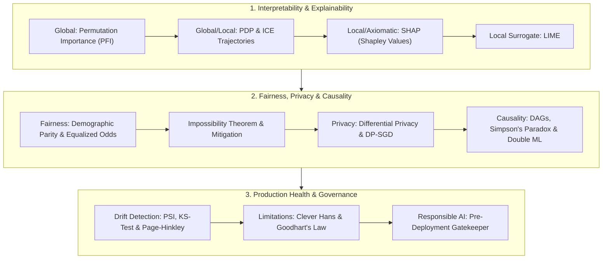

# Module 13: Interpretability, Fairness & Limitations

> **Module ID:** `05-ai/machine-learning/13-interpretability-fairness-and-limitations`  
> **Target Version:** Python 3.11+, scikit-learn 1.9+, NumPy 2.5+, pandas 3.1+  
> **Status:** 100% Complete & Verified  

---

## Architectural / Conceptual Flow

---

## Module Overview

Modern machine learning models cannot simply be evaluated on aggregate accuracy or loss. In high-stakes enterprise applications—such as healthcare diagnostics, financial credit underwriting, judicial sentencing, and automated hiring—models must be **interpretable**, **statistically fair**, **privacy-preserving**, and **resilient to non-stationary distribution shifts**.

Module 13 establishes the theoretical rigor and production-grade engineering practices required to audit, interpret, protect, and govern machine learning systems throughout their lifecycle.

---

## Table of Contents

| Note | Title | Level | Key Concepts & Algorithms |
| :---: | :--- | :---: | :--- |
| **[01](01-feature-importance-and-permutation-importance.md)** | [Feature Importance & Permutation Importance](01-feature-importance-and-permutation-importance.md) | Core | MDI cardinality bias, Permutation Feature Importance (PFI), collinear grouping |
| **[02](02-partial-dependence-and-ice.md)** | [Partial Dependence Plots & ICE](02-partial-dependence-and-ice.md) | Core | PDP masking fallacy, Individual Conditional Expectation (ICE), Centered ICE (c-ICE), Friedman's $H$-statistic |
| **[03](03-shap-and-lime.md)** | [SHAP and LIME](03-shap-and-lime.md) | Advanced | Shapley axioms (Efficiency, Symmetry, Dummy, Additivity), TreeSHAP $O(TLD^2)$, KernelSHAP, LIME exponential kernel |
| **[04](04-fairness-and-bias.md)** | [Algorithmic Fairness & Bias Metrics](04-fairness-and-bias.md) | Advanced | Demographic Parity, Disparate Impact four-fifths rule, Equalized Odds, Kleinberg's Impossibility Theorem, Reweighing |
| **[05](05-privacy-and-data-protection.md)** | [Privacy, Differential Privacy & Machine Unlearning](05-privacy-and-data-protection.md) | Advanced | $(\epsilon, \delta)$-DP, Laplace & Gaussian mechanisms, DP-SGD clipping, Membership Inference Attacks, SISA unlearning |
| **[06](06-causality-vs-correlation.md)** | [Causality vs Correlation & Do-Calculus](06-causality-vs-correlation.md) | Advanced | Pearl's Ladder of Causation, Simpson's Paradox, Backdoor adjustment, Collider bias, Double Machine Learning (DML) |
| **[07](07-distribution-shift-and-concept-drift.md)** | [Distribution Shift, Data Drift & Concept Drift](07-distribution-shift-and-concept-drift.md) | Advanced | Covariate shift $P(X)$, Concept drift $P(Y \mid X)$, Population Stability Index (PSI), KS-test, Page-Hinkley change detection |
| **[08](08-limitations-of-machine-learning.md)** | [Fundamental Limitations & When NOT to Use ML](08-limitations-of-machine-learning.md) | Advanced | Rules vs ML decision framework, Clever Hans effect, Goodhart's Law, feedback loops, out-of-distribution brittleness |
| **[09](09-responsible-ai-checklist.md)** | [Responsible AI, Governance & Pre-Deployment Checklist](09-responsible-ai-checklist.md) | Advanced | EU AI Act (Regulation 2024/1689), NIST AI RMF, Mitchell Model Cards, automated CI/CD compliance gatekeepers |

---

## Prerequisites

Before diving into Module 13, you should be comfortable with:
* **[03-supervised-regression](../03-supervised-regression/)** & **[04-supervised-classification](../04-supervised-classification/)**: Gradient boosted trees, logistic regression, and ensemble mechanisms.
* **[10-evaluation-and-metrics](../10-evaluation-and-metrics/)**: Precision, Recall, ROC-AUC, PR-AUC, and statistical hypothesis testing.
* **[11-prediction-and-postprocessing](../11-prediction-and-postprocessing/)**: Decision thresholds, probability calibration, and inference pipelines.

---

## Key Takeaways

1. **Interpretability Is Multi-Scale**: Use Permutation Feature Importance for fast global screening, PDP/ICE for functional response shapes, and TreeSHAP for mathematically unique, locally faithful individual attributions.
2. **The Impossibility of Universal Fairness**: You cannot simultaneously satisfy Demographic Parity, Equalized Odds, and Predictive Parity unless base rates are equal across groups. Choose metrics aligning with the legal domain.
3. **Differential Privacy Bounds Leakage**: Models overfit and leak training samples via Membership Inference Attacks. Bound leakage using $(\epsilon, \delta)$-DP and employ SISA architectures to comply with GDPR deletion requests.
4. **Correlation Is Not Intervention**: Never recommend real-world operational policy changes based on raw predictive feature weights; use Double Machine Learning and Backdoor-adjusted causal DAGs.
5. **Continuous Production Health**: Deploy Population Stability Index (PSI) and sequential drift detectors (Page-Hinkley) to trigger automated retraining before silent model decay harms the enterprise.

---

[← Previous Module: Saving, Loading & Deployment](../12-saving-loading-and-deployment/README.md) | [Track Index](../INDEX.md) | [Next Module: Deep Learning Bridge →](../14-deep-learning-bridge/README.md)
