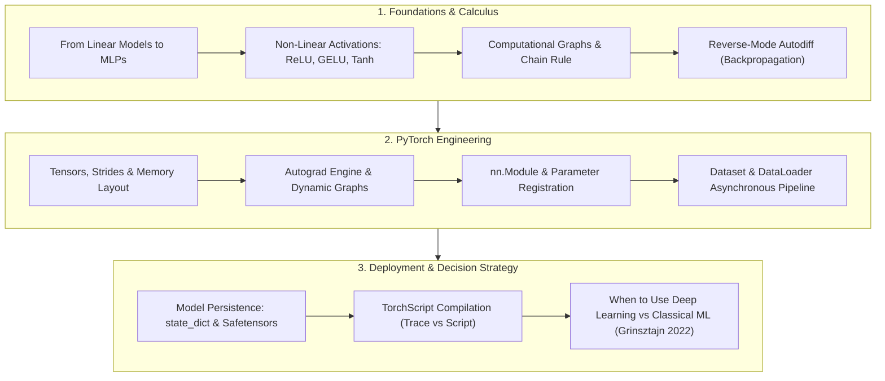

# Module 14: Deep Learning Bridge

> **Module ID:** `05-ai/machine-learning/14-deep-learning-bridge`  
> **Target Version:** Python 3.11+, PyTorch 2.4+, NumPy 2.5+, scikit-learn 1.9+  
> **Status:** 100% Complete & Verified  

---

## Architectural / Conceptual Flow

---

## Module Overview

Module 14 bridges the gap between classical statistical machine learning and modern deep learning. Starting from the geometric limitations of single-layer perceptrons (the XOR problem), this module deconstructs multi-layer neural networks, reverse-mode automatic differentiation (backpropagation), PyTorch's internal memory architecture, production training workflows, and deployment serialization (TorchScript and Safetensors).

Critically, this module arms engineers with the **architectural discernment** to evaluate when deep learning is appropriate versus when classical Gradient Boosted Decision Trees (GBDTs) are superior.

---

## Table of Contents

| Note | Title | Level | Key Concepts & Algorithms |
| :---: | :--- | :---: | :--- |
| **[01](01-from-linear-models-to-neural-networks.md)** | [From Linear Models to Neural Networks](01-from-linear-models-to-neural-networks.md) | Core | Perceptrons, XOR problem, MLPs, ReLU, GELU, Universal Approximation Theorem, Kaiming vs Xavier initialization |
| **[02](02-backpropagation-intuition.md)** | [Backpropagation Intuition & Autodiff](02-backpropagation-intuition.md) | Core | Computational graphs, Reverse-mode autodiff, Vector-Jacobian Products (VJPs), vanishing & exploding gradients, gradient clipping |
| **[03](03-pytorch-basics.md)** | [PyTorch Basics: Tensors, Autograd & DataLoader](03-pytorch-basics.md) | Core | Memory strides and storage, eager execution, `nn.Module`, `Dataset` and `DataLoader`, `nn.BCEWithLogitsLoss`, complete training loop |
| **[04](04-saving-and-loading-pytorch-models.md)** | [Saving, Loading & Exporting PyTorch Models](04-saving-and-loading-pytorch-models.md) | Advanced | `state_dict` vs full model serialization, Safetensors zero-copy `mmap`, TorchScript JIT tracing vs scripting, C++ LibTorch export |
| **[05](05-when-to-use-deep-learning-vs-classical-ml.md)** | [When to Use Deep Learning vs Classical ML](05-when-to-use-deep-learning-vs-classical-ml.md) | Advanced | Grinsztajn et al. (2022) NeurIPS benchmarks, coordinate-wise vs rotation-invariant inductive biases, TabNet/FT-Transformer vs LightGBM |

---

## Prerequisites

Before starting Module 14, you should understand:
* **[01-math-foundations/02-calculus-and-gradients.md](../01-math-foundations/02-calculus-and-gradients.md)**: Multivariate calculus, partial derivatives, and matrix dot products.
* **[03-supervised-regression](../03-supervised-regression/)** & **[04-supervised-classification](../04-supervised-classification/)**: Gradient descent optimization, logistic loss, and regularized linear models.
* **[12-saving-loading-and-deployment](../12-saving-loading-and-deployment/)**: Pickle risks, Skops, and serialization envelopes.

---

## Key Takeaways

1. **Non-Linearity Is Mandatory**: Stacking linear layers without non-linear activations mathematically collapses into a single linear model.
2. **Reverse-Mode Efficiency**: Reverse-mode automatic differentiation computes exact gradients for millions of parameters in a single backward pass because the loss objective is scalar ($M=1$).
3. **Decoupled Architecture**: Always serialize weights via `state_dict` or Hugging Face `safetensors`. Never pickle full model instances.
4. **Compile for Python-Free Environments**: Use `torch.jit.script` or `torch.jit.trace` to export computational graphs for execution in high-speed C++ LibTorch environments.
5. **Respect the Modality**: Unstructured data (vision, text, audio) belongs to Deep Learning. Tabular business data belongs to Gradient Boosted Decision Trees (LightGBM/XGBoost).

---

[← Previous Module: Interpretability, Fairness & Limitations](../13-interpretability-fairness-and-limitations/README.md) | [Track Index](../INDEX.md) | [Next Module: MLOps Basics →](../15-mlops-basics/README.md)
