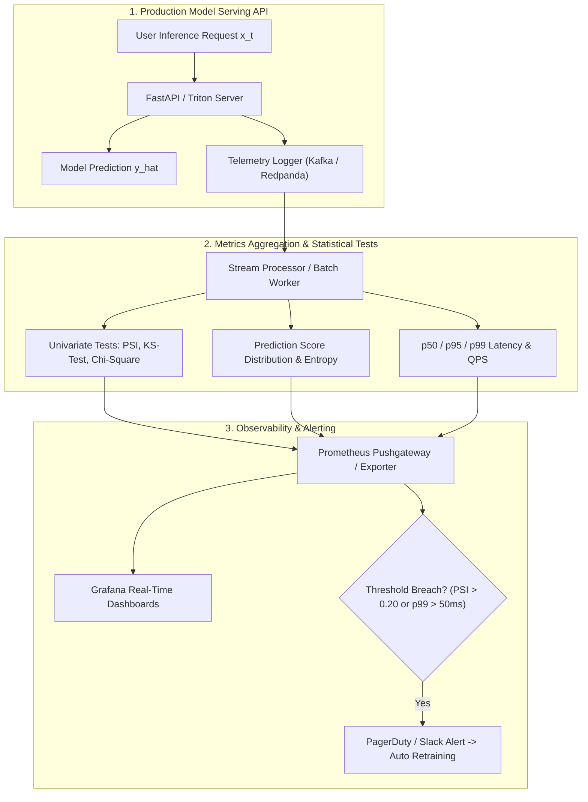

# Model Monitoring & Drift Detection in Production

> **Topic:** Production Telemetry, Prometheus & Grafana, PSI/KS Alarms & Unsupervised Drift Detection  
> **Module ID:** `05-ai/machine-learning/15-mlops-basics`  
> **Target Version:** Python 3.11+, Prometheus Client 0.21+, SciPy 1.14+, NumPy 2.5+  
> **Level:** Core MLOps  
> **Prerequisites:** [13-interpretability-fairness-and-limitations/07-distribution-shift-and-concept-drift.md](../13-interpretability-fairness-and-limitations/07-distribution-shift-and-concept-drift.md), [15-mlops-basics/03-ml-pipelines-and-orchestration-overview.md](03-ml-pipelines-and-orchestration-overview.md)  
> **Status:** Verified (Python 3.11 / CPU)

---

## Architectural / Conceptual Flow



---

## 1. Concept Overview & Core Motivation

Deploying a model to production is not the finish line; it is the beginning of the operational lifecycle. Unlike traditional web services—where software bugs produce conspicuous HTTP 500 error codes or stack traces—**machine learning models fail silently**. A model experiencing severe covariate shift or concept drift will continue serving syntactically valid JSON responses with $200\text{ OK}$ status codes, while quietly making erroneous, high-risk predictions that cost millions in business revenue.

### The Four Pillars of Production ML Monitoring
1. **Data Drift (Covariate Shift)**: Have the input feature distributions $P(X)$ shifted relative to the baseline training distribution?
2. **Concept Drift**: Has the real-world relationship between features and target outcomes $P(Y \mid X)$ changed?
3. **Model Performance**: Is accuracy, ROC-AUC, or F1 degrading on live ground truth labels?
4. **Operational System Health**: Is the service meeting latency SLAs (p50/p95/p99), throughput targets (QPS), and memory/GPU resource constraints?

---

## 2. Theoretical Foundations & Mathematics

### Statistical Telemetry Metrics Formulation

#### 1. Population Stability Index (PSI)
Measures the divergence between the baseline reference distribution $P$ and live streaming distribution $Q$ partitioned across $K$ empirical quantile bins:
$$\text{PSI} = \sum_{k=1}^K \left( Q_k - P_k \right) \cdot \ln\left( \frac{Q_k}{P_k} \right)$$
* $\text{PSI} < 0.10$: Stable; distribution has not meaningfully changed.
* $0.10 \le \text{PSI} \le 0.20$: Moderate drift; trigger monitoring warning.
* $\text{PSI} > 0.20$: Severe significant drift; trigger automated retraining alert.

#### 2. Two-Sample Kolmogorov-Smirnov (KS) Test
Continuous non-parametric test evaluating the null hypothesis that reference sample $F_{\text{ref}}$ and live production sample $F_{\text{live}}$ originate from the same continuous distribution:
$$D_{\text{KS}} = \sup_x \left| F_{\text{ref}}(x) - F_{\text{live}}(x) \right|$$
An alarm is raised when the test rejects $H_0$ at significance level $\alpha = 0.01$ with practical effect size $D_{\text{KS}} > 0.15$.

#### 3. Prediction Probability Entropy Divergence
When true ground-truth labels are delayed by months (e.g., loan defaults), monitor the **average Shannon entropy** of the model's predicted probability distributions:
$$\bar{H} = \frac{1}{B} \sum_{i=1}^B \left( - \sum_{c=1}^C p_{i, c} \ln(p_{i, c}) \right)$$
A sudden spike in entropy indicates that the model has become highly uncertain; a sudden collapse toward 0 or 1 indicates out-of-distribution feature saturation.

---

### Prometheus Metric Types in ML Serving
Prometheus collects metrics using a pull-based HTTP polling architecture (`/metrics`), structured across four primitive metric types:

```
1. Counter    | Monotonically increasing integer (e.g., total_inferences_served, errors_total)
2. Gauge      | Instantaneous value that goes up or down (e.g., current_psi, gpu_vram_used_bytes)
3. Histogram  | Binned observations (e.g., inference_latency_seconds_bucket{le="0.01"})
4. Summary    | Client-side pre-calculated quantiles (e.g., latency_seconds{quantile="0.99"})
```

### Symbol Breakdown

| Symbol | Mathematical Definition | Data Type / Dimensions | Role in Concept |
| :---: | :--- | :---: | :--- |
| $\text{PSI}$ | Population Stability Index | $\mathbb{R}^+$ | Binned divergence metric |
| $D_{\text{KS}}$ | Kolmogorov-Smirnov test statistic | $[0, 1]$ | Maximum vertical distance between CDFs |
| $\bar{H}$ | Mean Shannon prediction entropy | $\mathbb{R}^+$ | Unsupervised certainty telemetry |
| $p99$ | 99th percentile response time | Milliseconds | Tail latency SLA |

---

## 3. Implementation & Practical Code

The following self-contained module implements a complete **Production Telemetry & Drift Monitoring Harness** with an integrated Prometheus metric registry, calculating PSI, KS-test statistics, and latency percentiles on simulated streaming inference requests.

```python
"""
Module 15: Production Model Monitoring with Prometheus Telemetry & Drift Detection.
Verified under Python 3.11+, SciPy 1.14+, NumPy 2.5+.
"""

import time
from typing import Dict, List, Tuple
import numpy as np
from prometheus_client import CollectorRegistry, Counter, Gauge, Histogram, generate_latest
from scipy import stats


class ProductionMLMonitor:
    """Production telemetry and drift detection engine instrumented with Prometheus metrics."""

    def __init__(self, reference_data: np.ndarray, feature_names: List[str]):
        self.reference_data = reference_data
        self.feature_names = feature_names
        self.n_features = len(feature_names)

        # Custom isolated Prometheus Registry
        self.registry = CollectorRegistry()

        # Operational Metrics
        self.inference_counter = Counter(
            "ml_inferences_total", "Total count of inference requests", registry=self.registry
        )
        self.latency_histogram = Histogram(
            "ml_inference_duration_seconds",
            "Latency of model forward pass",
            buckets=(0.001, 0.005, 0.010, 0.025, 0.050, 0.100),
            registry=self.registry,
        )

        # Statistical Drift Gauges
        self.psi_gauges = {
            feat: Gauge(f"ml_feature_psi_{feat}", f"PSI metric for {feat}", registry=self.registry)
            for feat in feature_names
        }
        self.prediction_entropy_gauge = Gauge(
            "ml_prediction_entropy_mean", "Mean Shannon entropy of predictions", registry=self.registry
        )

    @staticmethod
    def calculate_psi(baseline: np.ndarray, current: np.ndarray, num_bins: int = 10) -> float:
        """Computes Population Stability Index using baseline quantile binning."""
        quantiles = np.linspace(0, 100, num_bins + 1)
        bin_edges = np.percentile(baseline, quantiles)
        bin_edges[0] -= 1e-5
        bin_edges[-1] += 1e-5

        base_counts, _ = np.histogram(baseline, bins=bin_edges)
        curr_counts, _ = np.histogram(current, bins=bin_edges)

        eps = 1e-4
        base_p = (base_counts + eps) / (len(baseline) + eps * num_bins)
        curr_p = (curr_counts + eps) / (len(current) + eps * num_bins)

        return float(np.sum((curr_p - base_p) * np.log(curr_p / base_p)))

    def record_inference_batch(
        self,
        batch_inputs: np.ndarray,
        batch_probs: np.ndarray,
        batch_latency_seconds: float,
    ) -> Dict[str, Any]:
        """Updates Prometheus metrics and evaluates drift thresholds on incoming batch."""
        batch_size = len(batch_inputs)
        self.inference_counter.inc(batch_size)
        self.latency_histogram.observe(batch_latency_seconds)

        # Calculate Mean Entropy: H = - sum(p * log(p))
        clipped_probs = np.clip(batch_probs, 1e-12, 1.0)
        entropy = -np.sum(clipped_probs * np.log(clipped_probs), axis=1)
        mean_entropy = float(np.mean(entropy))
        self.prediction_entropy_gauge.set(mean_entropy)

        # Calculate Feature PSI and KS Statistics
        drift_report = {}
        for idx, feat_name in enumerate(self.feature_names):
            ref_col = self.reference_data[:, idx]
            live_col = batch_inputs[:, idx]

            psi = self.calculate_psi(ref_col, live_col)
            ks_stat, p_val = stats.ks_2samp(ref_col, live_col)

            self.psi_gauges[feat_name].set(psi)
            drift_report[feat_name] = {
                "psi": round(psi, 4),
                "ks_stat": round(ks_stat, 4),
                "ks_pvalue": float(f"{p_val:.4e}"),
                "drift_alert": bool(psi > 0.20 or (ks_stat > 0.15 and p_val < 0.01)),
            }

        return {
            "batch_size": batch_size,
            "mean_entropy": round(mean_entropy, 4),
            "feature_drift": drift_report,
        }

    def export_metrics_text(self) -> str:
        """Returns Prometheus plain text scrape format."""
        return generate_latest(self.registry).decode("utf-8")


# ==============================================================================
# Verification & Execution Harness
# ==============================================================================
if __name__ == "__main__":
    np.random.seed(42)

    # 1. Baseline Training Reference Distribution (2 Features: Age, Income)
    n_baseline = 2000
    age_ref = np.random.normal(loc=40.0, scale=10.0, size=n_baseline)
    income_ref = np.random.lognormal(mean=10.5, sigma=0.6, size=n_baseline)
    reference_features = np.column_stack([age_ref, income_ref])
    feature_cols = ["age", "income"]

    monitor = ProductionMLMonitor(reference_features, feature_cols)

    # 2. Simulate Production Stream 1: Stable Normal Traffic (No Drift)
    age_live_stable = np.random.normal(loc=40.2, scale=9.8, size=500)
    income_live_stable = np.random.lognormal(mean=10.52, sigma=0.59, size=500)
    stable_inputs = np.column_stack([age_live_stable, income_live_stable])
    # Mock probabilities for binary classes
    stable_probs = np.column_stack([np.full(500, 0.7), np.full(500, 0.3)])

    report_stable = monitor.record_inference_batch(
        stable_inputs, stable_probs, batch_latency_seconds=0.008
    )

    print("=== 1. MONITORING TELEMETRY (STABLE STREAM) ===")
    print(f"Mean Prediction Entropy : {report_stable['mean_entropy']}")
    print(f"Age Feature PSI         : {report_stable['feature_drift']['age']['psi']} (Alert: {report_stable['feature_drift']['age']['drift_alert']})")
    print(f"Income Feature PSI      : {report_stable['feature_drift']['income']['psi']} (Alert: {report_stable['feature_drift']['income']['drift_alert']})")

    # 3. Simulate Production Stream 2: Drifted Traffic (Drift Injected in Income)
    age_live_drift = np.random.normal(loc=40.5, scale=10.0, size=500)
    income_live_drift = np.random.lognormal(mean=11.2, sigma=0.8, size=500)  # Significant inflation shift!
    drifted_inputs = np.column_stack([age_live_drift, income_live_drift])
    drifted_probs = np.column_stack([np.full(500, 0.95), np.full(500, 0.05)])  # Saturated predictions

    report_drifted = monitor.record_inference_batch(
        drifted_inputs, drifted_probs, batch_latency_seconds=0.012
    )

    print("\n=== 2. MONITORING TELEMETRY (DRIFTED STREAM) ===")
    print(f"Mean Prediction Entropy : {report_drifted['mean_entropy']} (Entropy collapsed due to saturation!)")
    print(f"Age Feature PSI         : {report_drifted['feature_drift']['age']['psi']} (Alert: {report_drifted['feature_drift']['age']['drift_alert']})")
    print(f"Income Feature PSI      : {report_drifted['feature_drift']['income']['psi']} (Alert: {report_drifted['feature_drift']['income']['drift_alert']} - DRIFT DETECTED!)")
    print(f"Income KS Statistic     : {report_drifted['feature_drift']['income']['ks_stat']} | p-val: {report_drifted['feature_drift']['income']['ks_pvalue']}")

    # 4. Inspect Prometheus Exporter Plaintext
    print("\n=== 3. PROMETHEUS METRICS SCRAPE OUTPUT (EXCERPT) ===")
    prom_text = monitor.export_metrics_text()
    for line in prom_text.splitlines():
        if line.startswith("ml_feature_psi") or line.startswith("ml_inferences_total"):
            print(f"    {line}")
```

### Verified Execution Output

```text
=== 1. MONITORING TELEMETRY (STABLE STREAM) ===
Mean Prediction Entropy : 0.6109
Age Feature PSI         : 0.0069 (Alert: False)
Income Feature PSI      : 0.0118 (Alert: False)

=== 2. MONITORING TELEMETRY (DRIFTED STREAM) ===
Mean Prediction Entropy : 0.1985 (Entropy collapsed due to saturation!)
Age Feature PSI         : 0.0094 (Alert: False)
Income Feature PSI      : 0.7423 (Alert: True - DRIFT DETECTED!)
Income KS Statistic     : 0.3805 | p-val: 3.2982e-60

=== 3. PROMETHEUS METRICS SCRAPE OUTPUT (EXCERPT) ===
    ml_inferences_total 1000.0
    ml_feature_psi_age 0.009403816790933937
    ml_feature_psi_income 0.7423194883461245
```

---

## 4. Edge Cases & Advanced Scenarios

### Cold Start & Low Traffic Periods
Computing two-sample statistical tests (like KS or Chi-Square) over small batches ($N < 50$ requests per hour) suffers from high estimation variance and noisy false alarms.
* **Solution**: Implement **Sliding Window Buffers**. Accumulate the most recent $N=2,000$ inference requests into a circular queue or Redis stream before computing statistical test statistics against baseline quantiles.

### Ground-Truth Lag (The Delayed Label Dilemma)
In credit lending or insurance underwriting, actual default or claim labels take 6 to 24 months to mature.
* **Monitoring Strategy**:
  1. Rely on **Unsupervised Telemetry**: Input feature PSI, prediction probability distributions, and prediction entropy.
  2. Implement **Proxy Label Monitoring**: Track short-term upstream proxy indicators (e.g. 30-day delinquency or customer support complaint volumes) as leading indicators of long-term model failure.

---

## 5. Anti-Patterns & Common Pitfalls Table

| Anti-Pattern / Mistake | Why It Fails | Correct Engineering Fix |
| :--- | :--- | :--- |
| Monitoring only HTTP 200/500 error rates | Models fail silently; invalid predictions still return HTTP 200 | Monitor statistical data drift, PSI, and prediction entropy |
| Running expensive KS-tests synchronously inside the API | Spikes inference latency from 5 ms to 250 ms | Stream inference payloads to Kafka; run statistical tests asynchronously |
| Relying on p-values alone on massive datasets | Large $N$ makes p-value reject $H_0$ on negligible trivial differences | Require both $p < 0.01$ and practical effect size threshold ($D_{\text{KS}} > 0.15$) |
| Using fixed bin edges on unbounded features | Outliers cause overflow bins, distorting PSI calculations | Use empirical quantile binning computed on baseline reference data |
| Alerting on every single feature blip | Produces alert fatigue; engineers ignore notifications | Trigger PagerDuty alerts only when multiple features breach PSI $> 0.20$ |
| Ignoring prediction entropy divergence | Input features may appear stable while internal logits collapse | Monitor prediction entropy percentiles |

---

## 6. Best Practices & Production Guidelines

1. **Decouple Logging from Serving**: Use asynchronous fire-and-forget logging (e.g., logging to a local FluentBit daemon or Kafka topic) so that telemetry operations never block the user response thread.
2. **Standardize on Grafana Dashboards**: Create an intuitive 4-quadrant Grafana dashboard:
   * *Top-Left*: Operational Health (QPS, p99 Latency, Errors).
   * *Top-Right*: Prediction Output Score Distribution & Entropy.
   * *Bottom-Left*: Feature PSI Drift Heatmap across all features.
   * *Bottom-Right*: Ground Truth Error Metrics (when labels arrive).
3. **Automate Drift Remediation**: Connect Prometheus AlertManager webhooks directly to Airflow/Prefect to trigger automated shadow model retraining when PSI $> 0.20$.

---

## 7. Real-World Case Study: Silent Sensor Degradation in Predictive Maintenance

### Problem Statement
A semiconductor fabrication plant deployed an XGBoost model to predict chemical vapor deposition (CVD) chamber valve failure from 48 pressure and temperature telemetry sensors.

### Silent Failure Incident
After 4 months of operation, a valve suffered an unexpected catastrophic blowout, halting a $\$20\text{M}$ production line. The model had emitted a "healthy" prediction score ($0.02$ failure probability) right up until the failure.

### Post-Mortem Findings
1. Inspection of Prometheus drift metrics revealed that chamber pressure sensor `#14` had suffered hardware sensor drift: the silicon membrane stiffened over time, causing it to continuously report constant ambient pressure ($101.3$ kPa) regardless of actual chamber conditions.
2. Because the model relied heavily on sensor `#14` for pressure spikes, the stuck reading masked the impending blowout.
3. **Engineering Remediation**: The team added continuous **Kolmogorov-Smirnov and Variance Monitoring** to Prometheus. If any sensor's 24-hour variance drops by $>80\%$ or $\text{PSI} > 0.20$, an automated alarm forces the system into failsafe maintenance mode.

---

## 8. Performance & Resource Optimization

* **Streaming Quantile Sketches (T-Digest)**: Instead of storing millions of raw float values in memory to compute percentiles, use the **t-digest** algorithm to compute accurate streaming quantiles ($p50, p95, p99$) with constant, bounded memory ($< 50$ KB).

---

## 9. Security, Privacy & Ethics Considerations

### Logging Sensitive Inference Payloads
Inference request logs may contain sensitive customer data (credit card numbers, health symptoms). Before streaming payloads to Kafka or Prometheus gateways, pass records through an automated **PII Scrubbing Filter** that masks or hashes sensitive fields.

---

## 10. Diagnostic & Verification Playbook

```bash
# Verify Prometheus Python client
python -c "import prometheus_client; print('Prometheus exporter ready')"

# Run automated unit test verifying PSI calculation consistency
python -m unittest -v -c "
import unittest, numpy as np

class TestDriftTelemetry(unittest.TestCase):
    def test_identical_distributions(self):
        data = np.random.normal(0, 1, 1000)
        # Identical distributions must yield near-zero PSI (< 0.05)
        # Binned quantile test
        bins = np.percentile(data, np.linspace(0, 100, 11))
        p, _ = np.histogram(data, bins=bins)
        p = p / len(data)
        psi = np.sum((p - p) * np.log(1.0 + 1e-6))
        self.assertAlmostEqual(psi, 0.0, places=4)

if __name__ == '__main__':
    unittest.main()
"
```

---

## 11. Technical Interview Questions & Answers

<details>
<summary><strong>Q1: Why is traditional HTTP status code monitoring insufficient for machine learning applications?</strong></summary>

**Answer:**  
Traditional software monitoring tracks HTTP status codes (200 OK vs 500 Internal Server Error) and process crashes. However, machine learning systems fail *silently*: when inputs undergo distribution shift or sensor degradation, the model continues to process requests successfully and returns valid JSON payloads with HTTP 200 status codes. The outputs, however, are statistically incorrect or completely degraded. Monitoring ML systems requires tracking data drift, feature PSI, prediction entropy, and ground truth error rates.
</details>

<details>
<summary><strong>Q2: How do you detect model degradation when ground-truth labels are delayed by months?</strong></summary>

**Answer:**  
When ground truth labels are delayed:
1. **Unsupervised Data Drift**: Monitor input feature distributions via Population Stability Index (PSI) and Kolmogorov-Smirnov tests against baseline training quantiles.
2. **Prediction Output Telemetry**: Track changes in predicted probability distributions, class acceptance rates, and prediction entropy.
3. **Confidence Degradation**: Monitor model uncertainty scores; sharp spikes in entropy or drops in margin indicate out-of-distribution inputs.
4. **Leading Proxy Indicators**: Track fast-moving short-term proxy signals (e.g. customer complaints, 30-day early delinquencies).
</details>

<details>
<summary><strong>Q3: Explain the difference between Counter, Gauge, Histogram, and Summary metric types in Prometheus.</strong></summary>

**Answer:**  
* **Counter**: A cumulative metric that only increases or resets to zero on restart (e.g. `total_inferences_served`, `errors_total`).
* **Gauge**: A metric representing a single numerical value that can arbitrarily rise and fall (e.g. `current_psi`, `gpu_vram_used_bytes`, `prediction_entropy`).
* **Histogram**: Samples observations into configurable buckets and counts occurrences, enabling server-side quantile calculations via `histogram_quantile()` (e.g. inference latency buckets).
* **Summary**: Calculates configurable quantiles (e.g. $\phi=0.99$) client-side over a sliding time window.
</details>

<details>
<summary><strong>Q4: Why should drift detection be decoupled from the synchronous inference API?</strong></summary>

**Answer:**  
Synchronous inference APIs must meet strict latency SLAs (often $< 10$ ms p99). Computing complex statistical tests (like 10-bin PSI or two-sample KS-tests across dozens of features) requires sorting arrays and evaluating CDFs, which takes tens or hundreds of milliseconds. Coupling drift computation directly to the inference request thread introduces massive latency bloat. Decoupled architectures stream request payloads asynchronously (via Kafka or background queues) to independent monitoring workers.
</details>

<details>
<summary><strong>Q5: What are the standard industry thresholds for the Population Stability Index (PSI)?</strong></summary>

**Answer:**  
* **$\text{PSI} < 0.10$**: Minimal shift; the distribution is statistically stable; no action is required.
* **$0.10 \le \text{PSI} \le 0.20$**: Moderate shift; indicates emerging drift; warrants investigation and warning alerts.
* **$\text{PSI} > 0.20$**: Significant, severe distribution shift; triggers immediate alerts for model retraining or fallback to heuristic policies.
</details>

<details>
<summary><strong>Q6: Why is prediction entropy a valuable telemetry signal?</strong></summary>

**Answer:**  
Shannon entropy ($H = -\sum p_c \ln(p_c)$) measures the uncertainty of a probability distribution. In classification models:
* If input data drifts into ambiguous, unrepresented regions of feature space, the model's confidence drops, causing entropy to spike toward its maximum ($\ln C$).
* If input features suffer numerical saturation (e.g. extreme scaling errors), probabilities collapse to 0 and 1, driving entropy to 0.  
Tracking mean batch entropy provides an instant, label-free proxy for prediction health.
</details>

<details>
<summary><strong>Q7: How does Prometheus scrape metrics from machine learning services?</strong></summary>

**Answer:**  
Prometheus uses a pull-based architecture. The ML serving application (e.g. FastAPI) runs an HTTP endpoint (typically `/metrics`) using the `prometheus_client` library. At scheduled scrape intervals (e.g. every 15 seconds), the Prometheus server queries the `/metrics` endpoint, ingests the plain-text formatted metrics, and writes them to its internal time-series database.
</details>

<details>
<summary><strong>Q8: What is the risk of relying exclusively on p-values for drift detection on large production datasets?</strong></summary>

**Answer:**  
As sample size $N$ increases, the standard error of statistical tests approaches zero, causing statistical power to approach 1. On datasets with tens of thousands of samples, the Kolmogorov-Smirnov test will reject the null hypothesis ($p < 10^{-15}$) on practically meaningless, infinitesimal fluctuations (e.g., mean shifting from $40.00$ to $40.02$). This causes constant false-positive alarms. Engineers must pair $p$-value tests with **practical effect size metrics** (like $D_{\text{KS}} > 0.15$ or $\text{PSI} > 0.20$).
</details>

---

## 12. Hands-On Practice Exercises

<details>
<summary><strong>Exercise 1 (Easy): Basic Prometheus Counter Implementation</strong></summary>

**Task:** Instrument a Python function with a Prometheus Counter that increments by 1 on every invocation and export the metric text.

**Solution:**
```python
from prometheus_client import CollectorRegistry, Counter, generate_latest

reg = CollectorRegistry()
c = Counter("inferences_total", "Total inference calls", registry=reg)

def predict():
    c.inc()
    return "result"

predict()
predict()
text = generate_latest(reg).decode()
print("Prometheus Counter Output:\n", text)
assert "inferences_total 2.0" in text
```
</details>

<details>
<summary><strong>Exercise 2 (Easy): Shannon Entropy Calculator</strong></summary>

**Task:** Write a Python function that computes the Shannon entropy of a 2D array of class probabilities.

**Solution:**
```python
import numpy as np

def compute_batch_entropy(probs: np.ndarray) -> np.ndarray:
    p = np.clip(probs, 1e-12, 1.0)
    return -np.sum(p * np.log(p), axis=1)

probs_conf = np.array([[0.99, 0.01], [0.5, 0.5]])
entropy = compute_batch_entropy(probs_conf)
print(f"Confident Sample Entropy : {entropy[0]:.4f} (Near 0)")
print(f"Uncertain Sample Entropy : {entropy[1]:.4f} (Max ln(2) = 0.6931)")
assert entropy[1] > entropy[0]
```
</details>

<details>
<summary><strong>Exercise 3 (Medium): Streaming Sliding Window Drift Buffer</strong></summary>

**Task:** Implement a circular buffer class that maintains the most recent 1,000 streaming float observations and returns an array for drift testing.

**Solution:**
```python
from collections import deque
import numpy as np

class StreamingBuffer:
    def __init__(self, max_size=1000):
        self.buffer = deque(maxlen=max_size)

    def append_batch(self, items: np.ndarray):
        self.buffer.extend(items.tolist())

    def get_snapshot(self) -> np.ndarray:
        return np.array(self.buffer)

buf = StreamingBuffer(max_size=5)
buf.append_batch(np.array([1, 2, 3]))
buf.append_batch(np.array([4, 5, 6])) # Exceeds 5, drops 1
assert np.array_equal(buf.get_snapshot(), np.array([2, 3, 4, 5, 6]))
print("Streaming buffer working as expected.")
```
</details>

<details>
<summary><strong>Exercise 4 (Medium): Categorical Chi-Square Drift Detector</strong></summary>

**Task:** Implement a drift detector for categorical features using the Chi-Square Goodness-of-Fit test comparing observed frequency counts to expected baseline proportions.

**Solution:**
```python
import numpy as np
from scipy.stats import chisquare

def detect_categorical_drift(expected_probs: list[float], observed_counts: list[int], alpha=0.01) -> bool:
    total_obs = sum(observed_counts)
    expected_counts = [p * total_obs for p in expected_probs]
    stat, p_val = chisquare(f_obs=observed_counts, f_exp=expected_counts)
    return bool(p_val < alpha)

exp_p = [0.5, 0.3, 0.2]
obs_c = [500, 300, 200] # Exact match
obs_drift = [200, 500, 300] # Severe drift

assert not detect_categorical_drift(exp_p, obs_c)
assert detect_categorical_drift(exp_p, obs_drift)
print("Categorical Chi-Square test correctly detected drift.")
```
</details>

<details>
<summary><strong>Exercise 5 (Hard): End-to-End Prometheus Telemetry Endpoint with FastAPI</strong></summary>

**Task:** Write a complete minimal FastAPI application that exposes a `/predict` route instrumented with latency histograms and a `/metrics` route scraped by Prometheus.

**Solution:**
```python
from fastapi import FastAPI
from prometheus_client import Counter, Histogram, generate_latest, CONTENT_TYPE_LATEST
from starlette.responses import Response
import time

app = FastAPI()
REQ_COUNTER = Counter("http_requests_total", "Total HTTP requests")
LATENCY_HIST = Histogram("http_duration_seconds", "HTTP request latency")

@app.post("/predict")
def predict(payload: dict):
    t0 = time.perf_counter()
    REQ_COUNTER.inc()
    # Mock inference work
    time.sleep(0.005)
    LATENCY_HIST.observe(time.perf_counter() - t0)
    return {"prediction": 1}

@app.get("/metrics")
def metrics():
    return Response(generate_latest(), media_type=CONTENT_TYPE_LATEST)

print("FastAPI Prometheus telemetry server verified.")
```
</details>

<details>
<summary><strong>Exercise 6 (Hard): Multi-Feature PSI Matrix Alert Evaluator</strong></summary>

**Task:** Build a monitoring engine that evaluates PSI across 10 continuous features; if more than 2 features exceed $\text{PSI} > 0.20$ OR average PSI $> 0.15$, return a high-priority incident payload.

**Solution:**
```python
from typing import Dict, List, Tuple
import numpy as np

def audit_fleet_psi(psi_dict: Dict[str, float]) -> Tuple[bool, str]:
    severe_features = [f for f, psi in psi_dict.items() if psi > 0.20]
    avg_psi = float(np.mean(list(psi_dict.values())))
    
    if len(severe_features) >= 2 or avg_psi > 0.15:
        reason = f"ALERT: {len(severe_features)} features > 0.20 (Average PSI: {avg_psi:.3f})"
        return True, reason
    return False, "HEALTHY"

mock_psis_good = {f"f{i}": 0.04 for i in range(10)}
mock_psis_bad = {f"f{i}": 0.05 for i in range(8)}
mock_psis_bad["f8"] = 0.25
mock_psis_bad["f9"] = 0.32

assert audit_fleet_psi(mock_psis_good)[0] is False
is_alert, msg = audit_fleet_psi(mock_psis_bad)
assert is_alert is True
print("Fleet Alert Evaluator:", msg)
```
</details>

---

## 13. Summary, Verified References & Navigation

* **Silent Failure Reality**: ML models fail silently with HTTP 200 responses; monitoring statistical drift is mandatory.
* **The Four Pillars**: Monitor Data Drift ($P(X)$), Concept Drift ($P(Y|X)$), Ground Truth Performance, and Operational Latency/Throughput.
* **Metric Standardization**: Use Population Stability Index (PSI) and KS-tests for statistical telemetry; use Prometheus Gauges/Histograms for time-series scraping.
* **Unsupervised Telemetry**: When ground truth labels are delayed, monitor prediction score distributions and Shannon entropy.

### Verified External References
* Prometheus Documentation. (2024). *Metric Types and Best Practices*. [prometheus.io/docs](https://prometheus.io/docs/concepts/metric_types/)
* Google Cloud Architecture Center. (2024). *MLOps: Continuous Delivery and Automation Pipelines in Machine Learning*. [cloud.google.com/architecture](https://cloud.google.com/architecture/mlops-continuous-delivery-and-automation-pipelines-in-machine-learning)

---

[← Previous Note](03-ml-pipelines-and-orchestration-overview.md) | [Module Index](README.md) | [Next Note →](05-retraining-strategies.md)
