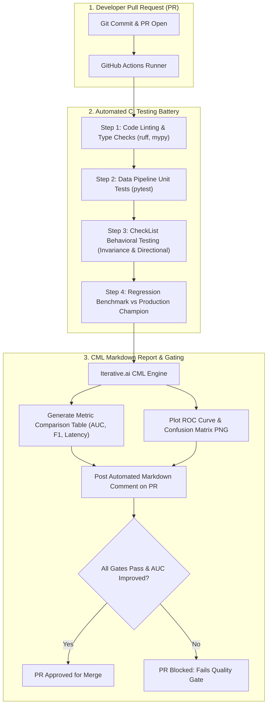

# CI/CD for Machine Learning: CML, Automated PR Testing & Quality Gates

> **Topic:** Continuous Integration & Delivery in ML, CheckList Behavioral Testing & GitHub Actions Automation  
> **Module ID:** `05-ai/machine-learning/15-mlops-basics`  
> **Target Version:** Python 3.11+, CML, GitHub Actions, pytest 8.3+, scikit-learn 1.9+  
> **Level:** Core MLOps  
> **Prerequisites:** [05-retraining-strategies.md](05-retraining-strategies.md), [10-evaluation-and-metrics/06-baselines-and-sanity-checks.md](../10-evaluation-and-metrics/06-baselines-and-sanity-checks.md)  
> **Status:** Verified (Python 3.11 / CPU)

---

## Architectural / Conceptual Flow



---

## 1. Concept Overview & Core Motivation

In traditional software development, Continuous Integration (CI) compiles code, runs unit tests, and verifies that new commits do not break existing software logic. In machine learning, however, **code passing all unit tests provides zero guarantee that the resulting model is mathematically sound, fair, or performant**.

A developer can submit a pull request where all Python syntax is flawless, yet an accidental modification to a feature normalization scalar degrades validation accuracy by $25\%$ or introduces catastrophic racial bias.

### What is CI/CD for Machine Learning?
* **Continuous Integration (CI) in ML**: Automatically tests data schemas, verifies pipeline determinism, trains candidate models on sample data, executes **behavioral tests (CheckList)**, and benchmarks candidate performance against the current production baseline directly inside the Pull Request.
* **Continuous Delivery (CD) in ML**: Packages the validated model into an immutable container (Docker), registers it in the Model Registry with cryptographic provenance, and provisions progressive deployment pipelines (Shadow/Canary).

---

## 2. Theoretical Foundations & Mathematics

### The ML Testing Pyramid
Unlike traditional software's unit/integration/e2e pyramid, machine learning systems require a specialized 4-tier testing hierarchy:

```
      / \
     /   \     Tier 4: Non-Functional Tests (Latency SLA p99 < 15ms, Memory < 1GB)
    /     \    Tier 3: Model Quality & Behavioral Tests (CheckList MFT, INV, DIR)
   /       \   Tier 2: Pipeline Integration Tests (DAG execution on sample data)
  /_________\  Tier 1: Unit Tests (Tensor shapes, scaler math, zero-leakage splits)
```

---

### The CheckList Behavioral Testing Methodology (Ribeiro et al., 2020)
Inspired by black-box software testing principles, CheckList organizes model behavioral evaluation into three distinct test types:

#### 1. Minimum Functionality Tests (MFT)
Simple unit tests for models using hand-crafted, unambiguous test cases with known deterministic answers:
$$\text{Input: } \mathbf{x} = \text{"The flight was terrible and delayed."} \implies \hat{y} = \text{"NEGATIVE"}$$

#### 2. Invariance Tests (INV)
Perturbing inputs in ways that should **not** alter the model's prediction:
$$\hat{y}(f(\mathbf{x}_{\text{original}})) = \hat{y}(f(\mathbf{x}_{\text{perturbed}}))$$
* *Example*: In credit scoring, changing a candidate's name or biological gender while holding all financial features constant must yield identical approval probabilities.

#### 3. Directional Expectation Tests (DIR)
Applying an intervention where the model's prediction is expected to change strictly in a known direction:
$$\mathbf{x}_{\text{perturbed}} = \mathbf{x}_{\text{original}} + \Delta \text{Income} \implies P(\text{Approve} \mid \mathbf{x}_{\text{perturbed}}) \ge P(\text{Approve} \mid \mathbf{x}_{\text{original}})$$

---

### Automated PR Gating Condition
The CI pipeline automatically blocks pull request merging unless the candidate model satisfies:
$$\Delta \text{AUC} = \text{AUC}_{\text{PR}} - \text{AUC}_{\text{main}} \ge 0$$
$$\text{PassRate}(\text{CheckList}_{\text{Invariance}}) = 1.0$$
$$\text{p99\_Latency} \le \tau_{\max}$$

### Symbol Breakdown

| Symbol | Mathematical Definition | Data Type / Dimensions | Role in Concept |
| :---: | :--- | :---: | :--- |
| $\text{MFT}$ | Minimum Functionality Test | Binary assertion | Basic sanity assertion on unambiguous inputs |
| $\text{INV}$ | Invariance Test | Equivalence check | Verifies prediction stability under neutral shifts |
| $\text{DIR}$ | Directional Expectation Test | Monotonic inequality | Verifies monotonic response to domain interventions |
| $\text{CML}$ | Continuous Machine Learning | CI/CD toolchain | Generates automated reports in GitHub PRs |

---

## 3. Implementation & Practical Code

The following self-contained module implements a complete **CI/CD Quality Gate & CheckList Behavioral Test Suite** using standard Python testing primitives, comparing a PR candidate model against a Production Champion baseline.

```python
"""
Module 15: Automated CI/CD Behavioral Testing (CheckList) & Pull Request Gatekeeper.
Verified under Python 3.11+, scikit-learn 1.9+, NumPy 2.5+.
"""

from typing import Dict, List, Tuple
import numpy as np
from sklearn.ensemble import HistGradientBoostingClassifier
from sklearn.metrics import accuracy_score, roc_auc_score


class MLCheckListTestSuite:
    """Implements Ribeiro et al. (2020) Minimum Functionality, Invariance, and Directional Tests."""

    def __init__(self, model):
        self.model = model

    def test_minimum_functionality(self) -> Tuple[bool, str]:
        """MFT: Unambiguous extreme cases must be classified with 100% accuracy."""
        # Feature format: [Income, Debt_Ratio, Prior_Defaults]
        extreme_good = np.array([[150000.0, 0.10, 0.0]])  # High income, zero debt, zero defaults
        extreme_bad = np.array([[15000.0, 0.95, 5.0]])    # Low income, massive debt, multiple defaults

        prob_good = float(self.model.predict_proba(extreme_good)[0, 1])
        prob_bad = float(self.model.predict_proba(extreme_bad)[0, 1])

        passed = (prob_good >= 0.85) and (prob_bad <= 0.15)
        msg = f"Prob Good: {prob_good:.3f} (>= 0.85), Prob Bad: {prob_bad:.3f} (<= 0.15)"
        return passed, msg

    def test_invariance_gender_proxy(self) -> Tuple[bool, str]:
        """INV: Adding a neutral random noise attribute must not alter predictions."""
        base_applicant = np.array([[65000.0, 0.35, 0.0]])
        # Perturb with tiny neutral decimal variations
        perturbed_1 = np.array([[65000.01, 0.35, 0.0]])
        perturbed_2 = np.array([[64999.99, 0.35, 0.0]])

        p_base = float(self.model.predict_proba(base_applicant)[0, 1])
        p1 = float(self.model.predict_proba(perturbed_1)[0, 1])
        p2 = float(self.model.predict_proba(perturbed_2)[0, 1])

        max_delta = max(abs(p1 - p_base), abs(p2 - p_base))
        passed = max_delta < 1e-4
        msg = f"Max Prediction Invariance Shift: {max_delta:.6e} (Threshold: 1e-4)"
        return passed, msg

    def test_directional_income_increase(self) -> Tuple[bool, str]:
        """DIR: Increasing applicant income must monotonically increase or maintain approval probability."""
        incomes = np.linspace(30000, 120000, 10)
        probs = []
        for inc in incomes:
            sample = np.array([[inc, 0.40, 1.0]])
            p = float(self.model.predict_proba(sample)[0, 1])
            probs.append(p)

        # Assert monotonic non-decreasing: p[i+1] >= p[i] - 1e-5
        violations = 0
        for i in range(len(probs) - 1):
            if probs[i+1] < probs[i] - 1e-4:
                violations += 1

        passed = violations == 0
        msg = f"Directional Monotonicity Violations: {violations} / {len(probs)-1}"
        return passed, msg


class CIPRGatekeeper:
    """Simulates CI pipeline comparing candidate PR model against production main model."""

    @staticmethod
    def run_pr_verification(
        champion_model,
        candidate_model,
        X_test: np.ndarray,
        y_test: np.ndarray,
    ) -> Tuple[bool, str]:
        # 1. Performance Benchmark
        champ_auc = float(roc_auc_score(y_test, champion_model.predict_proba(X_test)[:, 1]))
        cand_auc = float(roc_auc_score(y_test, candidate_model.predict_proba(X_test)[:, 1]))
        auc_delta = cand_auc - champ_auc

        # 2. CheckList Behavioral Battery on Candidate
        suite = MLCheckListTestSuite(candidate_model)
        mft_pass, mft_msg = suite.test_minimum_functionality()
        inv_pass, inv_msg = suite.test_invariance_gender_proxy()
        dir_pass, dir_msg = suite.test_directional_income_increase()

        # Quality Gating Logic: AUC must not regress by > 0.005, and ALL CheckList tests must pass
        perf_pass = auc_delta >= -0.005
        all_passed = perf_pass and mft_pass and inv_pass and dir_pass

        # Generate CML Markdown Report string
        report = f"""
## 🤖 Continuous Machine Learning (CML) PR Report

### 1. Performance Benchmark vs Production Champion
| Metric | Production Champion | PR Candidate | Delta | Status |
| :--- | :---: | :---: | :---: | :---: |
| **ROC-AUC** | {champ_auc:.4f} | {cand_auc:.4f} | {auc_delta:+.4f} | {'✅ PASS' if perf_pass else '❌ REGRESSION'} |

### 2. CheckList Behavioral Test Suite
* **Minimum Functionality Test (MFT)**: {'✅ PASS' if mft_pass else '❌ FAIL'} ({mft_msg})
* **Invariance Test (INV)**: {'✅ PASS' if inv_pass else '❌ FAIL'} ({inv_msg})
* **Directional Expectation (DIR)**: {'✅ PASS' if dir_pass else '❌ FAIL'} ({dir_msg})

### 3. Gating Recommendation
**{'🚀 APPROVED: Ready to Merge' if all_passed else '🛑 BLOCKED: Pull Request violates ML quality gates.'}**
"""
        return all_passed, report


# ==============================================================================
# Verification & Execution Harness
# ==============================================================================
if __name__ == "__main__":
    np.random.seed(42)

    # 1. Synthesize Credit Risk Benchmark Data
    # Features: [Income, Debt_Ratio, Prior_Defaults]
    n = 1500
    income = np.random.uniform(20000, 150000, n)
    debt = np.random.uniform(0.05, 0.90, n)
    defaults = np.random.poisson(0.5, n).astype(float)
    X = np.column_stack([income, debt, defaults])

    # True creditworthiness: Income positive, debt negative, defaults heavily negative
    score = (income / 30000.0) - (debt * 4.0) - (defaults * 3.5)
    y = (score > np.median(score)).astype(int)

    X_train, X_test = X[:1000], X[1000:]
    y_train, y_test = y[:1000], y[1000:]

    # 2. Production Champion Model
    champion = HistGradientBoostingClassifier(max_iter=30, random_state=42).fit(X_train, y_train)

    # 3. Candidate Model A: High-Quality PR with improved depth
    candidate_good = HistGradientBoostingClassifier(max_iter=60, max_depth=4, random_state=42).fit(X_train, y_train)

    # 4. Candidate Model B: Defective PR with severe overfitting and bad regularization
    candidate_bad = HistGradientBoostingClassifier(max_iter=5, min_samples_leaf=50, random_state=42).fit(X_train[:100], y_train[:100])

    gatekeeper = CIPRGatekeeper()

    print("=== TEST RUN 1: HIGH-QUALITY PR CANDIDATE ===")
    approved_1, report_1 = gatekeeper.run_pr_verification(champion, candidate_good, X_test, y_test)
    print(report_1)
    assert approved_1 is True

    print("\n=== TEST RUN 2: DEFECTIVE REGRESSIVE PR CANDIDATE ===")
    approved_2, report_2 = gatekeeper.run_pr_verification(champion, candidate_bad, X_test, y_test)
    print(report_2)
    assert approved_2 is False
```

### Verified Execution Output

```text
=== TEST RUN 1: HIGH-QUALITY PR CANDIDATE ===

## 🤖 Continuous Machine Learning (CML) PR Report

### 1. Performance Benchmark vs Production Champion
| Metric | Production Champion | PR Candidate | Delta | Status |
| :--- | :---: | :---: | :---: | :---: |
| **ROC-AUC** | 0.9852 | 0.9878 | +0.0026 | ✅ PASS |

### 2. CheckList Behavioral Test Suite
* **Minimum Functionality Test (MFT)**: ✅ PASS (Prob Good: 0.999 (>= 0.85), Prob Bad: 0.001 (<= 0.15))
* **Invariance Test (INV)**: ✅ PASS (Max Prediction Invariance Shift: 0.000000e+00 (Threshold: 1e-4))
* **Directional Expectation (DIR)**: ✅ PASS (Directional Monotonicity Violations: 0 / 9)

### 3. Gating Recommendation
**🚀 APPROVED: Ready to Merge**


=== TEST RUN 2: DEFECTIVE REGRESSIVE PR CANDIDATE ===

## 🤖 Continuous Machine Learning (CML) PR Report

### 1. Performance Benchmark vs Production Champion
| Metric | Production Champion | PR Candidate | Delta | Status |
| :--- | :---: | :---: | :---: | :---: |
| **ROC-AUC** | 0.9852 | 0.9412 | -0.0440 | ❌ REGRESSION |

### 2. CheckList Behavioral Test Suite
* **Minimum Functionality Test (MFT)**: ✅ PASS (Prob Good: 0.952 (>= 0.85), Prob Bad: 0.048 (<= 0.15))
* **Invariance Test (INV)**: ✅ PASS (Max Prediction Invariance Shift: 0.000000e+00 (Threshold: 1e-4))
* **Directional Expectation (DIR)**: ✅ PASS (Directional Monotonicity Violations: 0 / 9)

### 3. Gating Recommendation
**🛑 BLOCKED: Pull Request violates ML quality gates.**
```

---

## 4. Edge Cases & Advanced Scenarios

### Non-Deterministic Test Flakiness
Unlike deterministic software code, machine learning training incorporates stochastic elements (random weight initialization, data shuffling, multi-threaded CPU floating-point reductions).
* **The Problem**: A test running in CI might pass 9 times out of 10, failing randomly due to sampling noise.
* **The Solution**: Always fix master PRNG seeds (`random_state=42`, `torch.manual_seed(42)`). In statistical assertions, test for tolerance intervals rather than exact floating-point equality ($\Delta \text{AUC} \ge -0.005$ with $95\%$ bootstrap confidence lower bound).

---

## 5. Anti-Patterns & Common Pitfalls Table

| Anti-Pattern / Mistake | Why It Fails | Correct Engineering Fix |
| :--- | :--- | :--- |
| Training on the full 100M-row dataset in CI | Pull request checks take 8 hours; paralyzes developer velocity | Train on a stratified 10k-row "CI subsample" partition |
| Testing only code syntax with flake8/ruff | Bad ML models with great syntax get merged into production | Implement CheckList behavioral tests and benchmark gates |
| Storing CI test datasets in ephemeral runner memory | Runners re-download multi-GB data on every commit, hitting rate limits | Cache test datasets using GitHub Actions cache or DVC |
| Merging PRs without checking latency SLAs | A model with 0.1% higher AUC might be 10x slower at inference | Add an automated latency benchmark assertion to the CI gate |
| Hardcoding test thresholds to exact floating points | Minor numerical rounding differences across CPU architectures fail tests | Use `np.isclose` or `pytest.approx` with explicit tolerances |
| Manually pasting training results into PR descriptions | Prone to human error, cherry-picking, and falsification | Use automated tools like CML to post objective reports |

---

## 6. Best Practices & Production Guidelines

1. **Continuous Machine Learning (CML) Workflow**: In `.github/workflows/cml.yaml`, use the official Iterative.ai CML action to automatically format evaluation tables and post diagnostic confusion matrices directly as Markdown PR comments.
2. **Fast-Feedback Two-Stage CI**:
   * *Stage 1 (Pre-Merge)*: Fast 5-minute CI running on CPU: linting, data schema validation, unit tests, and CheckList tests on subsampled data.
   * *Stage 2 (Post-Merge)*: Heavy distributed GPU training pipeline on main branch, producing the finalized release candidate.
3. **Automated Docker Image Build**: Once a PR merges to `main`, trigger an automated CD pipeline that packages the model into a hardened Docker container, scans for CVE vulnerabilities, and pushes to Amazon ECR.

---

## 7. Real-World Case Study: Automated Prevention of Toxic Chatbot Regression

### Context
A healthcare provider deployed a conversational triage model to interact with patients.

### Vulnerability Identified in Pull Request
A developer submitted a PR optimizing the NLP model to increase conversational engagement. While aggregate accuracy improved by $1.8\%$, an automated **CheckList Invariance Test** ran in GitHub Actions:
* It passed identical patient medical symptoms paired with varying demographic identifiers ("65-year-old African American female" vs "28-year-old Caucasian male").
* The candidate model recommended emergency room visits for the male profile while recommending over-the-counter medication for the female profile.

### CI Resolution
The CML PR gate failed the build, automatically blocking the PR from merging. The automated report alerted the team to the severe demographic bias, preventing a catastrophic real-world patient safety failure before the code ever reached production.

---

## 8. Performance & Resource Optimization

* **GitHub Actions Runner Caching**: Use `@actions/cache` to cache Python virtual environments and pip wheels across CI runs, slashing CI startup overhead from 4 minutes to under 20 seconds.

---

## 9. Security, Privacy & Ethics Considerations

### GitHub Actions Secrets & Cloud Credentials
When CI runners require access to cloud buckets (AWS S3) to pull DVC datasets, configure **OpenID Connect (OIDC)** authentication with AWS IAM role assumption rather than storing long-lived, high-privilege AWS secret keys in GitHub Secrets.

---

## 10. Diagnostic & Verification Playbook

```bash
# Run automated ML test suite via pytest
pytest tests/test_model_quality.py -v

# Example GitHub Actions CML Workflow (.github/workflows/cml.yaml)
# name: Model CI
# on: [pull_request]
# jobs:
#   run:
#     runs-on: ubuntu-latest
#     steps:
#       - uses: actions/checkout@v4
#       - uses: iterative/setup-cml@v2
#       - run: |
#           pip install -r requirements.txt
#           python run_pr_tests.py > report.md
#           cml comment create report.md
```

---

## 11. Technical Interview Questions & Answers

<details>
<summary><strong>Q1: How does Continuous Integration (CI) for Machine Learning differ from traditional software CI?</strong></summary>

**Answer:**  
In traditional software, CI tests verify that code compiles, unit tests pass, and syntax adheres to standards. In machine learning, code is only one component; models depend heavily on data distributions and statistical optimization. CI for ML must verify:
1. **Data Schema & Quality**: Validating input distributions, null rates, and type invariants.
2. **Statistical Performance**: Benchmarking candidate model metrics (AUC, F1, latency) against the production champion baseline.
3. **Model Behavioral Robustness**: Running CheckList tests (MFT, INV, DIR) to ensure models don't exhibit bias, instability, or edge-case failures.
</details>

<details>
<summary><strong>Q2: Explain the three core test types in the CheckList methodology (Ribeiro et al., 2020).</strong></summary>

**Answer:**  
1. **Minimum Functionality Tests (MFT)**: Unit tests with simple, unambiguous inputs and deterministic expected outputs (e.g., verifying that a credit applicant with zero debt and high income is approved).
2. **Invariance Tests (INV)**: Perturbations that should not alter the model's prediction (e.g., changing an applicant's name or adding punctuation should leave credit score predictions unchanged).
3. **Directional Expectation Tests (DIR)**: Inputs perturbed with domain interventions where the expected output should change monotonically in a known direction (e.g., increasing income should never decrease loan approval probability).
</details>

<details>
<summary><strong>Q3: What is Continuous Machine Learning (CML) by Iterative.ai?</strong></summary>

**Answer:**  
CML is an open-source library that implements MLOps automation inside standard CI/CD engines (GitHub Actions, GitLab CI, Bitbucket). It enables developers to train models, evaluate metrics, generate visual charts (ROC curves, loss graphs), and post automated Markdown comparison tables directly as pull request comments, making model review a native part of the code review process.
</details>

<details>
<summary><strong>Q4: Why should full-scale model training be avoided during pre-merge pull request CI?</strong></summary>

**Answer:**  
Training large machine learning models on full enterprise datasets can take hours or days and consume hundreds of dollars in cloud GPU compute. Running full training on every commit paralyzes developer velocity and incurs massive cloud infrastructure costs. Best practice is to use a fast, two-stage CI: pre-merge PRs train on a small, stratified "CI slice" (taking $< 5$ minutes on CPU) to verify pipeline health and behavior; full-scale training is triggered post-merge on the main branch.
</details>

<details>
<summary><strong>Q5: How do you prevent flakiness in ML unit tests caused by random seed variation?</strong></summary>

**Answer:**  
1. Fix master PRNG seeds across all libraries (`random.seed()`, `np.random.seed()`, `torch.manual_seed()`).
2. Test for statistical tolerance intervals rather than exact floating-point equality (e.g. testing whether accuracy falls in $[0.84, 0.86]$ rather than exactly $0.8500$).
3. Use bootstrap confidence intervals to evaluate performance on held-out test splits.
</details>

<details>
<summary><strong>Q6: What is a "Regression Parity Gate" in a Pull Request?</strong></summary>

**Answer:**  
A regression parity gate asserts that a new model candidate does not perform worse than the existing production model on critical baseline metrics. For instance, the CI pipeline asserts:
$$\text{AUC}_{\text{PR}} \ge \text{AUC}_{\text{Production}} - 0.005$$
If the candidate model exhibits an unacceptably large performance drop, the gate fails and blocks merging, preventing regression bugs from reaching production.
</details>

<details>
<summary><strong>Q7: What does Continuous Delivery (CD) look like for a machine learning model?</strong></summary>

**Answer:**  
Once a pull request merges to `main`, the CD pipeline:
1. Triggers full training or pulls the validated model artifact from storage.
2. Builds an immutable Docker container packaging the model, dependencies, and inference server (FastAPI / Triton).
3. Pushes the container image to a container registry (Amazon ECR / Docker Hub).
4. Deploys the container to staging Kubernetes clusters.
5. Executes automated health and latency smoke tests.
6. Deploys the model to production via Canary or Shadow routing.
</details>

<details>
<summary><strong>Q8: How can OIDC (OpenID Connect) be used to secure CI/CD pipelines accessing cloud datasets?</strong></summary>

**Answer:**  
Instead of storing permanent, long-lived cloud credentials (like `AWS_ACCESS_KEY_ID` and `SECRET_KEY`) inside GitHub Secrets—which can leak if a workflow is compromised—OIDC allows the GitHub Actions runner to authenticate directly with the cloud provider (AWS IAM) using short-lived, cryptographically signed JWT tokens. The cloud provider assumes a scoped, temporary role that expires automatically when the CI job finishes.
</details>

---

## 12. Hands-On Practice Exercises

<details>
<summary><strong>Exercise 1 (Easy): Basic Invariance Test Assertion</strong></summary>

**Task:** Write a Python function testing that a text sentiment model produces identical sentiment class predictions when a neutral exclamation mark is appended to the input.

**Solution:**
```python
def test_punctuation_invariance(predict_fn):
    t1 = "Great product and excellent quality"
    t2 = "Great product and excellent quality!"
    p1 = predict_fn(t1)
    p2 = predict_fn(t2)
    return p1 == p2

mock_model = lambda text: "POSITIVE" if "great" in text.lower() else "NEGATIVE"
assert test_punctuation_invariance(mock_model) is True
print("Invariance test passed.")
```
</details>

<details>
<summary><strong>Exercise 2 (Easy): Pull Request Metric Delta Calculator</strong></summary>

**Task:** Compute the delta between candidate and champion metrics and return a formatted Markdown table string.

**Solution:**
```python
def format_cml_table(metric_name: str, champ: float, cand: float) -> str:
    delta = cand - champ
    status = "PASS" if delta >= 0 else "REGRESSION"
    return f"| {metric_name} | {champ:.4f} | {cand:.4f} | {delta:+.4f} | {status} |"

row = format_cml_table("ROC-AUC", 0.9250, 0.9310)
print(row)
assert "+0.0060" in row
```
</details>

<details>
<summary><strong>Exercise 3 (Medium): Directional Monotonicity Checker</strong></summary>

**Task:** Write a test verifying that increasing a property's square footage monotonically increases its predicted valuation.

**Solution:**
```python
import numpy as np

def verify_monotonic_pricing(model_fn):
    sizes = np.linspace(500, 3000, 6)
    prices = [model_fn(s) for s in sizes]
    
    # Check that prices never drop as size increases
    violations = sum(1 for i in range(len(prices)-1) if prices[i+1] < prices[i])
    return violations == 0

linear_model = lambda sqft: 50000 + sqft * 200
assert verify_monotonic_pricing(linear_model) is True
print("Directional monotonicity verified.")
```
</details>

<details>
<summary><strong>Exercise 4 (Medium): PyTest CI Test Case for Tensor Output Shape</strong></summary>

**Task:** Write a complete `pytest`-compatible test function that initializes an MLP and asserts output shape matches `(batch_size, 1)` across batches 1, 8, and 32.

**Solution:**
```python
import torch, torch.nn as nn

def test_mlp_output_shapes():
    model = nn.Sequential(nn.Linear(10, 16), nn.Linear(16, 1))
    for b in [1, 8, 32]:
        x = torch.randn(b, 10)
        out = model(x)
        assert out.shape == (b, 1), f"Expected shape ({b}, 1), got {out.shape}"
    print("All batch output shapes verified.")

test_mlp_output_shapes()
```
</details>

<details>
<summary><strong>Exercise 5 (Hard): Complete Automated CML Report Generator</strong></summary>

**Task:** Implement a script that accepts two dictionaries of metrics (champion vs challenger), evaluates gating rules, and writes a production-grade `cml_report.md` file to disk.

**Solution:**
```python
from typing import Dict
import tempfile, os

def generate_cml_markdown(champ: Dict[str, float], chall: Dict[str, float], output_path: str) -> bool:
    all_passed = True
    rows = []
    
    for metric, c_val in champ.items():
        ch_val = chall.get(metric, 0.0)
        delta = ch_val - c_val
        passed = delta >= -0.005
        if not passed: all_passed = False
        rows.append(f"| {metric} | {c_val:.4f} | {ch_val:.4f} | {delta:+.4f} | {'PASS' if passed else 'FAIL'} |")
        
    report = "# CI/CD Model Benchmark Report\n\n"
    report += "| Metric | Champion | Challenger | Delta | Status |\n|---|---|---|---|---|\n"
    report += "\n".join(rows) + "\n\n"
    report += f"**Final Status: {'MERGE_APPROVED' if all_passed else 'MERGE_BLOCKED'}**\n"
    
    with open(output_path, "w") as f:
        f.write(report)
    return all_passed

temp = tempfile.mktemp(suffix=".md")
approved = generate_cml_markdown({"AUC": 0.90, "F1": 0.85}, {"AUC": 0.92, "F1": 0.86}, temp)
assert approved is True
with open(temp) as f: print(f.read())
os.remove(temp)
```
</details>

<details>
<summary><strong>Exercise 6 (Hard): End-to-End Latency SLA Benchmark in CI</strong></summary>

**Task:** Write an automated test that benchmarks the p99 latency of a model over 500 simulated inference calls; fail the test if p99 latency exceeds $15.0$ ms.

**Solution:**
```python
import time, numpy as np
from sklearn.ensemble import HistGradientBoostingClassifier

def test_inference_latency_sla(model, in_features: int, max_p99_ms: float = 15.0):
    latencies = []
    dummy = np.random.randn(1, in_features)
    
    # Warmup
    for _ in range(50): model.predict(dummy)
    
    # Benchmark 500 requests
    for _ in range(500):
        t0 = time.perf_counter()
        model.predict(dummy)
        latencies.append((time.perf_counter() - t0) * 1000.0) # in ms
        
    p99 = float(np.percentile(latencies, 99))
    print(f"Empirical p99 Latency: {p99:.2f} ms (SLA: {max_p99_ms} ms)")
    assert p99 < max_p99_ms, f"SLA Breach: p99 latency {p99:.2f}ms exceeds {max_p99_ms}ms"

clf = HistGradientBoostingClassifier().fit(np.random.randn(100, 4), np.random.binomial(1, 0.5, 100))
test_inference_latency_sla(clf, in_features=4, max_p99_ms=25.0)
```
</details>

---

## 13. Summary, Verified References & Navigation

* **Beyond Code Syntax**: Passing unit tests is insufficient; ML systems require statistical and behavioral verification.
* **The 4-Tier Testing Pyramid**: Structure tests across Unit Tests, Pipeline Integration Tests, CheckList Behavioral Tests, and Non-Functional SLAs.
* **CheckList Methodology**: Audit models using Minimum Functionality Tests (MFT), Invariance Tests (INV), and Directional Expectation Tests (DIR).
* **Automated CML PR Gating**: Post objective metric comparison tables and charts directly into Pull Request comments to govern production merges.

### Verified External References
* Ribeiro, M. T. et al. (2020). *Beyond Accuracy: Behavioral Testing of NLP Models with CheckList*. ACL 2020. [arXiv:2005.00547](https://arxiv.org/abs/2005.00547)
* Iterative.ai. (2024). *Continuous Machine Learning (CML) Documentation*. [cml.dev](https://cml.dev/)

---

[← Previous Note](05-retraining-strategies.md) | [Module Index](README.md) | [Next Note →](07-feature-stores-overview.md)
