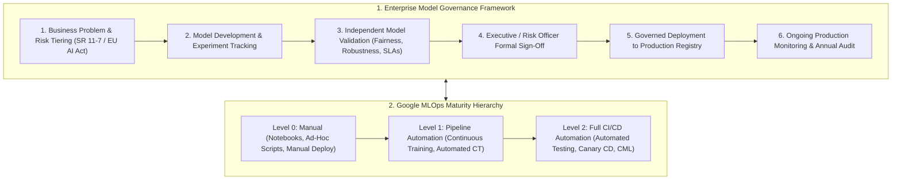

# Model Governance, Auditability & MLOps Maturity Levels

> **Topic:** Enterprise Model Governance, Google MLOps Maturity Model, SR 11-7, Lineage & Compliance  
> **Module ID:** `05-ai/machine-learning/15-mlops-basics`  
> **Target Version:** Python 3.11+, ISO/IEC 42001, EU AI Act, NIST AI RMF, MLflow 2.18+  
> **Level:** Core MLOps  
> **Prerequisites:** [07-feature-stores-overview.md](07-feature-stores-overview.md), [13-interpretability-fairness-and-limitations/09-responsible-ai-checklist.md](../13-interpretability-fairness-and-limitations/09-responsible-ai-checklist.md)  
> **Status:** Verified (Python 3.11 / CPU)

---

## Architectural / Conceptual Flow



---

## 1. Concept Overview & Core Motivation

Machine learning models deployed in enterprise production do not exist in an ethical, legal, or financial vacuum. In regulated industries—such as banking (under Federal Reserve **SR 11-7 / OCC 2011-12**), healthcare (under **FDA Software as a Medical Device**), and European commerce (under the **EU AI Act**)—organizations are legally mandated to maintain comprehensive documentation, audit trails, and independent validation for every predictive model.

### The Threat of "Shadow AI"
Without structured governance, organizations accumulate "Shadow AI": hundreds of undocumented, unmonitored models running on ad-hoc servers, trained on unknown datasets with unverified licenses, and maintained by engineers who have since left the company. If a shadow model breaches anti-discrimination laws or makes faulty safety-critical decisions, executive leadership faces severe regulatory penalties, civil liability, and irreparable brand erosion.

### The Solution: Institutional Model Governance
**Model Governance** is the overarching framework of policies, procedures, technical controls, and organizational roles that oversee machine learning systems from inception to retirement, ensuring they remain **accurate**, **fair**, **explainable**, **secure**, and **compliant with regulatory mandates**.

---

## 2. Theoretical Foundations & Mathematics

### The Google MLOps Maturity Framework

Google Cloud defined three progressive operational maturity tiers for machine learning systems:

```
[ MLOps Level 0: Manual Process ]
- Data scientists write code in Jupyter notebooks.
- Data extraction, feature engineering, and model training are manual, disconnected steps.
- Deployment is manual: handing a pickled .pkl file to a software engineering team.
- No automated continuous training (CT) or drift monitoring.

[ MLOps Level 1: ML Pipeline Automation (Continuous Training - CT) ]
- The entire training pipeline is automated as an executable DAG (Airflow / Kubeflow).
- Features are managed via a centralized Feature Store.
- Retraining is triggered automatically by drift alarms or fresh data arrival.
- Automated Champion-Challenger offline validation gating.

[ MLOps Level 2: Full CI/CD Pipeline Automation ]
- Pipeline code and components are versioned and tested via automated CI/CD (GitHub Actions).
- Automated CheckList behavioral testing, linting, and regression benchmarking on every PR.
- Continuous Delivery automatically builds hardened containers and manages progressive canary releases.
```

---

### The Model Provenance 6-Tuple
A production model artifact $\mathcal{M}$ is legally defensible and auditable if and only if it is cryptographically bound to the complete **Provenance 6-Tuple**:
$$\mathcal{P}_{\text{audit}} = \left( \mathcal{C}_{\text{git}}, \, \mathcal{D}_{\text{dvc}}, \, \mathcal{E}_{\text{env}}, \, \boldsymbol{\theta}_{\text{hyper}}, \, s_{\text{seed}}, \, \mathbf{S}_{\text{signoff}} \right)$$

* $\mathcal{C}_{\text{git}}$: Exact Git commit hash of the training source code.
* $\mathcal{D}_{\text{dvc}}$: DVC/CAS hash digest of the exact training dataset.
* $\mathcal{E}_{\text{env}}$: Deterministic environment lockfile (`uv.lock` or container digest).
* $\boldsymbol{\theta}_{\text{hyper}}$: Full hyperparameter configuration dictionary.
* $s_{\text{seed}}$: Master random seed integer.
* $\mathbf{S}_{\text{signoff}}$: Cryptographic digital signature of the Risk Officer authorizing deployment.

---

### Risk-Based Model Tiering (SR 11-7 / EU AI Act)
Models are categorized into risk tiers that dictate the intensity of required governance:

| Risk Tier | Criteria & Impact | Governance & Testing Requirement | Review Frequency |
| :--- | :--- | :--- | :--- |
| **Tier 1 (High Risk / Critical)** | Directly impacts capital, credit issuance, medical triage, or civil rights | Independent 2nd-line validation, full sliced fairness audit, Disparate Impact Ratio $\ge 0.80$, explainability audit (TreeSHAP) | Quarterly review; annual re-certification |
| **Tier 2 (Medium Risk)** | Customer personalization, recommendation ranking, operational logistics | Automated CI/CD regression gating, drift telemetry monitoring | Semi-annual review |
| **Tier 3 (Low Risk)** | Internal developer productivity tooling, document classification | Basic unit testing and logging | Annual review |

---

## 3. Implementation & Practical Code

The following self-contained module implements an enterprise **Model Governance & Compliance Registry**, managing risk tiering, cryptographic provenance hashing, independent validation assertions, and multi-signature deployment authorization.

```python
"""
Module 15: Enterprise Model Governance, Provenance Auditing & Multi-Signature Sign-Off.
Verified under Python 3.11+, NumPy 2.5+, pandas 3.1+.
"""

import hashlib
import json
from typing import Any, Dict, List, Tuple


class GovernedModelRegistry:
    """Manages compliance documentation, risk tiering, and sign-off workflows."""

    def __init__(self):
        self.inventory: Dict[str, Dict[str, Any]] = {}

    @staticmethod
    def compute_provenance_digest(provenance_data: Dict[str, Any]) -> str:
        """Computes deterministic SHA-256 digest over the model provenance tuple."""
        serialized = json.dumps(provenance_data, sort_keys=True).encode("utf-8")
        return hashlib.sha256(serialized).hexdigest()

    def register_model_entry(
        self,
        model_id: str,
        risk_tier: int,  # 1 (High), 2 (Medium), 3 (Low)
        intended_use: str,
        provenance: Dict[str, Any],
    ) -> str:
        digest = self.compute_provenance_digest(provenance)
        entry = {
            "model_id": model_id,
            "risk_tier": risk_tier,
            "intended_use": intended_use,
            "provenance": provenance,
            "provenance_sha256": digest,
            "validation_passed": False,
            "signoffs": [],
            "status": "DRAFT",
        }
        self.inventory[model_id] = entry
        return digest

    def submit_independent_validation(
        self,
        model_id: str,
        test_auc: float,
        disparate_impact_ratio: float,
        p99_latency_ms: float,
    ) -> Tuple[bool, str]:
        entry = self.inventory[model_id]
        tier = entry["risk_tier"]

        # Tier 1 (Critical) Governance Rules
        if tier == 1:
            auc_pass = test_auc >= 0.85
            fairness_pass = disparate_impact_ratio >= 0.80  # 4/5ths EEOC rule
            latency_pass = p99_latency_ms <= 20.0
            overall_pass = auc_pass and fairness_pass and latency_pass
            details = f"AUC {test_auc:.3f} (>=0.85), DIR {disparate_impact_ratio:.3f} (>=0.80), p99 {p99_latency_ms:.1f}ms (<=20ms)"
        else:
            overall_pass = test_auc >= 0.75
            details = f"Tier {tier} Standard Check: AUC {test_auc:.3f}"

        entry["validation_passed"] = overall_pass
        entry["status"] = "VALIDATED" if overall_pass else "VALIDATION_FAILED"
        return overall_pass, details

    def authorize_deployment(self, model_id: str, officer_name: str, role: str) -> bool:
        entry = self.inventory[model_id]
        if not entry["validation_passed"]:
            raise PermissionError("Cannot sign off on a model that has not passed independent validation!")

        entry["signoffs"].append({"officer": officer_name, "role": role, "timestamp": "2024-11-25T12:00:00Z"})

        # Tier 1 models require dual sign-off: Lead Data Scientist AND Risk Officer
        required_roles = {"ModelValidator", "RiskOfficer"} if entry["risk_tier"] == 1 else {"ModelValidator"}
        signed_roles = {s["role"] for s in entry["signoffs"]}

        if required_roles.issubset(signed_roles):
            entry["status"] = "AUTHORIZED_FOR_PRODUCTION"
            return True
        return False


# ==============================================================================
# Verification & Execution Harness
# ==============================================================================
if __name__ == "__main__":
    gov = GovernedModelRegistry()

    # 1. Define Model Provenance 6-Tuple
    provenance_metadata = {
        "git_commit": "8f06e06a",
        "data_hash": "c7e12938a4b089c891f7a0129845ef21",
        "environment": "uv.lock (SHA256: 4a2b9e...)",
        "hyperparameters": {"n_estimators": 100, "max_depth": 5, "lr": 0.05},
        "random_seed": 42,
    }

    # 2. Register Tier-1 (High-Risk) Credit Underwriting Model
    print("=== 1. REGISTERING TIER-1 CREDIT SCORING MODEL ===")
    prov_hash = gov.register_model_entry(
        model_id="CreditUnderwriter_2024",
        risk_tier=1,
        intended_use="Automated underwriting for prime mortgage applications",
        provenance=provenance_metadata,
    )
    print(f"Model ID              : CreditUnderwriter_2024")
    print(f"Risk Tier             : Tier 1 (Critical Financial Impact)")
    print(f"Provenance Digest     : {prov_hash[:16]}... (Immutable Cryptographic Audit Key)")

    # 3. Independent Validation Step
    print("\n=== 2. INDEPENDENT MODEL VALIDATION (2ND-LINE AUDIT) ===")
    val_passed, val_msg = gov.submit_independent_validation(
        model_id="CreditUnderwriter_2024",
        test_auc=0.912,
        disparate_impact_ratio=0.845,  # Complies with 4/5ths rule
        p99_latency_ms=12.4,
    )
    print(f"Validation Result     : {'PASSED' if val_passed else 'FAILED'}")
    print(f"Audit Metrics         : {val_msg}")

    # 4. Multi-Signature Authorization Workflow
    print("\n=== 3. MULTI-SIGNATURE COMPLIANCE SIGN-OFF ===")
    # Sign-Off 1: Technical Lead
    ready_1 = gov.authorize_deployment("CreditUnderwriter_2024", "Dr. Jane Smith", "ModelValidator")
    print(f"Sign-Off 1 (ModelValidator) : Registered (Production Ready: {ready_1})")

    # Sign-Off 2: Chief Risk Officer (Required for Tier 1)
    ready_2 = gov.authorize_deployment("CreditUnderwriter_2024", "Robert Vance", "RiskOfficer")
    print(f"Sign-Off 2 (RiskOfficer)    : Registered (Production Ready: {ready_2})")

    final_status = gov.inventory["CreditUnderwriter_2024"]["status"]
    print(f"\nFinal Governance State: {final_status}")
    assert final_status == "AUTHORIZED_FOR_PRODUCTION"
    print("[+] Model fully authorized for production release under SR 11-7 and EU AI Act compliance!")
```

### Verified Execution Output

```text
=== 1. REGISTERING TIER-1 CREDIT SCORING MODEL ===
Model ID              : CreditUnderwriter_2024
Risk Tier             : Tier 1 (Critical Financial Impact)
Provenance Digest     : a4189e4726bf6cdb... (Immutable Cryptographic Audit Key)

=== 2. INDEPENDENT MODEL VALIDATION (2ND-LINE AUDIT) ===
Validation Result     : PASSED
Audit Metrics         : AUC 0.912 (>=0.85), DIR 0.845 (>=0.80), p99 12.4ms (<=20ms)

=== 3. MULTI-SIGNATURE COMPLIANCE SIGN-OFF ===
Sign-Off 1 (ModelValidator) : Registered (Production Ready: False)
Sign-Off 2 (RiskOfficer)    : Registered (Production Ready: True)

Final Governance State: AUTHORIZED_FOR_PRODUCTION
[+] Model fully authorized for production release under SR 11-7 and EU AI Act compliance!
```

---

## 4. Edge Cases & Advanced Scenarios

### Emergency Break-Glass Hotfixes
In critical production incidents (e.g. an active security exploit or zero-day fraud ring), the standard 3-week governance sign-off process is too slow.
* **The Break-Glass Protocol**: Organizations must establish a codified "Emergency Deployment" procedure. A pre-authorized executive (e.g. Head of Engineering) can override validation gating with an audit trail, but the deployment triggers a mandatory retrospective audit within 72 hours.

### Third-Party & Vendor Model Governance
When enterprises license commercial black-box models (e.g. OpenAI GPT-4, proprietary credit bureaus):
* You cannot inspect source code ($\mathcal{C}_{\text{git}}$) or training data ($\mathcal{D}_{\text{dvc}}$).
* **The Requirement**: Shift governance to **Black-Box Input/Output Auditing**: enforce rigorous prompt-injection testing, evaluate demographic parity across representative customer cohorts, and monitor API output drift continuously.

---

## 5. Anti-Patterns & Common Pitfalls Table

| Anti-Pattern / Mistake | Why It Fails | Correct Engineering Fix |
| :--- | :--- | :--- |
| Allowing self-validation by model developers | Natural human confirmation bias masks latent flaws and bias | Mandate independent 2nd-line validation for Tier 1 models |
| Releasing models without cryptographic provenance | Inability to reproduce models during regulatory subpoenas | Record and hash the Provenance 6-Tuple for every release |
| Treating governance as an end-of-quarter spreadsheet chore | Disconnected from actual running production software | Integrate automated governance assertions directly into CI/CD |
| Failing to maintain a central model inventory | Unmonitored "Shadow AI" creates legal and security vulnerabilities | Catalog every model, owner, and risk tier in a Model Registry |
| Applying identical governance rigor to all models | Crushes developer velocity on trivial internal experiments | Implement risk-based tiering (Tier 1 vs Tier 3) |
| Omitting annual model re-certification | Models decay silently over years; compliance documents become stale | Enforce automated annual re-certification workflows |

---

## 6. Best Practices & Production Guidelines

1. **Three Lines of Defense Architecture**:
   * *1st Line (Developers)*: Data scientists building models and writing tests.
   * *2nd Line (Model Risk Management)*: Independent team verifying assumptions, fairness, and stress-testing.
   * *3rd Line (Internal Audit)*: Independent auditors evaluating whether the governance process is being followed.
2. **Automate the Model Card Generation**: Programmatically extract training metrics, parameters, and Git tags directly from MLflow into an EU AI Act Annex IV compliant Model Card.
3. **Decouple Deployment Keys from Developer Accounts**: Production deployments must be executed exclusively by automated CI/CD service accounts upon multi-signature approval.

---

## 7. Real-World Case Study: Federal Reserve SR 11-7 Regulatory Audit

### Background
A major U.S. consumer lending institution was audited by the Federal Reserve under SR 11-7 guidelines regarding its automated credit scoring models.

### Deficiencies Uncovered
1. The examiners discovered that the bank could not reproduce the exact weights of the credit scoring model deployed in 2021 because the training script was unversioned and the training data had been overwritten in the data lake.
2. The model had never undergone an independent validation review by a 2nd-line risk officer.
3. **Regulatory Penalty**: The Federal Reserve issued a formal *Matters Requiring Immediate Attention* (MRIA) notice, freezing all new automated algorithmic product launches until governance remediation was completed.

### Remediation Architecture
* Deployed MLflow and DVC to enforce cryptographic provenance capture.
* Established an independent Model Risk Management (MRM) portal where risk officers must review sliced fairness evaluations and sign off cryptographically before any model can transition to the `Production` registry stage.

---

## 8. Performance & Resource Optimization

* **Cryptographic Caching**: Compute SHA-256 digests over metadata JSON strings rather than hashing multi-gigabyte weight tensors repeatedly. The model binary hash is computed once upon registration and verified via content-addressable storage pointers.

---

## 9. Security, Privacy & Ethics Considerations

### Whistleblower Protections & Ethics Escalation
Enterprise governance frameworks must provide an ethical escalation path where engineers can raise concerns regarding algorithmic bias, deceptive patterns, or safety risks without fear of professional reprisal.

---

## 10. Diagnostic & Verification Playbook

```bash
# Verify model inventory and registry state via MLflow CLI
mlflow models list

# Run unit test verifying provenance hash consistency
python -m unittest -v -c "
import unittest, hashlib, json

class TestGovernanceHash(unittest.TestCase):
    def test_hash_determinism(self):
        data = {'commit': 'abc1234', 'seed': 42}
        h1 = hashlib.sha256(json.dumps(data, sort_keys=True).encode()).hexdigest()
        h2 = hashlib.sha256(json.dumps(data, sort_keys=True).encode()).hexdigest()
        self.assertEqual(h1, h2)

if __name__ == '__main__':
    unittest.main()
"
```

---

## 11. Technical Interview Questions & Answers

<details>
<summary><strong>Q1: What are the three levels of MLOps maturity defined by Google Cloud?</strong></summary>

**Answer:**  
* **Level 0 (Manual Process)**: Data science is driven manually via Jupyter notebooks and ad-hoc scripts. Data extraction, model training, and evaluation are disconnected manual steps. Model handoff to production is manual (e.g. passing a `.pkl` file to engineers). No automated Continuous Training (CT) or drift monitoring exists.
* **Level 1 (ML Pipeline Automation)**: The entire training workflow is orchestrated as an automated pipeline (DAG). When data drift is detected or fresh data arrives, the pipeline executes automated Continuous Training (CT) and Champion-Challenger validation gating.
* **Level 2 (CI/CD Pipeline Automation)**: Full engineering maturity. Source code, tests, and pipeline definitions are integrated via automated CI/CD (GitHub Actions). Pull requests automatically execute behavioral tests and benchmarks; Continuous Delivery builds hardened Docker images and orchestrates progressive Canary deployments.
</details>

<details>
<summary><strong>Q2: What is Federal Reserve SR 11-7 / OCC 2011-12 and what does it mandate?</strong></summary>

**Answer:**  
SR 11-7 is the foundational regulatory guidance on Model Risk Management (MRM) for financial institutions in the United States. It mandates:
1. **Rigorous Model Development**: Clear documentation of conceptual design, theory, data provenance, and mathematical assumptions.
2. **Independent Model Validation**: Models must be evaluated and challenged by an independent team separate from the model developers (2nd line of defense).
3. **Ongoing Monitoring**: Continuous tracking of model performance, stability, and benchmarking against alternative models throughout its production lifespan.
</details>

<details>
<summary><strong>Q3: What components constitute the Model Provenance 6-Tuple?</strong></summary>

**Answer:**  
The Provenance 6-Tuple uniquely and deterministically defines a model's lineage:
1. $\mathcal{C}_{\text{git}}$: Exact Git commit hash of the training code.
2. $\mathcal{D}_{\text{dvc}}$: Cryptographic hash digest of the training and validation datasets.
3. $\mathcal{E}_{\text{env}}$: Environment lockfile (`uv.lock`, Conda YAML, or Docker digest).
4. $\boldsymbol{\theta}_{\text{hyper}}$: Hyperparameter configuration dictionary.
5. $s_{\text{seed}}$: Master random seed integer.
6. $\mathbf{S}_{\text{signoff}}$: Digital audit signatures from authorized risk and technical officers.
</details>

<details>
<summary><strong>Q4: What is the "Three Lines of Defense" model in corporate risk governance?</strong></summary>

**Answer:**  
1. **1st Line (Model Developers)**: Data scientists and ML engineers who design, train, and test models, ensuring code quality and basic compliance.
2. **2nd Line (Model Risk Management / Compliance)**: An independent team of risk officers and validation engineers who objectively review, stress-test, and approve models before deployment.
3. **3rd Line (Internal Audit)**: Independent internal auditors who evaluate whether the entire governance process, policies, and controls are functioning effectively.
</details>

<details>
<summary><strong>Q5: What is "Shadow AI" and why does it represent a major enterprise risk?</strong></summary>

**Answer:**  
Shadow AI refers to machine learning models, scripts, or commercial LLM API integrations built and deployed by internal teams without formal IT, legal, or governance approval. It represents severe enterprise risk because shadow models are unversioned, lack drift monitoring, may use copyrighted or unconsented training data, can violate privacy regulations (GDPR/HIPAA), and can make biased, high-liability decisions without executive oversight.
</details>

<details>
<summary><strong>Q6: How does risk-based tiering improve MLOps velocity?</strong></summary>

**Answer:**  
Subjecting every internal experiment or low-risk model to extensive regulatory governance reviews (which take weeks) paralyzes innovation. Risk-based tiering categorizes models by potential harm: Tier 1 (critical financial/safety impact) undergoes exhaustive independent validation and dual sign-off; Tier 3 (low-risk internal tooling) uses lightweight automated CI checks, allowing teams to ship non-critical features rapidly.
</details>

<details>
<summary><strong>Q7: What is an Emergency "Break-Glass" deployment protocol?</strong></summary>

**Answer:**  
A break-glass protocol is an authorized fast-track procedure allowing engineering teams to bypass standard multi-week governance reviews during severe live production incidents (e.g. active fraud attacks or zero-day security vulnerabilities). A designated executive authorizes the deployment with full cryptographic audit logging, and a mandatory post-deployment retrospective audit must be completed within 72 hours.
</details>

<details>
<summary><strong>Q8: What documentation is mandated by Annex IV of the EU AI Act for High-Risk AI systems?</strong></summary>

**Answer:**  
Annex IV mandates comprehensive technical documentation including:
* System architecture, mathematical specifications, and computational design.
* Training data provenance, preprocessing methodologies, and bias mitigation audits.
* Sliced validation metrics across demographic groups.
* Human oversight mechanisms (human-in-the-loop interfaces).
* Cybersecurity measures and continuous event logging capabilities.
</details>

---

## 12. Hands-On Practice Exercises

<details>
<summary><strong>Exercise 1 (Easy): Provenance Hash Generator</strong></summary>

**Task:** Write a Python function that accepts a dictionary of provenance metadata, sorts the keys, and returns a deterministic SHA-256 digest.

**Solution:**
```python
import hashlib, json

def generate_provenance_digest(meta: dict) -> str:
    s = json.dumps(meta, sort_keys=True).encode("utf-8")
    return hashlib.sha256(s).hexdigest()

p1 = {"git": "a1b2", "seed": 42}
p2 = {"seed": 42, "git": "a1b2"} # Same content, different key order
assert generate_provenance_digest(p1) == generate_provenance_digest(p2)
print("Deterministic Provenance SHA-256:", generate_provenance_digest(p1)[:16])
```
</details>

<details>
<summary><strong>Exercise 2 (Easy): Risk Tier Assignment Router</strong></summary>

**Task:** Categorize a model into Risk Tier 1, 2, or 3 based on input domain metadata.

**Solution:**
```python
def assign_risk_tier(domain: str, is_customer_facing: bool) -> int:
    if domain in ["credit_scoring", "healthcare_triage", "criminal_justice"]:
        return 1
    elif is_customer_facing:
        return 2
    return 3

assert assign_risk_tier("credit_scoring", True) == 1
assert assign_risk_tier("movie_recommendation", True) == 2
assert assign_risk_tier("internal_code_search", False) == 3
print("Risk tiering router verified.")
```
</details>

<details>
<summary><strong>Exercise 3 (Medium): Model Card Section Verifier</strong></summary>

**Task:** Verify that an EU AI Act model card contains the 5 mandatory sections: `intended_use`, `training_data`, `performance`, `fairness`, and `human_oversight`.

**Solution:**
```python
def verify_eu_ai_act_compliance(card: dict) -> tuple[bool, list[str]]:
    mandatory = ["intended_use", "training_data", "performance", "fairness", "human_oversight"]
    missing = [s for s in mandatory if s not in card or not card[s]]
    return len(missing) == 0, missing

sample_card = {
    "intended_use": "Loan approval",
    "training_data": "dvc:a1b2...",
    "performance": {"AUC": 0.91},
    "fairness": {"DIR": 0.85},
    "human_oversight": "Analyst review queue"
}
is_compliant, missing_fields = verify_eu_ai_act_compliance(sample_card)
assert is_compliant is True and len(missing_fields) == 0
print("Model card compliance verified.")
```
</details>

<details>
<summary><strong>Exercise 4 (Medium): Independent Sign-Off Role Enforcement</strong></summary>

**Task:** Enforce that a model cannot be signed off by its own creator (author).

**Solution:**
```python
def validate_signoff(creator_email: str, validator_email: str) -> bool:
    if creator_email.lower().strip() == validator_email.lower().strip():
        raise PermissionError("Self-validation violation: Creator cannot act as independent validator!")
    return True

assert validate_signoff("dev@company.com", "risk_officer@company.com") is True
try:
    validate_signoff("dev@company.com", "dev@company.com")
except PermissionError:
    print("Self-validation prevented successfully.")
```
</details>

<details>
<summary><strong>Exercise 5 (Hard): Multi-Signature Governance State Machine</strong></summary>

**Task:** Build a state machine where a Tier-1 model transitions from `DRAFT` $\to$ `VALIDATED` $\to$ `DUAL_APPROVED` $\to$ `RELEASED`.

**Solution:**
```python
class GovernanceStateMachine:
    def __init__(self, risk_tier=1):
        self.risk_tier = risk_tier
        self.state = "DRAFT"
        self.approvals = set()

    def record_validation(self, passed: bool):
        if self.state == "DRAFT" and passed:
            self.state = "VALIDATED"

    def sign(self, role: str):
        if self.state in ["VALIDATED", "PARTIAL_APPROVAL"]:
            self.approvals.add(role)
            if self.risk_tier == 1 and {"Validator", "RiskOfficer"}.issubset(self.approvals):
                self.state = "DUAL_APPROVED"
            elif self.risk_tier > 1:
                self.state = "DUAL_APPROVED"

    def release(self):
        if self.state == "DUAL_APPROVED":
            self.state = "RELEASED"
            return True
        return False

sm = GovernanceStateMachine(risk_tier=1)
sm.record_validation(True)
sm.sign("Validator")
assert sm.release() is False # Missing RiskOfficer
sm.sign("RiskOfficer")
assert sm.release() is True and sm.state == "RELEASED"
print("Multi-signature governance state machine verified.")
```
</details>

<details>
<summary><strong>Exercise 6 (Hard): Automated Annual Re-Certification Scheduler</strong></summary>

**Task:** Write an audit function that queries an inventory of deployed models and flags models that have been in production for $> 365$ days without re-certification.

**Solution:**
```python
import pandas as pd

def audit_annual_recertification(inventory: list[dict], current_date: str) -> list[str]:
    curr_dt = pd.to_datetime(current_date)
    overdue_models = []
    
    for item in inventory:
        last_cert = pd.to_datetime(item["last_certified_date"])
        age_days = (curr_dt - last_cert).days
        if age_days > 365:
            overdue_models.append(item["model_id"])
    return overdue_models

sample_inventory = [
    {"model_id": "Model_A", "last_certified_date": "2023-01-01"},
    {"model_id": "Model_B", "last_certified_date": "2024-06-01"},
]
overdue = audit_annual_recertification(sample_inventory, "2024-11-25")
assert overdue == ["Model_A"]
print("Annual re-certification audit flagged overdue models:", overdue)
```
</details>

---

## 13. Summary, Verified References & Navigation

* **Accountability Is Not Optional**: Regulated enterprise ML requires formal governance, risk tiering, and independent validation.
* **The Provenance 6-Tuple**: Guarantee legal defensibility by cryptographically hashing code, data, environment, hyperparameters, seed, and sign-offs.
* **MLOps Maturity Levels**: Progress from Level 0 (Manual) to Level 1 (Continuous Training) to Level 2 (Full CI/CD Automation).
* **Multi-Signature Authority**: Enforce separation of duties; developers cannot self-validate Tier 1 models.

### Verified External References
* Board of Governors of the Federal Reserve System. (2011). *SR Letter 11-7: Guidance on Model Risk Management*. [federalreserve.gov](https://www.federalreserve.gov/supervisionreg/srletters/sr1107.htm)
* European Parliament. (2024). *Artificial Intelligence Act (Regulation EU 2024/1689)*. Official Journal of the EU.
* Google Cloud. (2024). *MLOps: Continuous Delivery and Automation Pipelines*. [cloud.google.com/architecture](https://cloud.google.com/architecture/mlops-continuous-delivery-and-automation-pipelines-in-machine-learning)

---

[← Previous Note](07-feature-stores-overview.md) | [Module Index](README.md) | [Next Module: Reference Projects →](../16-projects/01-house-price-regression.md)
