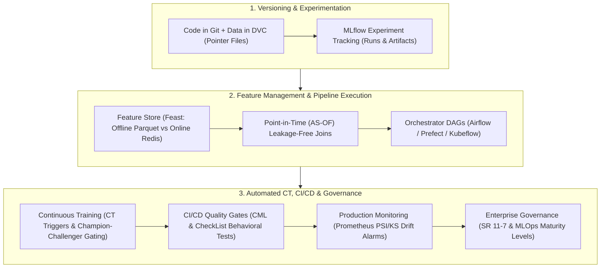

# Module 15: MLOps Basics

> **Module ID:** `05-ai/machine-learning/15-mlops-basics`  
> **Target Version:** Python 3.11+, MLflow 2.18+, DVC 3.50+, Airflow 2.10+, Feast 0.40+  
> **Status:** 100% Complete & Verified  

---

## Architectural / Conceptual Flow

---

## Module Overview

Building a machine learning model inside an interactive notebook is only $10\%$ of real-world machine learning engineering. The remaining $90\%$ consists of the infrastructure, pipelines, operational telemetry, versioning controls, and governance frameworks required to sustain models reliably in production.

Module 15 establishes the foundational engineering principles of **MLOps (Machine Learning Operations)**. It covers experiment tracking, data and model versioning, workflow orchestration, production drift telemetry, continuous training triggers, automated CI/CD behavioral testing, feature stores, and regulatory model risk governance.

---

## Table of Contents

| Note | Title | Level | Key Concepts & Tools |
| :---: | :--- | :---: | :--- |
| **[01](01-experiment-tracking.md)** | [Experiment Tracking with MLflow](01-experiment-tracking.md) | Core | MLflow Tracking Server, Runs, Parameters, Metrics, Artifacts, Nested Runs, Autologging |
| **[02](02-data-and-model-versioning.md)** | [Data & Model Versioning with DVC](02-data-and-model-versioning.md) | Core | DVC pointer files (`.dvc`), Content-Addressable Storage (CAS), S3 remote cache, Model Registries |
| **[03](03-ml-pipelines-and-orchestration-overview.md)** | [ML Pipelines & Orchestration](03-ml-pipelines-and-orchestration-overview.md) | Core | Directed Acyclic Graphs (DAGs), Airflow vs Prefect vs Kubeflow, Idempotency, Exponential Backoff |
| **[04](04-monitoring-and-drift-detection.md)** | [Monitoring & Drift Detection in Production](04-monitoring-and-drift-detection.md) | Core | Prometheus & Grafana, Population Stability Index (PSI), KS-test, Prediction Entropy, Latency SLAs |
| **[05](05-retraining-strategies.md)** | [Continuous Training (CT) Strategies](05-retraining-strategies.md) | Core | Retraining triggers (drift vs cron), Sliding windows, Warm-starting, Champion vs Challenger gating |
| **[06](06-ci-cd-for-ml.md)** | [CI/CD for Machine Learning](06-ci-cd-for-ml.md) | Core | Continuous Machine Learning (CML), GitHub Actions, CheckList testing (MFT, INV, DIR), PR quality gates |
| **[07](07-feature-stores-overview.md)** | [Feature Stores Overview](07-feature-stores-overview.md) | Core | Dual storage (Offline Parquet vs Online Redis), Feast, Point-in-Time (AS-OF) joins, Training-serving skew |
| **[08](08-model-governance.md)** | [Model Governance & MLOps Maturity](08-model-governance.md) | Core | Google MLOps Maturity Levels 0-2, Model Provenance 6-Tuple, Federal Reserve SR 11-7, Risk Tiering |

---

## Prerequisites

Before starting Module 15, you should be familiar with:
* **[11-prediction-and-postprocessing](../11-prediction-and-postprocessing/)**: Real-time vs batch inference, probability calibration, and input validation schemas.
* **[12-saving-loading-and-deployment](../12-saving-loading-and-deployment/)**: Model persistence formats (`joblib`, `skops`, `safetensors`, `ONNX`), FastAPI serving, and Docker containerization.
* **[13-interpretability-fairness-and-limitations](../13-interpretability-fairness-and-limitations/)**: Algorithmic fairness metrics (Disparate Impact Ratio), concept drift, and responsible AI pre-deployment checklists.

---

## Key Takeaways

1. **Decouple Metadata from Binaries**: Use Git for source code and pointer files; use Content-Addressable Storage (DVC / S3) for datasets and model weights.
2. **Idempotent Orchestration**: Build automated pipelines using DAGs where every task is idempotent, atomic, and safe to retry automatically upon failure.
3. **Dual Storage Eliminates Skew**: Feature stores bridge training and inference by serving batch historical datasets from the Offline Store and real-time features from the Online Store.
4. **Point-in-Time Discipline**: Never join historical data using simple SQL joins; use Point-in-Time AS-OF joins to eliminate future data leakage.
5. **Continuous Telemetry & Governance**: Monitor statistical drift (PSI $> 0.20$) to trigger automated Continuous Training, and govern production models using cryptographic provenance and multi-signature authorization.

---

[← Previous Module: Deep Learning Bridge](../14-deep-learning-bridge/README.md) | [Track Index](../INDEX.md) | [Next Module: Production Reference Projects →](../16-projects/README.md)
