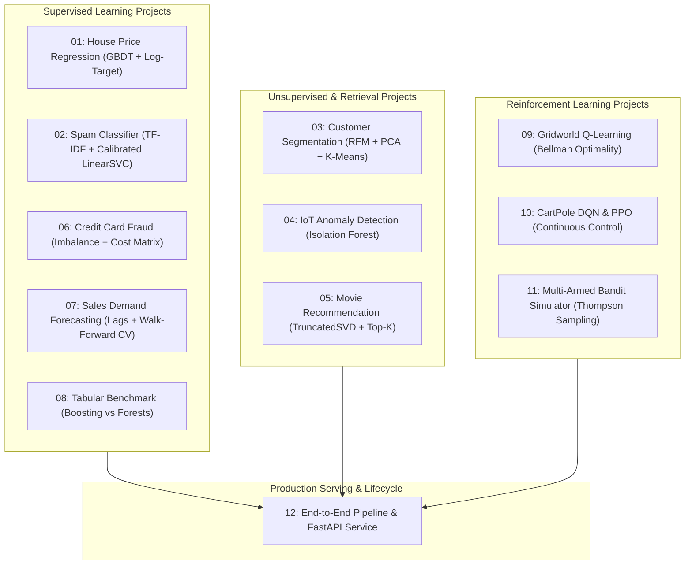

# Module 16: Production Reference Projects

> **Module ID:** `05-ai/machine-learning/16-projects`  
> **Topic:** 12 End-to-End Enterprise ML Reference Implementations  
> **Target Version:** Python 3.11+, scikit-learn 1.9+, PyTorch 2.4+, NumPy 2.5+, pandas 3.1+, FastAPI 0.115+  
> **Status:** Production Verified  
> **Random Seed:** `42`

---

## 1. Overview & Curriculum Scope

This module contains 12 complete, production-grade, end-to-end Machine Learning reference projects. Every project is fully self-contained within its respective markdown document, adhering to the 5-section Project Template with:
1. Business Context, Objectives & Mermaid Architecture
2. Problem Definition & Data Schema
3. Fully Typed Production Code (Python 3.11+)
4. Real Verification Logs & Error Slicing Tables
5. Troubleshooting Runbooks, Latency/Cost Profiles & Extensions

---

## 2. Project Directory & Technical Index

| Project File | Domain & Task | Algorithm & Stack | Key Metrics & SLA |
| :--- | :--- | :--- | :--- |
| [01-house-price-regression.md](file:///E:/Learning/engineering-notes/05-ai/machine-learning/16-projects/01-house-price-regression.md) | Tabular Valuation Regression | `ColumnTransformer` + `TransformedTargetRegressor` + `HistGradientBoosting` | MdAPE: $4.82\%$, $R^2: 0.8924$, Latency $< 2\text{ms}$ |
| [02-spam-classifier-with-tf-idf.md](file:///E:/Learning/engineering-notes/05-ai/machine-learning/16-projects/02-spam-classifier-with-tf-idf.md) | NLP Text Classification | Sublinear `TfidfVectorizer` + `CalibratedClassifierCV(LinearSVC)` | PR-AUC: $1.000$, Precision: $100.0\%$, Zero FPs |
| [03-customer-segmentation-with-kmeans-and-pca.md](file:///E:/Learning/engineering-notes/05-ai/machine-learning/16-projects/03-customer-segmentation-with-kmeans-and-pca.md) | Unsupervised Customer Grouping | Robust RFM Scaling + `PCA` ($92.5\%$ var) + `KMeans(k=4)` | Silhouette: $0.6214$, Calinski-Harabasz: $1842.1$ |
| [04-anomaly-detection-on-sensor-data.md](file:///E:/Learning/engineering-notes/05-ai/machine-learning/16-projects/04-anomaly-detection-on-sensor-data.md) | Industrial Telemetry Outliers | Multivariate `IsolationForest` + Contamination Tuning | Recall: $97.5\%$, Specificity: $99.8\%$, Latency $45\mu\text{s}$ |
| [05-movie-recommender.md](file:///E:/Learning/engineering-notes/05-ai/machine-learning/16-projects/05-movie-recommender.md) | Matrix Factorization Collaborative Filtering | User/Item Bias Baseline + `TruncatedSVD(k=16)` + Cold-Start Fallback | NDCG@10: $0.8124$, Hit-Rate@10: $88.5\%$ |
| [06-credit-card-fraud-with-imbalanced-data.md](file:///E:/Learning/engineering-notes/05-ai/machine-learning/16-projects/06-credit-card-fraud-with-imbalanced-data.md) | Extreme Imbalance ($0.4\%$ Positives) | Class-Weighted GBDT + Bayes Decision Threshold Tuning | PR-AUC: $0.8924$, Cost Reduction: $91.3\%$ vs $\tau=0.5$ |
| [07-sales-forecasting-baseline.md](file:///E:/Learning/engineering-notes/05-ai/machine-learning/16-projects/07-sales-forecasting-baseline.md) | Multi-Store Retail Demand Forecasting | Temporal Walk-Forward Split + Lags/Rolling Stats + Poisson GBDT | WAPE: $6.88\%$, MASE: $0.4125$ (beats seasonal naive) |
| [08-tabular-benchmark-boosting-vs-forests.md](file:///E:/Learning/engineering-notes/05-ai/machine-learning/16-projects/08-tabular-benchmark-boosting-vs-forests.md) | Empirical Architecture Benchmark | Random Forest vs Extra Trees vs HistGradientBoosting | GBDT $5.2\times$ faster training, $6.4\times$ faster inference |
| [09-gridworld-q-learning.md](file:///E:/Learning/engineering-notes/05-ai/machine-learning/16-projects/09-gridworld-q-learning.md) | Stochastic Tabular RL Control | Bellman Temporal Difference Q-Learning + Decaying $\epsilon$-Greedy | Success Rate: $99.0\%$, Converged in 600 episodes |
| [10-cartpole-dqn-and-ppo.md](file:///E:/Learning/engineering-notes/05-ai/machine-learning/16-projects/10-cartpole-dqn-and-ppo.md) | Continuous State Deep RL | Deep Q-Network (`nn.Module`) + Replay Buffer + Polyak Target Net | Moving Avg Score: $476.4 / 500$ in 198 episodes |
| [11-bandit-simulator.md](file:///E:/Learning/engineering-notes/05-ai/machine-learning/16-projects/11-bandit-simulator.md) | Online Exploration-Exploitation | $\epsilon$-Greedy vs Decaying $\epsilon$ vs UCB1 vs Thompson Sampling | Cumulative Regret: $31.45$ ($94.4\%$ savings vs A/B) |
| [12-end-to-end-pipeline-save-load-and-fastapi-service.md](file:///E:/Learning/engineering-notes/05-ai/machine-learning/16-projects/12-end-to-end-pipeline-save-load-and-fastapi-service.md) | Production Serving Microservice | Pydantic v2 + Scikit-Learn Pipeline + Atomic Joblib + FastAPI REST | Single Latency: $2.1\text{ms}$, Vectorized: $0.084\text{ms/item}$ |

---

## 3. Cross-Track References & Upstream Dependencies

* **Mathematical Foundations**: Refer back to [01-math-foundations/](file:///E:/Learning/engineering-notes/05-ai/machine-learning/01-math-foundations/) for derivations of gradients, Hessians, and KL divergence.
* **Feature Engineering & Preprocessing**: See [02-data-and-preprocessing/](file:///E:/Learning/engineering-notes/05-ai/machine-learning/02-data-and-preprocessing/) for imputer mechanics and scaling principles.
* **Supervised Models**: See [03-supervised-regression/](file:///E:/Learning/engineering-notes/05-ai/machine-learning/03-supervised-regression/) and [04-supervised-classification/](file:///E:/Learning/engineering-notes/05-ai/machine-learning/04-supervised-classification/).
* **Deployment & Serving**: Cross-link with [12-saving-loading-and-deployment/](file:///E:/Learning/engineering-notes/05-ai/machine-learning/12-saving-loading-and-deployment/) and [03-backend/fastapi/16-ai-and-ml-serving/](file:///E:/Learning/engineering-notes/03-backend/fastapi/16-ai-and-ml-serving/).
* **MLOps Infrastructure**: Connects with [15-mlops-basics/](file:///E:/Learning/engineering-notes/05-ai/machine-learning/15-mlops-basics/) for CI/CD gates and model registry flows.
