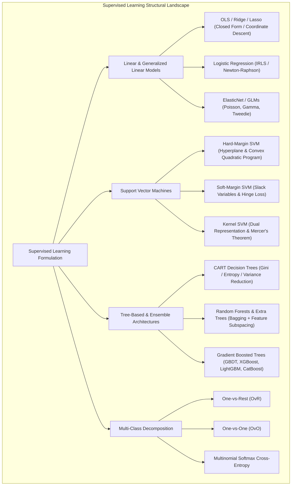

# Note 02: Supervised Learning Interview Q&A

> **Topic ID:** `05-ai/machine-learning/17-interview/02-supervised-learning-qa`  
> **Target Audience:** Senior ML Engineers, Applied Scientists, Technical Interviewers  
> **Prerequisites:** Note 01 (ML Fundamentals), Convex Optimization, Linear Algebra  
> **Status:** Production Verified

---

## 1. Architectural Taxonomy of Supervised Learning

Supervised learning algorithms infer functional mappings $f: \mathcal{X} \to \mathcal{Y}$ from labeled training pairs $\mathcal{D} = \{(\mathbf{x}_i, y_i)\}_{i=1}^N$. In senior interviews, discussions quickly transition from basic definitions to mathematical derivations, loss surfaces, Hessian dynamics, dual formulations, and algorithmic trade-offs.

---

## 2. In-Depth Technical Questions & Answers (35 Questions)

### Q1: Derive the closed-form Ordinary Least Squares (OLS) Normal Equation using matrix calculus.
**Answer:**
Let $\mathbf{X} \in \mathbb{R}^{N \times d}$ be the design matrix and $\mathbf{y} \in \mathbb{R}^N$ be the target vector. The residual sum of squares is:
$$J(\mathbf{w}) = \frac{1}{2} \|\mathbf{y} - \mathbf{X}\mathbf{w}\|_2^2 = \frac{1}{2} (\mathbf{y} - \mathbf{X}\mathbf{w})^T (\mathbf{y} - \mathbf{X}\mathbf{w})$$
Expanding the quadratic form:
$$J(\mathbf{w}) = \frac{1}{2} \left( \mathbf{y}^T \mathbf{y} - \mathbf{y}^T \mathbf{X}\mathbf{w} - \mathbf{w}^T \mathbf{X}^T \mathbf{y} + \mathbf{w}^T \mathbf{X}^T \mathbf{X}\mathbf{w} \right)$$
Since $\mathbf{y}^T \mathbf{X}\mathbf{w}$ is a scalar, $(\mathbf{y}^T \mathbf{X}\mathbf{w})^T = \mathbf{w}^T \mathbf{X}^T \mathbf{y}$:
$$J(\mathbf{w}) = \frac{1}{2} \mathbf{y}^T \mathbf{y} - \mathbf{w}^T \mathbf{X}^T \mathbf{y} + \frac{1}{2} \mathbf{w}^T (\mathbf{X}^T \mathbf{X}) \mathbf{w}$$
Computing the gradient with respect to $\mathbf{w}$ using matrix calculus rules ($\nabla_{\mathbf{w}} (\mathbf{w}^T \mathbf{a}) = \mathbf{a}$ and $\nabla_{\mathbf{w}} (\mathbf{w}^T \mathbf{A}\mathbf{w}) = 2\mathbf{A}\mathbf{w}$ for symmetric $\mathbf{A}$):
$$\nabla_{\mathbf{w}} J(\mathbf{w}) = -\mathbf{X}^T \mathbf{y} + \mathbf{X}^T \mathbf{X}\mathbf{w}$$
Setting the gradient to zero:
$$\mathbf{X}^T \mathbf{X}\mathbf{w} = \mathbf{X}^T \mathbf{y} \implies \hat{\mathbf{w}} = (\mathbf{X}^T \mathbf{X})^{-1} \mathbf{X}^T \mathbf{y}$$
The Hessian is $\nabla^2 J(\mathbf{w}) = \mathbf{X}^T \mathbf{X}$. If $\mathbf{X}$ has full column rank ($d$), $\mathbf{X}^T \mathbf{X}$ is strictly positive definite, guaranteeing that $\hat{\mathbf{w}}$ is the unique global minimum.

---

### Q2: Why is Ridge Regression $(\mathbf{X}^T \mathbf{X} + \lambda \mathbf{I})^{-1} \mathbf{X}^T \mathbf{y}$ always invertible, even if $\mathbf{X}$ is rank-deficient?
**Answer:**
Let $\mathbf{A} = \mathbf{X}^T \mathbf{X} \in \mathbb{R}^{d \times d}$. By definition, $\mathbf{A}$ is symmetric and positive semi-definite, meaning all its eigenvalues satisfy $\mu_i \ge 0$.
The Ridge formulation adds $\lambda \mathbf{I}$ with $\lambda > 0$:
$$\mathbf{M} = \mathbf{X}^T \mathbf{X} + \lambda \mathbf{I}$$
The eigenvalues of $\mathbf{M}$ are $\lambda_i = \mu_i + \lambda$.
Since $\mu_i \ge 0$ and $\lambda > 0$, we have:
$$\lambda_i \ge \lambda > 0 \quad \forall i \in \{1, \dots, d\}$$
Since all eigenvalues of $\mathbf{M}$ are strictly positive ($\lambda_i > 0$), its determinant is strictly positive:
$$\det(\mathbf{M}) = \prod_{i=1}^d \lambda_i \ge \lambda^d > 0$$
A matrix with non-zero determinant is non-singular and invertible. Furthermore, the condition number is capped at $\kappa \le \frac{\mu_{\max} + \lambda}{\lambda}$, stabilizing numerical matrix inversion.

---

### Q3: What is the Iteratively Reweighted Least Squares (IRLS) algorithm for Logistic Regression?
**Answer:**
Logistic regression optimizes the negative log-likelihood:
$$J(\mathbf{w}) = -\sum_{i=1}^N \left[ y_i \ln p_i + (1 - y_i) \ln(1 - p_i) \right]$$
where $p_i = \sigma(\mathbf{w}^T \mathbf{x}_i)$.
The gradient and Hessian are:
$$\nabla J(\mathbf{w}) = \mathbf{X}^T (\mathbf{p} - \mathbf{y})$$
$$\mathbf{H} = \nabla^2 J(\mathbf{w}) = \mathbf{X}^T \mathbf{S} \mathbf{X}$$
where $\mathbf{S} = \text{diag}(p_1(1-p_1), \dots, p_N(1-p_N))$ is an $N \times N$ diagonal weighting matrix.
Applying the Newton-Raphson update rule $\mathbf{w}^{(t+1)} = \mathbf{w}^{(t)} - \mathbf{H}^{-1} \nabla J(\mathbf{w}^{(t)})$:
$$\mathbf{w}^{(t+1)} = \mathbf{w}^{(t)} - (\mathbf{X}^T \mathbf{S} \mathbf{X})^{-1} \mathbf{X}^T (\mathbf{p} - \mathbf{y})$$
Factoring out $(\mathbf{X}^T \mathbf{S} \mathbf{X})^{-1} \mathbf{X}^T \mathbf{S}$:
$$\mathbf{w}^{(t+1)} = (\mathbf{X}^T \mathbf{S} \mathbf{X})^{-1} \mathbf{X}^T \mathbf{S} \left( \mathbf{X}\mathbf{w}^{(t)} - \mathbf{S}^{-1}(\mathbf{p} - \mathbf{y}) \right)$$
Defining the adjusted response vector $\mathbf{z} = \mathbf{X}\mathbf{w}^{(t)} - \mathbf{S}^{-1}(\mathbf{p} - \mathbf{y})$:
$$\mathbf{w}^{(t+1)} = (\mathbf{X}^T \mathbf{S} \mathbf{X})^{-1} \mathbf{X}^T \mathbf{S} \mathbf{z}$$
This is mathematically identical to a **weighted linear least squares** problem solving $\min_{\mathbf{w}} (\mathbf{z} - \mathbf{X}\mathbf{w})^T \mathbf{S} (\mathbf{z} - \mathbf{X}\mathbf{w})$. Because weights $\mathbf{S}$ change at every iteration, the method is called *Iteratively Reweighted Least Squares*.

---

### Q4: State the Primal and Dual formulations of the Soft-Margin Support Vector Machine.
**Answer:**
* **Primal Formulation**:
  $$\min_{\mathbf{w}, b, \boldsymbol{\xi}} \frac{1}{2} \|\mathbf{w}\|_2^2 + C \sum_{i=1}^N \xi_i$$
  $$\text{subject to } y_i (\mathbf{w}^T \mathbf{x}_i + b) \ge 1 - \xi_i, \quad \xi_i \ge 0 \quad \forall i$$
* **Dual Formulation** (via Lagrange Multipliers $\alpha_i, r_i$):
  The Lagrangian is:
  $$\mathcal{L}(\mathbf{w}, b, \boldsymbol{\xi}, \boldsymbol{\alpha}, \mathbf{r}) = \frac{1}{2}\|\mathbf{w}\|_2^2 + C\sum_{i=1}^N \xi_i - \sum_{i=1}^N \alpha_i \left[ y_i(\mathbf{w}^T\mathbf{x}_i + b) - 1 + \xi_i \right] - \sum_{i=1}^N r_i \xi_i$$
  Setting derivatives with respect to primal variables ($\mathbf{w}, b, \xi_i$) to zero:
  * $\nabla_{\mathbf{w}} \mathcal{L} = \mathbf{w} - \sum \alpha_i y_i \mathbf{x}_i = 0 \implies \mathbf{w} = \sum_{i=1}^N \alpha_i y_i \mathbf{x}_i$
  * $\frac{\partial \mathcal{L}}{\partial b} = -\sum \alpha_i y_i = 0 \implies \sum_{i=1}^N \alpha_i y_i = 0$
  * $\frac{\partial \mathcal{L}}{\partial \xi_i} = C - \alpha_i - r_i = 0 \implies 0 \le \alpha_i \le C$ (since $r_i \ge 0$)
  Substituting back yields the **Dual Problem**:
  $$\max_{\boldsymbol{\alpha}} \sum_{i=1}^N \alpha_i - \frac{1}{2} \sum_{i=1}^N \sum_{j=1}^N \alpha_i \alpha_j y_i y_j (\mathbf{x}_i^T \mathbf{x}_j)$$
  $$\text{subject to } \sum_{i=1}^N \alpha_i y_i = 0 \quad \text{and} \quad 0 \le \alpha_i \le C \quad \forall i$$

---

### Q5: What are the KKT (Karush-Kuhn-Tucker) conditions in SVM, and what do they imply about Support Vectors?
**Answer:**
The KKT conditions establish necessary and sufficient conditions for optimality in convex optimization:
1. **Primal Feasibility**: $y_i(\mathbf{w}^T \mathbf{x}_i + b) - 1 + \xi_i \ge 0$ and $\xi_i \ge 0$.
2. **Dual Feasibility**: $0 \le \alpha_i \le C$ and $r_i \ge 0$.
3. **Complementary Slackness**:
   * $\alpha_i \left[ y_i(\mathbf{w}^T \mathbf{x}_i + b) - 1 + \xi_i \right] = 0$
   * $r_i \xi_i = (C - \alpha_i) \xi_i = 0$

**Implications for Support Vectors**:
* **Case 1 ($\alpha_i = 0$)**: The point satisfies $y_i(\mathbf{w}^T \mathbf{x}_i + b) > 1$. The instance lies strictly outside the margin on the correct side. It has zero influence on the model; if removed from the training set, the hyperplane remains unchanged.
* **Case 2 ($0 < \alpha_i < C$)**: From $(C - \alpha_i)\xi_i = 0$, we have $\xi_i = 0$. From the first condition, $y_i(\mathbf{w}^T \mathbf{x}_i + b) = 1$. The point lies **precisely on the margin boundary** (Free Support Vector). These points uniquely determine the intercept $b$.
* **Case 3 ($\alpha_i = C$)**: Bounded Support Vector. Here $\xi_i > 0$. The point lies within the margin ($0 < \xi_i \le 1$) or is misclassified ($\xi_i > 1$).

---

### Q6: Why is the computational complexity of Kernel SVM $O(N^2)$ to $O(N^3)$, and why does it fail on big data?
**Answer:**
The dual formulation requires computing and storing the $N \times N$ kernel Gram matrix $\mathbf{K}$ where $K_{ij} = k(\mathbf{x}_i, \mathbf{x}_j)$.
* **Memory Complexity**: Storing $\mathbf{K}$ requires $O(N^2)$ floats. For $N = 100,000$, $\mathbf{K}$ requires $100,000^2 \times 8\text{ bytes} \approx 80\text{ GB}$ of RAM.
* **Time Complexity**: Standard Sequential Minimal Optimization (SMO) or quadratic programming solvers scale between $O(N^2)$ and $O(N^3)$ operations depending on cache hits and regularizer $C$. For $N = 1,000,000$, training takes days. In contrast, linear models and tree algorithms scale as $O(N \cdot d)$ or $O(N \log N)$.

---

### Q7: Explain the mathematical criteria for split-finding in Decision Trees: Gini Impurity, Information Entropy, and Variance Reduction.
**Answer:**
1. **Gini Impurity (CART Classification)**:
   $$I_G(p) = 1 - \sum_{k=1}^K p_k^2 = \sum_{k=1}^K p_k (1 - p_k)$$
   Measures the probability of misclassifying a randomly chosen element if it were randomly labeled according to the class distribution in the node.
2. **Information Entropy (ID3 / C4.5 Classification)**:
   $$H(p) = -\sum_{k=1}^K p_k \log_2(p_k)$$
   Measures the expected information content (in bits). The Information Gain is $\Delta H = H(\text{Parent}) - \sum \frac{N_j}{N} H(\text{Child}_j)$.
3. **Variance Reduction (CART Regression)**:
   $$\Delta \text{Var} = \text{Var}(y_{\text{Parent}}) - \left( \frac{N_L}{N} \text{Var}(y_L) + \frac{N_R}{N} \text{Var}(y_R) \right)$$
   Equivalent to maximizing the split gain $\frac{\left(\sum_{i \in L} y_i\right)^2}{N_L} + \frac{\left(\sum_{i \in R} y_i\right)^2}{N_R}$.

---

### Q8: What is Cost-Complexity Pruning (Minimal Cost-Complexity Pruning / Minimal $\alpha$-Pruning)?
**Answer:**
Given a fully grown unpruned tree $T_0$, Cost-Complexity Pruning minimizes the cost-complexity criterion parameterized by $\alpha \ge 0$:
$$R_\alpha(T) = R(T) + \alpha |T|$$
where $R(T) = \sum_{m=1}^{|T|} N_m \cdot I(m)$ is the total training error across all terminal leaves, and $|T|$ is the number of terminal leaves.
* **Pruning Algorithm**:
  1. For every internal non-leaf node $t$, calculate the effective threshold $\alpha_{\text{eff}}(t) = \frac{R(t) - R(T_t)}{|T_t| - 1}$, where $R(t)$ is the error if node $t$ were collapsed to a leaf, and $R(T_t)$ is the error of the subtree rooted at $t$.
  2. Find the node with the smallest $\alpha_{\text{eff}}$ and collapse its subtree.
  3. This produces a nested sequence of subtrees $T_0 \supset T_1 \supset T_2 \dots \supset T_{\text{root}}$.
  4. Select the optimal $\alpha$ using $K$-fold cross-validation.

---

### Q9: Why do Decision Trees have high variance, and how does Random Forest mitigate it? Derive the variance of an ensemble of $M$ correlated trees.
**Answer:**
Decision trees are hierarchical greedy algorithms: a minor perturbation in the training data can alter the top root split, cascading completely different splits downstream (instability).
**Variance Derivation of Ensemble**:
Let an ensemble average $M$ estimators: $\hat{f}(\mathbf{x}) = \frac{1}{M} \sum_{m=1}^M T_m(\mathbf{x})$, where each tree has variance $\text{Var}(T_m) = \sigma^2$ and the pairwise Pearson correlation between any two trees is $\rho = \text{Corr}(T_i, T_j)$.
$$\text{Var}\left( \frac{1}{M} \sum_{m=1}^M T_m \right) = \frac{1}{M^2} \left[ \sum_{m=1}^M \text{Var}(T_m) + \sum_{i \ne j} \text{Cov}(T_i, T_j) \right]$$
Since there are $M$ variance terms and $M(M-1)$ covariance terms with $\text{Cov} = \rho \sigma^2$:
$$\text{Var}(\hat{f}) = \frac{1}{M^2} \left[ M\sigma^2 + M(M-1)\rho \sigma^2 \right] = \rho \sigma^2 + \frac{1 - \rho}{M} \sigma^2$$
* **Impact of Random Forest**:
  1. As tree count $M \to \infty$, the second term $\frac{1-\rho}{M}\sigma^2 \to 0$.
  2. The remaining irreducible ensemble variance is $\rho \sigma^2$.
  3. To drive $\rho \sigma^2$ down, Random Forest introduces **random feature subspacing** (considering only $m = \sqrt{d}$ features at each split). This decorrelates the trees, drastically lowering $\rho$ without significantly increasing individual tree variance $\sigma^2$.

---

### Q10: What is Out-Of-Bag (OOB) error in Random Forest, and why is it an unbiased proxy for cross-validation?
**Answer:**
When constructing bootstrap samples of size $N$ with replacement:
$$\mathbb{P}(\text{sample } i \text{ is never chosen}) = \left( 1 - \frac{1}{N} \right)^N \xrightarrow[N \to \infty]{} e^{-1} \approx 0.368$$
Each tree is trained on approximately $63.2\%$ of the dataset; the remaining $36.8\%$ of instances are Out-Of-Bag (OOB) for that specific tree.
* **OOB Estimation Procedure**:
  For each sample $(\mathbf{x}_i, y_i)$, gather predictions *only* from the subset of trees where $\mathbf{x}_i$ was in the OOB set ($\approx 0.368 \times M$ trees). Average these predictions to compute $\hat{y}_i^{\text{OOB}}$. The OOB error is:
  $$\text{Error}_{\text{OOB}} = \frac{1}{N} \sum_{i=1}^N L(y_i, \hat{y}_i^{\text{OOB}})$$
  Because each tree evaluates $\mathbf{x}_i$ without ever seeing it during training, $\text{Error}_{\text{OOB}}$ is asymptotically equivalent to Leave-One-Out Cross-Validation, obtained for free with zero extra retraining!

---

### Q11: Derive Friedman's Gradient Boosted Decision Tree (GBDT) algorithm step-by-step.
**Answer:**
Let the objective be minimizing expected loss $\mathbb{E}[L(y, F(\mathbf{x}))]$.
1. **Initialize Base Constant**:
   $$F_0(\mathbf{x}) = \arg\min_{\gamma} \sum_{i=1}^N L(y_i, \gamma)$$
   (e.g., $F_0 = \bar{y}$ for MSE, $F_0 = \ln \frac{p}{1-p}$ for log-loss).
2. **For iteration $m = 1$ to $M$**:
   a. **Compute Pseudo-Residuals** (negative gradients of loss with respect to current ensemble predictions):
      $$r_{im} = -\left[ \frac{\partial L(y_i, F(\mathbf{x}_i))}{\partial F(\mathbf{x}_i)} \right]_{F=F_{m-1}}$$
   b. **Fit a Regression Tree** $h_m(\mathbf{x})$ to predict targets $r_{im}$ from features $\mathbf{x}_i$, creating terminal leaf regions $R_{jm}$ for $j \in \{1, \dots, J_m\}$.
   c. **Compute Optimal Leaf Weights $\gamma_{jm}$** via line search:
      $$\gamma_{jm} = \arg\min_{\gamma} \sum_{\mathbf{x}_i \in R_{jm}} L(y_i, F_{m-1}(\mathbf{x}_i) + \gamma)$$
   d. **Update Ensemble with Shrinkage Rate $\eta$**:
      $$F_m(\mathbf{x}) = F_{m-1}(\mathbf{x}) + \eta \sum_{j=1}^{J_m} \gamma_{jm} \mathbb{I}(\mathbf{x} \in R_{jm})$$

---

### Q12: How does XGBoost's split-finding objective differ from Friedman's GBDT? Derive the optimal leaf weight $w_j^*$ and split score.
**Answer:**
XGBoost applies a second-order Taylor expansion to the objective function:
$$\mathcal{L}^{(m)} \approx \sum_{i=1}^N \left[ L(y_i, \hat{y}_i^{(m-1)}) + g_i f_m(\mathbf{x}_i) + \frac{1}{2} h_i f_m^2(\mathbf{x}_i) \right] + \Omega(f_m)$$
where $g_i = \frac{\partial L(y_i, \hat{y})}{\partial \hat{y}}$ (1st derivative) and $h_i = \frac{\partial^2 L(y_i, \hat{y})}{\partial \hat{y}^2}$ (2nd derivative / Hessian), and regularization is $\Omega(f) = \gamma T + \frac{1}{2} \lambda \sum_{j=1}^T w_j^2$.
Grouping by leaf $j \in \{1, \dots, T\}$ with instance index sets $I_j = \{i : q(\mathbf{x}_i) = j\}$:
$$\tilde{\mathcal{L}}^{(m)} = \sum_{j=1}^T \left[ \left(\sum_{i \in I_j} g_i\right) w_j + \frac{1}{2} \left(\sum_{i \in I_j} h_i + \lambda\right) w_j^2 \right] + \gamma T$$
Let $G_j = \sum_{i \in I_j} g_i$ and $H_j = \sum_{i \in I_j} h_i$. Setting $\frac{\partial \tilde{\mathcal{L}}}{\partial w_j} = 0$:
$$w_j^* = -\frac{G_j}{H_j + \lambda}$$
Substituting $w_j^*$ back gives the **Optimal Objective Value**:
$$\tilde{\mathcal{L}}^* = -\frac{1}{2} \sum_{j=1}^T \frac{G_j^2}{H_j + \lambda} + \gamma T$$
For a split of leaf node into Left ($L$) and Right ($R$):
$$\text{Gain} = \frac{1}{2} \left[ \frac{G_L^2}{H_L + \lambda} + \frac{G_R^2}{H_R + \lambda} - \frac{(G_L + G_R)^2}{H_L + H_R + \lambda} \right] - \gamma$$
If $\text{Gain} < 0$, the split is pruned.

---

### Q13: What are the two core innovations in LightGBM: GOSS and EFB?
**Answer:**
1. **Gradient-based One-Side Sampling (GOSS)**:
   * Recognizes that data points with small gradients have small training error and are already well-trained.
   * Sorts data by absolute gradient $|g_i|$. Retains the top $a \times 100\%$ instances with largest gradients.
   * Randomly samples $b \times 100\%$ of instances from the remaining small-gradient subset.
   * Multiplies the small-gradient samples by a weight factor $\frac{1-a}{b}$ to preserve the original data distribution without biasing gradient calculations.
2. **Exclusive Feature Bundling (EFB)**:
   * High-dimensional tabular datasets are often highly sparse, with features that are rarely non-zero simultaneously (mutually exclusive, e.g., one-hot features).
   * Maps feature bundling to a Graph Coloring problem (NP-hard, solved via greedy heuristic).
   * Merges exclusive features into a single continuous bin by adding offsets to feature values (e.g., Feature A takes $[0, 10]$, Feature B takes $[11, 25]$), reducing the number of split checks by an order of magnitude.

---

### Q14: What is Ordered Target Encoding in CatBoost, and why does it prevent target leakage?
**Answer:**
Standard target encoding computes the mean target for a category: $\hat{x}_k = \frac{\sum_{i=1}^N y_i \mathbb{I}(x_i = k)}{\sum_{i=1}^N \mathbb{I}(x_i = k)}$. This uses sample $y_i$ to encode its own feature $x_i$, causing massive target leakage and overfitting.
* **CatBoost Ordered Target Encoding**:
  1. Generates a random permutation $\sigma = (\sigma_1, \dots, \sigma_N)$ of the training data instances.
  2. For instance $\sigma_p$, computes the categorical encoding using **only the observations preceding it** in the random permutation:
     $$\hat{x}_{\sigma_p} = \frac{\sum_{j=1}^{p-1} \mathbb{I}(x_{\sigma_j} = x_{\sigma_p}) y_{\sigma_j} + a \cdot P}{\sum_{j=1}^{p-1} \mathbb{I}(x_{\sigma_j} = x_{\sigma_p}) + a}$$
     where $P$ is the global target prior and $a > 0$ is a smoothing pseudo-count.
  3. Because sample $\sigma_p$'s own target is excluded and historical statistics change sequentially, this completely eliminates target leakage while preserving high cardinality signal.

---

### Q15: Explain the difference between One-vs-Rest (OvR) and One-vs-One (OvO) multiclass classification.
**Answer:**
| Dimension | One-vs-Rest (OvR / One-vs-All) | One-vs-One (OvO) |
| :--- | :--- | :--- |
| **Number of Classifiers** | Exactly $K$ binary models. | $\frac{K(K-1)}{2}$ binary models. |
| **Training Dataset Size** | Each model trains on all $N$ samples (Class $k$ vs all others). | Each model trains on a subset: samples belonging to Class $j$ and Class $k$ only. |
| **Class Imbalance** | High: Class $k$ ($1/K$ of data) vs All others ($(K-1)/K$ of data). | Balanced: pairs of classes generally have comparable sizes. |
| **Computational Cost** | $O(K \cdot \text{Cost}(N))$. Preferred for scalable algorithms ($K \le 100$). | $O(K^2 \cdot \text{Cost}(2N/K))$. Preferred for $O(N^2)$ algorithms like Kernel SVM. |
| **Inference Voting** | Argmax over confidence scores: $\arg\max_k f_k(\mathbf{x})$. | Majority voting over all pairwise tournament matches. |

---

### Q16: How does Naive Bayes work, and why does the "conditional independence" assumption hold up in practice despite being false?
**Answer:**
Naive Bayes applies Bayes' Theorem with the assumption that all features $X_1, \dots, X_d$ are mutually conditionally independent given class label $Y$:
$$P(Y = c \mid X_1, \dots, X_d) \propto P(Y = c) \prod_{j=1}^d P(X_j \mid Y = c)$$
* **Why it works in practice (Domingos & Pazzani, 1997)**:
  * Classification requires only the **correct ordinal ranking** of posterior probabilities ($\arg\max_c P(Y=c \mid X)$), not accurate probability calibration.
  * Even if conditional feature correlations severely distort the numerical probabilities $P(Y \mid X)$ toward $0$ or $1$, the decision boundary $\arg\max_c P(c \mid X)$ remains invariant as long as the true class receives the highest relative score.

---

### Q17: Derive Fisher's Linear Discriminant Analysis (LDA) criterion.
**Answer:**
LDA finds a linear projection vector $\mathbf{w}$ that projects data points onto a 1D scalar $z = \mathbf{w}^T \mathbf{x}$ such that the separation between class means is maximized while the within-class variance is minimized.
* **Between-Class Scatter**: $S_B = (\boldsymbol{\mu}_1 - \boldsymbol{\mu}_2)(\boldsymbol{\mu}_1 - \boldsymbol{\mu}_2)^T$
* **Within-Class Scatter**: $S_W = \sum_{\mathbf{x} \in C_1} (\mathbf{x} - \boldsymbol{\mu}_1)(\mathbf{x} - \boldsymbol{\mu}_1)^T + \sum_{\mathbf{x} \in C_2} (\mathbf{x} - \boldsymbol{\mu}_2)(\mathbf{x} - \boldsymbol{\mu}_2)^T$
Fisher's Criterion maximizes the Rayleigh quotient:
$$J(\mathbf{w}) = \frac{\mathbf{w}^T S_B \mathbf{w}}{\mathbf{w}^T S_W \mathbf{w}}$$
Setting $\nabla_{\mathbf{w}} J(\mathbf{w}) = 0$:
$$\frac{2 S_B \mathbf{w} (\mathbf{w}^T S_W \mathbf{w}) - 2 S_W \mathbf{w} (\mathbf{w}^T S_B \mathbf{w})}{(\mathbf{w}^T S_W \mathbf{w})^2} = 0 \implies S_B \mathbf{w} = \lambda S_W \mathbf{w}$$
Since $S_B \mathbf{w}$ is in the direction of $(\boldsymbol{\mu}_1 - \boldsymbol{\mu}_2)$:
$$\mathbf{w}^* \propto S_W^{-1} (\boldsymbol{\mu}_1 - \boldsymbol{\mu}_2)$$

---

### Q18: What is ElasticNet, and why does it overcome Lasso's collinearity failure?
**Answer:**
ElasticNet combines both L1 and L2 penalties:
$$J(\mathbf{w}) = \frac{1}{2N} \|\mathbf{y} - \mathbf{X}\mathbf{w}\|_2^2 + \lambda \left[ \alpha \|\mathbf{w}\|_1 + \frac{1 - \alpha}{2} \|\mathbf{w}\|_2^2 \right]$$
* **Lasso Failure on Collinear Features**: If two features are perfectly correlated ($X_1 = X_2$), Lasso's L1 penalty arbitrarily selects one of them at random and sets the other to zero, causing erratic instability across cross-validation folds.
* **ElasticNet Resolution**: The strictly convex L2 term adds quadratic curvature. By the strict convexity theorem, if $X_1 = X_2$, the optimal weights are guaranteed to be equal: $\hat{w}_1 = \hat{w}_2$ (the **grouping effect**). Highly correlated features enter or leave the model together.

---

### Q19: Explain the difference between Hard Margin and Soft Margin SVM. Under what conditions is Hard Margin SVM undefined?
**Answer:**
* **Hard Margin SVM**: Assumes the training data is strictly linearly separable in feature space without any errors. It enforces $y_i(\mathbf{w}^T \mathbf{x}_i + b) \ge 1$ for all $i \in \{1, \dots, N\}$.
* **Undefined Condition**: If the dataset contains even a single mislabeled sample or non-linearly separable point (e.g., overlapping classes), the feasible region of the quadratic program is empty. The optimizer returns no solution (infeasible).
* **Soft Margin SVM**: Introduces slack variables $\xi_i \ge 0$, relaxing the margin constraint to $y_i(\mathbf{w}^T \mathbf{x}_i + b) \ge 1 - \xi_i$ and penalizing margin violations with $C \sum \xi_i$. A valid solution exists for any arbitrary data distribution.

---

### Q20: What is the hinge loss function? Why is its subgradient set used instead of standard gradients?
**Answer:**
The **Hinge Loss** is defined as:
$$L_{\text{hinge}}(y, f(\mathbf{x})) = \max(0, 1 - y \cdot f(\mathbf{x})) \quad \text{where } y \in \{-1, +1\}$$
* **Subgradient Requirement**: At the hinge point $z = y \cdot f(\mathbf{x}) = 1$, the function has a sharp non-differentiable "kink". The left derivative is $-y$ and the right derivative is $0$.
* **Subgradient Definition**: The subdifferential set at $z = 1$ is the interval:
  $$\partial L(1) = \{ -g \cdot y : g \in [0, 1] \}$$
  Subgradient descent algorithms choose any subgradient $v \in \partial L$ (typically $v = 0$ or $-y$) to perform updates $\mathbf{w} \leftarrow \mathbf{w} - \eta v$.

---

### Q21: What is the Kernel Ridge Regression (KRR) dual solution, and how does it compare to Support Vector Regression (SVR)?
**Answer:**
* **Kernel Ridge Regression**: Uses L2 squared loss $L(y, \hat{y}) = (y - \hat{y})^2$ with kernel regularizer. By the Representer Theorem, $\mathbf{w} = \sum_{i=1}^N \alpha_i \phi(\mathbf{x}_i)$. The dual coefficients have exact closed-form solution:
  $$\boldsymbol{\alpha} = (\mathbf{K} + \lambda \mathbf{I})^{-1} \mathbf{y}$$
  * *Consequence*: Solution is **dense**; every training sample has $\alpha_i \ne 0$. Inference takes $O(N \cdot d)$.
* **Support Vector Regression (SVR)**: Uses Vapnik's $\epsilon$-insensitive loss:
  $$L_\epsilon(y, \hat{y}) = \max(0, |y - \hat{y}| - \epsilon)$$
  Errors within an $\epsilon$-tube around the ground truth incur zero penalty.
  * *Consequence*: Solution is **sparse**; only points lying on or outside the $\epsilon$-tube have non-zero dual coefficients $\alpha_i^*$. Inference scales as $O(N_{\text{SV}} \cdot d)$ where $N_{\text{SV}} \ll N$.

---

### Q22: What causes Multi-Class Softmax to suffer from temperature sensitivity, and how does temperature scaling calibrate confidence?
**Answer:**
The Softmax function with temperature parameter $T > 0$ maps logits $\mathbf{z} \in \mathbb{R}^K$ to probabilities:
$$p_k = \frac{\exp(z_k / T)}{\sum_{j=1}^K \exp(z_j / T)}$$
* **Temperature Dynamics**:
  * As $T \to 0^+$: The distribution collapses into a one-hot deterministic argmax ($\max_k p_k \to 1.0$), making predictions overconfident.
  * As $T \to \infty$: $\exp(z_k / T) \to 1$, collapsing the distribution into a uniform maximum-entropy distribution ($p_k \to 1/K$).
* **Temperature Scaling Calibration (Guo et al., 2017)**: Deep models are frequently overconfident (ECE $> 10\%$). By holding logits fixed and tuning a single scalar $T > 0$ on a held-out validation set via negative log-likelihood minimization, model probabilities become well-calibrated without changing argmax classification accuracy.

---

### Q23: Why do decision trees fail to extrapolate linear trends in time-series regression?
**Answer:**
A decision tree partitions the input feature space into a finite set of $J$ hyper-rectangles (leaf nodes) $R_1, \dots, R_J$, and assigns a constant prediction $\hat{y}_j = \frac{1}{|R_j|} \sum_{i \in R_j} y_i$ to each leaf:
$$\hat{f}(\mathbf{x}) = \sum_{j=1}^J \hat{y}_j \mathbb{I}(\mathbf{x} \in R_j)$$
* *Consequence for Extrapolation*: If a time-series input $t$ exceeds the maximum value observed in the training data ($t_{\text{query}} > t_{\max}$), the query sample falls into the outermost bounding leaf. The tree predicts a **flat constant** equal to the average of the highest training interval. Trees cannot model slopes $y = mt + c$ outside their training bounding box without explicit differencing or lag feature transformations.

---

### Q24: What is the exact difference between CatBoost, LightGBM, and XGBoost tree growth strategies?
**Answer:**
* **XGBoost**: Uses **Level-wise** (depth-wise) tree growth. Splitting occurs synchronously across all leaf nodes at depth $d$ before proceeding to depth $d+1$, producing balanced binary trees.
* **LightGBM**: Uses **Leaf-wise** (best-first) tree growth. At each step, it chooses the single leaf across the entire tree that yields the largest delta loss reduction (Gain), regardless of current depth. This minimizes training loss faster but requires strict `max_depth` or `min_data_in_leaf` controls to prevent asymmetric overfitting on small datasets.
* **CatBoost**: Uses **Symmetric Trees** (Oblivious Trees). At each level of the tree, the exact same feature and split threshold are evaluated across all nodes. This produces balanced, structurally uniform trees that evaluate with zero branch mispredictions on CPU SIMD instructions (evaluating conditions as bit vectors).

---

### Q25: How does Quantile Regression work, and what loss function does it optimize?
**Answer:**
Quantile regression estimates the conditional $\tau$-th quantile $q_\tau(\mathbf{x}) = \inf \{ y : F(y \mid \mathbf{x}) \ge \tau \}$ for $\tau \in (0, 1)$ instead of the conditional mean.
* **Pinball (Tilted / Asymmetric Laplace) Loss**:
  $$\rho_\tau(u) = u \cdot (\tau - \mathbb{I}(u < 0)) = \begin{cases} \tau \cdot u & \text{if } u \ge 0 \\ (\tau - 1) \cdot u & \text{if } u < 0 \end{cases}$$
  where $u = y - \hat{y}$.
  * For median regression ($\tau = 0.5$): $\rho_{0.5}(u) = 0.5 |u|$, which is standard Mean Absolute Error (L1 loss).
  * For upper 95th percentile ($\tau = 0.95$): Underpredictions ($u > 0$) are penalized with weight $0.95$, while overpredictions ($u < 0$) are penalized with weight $0.05$.

---

### Q26: What is the difference between isotonic regression and Platt scaling for probability calibration?
**Answer:**
* **Platt Scaling**: Fits a parametric univariate logistic sigmoid over raw model decision values $f(\mathbf{x})$:
  $$P(Y = 1 \mid f(\mathbf{x})) = \frac{1}{1 + \exp(A \cdot f(\mathbf{x}) + B)}$$
  *Parameters $A, B$ are fit via maximum likelihood. Fast and effective when distortion is sigmoidal, but fails on non-monotonic or multi-modal miscalibrations.*
* **Isotonic Regression**: Fits a non-parametric, piece-wise constant non-decreasing monotonic step function $\hat{y} = m(f(\mathbf{x}))$ using the Pool Adjacent Violators Algorithm (PAVA) to minimize squared error $\sum (y_i - m(f_i))^2$.
  *Free of functional form assumptions, but prone to severe overfitting on validation sets with $N < 1000$.*

---

### Q27: How does the Perceptron learning algorithm guarantee convergence on linearly separable data? State the Novikoff Theorem.
**Answer:**
**Novikoff's Perceptron Convergence Theorem (1962)**:
Let $\mathcal{D} = \{(\mathbf{x}_i, y_i)\}_{i=1}^N$ with $\|\mathbf{x}_i\|_2 \le R$ and $y_i \in \{-1, +1\}$. Suppose the dataset is linearly separable with margin $\gamma > 0$, meaning there exists an optimal unit vector $\mathbf{w}^*$ ($\|\mathbf{w}^*\|_2 = 1$) such that:
$$y_i (\mathbf{w}^{*T} \mathbf{x}_i) \ge \gamma \quad \forall i$$
Then the Perceptron learning rule ($\mathbf{w}_{k+1} = \mathbf{w}_k + y_i \mathbf{x}_i$ on error) terminates with zero mistakes in at most:
$$k \le \left( \frac{R}{\gamma} \right)^2 \text{ mistake steps}$$
*Proof Idea*: Show that $\mathbf{w}_k^T \mathbf{w}^* \ge k \gamma$ (inner product grows linearly) while $\|\mathbf{w}_k\|_2^2 \le k R^2$ (norm grows at most linearly). By Cauchy-Schwarz, $\cos \theta = \frac{\mathbf{w}_k^T \mathbf{w}^*}{\|\mathbf{w}_k\|} \le 1$, yielding $\frac{k \gamma}{\sqrt{k} R} \le 1 \implies k \le (R/\gamma)^2$.

---

### Q28: What is Generalized Additive Models (GAMs) and Explainable Boosting Machines (EBMs)?
**Answer:**
* **Generalized Additive Model (GAM)**: Relaxes the linear constraint $y = \mathbf{w}^T \mathbf{x}$ by modeling target response as a sum of non-linear univariate shape functions:
  $$g(\mathbb{E}[y]) = \beta_0 + \sum_{j=1}^d f_j(x_j)$$
  where $g(\cdot)$ is a link function (e.g., logit) and each $f_j$ is a spline or single-feature tree.
* **Explainable Boosting Machine (EBM)**: Modern GBDT implementation of GAMs with pairwise interaction terms (GA$^2$M):
  $$g(\mathbb{E}[y]) = \beta_0 + \sum_{j=1}^d f_j(x_j) + \sum_{j < k} f_{jk}(x_j, x_k)$$
  EBM trains round-robin shallow trees on one feature at a time with tiny learning rates.
  *Advantage*: Retains competitive accuracy with tree ensembles while providing **100% exact glass-box interpretability** (each feature's marginal effect can be plotted directly as a 2D line graph).

---

### Q29: What is the Representer Theorem, and why is it fundamental to Kernel methods?
**Answer:**
**Representer Theorem (Kimeldorf & Wahba, 1970)**:
Let $\mathcal{H}$ be a Reproducing Kernel Hilbert Space (RKHS) associated with kernel $K$, and consider any regularized empirical risk minimization problem:
$$\min_{f \in \mathcal{H}} \left[ \sum_{i=1}^N L(y_i, f(\mathbf{x}_i)) + \Omega(\|f\|_{\mathcal{H}}^2) \right]$$
where $\Omega$ is a strictly increasing function.  
Then the optimal minimizer $f^* \in \mathcal{H}$ admits a finite linear expansion in terms of the kernel evaluations centered on the training data points:
$$f^*(\mathbf{x}) = \sum_{i=1}^N \alpha_i K(\mathbf{x}, \mathbf{x}_i)$$
*Significance*: Reduces an infinite-dimensional functional optimization problem over $\mathcal{H}$ to a finite-dimensional optimization over $N$ scalar coefficients $\boldsymbol{\alpha} \in \mathbb{R}^N$.

---

### Q30: What is Stacking (Stacked Generalization), and why must base-learner out-of-fold predictions be used?
**Answer:**
* **Stacking (Wolpert, 1992)**: Ensembling architecture where multiple diverse Level-0 base models (e.g., CatBoost, Random Forest, Logistic Regression, MLP) generate predictions, and a Level-1 meta-model (e.g., Ridge Regression) learns to combine them:
  $$\hat{y} = g_{\text{meta}}\left( \hat{f}_1(\mathbf{x}), \hat{f}_2(\mathbf{x}), \dots, \hat{f}_M(\mathbf{x}) \right)$$
* **Why Out-Of-Fold (OOF) is Mandatory**: If base models generate predictions on their own training data, high-capacity models (like 100% accurate deep trees) will produce overly confident, near-perfect predictions $\hat{y}_i = y_i$. The meta-model will learn to place 100% of its weight on the overfitted model. By generating predictions exclusively out-of-fold via $K$-fold cross-validation, the meta-model receives realistically calibrated validation signals.

---

### Q31: How do you handle non-linear decision boundaries with a linear model without using kernels?
**Answer:**
1. **Explicit Polynomial Feature Expansion**: Transform $\mathbf{x} = [x_1, x_2]$ into $[1, x_1, x_2, x_1^2, x_1 x_2, x_2^2]$ via `PolynomialFeatures(degree=2)`. Linear weights in the expanded feature space map to conic sections in the original space.
2. **Radial Basis Function (RBF) Sampler / Random Fourier Features (Rahimi & Recht, 2007)**: Map features using randomized cosines $z(\mathbf{x}) = \sqrt{\frac{2}{D}} \cos(\mathbf{W}\mathbf{x} + \mathbf{b})$ with $\mathbf{W} \sim \mathcal{N}(0, 2\gamma)$ to approximate the infinite-dimensional RBF kernel in $O(N \cdot D)$ linear time.
3. **Spline Discretization**: Replace continuous features with B-spline basis functions (`SplineTransformer`) to allow piece-wise non-linear response curves.

---

### Q32: Why does Feature Scaling matter for Linear Regression with Gradient Descent, but not for OLS via Normal Equations?
**Answer:**
* **For Normal Equations**: $\hat{\mathbf{w}} = (\mathbf{X}^T \mathbf{X})^{-1} \mathbf{X}^T \mathbf{y}$. If a feature is scaled by factor $c$ ($X_j \to c X_j$), the matrix algebra in $(\mathbf{X}^T \mathbf{X})^{-1}$ rescales the corresponding weight by $1/c$ ($w_j \to w_j / c$). The mathematical solution is identical and invariant to linear transformations.
* **For Gradient Descent**: Unscaled features create an elongated ellipsoidal loss surface with an extreme condition number $\kappa = \lambda_{\max} / \lambda_{\min} \gg 1000$. Gradient steps oscillate perpendicular to the narrow ravine, requiring miniscule learning rates and thousands of iterations. Feature scaling transforms loss contours into concentric hyperspheres ($\kappa \approx 1$), allowing gradient vectors to point directly toward the global minimum.

---

### Q33: How does CatBoost handle numerical splits, and how does it prevent target leakage during tree structure building?
**Answer:**
1. **Quantization of Numerical Features**: CatBoost quantizes continuous features into $B$ discrete bins ($B \le 254$) using Greedy, Uniform, or Quantile binning algorithms.
2. **Target Leakage Prevention (Oblivious Trees + Permutations)**: CatBoost evaluates split gains using multiple independent random permutations $\sigma_1, \dots, \sigma_s$ of the training instances. At each split step, instance gradient statistics and leaf assignments are calculated strictly using prior permutation sequences, eliminating the structural lookahead bias that plagues standard gradient boosting.

---

### Q34: What is the difference between Mean Absolute Error (L1 loss) and Huber Loss in regression?
**Answer:**
* **Mean Absolute Error (MAE)**: $L(y, \hat{y}) = |y - \hat{y}|$.
  * *Derivative*: $\frac{\partial L}{\partial \hat{y}} = -\text{sign}(y - \hat{y})$.
  * *Disadvantage*: Discontinuous derivative at $y = \hat{y}$; gradient magnitude is constant ($\pm 1$) regardless of how close the prediction is to the target, causing gradient descent to overshoot and bounce around the minimum unless the learning rate decays to zero.
* **Huber Loss**:
  $$L_\delta(y, \hat{y}) = \begin{cases} \frac{1}{2}(y - \hat{y})^2 & \text{for } |y - \hat{y}| \le \delta \\ \delta |y - \hat{y}| - \frac{1}{2}\delta^2 & \text{otherwise} \end{cases}$$
  * *Advantages*: Combines the best of MSE and MAE. Quadratic (smooth, strictly convex, decaying gradients) near zero ($|u| \le \delta$), and linear (robust to extreme outliers, bounded influence function) outside $\delta$.

---

### Q35: When is Linear Discriminant Analysis (LDA) preferred over Logistic Regression, and vice versa?
**Answer:**
* **Prefer LDA when**:
  1. The class-conditional distributions are genuinely normally distributed ($X \mid Y=k \sim \mathcal{N}(\boldsymbol{\mu}_k, \boldsymbol{\Sigma})$) with identical covariance matrices $\boldsymbol{\Sigma}_k = \boldsymbol{\Sigma}$. Under these exact assumptions, LDA is asymptotically efficient and reaches the Bayes error faster than logistic regression with smaller $N$.
  2. Classes are well-separated. In perfectly separated datasets, Logistic Regression estimates diverge to $\pm \infty$ (complete separation failure), while LDA estimates remain finite and well-defined.
* **Prefer Logistic Regression when**:
  1. Features are non-Gaussian (categorical, skewed, multi-modal, or heavy-tailed). Logistic regression makes zero assumptions about $P(X \mid Y)$ and is far more robust to distributional deviations.
  2. Covariances differ substantially between classes (where QDA or regularized models are required).
