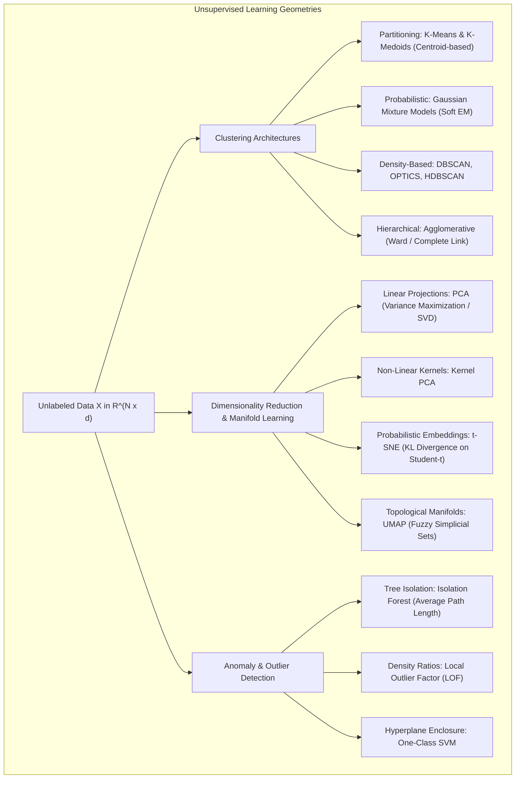

# Note 03: Unsupervised Learning Interview Q&A

> **Topic ID:** `05-ai/machine-learning/17-interview/03-unsupervised-learning-qa`  
> **Target Audience:** Senior ML Engineers, Applied Scientists, Technical Interviewers  
> **Prerequisites:** Linear Algebra (Eigendecomposition & SVD), Multivariate Probability, Optimization  
> **Status:** Production Verified

---

## 1. Architectural Taxonomy of Unsupervised Learning

Unsupervised learning extracts latent structure, cluster geometries, low-dimensional manifolds, and anomalous patterns from unlabeled data $\mathcal{D} = \{\mathbf{x}_i\}_{i=1}^N$. Senior interviewers focus on mathematical derivations, convergence mechanics, objective function bounds, and algorithmic scalability.

---

## 2. In-Depth Technical Questions & Answers (25 Questions)

### Q1: Derive Principal Component Analysis (PCA) via Variance Maximization using Lagrange Multipliers.
**Answer:**
Let $\mathbf{X} \in \mathbb{R}^{N \times d}$ be a centered design matrix ($\sum_{i=1}^N \mathbf{x}_i = \mathbf{0}$) with empirical sample covariance matrix:
$$\mathbf{S} = \frac{1}{N} \mathbf{X}^T \mathbf{X}$$
We seek a unit projection vector $\mathbf{u}_1 \in \mathbb{R}^d$ ($\|\mathbf{u}_1\|_2^2 = \mathbf{u}_1^T \mathbf{u}_1 = 1$) that maximizes the sample variance of the projected data $z_i = \mathbf{u}_1^T \mathbf{x}_i$:
$$\text{Var}(z) = \frac{1}{N} \sum_{i=1}^N (\mathbf{u}_1^T \mathbf{x}_i)^2 = \mathbf{u}_1^T \left( \frac{1}{N} \mathbf{X}^T \mathbf{X} \right) \mathbf{u}_1 = \mathbf{u}_1^T \mathbf{S} \mathbf{u}_1$$
Formulate the Lagrangian with Lagrange multiplier $\lambda_1$:
$$\mathcal{L}(\mathbf{u}_1, \lambda_1) = \mathbf{u}_1^T \mathbf{S} \mathbf{u}_1 - \lambda_1 (\mathbf{u}_1^T \mathbf{u}_1 - 1)$$
Setting the gradient with respect to $\mathbf{u}_1$ to zero:
$$\nabla_{\mathbf{u}_1} \mathcal{L} = 2 \mathbf{S} \mathbf{u}_1 - 2 \lambda_1 \mathbf{u}_1 = \mathbf{0} \implies \mathbf{S} \mathbf{u}_1 = \lambda_1 \mathbf{u}_1$$
This is the standard **eigenvalue equation**. Pre-multiplying by $\mathbf{u}_1^T$:
$$\mathbf{u}_1^T \mathbf{S} \mathbf{u}_1 = \lambda_1 \mathbf{u}_1^T \mathbf{u}_1 = \lambda_1$$
To maximize projected variance $\text{Var}(z) = \mathbf{u}_1^T \mathbf{S} \mathbf{u}_1$, $\mathbf{u}_1$ must be the eigenvector corresponding to the **largest eigenvalue** $\lambda_{\max}$ of covariance matrix $\mathbf{S}$. Subsequent orthogonal components $\mathbf{u}_2, \dots, \mathbf{u}_k$ correspond to decreasing eigenvalues $\lambda_2 \ge \dots \ge \lambda_k$.

---

### Q2: Prove that PCA via Covariance Eigendecomposition is mathematically equivalent to Singular Value Decomposition (SVD) of the data matrix.
**Answer:**
Let centered data matrix $\mathbf{X} \in \mathbb{R}^{N \times d}$ have SVD:
$$\mathbf{X} = \mathbf{U} \mathbf{\Sigma} \mathbf{V}^T$$
where $\mathbf{U} \in \mathbb{R}^{N \times N}$ and $\mathbf{V} \in \mathbb{R}^{d \times d}$ are orthogonal matrices ($\mathbf{U}^T \mathbf{U} = \mathbf{I}$, $\mathbf{V}^T \mathbf{V} = \mathbf{I}$), and $\mathbf{\Sigma} \in \mathbb{R}^{N \times d}$ contains singular values $\sigma_1 \ge \sigma_2 \ge \dots \ge 0$ along its diagonal.
The sample covariance matrix is:
$$\mathbf{S} = \frac{1}{N} \mathbf{X}^T \mathbf{X} = \frac{1}{N} (\mathbf{U} \mathbf{\Sigma} \mathbf{V}^T)^T (\mathbf{U} \mathbf{\Sigma} \mathbf{V}^T) = \frac{1}{N} \mathbf{V} \mathbf{\Sigma}^T (\mathbf{U}^T \mathbf{U}) \mathbf{\Sigma} \mathbf{V}^T$$
Since $\mathbf{U}^T \mathbf{U} = \mathbf{I}$:
$$\mathbf{S} = \mathbf{V} \left( \frac{1}{N} \mathbf{\Sigma}^T \mathbf{\Sigma} \right) \mathbf{V}^T$$
This is precisely the spectral eigendecomposition $\mathbf{S} = \mathbf{V} \mathbf{\Lambda} \mathbf{V}^T$:
* The right singular vectors $\mathbf{V}$ of $\mathbf{X}$ are **identically equal to the principal component loading vectors** (eigenvectors of $\mathbf{S}$).
* The eigenvalues are directly related to singular values by $\lambda_i = \frac{\sigma_i^2}{N}$.
* The projected principal component coordinates (scores) are given by:
  $$\mathbf{Z} = \mathbf{X} \mathbf{V} = \mathbf{U} \mathbf{\Sigma} \mathbf{V}^T \mathbf{V} = \mathbf{U} \mathbf{\Sigma}$$
* *Computational Advantage*: Computing SVD directly on $\mathbf{X}$ costs $O(N \cdot d \cdot \min(N, d))$ and avoids explicitly computing the covariance matrix $\mathbf{X}^T \mathbf{X}$, preventing numerical floating-point precision loss.

---

### Q3: Prove that K-Means is guaranteed to terminate in a finite number of steps, and explain why it is not guaranteed to find the global optimum.
**Answer:**
Let the K-Means objective function (inertia) be:
$$J = \sum_{k=1}^K \sum_{i \in C_k} \|\mathbf{x}_i - \boldsymbol{\mu}_k\|_2^2$$
1. **Monotonic Decrease**:
   * *Assignment Step*: Each point $\mathbf{x}_i$ is assigned to its nearest centroid $c_i = \arg\min_k \|\mathbf{x}_i - \boldsymbol{\mu}_k\|^2$. This minimizes $J$ with respect to assignments holding centroids fixed: $J(C^{(t+1)}, \boldsymbol{\mu}^{(t)}) \le J(C^{(t)}, \boldsymbol{\mu}^{(t)})$.
   * *Update Step*: Centroids are recomputed as leaf means $\boldsymbol{\mu}_k = \frac{1}{|C_k|} \sum_{i \in C_k} \mathbf{x}_i$. By the property of Euclidean distance, the sample mean uniquely minimizes the sum of squared distances to all points in that cluster: $J(C^{(t+1)}, \boldsymbol{\mu}^{(t+1)}) \le J(C^{(t+1)}, \boldsymbol{\mu}^{(t)})$.
   * Thus, $J$ decreases monotonically at every step: $J^{(t+1)} \le J^{(t)}$.
2. **Finite Termination**:
   * There are $N$ data points and $K$ clusters. The total number of distinct cluster assignments is finite ($K^N$ possible partitions).
   * Since $J$ strictly decreases whenever assignments change, no partition can ever be revisited.
   * Therefore, the algorithm must terminate in a finite number of iterations ($t \le K^N$).
3. **Local Minima**:
   * The space of partitions is discrete and non-convex. K-Means is a coordinate descent algorithm that stops when a local minimum (stationary point) is reached where no single point reassignment strictly decreases $J$. The global minimum is NP-hard.

---

### Q4: Prove that K-Means is a special limiting case of the Expectation-Maximization (EM) algorithm for Gaussian Mixture Models (GMM).
**Answer:**
Consider a GMM with $K$ components: $p(\mathbf{x}) = \sum_{k=1}^K \pi_k \mathcal{N}(\mathbf{x} \mid \boldsymbol{\mu}_k, \boldsymbol{\Sigma}_k)$.
Impose two constraints:
1. Equal uniform priors: $\pi_k = \frac{1}{K}$ for all $k$.
2. Isotropic spherical covariance matrices shared across all components: $\boldsymbol{\Sigma}_k = \sigma^2 \mathbf{I}$.
The Gaussian density is:
$$\mathcal{N}(\mathbf{x} \mid \boldsymbol{\mu}_k, \sigma^2 \mathbf{I}) = \frac{1}{(2\pi \sigma^2)^{d/2}} \exp\left( -\frac{\|\mathbf{x} - \boldsymbol{\mu}_k\|_2^2}{2\sigma^2} \right)$$
In the E-step, the posterior responsibility of component $k$ for sample $\mathbf{x}_i$ is:
$$\gamma_{ik} = \frac{\pi_k \mathcal{N}(\mathbf{x}_i \mid \boldsymbol{\mu}_k, \sigma^2 \mathbf{I})}{\sum_{j=1}^K \pi_j \mathcal{N}(\mathbf{x}_i \mid \boldsymbol{\mu}_j, \sigma^2 \mathbf{I})} = \frac{\exp\left( -\frac{\|\mathbf{x}_i - \boldsymbol{\mu}_k\|_2^2}{2\sigma^2} \right)}{\sum_{j=1}^K \exp\left( -\frac{\|\mathbf{x}_i - \boldsymbol{\mu}_j\|_2^2}{2\sigma^2} \right)}$$
Now, take the **limit as the variance approaches zero** ($\sigma^2 \to 0^+$):
The exponential with the smallest distance $\|\mathbf{x}_i - \boldsymbol{\mu}_k\|_2^2$ vanishes infinitely slower than all others:
$$\lim_{\sigma^2 \to 0^+} \gamma_{ik} = \begin{cases} 1 & \text{if } k = \arg\min_j \|\mathbf{x}_i - \boldsymbol{\mu}_j\|_2^2 \\ 0 & \text{otherwise} \end{cases}$$
The soft probabilistic responsibilities collapse into **hard binary assignments** identical to the K-Means assignment step. The M-step update $\boldsymbol{\mu}_k = \frac{\sum_i \gamma_{ik} \mathbf{x}_i}{\sum_i \gamma_{ik}}$ becomes the simple arithmetic mean of assigned points. Hence, K-Means is the "hard EM" limit of GMM as $\sigma^2 \to 0$.

---

### Q5: What is the "Crowding Problem" in dimensionality reduction, and how does t-SNE resolve it using the Student-t distribution?
**Answer:**
* **The Crowding Problem**:
  In high-dimensional space $\mathbb{R}^d$, the volume of a sphere of radius $r$ scales as $r^d$. A data point can have hundreds of equidistant orthogonal nearest neighbors. However, in a 2D or 3D embedding space, the area scales only as $r^2$. There is simply not enough volume to accommodate all moderate-distance neighbors without crushing distinct clusters together into an uninformative dense cloud in the center.
* **t-SNE Resolution (van der Maaten & Hinton, 2008)**:
  1. *High-Dimensional Space*: Uses Gaussian distributions to model pairwise similarities:
     $$p_{j \mid i} = \frac{\exp(-\|\mathbf{x}_i - \mathbf{x}_j\|^2 / 2\sigma_i^2)}{\sum_{k \ne i} \exp(-\|\mathbf{x}_i - \mathbf{x}_k\|^2 / 2\sigma_k^2)}$$
  2. *Low-Dimensional Space*: Uses a **heavy-tailed Student-t distribution with 1 degree of freedom** (Cauchy distribution):
     $$q_{ij} = \frac{(1 + \|\mathbf{y}_i - \mathbf{y}_j\|^2)^{-1}}{\sum_k \sum_{l \ne k} (1 + \|\mathbf{y}_k - \mathbf{y}_l\|^2)^{-1}}$$
  3. *Why it works*: The inverse-square tail $(1 + d^2)^{-1}$ drops off much slower than the Gaussian exponential $\exp(-d^2)$. To achieve the same small probability $q_{ij} \approx p_{ij}$ for moderately distant points, the points $\mathbf{y}_i, \mathbf{y}_j$ in 2D must be pushed much further apart, eliminating overcrowding and allowing distinct clusters to separate cleanly.

---

### Q6: What is the exact mathematical difference between the objective functions of t-SNE and UMAP?
**Answer:**
* **t-SNE Objective (Kullback-Leibler Divergence)**:
  $$C_{\text{t-SNE}} = \text{KL}(P \parallel Q) = \sum_{i \ne j} p_{ij} \ln \frac{p_{ij}}{q_{ij}} = \sum_{i \ne j} p_{ij} \ln p_{ij} - \sum_{i \ne j} p_{ij} \ln q_{ij}$$
  *Notice that $C_{\text{t-SNE}}$ penalizes heavily when $p_{ij}$ is large and $q_{ij}$ is small (local neighbors must stay together). But when $p_{ij} \approx 0$ (distant points), the term $p_{ij} \ln \frac{p_{ij}}{q_{ij}} \to 0$, meaning **t-SNE does not preserve global distance structure**.*
* **UMAP Objective (Fuzzy Set Cross-Entropy)**:
  $$C_{\text{UMAP}} = \sum_{i \ne j} \left[ \underbrace{p_{ij} \ln \frac{p_{ij}}{q_{ij}}}_{\text{Attractive forces}} + \underbrace{(1 - p_{ij}) \ln \left(\frac{1 - p_{ij}}{1 - q_{ij}}\right)}_{\text{Repulsive forces}} \right]$$
  *The second term $(1 - p_{ij}) \ln \frac{1}{1 - q_{ij}}$ explicitly penalizes cases where distant points in high dimensions ($p_{ij} \approx 0$) are placed close together in low dimensions ($q_{ij} > 0$). This active repulsion preserves global manifold topology and inter-cluster relationships.*

---

### Q7: Explain the mechanics of DBSCAN: Core, Border, and Noise points. How does DBSCAN handle clusters of varying densities?
**Answer:**
Given neighborhood radius $\epsilon > 0$ and minimum points $\text{MinPts} \ge 1$:
1. **Core Point**: A point $\mathbf{x}_i$ whose $\epsilon$-neighborhood contains at least $\text{MinPts}$ points: $|N_\epsilon(\mathbf{x}_i)| \ge \text{MinPts}$.
2. **Border Point**: A point that is not a core point ($|N_\epsilon| < \text{MinPts}$), but falls within the $\epsilon$-neighborhood of at least one core point.
3. **Noise Point**: A point that is neither a core point nor a border point.
* **Failure on Varying Densities**:
  DBSCAN enforces a **single global $\epsilon$ threshold**. If a dataset contains both a dense cluster (points separated by distance $\le 0.1$) and a sparse cluster (points separated by distance $\le 0.8$):
  * Setting $\epsilon = 0.8$ merges the dense cluster with nearby background noise.
  * Setting $\epsilon = 0.1$ correctly segments the dense cluster but marks the entire sparse cluster as noise.
* *Remedy*: Migrate to **HDBSCAN**, which builds a cluster tree across all continuous $\epsilon$ thresholds and extracts optimal clusters based on excess of mass stability.

---

### Q8: What is the theoretical basis of Isolation Forest for anomaly detection? Derive the average path length $c(n)$ of an unsuccessful search in a Binary Search Tree (BST).
**Answer:**
* **Theoretical Premise**: Anomalies are "few and different". In a randomly partitioned feature space, an anomalous data point isolated in a sparse region requires very few orthogonal cuts to isolate into a leaf node, whereas normal points embedded in dense clusters require many recursive splits.
* **Derivation of Average Path Length $c(n)$**:
  An Isolation Tree is structurally equivalent to a randomized Binary Search Tree (BST). For a dataset of $n$ instances, the average depth of an unsuccessful search in a BST satisfies the harmonic series recurrence:
  $$c(n) = 2 \sum_{k=1}^{n-1} \frac{1}{k} - \frac{2(n-1)}{n} = 2 H_{n-1} - \frac{2(n-1)}{n}$$
  Using the Euler-Mascheroni constant $\gamma \approx 0.5772156649$, $H_{n-1} \approx \ln(n-1) + \gamma$:
  $$c(n) = 2\left(\ln(n-1) + 0.5772156649\right) - \frac{2(n-1)}{n}$$
* **Anomaly Score Formulation**:
  For an instance $\mathbf{x}$ evaluated across $M$ trees with observed path lengths $h_m(\mathbf{x})$:
  $$s(\mathbf{x}, n) = 2^{-\frac{\mathbb{E}[h(\mathbf{x})]}{c(n)}}$$
  * When $\mathbb{E}[h(\mathbf{x})] \to 0 \implies s \to 2^0 = 1.0$ (definite anomaly).
  * When $\mathbb{E}[h(\mathbf{x})] \to c(n) \implies s \to 2^{-1} = 0.5$ (normal instance).
  * When $\mathbb{E}[h(\mathbf{x})] \to n-1 \implies s \to 0.0$ (tight cluster center).

---

### Q9: How does Local Outlier Factor (LOF) detect density-based anomalies? Define Reachability Distance and Local Reachability Density.
**Answer:**
LOF compares the local density of an object to the local densities of its $k$-nearest neighbors.
1. **$k$-Distance of $p$ ($d_k(p)$)**: The Euclidean distance between $p$ and its $k$-th nearest neighbor.
2. **Reachability Distance of $p$ with respect to $o$**:
   $$\text{reach-dist}_k(p, o) = \max(d_k(o), d(p, o))$$
   *(Smooths out fluctuations for points that are extremely close to $o$).*
3. **Local Reachability Density (lrd) of $p$**:
   $$\text{lrd}_k(p) = \frac{|N_k(p)|}{\sum_{o \in N_k(p)} \text{reach-dist}_k(p, o)}$$
   The inverse of the average reachability distance from $p$'s neighbors to $p$.
4. **Local Outlier Factor (LOF) of $p$**:
   $$\text{LOF}_k(p) = \frac{\sum_{o \in N_k(p)} \frac{\text{lrd}_k(o)}{\text{lrd}_k(p)}}{|N_k(p)|} = \frac{1}{|N_k(p)|} \sum_{o \in N_k(p)} \text{lrd}_k(o) \cdot \frac{1}{\text{lrd}_k(p)}$$
   * $\text{LOF} \approx 1.0$: Point has density comparable to its neighbors (inlier).
   * $\text{LOF} > 1.5$: Point has significantly lower density than its neighbors (outlier).

---

### Q10: What is Kernel PCA, and why is centering the Gram matrix in feature space non-trivial?
**Answer:**
Kernel PCA computes principal components in a reproducing kernel Hilbert space $\mathcal{H}$ mapped via $\phi(\mathbf{x})$.
* **Centering Requirement**: Standard PCA assumes data is zero-centered ($\sum \phi(\mathbf{x}_i) = \mathbf{0}$). However, $\phi(\mathbf{x})$ is implicit and unknown; we cannot manually subtract the mean $\bar{\phi}$.
* **Centering in Kernel Matrix Form**:
  Let $\mathbf{K} \in \mathbb{R}^{N \times N}$ be the uncentered Gram matrix $K_{ij} = k(\mathbf{x}_i, \mathbf{x}_j)$. The centered kernel matrix $\tilde{\mathbf{K}}$ is:
  $$\tilde{\mathbf{K}} = \mathbf{K} - \mathbf{1}_N \mathbf{K} - \mathbf{K} \mathbf{1}_N + \mathbf{1}_N \mathbf{K} \mathbf{1}_N$$
  where $\mathbf{1}_N \in \mathbb{R}^{N \times N}$ is the matrix with all entries equal to $1/N$.
  Solving the eigenvalue problem $\tilde{\mathbf{K}} \boldsymbol{\alpha}_k = \lambda_k \boldsymbol{\alpha}_k$ and normalizing $\boldsymbol{\alpha}_k$ such that $\lambda_k \|\boldsymbol{\alpha}_k\|^2 = 1$ yields non-linear principal component projections.

---

### Q11: Explain the four linkage criteria in Agglomerative Hierarchical Clustering: Single, Complete, Average, and Ward's.
**Answer:**
Given two clusters $A$ and $B$:
1. **Single Linkage**:
   $$D_{\text{single}}(A, B) = \min_{\mathbf{a} \in A, \mathbf{b} \in B} \|\mathbf{a} - \mathbf{b}\|$$
   *Characteristics*: Minimum spanning tree logic. Capable of discovering non-elliptical shapes, but suffers from the **chaining effect** (thin lines of noise bridge distinct clusters together).
2. **Complete Linkage**:
   $$D_{\text{complete}}(A, B) = \max_{\mathbf{a} \in A, \mathbf{b} \in B} \|\mathbf{a} - \mathbf{b}\|$$
   *Characteristics*: Produces compact, spherical clusters of roughly equal diameter. Avoids chaining, but highly sensitive to outliers.
3. **Average Linkage (UPGMA)**:
   $$D_{\text{average}}(A, B) = \frac{1}{|A| |B|} \sum_{\mathbf{a} \in A} \sum_{\mathbf{b} \in B} \|\mathbf{a} - \mathbf{b}\|$$
   *Characteristics*: Balances single and complete linkage; robust to moderate noise.
4. **Ward's Minimum Variance Linkage**:
   $$\Delta \text{ESS}_{AB} = \frac{|A| \cdot |B|}{|A| + |B|} \|\boldsymbol{\mu}_A - \boldsymbol{\mu}_B\|_2^2$$
   *Characteristics*: Merges the pair of clusters that minimizes the increase in total within-cluster sum of squared errors (inertia). Tends to produce equal-sized, spherical clusters identical in objective to K-Means.

---

### Q12: How do you choose the optimal number of clusters $K$ mathematically? Compare the Elbow Method, Silhouette Analysis, and Gap Statistic.
**Answer:**
1. **Elbow Method**: Plots inertia $J(K)$ vs $K$. Looks for the inflection point (elbow) where marginal reduction in sum of squares diminishes.
   *Critique*: Heuristic, subjective, and often lacks a clear elbow on smooth manifolds.
2. **Silhouette Coefficient**: For point $i$, let $a(i)$ be mean intra-cluster distance and $b(i)$ be mean nearest-cluster distance:
   $$s(i) = \frac{b(i) - a(i)}{\max(a(i), b(i))} \in [-1, +1]$$
   Optimal $K$ maximizes the mean silhouette score across all samples. Values $> 0.5$ indicate strong separation.
3. **Gap Statistic (Tibshirani et al., 2001)**: Compares the drop in inertia to an expected null reference distribution generated uniformly over the bounding box:
   $$\text{Gap}(K) = \mathbb{E}^*[\ln W_K] - \ln W_K$$
   Selects the smallest $K$ such that $\text{Gap}(K) \ge \text{Gap}(K+1) - s_{K+1}$. Rigorous and mathematically grounded.

---

### Q13: What is the K-Means++ initialization algorithm, and what theoretical approximation bound does it guarantee?
**Answer:**
Standard random initialization often leads K-Means into poor local minima with large inertia errors.
* **K-Means++ Algorithm (Arthur & Vassilvitskii, 2007)**:
  1. Choose the first center $\boldsymbol{\mu}_1$ uniformly at random from the dataset.
  2. For each data point $\mathbf{x}_i$, compute $D(\mathbf{x}_i) = \min_{j} \|\mathbf{x}_i - \boldsymbol{\mu}_j\|_2$, the distance to the nearest existing center.
  3. Select the next center $\boldsymbol{\mu}_{k}$ with probability proportional to the squared distance:
     $$P(\mathbf{x}_i) = \frac{D(\mathbf{x}_i)^2}{\sum_{j=1}^N D(\mathbf{x}_j)^2}$$
  4. Repeat steps 2 and 3 until $K$ centers are chosen.
* **Theoretical Guarantee**:
  K-Means++ guarantees that the expected inertia is within an **$O(\log K)$ approximation factor** of the optimal global solution:
  $$\mathbb{E}[J] \le 8(\ln K + 2) J_{\text{opt}}$$

---

### Q14: How does Gaussian Mixture Model (GMM) covariance constraint parameterization affect cluster flexibility?
**Answer:**
In scikit-learn's `GaussianMixture(covariance_type=...)`:
* `spherical`: $\boldsymbol{\Sigma}_k = \sigma_k^2 \mathbf{I}$. Clusters are spherical with varying radii ($d$ parameters per component).
* `diag`: $\boldsymbol{\Sigma}_k = \text{diag}(\sigma_{k,1}^2, \dots, \sigma_{k,d}^2)$. Ellipsoids aligned strictly with coordinate axes; assumes features are conditionally uncorrelated ($d$ parameters per component).
* `tied`: $\boldsymbol{\Sigma}_k = \boldsymbol{\Sigma}$. All $K$ clusters share the exact same arbitrary oriented covariance matrix ($d(d+1)/2$ total parameters).
* `full`: Each cluster has its own independent, unconstrained positive-definite covariance matrix $\boldsymbol{\Sigma}_k$ ($K \cdot \frac{d(d+1)}{2}$ parameters). Highly expressive, but prone to singularity crashes if a cluster contains fewer points than features ($N_k < d$).

---

### Q15: What is the Reconstruction Error in PCA, and what is the Eckart-Young-Mirsky Theorem?
**Answer:**
Let $\mathbf{X}_k = \mathbf{U}_k \mathbf{\Sigma}_k \mathbf{V}_k^T$ be the rank-$k$ truncated SVD reconstruction of centered matrix $\mathbf{X}$.
The reconstruction error is the Frobenius norm of the residual:
$$\|\mathbf{X} - \mathbf{X}_k\|_F^2 = \sum_{j=k+1}^d \sigma_j^2$$
* **Eckart-Young-Mirsky Theorem (1936)**:
  For any matrix $\mathbf{A} \in \mathbb{R}^{N \times d}$ and any target rank $k < \text{rank}(\mathbf{A})$, the truncated SVD approximation $\mathbf{A}_k = \sum_{i=1}^k \sigma_i \mathbf{u}_i \mathbf{v}_i^T$ is the **globally optimal low-rank approximation** under both the spectral norm and Frobenius norm:
  $$\min_{\text{rank}(\mathbf{B}) \le k} \|\mathbf{A} - \mathbf{B}\|_F = \|\mathbf{A} - \mathbf{A}_k\|_F = \sqrt{\sum_{i=k+1}^{\min(N, d)} \sigma_i^2}$$
  No other linear rank-$k$ projection can achieve a smaller reconstruction error.

---

### Q16: Why should you NEVER use t-SNE for feature preprocessing or general clustering pipelines?
**Answer:**
1. **Non-Parametric & No Out-Of-Sample Projection**: Standard t-SNE does not learn a parametric mapping function $f: \mathbb{R}^d \to \mathbb{R}^2$. If a new production test sample $\mathbf{x}_{\text{new}}$ arrives, there is no way to embed it without re-running the entire optimization over $N+1$ points.
2. **Distorted Cluster Sizes & Distances**: Perplexity balances local vs global aspects. The optimization expands dense clusters and compresses sparse clusters; distance between separated clusters has **zero quantitative meaning**.
3. **Stochastic Non-Convexity**: Initialized randomly, t-SNE converges to different local minima across runs unless fixed by a random seed, making downstream classifiers non-deterministic.
* *Rule*: t-SNE is strictly an exploratory 2D/3D visualization tool, not a dimensionality reduction feature extractor.

---

### Q17: What is Non-Negative Matrix Factorization (NMF), and why does it produce additive, interpretable parts-based representations?
**Answer:**
Given a non-negative data matrix $\mathbf{V} \in \mathbb{R}_{\ge 0}^{N \times d}$, NMF seeks two non-negative low-rank matrices $\mathbf{W} \in \mathbb{R}_{\ge 0}^{N \times k}$ and $\mathbf{H} \in \mathbb{R}_{\ge 0}^{k \times d}$ ($k \ll d$) such that:
$$\mathbf{V} \approx \mathbf{W} \mathbf{H} \quad \text{s.t. } W_{ik} \ge 0, H_{kj} \ge 0$$
* **Why it is parts-based (Lee & Seung, Nature 1999)**:
  In PCA, vectors have arbitrary positive and negative signs, allowing components to cancel each other out via destructive interference. In contrast, NMF's non-negativity constraint permits **only purely additive combinations**:
  $$\mathbf{v}_i \approx \sum_{r=1}^k W_{ir} \mathbf{h}_r$$
  In document modeling, $\mathbf{H}$ represents pure topic dictionaries (positive word counts) and $\mathbf{W}$ represents document topic weights. In facial imaging, basis components $\mathbf{h}_r$ represent distinct facial parts (noses, eyes, mouths) rather than ghostly holistic eigenfaces.

---

### Q18: What is One-Class SVM, and how does Schölkopf's formulation separate data from the coordinate origin?
**Answer:**
Schölkopf's One-Class SVM maps training instances $\mathbf{x}_i$ into a high-dimensional feature space $\mathcal{H}$ via kernel $\phi(\mathbf{x})$, and finds a maximum-margin hyperplane separating the mapped data points from the coordinate origin with minimal slack:
$$\min_{\mathbf{w}, \rho, \boldsymbol{\xi}} \frac{1}{2} \|\mathbf{w}\|_2^2 + \frac{1}{\nu N} \sum_{i=1}^N \xi_i - \rho$$
$$\text{subject to } \mathbf{w}^T \phi(\mathbf{x}_i) \ge \rho - \xi_i, \quad \xi_i \ge 0 \quad \forall i$$
* **The Role of $\nu \in (0, 1]$**:
  $\nu$ is an upper bound on the fraction of outliers (training errors lying on the origin side of the hyperplane) and a lower bound on the fraction of support vectors.
* **Decision Rule**: $f(\mathbf{x}) = \text{sign}(\mathbf{w}^T \phi(\mathbf{x}) - \rho) = \text{sign}\left(\sum_{i=1}^N \alpha_i k(\mathbf{x}_i, \mathbf{x}) - \rho\right)$. If $f(\mathbf{x}) < 0$, the instance is flagged as an anomaly.

---

### Q19: What is the Curse of Dimensionality's impact on distance-based clustering algorithms?
**Answer:**
Beyer et al. (1999) proved that under mild distributional assumptions, as dimension $d \to \infty$:
$$\frac{\text{dist}_{\max}(\mathbf{x}) - \text{dist}_{\min}(\mathbf{x})}{\text{dist}_{\min}(\mathbf{x})} \xrightarrow[d \to \infty]{p} 0$$
* **Impact on K-Means**: Distance from any point $\mathbf{x}_i$ to all $K$ centroids becomes virtually indistinguishable. Assignment boundaries become arbitrary and hypersensitive to numerical noise.
* **Impact on DBSCAN**: The volume of an $\epsilon$-hyperball is $V_d(\epsilon) \propto \frac{\pi^{d/2}}{\Gamma(d/2+1)} \epsilon^d \to 0$. In 50 dimensions, an $\epsilon$-ball is almost completely empty unless $\epsilon$ is set massive, at which point every single point becomes a direct neighbor of every other point.

---

### Q20: How does Truncated SVD handle sparse matrices differently than standard SVD / PCA?
**Answer:**
* Standard PCA centers data by computing $\mathbf{X} - \boldsymbol{\mu}$. Centering converts every implicit zero into a non-zero float ($0 - 0.05 = -0.05$), instantly destroying sparsity and exploding memory from megabytes to gigabytes.
* **Truncated SVD (Latent Semantic Analysis - LSA)** skips data centering, computing singular vectors directly on the sparse Compressed Sparse Row (CSR) matrix:
  $$\mathbf{X} \approx \mathbf{U}_k \mathbf{\Sigma}_k \mathbf{V}_k^T$$
  Matrix-vector multiplications $\mathbf{X}\mathbf{v}$ are evaluated strictly over non-zero elements in $O(\text{nnz})$ time, enabling factorization of massive text/user-item matrices with millions of rows and columns.

---

### Q21: What is the Dunn Index, and what does it measure in cluster validation?
**Answer:**
The **Dunn Index** evaluates cluster quality by measuring the ratio of the smallest inter-cluster separation to the largest intra-cluster diameter:
$$\text{Dunn} = \frac{\min_{1 \le i < j \le K} \delta(C_i, C_j)}{\max_{1 \le k \le K} \Delta(C_k)}$$
where $\delta(C_i, C_j) = \min_{\mathbf{x} \in C_i, \mathbf{y} \in C_j} \|\mathbf{x} - \mathbf{y}\|$ is inter-cluster distance, and $\Delta(C_k) = \max_{\mathbf{x}, \mathbf{y} \in C_k} \|\mathbf{x} - \mathbf{y}\|$ is the diameter of cluster $k$.
* Higher Dunn index indicates compact, well-separated clusters.
* *Limitation*: Highly sensitive to outliers since both numerator and denominator rely on extreme min/max pairwise distances.

---

### Q22: What is Spectral Clustering, and how does it use the Graph Laplacian matrix?
**Answer:**
Spectral clustering treats data points as nodes in a graph connected by an affinity matrix $\mathbf{W}$ ($W_{ij} = \exp(-\gamma \|\mathbf{x}_i - \mathbf{x}_j\|^2)$).
1. **Compute Degree Matrix**: $D_{ii} = \sum_j W_{ij}$.
2. **Compute Unnormalized Graph Laplacian**: $\mathbf{L} = \mathbf{D} - \mathbf{W}$ (or Normalized Symmetric $\mathbf{L}_{\text{sym}} = \mathbf{D}^{-1/2} \mathbf{L} \mathbf{D}^{-1/2} = \mathbf{I} - \mathbf{D}^{-1/2} \mathbf{W} \mathbf{D}^{-1/2}$).
3. **Eigendecomposition**: Find the $K$ eigenvectors corresponding to the $K$ **smallest eigenvalues** of $\mathbf{L}_{\text{sym}}$.
4. **K-Means Clustering**: Stack the eigenvectors into matrix $\mathbf{U} \in \mathbb{R}^{N \times K}$ and cluster rows using standard K-Means.
* *Why it works*: Approximates the NP-hard Normalized Cut (NCut) problem on graphs, easily separating highly complex non-convex interleaved manifolds (concentric circles) that defeat K-Means.

---

### Q23: Explain Minimum Covariance Determinant (MCD) and Mahalanobis Distance for robust outlier detection.
**Answer:**
* **Mahalanobis Distance**: Measures distance accounting for correlations:
  $$D_M(\mathbf{x}) = \sqrt{(\mathbf{x} - \boldsymbol{\mu})^T \boldsymbol{\Sigma}^{-1} (\mathbf{x} - \boldsymbol{\mu})}$$
  However, standard sample estimates $\hat{\boldsymbol{\mu}}, \hat{\boldsymbol{\Sigma}}$ are easily distorted by extreme outliers (masking effect).
* **Minimum Covariance Determinant (MCD / Elliptic Envelope)**:
  Finds a subset of $h$ observations ($N/2 < h < N$, e.g., $h = 0.75 N$) whose empirical covariance matrix has the **smallest possible determinant**:
  $$\hat{\boldsymbol{\Sigma}}_{\text{MCD}} = \arg\min_{|H|=h} \det(\boldsymbol{\Sigma}_H)$$
  Points outside the resulting robust ellipsoid ($D_M^2 > \chi_{d, 0.975}^2$) are flagged as anomalies with high breakdown point resistance ($> 25\%$ outlier contamination).

---

### Q24: What is the Adjusted Rand Index (ARI) and Normalized Mutual Information (NMI)?
**Answer:**
Used when external ground-truth class labels $Y$ are available to validate unsupervised clustering $C$:
1. **Adjusted Rand Index (ARI)**: Evaluates agreement over all $\binom{N}{2}$ sample pairs:
   $$\text{ARI} = \frac{\text{Index} - \mathbb{E}[\text{Index}]}{\text{MaxIndex} - \mathbb{E}[\text{Index}]} \in [-1, +1]$$
   Corrects for chance: $\text{ARI} = 0$ for purely random cluster assignments, and $1.0$ for perfect alignment.
2. **Normalized Mutual Information (NMI)**:
   $$\text{NMI}(Y, C) = \frac{2 \cdot I(Y; C)}{H(Y) + H(C)} \in [0, 1]$$
   Information-theoretic measure invariant to label permutation.

---

### Q25: Why does K-Means fail on non-globular or unequal-variance cluster distributions?
**Answer:**
1. **Equidistant Voronoi Tessellation**: K-Means assigns each point to the closest centroid under Euclidean distance. This mathematically forces all cluster decision boundaries to be **linear hyperplanes (Voronoi cells)**. Consequently, it cannot separate non-linear geometries (intertwined spirals, concentric circles).
2. **Variance Homogeneity Assumption**: Because K-Means minimizes inertia $\sum \|\mathbf{x}_i - \boldsymbol{\mu}_k\|^2$, it implicitly assumes all clusters are spherical and share identical spatial variances. If one cluster is massive and diffuse while another is small and dense, K-Means will split the large cluster in half and merge the small cluster with adjacent noise.
