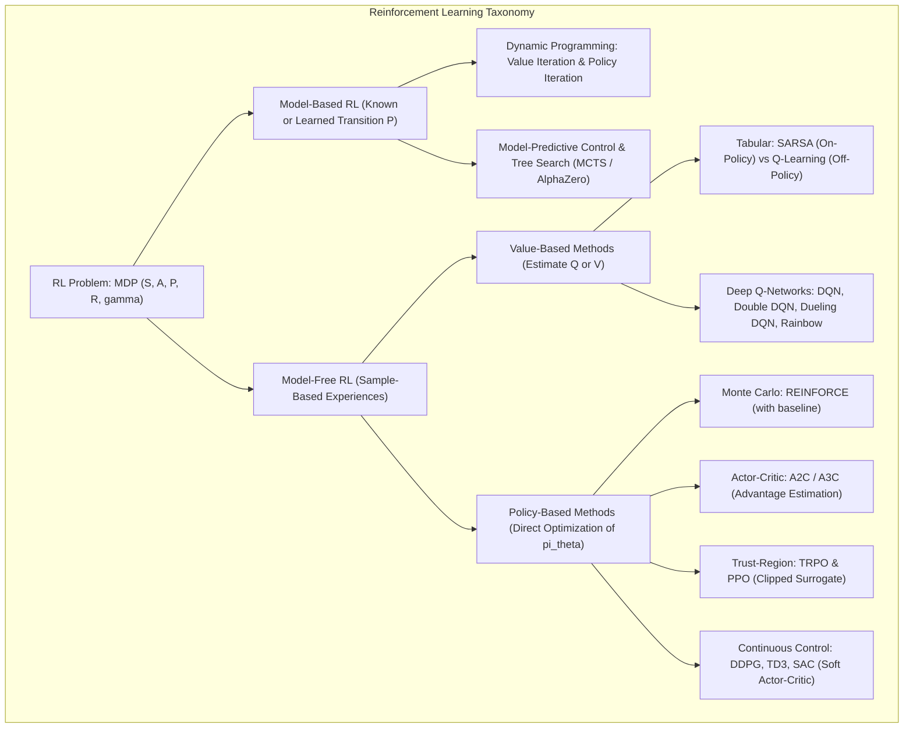

# Note 04: Reinforcement Learning Interview Q&A

> **Topic ID:** `05-ai/machine-learning/17-interview/04-reinforcement-learning-qa`  
> **Target Audience:** Senior ML Engineers, Robotics & RL Specialists, Technical Interviewers  
> **Prerequisites:** Note 01 (ML Fundamentals), Note 07 (RL Module), Stochastic Processes  
> **Status:** Production Verified

---

## 1. Architectural Taxonomy of Reinforcement Learning

Reinforcement Learning (RL) studies optimal sequential decision making under uncertainty, where an agent interacts with an environment to maximize cumulative discounted rewards. Senior interviews examine dynamic programming, contraction mappings, policy gradients, stability tricks in deep RL, and continuous control.

---

## 2. In-Depth Technical Questions & Answers (20 Questions)

### Q1: Formally define a Markov Decision Process (MDP) and state the Markov Property.
**Answer:**
A **Markov Decision Process** is a 5-tuple $\mathcal{M} = \langle \mathcal{S}, \mathcal{A}, \mathcal{P}, \mathcal{R}, \gamma \rangle$:
* $\mathcal{S}$: State space (set of all valid states).
* $\mathcal{A}$: Action space (set of all valid actions).
* $\mathcal{P}$: Transition probability function $\mathcal{P}(s' \mid s, a) = \mathbb{P}(S_{t+1} = s' \mid S_t = s, A_t = a)$.
* $\mathcal{R}$: Reward function $\mathcal{R}(s, a, s') = \mathbb{E}[R_{t+1} \mid S_t = s, A_t = a, S_{t+1} = s']$.
* $\gamma \in [0, 1)$: Discount factor ensuring convergence of infinite-horizon returns $G_t = \sum_{k=0}^\infty \gamma^k R_{t+k+1}$.

**The Markov Property**:
A stochastic process possesses the Markov property if the conditional probability distribution of future states depends strictly on the current state and action, and is conditionally independent of all historical past states and actions:
$$\mathbb{P}(S_{t+1} = s_{t+1}, R_{t+1} = r_{t+1} \mid S_t = s_t, A_t = a_t, S_{t-1} = s_{t-1}, \dots, S_0 = s_0, A_0 = a_0) = \mathbb{P}(S_{t+1} = s_{t+1}, R_{t+1} = r_{t+1} \mid S_t = s_t, A_t = a_t)$$

---

### Q2: Derive the Bellman Expectation Equations for $V^\pi(s)$ and $Q^\pi(s, a)$.
**Answer:**
Let return $G_t = R_{t+1} + \gamma G_{t+1}$.
1. **Derivation for $V^\pi(s)$**:
   $$V^\pi(s) = \mathbb{E}_\pi [G_t \mid S_t = s] = \mathbb{E}_\pi [R_{t+1} + \gamma G_{t+1} \mid S_t = s]$$
   Conditioning on action $a \sim \pi(a \mid s)$ and next state $s' \sim \mathcal{P}(s' \mid s, a)$:
   $$V^\pi(s) = \sum_{a \in \mathcal{A}} \pi(a \mid s) \sum_{s' \in \mathcal{S}} \mathcal{P}(s' \mid s, a) \left[ \mathcal{R}(s, a, s') + \gamma \mathbb{E}_\pi [G_{t+1} \mid S_{t+1} = s'] \right]$$
   $$V^\pi(s) = \sum_{a \in \mathcal{A}} \pi(a \mid s) \sum_{s' \in \mathcal{S}} \mathcal{P}(s' \mid s, a) \left[ \mathcal{R}(s, a, s') + \gamma V^\pi(s') \right]$$
2. **Derivation for $Q^\pi(s, a)$**:
   $$Q^\pi(s, a) = \mathbb{E}_\pi [R_{t+1} + \gamma G_{t+1} \mid S_t = s, A_t = a]$$
   $$Q^\pi(s, a) = \sum_{s' \in \mathcal{S}} \mathcal{P}(s' \mid s, a) \left[ \mathcal{R}(s, a, s') + \gamma V^\pi(s') \right]$$
   Substituting $V^\pi(s') = \sum_{a'} \pi(a' \mid s') Q^\pi(s', a')$:
   $$Q^\pi(s, a) = \sum_{s' \in \mathcal{S}} \mathcal{P}(s' \mid s, a) \left[ \mathcal{R}(s, a, s') + \gamma \sum_{a' \in \mathcal{A}} \pi(a' \mid s') Q^\pi(s', a') \right]$$

---

### Q3: State the Bellman Optimality Equations and explain why they cannot be solved linearly.
**Answer:**
* **Optimal State-Value Function $V^*(s)$**:
  $$V^*(s) = \max_{a \in \mathcal{A}} \sum_{s' \in \mathcal{S}} \mathcal{P}(s' \mid s, a) \left[ \mathcal{R}(s, a, s') + \gamma V^*(s') \right]$$
* **Optimal Action-Value Function $Q^*(s, a)$**:
  $$Q^*(s, a) = \sum_{s' \in \mathcal{S}} \mathcal{P}(s' \mid s, a) \left[ \mathcal{R}(s, a, s') + \gamma \max_{a' \in \mathcal{A}} Q^*(s', a') \right]$$
* **Why it Cannot be Solved Linearly**:
  The presence of the non-linear $\max$ operator prevents writing the system as a linear system $\mathbf{v} = \mathbf{R} + \gamma \mathbf{P} \mathbf{v}$ (which has closed-form matrix solution $\mathbf{v} = (\mathbf{I} - \gamma \mathbf{P})^{-1} \mathbf{R}$). Instead, it must be solved iteratively via contraction mappings: **Value Iteration**, **Policy Iteration**, or temporal difference learning.

---

### Q4: Prove that the Bellman Optimality Operator is a $\gamma$-Contraction Mapping under the infinity norm. What theorem guarantees convergence?
**Answer:**
Define the Bellman optimality operator $T: \mathbb{R}^{|\mathcal{S}|} \to \mathbb{R}^{|\mathcal{S}|}$:
$$(Tv)(s) = \max_{a \in \mathcal{A}} \left[ \mathcal{R}(s, a) + \gamma \sum_{s'} \mathcal{P}(s' \mid s, a) v(s') \right]$$
For any two value vectors $u, v$:
$$|(Tu)(s) - (Tv)(s)| = \left| \max_a \left( \mathcal{R}(s, a) + \gamma \sum_{s'} \mathcal{P} u(s') \right) - \max_{a'} \left( \mathcal{R}(s, a') + \gamma \sum_{s'} \mathcal{P} v(s') \right) \right|$$
Using the identity $|\max_x f(x) - \max_x g(x)| \le \max_x |f(x) - g(x)|$:
$$|(Tu)(s) - (Tv)(s)| \le \max_a \left| \gamma \sum_{s'} \mathcal{P}(s' \mid s, a) (u(s') - v(s')) \right|$$
$$\le \gamma \max_a \sum_{s'} \mathcal{P}(s' \mid s, a) |u(s') - v(s')| \le \gamma \max_{s''} |u(s'') - v(s'')| = \gamma \|u - v\|_\infty$$
Taking the supremum over all $s \in \mathcal{S}$:
$$\|Tu - Tv\|_\infty \le \gamma \|u - v\|_\infty$$
Since $\gamma \in [0, 1)$, $T$ is a **contraction mapping**.
* **Banach Fixed-Point Theorem**:
  Guarantees that:
  1. A unique fixed point $v^*$ exists such that $Tv^* = v^*$.
  2. Repeated application $v_{k+1} = Tv_k$ converges geometrically at rate $\gamma^k$ to $v^*$ from *any* arbitrary initial vector $v_0$.

---

### Q5: Compare Value Iteration and Policy Iteration. Which converges faster, and what are their computational complexities per step?
**Answer:**
| Dimension | Value Iteration | Policy Iteration |
| :--- | :--- | :--- |
| **Mechanics** | Directly updates value estimates via Bellman Optimality: $V_{k+1}(s) = \max_a \sum \mathcal{P}[R + \gamma V_k(s')]$. | Alternates two distinct steps: (1) Full Policy Evaluation $V^{\pi_k}$, (2) Greedy Policy Improvement $\pi_{k+1} = \arg\max_a Q^{\pi_k}(s, a)$. |
| **Convergence Rate** | Linear / Geometric convergence in $O\left( \frac{1}{1-\gamma} \ln \frac{1}{\epsilon} \right)$ iterations. | Converges in a **finite number of iterations** (often very few iterations, bounded by $|\mathcal{A}|^{|\mathcal{S}|}$). |
| **Complexity per Iteration** | $O(|\mathcal{S}|^2 |\mathcal{A}|)$ operations per sweep. | Policy Evaluation requires matrix inversion $O(|\mathcal{S}|^3)$ or iterative solving $O(K |\mathcal{S}|^2)$, plus improvement $O(|\mathcal{S}| |\mathcal{A}|)$. |
| **Rule of Thumb** | Prefer Value Iteration when state space $|\mathcal{S}|$ is large; prefer Policy Iteration when action space is small and exact policy optimality is required. |

---

### Q6: What is the formal difference between On-Policy and Off-Policy Reinforcement Learning? Use SARSA and Q-Learning as examples.
**Answer:**
* **Target Policy $\pi(a \mid s)$**: The policy being evaluated and optimized (the policy the agent wants to deploy).
* **Behavior Policy $\mu(a \mid s)$**: The policy used to generate exploratory actions in the environment (e.g., $\epsilon$-greedy).
* **On-Policy Learning (SARSA)**:
  * The target policy is **identical** to the behavior policy ($\pi \equiv \mu$). The agent evaluates the value of the action that was *actually executed* under exploration:
    $$Q(S_t, A_t) \leftarrow Q(S_t, A_t) + \alpha \left[ R_{t+1} + \gamma Q(S_{t+1}, A_{t+1}) - Q(S_{t+1}, A_{t+1}) \right]$$
    where $A_{t+1} \sim \mu(\cdot \mid S_{t+1})$.
  * *Characteristics*: Conservative; accounts for exploratory slips (e.g., learns to walk far from a cliff edge in Cliff Walking).
* **Off-Policy Learning (Q-Learning)**:
  * The target policy is **different** from the behavior policy. Typically, target policy is greedy $\pi(s) = \arg\max_a Q(s, a)$ while behavior policy $\mu$ is $\epsilon$-greedy:
    $$Q(S_t, A_t) \leftarrow Q(S_t, A_t) + \alpha \left[ R_{t+1} + \gamma \max_{a'} Q(S_{t+1}, a') - Q(S_t, A_t) \right]$$
  * *Characteristics*: Learns the true optimal policy $Q^*$ directly from exploratory, logged, or human demonstration trajectories. Replay buffers are mathematically valid.

---

### Q7: State the Robbins-Monro conditions for stochastic convergence of Q-Learning.
**Answer:**
**Theorem (Watkins & Dayan, 1992)**:
Tabular Q-learning converges with probability 1 to the optimal action-value function $Q^*(s, a)$ provided:
1. All state-action pairs $(s, a)$ are visited an infinite number of times.
2. The step-size (learning rate) sequence $\alpha_t(s, a)$ satisfies the **Robbins-Monro conditions**:
   $$\sum_{t=1}^\infty \alpha_t(s, a) = \infty \quad \text{and} \quad \sum_{t=1}^\infty \alpha_t^2(s, a) < \infty$$
* *Intuition*: $\sum \alpha_t = \infty$ ensures the step sizes are large enough to overcome arbitrary initial conditions and travel to the true optimum. $\sum \alpha_t^2 < \infty$ ensures the step sizes diminish fast enough to extinguish stochastic noise and variance. Constant learning rates ($\alpha = 0.1$) violate the second condition, causing parameters to oscillate indefinitely in stochastic environments.

---

### Q8: What are the three core instability mechanisms in Deep Q-Networks (the "Deadly Triad")?
**Answer:**
Sutton & Barto identified the **Deadly Triad**: catastrophic divergence occurs whenever an algorithm combines:
1. **Function Approximation**: Using parameterized non-linear approximators (Neural Networks) instead of lookup tables.
2. **Bootstrapping**: Updating value estimates using subsequent value estimates ($r + \gamma \max Q(s', a')$) rather than actual empirical Monte Carlo returns.
3. **Off-Policy Learning**: Training on transitions generated by a behavior distribution different from the target policy (or from an experience replay buffer).

**DQN's Architectural Stabilizers (Mnih et al., Nature 2015)**:
* **Experience Replay Buffer**: Breaks temporal correlation across sequential frames and stabilizes data distribution.
* **Target Network $Q_{\theta^-}$**: Decouples the target value calculation from immediate gradient steps, preventing the model from chasing moving targets.

---

### Q9: Derive the Maximization Bias in Q-Learning, and show how Double DQN eliminates it.
**Answer:**
* **Maximization Bias Proof**:
  Let $Q(s, a)$ be an unbiased estimator of true value $q^*(s, a)$, with estimation error $\epsilon_a = Q(s, a) - q^*(s, a)$ having $\mathbb{E}[\epsilon_a] = 0$.
  Because the maximum operator is convex, Jensen's inequality implies:
  $$\mathbb{E}\left[ \max_{a \in \mathcal{A}} Q(s, a) \right] \ge \max_{a \in \mathcal{A}} \mathbb{E}[Q(s, a)] = \max_a q^*(s, a)$$
  Taking the maximum over noisy estimates systematically **overestimates** the true expected return.
* **Double DQN Solution (van Hasselt et al., 2015)**:
  Decouples the **action selection** from the **action evaluation** using two separate networks (Policy Net $\theta$ and Target Net $\theta^-$):
  1. *Action Selection* is performed greedily by the online policy network:
     $$a^* = \arg\max_a Q_\theta(S_{t+1}, a)$$
  2. *Action Evaluation* is computed by the frozen target network:
     $$Y_t^{\text{DoubleDQN}} = R_{t+1} + \gamma Q_{\theta^-}\left(S_{t+1}, \arg\max_a Q_\theta(S_{t+1}, a)\right)$$
  Because the estimation errors of $\theta$ and $\theta^-$ are approximately uncorrelated, maximization bias is eliminated.

---

### Q10: What is Dueling DQN, and how does it decompose $Q(s, a)$ into Value and Advantage streams?
**Answer:**
In many states, the choice of action has negligible impact on future outcome (e.g., driving on an empty straight highway). Dueling DQN decomposes the $Q$-function into two streams:
* $V(s)$: Scalar value of being in state $s$.
* $A(s, a)$: Advantage of taking action $a$ relative to other actions ($\sum_a A(s, a) = 0$).

To resolve structural unidentifiability (where shifting $V$ by $+c$ and $A$ by $-c$ yields identical $Q$), Wang et al. (2016) subtract the mean advantage:
$$Q(s, a; \theta, \alpha, \beta) = V(s; \theta, \beta) + \left( A(s, a; \theta, \alpha) - \frac{1}{|\mathcal{A}|} \sum_{a' \in \mathcal{A}} A(s, a'; \theta, \alpha) \right)$$
* *Advantage*: The state-value stream $V(s)$ updates on every single backward pass regardless of which action was executed, drastically accelerating learning in high-dimensional action spaces.

---

### Q11: Derive the Policy Gradient Theorem from first principles.
**Answer:**
Let the objective be expected trajectory return under policy $\pi_\theta$:
$$J(\theta) = \mathbb{E}_{\tau \sim \pi_\theta}[R(\tau)] = \int P(\tau; \theta) R(\tau) d\tau$$
where trajectory $\tau = (s_0, a_0, s_1, a_1, \dots, s_T)$ has probability:
$$P(\tau; \theta) = \rho_0(s_0) \prod_{t=0}^T \pi_\theta(a_t \mid s_t) \mathcal{P}(s_{t+1} \mid s_t, a_t)$$
Computing the gradient $\nabla_\theta J(\theta)$:
$$\nabla_\theta J(\theta) = \int \nabla_\theta P(\tau; \theta) R(\tau) d\tau$$
Using the **Log-Derivative Trick** $\nabla_\theta P = P \frac{\nabla_\theta P}{P} = P \nabla_\theta \ln P$:
$$\nabla_\theta J(\theta) = \int P(\tau; \theta) \nabla_\theta \ln P(\tau; \theta) R(\tau) d\tau = \mathbb{E}_{\tau \sim \pi_\theta}\left[ \nabla_\theta \ln P(\tau; \theta) R(\tau) \right]$$
Taking the log of trajectory probability:
$$\ln P(\tau; \theta) = \ln \rho_0(s_0) + \sum_{t=0}^T \ln \pi_\theta(a_t \mid s_t) + \sum_{t=0}^T \ln \mathcal{P}(s_{t+1} \mid s_t, a_t)$$
Differentiating with respect to $\theta$ (transition dynamics $\mathcal{P}$ drop out because they do not depend on $\theta$):
$$\nabla_\theta \ln P(\tau; \theta) = \sum_{t=0}^T \nabla_\theta \ln \pi_\theta(a_t \mid s_t)$$
Substituting back:
$$\nabla_\theta J(\theta) = \mathbb{E}_{\tau \sim \pi_\theta}\left[ \sum_{t=0}^T \nabla_\theta \ln \pi_\theta(a_t \mid s_t) G_t \right] = \mathbb{E}_{s \sim d^\pi, a \sim \pi}\left[ \nabla_\theta \ln \pi_\theta(a \mid s) Q^\pi(s, a) \right]$$

---

### Q12: Why can we subtract an arbitrary state baseline $b(s)$ in the Policy Gradient Theorem without introducing bias? Prove it.
**Answer:**
**Proof**:
We show that $\mathbb{E}_{a \sim \pi_\theta}[\nabla_\theta \ln \pi_\theta(a \mid s) b(s)] = 0$.
$$\mathbb{E}_{a \sim \pi_\theta}[\nabla_\theta \ln \pi_\theta(a \mid s) b(s)] = \sum_{a \in \mathcal{A}} \pi_\theta(a \mid s) \frac{\nabla_\theta \pi_\theta(a \mid s)}{\pi_\theta(a \mid s)} b(s) = b(s) \sum_{a \in \mathcal{A}} \nabla_\theta \pi_\theta(a \mid s)$$
Interchanging the summation and gradient operators:
$$= b(s) \nabla_\theta \left( \sum_{a \in \mathcal{A}} \pi_\theta(a \mid s) \right)$$
Since probabilities sum to 1 ($\sum_{a} \pi_\theta(a \mid s) = 1$ for all $\theta$):
$$= b(s) \nabla_\theta (1) = b(s) \cdot \mathbf{0} = \mathbf{0}$$
* *Significance*: Choosing baseline $b(s) = V^\pi(s)$ converts $Q(s, a)$ into the **Advantage Function** $A(s, a) = Q(s, a) - V(s)$, drastically reducing Monte Carlo variance without adding any bias.

---

### Q13: Explain Proximal Policy Optimization (PPO) and its Clipped Surrogate Objective.
**Answer:**
Standard policy gradient updates can take catastrophically large steps in parameter space, causing the policy to collapse irreversibly. PPO (Schulman et al., 2017) defines the probability ratio:
$$r_t(\theta) = \frac{\pi_\theta(a_t \mid s_t)}{\pi_{\theta_{\text{old}}}(a_t \mid s_t)}$$
* **Clipped Surrogate Loss**:
  $$L^{\text{CLIP}}(\theta) = \hat{\mathbb{E}}_t \left[ \min\left( r_t(\theta)\hat{A}_t, \, \text{clip}(r_t(\theta), 1 - \epsilon, 1 + \epsilon) \hat{A}_t \right) \right]$$
  where $\epsilon \approx 0.2$.
* **Clipping Mechanics**:
  * **Case 1 ($\hat{A}_t > 0$, Positive Advantage)**: Action yielded higher return than expected. We want to increase $r_t(\theta)$, but clipping prevents $r_t$ from exceeding $1 + \epsilon$.
  * **Case 2 ($\hat{A}_t < 0$, Negative Advantage)**: Action yielded worse return. We want to decrease $r_t(\theta)$, but clipping prevents $r_t$ from dropping below $1 - \epsilon$.
  Taking the minimum forms a pessimistic lower bound, allowing multiple epochs of mini-batch SGD on the same collected on-policy batch without divergence.

---

### Q14: What is Generalized Advantage Estimation (GAE)? Derive its formulation with discount $\gamma$ and smoothing parameter $\lambda$.
**Answer:**
GAE (Schulman et al., 2015) bridges the trade-off between bias and variance in advantage estimation.
Define TD error at step $t$: $\delta_t^V = R_{t+1} + \gamma V(S_{t+1}) - V(S_t)$.
* $k$-step advantage: $\hat{A}_t^{(k)} = \sum_{l=0}^{k-1} \gamma^l \delta_{t+l}^V$.
* **GAE($\gamma, \lambda$)** is defined as the exponentially-weighted average of $k$-step estimators:
  $$\hat{A}_t^{\text{GAE}(\gamma, \lambda)} = (1 - \lambda) \sum_{k=1}^\infty \lambda^{k-1} \hat{A}_t^{(k)} = \sum_{l=0}^\infty (\gamma \lambda)^l \delta_{t+l}^V$$
* **Special Cases**:
  * $\lambda = 0$: $\hat{A}_t = \delta_t^V$. TD error estimator. **Lowest variance, highest bias** (depends entirely on $V$ accuracy).
  * $\lambda = 1$: $\hat{A}_t = \sum_{l=0}^\infty \gamma^l R_{t+l+1} - V(S_t)$. Monte Carlo return. **Zero bias, highest variance**.
  * $\lambda \in [0.90, 0.98]$ provides the optimal empirical frontier.

---

### Q15: How does Deep Deterministic Policy Gradient (DDPG) handle continuous action spaces $\mathbf{a} \in \mathbb{R}^d$?
**Answer:**
DQN cannot handle continuous action spaces because computing $\max_{\mathbf{a}} Q(s, \mathbf{a})$ requires solving a non-convex global optimization problem at every time step.
* **DDPG Solution (Lillicrap et al., 2015)**:
  Uses an Actor-Critic architecture where the Actor is a **deterministic policy** $\mu_\theta(s): \mathcal{S} \to \mathcal{A}$.
  1. *Critic Update*: Minimizes TD error using Bellman equation:
     $$y_t = R_{t+1} + \gamma Q_{\phi^-}\left(S_{t+1}, \mu_{\theta^-}(S_{t+1})\right)$$
     $$L(\phi) = \frac{1}{B} \sum \left( Q_\phi(S_t, A_t) - y_t \right)^2$$
  2. *Actor Update (Deterministic Policy Gradient Theorem)*:
     Updates $\theta$ via gradient ascent to maximize expected $Q$-value:
     $$\nabla_\theta J(\theta) = \frac{1}{B} \sum_{i} \nabla_{\mathbf{a}} Q_\phi(s_i, \mathbf{a})\big|_{\mathbf{a} = \mu_\theta(s_i)} \cdot \nabla_\theta \mu_\theta(s_i)$$
  Action noise (e.g., Ornstein-Uhlenbeck or Gaussian $\mathcal{N}(0, \sigma^2)$) is added to $\mu_\theta(s)$ during training for exploration.

---

### Q16: What three improvements are introduced in Twin Delayed DDPG (TD3)?
**Answer:**
TD3 (Fujimoto et al., 2018) addresses overestimation bias and instability in DDPG:
1. **Clipped Double Q-Learning**: Maintains two independent critics $Q_{\phi_1}$ and $Q_{\phi_2}$. Takes the minimum of the two targets:
   $$y_t = R_{t+1} + \gamma \min_{i=1, 2} Q_{\phi_i^-}\left(S_{t+1}, \tilde{\mathbf{a}}\right)$$
2. **Target Policy Smoothing**: Adds clipped random noise to the target action $\tilde{\mathbf{a}} = \text{clip}\left(\mu_{\theta^-}(s') + \text{clip}(\epsilon, -c, c), a_{\text{low}}, a_{\text{high}}\right)$. Enforces that similar actions should yield similar values.
3. **Delayed Policy Updates**: Updates the actor network $\theta$ and target networks $\theta^-, \phi^-$ only once every $d$ critic updates (e.g., $d=2$), ensuring the critic is well-converged before steering the actor.

---

### Q17: What is Soft Actor-Critic (SAC), and what is Maximum Entropy Reinforcement Learning?
**Answer:**
Standard RL maximizes expected return $\sum R_t$. **Maximum Entropy RL** augment the objective with policy entropy:
$$J(\pi) = \sum_{t=0}^\infty \mathbb{E}_{(s_t, a_t) \sim \rho_\pi} \left[ R(s_t, a_t) + \alpha \mathcal{H}(\pi(\cdot \mid s_t)) \right]$$
where $\mathcal{H}(\pi(\cdot \mid s)) = -\mathbb{E}_{a \sim \pi}[\ln \pi(a \mid s)]$ is the Shannon entropy, and $\alpha > 0$ is the temperature parameter.
* **Benefits of SAC (Haarnoja et al., 2018)**:
  1. *Exploration*: The policy is incentivized to explore all promising modes rather than collapsing to a single local path.
  2. *Robustness*: Prevents premature policy determinism; retains adaptability if environment obstacles shift.
  3. *Reparameterization Trick*: Uses squashed Gaussian policies $\mathbf{a} = \tanh(\boldsymbol{\mu}_\theta(s) + \boldsymbol{\sigma}_\theta(s) \odot \boldsymbol{\epsilon})$ with $\boldsymbol{\epsilon} \sim \mathcal{N}(\mathbf{0}, \mathbf{I})$ to backpropagate gradients end-to-end through stochastic action choices.

---

### Q18: What is Prioritized Experience Replay (PER), and why must Importance Sampling weights be used?
**Answer:**
* **Mechanics**: Instead of sampling transitions uniformly at random ($P(i) = 1/N$), PER (Schaul et al., 2016) samples transitions proportional to their absolute Temporal Difference (TD) error magnitude:
  $$P(i) = \frac{p_i^\alpha}{\sum_k p_k^\alpha} \quad \text{where } p_i = |\delta_i| + \epsilon$$
  Transitions where the model made large prediction mistakes are replayed much more frequently.
* **Why Importance Sampling (IS) is Mandatory**:
  Biasing the sampling distribution alters the expected gradient: $\mathbb{E}_{i \sim P}[\nabla L_i] \ne \mathbb{E}_{i \sim U}[\nabla L_i]$.
  To correct for this non-uniform sampling bias, loss gradients are weighted by IS weights:
  $$w_i = \left( \frac{1}{N} \cdot \frac{1}{P(i)} \right)^\beta$$
  where $\beta \in [0, 1]$ anneals to $1.0$ at the end of training.

---

### Q19: What is the difference between Monte Carlo (MC) methods and Temporal Difference (TD) methods in value estimation?
**Answer:**
| Dimension | Monte Carlo (MC) | Temporal Difference (TD(0)) |
| :--- | :--- | :--- |
| **Update Target** | Full empirical episodic return $G_t = \sum_{k=0}^T \gamma^k R_{t+k+1}$. | 1-step bootstrapped estimate $R_{t+1} + \gamma V(S_{t+1})$. |
| **Episodic Requirement** | Must wait until episode reaches terminal state $T$. Fails on continuing tasks. | Updates online at every single time step. Works on continuing / infinite-horizon tasks. |
| **Bias** | **Zero bias** (unbiased estimate of $V^\pi(s)$). | **Biased** (depends on current imperfect $V(S_{t+1})$). |
| **Variance** | **High variance** (accumulates stochastic transition and action noise across entire trajectory). | **Low variance** (depends only on single-step transition $S_{t+1}$). |
| **Markovian Assumption** | Does not assume the Markov property; models historical returns directly. | Relies heavily on the Markov property. |

---

### Q20: What is Reward Shaping, and what condition must a potential-based shaping function satisfy to preserve the optimal policy?
**Answer:**
Reward shaping adds an auxiliary reward $F(s, a, s')$ to sparse environments to guide exploration: $R'(s, a, s') = R(s, a, s') + F(s, a, s')$.
* *Risk of Arbitrary Shaping*: Can cause the agent to learn unintended loops (e.g., pacing back and forth to collect shaping bonuses forever without reaching the goal).
* **Ng, Harada & Russell Theorem (1999)**:
  An auxiliary shaping reward $F$ is **guaranteed to leave the optimal policy $\pi^*$ invariant** if and only if it is formulated as a difference of a potential function $\Phi: \mathcal{S} \to \mathbb{R}$:
  $$F(s, a, s') = \gamma \Phi(s') - \Phi(s)$$
  Under potential-based shaping, the modified Q-function is $Q^*(s, a) = Q^*(s, a) - \Phi(s)$, and the argmax greedy policy $\arg\max_a Q^*(s, a)$ is identical to the original environment's optimal policy.
