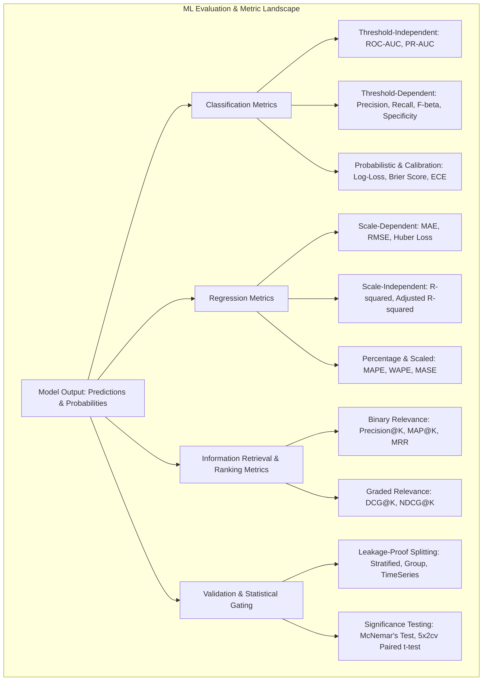

# Note 05: Evaluation and Metrics Interview Q&A

> **Topic ID:** `05-ai/machine-learning/17-interview/05-evaluation-and-metrics-qa`  
> **Target Audience:** Senior ML Engineers, Quantitative Evaluators, Technical Interviewers  
> **Prerequisites:** Note 01 (ML Fundamentals), Probability & Decision Theory  
> **Status:** Production Verified

---

## 1. Architectural Taxonomy of Machine Learning Evaluation

Model evaluation bridges statistical loss minimization and real-world business utility. Interviewers focus on metric suitability under extreme class imbalance, probability calibration, ranking metrics, decomposition formulas, and rigorous validation design that guards against data leakage.

---

## 2. In-Depth Technical Questions & Answers (25 Questions)

### Q1: What is the exact mathematical difference between ROC-AUC and PR-AUC? Why can a high ROC-AUC be completely misleading in imbalanced datasets?
**Answer:**
* **Receiver Operating Characteristic (ROC)**: Plots True Positive Rate (Recall) vs False Positive Rate (Fall-out):
  $$\text{TPR} = \frac{\text{TP}}{\text{TP} + \text{FN}} = \frac{\text{TP}}{P}, \quad \text{FPR} = \frac{\text{FP}}{\text{FP} + \text{TN}} = \frac{\text{FP}}{N}$$
  *Notice that FPR divides by total negatives $N = \text{FP} + \text{TN}$.*
* **Precision-Recall (PR) Curve**: Plots Precision vs Recall:
  $$\text{Precision} = \frac{\text{TP}}{\text{TP} + \text{FP}}, \quad \text{Recall} = \frac{\text{TP}}{\text{TP} + \text{FN}}$$
  *Notice that Precision divides by total positive predictions $\text{TP} + \text{FP}$.*
* **Why ROC-AUC is Misleading under Imbalance**:
  Consider fraud detection with $1,000,000$ negatives and $100$ positives ($10,000 : 1$ imbalance).
  Suppose a classifier produces $10,000$ False Positives and captures $90$ True Positives:
  $$\text{TPR} = \frac{90}{100} = 0.90 \quad (90\%), \quad \text{FPR} = \frac{10,000}{1,000,000} = 0.01 \quad (1.0\%)$$
  In ROC space, $(0.01, 0.90)$ looks phenomenal, and ROC-AUC will exceed $0.98$.
  However, in real business operations:
  $$\text{Precision} = \frac{90}{90 + 10,000} = \frac{90}{10,090} \approx 0.0089 \quad (0.89\%)$$
  Out of every $112$ fraud alarms raised, only $1$ is real fraud! The fraud operations team is overwhelmed by $99.1\%$ false alarms.
  * *Baseline Guesser*: ROC-AUC random baseline is always **$0.50$**; PR-AUC random baseline equals the true positive prevalence **$P / (P + N)$** (here $0.0001$). PR-AUC accurately exposes operational failure.

---

### Q2: Derive the general $F_\beta$ Score formula and explain how $\beta$ controls the trade-off between Precision and Recall.
**Answer:**
The $F_\beta$ score is defined as the weighted harmonic mean of Precision ($P$) and Recall ($R$), with weight parameter $\beta \ge 0$ indicating that Recall is considered $\beta$ times as important as Precision.
Using the weighted harmonic mean of two quantities $x, y$ with weights $w_x, w_y$:
$$H(x, y; w_x, w_y) = \frac{w_x + w_y}{\frac{w_x}{x} + \frac{w_y}{y}}$$
Let weight for Recall be $\beta^2$ and weight for Precision be $1$:
$$F_\beta = \frac{1 + \beta^2}{\frac{1}{P} + \frac{\beta^2}{R}} = \frac{1 + \beta^2}{\frac{R + \beta^2 P}{P \cdot R}} = (1 + \beta^2) \frac{P \cdot R}{\beta^2 P + R}$$
* **Role of $\beta$**:
  * $\beta = 1$ ($F_1$ Score): Standard harmonic mean; Precision and Recall are weighted equally.
  * $\beta = 2$ ($F_2$ Score): Weights Recall twice as heavily as Precision. Ideal for medical diagnosis or malware detection where missing a true positive is catastrophic.
  * $\beta = 0.5$ ($F_{0.5}$ Score): Weights Precision twice as heavily as Recall. Ideal for spam filtering or customer outreach where false alarms damage trust.

---

### Q3: What is the Brier Score? Derive its decomposition into Reliability, Resolution, and Uncertainty.
**Answer:**
The **Brier Score** measures the accuracy of probabilistic forecasts:
$$\text{BS} = \frac{1}{N} \sum_{i=1}^N (p_i - y_i)^2 \quad \text{where } y_i \in \{0, 1\}, p_i \in [0, 1]$$
Murphy (1973) proved that when predictions are binned into $K$ discrete probability categories $f_k \in (0, 1)$ with sample counts $N_k$ and empirical outcome frequencies $\bar{o}_k = \frac{1}{N_k} \sum_{i \in k} y_i$:
$$\text{BS} = \underbrace{\frac{1}{N} \sum_{k=1}^K N_k (f_k - \bar{o}_k)^2}_{\text{Reliability (Calibration Error)}} - \underbrace{\frac{1}{N} \sum_{k=1}^K N_k (\bar{o}_k - \bar{y})^2}_{\text{Resolution (Discrimination)}} + \underbrace{\bar{y}(1 - \bar{y})}_{\text{Uncertainty (Base Rate Variance)}}$$
where $\bar{y} = \frac{1}{N}\sum y_i$ is the overall base rate.
* **Reliability**: Measures calibration. Must be minimized ($\to 0$).
* **Resolution**: Measures the model's ability to separate outcomes into groups differing from the base rate. Must be maximized.
* **Uncertainty**: The inherent unpredictability of the event (maximum at $\bar{y} = 0.5$). Independent of model parameters.

---

### Q4: Formally define Expected Calibration Error (ECE) and Maximum Calibration Error (MCE).
**Answer:**
Partition the probability interval $[0, 1]$ into $M$ equally spaced bins $B_1, \dots, B_M$.
For each bin $B_m$:
* **Accuracy**: $\text{acc}(B_m) = \frac{1}{|B_m|} \sum_{i \in B_m} \mathbb{I}(\hat{y}_i = y_i)$
* **Confidence**: $\text{conf}(B_m) = \frac{1}{|B_m|} \sum_{i \in B_m} \hat{p}_i$
1. **Expected Calibration Error (ECE)**: The weighted average absolute difference between confidence and accuracy:
   $$\text{ECE} = \sum_{m=1}^M \frac{|B_m|}{N} \left| \text{acc}(B_m) - \text{conf}(B_m) \right|$$
2. **Maximum Calibration Error (MCE)**: The worst-case bin deviation:
   $$\text{MCE} = \max_{m \in \{1, \dots, M\}} \left| \text{acc}(B_m) - \text{conf}(B_m) \right|$$
   *SLA Target*: Enterprise production models require $\text{ECE} < 3.0\%$ and $\text{MCE} < 8.0\%$.

---

### Q5: What is the difference between $R^2$ and Adjusted $R^2$? Why can standard $R^2$ never decrease when adding junk features?
**Answer:**
The coefficient of determination is:
$$R^2 = 1 - \frac{\text{SS}_{\text{res}}}{\text{SS}_{\text{tot}}} = 1 - \frac{\sum_{i=1}^N (y_i - \hat{y}_i)^2}{\sum_{i=1}^N (y_i - \bar{y})^2}$$
* **Why $R^2$ Never Decreases**:
  Ordinary Least Squares solves $\min_{\mathbf{w}} \|\mathbf{y} - \mathbf{X}\mathbf{w}\|_2^2$. If a new feature column $\mathbf{x}_{\text{junk}}$ is added, the optimization space is expanded: $\mathbb{R}^d \subset \mathbb{R}^{d+1}$. The model can always set $w_{\text{junk}} = 0$ to achieve the exact same residual sum of squares $\text{SS}_{\text{res}}$. Even purely random noise features will correlate slightly with residuals by chance, strictly decreasing $\text{SS}_{\text{res}}$ and artificially inflating $R^2$.
* **Adjusted $R^2$ Correction**:
  Penalizes degrees of freedom consumed by the $p$ features:
  $$R_{\text{adj}}^2 = 1 - \left[ \frac{\text{SS}_{\text{res}} / (N - p - 1)}{\text{SS}_{\text{tot}} / (N - 1)} \right] = 1 - (1 - R^2) \frac{N - 1}{N - p - 1}$$
  If a newly added feature fails to reduce $\text{SS}_{\text{res}}$ by more than the penalty incurred by decreasing $(N - p - 1)$, $R_{\text{adj}}^2$ strictly **decreases**.

---

### Q6: What is the difference between MAPE, WAPE, and SMAPE? Why is MAPE dangerous on demand forecasting?
**Answer:**
1. **Mean Absolute Percentage Error (MAPE)**:
   $$\text{MAPE} = \frac{1}{N} \sum_{i=1}^N \frac{|y_i - \hat{y}_i|}{|y_i|} \times 100\%$$
   *Fatal Flaws*:
   * **Division by Zero**: If actual demand $y_i = 0$ (common in intermittent retail demand), MAPE divides by zero ($NaN / \infty$).
   * **Asymmetric Penalty**: If $y = 10$ and $\hat{y} = 0$, error is $100\%$. But if $y = 10$ and $\hat{y} = 30$, error is $200\%$. MAPE severely penalizes over-forecasting more than under-forecasting, biasing models toward predicting zeros.
2. **Symmetric MAPE (SMAPE)**:
   $$\text{SMAPE} = \frac{100\%}{N} \sum_{i=1}^N \frac{|y_i - \hat{y}_i|}{(|y_i| + |\hat{y}_i|) / 2}$$
   Bounds individual errors between $0\%$ and $200\%$, but creates an unstable discontinuity when both $y \to 0$ and $\hat{y} \to 0$.
3. **Weighted Absolute Percentage Error (WAPE)**:
   $$\text{WAPE} = \frac{\sum_{i=1}^N |y_i - \hat{y}_i|}{\sum_{i=1}^N |y_i|} \times 100\%$$
   *The Industry Standard*: Weights absolute errors proportional to the actual volume of the SKU, handles zeros gracefully, and aligns directly with enterprise supply chain costs.

---

### Q7: What is Mean Absolute Scaled Error (MASE), and why is it preferred for time-series forecasting benchmarks?
**Answer:**
MASE (Hyndman & Koehler, 2006) compares the forecast absolute error to the in-sample mean absolute error of a naive 1-step persistence benchmark:
$$\text{MASE} = \frac{\frac{1}{h} \sum_{t=1}^h |y_{N+t} - \hat{y}_{N+t}|}{\frac{1}{N - 1} \sum_{t=2}^N |y_t - y_{t-1}|}$$
(For seasonal series with periodicity $m$, denominator uses seasonal lag: $\frac{1}{N-m} \sum |y_t - y_{t-m}|$).
* **Interpretation**:
  * $\text{MASE} > 1.0$: The model performs **worse** than a naive persistence baseline (yesterday's sales).
  * $\text{MASE} < 1.0$: The model genuinely outperforms naive persistence.
  * $\text{MASE} = 0.50$: Model cuts naive forecast error in half.
* *Advantage*: Completely scale-independent, symmetric, well-defined for zeros, and provides immediate baseline comparison.

---

### Q8: Derive Normalized Discounted Cumulative Gain at $K$ (NDCG@K) for ranking systems.
**Answer:**
Given a list of items with graded relevance scores $r_1, \dots, r_K$ (e.g., $r_i \in \{0, 1, 2, 3\}$):
1. **Discounted Cumulative Gain (DCG@K)**:
   $$\text{DCG}@K = \sum_{i=1}^K \frac{2^{r_i} - 1}{\log_2(i + 1)}$$
   *The logarithmic denominator $\log_2(i + 1)$ imposes a steep position discount: errors at rank 1 are penalized far more heavily than errors at rank 10.*
2. **Ideal Discounted Cumulative Gain (IDCG@K)**:
   The DCG@K achieved by sorting the items in perfect descending order of true relevance $r^*$:
   $$\text{IDCG}@K = \sum_{i=1}^K \frac{2^{r_i^*} - 1}{\log_2(i + 1)}$$
3. **Normalized DCG@K (NDCG@K)**:
   $$\text{NDCG}@K = \frac{\text{DCG}@K}{\text{IDCG}@K} \in [0, 1]$$
   Ensures queries with different numbers of relevant items can be averaged meaningfully across a retrieval catalog.

---

### Q9: Compare Mean Average Precision at $K$ (MAP@K) and Mean Reciprocal Rank (MRR).
**Answer:**
* **Mean Reciprocal Rank (MRR)**:
  Evaluates the rank position of the **single first relevant item**:
  $$\text{MRR} = \frac{1}{|Q|} \sum_{q \in Q} \frac{1}{\text{rank}_q}$$
  where $\text{rank}_q$ is the position of the first clicked or relevant item.
  * *Best for*: Navigational search, voice assistants, and QA retrieval where the user only needs one definitive answer.
* **Mean Average Precision (MAP@K)**:
  Evaluates lists containing **multiple relevant items**, averaging Precision@$k$ at each cutoff where a relevant item appears:
  $$\text{AP}@K = \frac{\sum_{k=1}^K P(k) \times \text{rel}(k)}{\min(K, \text{Total Relevant Items})}, \quad \text{MAP}@K = \frac{1}{|Q|} \sum_{q \in Q} \text{AP}_q@K$$
  * *Best for*: E-commerce product searches, recommendations, and literature retrieval where users consume multiple relevant items.

---

### Q10: What is the difference between Macro, Micro, and Weighted averaging in multiclass metrics?
**Answer:**
Let metric $M_k$ (e.g., $F_1$) be calculated for each class $k \in \{1, \dots, K\}$, with sample counts $N_k$ and total $N = \sum N_k$:
1. **Macro Averaging**: Computes the arithmetic mean independently across classes:
   $$M_{\text{macro}} = \frac{1}{K} \sum_{k=1}^K M_k$$
   *Treats all classes equally*. Rare minority classes have the exact same influence as massive majority classes. Exposes poor minority performance.
2. **Micro Averaging**: Aggregates all globally pooled true positives, false positives, and false negatives first, then computes the metric:
   $$\text{Precision}_{\text{micro}} = \frac{\sum_{k=1}^K \text{TP}_k}{\sum_{k=1}^K (\text{TP}_k + \text{FP}_k)}$$
   *Treats all individual instances equally*. Dominated entirely by majority classes; mathematically equivalent to standard overall accuracy in mutually exclusive single-label setups.
3. **Weighted Averaging**: Weights each class metric by its true support frequency:
   $$M_{\text{weighted}} = \sum_{k=1}^K \frac{N_k}{N} M_k$$
   Accounts for class proportions while computing metric per class.

---

### Q11: Explain McNemar's Test for comparing two machine learning classifiers.
**Answer:**
McNemar's test compares two classifiers $A$ and $B$ evaluated on the exact same held-out test set by constructing a $2 \times 2$ contingency table of discordant mistakes:
* $n_{00}$: Both $A$ and $B$ correct.
* $n_{01}$: $A$ correct, $B$ wrong.
* $n_{10}$: $A$ wrong, $B$ correct.
* $n_{11}$: Both $A$ and $B$ wrong.

* **Null Hypothesis $H_0$**: Classifiers $A$ and $B$ have equal error rates ($P(n_{01}) = P(n_{10})$).
* **Test Statistic (with Yates' continuity correction)**:
  $$\chi^2 = \frac{(|n_{01} - n_{10}| - 1)^2}{n_{01} + n_{10}}$$
  Under $H_0$, $\chi^2$ follows a chi-squared distribution with 1 degree of freedom. If $p < 0.05$, the performance difference between model $A$ and model $B$ is statistically significant.

---

### Q12: Why is the $5 \times 2$ Cross-Validation Paired t-Test (Dietterich, 1998) superior to standard paired t-tests across 10-fold CV?
**Answer:**
In standard 10-fold CV, the 10 folds overlap heavily (each training set shares 80% of samples with every other training set). Violating the independence assumption causes the sample variance of the test statistic to be drastically underestimated, leading to high Type I error rates (falsely claiming a statistically significant difference when none exists).
* **Dietterich's $5 \times 2$ CV Solution**:
  1. Perform 5 replications of 2-fold cross-validation (50/50 splits).
  2. For replication $i$, compute error differences $p_i^{(1)} = e_A^{(1)} - e_B^{(1)}$ and $p_i^{(2)} = e_A^{(2)} - e_B^{(2)}$, and variance $s_i^2 = (p_i^{(1)} - \bar{p}_i)^2 + (p_i^{(2)} - \bar{p}_i)^2$.
  3. The statistic:
     $$t = \frac{p_1^{(1)}}{\sqrt{\frac{1}{5}\sum_{i=1}^5 s_i^2}}$$
     follows a Student's $t$-distribution with exactly 5 degrees of freedom and exhibits correct Type I error rates.

---

### Q13: What is Group Leakage, and when is `GroupKFold` required over `KFold`?
**Answer:**
* **Group Leakage**: Occurs when multiple correlated observations belong to the same underlying entity (e.g., multiple ECG recordings from the same patient, multiple voice clips from the same speaker, or multiple transactions from the same merchant).
* If standard `KFold` is used, recordings from Patient #42 will be randomly assigned to both the training set and the test set. The model memorizes patient-specific biological artifacts (e.g., baseline heart rate) rather than disease pathology, achieving $99\%$ CV accuracy but failing completely in production on new patients.
* **`GroupKFold` Resolution**: Enforces that all records belonging to a group ID (e.g., `patient_id`) reside exclusively in either the training fold or the validation fold, never split across both.

---

### Q14: How does Target Encoding cause Data Leakage during Cross-Validation if computed outside the pipeline?
**Answer:**
Target encoding maps category $c$ to $\mathbb{E}[y \mid x = c]$.
* If target encoding is applied to the full dataset before splitting:
  $$\hat{x}_i = \frac{1}{|C_c|} \sum_{j \in C_c} y_j$$
  The encoded value of sample $i$ in the validation set includes information from its own label $y_i$ as well as validation labels, leaking ground truth into feature values.
* *Fix*: Target encoding must be fit **strictly inside** cross-validation loops using training folds only (via `TargetEncoder(cv=5)` or nested pipelines), or by applying CatBoost's ordered target encoding.

---

### Q15: What is the Matthews Correlation Coefficient (MCC), and why is it considered more robust than $F_1$?
**Answer:**
The **Matthews Correlation Coefficient** is the Pearson correlation coefficient between true and predicted binary labels:
$$\text{MCC} = \frac{\text{TP} \times \text{TN} - \text{FP} \times \text{FN}}{\sqrt{(\text{TP} + \text{FP})(\text{TP} + \text{FN})(\text{TN} + \text{FP})(\text{TN} + \text{FN})}} \in [-1, +1]$$
* **Why MCC Beats $F_1$ (Chicco & Jurman, 2020)**:
  * $F_1$ completely ignores True Negatives ($\text{TN}$). If a classifier correctly flags negative instances or fails completely on negatives, $F_1$ is unchanged.
  * $F_1$ is asymmetric: swapping positive and negative class definitions yields different $F_1$ numbers.
  * MCC considers all four confusion matrix quadrants symmetrically. An MCC of $+1.0$ indicates perfect prediction, $0.0$ indicates random performance, and $-1.0$ indicates total disagreement.

---

### Q16: What is Cohen's Kappa, and how does it account for agreement occurring by chance?
**Answer:**
Cohen's Kappa ($\kappa$) evaluates inter-rater agreement or classifier performance against chance:
$$\kappa = \frac{p_o - p_e}{1 - p_e}$$
where:
* $p_o = \frac{\text{TP} + \text{TN}}{N}$ is the observed accuracy.
* $p_e$ is the expected accuracy of two independent raters matching by chance:
  $$p_e = \frac{(P_{\text{pred}} \cdot P_{\text{actual}}) + (N_{\text{pred}} \cdot N_{\text{actual}})}{N^2}$$
* *Interpretation*: If a medical test has $98\%$ accuracy simply because $98\%$ of patients are healthy ($p_o = 0.98, p_e = 0.98$), $\kappa = \frac{0.98 - 0.98}{1 - 0.98} = 0.0$ (exposing zero predictive skill).

---

### Q17: What is Log-Loss (Binary Cross-Entropy), and why does it penalize confident mistakes exponentially?
**Answer:**
$$\text{Log-Loss} = -\frac{1}{N} \sum_{i=1}^N \left[ y_i \ln p_i + (1 - y_i) \ln(1 - p_i) \right]$$
* **Exponential Penalty**:
  If true label is $y = 1$:
  * If model predicts $p = 0.99 \implies \text{Loss} = -\ln(0.99) \approx 0.01$.
  * If model predicts $p = 0.50 \implies \text{Loss} = -\ln(0.50) \approx 0.69$.
  * If model predicts $p = 0.01 \implies \text{Loss} = -\ln(0.01) \approx 4.60$.
  * If model predicts $p = 10^{-6} \implies \text{Loss} = -\ln(10^{-6}) \approx 13.82$.
  A single overconfident wrong prediction can dominate the entire test batch loss.
* *Practical Fix*: Prediction probabilities must be clipped to $[\epsilon, 1 - \epsilon]$ with $\epsilon = 10^{-15}$ to prevent `inf` or `NaN`.

---

### Q18: What is Top-$K$ Accuracy and Categorical Cross-Entropy in high-cardinality multi-class classification?
**Answer:**
* **Top-$K$ Accuracy**: An inference is marked correct if the true class label falls anywhere within the top $K$ highest predicted model probabilities:
  $$\text{Top-}K \text{ Acc} = \frac{1}{N} \sum_{i=1}^N \mathbb{I}\left( y_i \in \text{argtop}_K(\mathbf{p}_i) \right)$$
  Standard for ImageNet ($K=5$) and recommendation ranking ($K=10, 20$).
* **Categorical Cross-Entropy**:
  $$L = -\frac{1}{N} \sum_{i=1}^N \sum_{c=1}^C y_{ic} \ln p_{ic}$$
  Under one-hot encoding, only the probability assigned to the ground-truth class $c^*$ is penalized: $-\ln p_{i, c^*}$.

---

### Q19: Explain the Kolmogorov-Smirnov (KS) Statistic in credit risk modeling.
**Answer:**
The **KS Statistic** measures the maximum vertical separation between the cumulative distribution function of positive cases (defaulters) and negative cases (non-defaulters) across prediction thresholds:
$$\text{KS} = \max_t |F_{\text{defaulters}}(t) - F_{\text{non-defaulters}}(t)| \in [0, 1]$$
* In retail banking and credit scoring, $\text{KS} > 0.40$ indicates strong separation capacity. The threshold $t^*$ that achieves the maximum separation is often chosen as the primary decision boundary for credit card or loan approval.

---

### Q20: What is Population Stability Index (PSI), and what are the standard operational thresholds for model retraining?
**Answer:**
**Population Stability Index (PSI)** measures the divergence between a baseline reference distribution (training/validation population $B$) and a production inference population ($T$) partitioned into $K$ bins:
$$\text{PSI} = \sum_{k=1}^K (T_k - B_k) \times \ln\left( \frac{T_k}{B_k} \right)$$
where $T_k, B_k$ are the fraction of samples falling into bin $k$.
* **Standard Operational Governance Thresholds**:
  * $\text{PSI} < 0.10$: Minimal drift. Model is stable; no action required.
  * $0.10 \le \text{PSI} < 0.25$: Moderate drift. Alert emitted; investigate upstream feature distributions and schedule fine-tuning.
  * $\text{PSI} \ge 0.25$: Severe distribution shift. Automatic retraining triggered; switch critical traffic to fallback champion model.

---

### Q21: What is Mean Absolute Error (MAE) vs Root Mean Squared Error (RMSE) in terms of median vs mean regression?
**Answer:**
* **MAE Minimizer**: Minimizing $\mathbb{E}[|y - c|]$ yields the conditional **median**:
  $$c^* = \text{Median}(y \mid \mathbf{x})$$
  Robust to extreme outliers, but gradients are discontinuous at zero.
* **RMSE Minimizer**: Minimizing $\mathbb{E}[(y - c)^2]$ yields the conditional **mean**:
  $$c^* = \mathbb{E}[y \mid \mathbf{x}]$$
  Highly sensitive to large residuals (squaring heavily penalizes large errors). Prefer RMSE when large forecasting errors are disproportionately disastrous for the business (e.g., hospital bed capacity).

---

### Q22: What is the Area Under the Cost Curve (AUC-Cost) and Cost-Sensitive Threshold Optimization?
**Answer:**
Let $C_{\text{FP}}$ be the operational cost of a False Positive (e.g., $\$5$ to review a flagged transaction) and $C_{\text{FN}}$ be the cost of a False Negative (e.g., $\$350$ loss from undetected fraud).
The expected financial cost at threshold $\tau$ is:
$$\text{Total Cost}(\tau) = C_{\text{FP}} \cdot \text{FP}(\tau) + C_{\text{FN}} \cdot \text{FN}(\tau)$$
* **Bayes Optimal Decision Threshold**:
  The theoretical threshold $\tau^*$ that minimizes expected financial loss is:
  $$\tau^* = \frac{C_{\text{FP}}}{C_{\text{FP}} + C_{\text{FN}}}$$
  For $C_{\text{FP}} = \$5$ and $C_{\text{FN}} = \$350$:
  $$\tau^* = \frac{5}{5 + 350} = \frac{5}{355} \approx 0.0141$$
  Any sample with default probability $> 1.41\%$ must be intercepted, demonstrating that default threshold $0.50$ is financially catastrophic in asymmetric risk environments.

---

### Q23: Why does standard K-Fold cross-validation fail on Time-Series data, and how does TimeSeriesSplit resolve it?
**Answer:**
* **Temporal Leakage in K-Fold**:
  Random shuffling assigns future observations (e.g., 2026 sales) to the training set while holding out past observations (e.g., 2024 sales) for validation. The model learns from "the future" to predict "the past", generating artificially inflated accuracy that collapses completely in live forward inference.
* **`TimeSeriesSplit` (Walk-Forward / Expanding Window)**:
  Enforces strict temporal causality. In fold $k$, the training horizon spans $[0, t_k]$ and the validation horizon spans $[t_k, t_k + h]$. No future observation is ever included in training. Optionally incorporates an **embargo window** between train and validation sets to eliminate auto-regressive lag feature leakage.

---

### Q24: What is the Gini Coefficient in classification, and how does it relate to ROC-AUC?
**Answer:**
In credit scoring, the Gini coefficient measures inequality in the cumulative distribution of defaulters ranked by predicted risk:
$$\text{Gini} = 2 \times \text{ROC-AUC} - 1 \in [-1, +1]$$
* When $\text{ROC-AUC} = 0.50$ (random guesser), $\text{Gini} = 0.0$.
* When $\text{ROC-AUC} = 1.0$ (perfect separation), $\text{Gini} = 1.0$.
* Industry benchmark: credit rating models typically target $\text{Gini} \ge 0.60$ ($\text{ROC-AUC} \ge 0.80$).

---

### Q25: What is the Cumulative Gains and Lift Curve in marketing and campaign response modeling?
**Answer:**
* **Cumulative Gains Chart**: Sorts all test prospects by descending model predicted response probability along the x-axis ($0\%$ to $100\%$ of customers). The y-axis plots the percentage of total positive responders captured.
* **Lift at Decile $K$**:
  $$\text{Lift}@K = \frac{\% \text{ Responders captured in top } K\% \text{ of customers}}{K\%}$$
  * *Example*: If targeting the top $10\%$ of model-ranked customers captures $50\%$ of all positive sales responses, the Lift at Decile 1 is $\frac{50\%}{10\%} = 5.0\times$. Marketing can cut outreach costs by $90\%$ while preserving half the total conversions.
