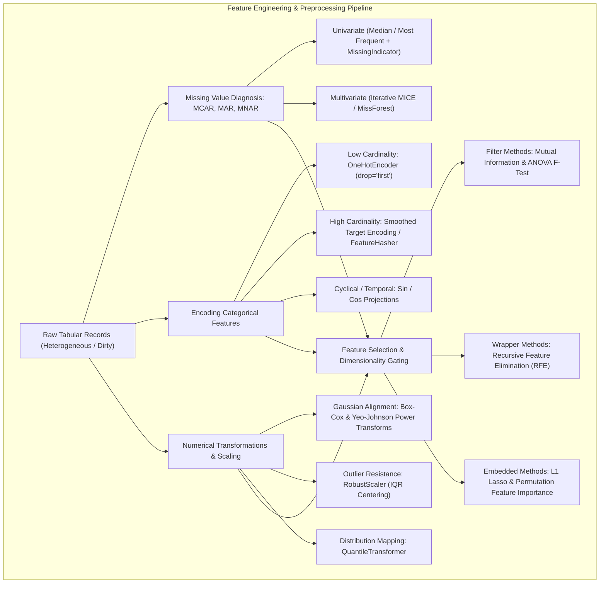

# Note 06: Feature Engineering & Preprocessing Interview Q&A

> **Topic ID:** `05-ai/machine-learning/17-interview/06-feature-engineering-and-preprocessing-qa`  
> **Target Audience:** Senior ML Engineers, Data Scientists, Technical Reviewers  
> **Prerequisites:** Note 01 (ML Fundamentals), Note 02 (Data Preprocessing Module)  
> **Status:** Production Verified

---

## 1. Architectural Overview of Feature Engineering

Feature engineering converts raw business telemetry into discriminative numerical representations aligned with model inductive biases. In senior interviews, questions explore data leakage boundaries, missingness mechanisms, mathematical properties of scalers, high-cardinality encodings, and robust selection filters.



---

## 2. In-Depth Technical Questions & Answers (20 Questions)

### Q1: What are Rubin's three missing data mechanisms: MCAR, MAR, and MNAR? What are their implications for imputation?
**Answer:**
Let $Y_{\text{obs}}$ be observed values, $Y_{\text{mis}}$ be missing values, and $M \in \{0, 1\}$ be the missingness indicator variable.
1. **Missing Completely at Random (MCAR)**:
   $$\mathbb{P}(M = 1 \mid Y_{\text{obs}}, Y_{\text{mis}}) = \mathbb{P}(M = 1)$$
   The probability of missingness is completely independent of both observed data and unobserved values (e.g., a test tube randomly dropped on the floor).
   *Implication*: Simple mean/median imputation or complete case analysis (dropping rows) produces **unbiased** parameter estimates, though sample size and statistical power are reduced.
2. **Missing at Random (MAR)**:
   $$\mathbb{P}(M = 1 \mid Y_{\text{obs}}, Y_{\text{mis}}) = \mathbb{P}(M = 1 \mid Y_{\text{obs}})$$
   The probability of missingness depends systematically on other observed variables, but not on the missing value itself (e.g., younger individuals are systematically less likely to report income, but conditional on age, missingness is random).
   *Implication*: Complete case analysis is biased. Imputation using multivariate regression models (MICE / KNNImputer) conditioned on $Y_{\text{obs}}$ restores unbiased estimates.
3. **Missing Not at Random (MNAR / Non-Ignorable)**:
   $$\mathbb{P}(M = 1 \mid Y_{\text{obs}}, Y_{\text{mis}}) \text{ depends on } Y_{\text{mis}}$$
   Missingness directly depends on the unobserved value itself (e.g., individuals with extremely high incomes refuse to disclose their salary).
   *Implication*: Standard statistical imputation algorithms are fundamentally biased. Missingness is informative and requires domain-specific joint modeling (Heckman selection model) and adding explicit `MissingIndicator` binary features.

---

### Q2: Write the mathematical formula for Smoothed Target Encoding (Micci-Barreca, 2001) and explain the role of the smoothing parameter $m$.
**Answer:**
Given a categorical feature $X$ taking category $k$ with $n_k$ observed instances and target mean $\bar{y}_k = \frac{1}{n_k} \sum_{i \in k} y_i$, and global dataset target mean $\bar{y} = \frac{1}{N} \sum_{i=1}^N y_i$:
$$\hat{S}_k = \lambda(n_k) \cdot \bar{y}_k + (1 - \lambda(n_k)) \cdot \bar{y}$$
where the smoothing weighting function is formulated as:
$$\lambda(n_k) = \frac{n_k}{n_k + m} \quad \text{or} \quad \lambda(n_k) = \frac{1}{1 + \exp\left(-\frac{n_k - k_{\text{min}}}{s}\right)}$$
Using the standard empirical Bayes formulation $\hat{S}_k = \frac{n_k \bar{y}_k + m \bar{y}}{n_k + m}$:
* **Role of Smoothing Parameter $m > 0$**:
  * When category count is large ($n_k \gg m$): $\lambda \to 1.0$, and the encoded value converges to the empirical category mean $\bar{y}_k$.
  * When category count is tiny / rare category ($n_k \to 1$ or $0$): $\lambda \to 0$, and the estimate shrinks to the global prior $\bar{y}$.
  * Prevents rare categories (e.g., a zip code observed only once with $y=1$) from being assigned extreme probabilities ($1.0$), which would cause massive overfitting.

---

### Q3: Compare StandardScaler, MinMaxScaler, RobustScaler, and QuantileTransformer. Which should be used for outlier-heavy data?
**Answer:**
| Scaler | Transformation Formula | Output Domain | Robustness to Outliers | Inductive Property |
| :--- | :---: | :---: | :---: | :--- |
| **StandardScaler** | $z = \frac{x - \mu}{\sigma}$ | $[-\infty, +\infty]$ | **Zero** (Outliers distort both $\mu$ and $\sigma$). | Centers data to $\mu=0, \sigma=1$; ideal for Gaussian features in linear models. |
| **MinMaxScaler** | $z = \frac{x - x_{\min}}{x_{\max} - x_{\min}}$ | $[0, 1]$ | **Zero** (A single massive outlier compresses all normal points into $[0, 0.01]$). | Preserves exact zero bounds; required for image pixel normalization and neural network inputs. |
| **RobustScaler** | $z = \frac{x - \text{Median}}{\text{IQR}}$ | $[-\infty, +\infty]$ | **High** (Uses 50th percentile and IQR $= Q_{75} - Q_{25}$). | **Preferred for outlier-heavy tabular data**. Preserves relative outlier distances without distorting normal cluster scales. |
| **QuantileTransformer** | $z = F_X(x) \sim \mathcal{U}[0, 1]$ or $\mathcal{N}(0, 1)$ | $[0, 1]$ or Normal | **Extreme** (Maps ranks directly to quantiles). | Non-linear monotonic rank transform. Collapses extreme outlier tails into uniform or normal distributions. |

---

### Q4: How does the Hashing Trick (FeatureHasher / CountMinSketch) handle infinite vocabulary or high-cardinality strings? What is collision probability?
**Answer:**
* **Mechanics**:
  Instead of maintaining an in-memory dictionary mapping string tokens to integer column indices (which scales with dictionary size $|V|$), the **Hashing Trick** applies a hash function $h: \mathcal{S} \to \{0, 1, \dots, B-1\}$ directly to the feature string:
  $$\mathbf{x}[h(\text{token})] += \xi(\text{token}) \cdot \text{count}$$
  where $\xi: \mathcal{S} \to \{-1, +1\}$ is an independent sign hash function that ensures zero-mean unbiased collision expectations: $\mathbb{E}[\mathbf{x}^T \mathbf{x}'] = \langle \phi(s), \phi(s') \rangle$.
* **Collision Probability (Birthday Paradox Bound)**:
  For $k$ unique distinct tokens hashed into $B$ buckets:
  $$P(\text{at least one collision}) \approx 1 - \exp\left( -\frac{k^2}{2B} \right)$$
  Setting $B = 2^{20} \approx 1,000,000$ buckets provides $< 0.1\%$ collision probability for $k = 1,000$ active features while bounding model memory strictly to an immutable array.

---

### Q5: Why is Label Encoding (Ordinal Encoding) fundamentally flawed for nominal categorical features in linear models and neural networks?
**Answer:**
* **Nominal Categories**: Categories have no intrinsic mathematical order (e.g., `["Red", "Green", "Blue"]`).
* If assigned ordinal integers: `Red -> 0`, `Green -> 1`, `Blue -> 2`.
* In a Linear Regression model: $\hat{y} = w \cdot x_{\text{color}} + b$:
  * Moving from Red to Green produces change $+w$.
  * Moving from Red to Blue produces change $+2w$.
  * The model is forced to assume that `Blue` is twice as "intense" as `Green`, and that `Green` lies halfway between `Red` and `Blue` in metric space.
* *Consequence*: Distorts optimization geometry and severely hurts linear models, SVMs, and neural networks. (Tree models can partially overcome this via recursive threshold splits, but still suffer from split inefficiencies). Nominal variables must use **One-Hot Encoding** or **Target Encoding**.

---

### Q6: How do you encode cyclical temporal features (e.g., Hour of Day, Day of Week, Month) to preserve circular continuity?
**Answer:**
* A simple integer encoding for hour $t \in [0, 23]$ creates a false artificial discontinuity: hour $23$ and hour $0$ (midnight) are adjacent in physical reality ($|\Delta t| = 1\text{ hour}$), but an integer model sees $|23 - 0| = 23$.
* **Trigonometric Coordinate Projection**:
  Map the cycle period $T$ (e.g., $T = 24$ for hours, $T = 7$ for days of week) onto a 2D unit circle:
  $$x_{\sin} = \sin\left( \frac{2 \pi t}{T} \right), \quad x_{\cos} = \cos\left( \frac{2 \pi t}{T} \right)$$
* *Properties*:
  * The Euclidean distance between $t = 23$ and $t = 0$ is:
    $$\sqrt{(\sin(23\pi/12) - \sin(0))^2 + (\cos(23\pi/12) - \cos(0))^2} = \sqrt{(-0.2588 - 0)^2 + (0.9659 - 1)^2} \approx 0.261$$
    which is identical to the distance between $t=0$ and $t=1$. Distance is preserved smoothly across the midnight boundary.

---

### Q7: What are the Box-Cox and Yeo-Johnson transformations, and what is their mathematical difference?
**Answer:**
Both are parametric power transformations that stabilize variance and transform skewed data distributions into Gaussian-like bell curves:
1. **Box-Cox Transformation (Box & Cox, 1964)**:
   $$y^{(\lambda)} = \begin{cases} \frac{y^\lambda - 1}{\lambda} & \text{if } \lambda \ne 0 \\ \ln(y) & \text{if } \lambda = 0 \end{cases}$$
   *Crucial Limitation*: **Strictly requires strictly positive values** ($y > 0$). Fails completely on zeros or negative values.
2. **Yeo-Johnson Transformation (Yeo & Johnson, 2000)**:
   Extends Box-Cox to accommodate **zeros and negative numbers**:
   $$\psi(\lambda, y) = \begin{cases} \frac{(y + 1)^\lambda - 1}{\lambda} & \text{if } \lambda \ne 0, y \ge 0 \\ \ln(y + 1) & \text{if } \lambda = 0, y \ge 0 \\ -\frac{(-y + 1)^{2 - \lambda} - 1}{2 - \lambda} & \text{if } \lambda \ne 2, y < 0 \\ -\ln(-y + 1) & \text{if } \lambda = 2, y < 0 \end{cases}$$
   Optimal $\lambda$ is estimated via profile log-likelihood maximization.

---

### Q8: What is Iterative Imputer (MICE - Multivariate Imputation by Chained Equations)?
**Answer:**
MICE models each feature with missing values as a function of all other features in a round-robin specification:
1. **Initialization**: Fill missing values across all columns with simple median imputations.
2. **For iteration $t = 1$ to $T$**:
   For each feature column $j \in \{1, \dots, d\}$ with missing values:
   a. Treat feature $X_j$ as the target variable $y$.
   b. Treat all other feature columns $X_{-j}$ as predictors.
   c. Train an estimator (e.g., Bayesian Ridge or Decision Tree) on the observed rows where $X_j$ was originally present:
      $$X_j^{\text{obs}} \sim f_j(X_{-j}^{\text{obs}}; \boldsymbol{\theta})$$
   d. Use the trained model to predict the missing entries $X_j^{\text{mis}} = \hat{f}_j(X_{-j}^{\text{mis}})$.
3. Repeat until the imputed values converge (typically $10$ iterations).
*Preserves multivariate correlation structures between features far better than univariate imputers.*

---

### Q9: What is Sublinear TF-IDF scaling, and why is it preferred in text classification?
**Answer:**
Standard Term Frequency (TF) counts raw term occurrences $tf(t, d)$.
* **Flaw of Raw TF**: A document where the word "patent" appears $20$ times is certainly more relevant to patents than a document where it appears once, but it is **not 20 times more relevant**. Relevance exhibits diminishing marginal returns.
* **Sublinear TF Scaling**:
  $$tf_{\text{sublinear}}(t, d) = \begin{cases} 1 + \ln(tf(t, d)) & \text{if } tf(t, d) > 0 \\ 0 & \text{otherwise} \end{cases}$$
  Combined with Inverse Document Frequency $idf(t) = \ln\left( \frac{1 + N}{1 + df(t)} \right) + 1$:
  $$\text{TF-IDF}_{\text{sublinear}} = (1 + \ln(tf)) \times idf(t)$$
  Dampens the dominance of extremely frequent words in long documents.

---

### Q10: How does Winsorization differ from Trimming when treating numerical outliers?
**Answer:**
Given continuous feature $X$ with empirical percentiles $P_{\alpha}$ and $P_{1-\alpha}$ (e.g., $\alpha = 0.01$, 1st and 99th percentiles):
* **Trimming (Truncation)**: Completely removes rows where $x_i < P_{\alpha}$ or $x_i > P_{1-\alpha}$.
  * *Disadvantage*: Discards legitimate customer rows and reduces training sample size $N$; creates sample selection bias.
* **Winsorization (Capping / Clamping)**: Replaces extreme values outside the thresholds with the threshold boundaries themselves:
  $$x_i^{\text{winsorized}} = \min\left( \max(x_i, P_{\alpha}), P_{1-\alpha} \right)$$
  * *Advantage*: Preserves sample size $N$ and row integrity while neutralizing the leverage of extreme anomalous outliers on OLS and neural gradients.

---

### Q11: What is Mutual Information in feature selection, and how does it detect non-linear dependencies that Pearson correlation misses?
**Answer:**
The **Mutual Information** between continuous feature $X$ and target $Y$ is defined as the KL divergence between their joint distribution and the product of their marginals:
$$I(X; Y) = \iint P(x, y) \ln \frac{P(x, y)}{P(x) P(y)} dx dy = H(Y) - H(Y \mid X)$$
* **Failure of Pearson Correlation**: Pearson correlation measures only **linear** associations ($r = \frac{\text{Cov}(X, Y)}{\sigma_X \sigma_Y}$). If $Y = X^2$ with $X \sim \mathcal{U}[-1, 1]$, the relationship is completely deterministic, but Pearson correlation is identically **$0.0$**.
* **Mutual Information Advantage**: $I(X; Y) \ge 0$, and $I(X; Y) = 0$ **if and only if** $X$ and $Y$ are strictly statistically independent. It captures polynomial, sinusoidal, step-wise, and complex multi-modal relationships without requiring linear monotonicity.

---

### Q12: Explain the mechanics of Recursive Feature Elimination (RFE). Why is it a wrapper method?
**Answer:**
* **Mechanics**:
  1. Train the estimator (e.g., SVM or Linear Regression) on all $d$ features.
  2. Extract feature importance weights $|\mathbf{w}_j|$ or tree feature importances.
  3. Prune the $k$ least important features (smallest weights).
  4. Retrain the model on the remaining $d - k$ features.
  5. Repeat steps 2–4 iteratively until the desired feature subset size is reached.
* **Why it is a Wrapper Method**:
  Unlike filter methods that evaluate features independently of any machine learning model using statistical tests (ANOVA, Chi-square), wrapper methods **wrap around** a specific model, iteratively training and evaluating the model itself to find the subset that optimizes that specific algorithm's objective.

---

### Q13: What is the Cardinality Bias in Random Forest Mean Decrease in Impurity (MDI) feature importances, and how does Permutation Importance fix it?
**Answer:**
* **MDI Cardinality Bias (Strobl et al., 2007)**:
  At each split, CART evaluates all possible threshold cutpoints. A numerical continuous feature or high-cardinality categorical feature (e.g., `user_id` with $10,000$ unique levels) offers thousands of potential split points. Pure random noise with high cardinality will accidentally provide a split that slightly reduces Gini impurity on the training fold. Consequently, MDI assigns massively inflated importance to high-cardinality noise features.
* **Permutation Feature Importance (PFI) Resolution**:
  Evaluates features on a **held-out test or validation dataset**.
  1. Record baseline test score: $s_{\text{base}} = \text{Metric}(y_{\text{test}}, f(X_{\text{test}}))$.
  2. For feature $j$, randomly shuffle its values across test rows, breaking its relationship with $y$ while preserving marginal distributions.
  3. Compute shuffled test score $s_{\text{perm}, j}$.
  4. Importance is $\Delta s = s_{\text{base}} - s_{\text{perm}, j}$.
  Random noise features will yield $\Delta s \le 0$, exposing their complete lack of predictive signal.

---

### Q14: How does Target Encoding handle unseen categories during inference?
**Answer:**
During inference on unseen test/production data, a categorical value may arrive that was never present in the training set (e.g., a newly launched merchant ID).
* If unhandled: Emits `NaN` or raises an exception.
* **Production Imputation Standard**:
  Unseen categories must default strictly to the **global training target prior**:
  $$\hat{S}_{\text{unseen}} = \bar{y}_{\text{train}} = \frac{1}{N_{\text{train}}} \sum_{i=1}^{N_{\text{train}}} y_i$$
  In scikit-learn's `TargetEncoder`, this is configured via `handle_unknown="value"` and `cv=5`.

---

### Q15: What is Weight of Evidence (WoE) and Information Value (IV) in financial scorecard engineering?
**Answer:**
For categorical bin $i$ in credit scoring with binary target ($Y=1$ Bad / Defaulter, $Y=0$ Good / Non-defaulter):
1. **Weight of Evidence (WoE)**:
   $$\text{WoE}_i = \ln\left( \frac{\% \text{ Good}_i}{\% \text{ Bad}_i} \right) = \ln\left( \frac{N_{\text{Good}, i} / N_{\text{Good, total}}}{N_{\text{Bad}, i} / N_{\text{Bad, total}}} \right)$$
   Replaces categorical levels with their log-odds ratio, transforming non-linear relationships into strictly linear log-odds for Logistic Regression.
2. **Information Value (IV)**:
   $$\text{IV} = \sum_{i=1}^B \left( \% \text{ Good}_i - \% \text{ Bad}_i \right) \times \text{WoE}_i$$
   * $\text{IV} < 0.02$: Not predictive.
   * $0.02 \le \text{IV} < 0.10$: Weak predictive power.
   * $0.10 \le \text{IV} < 0.30$: Medium predictive power.
   * $0.30 \le \text{IV} < 0.50$: Strong predictive power.
   * $\text{IV} \ge 0.50$: Suspiciously high; check for target leakage!

---

### Q16: How do you prevent Data Leakage when engineering temporal lag and rolling window features?
**Answer:**
* **The Golden Rule**: Any feature calculated for time step $t$ must depend strictly on data available at or before $t-1$.
* **Mandatory Steps**:
  1. **Shift First**: Always apply `.shift(1)` to the target or feature series before computing any rolling mean, rolling standard deviation, or min/max aggregations:
     ```python
     df["rolling_mean_7d"] = df.groupby("entity_id")["target"].shift(1).rolling(7).mean()
     ```
  2. **Never Group Globally**: Grouping across the entire dataset computes the global mean across past and future rows.
  3. **Embargo Windows**: When evaluating models via walk-forward splits, enforce an embargo period equal to the maximum lag horizon ($L = 28\text{ days}$) between the training end date and validation start date.

---

### Q17: What is Entity Embeddings for Categorical Variables (Guo & Berkhahn, 2016)?
**Answer:**
* Maps high-cardinality discrete categories $c \in \{1, \dots, K\}$ to continuous dense vectors $\mathbf{e}_c \in \mathbb{R}^d$ ($d \ll K$) via a lookup table layer in a neural network:
  $$\mathbf{e}_c = \mathbf{E} \mathbf{v}_c$$
  where $\mathbf{v}_c$ is a one-hot vector and $\mathbf{E} \in \mathbb{R}^{d \times K}$ is the embedding weight matrix.
* **Why it Outperforms One-Hot Encoding**:
  1. *Dimensionality Reduction*: Reduces dimensions from $K = 50,000$ to $d = 16$.
  2. *Semantic Proximity*: Embedding weights are trained end-to-end via gradient descent. Categories with similar behavioral patterns (e.g., two distinct postal codes with identical demographic purchasing habits) are mapped to vectors with high cosine similarity in embedding space.

---

### Q18: What is the difference between Box-Cox transformation and Log1p transformation?
**Answer:**
* **Log1p Transformation**: $f(x) = \ln(1 + x)$.
  * Fixed, non-parametric analytical function.
  * Handles $x = 0$ safely ($\ln(1 + 0) = 0$).
  * Compresses positive right-skewed tails, but cannot handle negative numbers ($x < -1$).
* **Box-Cox Transformation**: $f(x) = \frac{x^\lambda - 1}{\lambda}$.
  * Parametric transformation where $\lambda$ is continuously optimized via maximum likelihood to find the exact power that maximizes normality.
  * Far more flexible than pure log, but strictly fails on zeros ($x \le 0$).

---

### Q19: How do you select features when $d \gg N$ (e.g., Genomics with 20,000 genes and 200 patients)?
**Answer:**
1. **Screening via False Discovery Rate (FDR / Benjamini-Hochberg)**: Perform univariate hypothesis tests (two-sample t-test) on each gene, then control FDR at $q = 0.05$ to filter out spurious random noise correlations.
2. **Regularized L1 Sparse Estimation (Lasso / ElasticNet)**:
   $$\min_{\mathbf{w}} \|\mathbf{y} - \mathbf{X}\mathbf{w}\|_2^2 + \lambda \|\mathbf{w}\|_1$$
   Lasso selects at most $N$ non-zero features when $d > N$. ElasticNet overcomes this bound and selects correlated groups of genes.
3. **PCA / Supervised PCA (Bair et al., 2006)**: Filter genes that correlate with the target above a minimum threshold, then compute principal components over the screened subset.

---

### Q20: What is the Variance Threshold filter, and what is its primary pitfall?
**Answer:**
* **Mechanics**: Computes the empirical sample variance of each feature column:
  $$\text{Var}(X_j) = \frac{1}{N} \sum_{i=1}^N (x_{ij} - \bar{x}_j)^2$$
  Drops any feature with $\text{Var}(X_j) \le \tau$ (e.g., dropping boolean flags that are zero in $99.9\%$ of rows).
* **The Primary Pitfall**:
  Variance is **scale-dependent**! If Feature A is measured in meters ($\text{Var} = 0.04$) and Feature B is measured in millimeters ($\text{Var} = 40,000$), Feature A will be dropped by a fixed threshold even if Feature A contains $100\%$ of the predictive signal for the target.
  *Rule*: Numerical features must be standardized or normalized before applying variance thresholds.
