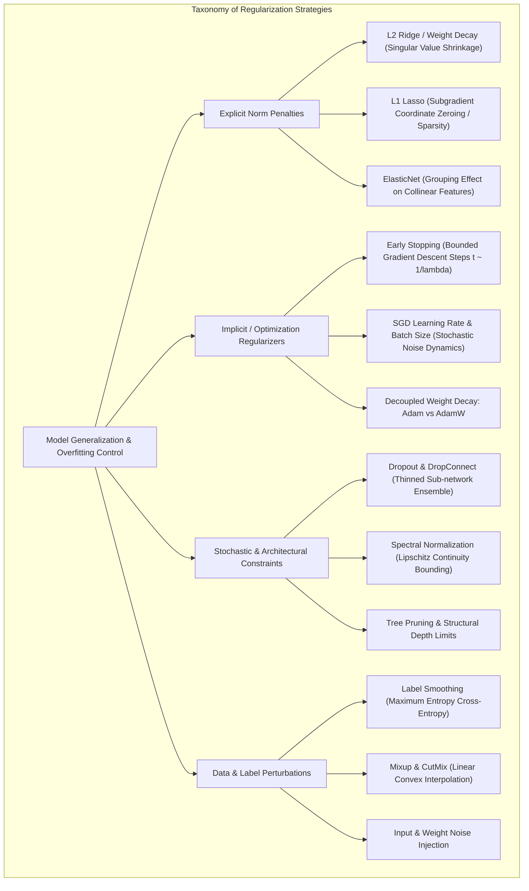

# Note 07: Overfitting & Regularization Interview Q&A

> **Topic ID:** `05-ai/machine-learning/17-interview/07-overfitting-and-regularisation-qa`  
> **Target Audience:** Senior ML Engineers, Staff AI Architects, Technical Reviewers  
> **Prerequisites:** Note 01 (ML Fundamentals), Note 09 (Training & Optimization)  
> **Status:** Production Verified

---

## 1. Architectural Taxonomy of Regularization

Regularization restricts the effective capacity of hypothesis spaces to prevent empirical risk minimization from fitting idiosyncratic sample noise. Senior interviews explore explicit norm penalties, implicit optimization dynamics, stochastic perturbations, and data-level regularizers.

---

## 2. In-Depth Technical Questions & Answers (20 Questions)

### Q1: Prove that Ridge Regression shrinks predictions along the principal components of $\mathbf{X}$ by a factor of $\frac{\sigma_i^2}{\sigma_i^2 + \lambda}$.
**Answer:**
Let $\mathbf{X} \in \mathbb{R}^{N \times d}$ have Singular Value Decomposition (SVD):
$$\mathbf{X} = \mathbf{U} \mathbf{\Sigma} \mathbf{V}^T$$
where $\mathbf{\Sigma} = \text{diag}(\sigma_1, \dots, \sigma_d)$ contains singular values.
1. **Unregularized OLS Solution**:
   $$\hat{\mathbf{w}}_{\text{OLS}} = (\mathbf{X}^T \mathbf{X})^{-1} \mathbf{X}^T \mathbf{y} = (\mathbf{V} \mathbf{\Sigma}^2 \mathbf{V}^T)^{-1} \mathbf{V} \mathbf{\Sigma} \mathbf{U}^T \mathbf{y} = \mathbf{V} \mathbf{\Sigma}^{-1} \mathbf{U}^T \mathbf{y}$$
   The OLS predictions are:
   $$\hat{\mathbf{y}}_{\text{OLS}} = \mathbf{X} \hat{\mathbf{w}}_{\text{OLS}} = (\mathbf{U} \mathbf{\Sigma} \mathbf{V}^T)(\mathbf{V} \mathbf{\Sigma}^{-1} \mathbf{U}^T \mathbf{y}) = \mathbf{U} \mathbf{U}^T \mathbf{y} = \sum_{i=1}^d \mathbf{u}_i (\mathbf{u}_i^T \mathbf{y})$$
2. **Ridge Regression Solution**:
   $$\hat{\mathbf{w}}_{\text{Ridge}} = (\mathbf{X}^T \mathbf{X} + \lambda \mathbf{I})^{-1} \mathbf{X}^T \mathbf{y} = (\mathbf{V} (\mathbf{\Sigma}^2 + \lambda \mathbf{I}) \mathbf{V}^T)^{-1} \mathbf{V} \mathbf{\Sigma} \mathbf{U}^T \mathbf{y} = \mathbf{V} (\mathbf{\Sigma}^2 + \lambda \mathbf{I})^{-1} \mathbf{\Sigma} \mathbf{U}^T \mathbf{y}$$
   The Ridge predictions are:
   $$\hat{\mathbf{y}}_{\text{Ridge}} = \mathbf{X} \hat{\mathbf{w}}_{\text{Ridge}} = (\mathbf{U} \mathbf{\Sigma} \mathbf{V}^T) \mathbf{V} (\mathbf{\Sigma}^2 + \lambda \mathbf{I})^{-1} \mathbf{\Sigma} \mathbf{U}^T \mathbf{y} = \mathbf{U} \left[ \mathbf{\Sigma}^2 (\mathbf{\Sigma}^2 + \lambda \mathbf{I})^{-1} \right] \mathbf{U}^T \mathbf{y}$$
   Writing this out as a sum of projection coordinates:
   $$\hat{\mathbf{y}}_{\text{Ridge}} = \sum_{i=1}^d \mathbf{u}_i \left( \frac{\sigma_i^2}{\sigma_i^2 + \lambda} \right) (\mathbf{u}_i^T \mathbf{y})$$
* **Interpretation**:
  * Directions with large singular values ($\sigma_i^2 \gg \lambda$) have $\frac{\sigma_i^2}{\sigma_i^2 + \lambda} \approx 1$ and are preserved almost unpenalized.
  * Directions with tiny singular values ($\sigma_i^2 \ll \lambda$, directions of low variance / collinear noise) have $\frac{\sigma_i^2}{\sigma_i^2 + \lambda} \to 0$ and are shrunk heavily toward zero!

---

### Q2: Derive the Soft-Thresholding Operator for L1 Lasso in Coordinate Descent.
**Answer:**
Consider unconstrained coordinate descent for Lasso objective with orthonormal design matrix $\mathbf{X}^T \mathbf{X} = \mathbf{I}$:
$$J(w_j) = \frac{1}{2} (w_j - \hat{w}_j^{\text{OLS}})^2 + \lambda |w_j|$$
We compute the subdifferential with respect to $w_j$:
$$\partial J(w_j) = (w_j - \hat{w}_j^{\text{OLS}}) + \lambda \partial |w_j| = (w_j - \hat{w}_j^{\text{OLS}}) + \lambda \begin{cases} \{+1\} & \text{if } w_j > 0 \\ [-1, 1] & \text{if } w_j = 0 \\ \{-1\} & \text{if } w_j < 0 \end{cases}$$
Setting $0 \in \partial J(w_j)$ and analyzing the three cases:
1. If $\hat{w}_j^{\text{OLS}} > \lambda$: $w_j - \hat{w}_j^{\text{OLS}} + \lambda = 0 \implies \hat{w}_j = \hat{w}_j^{\text{OLS}} - \lambda$.
2. If $\hat{w}_j^{\text{OLS}} < -\lambda$: $w_j - \hat{w}_j^{\text{OLS}} - \lambda = 0 \implies \hat{w}_j = \hat{w}_j^{\text{OLS}} + \lambda$.
3. If $|\hat{w}_j^{\text{OLS}}| \le \lambda$: $0 - \hat{w}_j^{\text{OLS}} + \lambda v = 0$ is satisfied by some $v \in [-1, 1] \implies \hat{w}_j = 0$.
Combining these into the **Soft-Thresholding Operator** $\mathcal{S}_\lambda(z)$:
$$\hat{w}_j = \mathcal{S}_\lambda(\hat{w}_j^{\text{OLS}}) = \text{sign}(\hat{w}_j^{\text{OLS}}) \cdot \max(0, |\hat{w}_j^{\text{OLS}}| - \lambda)$$
*This proves why any feature whose unregularized coefficient is smaller than threshold $\lambda$ is set identically to zero ($w_j \equiv 0$).*

---

### Q3: Explain why Early Stopping acts as implicit L2 (Ridge) Regularization in gradient descent.
**Answer:**
Consider quadratic loss $J(\mathbf{w}) = \frac{1}{2} \mathbf{w}^T \mathbf{H} \mathbf{w} - \mathbf{b}^T \mathbf{w}$ with Hessian $\mathbf{H} = \mathbf{Q} \mathbf{\Lambda} \mathbf{Q}^T$ and initial weights $\mathbf{w}_0 = \mathbf{0}$.
Gradient descent with learning rate $\eta$:
$$\mathbf{w}_{t} = \mathbf{w}_{t-1} - \eta (\mathbf{H} \mathbf{w}_{t-1} - \mathbf{b})$$
Subtracting the true unconstrained optimum $\mathbf{w}^* = \mathbf{H}^{-1} \mathbf{b}$:
$$\mathbf{w}_t - \mathbf{w}^* = (\mathbf{I} - \eta \mathbf{H})(\mathbf{w}_{t-1} - \mathbf{w}^*) = (\mathbf{I} - \eta \mathbf{H})^t (\mathbf{w}_0 - \mathbf{w}^*)$$
Since $\mathbf{w}_0 = \mathbf{0}$:
$$\mathbf{w}_t = \left[ \mathbf{I} - (\mathbf{I} - \eta \mathbf{H})^t \right] \mathbf{w}^* = \mathbf{Q} \left[ \mathbf{I} - (\mathbf{I} - \eta \mathbf{\Lambda})^t \right] \mathbf{Q}^T \mathbf{w}^*$$
Along principal component $i$ with eigenvalue $\lambda_i$:
$$w_{t, i} = \left[ 1 - (1 - \eta \lambda_i)^t \right] w_i^*$$
Now compare this to the Ridge Regression shrinkage factor:
$$w_{\text{Ridge}, i} = \left( \frac{\lambda_i}{\lambda_i + \lambda} \right) w_i^* = \left( 1 - \frac{\lambda}{\lambda_i + \lambda} \right) w_i^*$$
Using the approximation $(1 - \eta \lambda_i)^t \approx \exp(-t \eta \lambda_i)$ and matching terms:
$$\exp(-t \eta \lambda_i) \approx \frac{\lambda}{\lambda_i + \lambda} \approx \frac{1}{1 + \frac{\lambda_i}{\lambda}} \approx \exp\left( -\frac{\lambda_i}{\lambda} \right)$$
Equating exponents:
$$t \eta \approx \frac{1}{\lambda} \implies \lambda \approx \frac{1}{\eta \cdot t}$$
* **Mathematical Equivalence**: Stopping gradient descent early at iteration $t$ with step size $\eta$ is mathematically equivalent to solving Ridge regression with penalty $\lambda \approx \frac{1}{\eta t}$. The number of training epochs $t$ acts as an inverse regularization parameter.

---

### Q4: Explain Dropout (Srivastava et al., 2014) as an ensemble of $2^B$ sub-networks. What is Inverted Dropout?
**Answer:**
* **Ensemble Formulation**:
  In a network with $B$ hidden units, Dropout independently masks each node with probability $p \in [0, 1]$ during each forward pass:
  $$\tilde{\mathbf{h}} = \mathbf{r} \odot \mathbf{h} \quad \text{where } r_j \sim \text{Bernoulli}(1 - p)$$
  Because every training step randomly disables a different subset of neurons, a network with $B$ units corresponds to an ensemble of $2^B$ distinct thinned sub-networks that share weight parameters. Weight sharing acts as an extreme form of model bagging, preventing co-adaptation of features.
* **Inverted Dropout**:
  * *Standard Dropout*: Scales outputs during inference by multiplying weights by $(1 - p)$ to match expectations: $\mathbb{E}[\tilde{h}] = (1 - p) h$.
  * *Inverted Dropout (Modern Standard)*: Scales activations **during training** by dividing by $(1 - p)$:
    $$\tilde{\mathbf{h}}_{\text{train}} = \frac{\mathbf{r} \odot \mathbf{h}}{1 - p}$$
    *Advantage*: The inference forward pass requires **zero modification or scaling** ($\tilde{\mathbf{h}}_{\text{test}} = \mathbf{h}$), eliminating runtime latency overhead during production serving.

---

### Q5: What is Monte Carlo Dropout (Gal & Ghahramani, 2016), and how does it estimate epistemic uncertainty without retraining?
**Answer:**
* **Epistemic Uncertainty**: Model uncertainty caused by a lack of training data in certain regions of the feature space.
* **MC Dropout Procedure**:
  Standard deep learning disables dropout at inference time (`model.eval()`).
  Gal & Ghahramani proved that keeping Dropout active at test time is mathematically equivalent to approximate Bayesian inference over a deep Gaussian Process.
  1. Leave `model.train()` or dropout enabled at test time.
  2. Perform $T$ forward passes (e.g., $T = 50$) on the same test sample $\mathbf{x}^*$, generating stochastic predictions $\hat{y}_1, \dots, \hat{y}_T$.
  3. Compute:
     * **Predictive Mean**: $\bar{y} = \frac{1}{T} \sum_{t=1}^T \hat{y}_t$
     * **Epistemic Uncertainty (Variance)**: $\hat{\sigma}^2 = \frac{1}{T} \sum_{t=1}^T (\hat{y}_t - \bar{y})^2$
* *Application*: If $\hat{\sigma}^2 > \tau$, the model flags itself as uncertain and routes the sample to human review (autonomous driving braking, medical diagnosis).

---

### Q6: What is the difference between L2 Regularization and Weight Decay in Adam? Why did Loshchilov & Hutter (2017) invent AdamW?
**Answer:**
* **In SGD**: L2 regularization ($\min L(\mathbf{w}) + \frac{1}{2} \lambda \|\mathbf{w}\|_2^2$) is mathematically identical to weight decay ($\mathbf{w}_{t+1} = (1 - \eta \lambda) \mathbf{w}_t - \eta \nabla L$).
* **In Adam**:
  Under L2 regularization, the penalty gradient $\lambda \mathbf{w}$ is added directly to the loss gradient:
  $$\mathbf{g}_t = \nabla L(\mathbf{w}_t) + \lambda \mathbf{w}_t$$
  Adam computes moving averages of gradients $\mathbf{m}_t$ and squared gradients $\mathbf{v}_t$:
  $$\mathbf{v}_t = \beta_2 \mathbf{v}_{t-1} + (1 - \beta_2) (\nabla L + \lambda \mathbf{w}_t)^2$$
  The parameter update step is:
  $$\mathbf{w}_{t+1} = \mathbf{w}_t - \frac{\eta}{\sqrt{\mathbf{v}_t} + \epsilon} \mathbf{m}_t$$
  *The Flaw*: When a weight has a large magnitude, $\mathbf{v}_t$ becomes large, which **divides and shrinks the penalty** $\frac{\lambda \mathbf{w}}{\sqrt{\mathbf{v}_t}}$. Weights with large gradients receive less regularization, while weights with infrequent gradients receive excessive decay!
* **AdamW Solution (Decoupled Weight Decay)**:
  Decouples weight decay from gradient moment accumulation:
  $$\mathbf{w}_{t+1} = (1 - \eta \lambda) \mathbf{w}_t - \frac{\eta}{\sqrt{\mathbf{v}_t} + \epsilon} \mathbf{m}_t$$
  where $\mathbf{m}_t$ and $\mathbf{v}_t$ are computed strictly on raw loss gradients $\nabla L$. This restores true scale-invariant regularization.

---

### Q7: What is Label Smoothing, and how does it prevent the Softmax output head from becoming overconfident?
**Answer:**
In standard classification, ground truth targets are one-hot encoded: $y_k = 1$ for true class, $y_j = 0$ for $j \ne k$.
* To output probability $p_k = 1.0$, the Softmax head requires logit $z_k - z_j \to +\infty$. The network drives weight norms $\|\mathbf{W}\| \to \infty$, leading to extreme overconfidence and poor calibration.
* **Label Smoothing (Szegedy et al., 2016)**:
  Replaces hard binary targets with a mixture of the true label and a uniform distribution over $K$ classes with smoothing factor $\alpha \in [0, 1]$ (typically $\alpha = 0.1$):
  $$y_k^{\text{smooth}} = (1 - \alpha) y_k + \frac{\alpha}{K} = \begin{cases} 1 - \alpha + \frac{\alpha}{K} & \text{if } k = \text{true class} \\ \frac{\alpha}{K} & \text{if } k \ne \text{true class} \end{cases}$$
* *Result*: Finite target logits are sufficient to minimize cross-entropy loss, bounding weight norms, encouraging clustering of representations, and drastically improving probability calibration.

---

### Q8: What is Mixup Data Augmentation (Zhang et al., 2017), and what inductive bias does it impose?
**Answer:**
Mixup trains models on convex linear combinations of pairs of training examples and their labels:
$$\tilde{\mathbf{x}} = \lambda \mathbf{x}_i + (1 - \lambda) \mathbf{x}_j, \quad \tilde{y} = \lambda y_i + (1 - \lambda) y_j$$
where $\lambda \sim \text{Beta}(\alpha, \alpha)$ with $\alpha \in [0.1, 0.4]$.
* **Inductive Bias**:
  Standard Empirical Risk Minimization penalizes mistakes only at discrete observed data points $\mathbf{x}_i$, allowing models to exhibit wild, non-linear oscillations in the empty space between samples. Mixup enforces **linear behavior between training samples**, regularizing the model to predict that the output changes smoothly and linearly along the interpolating vectors.

---

### Q9: What is Spectral Normalization (Miyato et al., 2018), and why does it enforce a 1-Lipschitz bound?
**Answer:**
A neural network layer $f(\mathbf{x}) = \sigma(\mathbf{W}\mathbf{x})$ is 1-Lipschitz continuous ($\|f(\mathbf{x}) - f(\mathbf{y})\| \le \|\mathbf{x} - \mathbf{y}\|$) if the spectral norm (maximum singular value) of its weight matrix is bounded by 1:
$$\|\mathbf{W}\|_2 = \sigma_{\max}(\mathbf{W}) = \max_{\mathbf{h} \ne \mathbf{0}} \frac{\|\mathbf{W}\mathbf{h}\|_2}{\|\mathbf{h}\|_2} \le 1$$
* **Spectral Normalization Formulation**:
  Normalizes the weight matrix by its largest singular value computed efficiently via Power Iteration:
  $$\mathbf{W}_{\text{SN}} = \frac{\mathbf{W}}{\sigma_{\max}(\mathbf{W})}$$
* *Significance*: By the composition rule of Lipschitz functions, a multi-layer network composed of 1-Lipschitz activations (ReLU, GELU) and spectrally normalized weights has a global Lipschitz constant $\le 1$. Gradients are mathematically prevented from exploding, stabilizing GAN discriminators and deep RL critics.

---

### Q10: How does Batch Normalization act as an implicit regularizer? Why does it often eliminate the need for Dropout?
**Answer:**
Batch Normalization computes mean and variance over a mini-batch $\mathcal{B}$ of size $B$:
$$\hat{x}_i = \frac{x_i - \mu_{\mathcal{B}}}{\sqrt{\sigma_{\mathcal{B}}^2 + \epsilon}}$$
* **Stochastic Regularization Mechanism**:
  Because $\mu_{\mathcal{B}}$ and $\sigma_{\mathcal{B}}^2$ are computed over a randomly sampled mini-batch, they are noisy estimators of the true global population statistics. Evaluating sample $x_i$ inside different mini-batches produces slightly different normalized activations:
  $$x_i \to x_i + \text{stochastic noise}$$
  This stochastic noise acts similarly to additive Gaussian noise injection or Dropout, regularizing the network. In practice, models with BatchNorm often train successfully with zero Dropout.

---

### Q11: What is CutMix (Yun et al., 2019) vs Cutout?
**Answer:**
* **Cutout (DeVries & Taylor, 2017)**: Randomly masks out a square region of an input image with zeros.
  * *Disadvantage*: Drops informative pixels, reducing data efficiency.
* **CutMix**: Cuts a rectangular patch from image $B$ and pastes it directly over image $A$. The target label is linearly weighted proportional to the pixel area of the patch:
  $$\tilde{\mathbf{x}} = \mathbf{M} \odot \mathbf{x}_A + (\mathbf{1} - \mathbf{M}) \odot \mathbf{x}_B$$
  $$\tilde{y} = \lambda y_A + (1 - \lambda) y_B$$
  where $\lambda = 1 - \frac{W_{\text{box}} H_{\text{box}}}{W H}$.
  * *Advantage*: Preserves 100% of image pixel real estate while forcing the model to recognize objects from localized partial views.

---

### Q12: How does Tree Pruning differ between Pre-Pruning (Early Stopping) and Post-Pruning (Cost-Complexity)?
**Answer:**
* **Pre-Pruning (Heuristic Constraints)**:
  Halts tree growth during construction if specific stopping criteria are met: `max_depth`, `min_samples_split`, `min_samples_leaf`, or `max_leaf_nodes`.
  * *Disadvantage (Horizon Effect)*: A split that yields negligible immediate impurity reduction might unlock a magnificent, highly discriminative split at the next level (e.g., XOR patterns). Pre-pruning terminates prematurely before discovering the interaction.
* **Post-Pruning (Minimal Cost-Complexity)**:
  Grows the tree to full unconstrained depth ($T_{\max}$), allowing complex multi-feature interactions to emerge. Then prunes nodes backward by minimizing:
  $$R_\alpha(T) = R(T) + \alpha |T|$$
  using cross-validation to select the optimal capacity parameter $\alpha$. Statistically superior, though computationally more demanding.

---

### Q13: What is Stochastic Depth (DropPath / Huang et al., 2016)?
**Answer:**
In ultra-deep residual networks (e.g., 1000-layer ResNets or Vision Transformers), Stochastic Depth randomly drops entire residual blocks during training:
$$\mathbf{x}_{l} = \mathbf{x}_{l-1} + b_l \cdot F(\mathbf{x}_{l-1})$$
where $b_l \sim \text{Bernoulli}(p_l)$ is a random binary scalar with survival probability $p_l$ linearly decreasing from $1.0$ at the first layer to $0.5$ at the final layer.
* *Effect*: Shortens the effective gradient backpropagation path during training while training an implicit ensemble of networks of diverse depths. At test time, all blocks are active with outputs scaled by $p_l$.

---

### Q14: What is Noise Injection in machine learning, and where can noise be injected?
**Answer:**
Noise can be injected at four architectural points:
1. **Inputs ($\mathbf{x} + \boldsymbol{\epsilon}$)**: Equivalent to Tikhonov regularization; penalizes the Frobenius norm of the Jacobian $\mathbb{E}[\|\nabla_{\mathbf{x}} f(\mathbf{x})\|_F^2]$, forcing model outputs to be locally flat around data points.
2. **Hidden Activations**: Similar to Dropout; forces neurons to be robust to perturbed activations.
3. **Weights ($\mathbf{W} + \boldsymbol{\epsilon}$)**: Forces the optimizer toward flat, wide local minima rather than sharp, narrow ravines (Hochreiter & Schmidhuber, 1997).
4. **Outputs / Labels**: Flipping labels with probability $\eta$; acts as label smoothing and prevents the model from fitting ambiguous boundary examples with infinite confidence.

---

### Q15: What is the Flat Minima vs Sharp Minima hypothesis (Keskar et al., ICLR 2017)?
**Answer:**
* **Sharp Minima**: A local minimum where the loss surface curves steeply in many directions (large Hessian eigenvalues $\lambda_{\max}(\nabla^2 L) \gg 0$).
  * *Overfitting Risk*: A tiny distribution shift between training set $\mathcal{D}_{\text{train}}$ and test set $\mathcal{D}_{\text{test}}$ shifts the loss surface slightly. In a sharp ravine, moving a distance $\Delta \mathbf{w}$ causes the test loss to explode violently.
* **Flat Minima**: A minimum where the loss surface is broad and shallow ($\lambda_{\max}(\nabla^2 L) \approx 0$).
  * *Generalization*: Small perturbations or distribution shifts produce negligible changes in test loss.
  * Small-batch SGD ($B \le 256$) injects gradient noise that knocks the optimizer out of sharp minima into flat minima.

---

### Q16: How does Gradient Penalization (e.g., WGAN-GP) regularize models?
**Answer:**
Gulrajani et al. (2017) enforce a 1-Lipschitz constraint by penalizing the deviation of the gradient norm of the critic $D(\mathbf{x})$ from 1 along linear interpolations $\hat{\mathbf{x}} = \epsilon \mathbf{x}_{\text{real}} + (1-\epsilon) \mathbf{x}_{\text{fake}}$:
$$\mathcal{L}_{\text{GP}} = \mathbb{E}_{\hat{\mathbf{x}}}\left[ \left( \|\nabla_{\hat{\mathbf{x}}} D(\hat{\mathbf{x}})\|_2 - 1 \right)^2 \right]$$
* *Mechanism*: Directly restricts the slope of the neural function, preventing the discriminator from saturating or producing vanishing gradients for the generator.

---

### Q17: What is Sharpness-Aware Minimization (SAM - Foret et al., ICLR 2021)?
**Answer:**
Standard gradient descent minimizes empirical loss $L_S(\mathbf{w})$. SAM minimizes both the empirical loss and the loss sharpness simultaneously:
$$\min_{\mathbf{w}} \left[ \max_{\|\boldsymbol{\epsilon}\|_2 \le \rho} L_S(\mathbf{w} + \boldsymbol{\epsilon}) \right] + \lambda \|\mathbf{w}\|_2^2$$
* **Algorithm**:
  1. Find worst-case local adversarial perturbation:
     $$\boldsymbol{\epsilon}^*(\mathbf{w}) \approx \rho \frac{\nabla_\mathbf{w} L_S(\mathbf{w})}{\|\nabla_\mathbf{w} L_S(\mathbf{w})\|_2}$$
  2. Compute gradient at the perturbed point $\mathbf{w} + \boldsymbol{\epsilon}^*$:
     $$\mathbf{g} = \nabla_\mathbf{w} L_S(\mathbf{w} + \boldsymbol{\epsilon}^*)$$
  3. Update parameters: $\mathbf{w} \leftarrow \mathbf{w} - \eta \mathbf{g}$.
* *Result*: Seeks parameter regions that have uniformly low loss within a ball of radius $\rho$, guaranteeing convergence to robust flat minima.

---

### Q18: What is DropConnect (Wan et al., 2013) vs Dropout?
**Answer:**
* **Dropout**: Sets a randomly chosen subset of **activation units** to zero: $\mathbf{a} = \sigma(\mathbf{W}\mathbf{x}) \odot \mathbf{r}$.
* **DropConnect**: Sets a randomly chosen subset of individual **weights** in the weight matrix to zero:
  $$\mathbf{a} = \sigma\left( (\mathbf{W} \odot \mathbf{M}) \mathbf{x} \right) \quad \text{where } M_{ij} \sim \text{Bernoulli}(1 - p)$$
  * DropConnect generalizes Dropout: each input connection can be dropped independently, introducing greater structural randomization at the cost of requiring custom sparse GEMM kernels.

---

### Q19: What is Flooding (Ishida et al., ICML 2020), and how does it prevent zero training loss?
**Answer:**
When training modern deep networks, training loss typically drives all the way to zero ($L \to 0$), leading to overfitting.
* **Flooding Objective**:
  $$\tilde{J}(\mathbf{w}) = |J(\mathbf{w}) - b| + b$$
  where $b > 0$ is a flooding level (e.g., $b = 0.05$).
* **Optimization Dynamics**:
  * If $J(\mathbf{w}) > b$: The gradient is $\nabla J(\mathbf{w})$ (standard gradient descent).
  * If $J(\mathbf{w}) < b$: The gradient becomes $-\nabla J(\mathbf{w})$ (**gradient ascent**!).
  The optimizer bounces around the flooding boundary $J \approx b$, preventing the network from zeroing out training error and keeping weights regularized.

---

### Q20: What is the difference between Structural Risk Minimization and Empirical Risk Minimization regarding capacity control?
**Answer:**
* **Empirical Risk Minimization (ERM)**: Only minimizes training error $\frac{1}{N} \sum L_i$. It treats all models in hypothesis class $\mathcal{H}$ identically and has no capacity control mechanism, inevitably choosing the most complex model that memorizes data.
* **Structural Risk Minimization (SRM)**: Formulates an upper bound on generalization risk:
  $$\text{Risk}_{\text{true}}(h) \le \text{Risk}_{\text{emp}}(h) + \mathcal{O}\left( \sqrt{\frac{d_{\text{VC}}}{N}} \right)$$
  It penalizes the hypothesis class capacity directly. L1/L2 regularization, minimum description length (MDL), and cost-complexity pruning are practical implementations of SRM that optimize the trade-off between empirical fit and capacity penalty.
