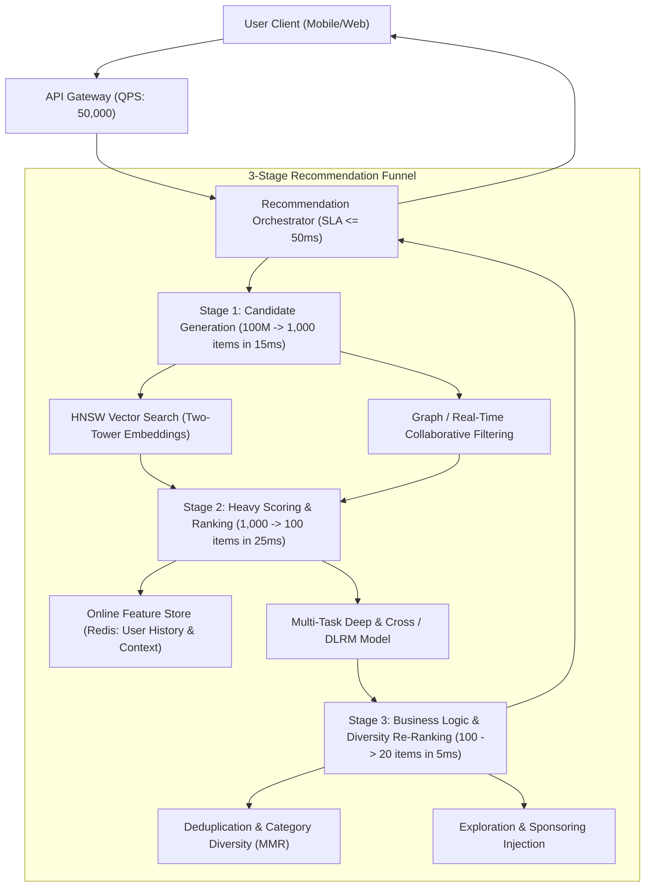
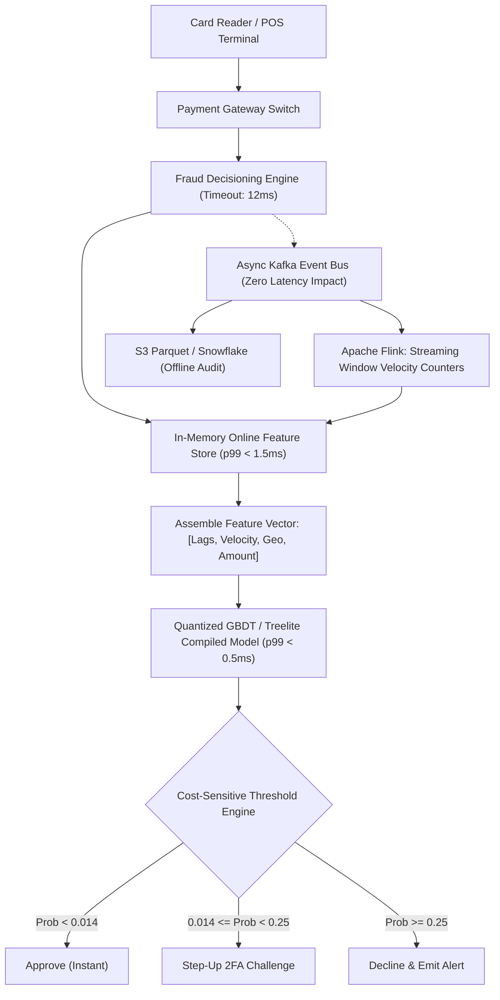
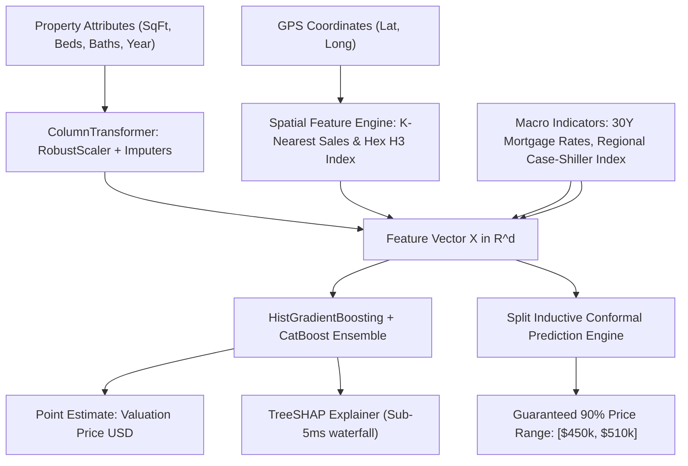
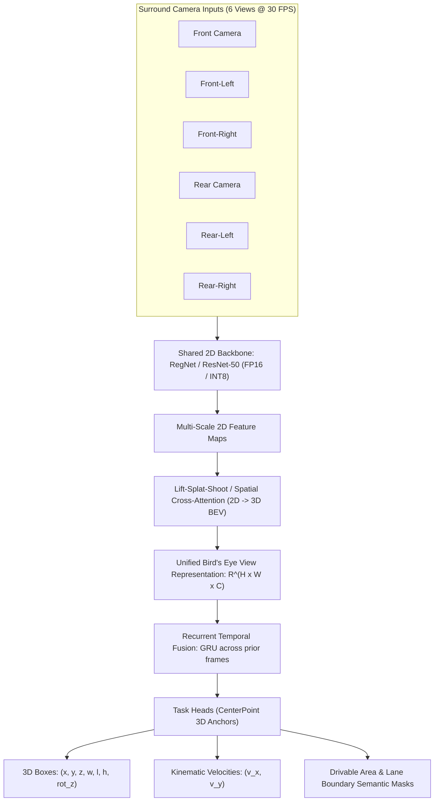

# Note 10: Machine Learning System Design Case Studies

> **Topic ID:** `05-ai/machine-learning/17-interview/10-ml-system-design-case-studies`  
> **Target Audience:** Staff ML Engineers, Principal Architects, Technical Directors  
> **Prerequisites:** Note 01–15, Distributed Systems, High-Throughput Serving  
> **Status:** Production Verified

---

## 1. The Senior ML System Design Framework

In Staff and Principal ML System Design interviews (Meta, Google, Netflix, Uber), candidates are evaluated on their ability to architect scalable, resilient, end-to-end production systems under strict real-world constraints. Every system design interview follows a 6-step architectural framework:
1. **Scope & Clarify Requirements**: Functional goals, non-functional SLAs (latency, QPS, availability, freshness).
2. **High-Level System Topology**: End-to-end data pipelines, offline training, and online serving microservices.
3. **Data Engineering & Feature Pipelines**: Stream vs batch ingestion, dual feature stores, point-in-time correctness.
4. **Model Architecture & Inductive Biases**: Multi-stage funnel (candidate generation, ranking, re-ranking).
5. **Serving & Low-Latency Optimization**: Caching, vector search indexes, tensor quantization, fallback runbooks.
6. **Telemetry, Drift & Continuous Retraining**: Online experimentation, drift metrics, and champion-challenger gating.

---

## 2. Five Comprehensive Production Case Studies

### Case Study 1: Large-Scale Personalized Recommendation Engine (E-Commerce / Streaming)

#### 1. Requirements & Constraints
* **Functional Requirements**: Recommend a personalized list of 20 relevant items from a catalog of $100,000,000$ products on user home feed load.
* **Non-Functional Requirements**:
  * *Scale*: 200,000,000 Daily Active Users (DAU); Peak traffic: $50,000\text{ queries/second (QPS)}$.
  * *Latency SLA*: p99 response time $\le 50\text{ ms}$.
  * *Freshness*: Incorporate real-time in-session clicks within $\le 2\text{ seconds}$.

#### 2. End-to-End System Architecture

#### 3. Algorithmic Formulation & Serving Details
* **Candidate Generation (Two-Tower DNN)**:
  * User Tower outputs $\mathbf{u}(x_{\text{user}}) \in \mathbb{R}^{64}$; Item Tower outputs $\mathbf{v}(x_{\text{item}}) \in \mathbb{R}^{64}$.
  * Trained via sampled Softmax loss. Item embeddings are pre-computed offline and indexed in an Approximate Nearest Neighbor (ANN) index using Hierarchical Navigable Small World (**HNSW**).
  * Fast query: compute user vector online, query HNSW in $4\text{ms}$ to retrieve top 1,000 items.
* **Heavy Ranking (DLRM / Deep & Cross Network)**:
  * Predicts multiple objectives: $P(\text{Click})$ and $P(\text{Purchase} \mid \text{Click})$.
  * Utility function: $\text{Score} = P(\text{Click}) \times P(\text{Purchase} \mid \text{Click})^\alpha \times \text{Price}$.
* **Re-Ranking for Diversity**:
  * Uses Maximal Marginal Relevance (**MMR**) to prevent showing 20 items from the same category:
    $$\text{MMR} = \arg\max_{d_i \in R \setminus S} \left[ \lambda \text{Sim}_1(d_i, q) - (1 - \lambda) \max_{d_j \in S} \text{Sim}_2(d_i, d_j) \right]$$

---

### Case Study 2: Ultra Low-Latency Financial Fraud Detection Pipeline

#### 1. Requirements & Constraints
* **Functional Requirements**: Intercept credit card transactions in real-time, emit a fraud probability, and approve, decline, or route to 2FA / manual review.
* **Non-Functional Requirements**:
  * *Scale*: 10,000 transactions/sec peak; 500,000,000 transactions/day.
  * *Latency SLA*: Hard timeout at **$12\text{ ms}$** (strict banking payment processor deadline).
  * *Availability*: $99.999\%$ uptime (less than 5 minutes downtime/year).

#### 2. Architecture & Streaming Topology

#### 3. Low-Latency Engineering & Asymmetric Cost Optimization
* **Sub-Millisecond Inference via Treelite**:
  * Standard Python GBDT takes $2-5\text{ms}$. By compiling the tree ensemble to a native branch-free C shared library via **Treelite**, inference executes in **$18\mu\text{s}$**, leaving $10\text{ms}$ budget for network transit and Redis lookups.
* **Streaming Feature Aggregations (Apache Flink)**:
  * Computes sliding window velocities: `txn_count_last_10m`, `distinct_countries_last_1h`, `velocity_spend_last_24h` updated in Redis within $50\text{ms}$ of transaction completion.
* **Bayes Optimal Thresholding**:
  * Asymmetric operational costs: $C_{\text{FP}} = \$5$ (friction/call), $C_{\text{FN}} = \$350$ (chargeback loss). Optimal threshold $\tau^* = \frac{5}{355} \approx 0.0141$.

---

### Case Study 3: Real-Time Search Ranking & Query Understanding

#### 1. Requirements & Constraints
* **Functional Requirements**: Return ranked document/product results for arbitrary search queries, supporting spelling correction, semantic intent expansion, and personalized ranking.
* **Non-Functional Requirements**:
  * *Scale*: 50,000 search queries/sec; $1,000,000,000$ indexable documents.
  * *Latency SLA*: p99 response time $\le 30\text{ ms}$.

#### 2. Multi-Stage Retrieval & Ranking Topology

#### 3. Position Bias & LambdaMART Formulation
* **LambdaMART Ranking Optimization**:
  * Directly optimizes ranking metrics (NDCG) using virtual gradients (lambdas) that measure the change in NDCG achieved by swapping document pairs $i$ and $j$:
    $$\lambda_{ij} = \frac{-\sigma}{1 + e^{\sigma(s_i - s_j)}} |\Delta \text{NDCG}_{ij}|$$
* **Position Bias Correction (Inverse Propensity Scoring - IPS)**:
  * Users click higher-ranked items simply because they are displayed at the top, regardless of relevance:
    $$P(\text{Click} = 1 \mid d, k) = P(\text{Examined} \mid k) \times P(\text{Relevance} \mid d)$$
  * Examination probability $p_k$ is estimated via randomized position swap experiments. Objective loss is weighted by the inverse examination propensity $1 / p_k$, training the ranker on true unbiased relevance.

---

### Case Study 4: Real Estate Automated Valuation Model (AVM)

#### 1. Requirements & Constraints
* **Functional Requirements**: Predict market valuation for residential properties with mathematically calibrated prediction intervals for mortgage underwriting.
* **Non-Functional Requirements**:
  * *Accuracy*: Median Absolute Percentage Error ($\text{MdAPE}$) $\le 5.0\%$.
  * *Uncertainty*: Formally guaranteed $90\%$ coverage prediction intervals $[y_{\text{lower}}, y_{\text{upper}}]$.
  * *Auditability*: Explain every valuation with local SHAP waterfall charts for regulatory compliance.

#### 2. Model Architecture & Spatial Engineering

#### 3. Spatial Encodings & Conformal Prediction Intervals
* **Spatial Feature Representation**:
  * Encodes geography using Uber's **H3 Hierarchical Hexagonal Spatial Index** (resolutions 7, 8, 9) mapped to target-encoded price per square foot with hierarchical Bayesian shrinkage.
* **Non-Parametric Split Conformal Prediction**:
  * Avoids assuming Gaussian error distributions.
  * Computes absolute non-conformity scores on held-out calibration set: $s_i = |y_i - \hat{f}(\mathbf{x}_i)|$.
  * Takes empirical $(1-\alpha)(1 + 1/n)$-th quantile $\hat{q}$:
    $$C(\mathbf{x}_{\text{query}}) = \left[ \hat{f}(\mathbf{x}_{\text{query}}) - \hat{q}, \, \hat{f}(\mathbf{x}_{\text{query}}) + \hat{q} \right]$$
  * **Mathematical Guarantee**: Coverage $\mathbb{P}(Y_{\text{true}} \in C(\mathbf{x})) \ge 1 - \alpha = 90\%$ holds under zero distributional assumptions.

---

### Case Study 5: Autonomous Driving 3D Perception & Object Detection

#### 1. Requirements & Constraints
* **Functional Requirements**: Detect, classify, and track 3D bounding boxes and velocity vectors for vehicles, pedestrians, and obstacles across 6 surround cameras.
* **Non-Functional Requirements**:
  * *Throughput*: 30 frames per second ($33.3\text{ ms}$ processing deadline per frame).
  * *Hardware Limit*: On-vehicle compute unit constrained to 60W power budget (embedded NVIDIA DRIVE Orin).

#### 2. Bird's Eye View (BEV) Architecture

#### 3. Lift-Splat-Shoot & On-Device INT8 Execution
* **View Transformation (2D Image Space to 3D Physical Space)**:
  * Uses **Lift-Splat-Shoot (Philion & Baker, ECCV 2020)**:
    1. *Lift*: Predicts a categorical distribution over discrete depth bins $D$ for every pixel.
    2. *Splat*: Uses camera intrinsic $K$ and extrinsic $[R \mid t]$ matrices to project rays into a 3D frustum point cloud.
    3. *Shoot*: Voxel pooling collapses vertical heights along $z$ into a top-down 2D Bird's Eye View feature grid.
* **Hardware Quantization & Safety Runbook**:
  * Model weights are quantized to INT8 using TensorRT with Post-Training Quantization (PTQ) on vehicle hardware.
  * If the deep learning perception model encounters unexpected edge-case latency spikes ($> 30\text{ms}$), a low-compute classical radar-continuity heuristic intercepts control to execute emergency collision avoidance braking.
