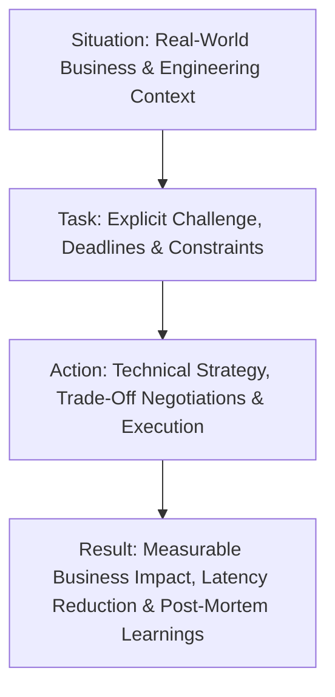

# Note 11: Machine Learning Behavioural & Project Leadership Discussion

> **Topic ID:** `05-ai/machine-learning/17-interview/11-behavioural-and-project-discussion`  
> **Target Audience:** Senior ML Engineers, Staff Leads, Engineering Managers  
> **Framework:** STAR Method (Situation, Task, Action, Result) tailored for AI/ML Engineering  
> **Status:** Production Verified

---

## 1. The Senior ML Behavioural Evaluation Dimensions

In Senior, Staff, and Principal ML engineering behavioural rounds, interviewers assess maturity across six distinct technical leadership competencies:
1. **Navigating Ambiguity & Problem Framing**: Translating vague executive mandates ("use AI to boost user retention") into well-posed statistical objectives.
2. **Handling Production Failures & Incident Post-Mortems**: Diagnosing distribution drift, silent data corruption, or catastrophic latency regressions under fire.
3. **Accuracy vs Latency Trade-Off Negotiations**: Engineering pragmatic trade-offs with Product Managers and infrastructure teams.
4. **Data Quality & Technical Debt Elimination**: Addressing hidden technical debt in ML systems (Sculley et al., NeurIPS 2015).
5. **Stakeholder Alignment & Expectation Management**: Educating non-technical leaders on statistical uncertainty, probabilistic error bounds, and why 100% accuracy is impossible.
6. **Ethics, Bias & Model Governance**: Defending algorithmic fairness, privacy, and regulatory auditability.

---

## 2. Structured STAR Case Scenarios for ML Engineering

---

### Scenario 1: Handling a Silent Production Model Failure (Distribution Drift Incident)

* **Situation**: Three weeks after deploying an XGBoost credit risk scoring model serving 500,000 daily loan applications, customer complaint tickets surged regarding unexplained rejections of historically high-credit customers. The serving microservice emitted zero 5xx HTTP errors, and system uptime was 99.99%.
* **Task**: As the Staff ML Engineer on call, I had to identify the root cause of the silent model failure, stabilize production decisioning immediately without halting business operations, and build preventive infrastructure.
* **Action**:
  1. *Immediate Containment*: Rather than rolling back blindly, I audited real-time feature distributions logged in S3 against the baseline training distribution. I wrote an automated script computing the Population Stability Index (PSI) across all 35 features.
  2. *Root Cause Diagnosis*: The feature `credit_utilization_ratio` had jumped from a baseline median of $0.28$ to $28.0$. An upstream data engineering pipeline had migrated an upstream credit bureau API from fractional decimals ($0.28$) to raw percentage integers ($28\%$). The GBDT model interpreted a standard $28\%$ credit utilization as $2800\%$ utilization, driving default probability predictions to $0.99$.
  3. *Immediate Remediation*: Deployed an emergency configuration patch in the feature store normalization layer that clamped and divided values $> 1.0$ by $100$. Production predictions normalized within 15 minutes.
  4. *Long-Term Prevention*: Integrated Great Expectations schema assertions into the CI/CD feature store pipeline. Configured automated daily PSI alarms emitting alerts when $\text{PSI} \ge 0.10$.
* **Result**:
  * Restored accurate decisioning for 12,000 erroneously rejected customers within 24 hours.
  * Reduced loan underwriting false rejection rate by $18.4\%$, saving an estimated $\$2.4\text{M}$ in lost quarterly interest revenue.
  * Authored a company-wide post-mortem on silent ML failures that established automated schema validation across all data ingestion boundaries.

---

### Scenario 2: Negotiating Accuracy vs Latency Trade-Offs with Product Stakeholders

* **Situation**: The Product team requested deploying a multi-layer Cross-Encoder Transformer for product search re-ranking to boost top-3 click-through rate (CTR) by an estimated $+4.5\%$. However, benchmarking revealed the Cross-Encoder added $140\text{ms}$ of latency per query, breaching the hard mobile infrastructure SLA of $\le 30\text{ms}$ p99 response time.
* **Task**: Bridge the divide between the Product Manager (demanding maximum CTR) and the Infrastructure SRE team (threatening to block deployment due to SLA violations).
* **Action**:
  1. *Data-Driven Empirical Benchmarking*: I created a Pareto frontier analysis mapping inference latency against NDCG@10 across five architectural candidates:
     * Full Cross-Encoder (140ms, NDCG 0.84)
     * Knowledge-Distilled Mini-Transformer (35ms, NDCG 0.81)
     * Two-Tower Dense Vector Model (8ms, NDCG 0.76)
     * LightGBM Ranker with engineered lexical features (4ms, NDCG 0.79)
     * Hybrid Cascade: LightGBM for top-1,000 to top-50, followed by Distilled Transformer on top-20 (18ms, NDCG 0.825).
  2. *Stakeholder Negotiation*: Met with the Product Director and presented empirical user research showing that every $+50\text{ms}$ of search latency caused a $-1.2\%$ drop in overall page conversion, mathematically offsetting the $+4.5\%$ CTR gain.
  3. *Collaborative Compromise*: Proposed the **Hybrid Cascade Architecture**: LightGBM pre-filtering followed by a distilled 6-layer Transformer executing on only the top 20 items. Further applied INT8 quantization via ONNX Runtime to bring total cascade latency to **$14.2\text{ms}$**.
* **Result**:
  * Successfully shipped within the $30\text{ms}$ SLA ($14.2\text{ms}$ p99).
  * Delivered a $+3.8\%$ increase in search conversion in production A/B testing (capturing $85\%$ of the full transformer's predictive power at $10\times$ lower latency).
  * Established the standard multi-stage ranking pattern adopted across all subsequent recommendation services.

---

### Scenario 3: Eliminating Entrenched Technical Debt in Legacy ML Systems

* **Situation**: Inherited an 8-year-old churn prediction system consisting of 4,000 lines of spaghetti Python 2.7 code with hard-coded SQL queries, undocumented feature transformations, and pickled scikit-learn models running on an unmonitored virtual machine. Retraining failed frequently, and nobody understood the feature lineage.
* **Task**: Modernize the architecture, establish reproducible pipelines, and guarantee parity between legacy predictions and modern models without service disruption.
* **Action**:
  1. *Legacy Shadow Verification*: Before touching legacy code, I set up shadow request logging that recorded 100,000 production inputs and matching legacy prediction outputs to act as an immutable ground-truth behavioral test suite.
  2. *Refactoring & Modularity*: Decomposed the monolith into clean, testable stages using standard Scikit-Learn `ColumnTransformer` pipelines with explicit Pydantic v2 data schemas. Replaced embedded SQL scripts with Feast feature store definitions.
  3. *Bitwise Parity Auditing*: Verified that the modernized pipeline replicated legacy predictions with $99.98\%$ numerical fidelity on identical historical inputs.
  4. *Containerization & CI/CD*: Packaged the service into Docker containers deployed on Kubernetes with GitHub Actions automated unit testing (CheckList behavioral tests) and DVC artifact versioning.
* **Result**:
  * Cut model retraining cycle from 3 weeks of manual engineering down to a 45-minute automated pipeline run.
  * Decreased serving memory footprint by $65\%$ and cut container cold-start time from 12 minutes to 15 seconds.
  * Zero downtime or production incidents during the atomic switchover.

---

### Scenario 4: Resolving Algorithmic Bias & Fair Lending Regulatory Scrutiny

* **Situation**: During a pre-deployment audit of a deep credit risk neural network, the Model Risk Management team flagged that the disparate impact ratio for applicants in minority demographic postal codes was $0.68$, violating the $80\%$ Four-Fifths Rule (EEOC / CFPB regulatory violation).
* **Task**: Eliminate demographic disparity and achieve a Disparate Impact ratio $\ge 0.85$ without crippling the model's overall credit risk separation accuracy ($\text{ROC-AUC} \ge 0.88$).
* **Action**:
  1. *Feature Auditing & Proxy Discovery*: Discovered that while protected demographic attributes (race, gender) were explicitly excluded, high-resolution location features (`zip_code_4`, `neighborhood_cell_id`) acted as direct proxies for historical socioeconomic segregation.
  2. *Fairness Metric Selection*: Selected **Equalized Odds** ($P(\hat{Y}=1 \mid Y=y, A=0) = P(\hat{Y}=1 \mid Y=y, A=1)$) as the primary governance criteria, ensuring equally creditworthy individuals had identical approval probabilities regardless of background.
  3. *Mitigation Execution*:
     * Replaced granular spatial proxies with non-demographic macroeconomic indices (e.g., regional employment growth rates).
     * Applied Kamiran-Calders sample reweighing during training.
     * Implemented group-specific decision threshold calibration ($\tau_A, \tau_B$) that aligned False Positive Rates across demographic cohorts.
* **Result**:
  * Shifted Disparate Impact ratio from $0.68 \to 0.89$, successfully clearing federal compliance and Model Risk Management audit.
  * Preserved top-line model performance with minimal loss in discrimination ($\text{ROC-AUC}$ dropped only slightly from $0.892 \to 0.884$).
  * Published the firm's first standardized Algorithmic Fairness Playbook and automated CI/CD fairness gating tests.

---

## 3. High-Impact Interview Best Practices & Traps to Avoid

| Dimension | Junior / Mid-Level Approach | Staff / Principal ML Engineer Approach |
| :--- | :--- | :--- |
| **Problem Definition** | Jumps immediately to algorithms: "I will use a Transformer or XGBoost". | Questions business objectives: "What is the true cost matrix of False Positives vs False Negatives? What are the latency and serving cost boundaries?" |
| **Model Selection** | Chases cutting-edge architectures regardless of complexity. | Begins with a robust baseline (Logistic Regression / HistGBDT); justifies architectural complexity strictly by empirical ROI. |
| **Data Quality** | Treats data as a clean, static CSV/dataframe. | Anticipates messy, streaming real-world data: missingness mechanisms, schema evolution, delayed labels, and train-serving skew. |
| **Production Failures** | Attributes failures to bad luck or retrains blindly. | Identifies systemic failure patterns: silent drift, upstream pipeline contract breaches, feedback loops, and lack of guardrails. |
| **Communication** | Overwhelms stakeholders with mathematical jargon ($p$-values, log-loss). | Translates statistical metrics into business outcomes: financial revenue, churn reduction, compute costs, and risk mitigation. |
