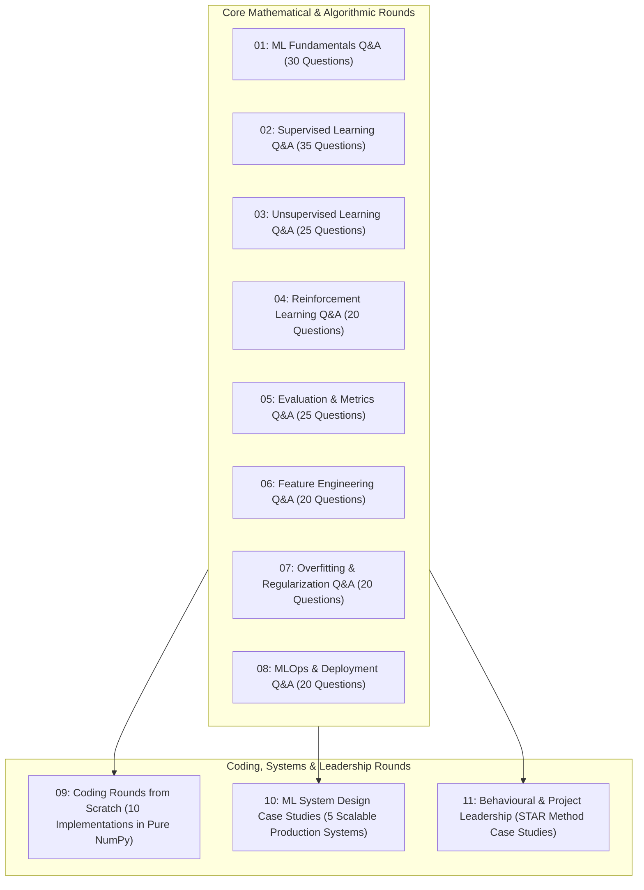

# Module 17: Technical Interview Preparation

> **Module ID:** `05-ai/machine-learning/17-interview`  
> **Topic:** Comprehensive Technical Interview Preparation for Senior & Staff ML Engineers  
> **Coverage:** Fundamentals, Supervised, Unsupervised, RL, Metrics, Feature Engineering, Regularization, MLOps, Coding from Scratch, System Design, and Behavioral Leadership  
> **Status:** Production Verified

---

## 1. Overview & Curriculum Architecture

Module 17 provides an exhaustive, enterprise-grade technical interview preparation curriculum for Machine Learning Engineers, Applied Scientists, and ML System Architects. Every note is written with mathematical rigor, practical derivations, operational war-stories, and zero hand-wavy explanations.

---

## 2. Directory & Technical Index

| Note File | Core Topic & Questions | Target Roles & Key Derivations |
| :--- | :--- | :--- |
| [01-ml-fundamentals-qa.md](file:///E:/Learning/engineering-notes/05-ai/machine-learning/17-interview/01-ml-fundamentals-qa.md) | **ML Fundamentals (30 Qs)** | Bias-variance derivation, PAC bounds, MLE vs MAP, ERM vs SRM, curse of dimensionality, inductive bias. |
| [02-supervised-learning-qa.md](file:///E:/Learning/engineering-notes/05-ai/machine-learning/17-interview/02-supervised-learning-qa.md) | **Supervised Learning (35 Qs)** | OLS normal equation proof, soft-margin SVM dual, KKT conditions, GBDT pseudo-residuals, XGBoost Hessian gain, LightGBM GOSS/EFB. |
| [03-unsupervised-learning-qa.md](file:///E:/Learning/engineering-notes/05-ai/machine-learning/17-interview/03-unsupervised-learning-qa.md) | **Unsupervised Learning (25 Qs)** | PCA variance maximization derivation, K-Means as hard GMM limit, t-SNE Student-t crowding fix, Isolation Forest BST path length $c(n)$, LOF. |
| [04-reinforcement-learning-qa.md](file:///E:/Learning/engineering-notes/05-ai/machine-learning/17-interview/04-reinforcement-learning-qa.md) | **Reinforcement Learning (20 Qs)** | Bellman contraction mapping proof, Robbins-Monro conditions, Policy Gradient Theorem derivation, PPO clipping, GAE, Double DQN. |
| [05-evaluation-and-metrics-qa.md](file:///E:/Learning/engineering-notes/05-ai/machine-learning/17-interview/05-evaluation-and-metrics-qa.md) | **Evaluation & Metrics (25 Qs)** | ROC-AUC vs PR-AUC under extreme imbalance, Brier score decomposition, ECE calibration, NDCG@K, WAPE, Bayes optimal thresholding $\tau^*$. |
| [06-feature-engineering-and-preprocessing-qa.md](file:///E:/Learning/engineering-notes/05-ai/machine-learning/17-interview/06-feature-engineering-and-preprocessing-qa.md) | **Feature Engineering (20 Qs)** | Rubin's MCAR/MAR/MNAR, Smoothed Target Encoding formula, RobustScaler vs QuantileTransformer, Hashing trick collision bound, cyclical encoding. |
| [07-overfitting-and-regularisation-qa.md](file:///E:/Learning/engineering-notes/05-ai/machine-learning/17-interview/07-overfitting-and-regularisation-qa.md) | **Overfitting & Regularization (20 Qs)** | Ridge singular value shrinkage proof $\frac{\sigma_i^2}{\sigma_i^2 + \lambda}$, Lasso soft-thresholding derivation, Early stopping as L2, Adam vs AdamW decoupled weight decay. |
| [08-mlops-and-deployment-qa.md](file:///E:/Learning/engineering-notes/05-ai/machine-learning/17-interview/08-mlops-and-deployment-qa.md) | **MLOps & Deployment (20 Qs)** | Dual Feature Store architecture, Point-in-time AS-OF joins, Canary/Blue-Green/Shadow routing, Treelite compilation, Page-Hinkley drift test, SR 11-7 compliance. |
| [09-coding-rounds.md](file:///E:/Learning/engineering-notes/05-ai/machine-learning/17-interview/09-coding-rounds.md) | **10 Coding Rounds from Scratch** | Ridge regression, K-Means++, CART Gini split, IoU & NMS, ROC-AUC from rank sum, Adam optimizer, Beam Search, Sublinear TF-IDF, MAB Epsilon-Greedy, Self-Attention in pure NumPy. |
| [10-ml-system-design-case-studies.md](file:///E:/Learning/engineering-notes/05-ai/machine-learning/17-interview/10-ml-system-design-case-studies.md) | **5 Production System Designs** | 1. Two-Tower Recommender, 2. Real-Time Fraud Pipeline (<12ms), 3. LambdaMART Search Engine, 4. Conformal Real Estate AVM, 5. Autonomous Driving BEV Perception. |
| [11-behavioural-and-project-discussion.md](file:///E:/Learning/engineering-notes/05-ai/machine-learning/17-interview/11-behavioural-and-project-discussion.md) | **STAR Leadership Case Studies** | Silent distribution drift incident, accuracy vs latency stakeholder negotiation, legacy ML technical debt migration, fair lending regulatory remediation. |

---

## 3. Role-Based Study Pathways

* **Applied ML Engineer (Level 4 / Mid-Level)**: Focus on Notes 01, 02, 05, 06, 09 (Mastering coding from scratch and metric selection).
* **Senior ML Engineer (Level 5)**: Complete Notes 01–09, with deep focus on Note 10 (System Design Case Studies 1, 2, 3) and Note 11 (Behavioural trade-offs).
* **Staff / Principal ML Architect (Level 6+)**: Master Notes 08, 10, 11 (System topology, resilience, governance, cross-functional organizational leadership).
* **Research Scientist**: Emphasize Notes 01, 02, 03, 04, 07, 09 (Mathematical derivations, contraction mappings, optimization geometry).
