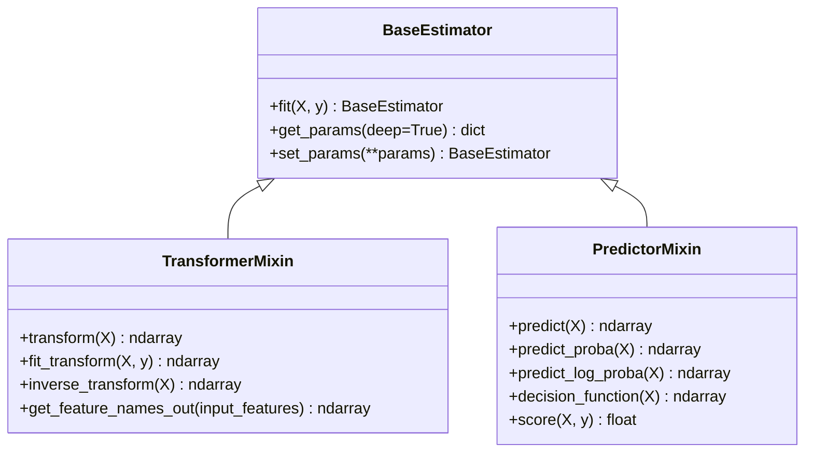

# Cheatsheet 02: Scikit-Learn Modern API Reference

> **Cheatsheet ID:** `05-ai/machine-learning/18-cheatsheets/02-scikit-learn-api`  
> **Target Version:** scikit-learn 1.9+, Python 3.11+  
> **Status:** Production Verified

---

## 1. Unified Estimator, Transformer & Predictor Interfaces

Scikit-Learn enforces an object-oriented API contract across all algorithms:



### Core Interface Signatures
* `fit(X, y=None)`: Fits the estimator parameters from training data. Returns `self`.
* `transform(X)`: Applies learned preprocessing transformations. Returns transformed array/dataframe.
* `fit_transform(X, y=None)`: Optimized single-pass fitting and transforming.
* `predict(X)`: Generates discrete class labels or continuous regression predictions.
* `predict_proba(X)`: Emits calibrated class probability distribution (shape `(N, K)` where $\sum p_k = 1.0$).
* `decision_function(X)`: Emits signed distance to the separating hyperplane (SVM, LogisticRegression).
* `score(X, y)`: Returns default evaluation metric ($R^2$ for regressors, Mean Accuracy for classifiers).

---

## 2. Modern Composition: Pipeline, ColumnTransformer & Target Transform

### 2.1 Complete Production Pipeline Recipe
```python
from sklearn.pipeline import Pipeline
from sklearn.compose import ColumnTransformer, TransformedTargetRegressor
from sklearn.preprocessing import RobustScaler, OneHotEncoder
from sklearn.impute import SimpleImputer
from sklearn.ensemble import HistGradientBoostingRegressor
import numpy as np

numeric_features = ["age", "income", "credit_score"]
categorical_features = ["home_ownership", "loan_intent"]

# Preprocessing sub-pipelines
num_pipeline = Pipeline([
    ("imputer", SimpleImputer(strategy="median")),
    ("scaler", RobustScaler())
])

cat_pipeline = Pipeline([
    ("imputer", SimpleImputer(strategy="constant", fill_value="missing")),
    ("encoder", OneHotEncoder(drop="first", handle_unknown="ignore", sparse_output=False))
])

preprocessor = ColumnTransformer(
    transformers=[
        ("num", num_pipeline, numeric_features),
        ("cat", cat_pipeline, categorical_features)
    ],
    remainder="drop", # Drop unlisted columns
    verbose_feature_names_out=False
)

# Target transformation: trains on log(1+y), automatically inverts expm1(y_hat) on predict()
full_model = TransformedTargetRegressor(
    regressor=Pipeline([
        ("preprocessor", preprocessor),
        ("regressor", HistGradientBoostingRegressor(max_iter=150, random_state=42))
    ]),
    func=np.log1p,
    inverse_func=np.expm1
)
```

---

## 3. Model Selection, Cross-Validation & Search Strategies

| Strategy | Import Path | Best For | Code Signature |
| :--- | :--- | :--- | :--- |
| **Stratified K-Fold** | `from sklearn.model_selection import StratifiedKFold` | Classification (preserves class ratios). | `StratifiedKFold(n_splits=5, shuffle=True, random_state=42)` |
| **Time Series Split** | `from sklearn.model_selection import TimeSeriesSplit` | Temporal sequences (no lookahead). | `TimeSeriesSplit(n_splits=5, max_train_size=None)` |
| **Group K-Fold** | `from sklearn.model_selection import GroupKFold` | Clustered entities (prevents patient/user leakage). | `GroupKFold(n_splits=5)` |
| **Randomized Search** | `from sklearn.model_selection import RandomizedSearchCV` | Efficient hyperparameter exploration. | `RandomizedSearchCV(estimator, param_distributions, n_iter=50, cv=5, n_jobs=-1)` |
| **Successive Halving** | `from sklearn.model_selection import HalvingRandomSearchCV` | $10\times$ faster tuning on small resource subsets. | `HalvingRandomSearchCV(estimator, param_distributions, factor=3, resource='n_samples')` |

### RandomizedSearchCV Production Recipe
```python
from scipy.stats import uniform, randint
from sklearn.model_selection import RandomizedSearchCV

param_distributions = {
    "regressor__regressor__learning_rate": uniform(0.01, 0.20),
    "regressor__regressor__max_iter": randint(50, 300),
    "regressor__regressor__min_samples_leaf": randint(10, 50),
    "regressor__regressor__l2_regularization": uniform(0.0, 5.0)
}

search = RandomizedSearchCV(
    estimator=full_model,
    param_distributions=param_distributions,
    n_iter=25,
    scoring="neg_root_mean_squared_error",
    cv=5,
    n_jobs=-1,
    random_state=42,
    refit=True
)
search.fit(X_train, y_train)
best_pipeline = search.best_estimator_
```

---

## 4. Inspection, Explainability & Diagnostics

### 4.1 Permutation Feature Importance
```python
from sklearn.inspection import permutation_importance

# Always compute on held-out test data, NOT training data!
result = permutation_importance(
    estimator=best_pipeline,
    X=X_test,
    y=y_test,
    scoring="neg_root_mean_squared_error",
    n_repeats=10,
    random_state=42,
    n_jobs=-1
)

for i in result.importances_mean.argsort()[::-1]:
    print(f"Feature: {numeric_features[i]:<20} | Mean Drop: {result.importances_mean[i]:.4f} +/- {result.importances_std[i]:.4f}")
```

### 4.2 Partial Dependence Displays (PDP)
```python
from sklearn.inspection import PartialDependenceDisplay

disp = PartialDependenceDisplay.from_estimator(
    estimator=best_pipeline,
    X=X_train,
    features=["age", "income", ("age", "income")], # Univariate and 2D interaction
    kind="average" # or "both" for ICE lines
)
```

---

## 5. Critical Flags & Production Best Practices

1. **`set_output(transform="pandas")`**: Forces all transformers to return Pandas DataFrames with preserved feature names rather than anonymous NumPy arrays:
   ```python
   from sklearn import set_config
   set_config(transform_output="pandas")
   ```
2. **`sparse_output=False` in `OneHotEncoder`**: Dense arrays avoid silent sparse-dense conversion errors in HistGradientBoosting and PyTorch.
3. **`n_jobs=-1`**: Parallelizes across all available CPU cores during cross-validation and Random Forest training.
4. **`handle_unknown="ignore"`**: Prevents crash when unseen categorical levels appear during production inference.
