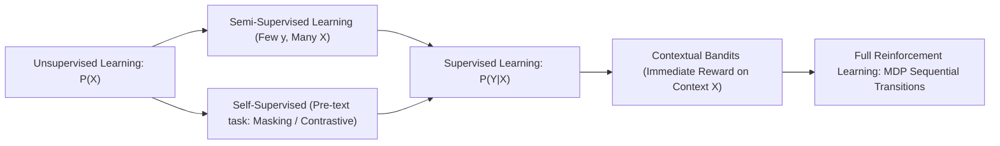

# Cheatsheet 06: Supervised vs Unsupervised vs Reinforcement Learning Comparison Matrix

> **Cheatsheet ID:** `05-ai/machine-learning/18-cheatsheets/06-supervised-vs-unsupervised-vs-rl-comparison`  
> **Topic:** Comprehensive Multi-Dimensional Architectural Comparison Across the Three Core ML Paradigms  
> **Status:** Production Verified

---

## 1. Master Architectural Comparison Matrix

| Architectural Dimension | Supervised Learning | Unsupervised Learning | Reinforcement Learning |
| :--- | :--- | :--- | :--- |
| **Input Data Structure** | Labeled pairs $\mathcal{D} = \{(\mathbf{x}_i, y_i)\}_{i=1}^N$ drawn i.i.d. from $P(X, Y)$. | Unlabeled vectors $\mathcal{D} = \{\mathbf{x}_i\}_{i=1}^N$ drawn from $P(X)$. | Sequential interaction trajectories $\tau = (s_0, a_0, r_1, s_1, \dots)$ from Markov Decision Process $\mathcal{M}$. |
| **Feedback Mechanism** | **Direct & Instantaneous**: Loss $L(y_i, \hat{y}_i)$ computes immediate error for every sample. | **Intrinsic / Latent**: Reconstruction error, density estimation, or geometric inertia; zero external supervision. | **Delayed, Evaluative & Sparse**: Scalar reward $R_{t+1}$ received steps or episodes after action was taken. |
| **Mathematical Objective** | Empirical Risk Minimization (ERM): $\min_{\mathbf{w}} \frac{1}{N} \sum_{i=1}^N L(y_i, f(\mathbf{x}_i; \mathbf{w}))$. | Max Likelihood / Min Distortion: $\max_{\boldsymbol{\theta}} \sum \ln p(\mathbf{x}_i; \boldsymbol{\theta})$ or $\min \sum \|\mathbf{x} - \hat{\mathbf{x}}\|^2$. | Expected Discounted Cumulative Return: $\max_{\pi} \mathbb{E}_{\tau \sim \pi} \left[ \sum_{t=0}^\infty \gamma^t R_{t+1} \right]$. |
| **Core Problem Families** | * Regression (Continuous $y \in \mathbb{R}$) * Classification (Discrete $y \in \{1, \dots, K\}$) * Structured Prediction / Ranking | * Clustering (Partitioning, Density) * Dimensionality Reduction (PCA, SVD) * Anomaly / Novelty Detection * Density Estimation (GMM, KDE) | * Episodic Control (Games, Navigation) * Continuous Robotics (Locomotion) * Online Resource Allocation / Bandits * Sequential Recommendation / LLM RLHF |
| **Data Generation Assumption** | **Stationary & Passive**: Data collection is decoupled from model predictions. | **Stationary & Passive**: Independent samples from a fixed unknown manifold. | **Non-Stationary & Active**: Agent actions directly alter the state distribution ($S_{t+1} \sim \mathcal{P}(\cdot \mid S_t, A_t)$). |
| **Exploration vs Exploitation** | **None**: Model cannot choose which training data it receives. | **None**: Operates statically over fixed batch of vectors. | **Fundamental Trade-Off**: Must balance exploiting known high-reward actions vs exploring unvisited states. |
| **Canonical Algorithms** | * Ridge / Lasso / Logistic Regression * Random Forest & Extra Trees * Gradient Boosted Trees (HistGBDT, XGBoost, LightGBM) * Multi-Layer Perceptrons & Deep CNNs | * K-Means++ & GMM (EM) * DBSCAN & HDBSCAN * PCA & Kernel PCA * t-SNE & UMAP * Isolation Forest & LOF | * Tabular SARSA & Q-Learning * Deep Q-Networks (Double DQN, Dueling) * Policy Gradients (REINFORCE) * Actor-Critic (PPO, A2C, SAC) * Multi-Armed Bandits (Thompson Sampling) |
| **Primary Failure Modes** | * Overfitting & Label Noise Sensitivity * Target Leakage * Confounding / Spurious Correlation * Severe Class Imbalance | * Curse of Dimensionality (Distance concentration) * Arbitrary cluster geometries * Unidentifiable local minima * Lack of objective validation truth | * Credit Assignment Problem * Policy Collapse & Catastrophic Forgetting * Reward Hacking (Exploiting unintended bugs in $R$) * Extreme Sample Inefficiency |
| **Production Evaluation Metrics** | * Accuracy, Precision, Recall, $F_1$, ROC-AUC, PR-AUC * RMSE, MAE, $R^2$, WAPE, MASE | * Silhouette Coefficient, Davies-Bouldin * Reconstruction Error (Frobenius) * Excess of Mass / Relative Density | * Mean Episodic Cumulative Return * Success Rate (%) over held-out seeds * Cumulative Regret $R(T)$ |

---

## 2. Hybrid & Intermediate Paradigms

1. **Semi-Supervised Learning**: Leverages small labeled set $\mathcal{D}_L$ and massive unlabeled set $\mathcal{D}_U$ via Pseudo-Labeling, Self-Training, or Graph Transductive Label Propagation.
2. **Self-Supervised Learning (SSL)**: Generates surrogate supervision from raw data itself without human annotation (e.g., Masked Language Modeling in BERT, contrastive instance discrimination in SimCLR/MoCo). Pre-trained representations are fine-tuned on supervised tasks.
3. **Contextual Bandits**: Intermediate between Supervised Learning and Full RL. Agent observes state/context $\mathbf{x}$, selects action $a$, and receives immediate scalar reward $r$. Unlike Full RL, action $a$ does not alter future context states (state transitions $\mathcal{P}(s' \mid s, a)$ are decoupled).
