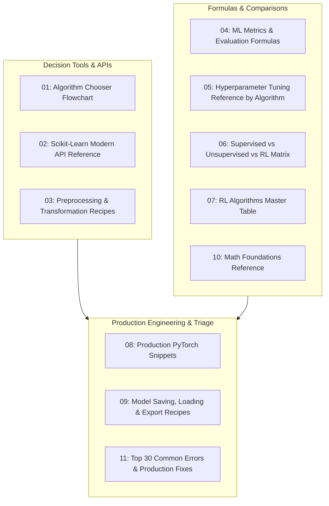

# Module 18: Quick Reference Cheatsheets

> **Module ID:** `05-ai/machine-learning/18-cheatsheets`  
> **Topic:** Master Quick-Reference Tables, Formulas, Code Recipes & Error Runbooks  
> **Target Version:** Python 3.11+, scikit-learn 1.9+, PyTorch 2.4+, NumPy 2.5+, pandas 3.1+  
> **Status:** Production Verified

---

## 1. Overview & Curriculum Architecture

Module 18 serves as the high-density operational desk reference for machine learning engineers, data scientists, and technical interviewers. While earlier modules provide deep mathematical foundations and comprehensive explanations, this module distills critical equations, decision trees, hyperparameter tuning ranges, production code recipes, and debugging runbooks into instant lookup cheat-sheets.

---

## 2. Cheatsheet Directory & Technical Index

| Cheatsheet File | Core Topic & Coverage | Primary Focus & Highlights |
| :--- | :--- | :--- |
| [01-algorithm-chooser-flowchart.md](file:///E:/Learning/engineering-notes/05-ai/machine-learning/18-cheatsheets/01-algorithm-chooser-flowchart.md) | **Algorithm Chooser Flowchart** | Master decision tree choosing algorithms based on labels, scale ($N < 10^3$ to $N > 10^7$), feature type, latency SLAs, and interpretability. |
| [02-scikit-learn-api.md](file:///E:/Learning/engineering-notes/05-ai/machine-learning/18-cheatsheets/02-scikit-learn-api.md) | **Scikit-Learn Modern API** | Estimators, Transformers, Predictors, Pipelines, `ColumnTransformer`, `TransformedTargetRegressor`, `RandomizedSearchCV`, `permutation_importance`. |
| [03-preprocessing-recipes.md](file:///E:/Learning/engineering-notes/05-ai/machine-learning/18-cheatsheets/03-preprocessing-recipes.md) | **Preprocessing Recipes** | Copy-paste code for missing values (KNN, MICE), outlier scalers (Robust, Yeo-Johnson), encodings (Target, Hashing, OneHot), and cyclical trigonometry. |
| [04-metrics-formulas.md](file:///E:/Learning/engineering-notes/05-ai/machine-learning/18-cheatsheets/04-metrics-formulas.md) | **Metrics Formulas Reference** | Exact equations for Classification (Accuracy, Precision, Recall, $F_\beta$, MCC), Calibration (Log-Loss, Brier, ECE), Regression (RMSE, WAPE, MASE), and Ranking (NDCG). |
| [05-hyperparameters-by-algorithm.md](file:///E:/Learning/engineering-notes/05-ai/machine-learning/18-cheatsheets/05-hyperparameters-by-algorithm.md) | **Hyperparameters by Algorithm** | Tuning ranges, defaults, and distribution types for Ridge, Lasso, Random Forest, HistGBDT, XGBoost, CatBoost, SVM, and AdamW. |
| [06-supervised-vs-unsupervised-vs-rl-comparison.md](file:///E:/Learning/engineering-notes/05-ai/machine-learning/18-cheatsheets/06-supervised-vs-unsupervised-vs-rl-comparison.md) | **Paradigm Comparison Matrix** | Side-by-side comparison of data requirements, feedback mechanisms, mathematical objectives, failure modes, and semi-supervised/bandit bridges. |
| [07-rl-algorithms-table.md](file:///E:/Learning/engineering-notes/05-ai/machine-learning/18-cheatsheets/07-rl-algorithms-table.md) | **RL Algorithms Master Table** | Full classification: Tabular vs Deep, Model-Free vs Model-Based, On-Policy vs Off-Policy, Discrete vs Continuous across 15 canonical RL algorithms. |
| [08-pytorch-snippets.md](file:///E:/Learning/engineering-notes/05-ai/machine-learning/18-cheatsheets/08-pytorch-snippets.md) | **PyTorch Production Snippets** | Vectorized tensor operations, custom `Dataset`/`DataLoader`, AMP training loop with `GradScaler`, atomic checkpointing, and custom `nn.Module`. |
| [09-saving-and-loading-recipes.md](file:///E:/Learning/engineering-notes/05-ai/machine-learning/18-cheatsheets/09-saving-and-loading-recipes.md) | **Model Saving & Loading Recipes** | Atomic Joblib with compression, secure Skops, zero-copy Safetensors, ONNX export/runtime inference, and TorchScript JIT tracing. |
| [10-math-formulas.md](file:///E:/Learning/engineering-notes/05-ai/machine-learning/18-cheatsheets/10-math-formulas.md) | **Math Foundations Reference** | Matrix calculus derivative rules, Taylor series, condition numbers, probability distributions, Shannon entropy, and optimization update rules. |
| [11-common-errors-and-fixes.md](file:///E:/Learning/engineering-notes/05-ai/machine-learning/18-cheatsheets/11-common-errors-and-fixes.md) | **Top 30 ML Errors & Fixes** | Stack traces, root causes, and verified code fixes for NaNs in loss, memory leaks, broadcasting shape bugs, unhandled categories, and deadlocks. |

---

## 3. How to Use These Cheatsheets

1. **Daily Engineering**: Keep [02-scikit-learn-api.md](file:///E:/Learning/engineering-notes/05-ai/machine-learning/18-cheatsheets/02-scikit-learn-api.md) and [03-preprocessing-recipes.md](file:///E:/Learning/engineering-notes/05-ai/machine-learning/18-cheatsheets/03-preprocessing-recipes.md) pinned for clean copy-paste pipeline construction.
2. **Incident Triage & Debugging**: When an unexpected stack trace or training failure occurs, consult [11-common-errors-and-fixes.md](file:///E:/Learning/engineering-notes/05-ai/machine-learning/18-cheatsheets/11-common-errors-and-fixes.md) for immediate root cause identification and operational runbooks.
3. **Interview Preparation**: Review [01-algorithm-chooser-flowchart.md](file:///E:/Learning/engineering-notes/05-ai/machine-learning/18-cheatsheets/01-algorithm-chooser-flowchart.md), [04-metrics-formulas.md](file:///E:/Learning/engineering-notes/05-ai/machine-learning/18-cheatsheets/04-metrics-formulas.md), and [06-supervised-vs-unsupervised-vs-rl-comparison.md](file:///E:/Learning/engineering-notes/05-ai/machine-learning/18-cheatsheets/06-supervised-vs-unsupervised-vs-rl-comparison.md) for high-level technical articulation.
