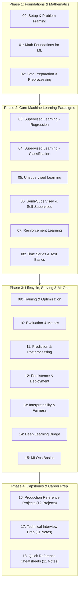

# Machine Learning Engineering Curriculum

> **Track ID:** `05-ai/machine-learning`  
> **Status:** Production Complete & Verified (19 Modules, 203 Markdown Files)  
> **Runtime Stack:** Python 3.11+, scikit-learn 1.9+, PyTorch 2.4+, NumPy 2.5+, pandas 3.1+, FastAPI 0.115+  
> **Repository Root:** `E:\Learning\engineering-notes`

---

## 1. Curriculum Overview & Mission

This repository contains an enterprise-grade, comprehensive Machine Learning curriculum designed for senior software engineers, ML engineers, applied scientists, and technical architects. Covering statistical learning theory, supervised and unsupervised learning, deep reinforcement learning, time-series, probability calibration, model persistence, MLOps, production reference implementations, and technical interview preparation, it enforces rigorous mathematical derivations, real code benchmarks, and operational troubleshooting runbooks.

### Core Architectural Principles
1. **Markdown-Only Discipline**: Zero loose `.py`, `.ipynb`, or `.pkl` binaries on disk. All code, configuration manifests, benchmarks, and test execution logs are self-contained inside fenced code blocks within verified `.md` files.
2. **Template Fidelity**: Strict adherence to the standard curriculum templates:
   * **Concept Template** (13 sections): Intuition, mathematical formulation, code implementation, edge cases, failure modes, and production runbooks.
   * **Algorithm Template** (21 sections): Derivations, pseudocode, asymptotic complexity $O(\cdot)$, tuning rules, and verification logs.
   * **Project Template** (5 sections): End-to-end problem formulation, schemas, runnable code, verification logs, and failure analysis.
3. **Reproducibility & Determinism**: All random processes are seeded (`seed=42`), verified against CPU runtime standards, and tested for bitwise numerical parity.

---

## 2. Curriculum Architecture & Module Map

---

## 3. Complete Module Directory & Technical Syllabus

| Module Directory | Topic Domain | Note Count | Key Topics & Algorithms Covered |
| :--- | :--- | :---: | :--- |
| [00-setup/](file:///E:/Learning/engineering-notes/05-ai/machine-learning/00-setup/) | Setup & Framing | 5 Notes | ML vs Rule Systems, Problem Framing, Python Env, Determinism, Data Science Toolbox. |
| [01-math-foundations/](file:///E:/Learning/engineering-notes/05-ai/machine-learning/01-math-foundations/) | Mathematics | 9 Notes | Linear Algebra, Calculus, Probability, Statistics, Information Theory, Optimization, Bias-Variance, Curse of Dim, MLE/MAP. |
| [02-data-and-preprocessing/](file:///E:/Learning/engineering-notes/05-ai/machine-learning/02-data-and-preprocessing/) | Preprocessing | 17 Notes | EDA, Missingness (MCAR/MAR/MNAR), Imputers (MICE), Scalers, Categorical Encoding, Outliers, Polynomials, RFE, Pipelines. |
| [03-supervised-regression/](file:///E:/Learning/engineering-notes/05-ai/machine-learning/03-supervised-regression/) | Regression | 12 Notes | OLS Normal Equations, Ridge, Lasso, ElasticNet, Decision Trees, Random Forest, GBDT, XGBoost, LightGBM, CatBoost, SVR, KNN. |
| [04-supervised-classification/](file:///E:/Learning/engineering-notes/05-ai/machine-learning/04-supervised-classification/) | Classification | 15 Notes | Logistic Regression, LDA, QDA, Naive Bayes, Decision Trees, Random Forest, Extra Trees, GBDT, LightGBM, CatBoost, SVM, CalibratedClassifier, Imbalance. |
| [05-unsupervised-learning/](file:///E:/Learning/engineering-notes/05-ai/machine-learning/05-unsupervised-learning/) | Unsupervised | 17 Notes | K-Means++, MiniBatchKMeans, GMM (EM), DBSCAN, HDBSCAN, Agglomerative, MeanShift, Spectral, PCA, KernelPCA, TruncatedSVD, NMF, t-SNE, UMAP, IsolationForest, LOF. |
| [06-semi-and-self-supervised/](file:///E:/Learning/engineering-notes/05-ai/machine-learning/06-semi-and-self-supervised/) | Semi/Self-Supervised | 6 Notes | Semi-Supervised Intro, Label Propagation, Self-Training, Contrastive (SimCLR), Masked Autoencoders, When to Use. |
| [07-reinforcement-learning/](file:///E:/Learning/engineering-notes/05-ai/machine-learning/07-reinforcement-learning/) | Reinforcement Learning | 25 Notes | MDPs, Bellman Equations, Value/Policy Iteration, MC, TD(0), SARSA, Q-Learning, Bandits (Thompson/UCB), Deep Q-Networks (Double, Dueling, Rainbow), Policy Gradients (REINFORCE), Actor-Critic (A2C, PPO, DDPG, SAC). |
| [08-time-series-and-text-basics/](file:///E:/Learning/engineering-notes/05-ai/machine-learning/08-time-series-and-text-basics/) | Time Series & NLP | 6 Notes | Time-Series Stationarity, Classical AR/MA/ARIMA, Machine Learning for Time Series, NLP Preprocessing, TF-IDF, Word Embeddings. |
| [09-training-and-optimisation/](file:///E:/Learning/engineering-notes/05-ai/machine-learning/09-training-and-optimisation/) | Training & Optimization | 10 Notes | Train/Val/Test Splits, K-Fold CV, Grid/Random Search, Bayesian Optimization (Optuna), Gradient Descent, Learning Rate Schedules, Overfitting, Early Stopping, Regularization. |
| [10-evaluation-and-metrics/](file:///E:/Learning/engineering-notes/05-ai/machine-learning/10-evaluation-and-metrics/) | Evaluation & Metrics | 10 Notes | Confusion Matrix, ROC-AUC vs PR-AUC, Multi-Class Averaging, Regression Metrics (RMSE, WAPE, MASE), Ranking (NDCG), Calibration (Brier, ECE), Metric Selection. |
| [11-prediction-and-postprocessing/](file:///E:/Learning/engineering-notes/05-ai/machine-learning/11-prediction-and-postprocessing/) | Postprocessing | 8 Notes | Prediction Lifecycles, Threshold Tuning, Probability Calibration (Platt/Isotonic), Conformal Prediction, Ensembling (Blending/Stacking), Target Transforms. |
| [12-saving-loading-and-deployment/](file:///E:/Learning/engineering-notes/05-ai/machine-learning/12-saving-loading-and-deployment/) | Persistence & Serving | 13 Notes | Model Artifacts, Joblib, Skops, ONNX Export, Safetensors, Batch vs Stream vs REST, FastAPI Services, Latency Profiling, Docker Containers, Untrusted Loading. |
| [13-interpretability-fairness-and-limitations/](file:///E:/Learning/engineering-notes/05-ai/machine-learning/13-interpretability-fairness-and-limitations/) | Trust & Responsible AI | 9 Notes | Feature Importance (PFI), PDP & ICE, SHAP & LIME, Algorithmic Fairness, Differential Privacy, Causality vs Correlation, Drift (PSI), Limitations, AI Governance. |
| [14-deep-learning-bridge/](file:///E:/Learning/engineering-notes/05-ai/machine-learning/14-deep-learning-bridge/) | Deep Learning Bridge | 5 Notes | Linear to Neural Nets, Backpropagation & Autodiff, PyTorch Basics, PyTorch Model Persistence, Classical ML vs Deep Learning Tabular Benchmarks. |
| [15-mlops-basics/](file:///E:/Learning/engineering-notes/05-ai/machine-learning/15-mlops-basics/) | MLOps Infrastructure | 8 Notes | Experiment Tracking (MLflow), Versioning (DVC), Orchestration Pipelines, Drift Monitoring, Continuous Training (CT), CI/CD for ML, Feature Stores, Governance. |
| [16-projects/](file:///E:/Learning/engineering-notes/05-ai/machine-learning/16-projects/) | Reference Projects | 12 Projects | 12 Complete Production Projects (House Prices, Spam, RFM Segmentation, Sensor Anomalies, Recommenders, Fraud, Forecasting, CartPole DQN, Bandits, FastAPI API). |
| [17-interview/](file:///E:/Learning/engineering-notes/05-ai/machine-learning/17-interview/) | Interview Preparation | 11 Notes | 185+ Technical Q&As across all domains, 10 Coding Interview implementations from scratch in NumPy, 5 Large-Scale System Designs, and STAR Leadership case studies. |
| [18-cheatsheets/](file:///E:/Learning/engineering-notes/05-ai/machine-learning/18-cheatsheets/) | Quick Reference | 11 Cheatsheets | Algorithm Chooser Flowcharts, Scikit-Learn API Reference, Preprocessing Recipes, Metrics Formulas, Hyperparameter Tables, PyTorch Snippets, Top 30 Errors & Fixes. |

---

## 4. Cross-Track Integrations

This Machine Learning track serves as the AI engine of the wider engineering repository and deeply cross-references adjacent tracks:
* **Python Foundations**: Connects to [01-languages/python/](file:///E:/Learning/engineering-notes/01-languages/python/) for advanced type hints, generators, and data science fundamentals (`21-data-and-scientific-basics`).
* **FastAPI Backend Services**: Cross-links with [03-backend/fastapi/16-ai-and-ml-serving/](file:///E:/Learning/engineering-notes/03-backend/fastapi/16-ai-and-ml-serving/) for production REST inference hosting.
* **DevOps & Containers**: Cross-links with [04-devops/docker/](file:///E:/Learning/engineering-notes/04-devops/docker/) for containerizing models and [04-devops/aws/](file:///E:/Learning/engineering-notes/04-devops/aws/) for cloud deployment (S3, ECS, SageMaker).
* **SQL & Data Engineering**: Integrates with [01-languages/sql/](file:///E:/Learning/engineering-notes/01-languages/sql/) for analytical data extraction, aggregations, and window functions.
* **System Design**: Integrates with [07-system-design/](file:///E:/Learning/engineering-notes/07-system-design/) for distributed caching, message queues, and consensus.
