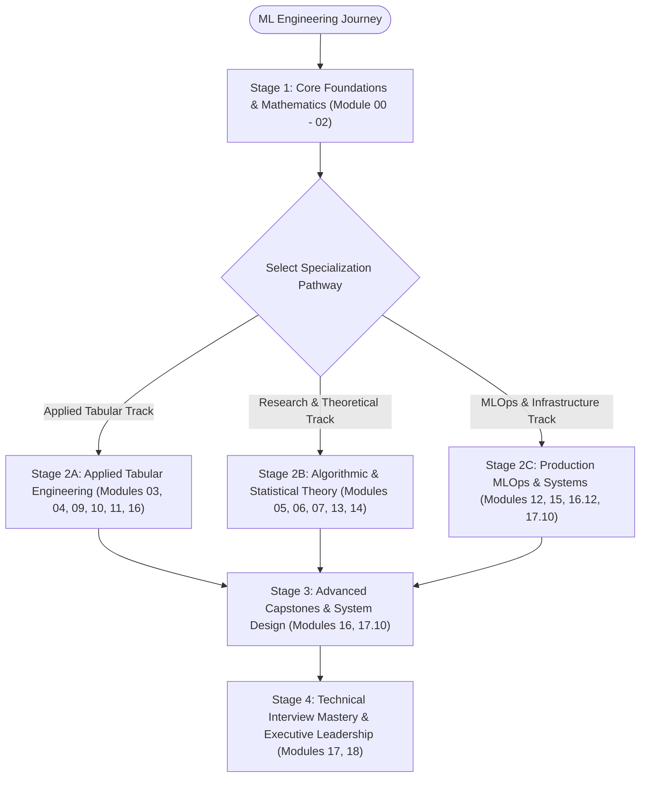

# Machine Learning Curriculum Study Pathways & Learning Roadmap

> **Track ID:** `05-ai/machine-learning/ROADMAP`  
> **Status:** Production Verified  
> **Target Audience:** From Software Engineers Transitioning to ML to Principal AI Architects

---

## 1. Master Learning Pathway Overview

---

## 2. Four Specialized Learning Pathways

### Pathway 1: Applied Tabular Machine Learning Engineer
* **Target Role**: Data Scientist, Applied ML Engineer, Kaggle Grandmaster.
* **Estimated Time**: 120 Hours.
* **Core Focus**: Mastering real-world tabular data preprocessing, gradient boosted decision trees (HistGBDT, LightGBM, CatBoost), leakage-proof cross-validation, and cost-sensitive threshold calibration.
* **Syllabus Sequence**:
  1. `00-setup/` (Workflow, Reproducibility, Determinism) — 5 Hours
  2. `01-math-foundations/` (Notes 01, 02, 06, 07) — 15 Hours
  3. `02-data-and-preprocessing/` (Complete: Imputers, Scalers, Target Encoding, Pipelines) — 25 Hours
  4. `03-supervised-regression/` & `04-supervised-classification/` (Trees, Ensembles, GBDT, LightGBM, CatBoost) — 35 Hours
  5. `09-training-and-optimisation/` & `10-evaluation-and-metrics/` (K-Fold, PR-AUC, Brier score) — 15 Hours
  6. `11-prediction-and-postprocessing/` (Threshold Tuning, Conformal Prediction) — 10 Hours
  7. `16-projects/` (Projects 01, 02, 03, 06, 07, 08) — 15 Hours

---

### Pathway 2: Research Scientist & Algorithmic Specialist
* **Target Role**: AI Research Scientist, Quantitative Researcher, Core Algorithm Developer.
* **Estimated Time**: 160 Hours.
* **Core Focus**: Deep theoretical derivations, contraction mapping convergence, manifold learning topology, probabilistic graphical models, and continuous reinforcement learning control.
* **Syllabus Sequence**:
  1. `01-math-foundations/` (Exhaustive: Information Theory, MLE/MAP, Calculus, Curse of Dim) — 25 Hours
  2. `03-supervised-regression/` & `04-supervised-classification/` (Derivations: OLS, Ridge, Soft-margin SVM, KKT, GBDT Hessian gains) — 30 Hours
  3. `05-unsupervised-learning/` (PCA SVD, Kernel PCA, t-SNE Crowding, UMAP Topology, Isolation Forest) — 25 Hours
  4. `06-semi-and-self-supervised/` (Label Propagation, Contrastive Representation Learning) — 10 Hours
  5. `07-reinforcement-learning/` (Exhaustive: Bellman Equations, Robbins-Monro, Deep Q-Networks, Policy Gradients, PPO, SAC) — 40 Hours
  6. `13-interpretability-fairness-and-limitations/` (SHAP Axioms, Differential Privacy, Pearl Causality) — 15 Hours
  7. `17-interview/09-coding-rounds.md` (Implementing all 10 algorithms from scratch in pure NumPy) — 15 Hours

---

### Pathway 3: Production MLOps Architect & Infrastructure Lead
* **Target Role**: MLOps Engineer, Platform Architect, Infrastructure SRE.
* **Estimated Time**: 110 Hours.
* **Core Focus**: Dual-storage feature stores, low-latency microservices, ONNX/Treelite runtime compilation, continuous training DAGs, drift telemetry, and model governance compliance.
* **Syllabus Sequence**:
  1. `12-saving-loading-and-deployment/` (Atomic Joblib, Skops, ONNX, Safetensors, Docker, FastAPI) — 25 Hours
  2. `15-mlops-basics/` (MLflow, DVC, DAG Pipelines, Prometheus Drift Telemetry, Feast Feature Stores, SR 11-7) — 25 Hours
  3. `16-projects/12-end-to-end-pipeline-save-load-and-fastapi-service.md` — 10 Hours
  4. `17-interview/08-mlops-and-deployment-qa.md` — 10 Hours
  5. `17-interview/10-ml-system-design-case-studies.md` (All 5 Scalable Case Studies) — 25 Hours
  6. `18-cheatsheets/` (Cheatsheets 02, 03, 08, 09, 11) — 15 Hours

---

### Pathway 4: Technical Interview Fast-Track (L5/L6 Senior & Staff Mastery)
* **Target Role**: Active Interview Candidates preparing for FAANG / Tier-1 Tech Interviews.
* **Estimated Time**: 50 Hours.
* **Core Focus**: High-yield Q&As, first-principles coding rounds, system design case studies, and behavioural incident navigation.
* **Syllabus Sequence**:
  1. `17-interview/01-ml-fundamentals-qa.md` to `08-mlops-and-deployment-qa.md` (185+ High-Yield Questions) — 20 Hours
  2. `17-interview/09-coding-rounds.md` (Mastering 10 from-scratch coding challenges) — 10 Hours
  3. `17-interview/10-ml-system-design-case-studies.md` (5 Scalable Systems: Recommender, Fraud, Search, AVM, Autonomous Driving) — 12 Hours
  4. `17-interview/11-behavioural-and-project-discussion.md` (STAR leadership scenarios) — 4 Hours
  5. `18-cheatsheets/` (Rapid lookup, metrics, tuning tables, top 30 error runbooks) — 4 Hours
