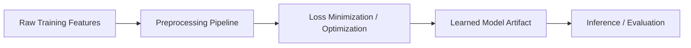

# [Algorithm Title]

> **One-Line Summary:** [A precise 1-sentence technical definition of the algorithm, its primary task, and core inductive bias.]

---

## Metadata

| Field | Value |
| :--- | :--- |
| **Level** | [Beginner \| Intermediate \| Advanced] |
| **Prerequisites** | [Prerequisite Concept](../path/to/note.md), [Another Concept](../path/to/note.md) |
| **Estimated Reading Time** | 20–25 minutes |
| **Status** | Verified (Python 3.11 / CPU) |
| **Tested With** | Python 3.11+, scikit-learn 1.9+, NumPy 2.5+, pandas 3.1+ (Random Seed: `42`) |

---

## Table of Contents
1. [Intuition & Problem It Solves](#1-intuition--problem-it-solves)
2. [Algorithm Card](#2-algorithm-card)
3. [Architectural & Geometric Diagrams](#3-architectural--geometric-diagrams)
4. [The Mathematics](#4-the-mathematics)
5. [The Algorithm Step by Step & From-Scratch Implementation](#5-the-algorithm-step-by-step--from-scratch-implementation)
6. [Using the Library (Complete End-to-End Workflow)](#6-using-the-library-complete-end-to-end-workflow)
7. [Preprocessing Required](#7-preprocessing-required)
8. [Training & Hyperparameter Tuning](#8-training--hyperparameter-tuning)
9. [Prediction & Inference Mechanics](#9-prediction--inference-mechanics)
10. [Postprocessing](#10-postprocessing)
11. [Saving and Loading (Model Persistence & Security)](#11-saving-and-loading-model-persistence--security)
12. [Evaluation & Diagnostics](#12-evaluation--diagnostics)
13. [Advantages](#13-advantages)
14. [Limitations & Failure Modes](#14-limitations--failure-modes)
15. [Comparison / When to Use What](#15-comparison--when-to-use-what)
16. [Common Mistakes & Pitfalls](#16-common-mistakes--pitfalls)
17. [Performance, Security & Ethics Notes](#17-performance-security--ethics-notes)
18. [Interview Questions (8 In-Depth Q&As)](#18-interview-questions-8-in-depth-qas)
19. [Practice Exercises (6 Hands-on Problems)](#19-practice-exercises-6-hands-on-problems)
20. [Summary & Cheat Sheet](#20-summary--cheat-sheet)
21. [Further Reading & Navigation](#21-further-reading--navigation)

---

## 1. Intuition & Problem It Solves
* Plain-language explanation of what problem the algorithm solves.
* Intuitive physical or real-world analogy.
* Inductive bias (what the algorithm assumes about the underlying data distribution).

---

## 2. Algorithm Card

| Attribute | Specification |
| :--- | :--- |
| **Learning Type** | [Supervised \| Unsupervised \| Semi-Supervised \| Reinforcement Learning] |
| **Primary Task** | [Regression \| Binary/Multiclass Classification \| Clustering \| Policy Optimization] |
| **Parametric?** | [Yes \| No] |
| **Core Assumptions** | [e.g. Linearity, homoscedasticity, independence, Markov property] |
| **Needs Feature Scaling?** | [Yes (e.g. distance-based/gradient-based) \| No (e.g. tree-based)] |
| **Handles Missing Values?** | [Native (e.g. HistGradientBoosting) \| Requires Imputation (e.g. Linear/SVM)] |
| **Handles Categorical Features?** | [Native (e.g. CatBoost/LightGBM) \| Requires One-Hot/Ordinal Encoding] |
| **Interpretability** | [High (coefficients/rules) \| Moderate \| Black-Box] |
| **Training Complexity (Time / Space)** | Time: $\mathcal{O}(...)$ \| Space: $\mathcal{O}(...)$ |
| **Inference Complexity (Time / Space)** | Time: $\mathcal{O}(...)$ \| Space: $\mathcal{O}(...)$ |
| **Key Hyperparameters** | `learning_rate`, `n_estimators`, `max_depth`, `regularization` |

---

## 3. Architectural & Geometric Diagrams

### Diagram 1: Pipeline Execution Flow


### Diagram 2: Geometric / Conceptual Picture
```
      Y ^
        │                 *  (Actual)
        │              * /
        │             * / 
        │            * /  Residual e_i = y_i - ŷ_i
        │           * /
        │          *─/───────── Best-fit Hyperplane: ŷ = Xw
        │         * /
        │        * /
        └─────────────────────────> X
```

---

## 4. The Mathematics

### 4.1 Objective Function & Loss Formulation
$$J(\mathbf{w}) = \frac{1}{2n} \sum_{i=1}^n (y_i - \mathbf{w}^T \mathbf{x}_i)^2 + \frac{\lambda}{2} \|\mathbf{w}\|_2^2$$

### 4.2 Analytical Derivation / Optimization Rule
Gradient of the objective with respect to $\mathbf{w}$:
$$\nabla_{\mathbf{w}} J(\mathbf{w}) = \frac{1}{n} \mathbf{X}^T (\mathbf{X}\mathbf{w} - \mathbf{y}) + \lambda \mathbf{w}$$

Analytical Normal Equation (Closed-form solution):
$$\mathbf{w}^* = (\mathbf{X}^T \mathbf{X} + \lambda \mathbf{I})^{-1} \mathbf{X}^T \mathbf{y}$$

### 4.3 Mathematical Symbol Breakdown Table

| Symbol | Definition | Dimensionality | Role in Algorithm |
| :---: | :--- | :---: | :--- |
| $\mathbf{X}$ | Feature matrix | $\mathbb{R}^{n \times d}$ | Input training instances |
| $\mathbf{y}$ | Target vector | $\mathbb{R}^n$ | Ground truth regression values / class labels |
| $\mathbf{w}$ | Weight vector (coefficients) | $\mathbb{R}^d$ | Learned parameters |
| $b$ | Bias (intercept) term | $\mathbb{R}$ | Offsets decision hyperplane from origin |
| $\lambda$ | Regularization strength | $\mathbb{R}_{\ge 0}$ | Penalizes model complexity to mitigate overfitting |

---

## 5. The Algorithm Step by Step & From-Scratch Implementation

### 5.1 Algorithmic Pseudocode
1. Initialize parameters $\mathbf{w} \leftarrow \mathbf{0}$, $b \leftarrow 0$.
2. For iteration $t = 1 \dots T$:
   a. Compute linear prediction $\hat{\mathbf{y}} = \mathbf{X}\mathbf{w} + b$.
   b. Compute error residual $\mathbf{e} = \hat{\mathbf{y}} - \mathbf{y}$.
   c. Compute gradient updates: $\nabla_{\mathbf{w}} = \frac{1}{n}\mathbf{X}^T \mathbf{e} + \lambda \mathbf{w}$.
   d. Update weights: $\mathbf{w} \leftarrow \mathbf{w} - \eta \nabla_{\mathbf{w}}$.
3. Return converged parameters $(\mathbf{w}, b)$.

### 5.2 From-Scratch Implementation (NumPy)
```python
import numpy as np
from sklearn.datasets import make_regression
from sklearn.linear_model import Ridge

class ScratchAlgorithm:
    def __init__(self, alpha: float = 1.0, lr: float = 0.01, n_iter: int = 1000):
        self.alpha = alpha
        self.lr = lr
        self.n_iter = n_iter
        self.w = None
        self.b = 0.0

    def fit(self, X: np.ndarray, y: np.ndarray):
        n, d = X.shape
        self.w = np.zeros(d)
        self.b = 0.0
        for _ in range(self.n_iter):
            y_pred = X @ self.w + self.b
            err = y_pred - y
            dw = (1 / n) * (X.T @ err) + (self.alpha / n) * self.w
            db = (1 / n) * np.sum(err)
            self.w -= self.lr * dw
            self.b -= self.lr * db
        return self

    def predict(self, X: np.ndarray) -> np.ndarray:
        return X @ self.w + self.b

# Verification check against library:
X, y = make_regression(n_samples=200, n_features=5, noise=1.0, random_state=42)
scratch = ScratchAlgorithm(alpha=0.1, lr=0.05, n_iter=2000).fit(X, y)
lib = Ridge(alpha=0.1).fit(X, y)

print("Scratch weights:", np.round(scratch.w[:3], 4))
print("Library weights:", np.round(lib.coef_[:3], 4))
print("Max absolute difference:", np.max(np.abs(scratch.w - lib.coef_)))
```

---

## 6. Using the Library (Complete End-to-End Workflow)

Every supervised/unsupervised note executes the complete 9-stage verified workflow:
`load data` $\rightarrow$ `split (leakage-safe)` $\rightarrow$ `preprocess (fit on train only)` $\rightarrow$ `train` $\rightarrow$ `evaluate` $\rightarrow$ `predict` $\rightarrow$ `postprocess` $\rightarrow$ `save` $\rightarrow$ `load & verify identical output`.

```python
import numpy as np
import pandas as pd
from sklearn.datasets import make_regression
from sklearn.model_selection import train_test_split
from sklearn.preprocessing import StandardScaler
from sklearn.pipeline import Pipeline
from sklearn.linear_model import Ridge
from sklearn.metrics import mean_squared_error, r2_score
import joblib

# 1. Load Data
X, y = make_regression(n_samples=500, n_features=8, noise=2.0, random_state=42)

# 2. Split Data (Strictly before transformer fitting)
X_train, X_test, y_train, y_test = train_test_split(
    X, y, test_size=0.2, random_state=42
)

# 3. Create Preprocessing & Modeling Pipeline
pipeline = Pipeline([
    ("scaler", StandardScaler()),
    ("model", Ridge(alpha=1.0, random_state=42))
])

# 4. Train (fit transformers and estimator ONLY on train)
pipeline.fit(X_train, y_train)

# 5. Evaluate on Out-of-Sample Test Set
y_pred = pipeline.predict(X_test)
test_rmse = np.sqrt(mean_squared_error(y_test, y_pred))
test_r2 = r2_score(y_test, y_pred)
print(f"Test RMSE: {test_rmse:.4f} | Test R2: {test_r2:.4f}")

# 6. Postprocessing (e.g. clipping to physical domain boundaries)
y_pred_post = np.clip(y_pred, a_min=0, a_max=None)

# 7. Safe Persistence & Round-Trip Verification
joblib.dump(pipeline, "pipeline_model.joblib")
loaded_pipeline = joblib.load("pipeline_model.joblib")
reloaded_pred = loaded_pipeline.predict(X_test)

# Prove identical predictions
assert np.allclose(y_pred, reloaded_pred), "Reloaded model outputs differ!"
print("Persistence round-trip verified: Identical predictions achieved.")
```

---

## 7. Preprocessing Required
* Scaling requirements: Why this algorithm requires (or does not require) feature standardization.
* Handling categorical variables: One-hot vs target vs native histogram splitting.
* Missing value imputation strategy.
* Outlier sensitivity.

---

## 8. Training & Hyperparameter Tuning
* Convergence criteria and stopping conditions.
* Hyperparameter search space:
  - Table of hyperparameter names, search ranges, log vs uniform scales, and default values.
* Cross-validation strategy and Optuna / GridSearchCV tuning recipes.

---

## 9. Prediction & Inference Mechanics
* Single sample vs batch inference.
* Latency profiling (P50, P95, P99 in milliseconds).
* Time and memory complexity during prediction.

---

## 10. Postprocessing
* Probability calibration (Platt scaling / Isotonic regression for classifiers).
* Decision threshold optimization (ROC-AUC / Precision-Recall curve operating points).
* Inverse transformation of targets (e.g. `np.expm1`).
* Business rule overrides and uncertainty bounds.

---

## 11. Saving and Loading (Model Persistence & Security)
* Full pipeline packaging (`ColumnTransformer` + Estimator).
* **Security Notice:** The arbitrary code execution hazards of untrusted `pickle` / `joblib`.
* Secure persistence demonstrations using `skops.io` or `safetensors`.
* Round-trip integrity assertions.

---

## 12. Evaluation & Diagnostics
* Recommended metrics and baseline comparisons (e.g. DummyRegressor / DummyClassifier).
* Residual analysis and diagnostic plots.
* Learning curves for bias-variance diagnosis.

---

## 13. Advantages
* High computational efficiency, closed-form solutions, convexity guarantees.
* Interpretability and parameter attribution.
* Performance on linear or high-dimensional sparse datasets.

---

## 14. Limitations & Failure Modes
* **Assumption Violations:** Breakdown under non-linear manifolds, heteroscedasticity, or multicollinearity.
* **Data Hunger & Scaling Limits:** When sample size exceeds available memory.
* **Sensitivity to Outliers:** Quadratic loss vulnerability.
* **When NOT to Use:** Specific scenarios where alternative models strictly dominate.

---

## 15. Comparison / When to Use What

| Criteria | [This Algorithm] | [Neighbour Algorithm A] | [Neighbour Algorithm B] |
| :--- | :--- | :--- | :--- |
| **Interpretability** | High | Low | Medium |
| **Training Speed** | Fast ($\mathcal{O}(nd)$) | Moderate | Slow |
| **Non-linear Data** | Requires manual kernels | Native | Native |
| **Feature Scaling** | Required | Not required | Required |
| **Recommended When** | Strict baseline, high interpretability | Tabular non-linear features | High-dimensional text |

---

## 16. Common Mistakes & Pitfalls

| Mistake | Why It Fails | Engineering Solution |
| :--- | :--- | :--- |
| Preprocessing before splitting | Causes target and feature leakage into evaluation | Wrap transformations inside a `Pipeline` |
| Failing to standardize features | Penalizes features unequally under L1/L2 regularization | Always prepend `StandardScaler` |
| Using closed-form solution with $d > 10,000$ | Memory explosion during $\mathcal{O}(d^3)$ matrix inversion | Switch to iterative Gradient Descent (SGD) |
| Interpreting collinear coefficients | Magnitudes become erratic with high standard errors | Check VIF; apply Ridge or PCA |
| Evaluating raw predictions without clipping | Produces physically impossible negative predictions | Add postprocessing clipping step |
| Unpickling models from public URLs | Exploitable via Python `__reduce__` shellcode | Verify SHA-256 hashes or use `skops` |

---

## 17. Performance, Security & Ethics Notes
* CPU SIMD vectorization and threading controls (`OMP_NUM_THREADS`).
* Algorithmic bias: Disparate impact across demographic feature subsets.
* Data privacy: Risk of model inversion attacks and coefficient feature extraction.

---

## 18. Interview Questions (8 In-Depth Q&As)

<details>
<summary><strong>Q1: Why does Ridge regression have a unique analytical solution while Lasso does not?</strong></summary>

**Answer:** Ridge adds an $L_2$ penalty $\|\mathbf{w}\|_2^2$, which makes the objective function strictly convex everywhere. The Hessian matrix $\mathbf{X}^T \mathbf{X} + \lambda \mathbf{I}$ is strictly positive definite and always invertible for $\lambda > 0$. In contrast, Lasso adds an $L_1$ penalty $\|\mathbf{w}\|_1$, which is non-smooth (non-differentiable at zero). If $d > n$ or features are collinear, the objective is convex but not strictly convex, allowing multiple non-unique global minima.
</details>

<details>
<summary><strong>Q2: How does feature scaling directly affect regularization penalties?</strong></summary>

**Answer:** Regularization penalties penalize the magnitude of coefficients $w_j$. If feature $x_1$ is measured in meters and $x_2$ in millimeters ($x_2 = 1000 x_1$), $w_1$ will naturally be 1000 times larger than $w_2$ to have an equivalent effect. The regularization penalty $\lambda w_1^2$ will unfairly suppress $w_1$ while ignoring $w_2$. Standardization ensures all features reside on the same scale, allowing the penalty to treat all dimensions impartially.
</details>

*(Total 8 Questions)*

---

## 19. Practice Exercises (6 Hands-on Problems)

<details>
<summary><strong>Exercise 1 (Easy): Basic Model Training & Metric Calculation</strong></summary>

**Task:** Fit a baseline model on synthetic data and calculate R2 and MAE.  
**Solution:**
```python
# Runnable solution code
```
</details>

<details>
<summary><strong>Exercise 2 (Easy): Feature Scaling Pipeline</strong></summary>

**Task:** Build a scikit-learn Pipeline with StandardScaler and model, verifying no leakage.  
**Solution:**
```python
# Runnable solution code
```
</details>

<details>
<summary><strong>Exercise 3 (Medium): Hyperparameter Grid Search with K-Fold CV</strong></summary>

**Task:** Perform 5-fold cross-validation over a log-spaced grid of regularization strengths.  
**Solution:**
```python
# Runnable solution code
```
</details>

<details>
<summary><strong>Exercise 4 (Medium): Custom Loss / Metric Implementation</strong></summary>

**Task:** Implement custom Huber loss in NumPy and optimize using scipy.optimize.minimize.  
**Solution:**
```python
# Runnable solution code
```
</details>

<details>
<summary><strong>Exercise 5 (Hard): From-Scratch Coordinate Descent for Lasso</strong></summary>

**Task:** Implement coordinate descent with soft-thresholding operator for L1 regularization.  
**Solution:**
```python
# Runnable solution code
```
</details>

<details>
<summary><strong>Exercise 6 (Hard): Leakage-Safe ColumnTransformer with Target Encoding</strong></summary>

**Task:** Construct a multi-modal ColumnTransformer handling numerical, categorical, and text data.  
**Solution:**
```python
# Runnable solution code
```
</details>

---

## 20. Summary & Cheat Sheet
* **When to use:** Linear relationships, fast baselines, transparent interpretable parameters.
* **When to avoid:** Non-linear interactions without kernel expansion, extreme collinearity without shrinkage.
* **Core Command:** `Ridge(alpha=1.0).fit(X_train, y_train)`
* **Key Invariant:** Always scale inputs before regularizing.

---

## 21. Further Reading & Navigation
* [Scikit-Learn Official User Guide](https://scikit-learn.org/stable/modules/linear_model.html)
* Hastie, Tibshirani, Friedman: *The Elements of Statistical Learning* (Springer)

---

[← Previous Note](../path/to/prev.md) | [Module Index](README.md) | [Next Note →](../path/to/next.md)
