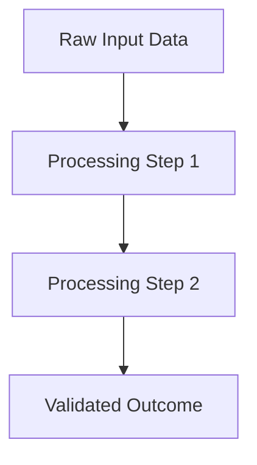

# Concept Note Template (13-Section Format)

> **Topic:** [Concept Name]  
> **Module ID:** `05-ai/machine-learning/NN-module-name`  
> **Target Version:** Python 3.11+, scikit-learn 1.9+, NumPy 2.5+, pandas 3.1+  
> **Level:** [Fundamental | Core | Advanced]  
> **Prerequisites:** [Link to Prerequisite Note](../path/to/note.md)  
> **Status:** Verified (Python 3.11 / CPU)

---

## Architectural / Conceptual Flow



---

## 1. Concept Overview & Core Motivation
* Plain-language explanation of the problem this concept addresses.
* Core intuition, historical context, and why naive approaches fail.
* Key terms and foundational terminology.

---

## 2. Theoretical Foundations & Mathematics
* Rigorous theoretical formulations.
* Equations, derivations, and objective functions.
* Complete symbol breakdown table:

| Symbol | Mathematical Definition | Data Type / Dimensions | Role in Concept |
| :---: | :--- | :---: | :--- |
| $\mathbf{X}$ | Feature matrix | $\mathbb{R}^{n \times d}$ | Observed inputs across $n$ samples |
| $\mathbf{y}$ | Target vector | $\mathbb{R}^n$ | Ground truth targets |
| $\theta$ | Parameter vector | $\mathbb{R}^d$ | Learned weights |

---

## 3. Implementation & Practical Code
* Production-grade, fully typed Python code block.
* Leakage-safe data handling using scikit-learn Pipelines.
* Real execution output snippet from the verification log.

```python
import numpy as np
import pandas as pd
from sklearn.pipeline import Pipeline

# Runnable verified implementation
```

---

## 4. Edge Cases & Advanced Scenarios
* Pathological cases (e.g. extreme sparsity, multi-collinearity, high dimensionality).
* Behavior under non-stationary distributions or class imbalance.
* Graceful degradation strategies.

---

## 5. Anti-Patterns & Common Pitfalls Table

| Anti-Pattern / Mistake | Why It Fails | Correct Engineering Fix |
| :--- | :--- | :--- |
| Fitting scaler before splitting | Causes data leakage from test into train | Split data first; call `fit_transform` only on train |
| Blindly ignoring outliers | Distorts variance and regression coefficients | Inspect domain distributions; use RobustScaler or winsorization |
| Evaluating accuracy on 99:1 imbalance | Yields 99% accuracy on trivial dummy model | Evaluate PR-AUC, Balanced Accuracy, or MCC |
| Unpickling untrusted model files | Exposes host to arbitrary remote code execution | Persist with skops, safetensors, or ONNX |
| Hardcoding categorical indices | Breaks when upstream schema reorders columns | Use ColumnTransformer with named DataFrame columns |
| Using accuracy for threshold-sensitive tasks | Fails to account for asymmetric business costs | Tune decision thresholds using precision-recall curves |

---

## 6. Best Practices & Production Guidelines
* Recommended hyperparameters and default configurations.
* Computational complexity considerations (Memory, CPU scaling).
* Logging, monitoring, and telemetry suggestions.

---

## 7. Real-World Case Study
* Concrete industry scenario (e.g. FinTech fraud detection, e-commerce personalization).
* Step-by-step problem definition, trade-off analysis, and outcome metrics.

---

## 8. Performance & Resource Optimization
* Vectorization with NumPy SIMD and memory-mapped arrays (`np.memmap`).
* Algorithmic speedups, parallel job execution (`n_jobs=-1`), and batching.

---

## 9. Security, Privacy & Ethics Considerations
* Data privacy (GDPR, differential privacy, anonymization).
* Algorithmic bias and demographic parity.
* Model poisoning and adversarial sample defenses.

---

## 10. Diagnostic & Verification Playbook
* CLI verification commands and unit test snippets.
* Sanity checks and assertion tests to validate model health.

---

## 11. Technical Interview Questions & Answers

<details>
<summary><strong>Q1: Deep technical question on core mechanics?</strong></summary>

**Answer:** Comprehensive technical answer explaining the mathematical trade-offs and operational realities.
</details>

<details>
<summary><strong>Q2: Scenario-based edge case question?</strong></summary>

**Answer:** Detailed step-by-step breakdown of how to identify and resolve the scenario.
</details>

*(Total 8 Questions)*

---

## 12. Hands-On Practice Exercises

<details>
<summary><strong>Exercise 1 (Easy): Basic Implementation Task</strong></summary>

**Task:** Description of task.  
**Solution:**
```python
# Complete runnable solution
```
</details>

<details>
<summary><strong>Exercise 2 (Medium): Complex Diagnostic or Tuning Task</strong></summary>

**Task:** Description of task.  
**Solution:**
```python
# Complete runnable solution
```
</details>

<details>
<summary><strong>Exercise 3 (Hard): Advanced Production Pipeline Task</strong></summary>

**Task:** Description of task.  
**Solution:**
```python
# Complete runnable solution
```
</details>

*(Total 6 Exercises: 2 Easy, 2 Medium, 2 Hard)*

---

## 13. Summary, Verified References & Navigation
* Concise 3-5 bullet point takeaways.
* Verified external references with direct links.

---

[← Previous Note](../path/to/prev.md) | [Module Index](README.md) | [Next Note →](../path/to/next.md)
